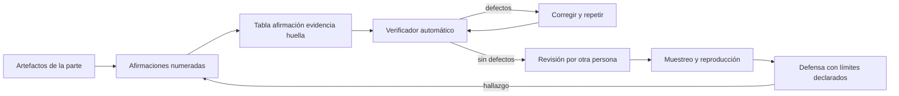
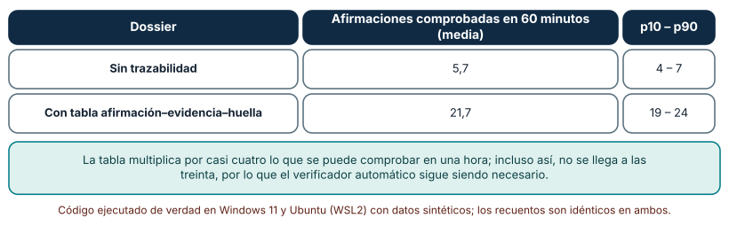

# SE-456 — Proyecto: dossier profesional defendible

[← SE-455 — Taller: conducir una revisión de decisión difícil](https://github.com/vladimiracunadev-create/modern-software-engineering-program/blob/main/classes/part-37-gestion-liderazgo-y-practica-profesional/se-455-taller-conducir-una-revision-de-decision-dificil/README.md) · [↑ Parte 37](https://github.com/vladimiracunadev-create/modern-software-engineering-program/blob/main/classes/part-37-gestion-liderazgo-y-practica-profesional/README.md) · [📚 Índice completo](https://github.com/vladimiracunadev-create/modern-software-engineering-program/blob/main/classes/README.md) · [🌐 Portal](https://vladimiracunadev-create.github.io/modern-software-engineering-program/classes/SE-456.html) · [SE-457 — Capacidades y límites de los modelos generativos →](https://github.com/vladimiracunadev-create/modern-software-engineering-program/blob/main/classes/part-38-desarrollo-de-software-asistido-por-ia/se-457-capacidades-y-limites-de-los-modelos-generativos/README.md)

## Punto profesional y fundamento pedagógico

**Punto profesional.** El proyecto existe para que reúnas lo trabajado en la Parte 37 en un dossier que otra persona pueda leer, comprobar y cuestionar sin tu ayuda. Un dossier profesional no es una carpeta con documentos sino un conjunto de afirmaciones, cada una vinculada a una evidencia concreta e inalterada, con sus cifras coherentes entre documentos y con los límites declarados por escrito. La habilidad profesional es diseñar el dossier para quien lo revisa: que cada afirmación se pueda comprobar rápido, que una alteración posterior se detecte y que lo que no se hizo figure donde se espera.

**Por qué aparece aquí.** Cierra la Parte 37 integrando los artefactos de `SE-445` a `SE-455`: la propuesta con su ruta de adopción, el mapa de propiedad, el mensaje de decisión, el acuerdo de mentoría, el compromiso probabilístico, el registro de riesgos, la matriz de proveedores, el inventario de licencias, el análisis económico, el portafolio y la revisión de una decisión. El caso conductor es **el equipo de plataforma educativa**: el dossier defiende, ante un comité, la decisión de adaptar la exportación al nuevo formato del ministerio con el almacenamiento elegido.

**Error conceptual que debe corregir.** Creer que un dossier completo es un dossier comprobable y que una revisión lee todo. Quien revisa dispone de una hora y examina una muestra: en la simulación de la clase, si 3 de 30 afirmaciones carecen de respaldo y se inspeccionan 5, se descubre alguna solo el 43 % de las veces. Por eso el diseño importa más que la extensión: con una tabla que enlaza cada afirmación con su evidencia y su huella, la misma hora permite comprobar unas 22 afirmaciones en vez de unas 6.

**Secuencia de aprendizaje.** Antes de mirar los resultados, predices con qué probabilidad un revisor que inspecciona 5 de 30 afirmaciones encuentra alguna de las 3 sin respaldo; después ejecutas un verificador sobre seis variantes de un dossier (completo y cinco con un defecto distinto), calculas la probabilidad exacta y simulada del muestreo y mides cuántas afirmaciones se comprueban en una hora con y sin trazabilidad. La secuencia usa predicción, explicación propia, contraste y recuperación. [ICAP](https://icap.education.asu.edu/research) distingue participación de construcción de conocimiento; [How People Learn II](https://nap.nationalacademies.org/catalog/24783/how-people-learn-ii-learners-contexts-and-cultures) respalda diseñar la práctica con contextos reales y retroalimentación.

**Evidencia de aprendizaje.** El paquete `dossier/` descrito en la sección de entrega: siete archivos requeridos, una carpeta de evidencia con huellas, el verificador ejecutado con su salida, la predicción, las tres figuras reproducidas, la defensa ensayada con tres preguntas de profundidad y `LIMITES.md`, y una nota que separe qué es medido, qué inferido y qué supuesto. Se aprueba con la comprobación de otra persona.

**Límite de la conclusión.** Los dossiers de prueba, las treinta afirmaciones, los tiempos de revisión y las evidencias son sintéticos, escritos por el autor con semilla fija y, en el verificador, creados en un directorio temporal. No se revisó ningún dossier ni persona reales. El verificador comprueba la presencia, la integridad y la coherencia de las cifras etiquetadas; no comprueba que lo afirmado sea verdad, y su cobertura de incoherencias es parcial.

### Trazabilidad fuente → afirmación

| Fuente primaria u oficial | Afirmación que respalda | Lo que no prueba |
|---|---|---|
| [Python, módulo `hashlib`](https://docs.python.org/3/library/hashlib.html) | Documenta las funciones de resumen criptográfico, como SHA-256, que sirven para detectar si un archivo cambió. | Un resumen no prueba quién creó el archivo ni que su contenido sea veraz. |
| [Python, módulo `csv`](https://docs.python.org/3/library/csv.html) | Documenta la lectura y escritura de archivos CSV con cabeceras. | No define el contenido de la tabla de afirmaciones. |
| [Python, módulo `tempfile`](https://docs.python.org/3/library/tempfile.html) | Documenta la creación de directorios temporales que se eliminan al terminar. | No garantiza que el contenido de los experimentos sea válido. |
| [Python, módulo `math`](https://docs.python.org/3/library/math.html) | Documenta `comb`, usada en el cálculo exacto de la probabilidad de muestreo. | No justifica el modelo de muestreo. |
| [Diátaxis](https://diataxis.fr/) | Distingue cuatro tipos de documentación (tutorial, guía, referencia, explicación) y propone no mezclarlos. | No dice cómo debe organizarse un dossier de evaluación. |
| [Software Engineering at Google, cap. 10 «Documentation»](https://abseil.io/resources/swe-book/html/ch10.html) | Presenta la documentación como una parte del trabajo de ingeniería con dueños y mantenimiento. | Es la práctica de una organización concreta. |
| [SLSA](https://slsa.dev/) | Describe procedencia verificable de artefactos mediante registros firmados de cómo se produjeron. | Un dossier de evaluación no es una cadena de suministro de software. |

## Antes de empezar

Recupera lo aprendido en `SE-455`: las probabilidades escritas se contrastan después con lo ocurrido. La pregunta activa es: **si una revisora abre tu dossier y comprueba al azar cinco afirmaciones, ¿cuántas encontraría sin respaldo y quién se lo habría dicho antes que ella?**

## Prerrequisitos

- Haber completado `SE-445` a `SE-455` o tener a mano los artefactos que se piden en cada clase.
- Python 3.11 o posterior; los experimentos usan solo la biblioteca estándar (`csv`, `hashlib`, `tempfile`, `math`, `random`, `re`).
- Saber leer y escribir un archivo CSV y usar un resumen SHA-256.

## Problema auténtico

El comité del equipo recibió un dossier de cuarenta páginas: decisiones, riesgos, costos, un plan de retroalimentación y capturas. Quien lo revisó dispuso de una hora. Abrió el documento de costos y encontró un total de 1 200; el de decisión decía 1 020. Pidió ver la medición del p95 que se citaba y la carpeta de evidencia tenía un archivo modificado después de la fecha del informe. No pudo comprobar más de seis afirmaciones y concluyó que el resto «parecía razonable». En el segundo intento, el equipo rehízo el dossier con tres reglas: cada afirmación lleva un identificador y una fila en una tabla con la evidencia y su huella SHA-256; las cifras repetidas entre documentos se etiquetan para que un script las compare; y los límites forman un archivo propio. La revisora comprobó 22 afirmaciones en la hora y pudo decir cuáles eran firmes. El proyecto es construir ese dossier y verificarlo.

## Objetivos observables

Al terminar podrás:

1. diseñar un dossier con afirmaciones numeradas, tabla de evidencia con huellas, cifras etiquetadas y límites propios;
2. escribir y ejecutar un verificador que detecte archivos faltantes, afirmaciones sin respaldo, evidencia alterada o ausente, límites insuficientes y cifras en conflicto;
3. calcular la probabilidad de que una revisora que inspecciona una muestra encuentre una afirmación sin respaldo;
4. defender el dossier ante tres preguntas de profundidad declarando los límites;
5. explicar qué no puede comprobar el verificador.

## Mapa conceptual



El mapa separa tres controles: el **automático** (presencia, integridad, coherencia), el **humano** (reproducción y muestreo) y la **defensa** (profundidad y límites). La flecha de retorno indica que un hallazgo de la revisión vuelve a las afirmaciones, no a la forma.

## Temas y por qué importan

| Tema | Por qué cambia una decisión profesional | Evidencia mínima |
|---|---|---|
| Afirmaciones y evidencia | Convierten un documento en algo comprobable. | Tabla con identificador, archivo y huella |
| Integridad con resúmenes | Detecta cambios posteriores a la evidencia. | Huella SHA-256 verificada por script |
| Coherencia entre documentos | Una cifra que difiere entre archivos destruye la confianza. | Cifras etiquetadas y comparadas |
| Revisión por muestreo | La revisora no lee todo; el diseño decide qué encuentra. | Probabilidad de detección y tiempo de revisión |
| Defensa y límites | Declarar lo que falta es parte de la evidencia. | `LIMITES.md` y respuestas ensayadas |

## Conceptos y decisiones

### 1. Un dossier es un conjunto de afirmaciones con evidencia

Un dossier defendible se organiza alrededor de **afirmaciones** (frases que alguien podría cuestionar: «la cola reduce el p95 de 840 ms a 310 ms», «el costo a cinco años es 1 200», «la decisión es reversible durante 30 días»). Cada una lleva un identificador (C1, C2…) y se apoya en una **evidencia**: un archivo, un resultado de ejecución, un registro. Lo que no tiene evidencia se declara como supuesto, y los supuestos se marcan para que nadie los confunda con lo medido. Esta estructura responde la pregunta de quien revisa: «¿cómo sé que esto es cierto?». La organización de los documentos por función (un documento por tipo de contenido, como propone [Diátaxis](https://diataxis.fr/) para la documentación) evita mezclar la explicación con la referencia y facilita encontrar cada cosa, y la práctica de ingeniería de documentación ([Google](https://abseil.io/resources/swe-book/html/ch10.html)) recuerda que lo que no tiene dueño se desactualiza.

### 2. La tabla afirmación–evidencia–huella

La pieza central es una tabla (`claims.csv`) con una fila por afirmación: identificador, ruta de la evidencia y **huella SHA-256** del archivo. La huella es un resumen de longitud fija calculado con [`hashlib`](https://docs.python.org/3/library/hashlib.html): si el archivo cambia en un solo byte, la huella cambia. Así, cualquiera puede recalcularla y comprobar que la evidencia es la misma que se citó. Este mecanismo es una versión pequeña de la idea de procedencia verificable que desarrolla [SLSA](https://slsa.dev/) para artefactos de software: registrar de forma comprobable qué se produjo y cómo. Sus límites son claros: la huella detecta el cambio, no la falsedad; si el archivo original ya estaba mal, la huella lo conserva mal. La tabla se lee con el módulo [`csv`](https://docs.python.org/3/library/csv.html) y el verificador la cruza con el índice del `README`.

### 3. Coherencia entre documentos

Un dossier se desacredita con una cifra que difiere entre dos documentos (el costo es 1 200 en uno y 1 020 en otro), aunque ambas sean errores de transcripción. Para detectarlo automáticamente, las cifras que se repiten se **etiquetan** en el texto con un formato fijo (por ejemplo, `[[TCO_5A=1200]]`) y un script las reúne por clave y compara. La técnica tiene un límite que conviene conocer: solo detecta lo etiquetado. Si el `README` dice «seis personas» en prosa y el documento de riesgos dice cinco con etiqueta, el script no ve el conflicto porque la cifra del `README` no está etiquetada. La disciplina es, por eso, etiquetar toda cifra que aparezca en más de un lugar y revisar a mano las que no.

### 4. Revisión por muestreo

Quien revisa no lee todo. Si un dossier tiene n afirmaciones, m de ellas sin respaldo, y la revisora inspecciona k elegidas al azar, la probabilidad de ver al menos una sin respaldo es 1 − C(n−m, k) / C(n, k), una distribución hipergeométrica que se calcula con [`math.comb`](https://docs.python.org/3/library/math.html). Con n = 30 y m = 3, inspeccionar 5 da el 43,3 % y 12 el 79,9 %. Dos consecuencias de diseño. Primera: pocas afirmaciones sin respaldo se esconden muy bien en una muestra, así que el autor no debe contar con que «nadie las verá» ni con que «seguro las encuentran»; el verificador es la forma de no depender del azar. Segunda: la velocidad de comprobación cambia la muestra. Si comprobar una afirmación cuesta nueve minutos (buscar la evidencia a mano), la hora alcanza para unas seis; si cuesta dos minutos y medio (la tabla indica dónde está y cuál es la huella), alcanza para unas veintidós.

### 5. Defensa y límites

La defensa de un dossier es una secuencia de preguntas sobre un mismo trabajo (como en `SE-454`) y la revisión adversarial (como en `SE-455`) la convierte en un ejercicio colectivo. El archivo `LIMITES.md` anticipa esas preguntas por escrito: qué no se midió, qué no se probó, qué supuestos son del autor, qué datos eran sintéticos, qué parte depende de personas que no revisaron. Un dossier sin límites declarados es sospechoso por lo que calla, y uno con límites detallados es más fácil de defender porque cada pregunta incómoda ya tiene una respuesta escrita. La honestidad aquí no es una virtud decorativa: es la mejor defensa contra la pregunta que la revisora haría después. La referencia ética es la del [código de la ACM](https://www.acm.org/code-of-ethics) (`SE-454`): reconocer los límites de la propia competencia.

### Qué detecta el verificador

Se crean, en un directorio temporal, seis variantes de un dossier con siete archivos requeridos, cinco archivos de evidencia y cinco afirmaciones. El verificador comprueba que existan los siete archivos, que `LIMITES.md` tenga al menos tres límites, que cada afirmación del `README` tenga una fila con evidencia, que la evidencia exista y que su huella coincida, y compara las cifras etiquetadas entre documentos.

| Variante | Defecto introducido | Defectos detectados | Cifras en conflicto |
|---|---|---|---|
| Completo | ninguno | ninguno | ninguna |
| Sin límites | `LIMITES.md` sin límites | menos de 3 límites | ninguna |
| Afirmación sin respaldo | C5 sin evidencia | C5 sin evidencia | ninguna |
| Evidencia alterada | `e2.txt` cambiado tras la huella | C2 con evidencia alterada | ninguna |
| Evidencia faltante | `e3.txt` borrado | C3 con evidencia ausente | ninguna |
| Cifra distinta | costo 1 020 frente a 1 200 y guardia 5 frente a 6 | ninguno | `TCO_5A` |


**Cómo leer la figura.** Cada variante tiene un defecto distinto y el verificador lo señala con la afirmación o el archivo exactos. La última fila muestra el límite: se introdujeron dos incoherencias y se detectó una; la otra (personas de guardia, 5 en riesgos y 6 en el `README`) no se vio porque la cifra del `README` no estaba etiquetada. **Dónde deja de valer:** los dossiers son construidos para la prueba, con cinco afirmaciones y evidencias triviales; el verificador comprueba presencia, integridad y coherencia etiquetada, no que lo afirmado sea cierto ni que la evidencia sea relevante para la afirmación. Un dossier que pase todas las comprobaciones puede estar vacío de contenido válido.

### Cuánto se encuentra al muestrear

Un dossier de 30 afirmaciones tiene m sin respaldo (1, 3 o 6); la revisora inspecciona k al azar (3, 5, 8 o 12). Se calcula la probabilidad exacta de ver al menos una sin respaldo y se compara con 20 000 simulaciones.

| Afirmaciones sin respaldo | Revisa 3 | Revisa 5 | Revisa 8 | Revisa 12 |
|---|---:|---:|---:|---:|
| 1 de 30 | 10,0 % | 16,7 % | 26,7 % | 40,0 % |
| 3 de 30 | 28,0 % | 43,3 % | 62,1 % | 79,9 % |
| 6 de 30 | 50,1 % | 70,2 % | 87,4 % | 96,9 % |


**Cómo leer la figura.** Una sola afirmación sin respaldo entre treinta supera el 25 % de probabilidad de ser vista solo si se inspeccionan ocho. Para encontrar con 80 % un problema de tres afirmaciones hay que inspeccionar doce. Las simulaciones coinciden con los valores exactos con una diferencia de menos de un punto. **Dónde deja de valer:** la inspección es al azar y uniforme; las revisoras reales miran primero las afirmaciones más llamativas o críticas, lo que hace más probable encontrar una afirmación grave que una trivial. El cálculo vale como cota de lo que se escapa si se confía en el azar, no como modelo del comportamiento de una persona.

### Cuántas afirmaciones se comprueban en una hora

Una revisora tiene 60 minutos y 30 afirmaciones. Sin trazabilidad, comprobar una requiere buscar la evidencia (9 minutos de media); con la tabla que indica el archivo y la huella, 2,5 minutos. El tiempo de cada comprobación varía con una dispersión logarítmica de 0,4 (5 000 simulaciones).

| Dossier | Afirmaciones comprobadas en 60 minutos (media) | p10 – p90 |
|---|---:|---|
| Sin trazabilidad | 5,7 | 4 – 7 |
| Con tabla afirmación–evidencia–huella | 21,7 | 19 – 24 |



**Cómo leer la figura.** La tabla multiplica por casi cuatro lo que se puede comprobar en una hora; incluso así, no se llega a las treinta, por lo que el verificador automático sigue siendo necesario. **Dónde deja de valer:** los 9 y 2,5 minutos y la dispersión son supuestos del autor; la comprobación de una afirmación compleja (reproducir una medida) toma mucho más que abrir un archivo y comparar una huella. La figura muestra el efecto del diseño del dossier sobre la revisión, no el tiempo de una revisión real.

## Definiciones de trabajo

- **dossier defendible:** conjunto de afirmaciones con evidencia vinculada, cifras coherentes y límites declarados, diseñado para que otra persona lo compruebe.
- **huella (resumen) SHA-256:** valor de longitud fija calculado a partir del contenido de un archivo, que cambia si el contenido cambia.
- **cifra etiquetada:** valor escrito con un formato fijo que un script puede extraer y comparar entre documentos.
- **revisión por muestreo:** comprobación de un subconjunto de las afirmaciones elegidas al azar o por criterio.
- **límites declarados:** lista de lo que no se midió, no se probó o se supuso, escrita en el propio dossier.

Las definiciones son operativas para el equipo de plataforma educativa. No convierten términos con una historia más amplia en sinónimos y deben contrastarse con las fuentes primarias enlazadas al final.

## Ejemplo mínimo

El fragmento calcula la huella de un texto y comprueba que cambia al alterar una letra. Antes de ejecutarlo, predice si las huellas comparten algún tramo.

```python
import hashlib
a = hashlib.sha256("salida del experimento 1\n".encode()).hexdigest()
b = hashlib.sha256("salida del experimento 2\n".encode()).hexdigest()
print(a[:12], b[:12], a == b)
```

Imprime dos prefijos de doce caracteres hexadecimales distintos y `False`: cambiar un carácter produce una huella sin parecido con la anterior, y por eso sirve para detectar alteraciones. Observa que la huella no dice cuál de los dos textos es el correcto, solo que son distintos. Registra versión de Python, comando y salida.

## Ejemplo profesional

Escenario hipotético, construido para la clase y sin datos reales. El equipo arma el dossier de la decisión de la exportación con los siete archivos requeridos: el índice con ocho afirmaciones, la decisión revisada con el expediente de `SE-455`, los riesgos con el valor esperado de `SE-450`, los costos con el análisis de `SE-453` y la matriz de `SE-451`, la retroalimentación con el acuerdo de mentoría de `SE-448` y el mensaje de decisión de `SE-447`, y los límites. En la tabla de afirmaciones, cada fila apunta a un archivo de la carpeta de evidencia con su huella: la salida del banco de pruebas, la matriz con su prueba de sensibilidad, el inventario de licencias, la lista de modos de fallo. Etiqueta las cifras que aparecen en más de un documento (costo a cinco años, días de reversibilidad, personas de guardia) y ejecuta el verificador; encuentra que la guardia aparece como seis en el índice y cinco en riesgos, porque no había etiquetado la del índice. Corrige, etiqueta y repite. Pide a una compañera que haga una revisión de una hora: comprueba dieciocho afirmaciones, reproduce la medida del p95 con un checkout limpio y encuentra una evidencia que no demuestra la afirmación que la cita; lo corrige y lo anota. Ensaya tres preguntas de profundidad y se prepara para declarar que el almacenamiento nunca se probó con tráfico real. Compara con el dossier de cuarenta páginas: la diferencia es qué pudo comprobar alguien que no estuvo.

## Práctica guiada

1. Elige el caso del dossier (el del equipo de plataforma o uno propio) y lista ocho afirmaciones que alguien podría cuestionar.
2. Predice la probabilidad de ver una afirmación sin respaldo al inspeccionar 5 de 30 con 3 sin respaldo y escribe el número antes de calcular.
3. Reproduce las tres tablas con las semillas fijadas en `scripts/experiments_part37_b.py`; cambia el número de afirmaciones sin respaldo y observa cuánto hay que inspeccionar para llegar al 90 %.
4. Reúne las evidencias, calcula las huellas SHA-256 y construye `claims.csv`.
5. Etiqueta todas las cifras que aparezcan en más de un documento y ejecuta el verificador hasta que no devuelva defectos.
6. Pide a otra persona que revise el dossier en una hora y anota qué comprobó, qué reprodujo y qué no pudo comprobar.
7. Ensaya la defensa con tres preguntas de profundidad y escribe tus límites en `LIMITES.md`.

## Ejercicios

1. **Muestreo:** calcula la probabilidad de encontrar una afirmación sin respaldo si se inspeccionan 10 de 40 y hay 2 sin respaldo; verifica con una simulación de 10 000 repeticiones.
2. **Etiquetas:** escribe una expresión regular para extraer cifras etiquetadas de la forma `[[CLAVE=valor]]` y explica un caso que no detectaría.
3. **Huellas:** explica por qué una huella no demuestra que la evidencia sea verdadera y propón una comprobación complementaria.
4. **Límites:** redacta cinco límites para un dossier propio, cada uno con lo que no se hizo y el riesgo que deja.

## Reto verificable

Entrega la carpeta `dossier/` con los siete archivos requeridos (`README.md`, `decision.md`, `riesgos.md`, `costos.md`, `feedback.md`, `LIMITES.md`, `claims.csv`), la carpeta `evidencia/` con las huellas verificadas, la salida del verificador sin defectos, las tres figuras reproducidas, la predicción y la defensa ensayada. Se aprueba si otra persona ejecuta el verificador desde un checkout limpio, obtiene la misma salida, reproduce una medida de la tabla y puede decir, a partir de `LIMITES.md`, qué no se midió. No se aprueba por entregar un dossier que pase el verificador pero cuyas afirmaciones no se puedan reproducir.

## Caso conductor

El equipo de plataforma educativa es el caso conductor de la Parte 37. Este proyecto deja el último artefacto: el dossier, que reúne la propuesta, la propiedad, la comunicación, la mentoría, el compromiso, el riesgo, el proveedor, la licencia, el costo, el portafolio y la revisión. La Parte 38 lleva la mirada al desarrollo de software asistido por IA, donde la comprobabilidad de lo producido se vuelve central. Cambia después un solo dato, el número de afirmaciones sin respaldo de 3 a 6, y observa cuánto aumenta la probabilidad de ser visto con cinco inspecciones.

## Preguntas frecuentes

### ¿Cuántas afirmaciones debe tener un dossier?

Las que necesites para sostener la decisión, y cada una con su evidencia. Un dossier de ocho afirmaciones bien respaldadas es más fuerte que uno de cuarenta. Si dudas de si incluir una afirmación, pregunta si alguien podría cuestionarla; si sí, necesita evidencia, y si no, quizá no es una afirmación sino contexto.

### ¿Qué hago con evidencia que no puedo compartir?

Describe qué es, por qué no se comparte y qué evidencia equivalente sí compartes (una versión con datos sintéticos, un resumen firmado por quien la custodia). Marca la afirmación como respaldada por evidencia restringida, para que quien revisa decida cuánto pesa. Ocultar que la evidencia no se puede ver es peor que decirlo.

### ¿El verificador no es excesivo para un dossier pequeño?

El verificador es corto y ahorra el tipo de error más dañino: una cifra que cambia entre documentos o una evidencia modificada sin que nadie se dé cuenta. Para un dossier pequeño, su costo es de minutos y detecta errores que una lectura cuidadosa suele pasar por alto.

### ¿Puede una herramienta de IA redactar el dossier?

Puede ayudar a ordenar y redactar, con las salvedades del puente de agentes de esta clase. Lo que no puede es decidir qué afirmaciones son ciertas ni qué evidencia las respalda; esa parte es de quien firma el dossier y debe poder defenderla.

## Fallo controlado y diagnóstico

Reproduce el fallo clásico de la clase: **una cifra que difiere entre dos documentos y que nadie detecta porque una de las dos no estaba etiquetada**. Ejecuta el verificador sobre la variante de cifra distinta.

Registra síntoma, entrada mínima, hipótesis, observación que descarta cada hipótesis, causa, corrección y prueba de regresión. **Síntoma:** la revisora encuentra que el índice dice seis personas de guardia y el documento de riesgos, cinco, aunque el verificador no devolvió conflictos en esa clave. **Hipótesis rivales:** (a) el verificador falló; (b) la cifra del índice no estaba etiquetada; (c) ambas cifras son correctas y se refieren a cosas distintas. **Prueba:** busca la cifra en ambos documentos; si solo uno la etiqueta, la causa es la etiqueta. **Conclusión:** de dos incoherencias introducidas, el verificador detectó una (el costo a cinco años) y no la otra. **Regresión:** exige etiquetar toda cifra que aparezca en más de un documento y añade al verificador una advertencia cuando una clave aparece solo una vez y su valor numérico figura sin etiqueta en otro documento. No cambies a la vez el formato de etiquetas y el contenido de los documentos.

## Errores comunes y cómo corregirlos

| Síntoma | Causa probable | Corrección |
|---|---|---|
| La revisora no encuentra la evidencia | Sin tabla afirmación–evidencia | Construir `claims.csv` con ruta y huella |
| La evidencia no coincide con la huella | Se modificó después de calcularla | Recalcular y registrar el cambio, o restaurar el original |
| Las cifras difieren entre documentos | Se copiaron a mano y no se etiquetaron | Etiquetar y comparar con un script |
| El dossier pasa el verificador y no convence | La evidencia no prueba la afirmación | Revisión humana de relevancia y reproducción |
| La defensa se desarma ante la tercera pregunta | Límites sin declarar | Escribir `LIMITES.md` y ensayar con preguntas encadenadas |

## Entorno y archivos clave

```text
dossier/
├── README.md              # índice con las afirmaciones C1, C2, ...
├── decision.md            # decisión revisada y expediente
├── riesgos.md             # registro de riesgos con valor esperado
├── costos.md              # costo total y comparación de proveedores
├── feedback.md            # mentoría, retroalimentación y comunicación
├── LIMITES.md             # lo que no se hizo ni se midió
├── claims.csv             # id, evidencia, sha256
└── evidencia/
    ├── e1.txt
    └── ...
```

Las pruebas viven fuera del paquete (`tests/test_dossier.py`) y el `README` declara plataforma, versión de Python, semillas y comandos. Los experimentos usan solo la biblioteca estándar (`csv`, `hashlib`, `tempfile`, `math`, `random`, `re`) y se ejecutaron con CPython 3.12.9 en Windows 11 y 3.12.3 en Ubuntu bajo WSL2: las salidas fueron idénticas. El verificador crea sus dossiers de prueba en un directorio temporal que se elimina al terminar. Si añades una dependencia, fija procedencia y versión.

## Seguridad, ética y accesibilidad

- una carpeta de evidencia puede contener datos personales, credenciales o información confidencial: revísala antes de compartirla y usa datos sintéticos siempre que sea posible;
- las huellas no ocultan el contenido pero dan una falsa sensación de seguridad si el archivo ya estaba mal: complementa la integridad con la revisión de relevancia;
- los límites deben nombrar los casos en que lo construido podría perjudicar a las personas usuarias, no solo los técnicos;
- las tablas y figuras deben tener texto alternativo y no depender del color;
- las fuentes citadas son textos de sus autores: cita las ideas y vincula la fuente, no copies sus textos ni diagramas.

## Puente hacia el trabajo con agentes

Un agente al que se le pide «prepara mi dossier» generará documentos coherentes y bien redactados con cifras que coinciden entre sí por construcción, no porque estén medidas, y puede rellenar evidencias que no existen. Pídele en cambio que parta de tu tabla de afirmaciones, que redacte cada documento solo con el contenido de la evidencia enlazada, que marque como supuestos las frases sin evidencia y que ejecute el verificador para mostrar su salida. Revisa especialmente cualquier cifra, versión o enlace que no esté en tu evidencia y cualquier límite que el agente haya omitido. El agente puede ordenar y verificar la forma; que la evidencia sea cierta y que los límites sean completos son responsabilidades de quien firma el dossier.

## Transferencia

Traslada el proyecto a otro dominio (por ejemplo, la solicitud de un fondo concursable para una cooperativa): cambia las afirmaciones, la evidencia y los límites y conserva el procedimiento de numerar afirmaciones, vincular cada una a evidencia con huella, etiquetar las cifras repetidas, verificar con un script y declarar los límites. La transferencia está lograda cuando puedes decir qué afirmación de tu dominio es la más difícil de respaldar y cómo la declararías si no pudieras, no cuando el dossier se parece al del equipo de plataforma.

## Evaluación y evidencia

| Criterio | Evidencia para aprobar |
|---|---|
| comprensión | explicación de cómo la tabla, las huellas y las cifras etiquetadas hacen comprobable el dossier |
| corrección | verificador ejecutado sin defectos y tablas de muestreo y de revisión reproducibles con las mismas semillas |
| diseño | siete archivos requeridos, evidencia con huellas, cifras etiquetadas y `LIMITES.md` con al menos tres límites |
| diagnóstico | reproducción del fallo «cifra sin etiquetar» con regresión |
| incertidumbre | declaración de qué supuestos son del autor y de qué evidencia es sintética |
| reproducibilidad | comprobación por otra persona desde un checkout limpio, con versiones, comandos y salida |

## Fuentes

- [Python, módulo `hashlib`](https://docs.python.org/3/library/hashlib.html) — resúmenes criptográficos; autoridad: Python Software Foundation.
- [Python, módulo `csv`](https://docs.python.org/3/library/csv.html) — lectura y escritura de CSV; autoridad: Python Software Foundation.
- [Python, módulo `tempfile`](https://docs.python.org/3/library/tempfile.html) — directorios temporales; autoridad: Python Software Foundation.
- [Python, módulo `math`](https://docs.python.org/3/library/math.html) — combinaciones; autoridad: Python Software Foundation.
- [Diátaxis](https://diataxis.fr/) — tipos de documentación; autoridad: autor del marco.
- [Software Engineering at Google, cap. 10 «Documentation»](https://abseil.io/resources/swe-book/html/ch10.html) — documentación como práctica de ingeniería; autoridad: equipo de ingeniería de Google.
- [SLSA](https://slsa.dev/) — procedencia verificable de artefactos; autoridad: proyecto SLSA.
- [ACM, Código de Ética y Conducta Profesional](https://www.acm.org/code-of-ethics) — honestidad y límites de la competencia; autoridad: Association for Computing Machinery.

Cada fuente respalda el mecanismo indicado; ninguna demuestra que el 43,3 % de probabilidad de ver una afirmación sin respaldo, las 21,7 afirmaciones por hora con trazabilidad o la detección de una de dos incoherencias se observen en tu dossier. Esa afirmación depende de tu dossier, de tu revisora y de tus herramientas.

## Límites y siguiente paso

Se ejecutaron tres experimentos con datos sintéticos y un verificador sobre seis dossiers construidos por el autor en un directorio temporal, en Windows y Ubuntu (WSL2), con resultados idénticos. No se revisó ningún dossier ni persona reales; los dossiers de prueba, los tiempos de revisión y la elección uniforme de la muestra son construcciones del autor, y el verificador comprueba forma, integridad y coherencia etiquetada, no veracidad. La Parte 38 lleva la mirada a las capacidades y límites de los modelos generativos y al desarrollo de software asistido por IA.

## Glosario

- **dossier defendible:** conjunto de afirmaciones con evidencia vinculada, cifras coherentes y límites declarados, diseñado para que otra persona lo compruebe.
- **huella (resumen) SHA-256:** valor de longitud fija calculado a partir del contenido de un archivo, que cambia si el contenido cambia.
- **cifra etiquetada:** valor escrito con un formato fijo que un script puede extraer y comparar entre documentos.
- **revisión por muestreo:** comprobación de un subconjunto de las afirmaciones elegidas al azar o por criterio.
- **límites declarados:** lista de lo que no se midió, no se probó o se supuso, escrita en el propio dossier.

---

[← SE-455 — Taller: conducir una revisión de decisión difícil](https://github.com/vladimiracunadev-create/modern-software-engineering-program/blob/main/classes/part-37-gestion-liderazgo-y-practica-profesional/se-455-taller-conducir-una-revision-de-decision-dificil/README.md) · [↑ Parte 37](https://github.com/vladimiracunadev-create/modern-software-engineering-program/blob/main/classes/part-37-gestion-liderazgo-y-practica-profesional/README.md) · [📚 Índice completo](https://github.com/vladimiracunadev-create/modern-software-engineering-program/blob/main/classes/README.md) · [🌐 Portal](https://vladimiracunadev-create.github.io/modern-software-engineering-program/classes/SE-456.html) · [SE-457 — Capacidades y límites de los modelos generativos →](https://github.com/vladimiracunadev-create/modern-software-engineering-program/blob/main/classes/part-38-desarrollo-de-software-asistido-por-ia/se-457-capacidades-y-limites-de-los-modelos-generativos/README.md)
