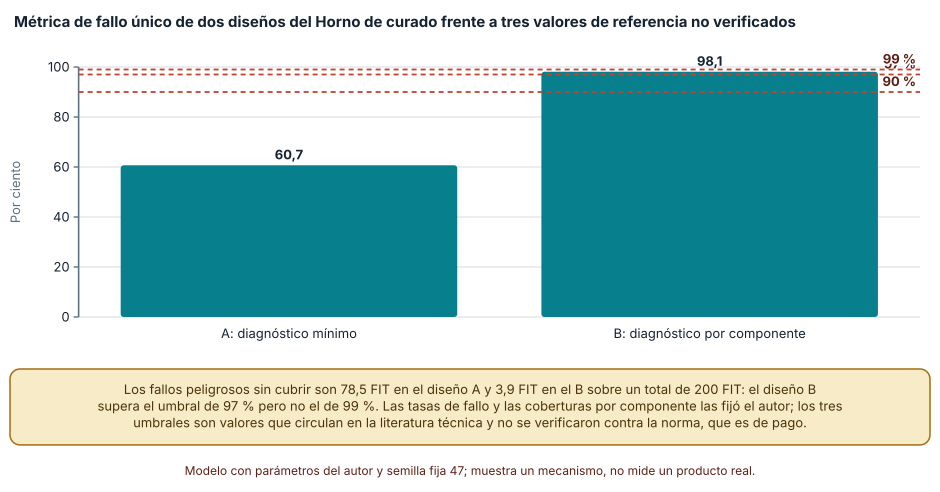
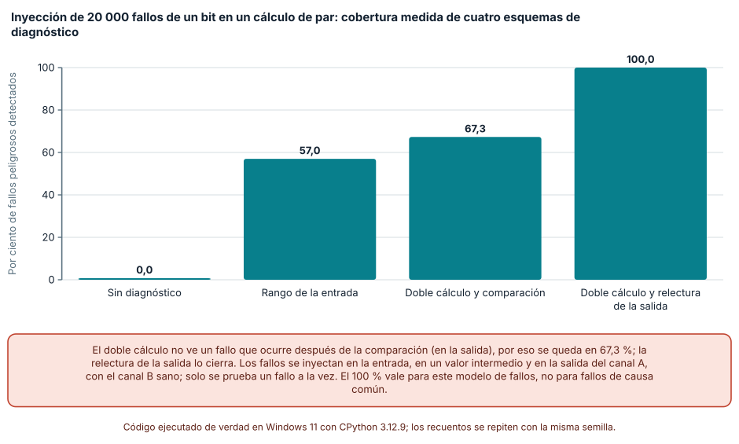
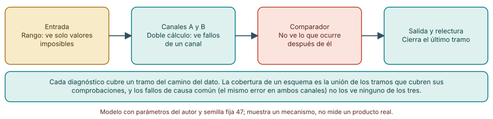

# SE-447 — Automoción: ISO 26262 y niveles ASIL

[← SE-446 — IEC 61508 y niveles de integridad de seguridad](https://github.com/vladimiracunadev-create/modern-software-engineering-program/blob/main/classes/part-37-sistemas-criticos-tiempo-real-y-normas-de-seguridad/se-446-iec-61508-y-niveles-de-integridad-de-seguridad/README.md) · [↑ Parte 37](https://github.com/vladimiracunadev-create/modern-software-engineering-program/blob/main/classes/part-37-sistemas-criticos-tiempo-real-y-normas-de-seguridad/README.md) · [📚 Índice completo](https://github.com/vladimiracunadev-create/modern-software-engineering-program/blob/main/classes/README.md) · [🌐 Portal](https://vladimiracunadev-create.github.io/modern-software-engineering-program/classes/SE-447.html) · [SE-448 — Aviación: DO-178C, DO-254 y ARP4754 →](https://github.com/vladimiracunadev-create/modern-software-engineering-program/blob/main/classes/part-37-sistemas-criticos-tiempo-real-y-normas-de-seguridad/se-448-aviacion-do-178c-do-254-y-arp4754/README.md)

## Punto profesional y fundamento pedagógico

**Punto profesional.** La clase existe para que entiendas cómo el sector del automóvil convierte un análisis de peligros en un nivel de rigor de desarrollo y cómo se demuestra que los mecanismos de diagnóstico del producto cubren lo que dicen cubrir. ISO 26262 adapta las ideas de la seguridad funcional genérica (`SE-446`) a los sistemas eléctricos y electrónicos de vehículos de carretera: define un ciclo de vida de seguridad, asigna a cada objetivo de seguridad un nivel de integridad de seguridad automotriz (ASIL, de A a D, además de «QM» para lo que solo requiere gestión de calidad ordinaria) y exige que el rigor de métodos, verificación y métricas de hardware crezca con ese nivel. Quien trabaja en software de vehículos escucha esta sigla cada semana; entender qué significa evita tanto el rito vacío como el descuido.

**Por qué aparece aquí.** Sigue a `SE-446` porque muestra una instancia sectorial de la misma estructura (peligro, nivel, arquitectura, evidencia) y añade dos ideas propias que se miden aquí: la clasificación por gravedad, exposición y controlabilidad, y las métricas de arquitectura de hardware que cuantifican la cobertura del diagnóstico. Prepara `SE-448` y `SE-449`, que muestran otras dos formas de organizar la misma pregunta en la aviación y en los dispositivos médicos.

**Error conceptual que debe corregir.** Creer que un mecanismo de diagnóstico «cubre» los fallos por existir. Su cobertura se mide inyectando fallos. En el laboratorio, 20 000 fallos de un bit en un cálculo de par producen 15 422 desviaciones peligrosas; una comprobación de rango detecta el 57,0 %, un doble cálculo con comparación el 67,3 % y solo el doble cálculo con relectura de la salida detecta el 100 %: el comparador no ve los fallos posteriores a él. Una cobertura declarada sin medir es una opinión.

**Secuencia de aprendizaje.** Antes de ejecutar, predices qué fracción de fallos de un bit detecta cada esquema de diagnóstico y qué parte del camino del dato deja sin ver. Después calculas la métrica de fallo único de dos diseños con coberturas por componente, inyectas fallos en un cálculo con cuatro esquemas, comparas con los valores de referencia que circulan en la literatura y lees qué tramo del camino queda descubierto.

**Evidencia de aprendizaje.** `diagnostico-del-calculo.md` con la clasificación del peligro (gravedad, exposición y controlabilidad con su razón), el objetivo de seguridad, los mecanismos de diagnóstico con la cobertura medida por inyección de fallos y la métrica de arquitectura calculada con sus tasas.

**Límite de la conclusión.** Las tasas de fallo (en FIT, fallos por 10⁹ horas), las coberturas por componente y el cálculo de par son del autor; el modelo de fallos es de un bit, uno a la vez. Los umbrales de referencia de las métricas (90, 97 y 99 % para tres niveles) son valores que circulan en la literatura técnica y en documentación de proveedores y **no se verificaron contra el texto de la norma**, que es de pago y no se reproduce; tampoco se reproduce la tabla que asigna el nivel. No se afirma conformidad con ninguna parte de la norma.

### Trazabilidad fuente → afirmación

| Fuente primaria u oficial | Afirmación que respalda | Lo que no prueba |
|---|---|---|
| [Salay, Queiroz y Czarnecki, «An Analysis of ISO 26262: Using Machine Learning Safely in Automotive Software» (arXiv)](https://arxiv.org/abs/1709.02435) | Describe de forma pública la estructura de la norma: ciclo de vida, niveles ASIL y la cadena de peligro a requisitos. | No reproduce las tablas ni valida las métricas del laboratorio. |
| [IEC 61508-1, ficha de la norma](https://webstore.iec.ch/en/publication/5515) | Identifica la norma genérica de la que ISO 26262 es una adaptación sectorial. | No contiene su texto. |
| [Informe del vuelo 501 de Ariane 5 (ESA)](https://esamultimedia.esa.int/docs/esa-x-1819eng.pdf) | Ejemplo de redundancia que no diagnostica un fallo común. | No es un caso automotor. |
| [Python: `random`](https://docs.python.org/3/library/random.html) | Documenta el generador con semilla de la inyección de fallos. | No valida el modelo de fallos. |

## Antes de empezar

Recupera lo aprendido en `SE-446`: la integridad es propiedad de una función y la prueba periódica tiene una cobertura. La pregunta activa es: **¿qué comprobación de tu sistema «cubre» un fallo que jamás has provocado a propósito para verificar que la detecta?**

## Prerrequisitos

- Haber completado `SE-445` y `SE-446`.
- Haber visto [SE-269 — Interrupciones, concurrencia y estado compartido](https://github.com/vladimiracunadev-create/modern-software-engineering-program/blob/main/classes/part-22-embedded-iot-y-tiempo-real/se-269-interrupciones-concurrencia-y-estado-compartido/README.md) y [SE-274 — Safety, seguridad y vida útil prolongada](https://github.com/vladimiracunadev-create/modern-software-engineering-program/blob/main/classes/part-22-embedded-iot-y-tiempo-real/se-274-safety-seguridad-y-vida-util-prolongada/README.md).
- Entender operaciones de bits y el desbordamiento de enteros de ancho fijo.
- Python 3.11 o posterior.

## Problema auténtico

Un módulo de control calcula una solicitud de par a partir de la posición de un pedal: par = (pedal × ganancia) / 2 + desfase. Un fallo de un bit en la entrada, en un valor intermedio o en la salida puede solicitar un par muy superior al correcto. El objetivo de seguridad es «evitar un par solicitado superior al pedido por la persona conductora dentro de una tolerancia». El equipo propone tres diagnósticos: comprobar el rango de la entrada, duplicar el cálculo y comparar, y releer la salida tras escribirla. Cada uno es barato; la pregunta es qué fracción de los fallos peligrosos detecta cada combinación y qué métrica de arquitectura resulta.

La clase cuantifica ambas cosas: calcula la métrica de fallo único de dos diseños con coberturas distintas por componente y mide por inyección de fallos la cobertura real de cuatro esquemas de diagnóstico sobre el cálculo de par.

## Objetivos observables

Al terminar podrás:

1. describir la cadena del estándar automotor (situación de operación, peligro, evaluación de gravedad, exposición y controlabilidad, objetivo de seguridad, requisitos) sin reproducir sus tablas;
2. explicar qué son el nivel ASIL, la descomposición y el nivel «QM» y por qué un ASIL no se hereda sin análisis;
3. calcular una métrica de fallo único a partir de tasas de fallo y coberturas por componente y explicar qué mide;
4. medir por inyección de fallos la cobertura de un esquema de diagnóstico y localizar el tramo del dato que deja sin ver;
5. distinguir una cobertura medida de una cobertura declarada y su efecto en el argumento.

## Mapa conceptual


La flecha punteada es el bucle de diseño: si las métricas no alcanzan lo que exige el nivel, se añaden o se mejoran diagnósticos hasta que la medida lo demuestre.

## Temas y por qué importan

| Tema | Por qué cambia una decisión profesional | Evidencia mínima |
|---|---|---|
| Gravedad, exposición y controlabilidad | Determinan el rigor con un criterio auditable. | Clasificación con su razón |
| ASIL y QM | Marca qué requiere proceso de seguridad y qué no. | Nivel por objetivo |
| Objetivo y requisito de seguridad | Traduce el peligro en algo verificable. | Cadena trazada |
| Cobertura de diagnóstico | Es lo que vuelve «detectable» un fallo. | Cobertura por inyección |
| Métricas de arquitectura | Cuantifican la parte de hardware sin cubrir. | Cálculo con tasas |
| Descomposición | Permite repartir rigor entre elementos independientes. | Argumento de independencia |
| Causa común y dependencia | Rompe la independencia que la descomposición supone. | Análisis de dependencias |

## Conceptos y decisiones

### 1. De la situación de operación al objetivo de seguridad

El análisis parte de situaciones concretas de uso («conducción en autopista a alta velocidad») y de fallos del sistema que las vuelven peligrosas («solicitud de par mucho mayor que el pedido»). Para cada combinación se juzgan tres ejes: cuán grave sería el daño, con qué frecuencia el vehículo está en esa situación y cuánto puede una persona conductora evitar el daño por su propia acción. De la combinación sale el nivel ASIL del **objetivo de seguridad**, una frase de alto nivel («evitar un par solicitado superior al pedido por la persona conductora»). La tabla exacta que asigna el nivel pertenece a la norma y no se reproduce; lo importante para el criterio profesional es que cada valoración lleve su razón escrita y que dos revisores puedan discutirla.

### 2. ASIL, QM y la descomposición

Hay cuatro niveles de integridad, de A (menos exigente) a D (más exigente), y un nivel QM para lo que no requiere medidas de seguridad especiales más allá de la calidad habitual. El nivel pide más rigor de métodos, de verificación independiente y de métricas de hardware a medida que sube. La **descomposición** permite satisfacer un requisito de nivel alto con dos elementos redundantes de nivel menor, si de verdad son independientes; la norma exige demostrar esa independencia. Es la misma idea de causa común de `SE-445` y `SE-446`: la descomposición es válida solo en la medida en que no comparten una causa de fallo, y la mayoría de los fracasos del argumento están ahí.

### 3. Requisitos de seguridad y mecanismos de diagnóstico

Del objetivo salen requisitos funcionales de seguridad y requisitos de arquitectura. Dos tipos de mecanismo aparecen siempre: los que **evitan** que el sistema entre en el estado peligroso (límites, saturaciones, rangos) y los que **detectan** que ya está en él y llevan a un estado seguro dentro del tiempo permitido (comparación de canales, comprobación cruzada, relectura, vigilancia). Cada mecanismo necesita tres cosas escritas: qué fallos cubre, en cuánto tiempo los detecta y qué hace al detectarlos. Sin la tercera, el diagnóstico solo produce un mensaje.

### 4. Métricas de arquitectura: la parte sin cubrir

Para el hardware, la norma pide métricas que cuantifican qué fracción de las tasas de fallo peligrosas queda cubierta por diagnóstico: una de fallo único (cuánto de la tasa total no queda como fallo de un solo punto o residual), una de fallo latente y una probabilidad total de fallo de hardware peligroso. El cálculo de la primera es sencillo: un menos la tasa no cubierta dividida por la tasa total. En el laboratorio, con cuatro componentes de 200 FIT en total, el diseño A (diagnóstico mínimo) deja 78,5 FIT sin cubrir y su métrica es 60,7 %; el diseño B (diagnóstico por componente) deja 3,9 FIT y llega a 98,1 %. Los valores de referencia que circulan en la literatura para tres niveles son 90, 97 y 99 %; el diseño B superaría el de 97 y no el de 99. Se insiste: esos tres números no se verificaron contra la norma.

### 5. Cobertura de diagnóstico: medida, no declarada

La métrica de arquitectura depende de la cobertura de cada diagnóstico, y esa cobertura se mide inyectando fallos y observando cuáles se detectan. En el laboratorio se inyectan 20 000 fallos de un bit al azar (semilla 47) en tres puntos: la entrada, un valor intermedio y la salida del canal A; con el canal B sano. De ellos, 15 422 producen una desviación mayor que la tolerancia. Sin diagnóstico se detecta el 0 %; la comprobación de rango de la entrada, el 57,0 % (solo ve valores imposibles); el doble cálculo con comparación, el 67,3 % (ve los fallos de los canales pero no los de la salida, que ocurren después); el doble cálculo con relectura de la salida, el 100 %. Ningún diagnóstico es bueno o malo en abstracto: cubre un tramo del camino del dato.

### 6. Dónde termina el diagnóstico: causa común y fallos latentes

El 100 % vale para el modelo de fallos usado: un bit, un fallo a la vez, canal B sano. Un fallo de causa común (el mismo error de especificación en ambos canales) o un fallo en el propio comparador (un fallo latente de diagnóstico) quedan fuera. El análisis de dependientes pide buscar causas comunes (misma alimentación, mismo reloj, mismo compilador, mismo equipo) y cubrir los fallos de los mecanismos de seguridad con sus propias comprobaciones. El caso de Ariane 5, donde dos unidades inerciales idénticas fallaron del mismo modo y la segunda no ofrecía ningún respaldo, es el ejemplo de manual de por qué «doble» no es «independiente».

### 7. Lo que la norma no resuelve

Esta norma trata los fallos del sistema eléctrico y electrónico, no los peligros del comportamiento correcto del sistema en situaciones imprevistas (por ejemplo, los límites de un sensor o de un algoritmo de percepción en la lluvia): eso se trata en una norma complementaria sobre la seguridad de la función prevista. Tampoco sustituye el análisis de ciberseguridad. Quien la usa sin esas otras piezas obtiene un sistema libre de ciertos fallos y expuesto a otros peligros.

## Métrica de arquitectura

La primera medida calcula la métrica de fallo único de dos diseños.



**Cómo leer la figura.** Cada barra es la métrica de un diseño y las líneas son los tres valores de referencia; mira primero que el diseño B cruza las dos primeras líneas y no la tercera. **Dónde deja de valer:** las tasas de fallo y las coberturas por componente son del autor, y las tres líneas son valores que circulan en la literatura técnica, no verificados contra la norma. La métrica no mide el riesgo del vehículo: mide cuánto de una tasa dada queda sin diagnóstico.

## Cobertura medida

La segunda medida inyecta fallos y cuenta cuáles detecta cada esquema.



**Cómo leer la figura.** Cada barra es un esquema y su altura el porcentaje de fallos peligrosos detectados; mira primero el escalón entre el doble cálculo y el esquema con relectura, que es el tramo posterior a la comparación. **Dónde deja de valer:** el modelo inyecta un bit en un solo punto con el canal B sano; no incluye fallos de causa común ni del comparador, y la tolerancia de ocho unidades es una elección. El 100 % es una propiedad del modelo, no del mundo.

## Qué tramo cubre cada comprobación

La tercera figura muestra el camino del dato y qué diagnóstico lo vigila.



**Cómo leer la figura.** Cada caja es un tramo del camino y su texto dice qué comprobación lo vigila y qué no ve; mira primero la caja del comparador, que no ve lo que pasa después. **Dónde deja de valer:** es un esquema del cálculo de par del laboratorio, no una arquitectura de producto; en un sistema real hay más tramos (buses, memoria, reloj) y cada uno exige su propio mecanismo.

## Definiciones de trabajo

- **[ASIL](../../../glosario/entradas/a/asil.md):** nivel de integridad de seguridad automotriz, de A a D, asignado a un objetivo de seguridad.
- **[QM](../../../glosario/entradas/q/qm.md):** nivel que solo requiere la gestión de calidad ordinaria, sin medidas específicas de seguridad.
- **[Objetivo de seguridad](../../../glosario/entradas/o/objetivo-de-seguridad.md):** requisito de más alto nivel derivado de un peligro.
- **[Descomposición](../../../glosario/entradas/d/descomposicion.md):** satisfacer un requisito con elementos redundantes de nivel menor que sean independientes.
- **[Cobertura de diagnóstico](../../../glosario/entradas/c/cobertura-de-diagnostico.md):** fracción de fallos peligrosos que un mecanismo detecta.
- **[FIT](../../../glosario/entradas/f/fit.md):** un fallo por 10⁹ horas de operación.
- **[Fallo latente](../../../glosario/entradas/f/fallo-latente.md):** fallo de un mecanismo de seguridad que no se manifiesta hasta que se necesita.

## Ejemplo mínimo

La inyección de un fallo de un bit y la comprobación de una relectura:

```python
def par(pedal, ganancia=3, desfase=40):
    return ((pedal * ganancia) >> 1) + desfase

pedal = 100
bueno = par(pedal)
salida = bueno ^ (1 << 7)            # un bit de la salida cambia

print(bueno, salida, abs(salida - bueno) > 8)      # 190, 62, True: desviación peligrosa
relectura = salida                    # el hardware devuelve lo que realmente se escribió
print("detectado por relectura:", relectura != bueno)
```

El doble cálculo no habría visto esta desviación porque ocurre después de comparar; la relectura de lo que de verdad salió sí. Es la diferencia entre 67,3 % y 100 % de la segunda figura.

## Ejemplo profesional

*Escenario ilustrativo: las cifras y los resultados que aparecen en este ejemplo son supuestos de la narración, no mediciones.*

El equipo de un controlador de actuador presenta su análisis a un revisor de seguridad. El diseño tiene un doble cálculo con comparador y la métrica sale sobre el valor de referencia. El revisor pregunta por una sola cosa: ¿qué detecta un fallo de la salida del microcontrolador, después del comparador? El equipo no había pensado en ello; el comparador estaba en el camino del dato y se daba por sentado que cubría todo el camino. Tras una sesión de inyección de fallos sobre un modelo de la etapa de salida se confirma que ese tramo no tiene ningún diagnóstico y se añade una relectura independiente con su propio tiempo de detección. La métrica cambia poco; el argumento cambia mucho. El revisor no aprobó nada: anotó el supuesto que quedaba sin evidencia y pidió el resultado de la nueva campaña.

## Práctica guiada

1. Dibuja el camino del dato de una función crítica de tu sistema, de la entrada a la salida física.
2. Para cada tramo, escribe qué diagnóstico lo vigila y qué fallos no ve.
3. Ejecuta `python scripts/experiments_part37_a.py 567` y compara tu predicción de cobertura con la medida.
4. Añade un quinto esquema (por ejemplo, un código de redundancia en la salida) y mide su cobertura.
5. Calcula la métrica de fallo único de tu diseño con coberturas medidas, no declaradas.

## Ejercicios

1. **Básico.** Explica por qué el doble cálculo con comparación queda en 67,3 % y qué faltaría para llegar a 100 %.
2. **Intermedio.** Cambia el modelo de fallos a dos bits a la vez y mide cuánto baja la cobertura de cada esquema.
3. **Avanzado.** Introduce un fallo de causa común (el mismo bit en ambos canales a la vez) y diseña un diagnóstico que lo detecte; justifica por qué sigue sin ser el 100 %.

## Reto verificable

Entrega `diagnostico-del-calculo.md` y el código de una campaña de inyección de fallos sobre un cálculo de al menos tres puntos de inyección con cuatro esquemas. Es válido si otra persona reproduce con la semilla las coberturas medidas, la métrica de arquitectura con las tasas declaradas y la identificación del tramo que ningún esquema cubre.

## Caso conductor

El módulo de par del *Horno de curado* (aquí, el cálculo de potencia del calentador) gana un diagnóstico por tramos y una cobertura medida. `SE-448` cambia de sector para mostrar cómo la aviación organiza una pregunta parecida con una idea distinta: la evidencia por niveles de severidad de la condición de fallo y la cobertura estructural del código.

## Preguntas frecuentes

### ¿Un ASIL D significa que el sistema es más seguro que uno ASIL B?

Significa que el objetivo de seguridad que el sistema debe satisfacer tiene un riesgo asociado mayor y por tanto exige más rigor y más evidencia. No es una propiedad del producto: un sistema ASIL D mal verificado es menos seguro que uno ASIL B bien hecho.

### ¿Qué es la descomposición y por qué es peligrosa?

Es repartir un requisito de nivel alto entre dos elementos de nivel menor con la condición de que sean independientes. Es peligrosa porque la independencia se supone con facilidad y se demuestra con dificultad; si comparten alimentación, reloj, compilador o equipo, el argumento cae.

### ¿Se puede usar software de otro proyecto sin análisis?

Se puede reutilizar si se demuestra que es adecuado en el nuevo contexto, con sus condiciones de uso y su historial. El caso de Ariane 5 es el ejemplo clásico de software heredado cuyo rango de entradas dejó de ser válido.

### ¿La inyección de fallos prueba todo?

Prueba la cobertura del modelo de fallos que se inyecta. Si el modelo es de un bit, la cobertura de dos bits o de causa común no está medida. Se declara qué modelo se usó y qué no cubre.

## Fallo controlado y diagnóstico

**Fallo.** Una validación en banco de un actuador muestra, en una campaña de 2000 fallos inyectados, una cobertura del 99,4 %, por encima del valor previsto. Meses después, en el campo, ocurre una solicitud errónea de posición sin que el diagnóstico la detecte.

**Diagnóstico paso a paso.** (1) La campaña inyectaba fallos solo en los registros de la CPU y en la memoria, no en la etapa de salida. (2) El fallo del campo fue un defecto en el controlador de potencia posterior al comparador, un tramo sin inyección. (3) La cobertura de 99,4 % era correcta para el tramo que se inyectó y desconocida para el resto. (4) El informe presentaba la cifra sin decir sobre qué tramos se había medido.

**Corrección.** Se añade a cada cobertura el mapa de los tramos del camino del dato en que se inyectó y los que no, se extiende la campaña a la etapa de salida y se incorpora una relectura independiente. La lección es que una cobertura es siempre «de qué, sobre qué modelo de fallos», y una cifra sin esa frase no es evidencia.

## Errores comunes y cómo corregirlos

- **Declarar la cobertura de un diagnóstico sin medirla.** Corrige con una campaña de inyección de fallos con semilla y modelo declarado.
- **Presentar una cobertura sin decir qué tramo cubre.** Corrige con el mapa del camino del dato.
- **Descomponer sin demostrar independencia.** Corrige con un análisis de dependencias.
- **Tratar el ASIL como propiedad del producto.** Corrige verificando que el objetivo, el requisito y la evidencia lo respaldan.
- **Citar umbrales de memoria.** Corrige con la fuente: si es de pago y no se leyó, se dice que no se verificó.
- **Olvidar los fallos del propio diagnóstico.** Corrige con comprobaciones de los mecanismos de seguridad.

## Entorno y archivos clave

- `scripts/experiments_part37_a.py`: función `e567` con la métrica de arquitectura y la inyección de 20 000 fallos con semilla 47; se ejecuta con `python scripts/experiments_part37_a.py 567`.
- Los resultados dependen de la semilla; con otra semilla cambian los recuentos a partir de la tercera cifra pero no el orden de los esquemas.
- `scripts/figures_part37_a.py`: las tres figuras de la clase.
- Solo la biblioteca estándar de Python 3.11 o posterior.

## Seguridad, ética y accesibilidad

Un vehículo con fallos de seguridad pone en riesgo a personas que no firmaron ningún contrato con el equipo. La honestidad sobre lo que se midió y lo que no es la parte ética del trabajo: una cobertura sin su modelo de fallos engaña sin mentir. La clase no sustituye a la norma ni afirma conformidad; es una introducción a sus ideas con un laboratorio propio. Las figuras tienen texto alternativo completo y no dependen solo del color.

## Puente hacia el trabajo con agentes

Un agente que genera código de diagnóstico puede producir comprobaciones plausibles que no cubren el tramo que importa. Pídele que, para cada comprobación, declare qué tramo del camino del dato vigila y qué fallo no ve, y exige una campaña de inyección que lo demuestre. Un agente que reporta «cobertura completa» sin una campaña reproducible está afirmando algo que nadie midió; la respuesta es pedir el script y la semilla.

## Transferencia

Elige una función crítica de tu sistema y dibuja su camino de dato. Escribe un mecanismo de diagnóstico por tramo, calcula su cobertura por inyección de fallos con un modelo declarado y busca el tramo que nadie vigila. Decide si añadir un diagnóstico, aceptar el riesgo con una justificación o rediseñar. Guarda el script y la semilla junto al informe.

## Evaluación y evidencia

| Criterio | Evidencia aceptable | Rechazo |
|---|---|---|
| Clasificación del peligro | Tres ejes con su razón escrita | Un nivel sin justificación |
| Cobertura | Medida por inyección con semilla y modelo | «Cubre el 99 %» sin campaña |
| Métrica | Cálculo con tasas y coberturas por componente | Un porcentaje sin cuentas |
| Independencia | Análisis de dependencias de la descomposición | «Son dos canales» |
| Honestidad de las fuentes | Lo no verificado aparece como tal | Umbrales citados de memoria |

## Fuentes

- Salay, R., Queiroz, R. y Czarnecki, K. [«An Analysis of ISO 26262: Using Machine Learning Safely in Automotive Software»](https://arxiv.org/abs/1709.02435). arXiv, 2017.
- IEC. [IEC 61508-1, ficha de la norma](https://webstore.iec.ch/en/publication/5515) (norma de pago; no se reproduce su texto).
- Comisión de investigación. [Informe sobre el fallo del vuelo 501 de Ariane 5](https://esamultimedia.esa.int/docs/esa-x-1819eng.pdf). ESA, 1996.
- Python Software Foundation. [`random`](https://docs.python.org/3/library/random.html).

## Límites y siguiente paso

Las tasas, las coberturas por componente y el cálculo de par son del autor; el modelo de fallos es de un bit; los valores de referencia de las métricas no se verificaron contra la norma de pago; no se reproduce ninguna tabla ni se afirma conformidad. El siguiente paso, `SE-448`, cambia al sector aeronáutico, donde el nivel de rigor sigue a la gravedad de la condición de fallo y la evidencia incluye la cobertura estructural del código.

## Glosario

| Término | Definición breve |
|---|---|
| ASIL | Nivel de integridad de seguridad automotriz, de A a D |
| QM | Nivel que solo requiere gestión de calidad ordinaria |
| Objetivo de seguridad | Requisito de más alto nivel derivado de un peligro |
| Descomposición | Repartir un requisito entre elementos independientes |
| Cobertura de diagnóstico | Fracción de fallos peligrosos detectados |
| FIT | Un fallo por 10⁹ horas |

Conceptos de esta clase en el [glosario del programa](../../../glosario/README.md): [ASIL](../../../glosario/entradas/a/asil.md) · [Cobertura de diagnóstico](../../../glosario/entradas/c/cobertura-de-diagnostico.md) · [Descomposición](../../../glosario/entradas/d/descomposicion.md) · [Fallo latente](../../../glosario/entradas/f/fallo-latente.md) · [FIT](../../../glosario/entradas/f/fit.md) · [Objetivo de seguridad](../../../glosario/entradas/o/objetivo-de-seguridad.md) · [QM](../../../glosario/entradas/q/qm.md).

---

[← SE-446 — IEC 61508 y niveles de integridad de seguridad](https://github.com/vladimiracunadev-create/modern-software-engineering-program/blob/main/classes/part-37-sistemas-criticos-tiempo-real-y-normas-de-seguridad/se-446-iec-61508-y-niveles-de-integridad-de-seguridad/README.md) · [↑ Parte 37](https://github.com/vladimiracunadev-create/modern-software-engineering-program/blob/main/classes/part-37-sistemas-criticos-tiempo-real-y-normas-de-seguridad/README.md) · [📚 Índice completo](https://github.com/vladimiracunadev-create/modern-software-engineering-program/blob/main/classes/README.md) · [🌐 Portal](https://vladimiracunadev-create.github.io/modern-software-engineering-program/classes/SE-447.html) · [SE-448 — Aviación: DO-178C, DO-254 y ARP4754 →](https://github.com/vladimiracunadev-create/modern-software-engineering-program/blob/main/classes/part-37-sistemas-criticos-tiempo-real-y-normas-de-seguridad/se-448-aviacion-do-178c-do-254-y-arp4754/README.md)
