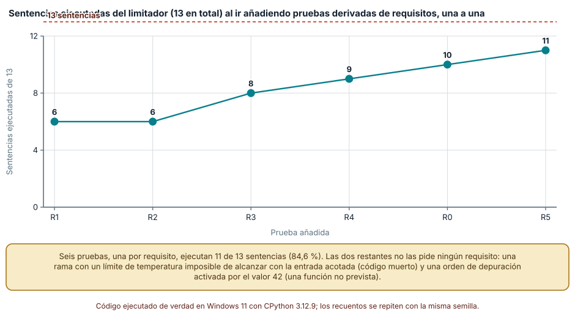
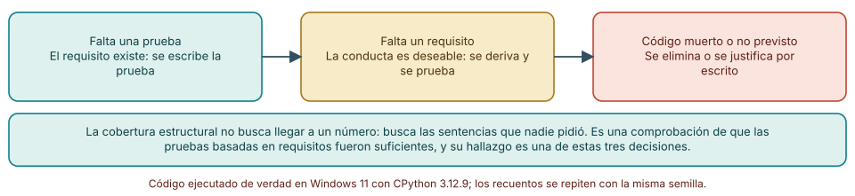
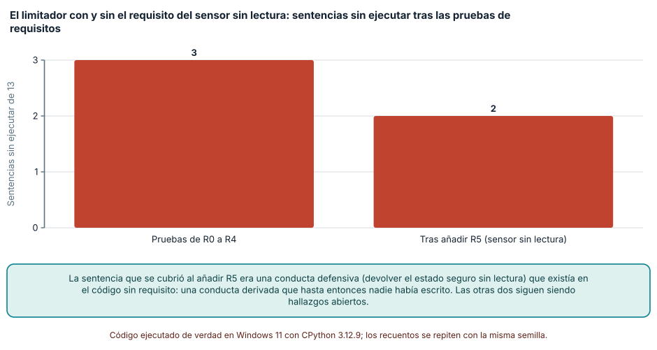

# SE-448 — Aviación: DO-178C, DO-254 y ARP4754

[← SE-447 — Automoción: ISO 26262 y niveles ASIL](https://github.com/vladimiracunadev-create/modern-software-engineering-program/blob/main/classes/part-37-sistemas-criticos-tiempo-real-y-normas-de-seguridad/se-447-automocion-iso-26262-y-niveles-asil/README.md) · [↑ Parte 37](https://github.com/vladimiracunadev-create/modern-software-engineering-program/blob/main/classes/part-37-sistemas-criticos-tiempo-real-y-normas-de-seguridad/README.md) · [📚 Índice completo](https://github.com/vladimiracunadev-create/modern-software-engineering-program/blob/main/classes/README.md) · [🌐 Portal](https://vladimiracunadev-create.github.io/modern-software-engineering-program/classes/SE-448.html) · [SE-449 — Dispositivos médicos: IEC 62304 →](https://github.com/vladimiracunadev-create/modern-software-engineering-program/blob/main/classes/part-37-sistemas-criticos-tiempo-real-y-normas-de-seguridad/se-449-dispositivos-medicos-iec-62304/README.md)

## Punto profesional y fundamento pedagógico

**Punto profesional.** La clase existe para que entiendas cómo la aviación civil organiza la confianza en el software de a bordo y por qué su pieza más característica, la **cobertura estructural del código medida contra pruebas basadas en requisitos**, es una herramienta para encontrar lo que nadie pidió y no un número que alcanzar. DO-178C (en Europa, ED-12C) es el documento que la industria y las autoridades usan para el software aerotransportado; DO-254 hace lo equivalente con el hardware electrónico complejo; ARP4754A describe el desarrollo de sistemas y ARP4761 la evaluación de seguridad que le da los niveles de rigor. La autoridad estadounidense reconoce DO-178C como un medio aceptable de cumplimiento mediante una circular de asesoría pública. Quien lee código que vuela, o integra un proveedor aeronáutico, necesita saber qué le piden y por qué.

**Por qué aparece aquí.** Sigue a `SE-447`: es la misma estructura (peligro, nivel de rigor, evidencia) con una herramienta distinta: el nivel depende de la **gravedad de la condición de fallo** del sistema y la evidencia incluye una verificación estructural del código. Prepara `SE-454`, donde la cobertura de condición/decisión modificada se calcula por completo.

**Error conceptual que debe corregir.** Creer que cobertura estructural alta significa software bien probado. La cobertura estructural mide si las pruebas ejecutaron el código; las pruebas basadas en requisitos son las que dicen si el código hace lo que debe. En el laboratorio, cinco pruebas derivadas de los requisitos del limitador ejecutan 10 de 13 sentencias (76,9 %); las tres no ejecutadas son una rama defensiva sin requisito, una rama inalcanzable con la entrada acotada y una orden de depuración que ningún requisito pidió. El número no dice nada de la corrección; lo valioso es lo que hay detrás de cada sentencia no ejecutada.

**Secuencia de aprendizaje.** Antes de ejecutar, predices qué fracción del código del limitador cubren las pruebas que salen de los requisitos y qué hay en el resto. Después ejecutas las pruebas con un medidor de cobertura propio, clasificas cada sentencia no ejecutada en una de tres causas, añades el requisito que falta y vuelves a medir.

**Evidencia de aprendizaje.** `cobertura-del-limitador.md` con los requisitos, las pruebas que sale de cada uno, la cobertura medida paso a paso, la clasificación de cada sentencia no ejecutada (falta una prueba, falta un requisito, código muerto o no previsto) y la decisión tomada.

**Límite de la conclusión.** La lógica del limitador es una función de Python de 13 sentencias escrita por el autor, con una rama inalcanzable y una puerta trasera plantadas a propósito; la cobertura se mide con el trazador de Python, no con una herramienta calificada para certificación. Las normas de pago no se reproducen: se describen sus ideas desde circulares de la autoridad, informes y literatura abierta. Lo que sigue no es una guía de certificación ni afirma conformidad con DO-178C.

### Trazabilidad fuente → afirmación

| Fuente primaria u oficial | Afirmación que respalda | Lo que no prueba |
|---|---|---|
| [FAA, Advisory Circular 20-115D](https://www.faa.gov/documentLibrary/media/Advisory_Circular/AC_20-115D.pdf) | La autoridad estadounidense reconoce DO-178C como un medio aceptable de cumplimiento para el software aerotransportado. | No reproduce el contenido de la norma. |
| [FAA, página de software y hardware electrónico aerotransportado](https://www.faa.gov/aircraft/air_cert/design_approvals/air_software) | Reúne los documentos públicos de la autoridad sobre software y hardware electrónico complejo, incluido DO-254. | No sustituye a las normas. |
| [FAA, Advisory Circular 20-152A](https://www.faa.gov/documentLibrary/media/Advisory_Circular/AC_20-152A.pdf) | Describe el reconocimiento de DO-254 para hardware electrónico aerotransportado. | No dice cómo hacer el desarrollo. |
| [SAE, ARP4754A](https://www.sae.org/standards/content/arp4754a/) y [ARP4761A](https://www.sae.org/standards/content/arp4761a/) | Identifican las prácticas de desarrollo de sistemas y de evaluación de seguridad aeronáutica. | Son fichas; la norma es de pago. |
| [Hayhurst et al., «A Practical Tutorial on Modified Condition/Decision Coverage» (NASA/TM-2001-210876)](https://shemesh.larc.nasa.gov/fm/papers/Hayhurst-2001-tm210876-MCDC.pdf) | Explica la cobertura estructural de condición/decisión modificada y su relación con DO-178B. | Es sobre la edición anterior y no trata de DO-178C. |
| [Python: `sys.settrace`](https://docs.python.org/3/library/sys.html#sys.settrace) | Documenta el trazador de líneas que usa el medidor del laboratorio. | No es una herramienta calificada. |

## Antes de empezar

Recupera lo aprendido en `SE-447`: una cobertura se mide, no se declara. La pregunta activa es: **¿qué código de tu proyecto no ejecutó nunca ninguna prueba, y quién podría explicar por qué está ahí?**

## Prerrequisitos

- Haber completado `SE-445` a `SE-447`.
- Haber visto [SE-421 — Calidad por riesgo y propósito de las pruebas](https://github.com/vladimiracunadev-create/modern-software-engineering-program/blob/main/classes/part-35-estrategia-y-tecnicas-de-prueba/se-421-calidad-por-riesgo-y-proposito-de-las-pruebas/README.md) y [SE-425 — Pruebas basadas en propiedades y modelos](https://github.com/vladimiracunadev-create/modern-software-engineering-program/blob/main/classes/part-35-estrategia-y-tecnicas-de-prueba/se-425-pruebas-basadas-en-propiedades-y-modelos/README.md).
- Saber qué es una sentencia, una rama y una condición compuesta.
- Python 3.11 o posterior.

## Problema auténtico

El limitador del *Horno de curado* tiene su lógica en una función de 13 sentencias. Los requisitos son cinco: R1 (cortar si la temperatura iguala o supera el límite), R2 (cortar con la puerta abierta), R3 (avisar a menos de 10 °C del límite), R4 (calentar en operación normal) y R0 (esperar si no está habilitado). El equipo escribe una prueba por requisito, todas pasan, y el jefe de proyecto pregunta si el código está probado. La respuesta honesta es «no sabemos qué código no ejecutaron esas pruebas».

La clase mide qué sentencias ejecutan las pruebas derivadas de los requisitos, clasifica cada sentencia no ejecutada, añade el requisito del sensor sin lectura y vuelve a medir. Cada sentencia que queda es una pregunta, no un número.

## Objetivos observables

Al terminar podrás:

1. explicar la relación entre gravedad de la condición de fallo, nivel de rigor y evidencia de verificación en la práctica aeronáutica, sin reproducir tablas de la norma;
2. distinguir pruebas basadas en requisitos de cobertura estructural y qué pregunta responde cada una;
3. clasificar el código no ejecutado en falta de prueba, falta de requisito, código muerto o función no prevista;
4. medir cobertura de sentencias con un trazador y reconocer lo que no mide;
5. describir el papel de la trazabilidad, los requisitos derivados y la calificación de herramientas en el argumento.

## Mapa conceptual


El bucle es el centro del proceso: la cobertura estructural no cierra el trabajo, devuelve a los requisitos o a las pruebas lo que no se había visto.

## Temas y por qué importan

| Tema | Por qué cambia una decisión profesional | Evidencia mínima |
|---|---|---|
| Gravedad de la condición de fallo | Fija el nivel de rigor de cada elemento. | Evaluación de seguridad del sistema |
| Requisitos de alto y bajo nivel | Son lo que las pruebas verifican. | Trazabilidad requisito a código |
| Requisitos derivados | Recogen lo que el diseño añade y nadie pidió. | Lista revisada por seguridad |
| Pruebas basadas en requisitos | Verifican la intención. | Pruebas trazadas a requisitos |
| Cobertura estructural | Encuentra lo que las pruebas no ejercitaron. | Medición y análisis de huecos |
| Código muerto y no previsto | Es riesgo sin función. | Decisión por sentencia |
| Calificación de herramientas | Una herramienta que sustituye una verificación debe ser confiable. | Criterio de calificación |

## Conceptos y decisiones

### 1. El nivel de rigor sigue la condición de fallo

En la práctica aeronáutica, cada función del sistema tiene condiciones de fallo clasificadas por su efecto en la aeronave y las personas (desde «sin efecto» hasta «catastrófica»). De esa clasificación sale un nivel de garantía de desarrollo para el software y el hardware que implementan la función: a mayor gravedad, más objetivos de verificación, más independencia entre quien desarrolla y quien verifica y mayor profundidad de la cobertura estructural. La evaluación que fija esos niveles la hacen los procesos de sistema y de seguridad (ARP4754A y ARP4761), no el equipo de software. El número exacto de objetivos por nivel pertenece a la norma de pago y no se reproduce.

### 2. Requisitos de alto y bajo nivel, y derivados

El software parte de requisitos del sistema asignados a él (alto nivel) y los refina en requisitos de bajo nivel (de los que sale el código). Durante el diseño aparecen decisiones que no estaban en ningún requisito del sistema: usar una tabla, proteger una entrada, reintentar. Son **requisitos derivados** y deben reportarse a los procesos de seguridad porque pueden afectar la evaluación del sistema: el equipo de seguridad no sabía que el software haría eso. En el laboratorio, devolver el estado seguro si el sensor no tiene lectura es una conducta derivada que estaba en el código pero en ningún requisito.

### 3. Pruebas basadas en requisitos: la intención primero

La verificación principal del comportamiento es una prueba por cada requisito, con casos normales y de robustez (entradas fuera de rango, falta de datos). Su pregunta es «¿hace el código lo que debe?». No se diseñan mirando el código, porque entonces solo verificarían que el código hace lo que hace. En el laboratorio, las cinco pruebas de R0 a R4 pasan todas; si el análisis terminara ahí, se habría concluido que el limitador está verificado, con tres sentencias que nadie ejecutó.

### 4. Cobertura estructural: encontrar lo que nadie pidió

Tras las pruebas basadas en requisitos se mide qué partes del código se ejecutaron. Los criterios crecen en exigencia: sentencias, decisiones (cada resultado de cada condicional), y condición/decisión modificada (cada condición muestra su influencia independiente en el resultado; `SE-454`). Los niveles de rigor más altos exigen los criterios más estrictos; esa asociación aparece en material público de la autoridad y en tutoriales de la NASA. La cobertura no se usa para escribir más pruebas hasta llegar a un número, sino para **encontrar lo que las pruebas basadas en requisitos no ejercitaron**: una prueba que «solo sube la cobertura» sin verificar un requisito es una trampa.

### 5. Qué hacer con una sentencia no ejecutada

Hay tres explicaciones y cada una tiene su respuesta. **Falta una prueba**: el requisito existe y su prueba no ejercita esa rama; se escribe. **Falta un requisito**: la conducta es deseable y nadie la pidió; se deriva, se revisa con seguridad y se prueba. **Código muerto o no previsto**: no hay requisito y no debería haberlo; se elimina o se justifica por escrito (por ejemplo, programación defensiva que no se puede activar con las entradas posibles) con una revisión. El código no previsto es el que más importa: una orden de depuración que se activa con un valor mágico es una función que nadie evaluó, y en un sistema crítico una función no evaluada es un peligro.

### 6. Calificación de herramientas y trazabilidad

Si una herramienta automatiza o reemplaza una verificación (el medidor de cobertura, el generador de código), su error puede pasar inadvertido; por eso existe un documento aparte sobre la calificación de herramientas y los suplementos para modelos, orientación a objetos y métodos formales. En el laboratorio, el medidor es el trazador de líneas de Python, no una herramienta calificada, y por eso los resultados sirven para entender el mecanismo y no como evidencia de certificación. La trazabilidad bidireccional (requisito a código a prueba y de vuelta) es el hilo que permite saber qué prueba cubre qué requisito y qué código no tiene requisito (`SE-450`).

### 7. Lo que la cobertura no ve

Ejecutar una sentencia no es verificarla: una prueba puede ejecutar la rama sin comprobar su resultado. La cobertura no mira los datos (un valor extremo que provoca desbordamiento), el tiempo (una respuesta tardía), la concurrencia ni el entorno. No detecta código que falta: una conducta que nadie escribió no tiene sentencias que cubrir. Por eso la cobertura es una prueba de suficiencia de las pruebas basadas en requisitos, no de la corrección del software.

## Cobertura acumulada

La primera medida añade las pruebas una a una y cuenta las sentencias ejecutadas.



**Cómo leer la figura.** El eje horizontal son las pruebas en el orden en que se añaden y el vertical las sentencias ejecutadas de 13; mira primero que la prueba de R2 no suma nada (ejecuta lo mismo que la de R1) y que seis pruebas no llegan a 13. **Dónde deja de valer:** son 13 sentencias de una función pequeña; en un programa real, la cobertura crece con los esfuerzos de forma muy distinta y la última fracción cuesta mucho más. El trazador mide líneas, no condiciones.

## Tres causas posibles

La segunda figura resume qué se hace con cada sentencia no ejecutada.



**Cómo leer la figura.** Cada caja es una explicación del hueco y la acción que le corresponde; el análisis de cada sentencia termina en una de ellas. **Dónde deja de valer:** es un esquema de decisión, no un procedimiento completo; en un proyecto real la decisión se registra, se revisa por alguien distinto a quien escribió el código y puede disparar un cambio en el análisis de seguridad del sistema.

## El efecto de un requisito derivado

La tercera medida cuenta las sentencias sin ejecutar antes y después de añadir R5.



**Cómo leer la figura.** Cada barra es el número de sentencias sin ejecutar en un momento; mira primero lo que bajó (la conducta defensiva que ahora tiene su requisito) y lo que queda (código muerto y puerta trasera). **Dónde deja de valer:** que queden dos sentencias no ejecutadas no significa que estén bien: significa que son hallazgos abiertos. Quedaría decidir si se eliminan, y en el caso de la puerta trasera, quién la puso y por qué.

## Definiciones de trabajo

- **[Condición de fallo](../../../glosario/entradas/c/condicion-de-fallo.md):** efecto de un fallo de una función sobre la aeronave y sus ocupantes, clasificado por gravedad.
- **[Requisito derivado](../../../glosario/entradas/r/requisito-derivado.md):** requisito que surge del diseño y no de los requisitos del sistema.
- **[Prueba basada en requisitos](../../../glosario/entradas/p/prueba-basada-en-requisitos.md):** prueba diseñada a partir de un requisito, no del código.
- **[Cobertura estructural](../../../glosario/entradas/c/cobertura-estructural.md):** medida de qué partes del código ejecutaron las pruebas.
- **[Código muerto](../../../glosario/entradas/c/codigo-muerto.md):** código que no puede ejecutarse con ninguna entrada posible.
- **[Código no previsto](../../../glosario/entradas/c/codigo-no-previsto.md):** código ejecutable que no corresponde a ningún requisito.
- **[Calificación de herramienta](../../../glosario/entradas/c/calificacion-de-herramienta.md):** demostración de que una herramienta es confiable para la verificación que sustituye.

## Ejemplo mínimo

El trazador de líneas de Python aplicado a una función con una puerta trasera:

```python
import sys

def f(x):
    if x == 42:
        return "depura"        # ningún requisito lo pide
    return "normal"

vistas = set()
def tracer(frame, event, arg):
    if event == "line" and frame.f_code is f.__code__:
        vistas.add(frame.f_lineno)
    return tracer

sys.settrace(tracer)
f(1); f(7)
sys.settrace(None)
print(sorted(vistas))      # la línea del 'return "depura"' no aparece
```

Las dos pruebas «de requisitos» pasan y la sentencia de la puerta trasera no se ejecuta. Es el hallazgo que la cobertura estructural existe para producir.

## Ejemplo profesional

*Escenario ilustrativo: las cifras y los resultados que aparecen en este ejemplo son supuestos de la narración, no mediciones.*

Un proveedor entrega a un integrador el software de una unidad de control de un actuador. El informe de verificación muestra todas las pruebas de requisitos en verde y una cobertura de decisión del 98 %. El revisor del integrador pide la lista de las decisiones sin cubrir y encuentra en ella una comprobación de un código de fábrica activa en vuelo si un campo de configuración vale un número concreto. El proveedor explica que es una función de pruebas en banco que olvidaron deshabilitar. No hubo un daño; hubo una función no evaluada en un software de nivel alto. La corrección fue quitar el código, repetir la verificación y revisar el proceso de control de configuración. El hallazgo salió de leer las sentencias no cubiertas, no del porcentaje.

## Práctica guiada

1. Escribe una prueba por requisito para una función tuya pequeña, sin mirar el código mientras la diseñas.
2. Mide la cobertura de sentencias con `sys.settrace` o con `coverage.py` y lista lo no ejecutado.
3. Ejecuta `python scripts/experiments_part37_a.py 568` y compara con tu medición.
4. Clasifica cada sentencia no ejecutada en una de las tres causas y escribe la decisión.
5. Si añades un requisito, indica quién de seguridad debe revisarlo.

## Ejercicios

1. **Básico.** Explica por qué la prueba de R2 no suma sentencias a la de R1 en la primera figura.
2. **Intermedio.** Añade al limitador una condición compuesta y muestra una prueba que cubre las sentencias pero no demuestra el efecto independiente de cada condición.
3. **Avanzado.** Diseña la campaña de verificación de una función con un nivel alto de rigor: requisitos, pruebas de robustez, medición, análisis de huecos y quién firma cada paso.

## Reto verificable

Entrega `cobertura-del-limitador.md` y una función de al menos 15 sentencias con sus requisitos, pruebas y una medición de cobertura por prueba. Es válido si otra persona reproduce las sentencias ejecutadas, la clasificación de cada sentencia no ejecutada en una de las tres causas y la decisión sobre cada una.

## Caso conductor

El limitador del *Horno de curado* gana su lista de requisitos, sus pruebas y una cobertura medida con dos hallazgos abiertos. `SE-449` pasa a los dispositivos médicos, donde la clase de seguridad del software depende de la contribución del software al daño y de los controles externos.

## Preguntas frecuentes

### ¿Hay que llegar al 100 % de cobertura?

En los niveles más altos de rigor, las normas piden analizar cada sentencia, decisión o condición no cubierta: cubrirla, o justificar y revisar por qué no se cubre. El objetivo es que no queden huecos sin explicar, no que un número llegue a 100 escribiendo pruebas que no verifican nada.

### ¿Por qué la cobertura es estructural y no se escriben las pruebas desde el código?

Porque las pruebas diseñadas desde el código verifican que el código hace lo que hace. Las pruebas diseñadas desde los requisitos verifican que hace lo que debe; la cobertura mira después si esas pruebas bastaron.

### ¿DO-254 es lo mismo para hardware?

Es la contraparte para hardware electrónico complejo (lógica programable, circuitos integrados específicos): también deriva el rigor de la gravedad de la condición de fallo y exige requisitos, verificación y trazabilidad, con las particularidades del hardware.

### ¿Un modelo o código generado se exime de esto?

No: los suplementos sobre modelos y sobre métodos formales permiten sustituir parte de la verificación a cambio de calificar las herramientas y de verificar el modelo. El código generado sin ese argumento sigue necesitando la verificación completa.

## Fallo controlado y diagnóstico

**Fallo.** En una revisión de un limitador, la cobertura de sentencias es de 100 % y las pruebas de requisitos pasan. En una prueba de vuelo simulada con un sensor desconectado, el limitador no corta la potencia.

**Diagnóstico paso a paso.** (1) El requisito R5 (sensor sin lectura) no existía, de modo que no había prueba de robustez para ese caso. (2) La cobertura de 100 % se alcanzó con una prueba añadida «para subir el porcentaje» que ejecutaba la rama defensiva con una entrada nula pero no comprobaba el resultado. (3) La rama devolvía «calor» en lugar de «corte» por un error al escribirla, y ninguna aserción lo detectaba. (4) La medición era correcta: ejecutar una sentencia no es verificarla.

**Corrección.** Se escribe el requisito R5 con su resultado esperado, se reemplaza la prueba que solo ejecutaba por una que verifica el estado seguro y se añade a la revisión una regla: cada prueba que se añade por cobertura debe estar trazada a un requisito o a un requisito derivado. La lección es que la cobertura es una pregunta sobre las pruebas, no una prueba del código.

## Errores comunes y cómo corregirlos

- **Escribir pruebas para subir el porcentaje.** Corrige exigiendo que toda prueba esté trazada a un requisito.
- **Diseñar pruebas mirando el código.** Corrige derivándolas de los requisitos y midiendo después.
- **Ignorar las sentencias no ejecutadas.** Corrige clasificando cada una y decidiendo por escrito.
- **No reportar conductas derivadas a seguridad.** Corrige con la lista de requisitos derivados revisada por el equipo de seguridad.
- **Confiar en una herramienta no calificada para evidencia.** Corrige con su criterio de calificación o con una verificación independiente.
- **Confundir ejecutar con verificar.** Corrige con aserciones que comprueban el resultado, no solo con la ejecución.

## Entorno y archivos clave

- `scripts/experiments_part37_a.py`: función `e568` con el limitador de 13 sentencias, las pruebas de requisitos y el medidor basado en `sys.settrace`; se ejecuta con `python scripts/experiments_part37_a.py 568`.
- Los números de línea que imprime el experimento son relativos a la función.
- `scripts/figures_part37_a.py`: las tres figuras de la clase.
- Solo la biblioteca estándar de Python 3.11 o posterior.

## Seguridad, ética y accesibilidad

Una función no evaluada en un sistema de vuelo es un riesgo que ninguna persona a bordo aceptó. La ética de esta práctica es cuidar el hallazgo: quien encuentra una puerta trasera no la borra en silencio, la reporta con su origen. La clase describe ideas de documentos de pago desde fuentes abiertas, no sustituye su lectura y no afirma conformidad. Las figuras tienen texto alternativo completo y no dependen solo del color.

## Puente hacia el trabajo con agentes

Un agente que escribe pruebas para «subir la cobertura» produce el anti-patrón de esta clase: pruebas que ejecutan sin verificar. Exige que cada prueba cite su requisito y que declare qué resultado verifica. Un agente que encuentra código sin cubrir puede proponer las tres causas con su razón, pero no decide si es código muerto o una función que el sistema necesita: esa clasificación la firma una persona con acceso a los requisitos y a seguridad.

## Transferencia

Toma un módulo pequeño de tu sistema con una función crítica. Escribe una prueba por requisito, mide la cobertura y clasifica cada sentencia no ejecutada. Para cada requisito derivado que encuentres, anota quién del equipo de seguridad o de producto debe revisarlo. Si hay código que nadie sabe explicar, ábrelo como hallazgo, no lo borres sin más.

## Evaluación y evidencia

| Criterio | Evidencia aceptable | Rechazo |
|---|---|---|
| Pruebas desde requisitos | Cada prueba trazada a un requisito | Pruebas escritas mirando el código |
| Medición | Cobertura por prueba con herramienta declarada | Un porcentaje global |
| Clasificación | Cada sentencia no ejecutada en una de tres causas | «Es código defensivo» |
| Requisitos derivados | Lista revisada por seguridad | Conducta en el código sin requisito |
| Honestidad | Herramienta no calificada declarada | Evidencia de certificación sin base |

## Fuentes

- FAA. [Advisory Circular 20-115D](https://www.faa.gov/documentLibrary/media/Advisory_Circular/AC_20-115D.pdf).
- FAA. [Software y hardware electrónico aerotransportado](https://www.faa.gov/aircraft/air_cert/design_approvals/air_software) y [Advisory Circular 20-152A](https://www.faa.gov/documentLibrary/media/Advisory_Circular/AC_20-152A.pdf).
- SAE International. [ARP4754A](https://www.sae.org/standards/content/arp4754a/) y [ARP4761A](https://www.sae.org/standards/content/arp4761a/) (fichas de normas de pago).
- Hayhurst, K. J. et al. [«A Practical Tutorial on Modified Condition/Decision Coverage»](https://shemesh.larc.nasa.gov/fm/papers/Hayhurst-2001-tm210876-MCDC.pdf). NASA/TM-2001-210876.
- Python Software Foundation. [`sys.settrace`](https://docs.python.org/3/library/sys.html#sys.settrace).

## Límites y siguiente paso

La función del limitador es una pieza didáctica con defectos plantados, el medidor no es una herramienta calificada, las normas de pago no se reproducen y no se afirma conformidad con DO-178C ni DO-254. El siguiente paso, `SE-449`, pasa a los dispositivos médicos, donde el software se clasifica por su contribución al daño y por los controles externos que lo acotan.

## Glosario

| Término | Definición breve |
|---|---|
| Condición de fallo | Efecto de un fallo en la aeronave, clasificado por gravedad |
| Requisito derivado | Requisito que surge del diseño y no del sistema |
| Cobertura estructural | Qué partes del código ejecutaron las pruebas |
| Código muerto | Código que ninguna entrada puede ejecutar |
| Código no previsto | Código ejecutable sin requisito |
| Calificación de herramienta | Demostración de confiabilidad de una herramienta de verificación |

Conceptos de esta clase en el [glosario del programa](../../../glosario/README.md): [Calificación de herramienta](../../../glosario/entradas/c/calificacion-de-herramienta.md) · [Cobertura estructural](../../../glosario/entradas/c/cobertura-estructural.md) · [Código muerto](../../../glosario/entradas/c/codigo-muerto.md) · [Código no previsto](../../../glosario/entradas/c/codigo-no-previsto.md) · [Condición de fallo](../../../glosario/entradas/c/condicion-de-fallo.md) · [Prueba basada en requisitos](../../../glosario/entradas/p/prueba-basada-en-requisitos.md) · [Requisito derivado](../../../glosario/entradas/r/requisito-derivado.md).

---

[← SE-447 — Automoción: ISO 26262 y niveles ASIL](https://github.com/vladimiracunadev-create/modern-software-engineering-program/blob/main/classes/part-37-sistemas-criticos-tiempo-real-y-normas-de-seguridad/se-447-automocion-iso-26262-y-niveles-asil/README.md) · [↑ Parte 37](https://github.com/vladimiracunadev-create/modern-software-engineering-program/blob/main/classes/part-37-sistemas-criticos-tiempo-real-y-normas-de-seguridad/README.md) · [📚 Índice completo](https://github.com/vladimiracunadev-create/modern-software-engineering-program/blob/main/classes/README.md) · [🌐 Portal](https://vladimiracunadev-create.github.io/modern-software-engineering-program/classes/SE-448.html) · [SE-449 — Dispositivos médicos: IEC 62304 →](https://github.com/vladimiracunadev-create/modern-software-engineering-program/blob/main/classes/part-37-sistemas-criticos-tiempo-real-y-normas-de-seguridad/se-449-dispositivos-medicos-iec-62304/README.md)
