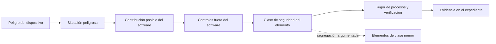
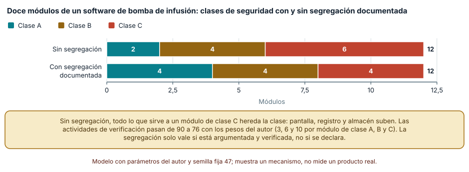
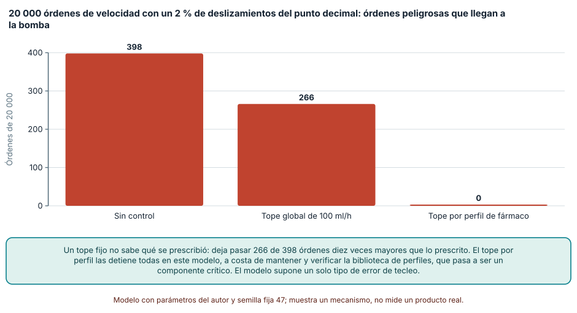
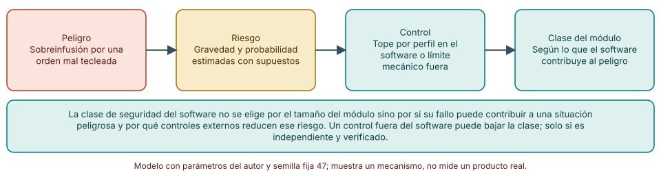

# SE-449 — Dispositivos médicos: IEC 62304

[← SE-448 — Aviación: DO-178C, DO-254 y ARP4754](https://github.com/vladimiracunadev-create/modern-software-engineering-program/blob/main/classes/part-37-sistemas-criticos-tiempo-real-y-normas-de-seguridad/se-448-aviacion-do-178c-do-254-y-arp4754/README.md) · [↑ Parte 37](https://github.com/vladimiracunadev-create/modern-software-engineering-program/blob/main/classes/part-37-sistemas-criticos-tiempo-real-y-normas-de-seguridad/README.md) · [📚 Índice completo](https://github.com/vladimiracunadev-create/modern-software-engineering-program/blob/main/classes/README.md) · [🌐 Portal](https://vladimiracunadev-create.github.io/modern-software-engineering-program/classes/SE-449.html) · [SE-450 — Casos de seguridad y trazabilidad →](https://github.com/vladimiracunadev-create/modern-software-engineering-program/blob/main/classes/part-37-sistemas-criticos-tiempo-real-y-normas-de-seguridad/se-450-casos-de-seguridad-y-trazabilidad/README.md)

## Punto profesional y fundamento pedagógico

**Punto profesional.** La clase existe para que entiendas cómo se organiza el desarrollo de software de un dispositivo médico y por qué su decisión central, la **clase de seguridad del software**, es una afirmación sobre qué puede causar el software y qué lo limita desde fuera, y no sobre cuán complejo es. IEC 62304 define los procesos del ciclo de vida del software de dispositivos médicos (planificación, requisitos, arquitectura, diseño, implementación y verificación de unidades, integración, pruebas de sistema, entrega, mantenimiento, gestión de riesgos, de configuración y de problemas). La autoridad estadounidense publica en su base de datos pública que reconoce la edición consolidada de 2015 como norma de consenso, y la europea la armoniza. Quien desarrolla software que toca a un paciente, aunque sea una aplicación auxiliar, trabaja dentro de este marco o de otro que lo imita.

**Por qué aparece aquí.** Sigue a `SE-448` con otra forma de repartir el rigor: no por la gravedad de una condición de fallo del sistema sino por la contribución del **software** a una situación peligrosa, descontando los controles que existen fuera de él. Conecta con [SE-295 — Salud, datos sensibles y sistemas regulados](https://github.com/vladimiracunadev-create/modern-software-engineering-program/blob/main/classes/part-24-software-especializado-y-dominios/se-295-salud-datos-sensibles-y-sistemas-regulados/README.md), que trató la dimensión de datos, y prepara `SE-450`, donde el expediente de riesgos y verificación se organiza como un argumento.

**Error conceptual que debe corregir.** Creer que la clase de seguridad se asigna al programa completo y que «todo es clase C para estar seguros». Asignarla a cada elemento de software, y segregar con una arquitectura verificada los que no pueden contribuir al daño, cambia el esfuerzo de manera medible. En el laboratorio, con doce módulos de una bomba de infusión ficticia, sin segregación hay 6 de clase C, 4 de B y 2 de A, y con segregación documentada hay 4, 4 y 4: las actividades de verificación pasan de 90 a 76 con los pesos del autor. La segregación solo vale si está argumentada y verificada.

**Secuencia de aprendizaje.** Antes de ejecutar, predices cuántos módulos suben de clase por depender de un módulo de clase C y qué fracción de órdenes de velocidad erróneas detiene un tope fijo. Después propagas la clase por el grafo de dependencias con y sin segregación, simulas 20 000 órdenes con un 2 % de deslizamientos del punto decimal y comparas tres políticas de control.

**Evidencia de aprendizaje.** `clases-de-seguridad.md` con la lista de módulos, su clase asignada y por qué, el grafo de dependencias, el argumento de segregación de cada módulo que se mantiene en una clase menor, y el resultado de la simulación de errores de entrada con el control elegido.

**Límite de la conclusión.** Los módulos, las clases y los pesos de esfuerzo son del autor y el dispositivo es ficticio; el error de entrada es de un solo tipo (deslizamiento del punto decimal) y no incluye fallos del software que realiza el control. El texto de IEC 62304 y de ISO 14971 es de pago y no se reproduce: se describen ideas desde fuentes públicas. No hay revisión humana externa del análisis ni afirmación de conformidad regulatoria.

### Trazabilidad fuente → afirmación

| Fuente primaria u oficial | Afirmación que respalda | Lo que no prueba |
|---|---|---|
| [Base de datos de normas reconocidas por la FDA: IEC 62304 Edition 1.1 2015-06](https://www.accessdata.fda.gov/scripts/cdrh/cfdocs/cfStandards/detail.cfm?standard__identification_no=38829) | La autoridad estadounidense registra públicamente el reconocimiento de la norma de ciclo de vida del software de dispositivos médicos. | No dice cómo se cumple ni reproduce el texto. |
| [FDA, «General Principles of Software Validation»](https://www.fda.gov/regulatory-information/search-fda-guidance-documents/general-principles-software-validation) | Describe expectativas de validación del software y su relación con el control de diseño. | Es una guía no vinculante y anterior a la norma vigente. |
| [FDA, «Content of Premarket Submissions for Device Software Functions»](https://www.fda.gov/regulatory-information/search-fda-guidance-documents/content-premarket-submissions-device-software-functions) | Detalla qué documentación de software acompaña una solicitud previa a la comercialización según el nivel de riesgo. | No sustituye a la norma ni valida el ejemplo. |
| [Leveson y Turner, Therac-25, IEEE Computer, 1993](https://doi.org/10.1109/MC.1993.274940) | Caso histórico de software médico sin análisis de riesgo del software ni verificación independiente. | Es anterior a la norma. |
| [Python: `random`](https://docs.python.org/3/library/random.html) | Documenta el generador con semilla de la simulación. | No valida el modelo de errores. |

## Antes de empezar

Recupera lo aprendido en `SE-448`: el código que ninguna prueba de requisitos ejecutó es un hallazgo. La pregunta activa es: **¿qué módulo de tu sistema «solo muestra datos» pero comparte memoria, proceso o dependencias con uno que decide algo crítico?**

## Prerrequisitos

- Haber completado `SE-445` a `SE-448`.
- Haber visto [SE-295 — Salud, datos sensibles y sistemas regulados](https://github.com/vladimiracunadev-create/modern-software-engineering-program/blob/main/classes/part-24-software-especializado-y-dominios/se-295-salud-datos-sensibles-y-sistemas-regulados/README.md) y [SE-159 — Contratos, invariantes y diseño por contrato](https://github.com/vladimiracunadev-create/modern-software-engineering-program/blob/main/classes/part-13-especificaciones-contratos-y-modelos/se-159-contratos-invariantes-y-diseno-por-contrato/README.md).
- Saber leer un grafo de dependencias entre módulos.
- Python 3.11 o posterior.

## Problema auténtico

Una empresa desarrolla el software de una bomba de infusión: calcula la velocidad de infusión según la prescripción, mueve el motor, muestra datos, registra eventos, se conecta a una red hospitalaria y recibe actualizaciones. Hay doce módulos. El equipo quiere tratarlos todos con el mismo rigor «por si acaso» y descubre que no puede costearlo; otro equipo propone tratar solo el control de dosis con rigor y dejar los demás, sin pensar en las dependencias. Ambas decisiones son defendibles o indefendibles según una cosa: si el argumento de por qué un módulo no puede causar daño se sostiene.

La clase calcula la clase efectiva de cada módulo con y sin segregación, simula errores de entrada de velocidad con tres políticas de control y discute qué se necesita para afirmar que un módulo es de una clase menor.

## Objetivos observables

Al terminar podrás:

1. describir los procesos del ciclo de vida de software de dispositivos médicos y su relación con la gestión de riesgos y la configuración;
2. explicar cómo se asigna la clase de seguridad según la contribución del software a una situación peligrosa y la reducción que aportan controles externos;
3. propagar la clase por un grafo de dependencias y reconocer cuándo una segregación la rompe;
4. describir qué es el software de origen desconocido (SOUP) y qué se pide para usarlo;
5. comparar controles de entrada de un error de usuario y reconocer el costo de mantener una biblioteca de límites.

## Mapa conceptual



El bloque punteado es el beneficio de la segregación: si se demuestra que un elemento no puede contribuir al peligro, su clase y su esfuerzo bajan; si no se demuestra, hereda la clase.

## Temas y por qué importan

| Tema | Por qué cambia una decisión profesional | Evidencia mínima |
|---|---|---|
| Ciclo de vida del software | Estructura lo que se hace y se registra. | Plan y procesos |
| Clase de seguridad | Reparte el rigor según el daño posible. | Clase por elemento y razón |
| Controles fuera del software | Pueden bajar la clase si son independientes. | Evidencia de independencia |
| Segregación | Acota el esfuerzo si es verificable. | Argumento y verificación |
| SOUP | Software de terceros sin desarrollo conocido. | Lista, uso y anomalías |
| Gestión de riesgos | Es la fuente de los controles y requisitos. | Archivo de riesgos |
| Mantenimiento y problemas | El software cambia y la evidencia debe seguirlo. | Análisis de impacto |

## Conceptos y decisiones

### 1. Un ciclo de vida con procesos y registros

La norma organiza el trabajo en procesos: planificación del desarrollo, análisis de requisitos de software, diseño de arquitectura, diseño detallado, implementación y verificación de unidades, integración y pruebas de integración, pruebas del sistema de software y entrega; además, mantenimiento, gestión de riesgos del software, gestión de la configuración y resolución de problemas. No impone un modelo de desarrollo (puede ser iterativo) sino qué actividades y qué registros deben existir y cuáles dependen de la clase. El centro no es la documentación en sí sino que la evidencia sea trazable: de un peligro a un requisito, a un diseño, a una prueba y a un resultado.

### 2. Clases A, B y C: qué contribución puede tener el software

La clase se asigna a cada elemento de software según lo que su fallo podría causar: la clase A si no puede contribuir a una situación peligrosa; la B si puede contribuir y el daño posible no es grave; la C si puede contribuir y el daño posible es la muerte o una lesión grave. En la edición consolidada de 2015, esa evaluación puede tener en cuenta **medidas de control de riesgo externas al software** (un límite mecánico, una alarma independiente); si reducen el riesgo de forma verificada, la clase puede bajar. El detalle de los criterios es de la norma; la idea que se transfiere es que la clase es una conclusión de un análisis y no una elección del equipo.

### 3. Segregación: la clase baja solo con un argumento

Un módulo de clase A que comparte proceso, memoria o dependencias con uno de clase C puede alterar su comportamiento: un puntero perdido, un uso de CPU, una excepción. Si no se demuestra lo contrario, hereda la clase. En el laboratorio, con las dependencias de doce módulos, sin segregación la clase C se propaga de control de dosis a validador, bomba, calibración, y por dependencia a registro y almacén: seis módulos en C y dos en A; el esfuerzo (actividades de verificación con pesos del autor) es 90. Con una segregación documentada —un proceso separado para el control con una interfaz mínima— quedan 4, 4 y 4, y el esfuerzo es 76. La diferencia no es la cifra: es que cada módulo que se mantiene en una clase menor necesita un argumento de aislamiento y verificación, y ese argumento tiene su propio costo.

### 4. Software de origen desconocido: lo que se usa sin conocer su desarrollo

Una biblioteca, un sistema operativo o un controlador desarrollados por terceros sin los procesos de la norma se llaman SOUP. La norma no prohíbe usarlos; pide identificarlos, especificar qué se requiere de ellos, evaluar sus anomalías conocidas publicadas y verificar que funcionan en el contexto. La pregunta práctica es qué se hace cuando una biblioteca publica un defecto: debe haber un proceso que lo evalúe contra los peligros del dispositivo. Un proyecto con cientos de dependencias y sin lista de SOUP no puede responder si un aviso lo afecta.

### 5. Un error de entrada como peligro: topes global y por perfil

La sobreinfusión por un error de tecleo es un peligro clásico de las bombas. En el laboratorio, 20 000 órdenes de velocidad con un 2 % de deslizamientos del punto decimal (la velocidad queda diez veces mayor) producen 398 órdenes peligrosas (más de cinco veces lo prescrito). Un tope global de 100 ml/h deja pasar 266; un tope por perfil de fármaco (tres veces la velocidad habitual del perfil) deja pasar 0. El tope por perfil depende de una biblioteca de perfiles que ahora es un componente crítico: su contenido, su actualización y su verificación entran en el análisis. Un control que traslada el riesgo a otra pieza debe llevar su propio argumento.

### 6. Riesgo, configuración y cambios

El software cambia después de la entrega: correcciones, mejoras, parches de SOUP. Cada cambio necesita un análisis de impacto sobre los riesgos y las pruebas, y la configuración (qué versión de cada elemento está en cada unidad) debe ser reproducible. La relación con la gestión de riesgos es bidireccional: un peligro nuevo puede generar un requisito de software, y un cambio de software puede cambiar un riesgo. Un archivo de gestión de riesgos que se hizo al principio y nunca se actualizó es una pieza de museo.

### 7. Lo que la norma no resuelve

La norma de ciclo de vida de software no define cuánto riesgo es aceptable, qué eficacia clínica tiene el dispositivo, ni cómo proteger los datos de la persona paciente; tampoco regula la ciberseguridad del producto, que otras guías de las autoridades tratan. Cumplir procesos no demuestra seguridad por sí solo; es una condición para que el argumento de seguridad tenga un cuerpo de evidencia detrás.

## Clases y segregación

La primera medida propaga la clase por el grafo de dependencias.



**Cómo leer la figura.** Cada barra es una política y sus tramos son los módulos de cada clase; mira primero el tramo de clase C, que baja de seis a cuatro con la segregación. **Dónde deja de valer:** el grafo y las clases iniciales son del autor; en un producto real se discuten módulo a módulo. La segregación aquí es una columna del modelo, no un hecho: en la práctica hay que demostrar el aislamiento con diseño y con pruebas.

## Topes de entrada

La segunda medida compara tres controles de un error de tecleo.



**Cómo leer la figura.** Cada barra es un control y su altura las órdenes peligrosas que llegan a la bomba de 20 000; mira primero el tope global, que casi no cambia el resultado. **Dónde deja de valer:** el modelo solo contempla un error de tecleo con una probabilidad del 2 % y velocidades de una lista corta; la biblioteca de perfiles se supone correcta. Un control que se apoya en un dato debe verificar el dato.

## Del peligro a la clase

La tercera figura resume la cadena de decisión.



**Cómo leer la figura.** Cada caja es una etapa de la decisión y la nota dice qué la gobierna; mira primero que la clase llega al final, después de considerar los controles. **Dónde deja de valer:** es un esquema; el proceso real incluye iteraciones, revisión de riesgos residuales y la decisión de aceptación por una persona con autoridad.

## Definiciones de trabajo

- **Clase de seguridad del software:** A, B o C, según la contribución del software a una situación peligrosa y la gravedad del daño posible.
- **Medida de control de riesgo:** acción o elemento que reduce el riesgo, dentro o fuera del software.
- **Segregación:** separación argumentada y verificada entre elementos que permite asignar clases distintas.
- **SOUP:** software de origen desconocido, usado sin conocer sus procesos de desarrollo.
- **Análisis de impacto:** evaluación del efecto de un cambio sobre riesgos, requisitos y pruebas.
- **Archivo de gestión de riesgos:** conjunto de registros del análisis y control de riesgos del dispositivo.
- **Situación peligrosa:** circunstancia en la que personas, bienes o el ambiente se exponen a un peligro.

## Ejemplo mínimo

La propagación de una clase por dependencias, en pocas líneas:

```python
orden = {"A": 1, "B": 2, "C": 3}
clase = {"control": "C", "bomba": "C", "registro": "B", "almacen": "A"}
deps = {"control": ["bomba", "registro"], "registro": ["almacen"], "bomba": [], "almacen": []}

cambio = True
while cambio:
    cambio = False
    for m, ds in deps.items():
        for d in ds:
            if orden[clase[m]] > orden[clase[d]]:
                clase[d] = clase[m]
                cambio = True

print(clase)    # registro y almacén suben a C porque el control los usa
```

Sin segregación, todo lo que usa un módulo de clase C pasa a clase C. El laboratorio aplica exactamente esta regla a doce módulos.

## Ejemplo profesional

*Escenario ilustrativo: las cifras y los resultados que aparecen en este ejemplo son supuestos de la narración, no mediciones.*

Una startup desarrolla la aplicación móvil de un monitor de glucosa. El equipo asume que la aplicación es clase A porque «solo muestra los datos del sensor». Un revisor pregunta qué pasa si la aplicación muestra un valor equivocado y la persona usa esa lectura para decidir una dosis. La conclusión cambia: la aplicación puede contribuir a una situación peligrosa y la clase efectiva es mayor. El equipo evalúa dos caminos: segregar el módulo de cálculo y alarma y verificarlo con rigor (clase mayor, módulo pequeño), o rediseñar para que la lectura crítica la muestre siempre el dispositivo físico y la aplicación sea solo informativa (con un control externo verificado). Eligen el primero porque el segundo exige cambiar hardware. La decisión quedó escrita con sus razones, y el equipo agregó un disparador de revisión si se añaden funciones de recomendación.

## Práctica guiada

1. Lista los módulos de un sistema tuyo y asigna a cada uno una clase provisional con la razón.
2. Dibuja las dependencias y propaga la clase como en el ejemplo mínimo.
3. Ejecuta `python scripts/experiments_part37_a.py 569` y compara con tu propagación.
4. Escribe, para un módulo que quieras mantener en clase menor, el argumento de segregación y cómo lo verificarías.
5. Lista las dependencias de terceros de tu sistema y marca cuáles serían SOUP.

## Ejercicios

1. **Básico.** Explica por qué un módulo de registro que solo escribe en disco puede subir de clase si lo usa el control de dosis.
2. **Intermedio.** Modifica el grafo para que el control de dosis use el módulo de pantalla solo a través de una interfaz de solo lectura y razona si la clase de pantalla puede bajar.
3. **Avanzado.** Diseña el control de tecleo para la bomba con un tope por perfil, la verificación de la biblioteca de perfiles y el análisis de qué ocurre si la biblioteca está corrompida.

## Reto verificable

Entrega `clases-de-seguridad.md` y el código de la propagación de clases sobre un grafo de al menos diez módulos con y sin segregación. Es válido si otra persona reproduce el reparto por clase, el esfuerzo con los pesos declarados y la simulación del error de entrada con tres políticas.

## Caso conductor

El *Horno de curado* se acerca a un uso de laboratorio clínico: su software de control gana una clasificación por módulo y su limitador un argumento de segregación. `SE-450` toma toda esta evidencia y la organiza como un argumento estructurado con trazabilidad.

## Preguntas frecuentes

### ¿Una aplicación que solo muestra datos es clase A?

No necesariamente: si su fallo (mostrar un valor erróneo) puede llevar a una decisión clínica peligrosa, puede contribuir a una situación peligrosa. La clase se concluye del análisis de riesgos, no del tipo de pantalla.

### ¿Se puede bajar la clase con una alarma independiente?

Si la alarma o el límite externo reducen el riesgo de forma verificada y son independientes del software, la evaluación puede tenerlos en cuenta. Hay que demostrar su eficacia y su independencia, y mantenerlas cuando el dispositivo cambia.

### ¿Hay que escribir toda la documentación para una clase A?

La norma pide menos actividades y registros en la clase A que en la C, pero no cero: planificación, requisitos, pruebas del sistema y gestión de configuración y de riesgos siguen existiendo.

### ¿Esto cubre la ciberseguridad?

No directamente: la seguridad de la información de un dispositivo tiene sus propias guías y normas, y un fallo de ciberseguridad puede ser un peligro de seguridad del paciente; ambos análisis se conectan.

## Fallo controlado y diagnóstico

**Fallo.** Una actualización de una biblioteca de comunicaciones, clasificada como parte de un módulo de clase A, provoca que una bomba reinicie su tarea de control durante 40 segundos en un hospital. La evidencia de la clase A no incluía pruebas del efecto.

**Diagnóstico paso a paso.** (1) La biblioteca de comunicaciones corría en el mismo proceso que el control de dosis. (2) El argumento de segregación decía «módulos separados» pero no había aislamiento de proceso ni de memoria. (3) Un defecto de la biblioteca consumió la memoria compartida y la tarea de control fue reiniciada por el vigilante. (4) La biblioteca figuraba como SOUP sin análisis de anomalías conocidas.

**Corrección.** Se mueve la comunicación a un proceso separado con una interfaz mínima y un tiempo de respuesta acotado, se verifica el aislamiento con una prueba que satura la memoria del proceso de comunicación y se adopta el análisis de anomalías de cada SOUP en cada actualización. La lección es que «módulos separados» en un diagrama no es segregación hasta que una prueba intenta romperla.

## Errores comunes y cómo corregirlos

- **Tratar todo como clase C «por si acaso».** Corrige con un análisis de segregación que sostenga clases menores.
- **Declarar segregación sin verificarla.** Corrige con pruebas que intentan romper el aislamiento.
- **Ignorar el SOUP.** Corrige con una lista, requisitos y revisión de anomalías en cada actualización.
- **Controlar un error con un dato no verificado.** Corrige tratando la biblioteca de límites como componente crítico.
- **Un archivo de riesgos que no se actualiza.** Corrige enlazando cada cambio a un análisis de impacto.
- **Confundir cumplir procesos con seguridad.** Corrige exigiendo que cada proceso tenga su evidencia trazable.

## Entorno y archivos clave

- `scripts/experiments_part37_a.py`: función `e569` con el grafo de doce módulos, la propagación de clases y la simulación de órdenes con semilla 47; se ejecuta con `python scripts/experiments_part37_a.py 569`.
- Los pesos de esfuerzo (3, 6 y 10) son del autor.
- `scripts/figures_part37_a.py`: las tres figuras de la clase.
- Solo la biblioteca estándar de Python 3.11 o posterior.

## Seguridad, ética y accesibilidad

Un dispositivo médico se usa sobre personas en situación de vulnerabilidad: un error de software puede ser un daño. La ética de esta práctica incluye no sobredeclarar lo que el análisis sostiene ni esconder una anomalía conocida de una biblioteca. Los datos de las personas pacientes tienen sus propias obligaciones de privacidad. La clase describe ideas de normas de pago desde fuentes abiertas, no sustituye su lectura y no afirma conformidad regulatoria. Las figuras tienen texto alternativo completo y no dependen solo del color.

## Puente hacia el trabajo con agentes

Un agente que actualiza dependencias puede introducir un SOUP nuevo o cambiar uno existente sin que el análisis de impacto se haga. Configura su trabajo para que cualquier cambio en una dependencia de un módulo clasificado abra una tarea de revisión con el análisis de anomalías y las pruebas afectadas, y no se fusione sin ella. Un agente que propone «mover esta función a otro módulo» puede estar cambiando la segregación: exige que declare el efecto sobre el grafo de dependencias y la clase.

## Transferencia

Toma un sistema tuyo con un módulo crítico. Clasifica provisionalmente cada módulo, propaga la clase por las dependencias y marca los que podrían bajar con una segregación. Para uno de ellos escribe el argumento y una prueba que intente romper el aislamiento. Lista tus dependencias de terceros y decide cómo sabrías que una de ellas publicó un defecto que te afecta.

## Evaluación y evidencia

| Criterio | Evidencia aceptable | Rechazo |
|---|---|---|
| Clase por elemento | Razón basada en contribución al daño | Una sola clase para todo |
| Propagación | Grafo y resultado con y sin segregación | «Son módulos separados» |
| Segregación | Argumento y prueba que intenta romperla | Diagrama sin verificación |
| SOUP | Lista, requisitos y revisión de anomalías | Dependencias sin inventario |
| Controles de entrada | Medición de órdenes peligrosas con cada política | «Hay un límite» |

## Fuentes

- FDA. [Base de datos de normas reconocidas: IEC 62304 Edition 1.1 2015-06](https://www.accessdata.fda.gov/scripts/cdrh/cfdocs/cfStandards/detail.cfm?standard__identification_no=38829).
- FDA. [General Principles of Software Validation](https://www.fda.gov/regulatory-information/search-fda-guidance-documents/general-principles-software-validation).
- FDA. [Content of Premarket Submissions for Device Software Functions](https://www.fda.gov/regulatory-information/search-fda-guidance-documents/content-premarket-submissions-device-software-functions).
- Leveson, N. G. y Turner, C. S. [«An Investigation of the Therac-25 Accidents»](https://doi.org/10.1109/MC.1993.274940). IEEE Computer, 1993.
- Python Software Foundation. [`random`](https://docs.python.org/3/library/random.html).

## Límites y siguiente paso

El dispositivo, los módulos, las clases y los pesos son ficticios y del autor; el modelo de error de entrada es de un solo tipo; las normas de pago no se reproducen y no se afirma conformidad regulatoria ni revisión por una autoridad. El siguiente paso, `SE-450`, organiza toda la evidencia de las clases anteriores como un caso de seguridad: un argumento estructurado con trazabilidad.

## Glosario

| Término | Definición breve |
|---|---|
| Clase de seguridad | A, B o C según la contribución del software al daño |
| Segregación | Aislamiento argumentado y verificado entre elementos |
| SOUP | Software usado sin conocer sus procesos de desarrollo |
| Medida de control | Elemento que reduce el riesgo |
| Análisis de impacto | Efecto de un cambio en riesgos, requisitos y pruebas |
| Situación peligrosa | Circunstancia de exposición a un peligro |

---

[← SE-448 — Aviación: DO-178C, DO-254 y ARP4754](https://github.com/vladimiracunadev-create/modern-software-engineering-program/blob/main/classes/part-37-sistemas-criticos-tiempo-real-y-normas-de-seguridad/se-448-aviacion-do-178c-do-254-y-arp4754/README.md) · [↑ Parte 37](https://github.com/vladimiracunadev-create/modern-software-engineering-program/blob/main/classes/part-37-sistemas-criticos-tiempo-real-y-normas-de-seguridad/README.md) · [📚 Índice completo](https://github.com/vladimiracunadev-create/modern-software-engineering-program/blob/main/classes/README.md) · [🌐 Portal](https://vladimiracunadev-create.github.io/modern-software-engineering-program/classes/SE-449.html) · [SE-450 — Casos de seguridad y trazabilidad →](https://github.com/vladimiracunadev-create/modern-software-engineering-program/blob/main/classes/part-37-sistemas-criticos-tiempo-real-y-normas-de-seguridad/se-450-casos-de-seguridad-y-trazabilidad/README.md)
