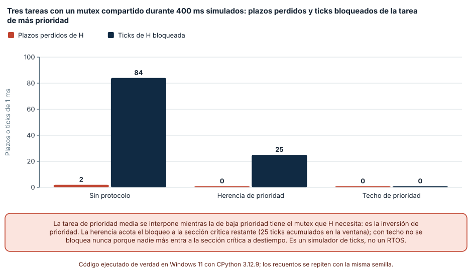
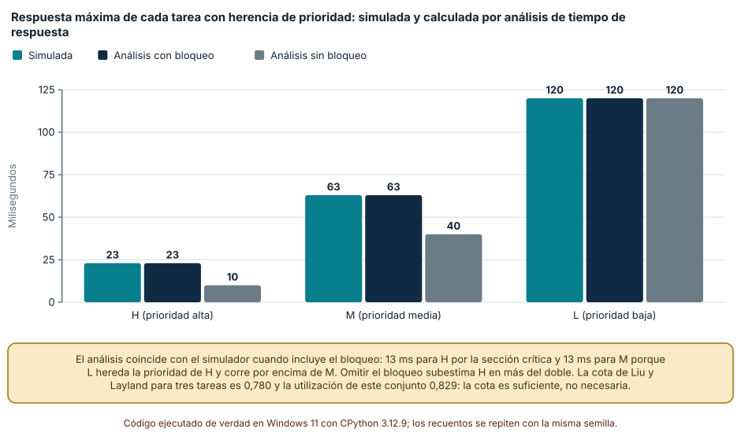
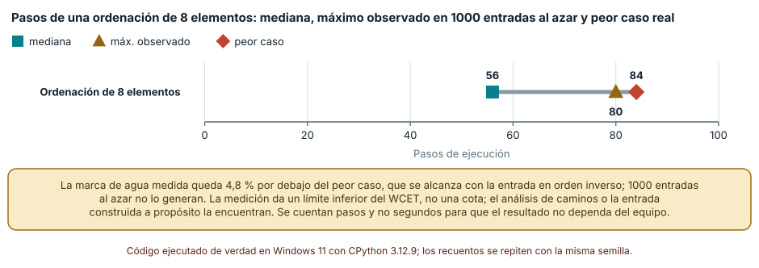

# SE-451 — RTOS y planificación de tiempo real

[← SE-450 — Casos de seguridad y trazabilidad](https://github.com/vladimiracunadev-create/modern-software-engineering-program/blob/main/classes/part-37-sistemas-criticos-tiempo-real-y-normas-de-seguridad/se-450-casos-de-seguridad-y-trazabilidad/README.md) · [↑ Parte 37](https://github.com/vladimiracunadev-create/modern-software-engineering-program/blob/main/classes/part-37-sistemas-criticos-tiempo-real-y-normas-de-seguridad/README.md) · [📚 Índice completo](https://github.com/vladimiracunadev-create/modern-software-engineering-program/blob/main/classes/README.md) · [🌐 Portal](https://vladimiracunadev-create.github.io/modern-software-engineering-program/classes/SE-451.html) · [SE-452 — Codificación segura: MISRA y CERT →](https://github.com/vladimiracunadev-create/modern-software-engineering-program/blob/main/classes/part-37-sistemas-criticos-tiempo-real-y-normas-de-seguridad/se-452-codificacion-segura-misra-y-cert/README.md)

## Punto profesional y fundamento pedagógico

**Punto profesional.** La clase existe para que entiendas por qué, en un sistema crítico, una función correcta que llega tarde es una función que falló, y qué herramientas permiten **argumentar** que llega a tiempo: el análisis de planificación de prioridades fijas, los protocolos que acotan la inversión de prioridad y el tiempo de ejecución en el peor caso (WCET). Un limitador que corta la potencia en 40 ms cuando se necesitan 2 s es seguro; el mismo limitador, bloqueado 3 s por una tarea intermedia que no tiene nada que ver con él, no lo es. Quien trabaja con sistemas embebidos de seguridad escribe, además del código, el argumento de que cada plazo se cumple.

**Por qué aparece aquí.** Sigue a `SE-450` y toma el compromiso de tiempo del caso de seguridad («el limitador corta en menos de dos segundos») como un requisito que hay que demostrar. Retoma de [SE-268 — Sistemas de tiempo real y deadlines](https://github.com/vladimiracunadev-create/modern-software-engineering-program/blob/main/classes/part-22-embedded-iot-y-tiempo-real/se-268-sistemas-de-tiempo-real-y-deadlines/README.md) y [SE-269 — Interrupciones, concurrencia y estado compartido](https://github.com/vladimiracunadev-create/modern-software-engineering-program/blob/main/classes/part-22-embedded-iot-y-tiempo-real/se-269-interrupciones-concurrencia-y-estado-compartido/README.md) los conceptos de plazo y de estado compartido y los convierte en cálculo.

**Error conceptual que debe corregir.** Creer que «mucha CPU libre» garantiza los plazos. La utilización total de un conjunto de tareas puede ser del 83 % y aun así la tarea de más prioridad perder plazos si comparte un recurso con una de baja prioridad que una de prioridad media interrumpe. En el laboratorio, con tres tareas (utilización 0,829), sin protocolo la tarea H pierde 2 plazos y queda bloqueada 84 ticks; con herencia de prioridad no pierde ninguno y se bloquea 25; con techo de prioridad, 0 y 0. La carga no cambió; cambió la regla que decide quién corre cuando alguien espera un recurso.

**Secuencia de aprendizaje.** Antes de ejecutar, predices si un conjunto con utilización por encima de la cota de Liu y Layland es planificable y cuántos plazos pierde la tarea de más prioridad cuando hay inversión. Después simulas un planificador apropiativo con un mutex, aplicas tres protocolos, calculas la respuesta máxima por análisis y la comparas con la simulada, y mides pasos de un algoritmo con entradas al azar frente al peor caso.

**Evidencia de aprendizaje.** `plazos-del-limitador.md` con la tabla de tareas (prioridad, periodo, tiempo de cómputo, secciones críticas), el análisis de tiempo de respuesta con el bloqueo, el resultado de la simulación con cada protocolo y el WCET del camino del limitador con su método.

**Límite de la conclusión.** El simulador es de ticks de 1 ms, con un solo mutex y tareas periódicas sin interrupciones, cambios de contexto ni caché; no es un sistema operativo de tiempo real. Los tiempos son del autor. El WCET se mide en pasos de un algoritmo y no en ciclos de un procesador; el análisis real del peor caso exige modelar el hardware. No se ejecutó ningún RTOS ni se invocó ningún modelo de lenguaje.

### Trazabilidad fuente → afirmación

| Fuente primaria u oficial | Afirmación que respalda | Lo que no prueba |
|---|---|---|
| [Liu y Layland, «Scheduling Algorithms for Multiprogramming in a Hard-Real-Time Environment», JACM, 1973](https://doi.org/10.1145/321738.321743) | Establece la cota de utilización n(2^(1/n) − 1) para prioridades por tasa monótona y la planificación por plazo más cercano. | Es una condición suficiente y supone tareas independientes. |
| [Sha, Rajkumar y Lehoczky, «Priority Inheritance Protocols», IEEE Transactions on Computers, 1990](https://doi.org/10.1109/12.57058) | Define los protocolos de herencia y de techo de prioridad que acotan la inversión de prioridad. | No cubre todos los recursos ni la multiprocesadores. |
| [Mike Jones, «What really happened on Mars Rover Pathfinder», RISKS Digest 19.49](https://catless.ncl.ac.uk/Risks/19/49) | Relata, desde una conferencia del CTO de Wind River, los reinicios del Pathfinder por inversión de prioridad con un mutex del bus de información. | Es un relato de segunda mano de una conferencia, no el informe de la misión. |
| [Copia del mismo relato (Cornell, curso CS614)](https://www.cs.cornell.edu/courses/cs614/1999sp/papers/pathfinder.html) | Permite leerlo completo en un sitio académico. | Mismo límite. |
| [NASA Software Engineering Handbook](https://swehb.nasa.gov/) | Recoge prácticas de la NASA sobre requisitos de tiempo, análisis de rendimiento y gestión de recursos en software crítico. | No define el análisis de este laboratorio. |

## Antes de empezar

Recupera lo aprendido en `SE-450`: una afirmación sin evidencia es una promesa. La pregunta activa es: **¿qué plazo de tu sistema se «cumple» porque nunca se vio incumplido y no porque alguien lo haya calculado?**

## Prerrequisitos

- Haber completado `SE-445` a `SE-450`.
- Haber visto [SE-268 — Sistemas de tiempo real y deadlines](https://github.com/vladimiracunadev-create/modern-software-engineering-program/blob/main/classes/part-22-embedded-iot-y-tiempo-real/se-268-sistemas-de-tiempo-real-y-deadlines/README.md) y [SE-269 — Interrupciones, concurrencia y estado compartido](https://github.com/vladimiracunadev-create/modern-software-engineering-program/blob/main/classes/part-22-embedded-iot-y-tiempo-real/se-269-interrupciones-concurrencia-y-estado-compartido/README.md).
- Entender periodo, tiempo de cómputo, plazo y utilización de una tarea periódica.
- Python 3.11 o posterior.

## Problema auténtico

El controlador del *Horno de curado* corre tres tareas: **H** (el limitador, prioridad alta, 10 ms de cómputo cada 40 ms), **M** (el registro y la comunicación, prioridad media, 30 ms cada 70) y **L** (el lazo de control lento y un resumen de estadísticas, prioridad baja, 30 ms cada 200). H y L comparten una estructura de datos protegida por un mutex: H lee la temperatura filtrada que L actualiza. Todo parece sobrado: la utilización es del 83 %. En una prueba larga, una vez cada varias horas, el limitador tarda más de lo permitido y el vigilante reinicia el sistema. Nadie lo reproduce en el banco.

La clase reproduce el fenómeno en un simulador, aplica herencia y techo de prioridad, calcula las respuestas máximas por análisis y las compara con la simulación, y muestra por qué medir tiempos en pruebas no basta para argumentar el peor caso.

## Objetivos observables

Al terminar podrás:

1. explicar planificación apropiativa de prioridades fijas, utilización y la diferencia entre una condición suficiente y una necesaria;
2. reproducir una inversión de prioridad y explicar por qué la prioridad media retrasa a la alta;
3. aplicar herencia y techo de prioridad y razonar el bloqueo que dejan;
4. calcular el tiempo de respuesta máximo de cada tarea con interferencia y bloqueo, y compararlo con una simulación;
5. distinguir una marca de agua medida de un WCET argumentado y los métodos para acotar el segundo.

## Mapa conceptual


El análisis combina tres insumos (cómputo en el peor caso, interferencia de tareas más prioritarias y bloqueo por recursos) y su resultado es una cota, no una medición.

## Temas y por qué importan

| Tema | Por qué cambia una decisión profesional | Evidencia mínima |
|---|---|---|
| Prioridades fijas y utilización | Fijan la regla de quién corre. | Tabla de tareas |
| Inversión de prioridad | Retrasa a la tarea más urgente sin que haya carga alta. | Simulación o traza |
| Herencia y techo de prioridad | Acotan el bloqueo. | Protocolo y su bloqueo máximo |
| Análisis de tiempo de respuesta | Da una cota por tarea. | Cálculo con bloqueo |
| WCET | Es el insumo más difícil de obtener. | Método y justificación |
| Cota de utilización | Es una condición suficiente rápida. | Utilización y cota |
| Mediciones y traza | Complementan, no sustituyen, el análisis. | Registros con semilla |

## Conceptos y decisiones

### 1. Prioridades fijas, utilización y la cota de Liu y Layland

En un planificador apropiativo de prioridades fijas, cada tarea tiene una prioridad que no cambia y la que está lista con mayor prioridad corre. Si las prioridades se asignan por tasa monótona (menor periodo, mayor prioridad), Liu y Layland demostraron en 1973 que n tareas periódicas independientes cumplen sus plazos si la utilización total no supera n(2^(1/n) − 1): 0,780 para tres tareas y, con muchas tareas, el logaritmo natural de 2, unos 0,693. Es una condición **suficiente**, no necesaria. En el laboratorio, un conjunto con utilización 0,841 supera la cota y es planificable por análisis (la tarea más lenta responde en 77 ms de 100); otro con 0,950 supera la cota y no lo es (113 ms de 100). La cota no responde «¿cumple?», responde «seguro que sí» o «hay que mirar más».

### 2. Análisis de tiempo de respuesta

El tiempo de respuesta máximo de una tarea es su cómputo más el bloqueo que le impone un recurso tomado por una tarea de menor prioridad, más la interferencia de las tareas de mayor prioridad, que se resuelve por iteración: R = C + B + Σ ⌈R / Tj⌉ Cj sobre las tareas j más prioritarias, hasta que R deja de cambiar. Es exacto para el modelo (tareas periódicas con plazo igual al periodo, desfase peor posible) y barato de calcular. Es la herramienta que convierte «mucha CPU libre» en una cota por tarea. En el laboratorio, sin considerar el bloqueo, el análisis daría 10, 40 y 120 ms para H, M y L; con el bloqueo, 23, 63 y 120, que coinciden con los máximos de la simulación.

### 3. La inversión de prioridad

La tarea de baja prioridad L toma el mutex. La tarea de alta prioridad H se activa y pide el mismo mutex: se bloquea esperando a L. Mientras tanto, una tarea de prioridad media M, que nada tiene que ver con el recurso, está lista y desplaza a L (M tiene más prioridad que L): H queda esperando a M, de menor prioridad que ella. El bloqueo ya no está acotado por la sección crítica de L sino por todo lo que M quiera correr. En el laboratorio, sin protocolo, H pierde 2 plazos y acumula 84 ticks bloqueada. Es el fallo que reinició el Pathfinder en 1997, según el relato que recoge la bibliografía: una tarea de baja prioridad que publicaba datos meteorológicos retenía el mutex del bus de información, y otras tareas de prioridad media impedían que lo liberara mientras la tarea del bus, de alta prioridad, esperaba.

### 4. Herencia y techo de prioridad

Con **herencia de prioridad**, la tarea que tiene el mutex hereda la prioridad más alta de las que esperan por él; así M no puede desplazar a L mientras H espera. El bloqueo de H queda acotado por la sección crítica restante de L. Con **techo de prioridad**, cada mutex tiene un techo igual a la prioridad más alta de las tareas que lo usan y quien lo toma corre con esa prioridad desde el momento de tomarlo: evita además los interbloqueos por orden de toma y acota el bloqueo a una sección crítica, a costa de subir la prioridad aun cuando nadie espera. En el laboratorio, con herencia H se bloquea 25 ticks y con techo 0 porque H nunca llega a esperar. Un detalle de configuración puede arruinarlo: en el relato del Pathfinder, la herencia de prioridad existía en el sistema operativo y estaba desactivada en ese mutex.

### 5. El bloqueo hacia otras tareas

Un protocolo que protege a H traslada un costo a otras. Con herencia, L corre con la prioridad de H durante su sección crítica y retrasa a M hasta 13 ms; el análisis lo registra como un bloqueo de M de 13 ms, y por eso la respuesta calculada de M es 63 ms y no los 40 de su cómputo e interferencia. Es una regla general: cada garantía de plazo para una tarea se paga con un bloqueo de otra, y el análisis tiene que sumar los dos lados.

### 6. WCET: lo que se mide y lo que se argumenta

El tiempo de cómputo del peor caso de una tarea es el insumo más difícil. Medirlo en pruebas da un límite inferior: lo que se observó, no lo que puede ocurrir. En el laboratorio, una ordenación de 8 elementos con salida anticipada usa 56 pasos de mediana, 80 pasos como máximo observado en 1000 entradas al azar y 84 pasos en el peor caso real (entrada en orden inverso), que 1000 entradas aleatorias no generan: la marca de agua queda 4,8 % por debajo. Las vías para acotarlo son el análisis estático de caminos con un modelo del hardware (la caché, el procesador y los accesos a memoria), las mediciones sobre entradas construidas para ejercitar el peor camino y el diseño que elimina la variación (bucles con cota, sin recursión). Ninguna es gratuita.

### 7. Lo que el modelo no incluye

El análisis supone tareas periódicas independientes, un solo procesador, cambios de contexto sin costo y sin interrupciones, y plazos iguales al periodo. En un sistema real hay interrupciones que roban tiempo, costos de cambio de contexto, cachés compartidas, buses y multiprocesadores que rompen varias de esas hipótesis. Cada una se modela, se acota o se evita por diseño, y se documenta como supuesto del argumento. Lo que no se puede es ignorarlas porque «el simulador no las tiene».

## Inversión de prioridad

La primera medida compara los tres protocolos sobre las mismas tres tareas.



**Cómo leer la figura.** Cada grupo es un protocolo; las barras son los plazos perdidos por H y los ticks que H pasó bloqueada. Mira primero el grupo de la izquierda: con la misma carga, la ausencia de protocolo pierde plazos. **Dónde deja de valer:** es un simulador de ticks de 1 ms con un solo mutex y sin interrupciones; el número de ticks bloqueados depende del desfase elegido entre las tareas. Lo que se traslada es la forma del problema, no las cifras.

## Análisis frente a simulación

La segunda medida compara la respuesta máxima simulada con la calculada.



**Cómo leer la figura.** Cada grupo es una tarea y cada barra una forma de obtener su respuesta máxima; mira primero que simulación y análisis con bloqueo coinciden y que el análisis sin bloqueo subestima a H y a M. **Dónde deja de valer:** el análisis es exacto para el modelo (tareas periódicas independientes salvo el mutex); que coincida con el simulador solo muestra que el simulador implementa el mismo modelo, no que el modelo describa un sistema real.

## Marca de agua frente a peor caso

La tercera medida compara pasos medidos con el peor caso real de un algoritmo.



**Cómo leer la figura.** El segmento va de la mediana al peor caso real; los marcadores son la mediana, el máximo de 1000 entradas al azar y el peor caso. Mira primero la brecha entre el máximo observado y el peor caso: es lo que la medición aleatoria no vio. **Dónde deja de valer:** se cuentan pasos de un algoritmo de 8 elementos, no ciclos de una CPU; para ocho elementos el peor caso se conoce a mano, para código real hay que encontrarlo por análisis de caminos.

## Definiciones de trabajo

- **[Prioridad fija](../../../glosario/entradas/p/prioridad-fija.md):** prioridad de una tarea que no cambia durante la ejecución.
- **[Tasa monótona](../../../glosario/entradas/t/tasa-monotona.md):** asignación de prioridad según el periodo: menor periodo, mayor prioridad.
- **[Utilización](../../../glosario/entradas/u/utilizacion.md):** fracción de CPU que una tarea o un conjunto necesita (cómputo dividido por periodo).
- **[Inversión de prioridad](../../../glosario/entradas/i/inversion-de-prioridad.md):** situación en la que una tarea de alta prioridad espera por una de menor prioridad que a su vez es desplazada por otra intermedia.
- **[Herencia de prioridad](../../../glosario/entradas/h/herencia-de-prioridad.md):** el poseedor de un recurso hereda la prioridad más alta de quienes esperan.
- **[Techo de prioridad](../../../glosario/entradas/t/techo-de-prioridad.md):** el poseedor corre con la prioridad máxima de las tareas que usan el recurso.
- **[WCET](../../../glosario/entradas/p/peor-caso-de-ejecucion.md):** tiempo de ejecución en el peor caso de una tarea, sin interferencias.

## Ejemplo mínimo

El análisis de tiempo de respuesta por iteración para tres tareas, en pocas líneas:

```python
import math

tareas = [("H", 10, 40), ("M", 30, 70), ("L", 30, 200)]    # (nombre, cómputo, periodo) por prioridad
bloqueo = {"H": 13, "M": 13, "L": 0}

for i, (n, c, t) in enumerate(tareas):
    r = c + bloqueo[n]
    while True:
        nuevo = c + bloqueo[n] + sum(math.ceil(r / tp) * cp for _, cp, tp in tareas[:i])
        if nuevo == r:
            break
        r = nuevo
    print(n, r, "ms de", t)
```

Imprime 23, 63 y 120 ms, los mismos valores que el simulador de la clase. Es la ventaja del análisis: una cota en milisegundos de cálculo sin simular horas de ejecución.

## Ejemplo profesional

*Escenario ilustrativo: las cifras y los resultados que aparecen en este ejemplo son supuestos de la narración, no mediciones.*

Un equipo entrega el firmware de un limitador con una tabla de tareas y una afirmación: «la respuesta máxima del limitador es 23 ms». El revisor pide el análisis y encuentra que el bloqueo por el mutex del filtrado se calculó con la sección crítica de 5 ms que figura en el código, sin contar que la biblioteca de impresión de diagnóstico, llamada dentro de la misma sección, puede bloquearse en un puerto serie. La sección crítica real, en el peor caso, es de decenas de milisegundos. El equipo quita la llamada de la sección, mueve la impresión a otra tarea y vuelve a calcular. El hallazgo no vino del análisis (que era correcto para los datos que se le dieron) sino de preguntar qué hay dentro de la sección crítica. Un bloqueo se acota mirando el código, no las tablas.

## Práctica guiada

1. Escribe la tabla de tareas de un sistema tuyo con prioridad, periodo, cómputo y recursos compartidos.
2. Calcula la utilización y compárala con la cota de Liu y Layland; anota si es suficiente.
3. Ejecuta `python scripts/experiments_part37_b.py 571` y reproduce la inversión con y sin protocolo.
4. Calcula a mano el tiempo de respuesta de la tarea más prioritaria con el bloqueo de cada recurso.
5. Mide el tiempo de una función crítica con 1000 entradas y escribe cómo buscarías su peor caso.

## Ejercicios

1. **Básico.** Explica por qué la tarea M, que no usa el mutex, aparece con 63 ms de respuesta y no con 40 cuando H y L comparten uno.
2. **Intermedio.** Modifica el simulador para que la sección crítica de L dure 25 ms en lugar de 15 y mide cuántos plazos pierde H con cada protocolo.
3. **Avanzado.** Añade una interrupción periódica que roba 1 ms cada 10 al procesador y recalcula el análisis de tiempo de respuesta con ese costo; razona cómo la modelarías para el limitador.

## Reto verificable

Entrega `plazos-del-limitador.md` y el código de un simulador de planificación con al menos tres tareas y un recurso compartido, con tres protocolos y el análisis de tiempo de respuesta. Es válido si otra persona reproduce los plazos perdidos y los ticks bloqueados por protocolo, la coincidencia entre análisis y simulación y la brecha entre una marca de agua medida y el peor caso real de un algoritmo.

## Caso conductor

El limitador del *Horno de curado* cumple ahora su plazo con un argumento y no solo con pruebas. `SE-452` baja a otro nivel: qué reglas de codificación evitan que el código tenga defectos que ningún análisis de planificación puede ver.

## Preguntas frecuentes

### ¿Siempre conviene el techo de prioridad?

Evita los interbloqueos por orden de toma y acota el bloqueo a una sección crítica, pero sube la prioridad de quien toma el recurso aunque nadie espere, y exige conocer de antemano qué tareas usan cada recurso. La herencia es más flexible y más dinámica; la elección depende del sistema.

### ¿El tiempo real es lo mismo que rápido?

No: tiempo real es previsible y acotado. Un sistema rápido en promedio que a veces tarda cien veces más falla un plazo duro; uno más lento pero acotado lo cumple. Lo que se pide es una cota con argumento.

### ¿Cómo se obtiene el WCET en la práctica?

Con análisis estático de caminos con un modelo del hardware, con mediciones sobre entradas que ejercitan el peor camino y con diseño que reduce la variación. Combinar medición y análisis es lo habitual, y siempre con un margen explícito.

### ¿Qué pasa con varios procesadores?

El análisis se complica: hay interferencia por buses y cachés compartidas y los protocolos de recursos son distintos. Las teorías existen y son más difíciles de aplicar; muchos sistemas críticos eligen un solo núcleo para el argumento de seguridad.

## Fallo controlado y diagnóstico

**Fallo.** Una vez cada pocas horas, el vigilante reinicia el controlador del horno. Los registros muestran que el limitador tardó 140 ms en una iteración en que debía tardar menos de 30.

**Diagnóstico paso a paso.** (1) El tiempo de ejecución del limitador, medido aisladamente, es de 8 ms y no explica el retraso. (2) La traza muestra a H bloqueada esperando el mutex que L tenía. (3) Entre medias, la tarea M de registro, de prioridad intermedia, corrió 120 ms porque había una ráfaga de eventos. (4) La herencia de prioridad estaba disponible en el sistema operativo y desactivada en la creación de ese mutex.

**Corrección.** Se activa la herencia en el mutex, se acota la sección crítica de L, se añade al análisis el bloqueo de M y se incorpora una prueba de estrés que genera una ráfaga de eventos mientras L mantiene el mutex. La lección es que el fallo no estaba en ninguna tarea sino en la regla de interacción, y que las pruebas del banco con carga ligera no podían verlo.

## Errores comunes y cómo corregirlos

- **Confiar en la utilización baja.** Corrige calculando respuestas con bloqueo e interferencia.
- **Desactivar la herencia de prioridad.** Corrige verificándola en la configuración y en una prueba.
- **Medir un tiempo y llamarlo WCET.** Corrige con análisis de caminos o con entradas construidas para el peor caso.
- **Poner llamadas lentas dentro de una sección crítica.** Corrige acotando lo que ocurre dentro y sacando lo demás.
- **Olvidar el bloqueo que se traslada a otras tareas.** Corrige sumando el bloqueo de cada protocolo en el análisis.
- **Ignorar interrupciones y cambios de contexto.** Corrige modelándolos como interferencia o acotándolos por diseño.

## Entorno y archivos clave

- `scripts/experiments_part37_b.py`: función `e571` con el simulador de ticks, el análisis de tiempo de respuesta y el experimento de WCET; se ejecuta con `python scripts/experiments_part37_b.py 571`.
- Los desfases (la tarea H se libera en el tick 8 y M en el 7) están elegidos para producir la inversión; la semilla 47 solo afecta al WCET aleatorio.
- `scripts/figures_part37_b.py`: las tres figuras de la clase.
- Solo la biblioteca estándar de Python 3.11 o posterior.

## Seguridad, ética y accesibilidad

Un plazo incumplido en un sistema de seguridad es un daño que puede ocurrir una vez en años y por eso no se encuentra en pruebas. La ética del trabajo es argumentar el peor caso y declarar los supuestos, en lugar de mostrar que «nunca falló». La clase no sustituye el análisis de un sistema real ni afirma garantías temporales de ningún producto. Las figuras tienen texto alternativo completo y no dependen solo del color.

## Puente hacia el trabajo con agentes

Un agente que optimiza un lazo de control puede mover trabajo a una sección crítica, añadir un registro o cambiar un orden de tareas sin saber qué plazos dependen de eso. Pídele que, antes de tocar código dentro de una sección crítica o de una tarea con plazo, liste las tareas que comparten el recurso y el análisis de respuesta afectado, y exige que el cambio venga con una nueva medición del peor caso. Un agente que «mejora el rendimiento promedio» sin mirar el peor caso puede empeorar el sistema.

## Transferencia

Elige un sistema tuyo con un plazo importante. Haz la tabla de tareas, identifica recursos compartidos y calcula la respuesta de la tarea crítica con bloqueo e interferencia. Averigua si tu sistema operativo usa herencia o techo en esos recursos. Busca el peor caso de la función crítica con una entrada construida y compáralo con lo que mide tu prueba habitual. Decide qué parte del argumento falta.

## Evaluación y evidencia

| Criterio | Evidencia aceptable | Rechazo |
|---|---|---|
| Modelo de tareas | Tabla con prioridad, periodo, cómputo y recursos | «Hay poca carga» |
| Protocolo | Herencia o techo verificado en configuración | Mutex sin protocolo |
| Análisis | Respuesta con bloqueo e interferencia | Solo utilización |
| WCET | Método y margen declarados | Un tiempo medido una vez |
| Supuestos | Interrupciones y cambios de contexto tratados | «El simulador no los tiene» |

## Fuentes

- Liu, C. L. y Layland, J. W. [«Scheduling Algorithms for Multiprogramming in a Hard-Real-Time Environment»](https://doi.org/10.1145/321738.321743). Journal of the ACM, 20(1), 1973.
- Sha, L., Rajkumar, R. y Lehoczky, J. P. [«Priority Inheritance Protocols: An Approach to Real-Time Synchronization»](https://doi.org/10.1109/12.57058). IEEE Transactions on Computers, 39(9), 1990.
- Jones, M. [«What really happened on Mars Rover Pathfinder»](https://catless.ncl.ac.uk/Risks/19/49). RISKS Digest 19.49, 1997, y [copia en Cornell](https://www.cs.cornell.edu/courses/cs614/1999sp/papers/pathfinder.html).
- NASA. [Software Engineering Handbook](https://swehb.nasa.gov/).

## Límites y siguiente paso

El simulador es de ticks con un solo mutex, sin interrupciones ni caché; los tiempos son del autor y el WCET se mide en pasos de un algoritmo; el relato del Pathfinder es de segunda mano. Los dos artículos clásicos se citan por su DOI, que responde con bloqueo a clientes automáticos, y no se reproducen. El siguiente paso, `SE-452`, cambia de nivel y mira qué reglas de codificación previenen defectos que ni el análisis de tiempo ni las pruebas detectan fácilmente.

## Glosario

| Término | Definición breve |
|---|---|
| Tasa monótona | Prioridad según el periodo: menor periodo, mayor prioridad |
| Utilización | Fracción de CPU que necesita una tarea |
| Inversión de prioridad | Una tarea urgente espera a una menos urgente por culpa de una intermedia |
| Herencia de prioridad | El poseedor del recurso hereda la prioridad del que espera |
| Techo de prioridad | El poseedor corre con la prioridad máxima del recurso |
| WCET | Tiempo de ejecución en el peor caso |

Conceptos de esta clase en el [glosario del programa](../../../glosario/README.md): [Herencia de prioridad](../../../glosario/entradas/h/herencia-de-prioridad.md) · [Inversión de prioridad](../../../glosario/entradas/i/inversion-de-prioridad.md) · [Peor caso de ejecución](../../../glosario/entradas/p/peor-caso-de-ejecucion.md) · [Prioridad fija](../../../glosario/entradas/p/prioridad-fija.md) · [Tasa monótona](../../../glosario/entradas/t/tasa-monotona.md) · [Techo de prioridad](../../../glosario/entradas/t/techo-de-prioridad.md) · [Utilización](../../../glosario/entradas/u/utilizacion.md).

---

[← SE-450 — Casos de seguridad y trazabilidad](https://github.com/vladimiracunadev-create/modern-software-engineering-program/blob/main/classes/part-37-sistemas-criticos-tiempo-real-y-normas-de-seguridad/se-450-casos-de-seguridad-y-trazabilidad/README.md) · [↑ Parte 37](https://github.com/vladimiracunadev-create/modern-software-engineering-program/blob/main/classes/part-37-sistemas-criticos-tiempo-real-y-normas-de-seguridad/README.md) · [📚 Índice completo](https://github.com/vladimiracunadev-create/modern-software-engineering-program/blob/main/classes/README.md) · [🌐 Portal](https://vladimiracunadev-create.github.io/modern-software-engineering-program/classes/SE-451.html) · [SE-452 — Codificación segura: MISRA y CERT →](https://github.com/vladimiracunadev-create/modern-software-engineering-program/blob/main/classes/part-37-sistemas-criticos-tiempo-real-y-normas-de-seguridad/se-452-codificacion-segura-misra-y-cert/README.md)
