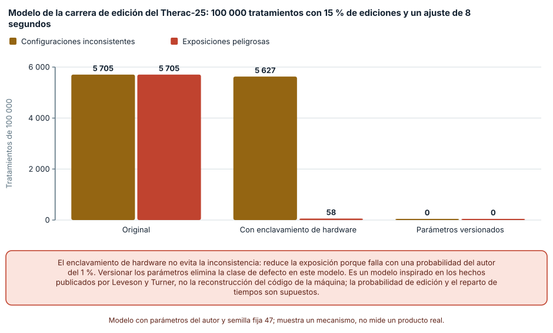
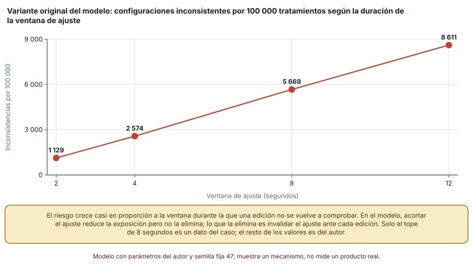
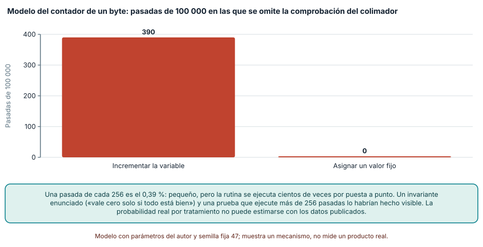

# SE-455 — Taller: analizar un fallo real frente a las normas

[← SE-454 — Verificación y cobertura: MC/DC, HIL y SIL](https://github.com/vladimiracunadev-create/modern-software-engineering-program/blob/main/classes/part-37-sistemas-criticos-tiempo-real-y-normas-de-seguridad/se-454-verificacion-y-cobertura-mc-dc-hil-y-sil/README.md) · [↑ Parte 37](https://github.com/vladimiracunadev-create/modern-software-engineering-program/blob/main/classes/part-37-sistemas-criticos-tiempo-real-y-normas-de-seguridad/README.md) · [📚 Índice completo](https://github.com/vladimiracunadev-create/modern-software-engineering-program/blob/main/classes/README.md) · [🌐 Portal](https://vladimiracunadev-create.github.io/modern-software-engineering-program/classes/SE-455.html) · [SE-456 — Proyecto: paquete de aseguramiento de un controlador →](https://github.com/vladimiracunadev-create/modern-software-engineering-program/blob/main/classes/part-37-sistemas-criticos-tiempo-real-y-normas-de-seguridad/se-456-proyecto-paquete-de-aseguramiento-de-un-controlador/README.md)

## Punto profesional y fundamento pedagógico

**Punto profesional.** La clase es un taller: en lugar de introducir una técnica nueva, usa las diez anteriores para **analizar un fallo real** y responder dos preguntas que un profesional del área debe saber contestar. ¿Qué idea de las normas de seguridad, si se hubiera aplicado, habría hecho visible cada factor del accidente? Y ¿qué parte de la lección no depende de ninguna norma sino del criterio de quien diseña? El caso es el del Therac-25, un acelerador lineal médico cuyos accidentes entre 1985 y 1987 se conocen en detalle por la investigación de Nancy Leveson y Clark Turner; el análisis completo de los hechos está en [el caso Therac-25](https://github.com/vladimiracunadev-create/modern-software-engineering-program/blob/main/casos/fallo/therac-25.md), y esta clase no lo repite: lo usa como material de trabajo. Las normas modernas nacieron en parte de casos como este, y el ejercicio de proyectarlas hacia atrás es una forma de entenderlas.

**Por qué aparece aquí.** Sigue a `SE-454` y precede al proyecto de `SE-456`. Reúne `SE-445` (análisis de peligros y causa común), `SE-446` (integridad por función y prueba periódica), `SE-450` (casos de seguridad y supuestos), `SE-451` (tiempo y concurrencia), `SE-452` (aritmética y reglas), `SE-453` (modelos de estados y contraejemplos) y `SE-454` (cobertura y condiciones temporales). También se relaciona con [SE-274 — Safety, seguridad y vida útil prolongada](https://github.com/vladimiracunadev-create/modern-software-engineering-program/blob/main/classes/part-22-embedded-iot-y-tiempo-real/se-274-safety-seguridad-y-vida-util-prolongada/README.md).

**Error conceptual que debe corregir.** Creer que un accidente así se explica por un «error de programación» y que se evita con un mejor programador. Los hechos documentados son una cadena de condiciones: el software como única barrera tras retirar interbloqueos de hardware, un análisis de seguridad que no consideró el software, una condición de carrera, un contador de un byte, mensajes crípticos, una cultura de pausas rutinarias y una respuesta lenta a los incidentes. En el modelo del laboratorio, la variante original tiene 5 705 configuraciones peligrosas por 100 000 tratamientos; un enclavamiento de hardware que falla con una probabilidad del autor del 1 % las reduce a 58; versionar los parámetros las lleva a 0. Ninguna medida sola es toda la lección, y cada una corresponde a una idea distinta.

**Secuencia de aprendizaje.** Antes de ejecutar, predices cuánto reduce el riesgo un enclavamiento de hardware imperfecto frente a eliminar la clase de defecto y qué tan sensible es la tasa de inconsistencias a la duración de una ventana de ajuste. Después lees el caso, extraes la lista de factores, los proyectas a las ideas de las clases anteriores, ejecutas dos modelos del autor (la carrera de edición y el contador de un byte) y escribes el análisis.

**Evidencia de aprendizaje.** `analisis-therac-25.md` con la tabla de factores (cada uno con su fuente en el caso), la idea de seguridad que lo habría hecho visible, la medida de control propuesta y su verificación, y los límites del análisis retrospectivo.

**Límite de la conclusión.** Todo lo que se afirma de los hechos viene de Leveson y Turner (1993) a través del caso del programa; los dos modelos del laboratorio son del autor, **inspirados** en el mecanismo publicado y no una reconstrucción del código de la máquina, que no es público. La probabilidad de edición, la distribución del instante de la edición y el 1 % de falla del enclavamiento son supuestos. El análisis retrospectivo tiene sesgo de lo ya sabido: quien diseñó la máquina no tenía el artículo. No se atribuyen culpas a personas ni se afirma qué habría pasado de otro modo.

### Trazabilidad fuente → afirmación

| Fuente primaria u oficial | Afirmación que respalda | Lo que no prueba |
|---|---|---|
| [Leveson y Turner, «An Investigation of the Therac-25 Accidents», IEEE Computer, 1993](https://doi.org/10.1109/MC.1993.274940) | Fuente primaria de los hechos técnicos: la ventana de 8 segundos, el contador de un byte, la retirada de interbloqueos de hardware y el análisis de seguridad que no consideró el software. | No incluye el código fuente ni las distribuciones de uso. |
| [Copia del artículo en el sitio de un curso de Columbia](https://www.cs.columbia.edu/~junfeng/08fa-e6998/sched/readings/therac25.pdf) | Permite leer el texto completo. | Mismo límite. |
| [Caso Therac-25 del programa](https://github.com/vladimiracunadev-create/modern-software-engineering-program/blob/main/casos/fallo/therac-25.md) | Reúne los hechos, la arquitectura, la línea de tiempo y las lecciones con su fuente y sus límites. | Es un caso didáctico, no una fuente primaria. |
| [Informe del vuelo 501 de Ariane 5 (ESA)](https://esamultimedia.esa.int/docs/esa-x-1819eng.pdf) | Segundo caso de fallo por un supuesto heredado y sin análisis de seguridad del software. | No es el caso estudiado. |
| [IEC 61508-1, ficha de la norma](https://webstore.iec.ch/en/publication/5515) | Identifica la norma genérica cuyas ideas se proyectan al caso; la norma es posterior a los accidentes. | No contiene su texto. |
| [Python: `random`](https://docs.python.org/3/library/random.html) | Documenta el generador con semilla de los modelos. | No valida el modelo. |

## Antes de empezar

Recupera lo aprendido en `SE-450`: un caso de seguridad vale tanto como sus supuestos. La pregunta activa es: **¿qué barrera de seguridad de tu sistema fue retirada o debilitada «porque el software ya lo comprueba», y quién revisó que el software lo comprueba bien?**

## Prerrequisitos

- Haber completado `SE-445` a `SE-454`.
- Haber leído el [caso Therac-25](https://github.com/vladimiracunadev-create/modern-software-engineering-program/blob/main/casos/fallo/therac-25.md), al menos las secciones sobre la arquitectura, el análisis de la condición de carrera y el contador de un byte.
- Haber visto [SE-501 — Postmortems sin culpa y aprendizaje](https://github.com/vladimiracunadev-create/modern-software-engineering-program/blob/main/classes/part-41-observabilidad-sre-e-incidentes/se-501-postmortems-sin-culpa-y-aprendizaje/README.md).
- Python 3.11 o posterior.

## Problema auténtico

Un comité de seguridad de un hospital recibe una propuesta de adquirir un acelerador moderno. El proveedor presenta una lista de certificaciones y la persona que preside pregunta, en voz alta, algo que cambia la reunión: «Si esta máquina cometiera hoy el error del Therac-25, ¿qué capa de ustedes lo detendría, y cómo lo sabe?». El equipo del proveedor puede hablar de normas y procesos, pero la pregunta pide otra cosa: un análisis concreto de qué defensas son independientes y de qué evidencia las respalda.

La clase hace ese ejercicio con el caso real. Se enumeran los factores documentados, se proyectan a las ideas de las clases anteriores, y se miden con dos modelos qué reduce más el riesgo: cada medida por separado y la medida que elimina la clase de defecto. No se analiza para repartir culpas sino para entrenar la pregunta.

## Objetivos observables

Al terminar podrás:

1. extraer de un informe de investigación los factores causales con su fuente, separando lo documentado de lo inferido;
2. proyectar cada factor a una idea de análisis (peligro, integridad, causa común, supuesto, tiempo, aritmética, estado) y proponer una medida de control con su verificación;
3. modelar una condición de carrera y un contador desbordado con un modelo declarado y medir el efecto de tres controles;
4. distinguir el efecto de reducir la probabilidad de un defecto del de eliminar su clase;
5. escribir un análisis retrospectivo que reconozca el sesgo de lo ya sabido y no atribuya culpas.

## Mapa conceptual

![Diagrama de flujo con 12 pasos. Recorrido: «Informe de investigación»; luego «Factores con su fuente»; luego «Software como única barrera», «Análisis que excluyó el software», «Condición de carrera», «Contador de un byte» y «Cultura de pausas y mensajes crípticos»; luego «Integridad por función y defensa en profundidad», «Análisis de peligros que incluye el software», «Modelo de estados y parámetros versionados», «Aritmética, invariantes y pruebas de límites» y «Caso de seguridad y revisión de supuestos».](../../../site/assets/figures/mermaid-efd513cb9c.svg)

Cada factor se proyecta a una idea de una clase anterior y a una medida con su verificación; ninguno se cubre con una sola.

## Temas y por qué importan

| Tema | Por qué cambia una decisión profesional | Evidencia mínima |
|---|---|---|
| Hechos y su fuente | Separa lo documentado de lo inferido. | Tabla con cita por factor |
| Software como única barrera | Hace que un solo defecto baste. | Capas independientes |
| Análisis que excluye el software | Deja sin cubrir la mayor parte del riesgo. | Árbol con eventos de software |
| Condición de carrera | Un orden raro de eventos produce un estado inconsistente. | Modelo de estados |
| Contador y aritmética | Un desbordamiento anula una comprobación. | Prueba de límites |
| Cultura y mensajes | Una alarma rutinaria deja de proteger. | Tasa de alarmas y acciones |
| Respuesta a incidentes | Retrasa o acelera el aprendizaje. | Línea de tiempo con decisiones |

## Conceptos y decisiones

### 1. Extraer los factores con su fuente

El primer paso es leer el informe y separar, con una cita por cada uno, lo que está **documentado** de lo que se **infiere**. Del caso, con la fuente en Leveson y Turner: las máquinas anteriores conservaban interbloqueos de hardware y el Therac-25 trasladó parte de esa protección al software; el análisis de seguridad de 1983 con árbol de fallos no consideró errores de software; la rutina de entrada de datos tenía una condición de carrera con una ventana de unos 8 segundos del ajuste de imanes durante la que una edición no se volvía a comprobar; una variable compartida de un solo byte se incrementaba en cada pasada y volvía a cero en la pasada 256, momento en que la comprobación del colimador se omitía; los mensajes de error eran crípticos y los operadores aprendieron a continuar tras ellos; y la respuesta a los primeros incidentes fue lenta. Lo que **no** se sabe también es parte del análisis: el artículo no obtuvo detalles del desarrollo ni de los costos.

### 2. Software como única barrera: defensa en profundidad

Cuando una protección depende de un único componente, un solo defecto basta. Es la idea de `SE-446` (independencia de los canales, causa común) aplicada a una arquitectura completa: tras retirar interbloqueos de hardware, la protección de seguridad era la misma pieza que producía el fallo. La medida de control es de arquitectura: una barrera independiente (hardware, otro principio) que no pueda ser anulada por el mismo error. En el modelo del laboratorio, un enclavamiento de hardware con una probabilidad de falla del autor del 1 % reduce las exposiciones peligrosas de 5 705 a 58 por 100 000 tratamientos, un 99 %, sin tocar la causa de las inconsistencias, que sigue produciendo 5 627.

### 3. El análisis de peligros que excluyó el software

El árbol de fallos de 1983, según el artículo, asumió que los errores de programación no existen y asignó probabilidades sin justificación. La idea de `SE-445` (HARA, FTA, STPA) responde de dos formas: el árbol debe incluir eventos de software como causas (con la limitación de que no tienen una tasa) y el análisis de acciones de control no seguras (STPA) pregunta, para cada acción, cuándo sería insegura sin presumir que nada falla. «Disparar el haz con la plataforma en la posición de luz de campo» es una acción de control no segura que aparece al enumerar contextos aunque ningún componente falle.

### 4. La condición de carrera como modelo de estados

El mecanismo documentado: la edición del operador ocurre dentro de la ventana de 8 segundos del ajuste de imanes, después de que la rutina de espera comprobó por última vez si había cambios, y los parámetros quedan inconsistentes. En el modelo del laboratorio, 100 000 tratamientos con una probabilidad de edición del 15 % (supuesto) y el instante de la edición uniforme en los primeros 20 segundos dan 5 705 inconsistencias en la variante original; con una ventana de 2 segundos son 1 129 y con 12 segundos, 8 611: el riesgo crece casi en proporción a la ventana durante la cual una edición no se vuelve a comprobar. La medida que elimina la clase es que cada edición invalide el ajuste y lo reinicie (parámetros versionados): 0 inconsistencias. Es la idea de `SE-453`: un modelo de estados con el invariante «la configuración del haz corresponde a los parámetros vigentes» habría producido un contraejemplo corto.

### 5. El contador de un byte: aritmética e invariantes

La variable debía valer cero solo si todo estaba bien; al incrementarla en cada pasada volvía a cero cada 256, y en esa pasada la comprobación del colimador se omitía. En el modelo, con 100 000 pasadas, 390 omiten la comprobación (0,39 %); si se asigna un valor fijo distinto de cero, ninguna. La corrección descrita fue exactamente esa. Las ideas de `SE-452` (aritmética de enteros, prueba con valores en los límites) y de `SE-159` (invariantes) lo habrían hecho visible: «vale cero solo si todo está bien» es un invariante que una prueba de más de 256 pasadas rompe. La probabilidad por tratamiento no puede estimarse con lo publicado: el modelo muestra el mecanismo, no el riesgo real.

### 6. Cultura, mensajes y supuestos

Los mensajes crípticos y las pausas que el operador aprendía a confirmar son un caso de alarma rutinaria: una defensa que se dispara demasiado se vuelve un trámite. Es una idea de factores humanos y de `SE-450` (supuestos): el caso de seguridad supone que el operador reacciona ante un mensaje, y ese supuesto debe verificarse con la tasa real de mensajes y de acciones. También el modo en que se reaccionó a los incidentes (lentitud, falta de notificación obligatoria entre centros) es un hecho del sistema socio-técnico, no un fallo de una persona.

### 7. Qué no hace el análisis retrospectivo

Un análisis retrospectivo tiene el sesgo de lo ya sabido: sabemos qué pasó y por tanto parece obvio. Los diseñadores de entonces no tenían el artículo, ni las normas posteriores, ni las herramientas actuales. El análisis sirve para entrenar la pregunta, no para juzgar. Además, la proyección es una hipótesis: no sabemos qué habría hecho el equipo con un árbol de fallos mejor; sabemos qué ideas ofrecen las técnicas. La honestidad de un taller así es decir qué parte de cada afirmación viene de la fuente y cuál es nuestra.

## Comparación de controles

La primera medida enfrenta tres variantes del modelo de la carrera.



**Cómo leer la figura.** Cada grupo es una variante del modelo; la barra dorada es el número de configuraciones inconsistentes y la coral el de exposiciones peligrosas, sobre 100 000 tratamientos. Mira primero el grupo del enclavamiento: casi no reduce la inconsistencia pero reduce la exposición, porque protege al paciente sin corregir la causa. **Dónde deja de valer:** es un modelo del autor inspirado en lo publicado (la ventana de 8 segundos es un dato del caso; la probabilidad de edición, la distribución del instante y el 1 % son supuestos). No reconstruye el código de la máquina ni estima el riesgo de un tratamiento real.

## Sensibilidad a la ventana

La segunda medida varía la duración de la ventana de ajuste.



**Cómo leer la figura.** El eje horizontal es la ventana en segundos y el vertical las inconsistencias por 100 000 tratamientos de la variante original. Mira primero que la relación es casi lineal: cada segundo más de ventana suma una fracción fija. **Dónde deja de valer:** solo el valor de 8 segundos tiene respaldo en el caso; el resto es un barrido del modelo. Acortar la ventana reduce la exposición, no la elimina.

## El contador

La tercera medida cuenta las pasadas en que se omite la comprobación del colimador.



**Cómo leer la figura.** Cada barra es una forma de actualizar la variable y su altura las pasadas sin comprobación sobre 100 000; mira primero que la corrección documentada lleva el número a cero. **Dónde deja de valer:** el modelo reproduce el mecanismo de envoltura de un byte, no el programa; el número de pasadas por tratamiento real y el instante en que el operador pulsa no se conocen. Lo que sí se traslada es que un invariante enunciado y una prueba de más de 256 pasadas lo habrían revelado.

## Definiciones de trabajo

- **Factor causal:** condición que contribuyó al accidente, con su fuente.
- **Barrera independiente:** defensa que no falla por la misma causa que la defendida.
- **Condición de carrera:** resultado que depende del orden relativo de eventos que no está controlado.
- **Envoltura de un byte:** vuelta a cero de una variable de ocho bits tras el valor 255.
- **Alarma rutinaria:** aviso tan frecuente que se confirma sin mirar.
- **Análisis retrospectivo:** análisis de un suceso con la información posterior a él.
- **Sesgo de lo ya sabido:** tendencia a ver como evidente lo que solo lo es después.

## Ejemplo mínimo

La envoltura de un byte y la comprobación que desaparece, en pocas líneas:

```python
clase3 = 0
omitidas = 0
for pasada in range(1, 1001):
    clase3 = (clase3 + 1) & 0xFF            # se incrementa en cada pasada
    if clase3 == 0:                          # cero significa "todo bien": no se comprueba el colimador
        omitidas += 1
print(omitidas)                              # 3 en 1000 pasadas (la 256, la 512 y la 768)
```

Con 1000 pasadas, tres omiten la comprobación. Asignar un valor fijo distinto de cero en cada pasada lleva el número a cero, que fue la corrección descrita.

## Ejemplo profesional

*Escenario ilustrativo: las cifras y los resultados que aparecen en este ejemplo son supuestos de la narración, no mediciones.*

En una jornada de formación, un equipo de software médico reparte el caso Therac-25 en cinco grupos, uno por factor, con la consigna de proponer la medida de control y cómo verificarla en **su** producto. El grupo del contador encuentra algo inesperado en su propio código: una variable de estado de ocho bits que se incrementa en cada ciclo y que otra rutina interpreta como «cero = sin problema». No hay un accidente detrás, pero el mismo patrón. La corrección es de una línea, y el equipo añade a la lista de revisión «ninguna variable de estado puede envolverse». El valor del taller no estuvo en el caso sino en que alguien tradujo la lección a una pregunta sobre su propio código.

## Práctica guiada

1. Lee el caso y escribe la lista de factores con su fuente, separando lo documentado de lo inferido.
2. Proyecta cada factor a una clase de esta parte y a una medida de control con su verificación.
3. Ejecuta `python scripts/experiments_part37_b.py 575` y compara tus predicciones con las medidas.
4. Busca en tu propio código una variable de estado de ancho fijo que pueda envolverse.
5. Escribe el análisis con un párrafo explícito sobre el sesgo de lo ya sabido.

## Ejercicios

1. **Básico.** Explica por qué el enclavamiento de hardware reduce las exposiciones peligrosas pero no las inconsistencias.
2. **Intermedio.** Modifica el modelo para que el enclavamiento pueda ser anulado por el operador con una probabilidad del 5 % y mide cuánto sube la exposición.
3. **Avanzado.** Redacta el caso de seguridad que debería haber tenido el sistema para la afirmación «el haz no se enciende en una configuración inconsistente»: estrategia, evidencia, supuestos y quién desafiaría cada uno.

## Reto verificable

Entrega `analisis-therac-25.md` y el código de los dos modelos con semilla fija. Es válido si otra persona reproduce las cifras de cada variante, la sensibilidad a la ventana y el efecto del contador, y si el análisis cita para cada factor la sección del caso o del artículo y separa lo documentado de lo propio.

## Caso conductor

El caso conductor de la parte, el *Horno de curado*, se revisa con las preguntas de este taller: ¿qué barrera depende de otra?, ¿qué contador puede envolverse?, ¿qué edición de parámetros puede cruzar una operación en curso? `SE-456` convierte todo en un paquete de aseguramiento.

## Preguntas frecuentes

### ¿Las normas actuales habrían evitado el accidente?

No se puede saber. Habrían exigido un análisis de peligros que incluyera el software, verificación independiente, trazabilidad y un proceso, que son ideas que ataquen varios de los factores. Pero una norma cumplida de forma burocrática no los evita, y el caso muestra que los hechos fueron una cadena de condiciones.

### ¿Fue culpa de un programador?

El informe de investigación no la atribuye a una persona: describe un sistema socio-técnico con una arquitectura, un proceso de desarrollo, un análisis de seguridad, una cultura de operación y una respuesta regulatoria. El caso del programa lo trata sin culpables, como pide un postmortem sin culpa (`SE-501`).

### ¿Por qué un modelo si ya sabemos qué pasó?

Porque el modelo permite comparar controles y ver la sensibilidad (cuánto pesa la ventana, cuánto la barrera independiente) y porque entrenar la traducción de un caso a un modelo es la habilidad que se aplicará a un sistema que todavía no falló.

### ¿Se puede hacer esto con casos más recientes?

Sí, con las mismas reglas: una fuente primaria, hechos separados de inferencias y respeto por las personas afectadas. Los informes de investigación de agencias de seguridad son la mejor fuente.

## Fallo controlado y diagnóstico

**Fallo.** En el taller, un grupo concluye que «el problema fue no probar lo suficiente» y propone duplicar las pruebas. Su modelo no cambia la tasa de inconsistencias, y no entienden por qué.

**Diagnóstico paso a paso.** (1) El grupo trató la inconsistencia como un defecto que más pruebas encontrarían. (2) La condición de carrera depende de un orden de eventos que las pruebas rara vez producen: con el supuesto de edición del 15 % y el instante uniforme, una prueba de usuario normal no cae en la ventana. (3) Duplicar pruebas aleatorias reduce el número de defectos no vistos en una fracción pequeña, mientras que un modelo de estados con el invariante habría producido el contraejemplo directamente. (4) La medida que elimina la clase (versionar los parámetros) no es una prueba sino un cambio de diseño.

**Corrección.** El grupo reformula su propuesta: un modelo de estados del flujo de edición con un invariante, un cambio de diseño que invalide el ajuste ante cada edición y una prueba que fuerce la edición dentro de la ventana. La lección es que «más pruebas» es la respuesta por defecto y a veces la peor: hay defectos que se eliminan por diseño y que las pruebas nunca verían.

## Errores comunes y cómo corregirlos

- **Reducir el caso a un error de programación.** Corrige con la lista de factores y su fuente.
- **Mezclar hechos con inferencias.** Corrige separándolos y citando.
- **Proponer una medida por factor sin su verificación.** Corrige con la forma de comprobar cada medida.
- **Ignorar el sesgo de lo ya sabido.** Corrige con un párrafo explícito sobre él.
- **Buscar culpables.** Corrige con el enfoque sin culpa del caso.
- **Creer que el modelo es el sistema.** Corrige con los límites del modelo escritos.

## Entorno y archivos clave

- `scripts/experiments_part37_b.py`: función `e575` con el modelo de la carrera de edición, el barrido de ventana y el del contador de un byte; se ejecuta con `python scripts/experiments_part37_b.py 575`.
- La semilla es 47; la probabilidad de edición (15 %), el instante uniforme y el 1 % del enclavamiento son supuestos del autor.
- `casos/fallo/therac-25.md`: el caso completo con su fuente, su línea de tiempo y sus lecciones.
- `scripts/figures_part37_b.py`: las tres figuras de la clase.
- Solo la biblioteca estándar de Python 3.11 o posterior.

## Seguridad, ética y accesibilidad

Seis personas recibieron sobredosis masivas de radiación y varias murieron o quedaron con lesiones graves. El análisis de este caso se hace con el respeto debido a ellas y a sus familias: se estudian decisiones, mecanismos y sistemas, no se busca culpar ni se trata como un ejercicio abstracto. Los modelos del laboratorio no representan a ninguna persona real. Las figuras tienen texto alternativo completo y no dependen solo del color.

## Puente hacia el trabajo con agentes

Un agente que lee un informe de investigación puede extraer factores y proponer medidas con rapidez, y puede mezclar lo documentado con lo plausible sin avisar. Exige que cada factor lleve la cita de la sección del informe, que separe lo que el informe afirma de lo que él infiere y que no atribuya culpas. Úsalo para el desafío: pídele los factores que el grupo no mencionó y verifica cada uno contra la fuente. Un análisis de seguridad que firma un agente sin una persona con criterio no es un análisis.

## Transferencia

Elige un accidente o incidente de software crítico bien documentado (con un informe de una agencia de investigación). Extrae sus factores con su fuente, proyéctalos a las ideas de las clases de esta parte y propone una medida de control con su verificación para cada uno. Construye un modelo mínimo de uno de los mecanismos y mide el efecto de dos medidas. Identifica un patrón equivalente en un sistema tuyo y decide qué cambiarías.

## Evaluación y evidencia

| Criterio | Evidencia aceptable | Rechazo |
|---|---|---|
| Hechos | Cada factor con cita de la fuente | «Todo el mundo sabe que» |
| Proyección | Idea de seguridad y medida por factor | Lista de lecciones genéricas |
| Modelo | Mecanismo, supuestos y semilla declarados | Cifras sin modelo |
| Control | Medida con su verificación | «Hay que probar más» |
| Respeto | Sin culpables, con sesgo declarado | Narrativa de errores personales |

## Fuentes

- Leveson, N. G. y Turner, C. S. [«An Investigation of the Therac-25 Accidents»](https://doi.org/10.1109/MC.1993.274940). IEEE Computer, 26(7), 1993, y [copia en el sitio de un curso de Columbia](https://www.cs.columbia.edu/~junfeng/08fa-e6998/sched/readings/therac25.pdf).
- Programa de ingeniería de software. [Caso Therac-25](https://github.com/vladimiracunadev-create/modern-software-engineering-program/blob/main/casos/fallo/therac-25.md).
- Comisión de investigación. [Informe sobre el fallo del vuelo 501 de Ariane 5](https://esamultimedia.esa.int/docs/esa-x-1819eng.pdf). ESA, 1996.
- IEC. [IEC 61508-1, ficha de la norma](https://webstore.iec.ch/en/publication/5515).
- Python Software Foundation. [`random`](https://docs.python.org/3/library/random.html).

## Límites y siguiente paso

Los hechos vienen de un solo artículo de 1993 y de su recopilación en el caso del programa; los modelos son del autor y no reconstruyen el código; los supuestos de probabilidad y distribución no tienen respaldo en datos publicados. El siguiente paso, `SE-456`, cierra la parte con un proyecto: armar el paquete de aseguramiento de un controlador, con comprobaciones automáticas de huecos y de evidencia obsoleta.

## Glosario

| Término | Definición breve |
|---|---|
| Factor causal | Condición que contribuyó al accidente, con su fuente |
| Barrera independiente | Defensa que no falla por la misma causa |
| Condición de carrera | Resultado que depende del orden no controlado de eventos |
| Envoltura de un byte | Vuelta a cero tras 255 en una variable de ocho bits |
| Alarma rutinaria | Aviso que se confirma sin mirar |
| Sesgo de lo ya sabido | Ver como evidente lo que solo lo es después |

---

[← SE-454 — Verificación y cobertura: MC/DC, HIL y SIL](https://github.com/vladimiracunadev-create/modern-software-engineering-program/blob/main/classes/part-37-sistemas-criticos-tiempo-real-y-normas-de-seguridad/se-454-verificacion-y-cobertura-mc-dc-hil-y-sil/README.md) · [↑ Parte 37](https://github.com/vladimiracunadev-create/modern-software-engineering-program/blob/main/classes/part-37-sistemas-criticos-tiempo-real-y-normas-de-seguridad/README.md) · [📚 Índice completo](https://github.com/vladimiracunadev-create/modern-software-engineering-program/blob/main/classes/README.md) · [🌐 Portal](https://vladimiracunadev-create.github.io/modern-software-engineering-program/classes/SE-455.html) · [SE-456 — Proyecto: paquete de aseguramiento de un controlador →](https://github.com/vladimiracunadev-create/modern-software-engineering-program/blob/main/classes/part-37-sistemas-criticos-tiempo-real-y-normas-de-seguridad/se-456-proyecto-paquete-de-aseguramiento-de-un-controlador/README.md)
