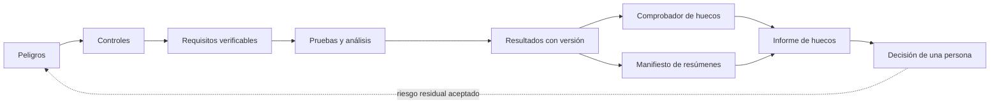
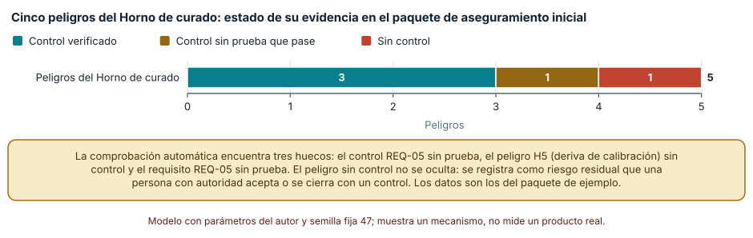
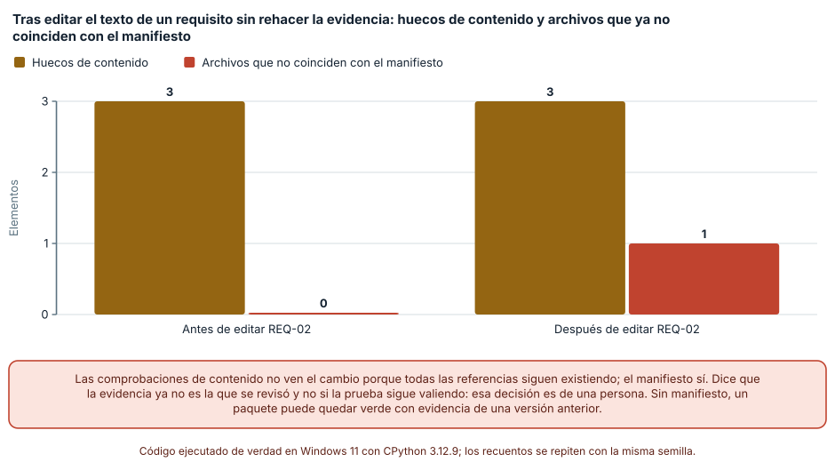
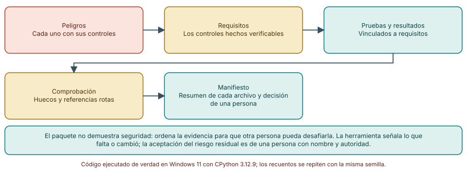

# SE-456 — Proyecto: paquete de aseguramiento de un controlador

[← SE-455 — Taller: analizar un fallo real frente a las normas](https://github.com/vladimiracunadev-create/modern-software-engineering-program/blob/main/classes/part-37-sistemas-criticos-tiempo-real-y-normas-de-seguridad/se-455-taller-analizar-un-fallo-real-frente-a-las-normas/README.md) · [↑ Parte 37](https://github.com/vladimiracunadev-create/modern-software-engineering-program/blob/main/classes/part-37-sistemas-criticos-tiempo-real-y-normas-de-seguridad/README.md) · [📚 Índice completo](https://github.com/vladimiracunadev-create/modern-software-engineering-program/blob/main/classes/README.md) · [🌐 Portal](https://vladimiracunadev-create.github.io/modern-software-engineering-program/classes/SE-456.html) · [SE-457 — Principios de seguridad y modelos de amenaza →](https://github.com/vladimiracunadev-create/modern-software-engineering-program/blob/main/classes/part-38-seguridad-privacidad-y-cumplimiento/se-457-principios-de-seguridad-y-modelos-de-amenaza/README.md)

## Punto profesional y fundamento pedagógico

**Punto profesional.** El proyecto final de la parte pide algo que un profesional de sistemas críticos hace de verdad: armar el **paquete de aseguramiento** de un controlador, es decir, el conjunto ordenado de peligros, requisitos, pruebas, resultados y análisis que permite a otra persona preguntar «¿cómo sabes que esto es suficientemente seguro?» y encontrar la respuesta, o encontrar el hueco. No es la última clase de teoría: es el ejercicio que obliga a juntar el análisis de peligros (`SE-445`), la integridad por función (`SE-446`), la evidencia de cobertura (`SE-448`, `SE-454`), la clasificación de módulos (`SE-449`), el argumento y la trazabilidad (`SE-450`), el plazo (`SE-451`), la política de código (`SE-452`) y la verificación formal (`SE-453`) en un artefacto que se puede comprobar con una herramienta y desafiar con una persona.

**Por qué aparece aquí.** Cierra la **Parte 37**. Retoma de [SE-168 — Proyecto: paquete de especificaciones trazables](https://github.com/vladimiracunadev-create/modern-software-engineering-program/blob/main/classes/part-13-especificaciones-contratos-y-modelos/se-168-proyecto-paquete-de-especificaciones-trazables/README.md) la idea de un paquete trazable y de [SE-276 — Proyecto: dispositivo simulado operable y actualizable](https://github.com/vladimiracunadev-create/modern-software-engineering-program/blob/main/classes/part-22-embedded-iot-y-tiempo-real/se-276-proyecto-dispositivo-simulado-operable-y-actualizable/README.md) un dispositivo simulado como objeto del trabajo, y les añade el argumento de seguridad.

**Error conceptual que debe corregir.** Creer que un paquete «completo» y «en verde» es un paquete que demuestra seguridad. La comprobación automática encuentra huecos de estructura y evidencia desactualizada; no sabe si las pruebas son buenas, si los supuestos valen ni si el riesgo residual es aceptable. En el laboratorio, un paquete de cinco peligros tiene tres con un control verificado, uno con un control sin prueba y uno sin ningún control (60 %); tras editar el texto de un requisito sin rehacer la evidencia, las comprobaciones de contenido siguen mostrando los mismos tres huecos, y solo el manifiesto de resúmenes revela que un archivo de evidencia ya no es el que se revisó.

**Secuencia de aprendizaje.** Antes de ejecutar, predices cuántos huecos tiene un paquete pequeño y qué comprobaciones detectarían que una evidencia quedó obsoleta tras un cambio. Después construyes el paquete como archivos con la biblioteca estándar (en un directorio temporal), ejecutas el comprobador de huecos, generas el manifiesto de resúmenes, cambias un requisito y vuelves a ejecutar.

**Evidencia de aprendizaje.** El paquete de aseguramiento del controlador que elijas (propuesta: el limitador del *Horno de curado*) con su README, su comprobador y un informe de huecos con una decisión sobre cada uno: cerrarlo, aceptarlo como riesgo residual con nombre y fecha, o escalarlo.

**Límite de la conclusión.** El paquete de ejemplo es mínimo (cinco peligros, cinco requisitos, cuatro pruebas) y sintético; el comprobador solo verifica estructura y que la evidencia no cambió, no su calidad. La aceptación del riesgo residual es siempre una decisión de una persona con autoridad y no la toma una herramienta. No se afirma que el *Horno de curado* sea seguro ni que el paquete cumpla una norma, y no hay revisión humana independiente.

### Trazabilidad fuente → afirmación

| Fuente primaria u oficial | Afirmación que respalda | Lo que no prueba |
|---|---|---|
| [GSN Community Standard (SCSC)](https://scsc.uk/gsn) | Aporta la estructura de un argumento de seguridad con afirmaciones, evidencia, contexto y supuestos que ordena el paquete. | No dice qué evidencia basta. |
| [FDA, «Content of Premarket Submissions for Device Software Functions»](https://www.fda.gov/regulatory-information/search-fda-guidance-documents/content-premarket-submissions-device-software-functions) | Ilustra qué documentación acompaña a un software de dispositivo médico según su riesgo. | Es una guía de la autoridad estadounidense para otro tipo de producto. |
| [FAA, Advisory Circular 20-115D](https://www.faa.gov/documentLibrary/media/Advisory_Circular/AC_20-115D.pdf) | Ilustra que la evidencia de software aerotransportado se organiza según la norma reconocida. | No reproduce el contenido de DO-178C. |
| [NASA Software Engineering Handbook](https://swehb.nasa.gov/) | Recoge prácticas de la NASA sobre requisitos, trazabilidad, verificación y registros de software crítico. | No define el paquete del laboratorio. |
| [Python: `hashlib`](https://docs.python.org/3/library/hashlib.html) y [`tempfile`](https://docs.python.org/3/library/tempfile.html) | Documentan el resumen SHA-256 del manifiesto y el directorio temporal del laboratorio. | Un resumen detecta cambios, no su significado. |
| [Leveson y Turner, Therac-25, IEEE Computer, 1993](https://doi.org/10.1109/MC.1993.274940) | Ejemplo de un sistema sin el paquete que habría permitido preguntar por el software. | No describe un paquete moderno. |

## Antes de empezar

Recupera lo aprendido en `SE-455`: las barreras necesitan ser independientes y los supuestos se desafían. La pregunta activa es: **¿qué archivo de tu proyecto contesta «cómo sabes que esto es seguro», y cuándo lo revisó alguien por última vez?**

## Prerrequisitos

- Haber completado `SE-445` a `SE-455`.
- Haber visto [SE-168 — Proyecto: paquete de especificaciones trazables](https://github.com/vladimiracunadev-create/modern-software-engineering-program/blob/main/classes/part-13-especificaciones-contratos-y-modelos/se-168-proyecto-paquete-de-especificaciones-trazables/README.md) y [SE-276 — Proyecto: dispositivo simulado operable y actualizable](https://github.com/vladimiracunadev-create/modern-software-engineering-program/blob/main/classes/part-22-embedded-iot-y-tiempo-real/se-276-proyecto-dispositivo-simulado-operable-y-actualizable/README.md).
- Manejar JSON, directorios temporales y resúmenes con la biblioteca estándar.
- Python 3.11 o posterior.

## Problema auténtico

El laboratorio universitario aprueba un piloto del *Horno de curado* con una condición: el equipo debe entregar un **paquete de aseguramiento** que el comité pueda revisar sin leer el código. El equipo tiene todo, pero disperso: un análisis de peligros en un documento, requisitos en una hoja de cálculo, pruebas en un repositorio y resultados en un registro de integración continua. Nadie sabe si los cinco peligros tienen un control con una prueba que pasa, ni qué pasa con la evidencia si se cambia un requisito.

El proyecto consiste en construir ese paquete como un conjunto de archivos legibles por máquina y por personas, con un comprobador que informe huecos (peligros sin control, controles sin prueba, requisitos sin prueba, referencias rotas) y evidencia obsoleta (por resumen), y en escribir la decisión sobre cada hueco.

## Objetivos observables

Al terminar podrás:

1. definir la estructura de un paquete de aseguramiento (peligros, requisitos, pruebas, resultados, argumento y manifiesto) y su relación con las clases de la parte;
2. escribir un comprobador de huecos y de evidencia obsoleta con la biblioteca estándar;
3. distinguir lo que una herramienta puede comprobar de lo que debe decidir una persona;
4. registrar el riesgo residual con su aceptante, su fecha y sus supuestos;
5. presentar el paquete a un revisor y recoger sus objeciones.

## Mapa conceptual



La cadena va del peligro a la evidencia y de vuelta, con dos comprobaciones automáticas (huecos y obsolescencia) y una decisión humana al final.

## Temas y por qué importan

| Tema | Por qué cambia una decisión profesional | Evidencia mínima |
|---|---|---|
| Estructura del paquete | Permite a otra persona recorrerlo sin ayuda. | Archivos y su relación |
| Huecos de contenido | Un peligro sin control es un hallazgo. | Informe del comprobador |
| Evidencia obsoleta | Un cambio invalida pruebas sin hacer ruido. | Manifiesto de resúmenes |
| Riesgo residual | No todo se cierra: se acepta con nombre. | Registro de aceptación |
| Qué decide una persona | La herramienta no acepta riesgos. | Decisión firmada |
| Revisión externa | Quita el sesgo de confirmación. | Objeciones registradas |
| Mantenimiento | El paquete cambia con el sistema. | Disparadores de revisión |

## Conceptos y decisiones

### 1. Un paquete es un conjunto de archivos con relaciones

El paquete del laboratorio tiene cuatro archivos JSON: `requisitos.json` (cada requisito con su texto), `peligros.json` (cada peligro con su texto y los requisitos que lo controlan), `pruebas.json` (cada prueba con los requisitos que verifica) y `resultados.json` (el resultado de cada prueba). Las relaciones van de peligro a control, de control a requisito y de requisito a prueba, y la comprobación recorre ese camino. La forma importa menos que dos propiedades: legible por máquina para comprobarlo en cada cambio, y legible por personas para desafiarlo. Un paquete en un documento de texto libre falla en la primera.

### 2. Huecos de contenido: lo que el comprobador encuentra

El comprobador recorre los peligros y marca tres tipos de hueco: un peligro sin ningún control, un control que apunta a un requisito inexistente y un control cuyo requisito no tiene una prueba que pase. Además, recorre los requisitos y marca los que no tienen ninguna prueba. En el paquete de ejemplo encuentra tres: el peligro H5 (deriva de calibración) sin control, el peligro H4 (reinicio con calentador conectado) con un control, REQ-05, que no tiene prueba que pase, y REQ-05 sin prueba. Cobertura de peligros con control verificado: 3 de 5 (60 %). Es un resultado útil por lo que muestra y por lo que obliga: decidir qué hacer con cada hueco.

### 3. Evidencia obsoleta: el manifiesto de resúmenes

Las comprobaciones de contenido no ven un cambio que mantenga todas las referencias válidas. Si se edita el texto de REQ-02 («la puerta abierta» pasa a «abierta o entreabierta»), todas las pruebas siguen enlazadas y pasan, y el paquete sigue «en verde», pero la prueba verificó un requisito anterior. La defensa mínima es un **manifiesto**: un archivo con el resumen SHA-256 de cada archivo de evidencia en el momento en que una persona lo revisó. Una comparación posterior marca los archivos que ya no coinciden. En el laboratorio, tras editar REQ-02, las comprobaciones de contenido siguen mostrando los mismos tres huecos y el manifiesto marca `requisitos.json` como distinto. El manifiesto no dice si la prueba sigue valiendo; dice que alguien debe decidirlo.

### 4. Riesgo residual: aceptar con nombre

Un hueco puede cerrarse (se añade el control o la prueba), escalarse (se encarga el análisis) o aceptarse como **riesgo residual**: se registra qué es, por qué se acepta, qué supuestos lo sostienen y quién lo acepta con su fecha. El peligro H5 del ejemplo, la deriva de calibración, podría aceptarse en un piloto de tres meses con calibración mensual, pero debe figurar como riesgo residual con su aceptante, y no como cumplido. La herramienta nunca decide esto: una herramienta que «acepta» un riesgo borra la responsabilidad que el registro debe preservar.

### 5. Qué entra en el paquete de un controlador crítico

Un paquete razonable para el limitador incluye: la lista de peligros (con contexto), la función de seguridad con su plazo y su integridad estimada (`SE-446`), el análisis de plazos (`SE-451`), la clasificación de módulos (`SE-449`), la cobertura y los mutantes de la lógica (`SE-454`), el resultado de la verificación del protocolo (`SE-453`), la política de codificación y el informe de avisos y desviaciones (`SE-452`), el caso de seguridad con sus supuestos (`SE-450`) y la matriz de trazabilidad. El laboratorio solo implementa los cuatro archivos básicos y el manifiesto; el resto son referencias a los experimentos de las clases anteriores, que cualquiera puede ejecutar.

### 6. Presentarlo a un revisor

El paquete se entrega con una pregunta concreta: «encuentra lo que falta». Un revisor que conoce el uso real descubre supuestos no escritos (la carga térmica, la humedad, el operador cansado). Cada objeción se registra con su respuesta: qué se cambió, qué se aceptó y por qué. Un paquete que nunca recibió una objeción no se ha puesto a prueba. En un proyecto real, el revisor es independiente de quien desarrolló, y su independencia se documenta.

### 7. Mantener el paquete vivo

El paquete se actualiza con cada cambio de requisitos, diseño, entorno o uso, y con cada incidente. La integración continua ejecuta el comprobador y falla si hay huecos nuevos o evidencia obsoleta sin una decisión registrada. Los disparadores de revisión están escritos (un cambio de proveedor del sensor, una actualización de una biblioteca, un incidente). Un paquete que se hizo una vez para una auditoría es el equivalente del archivo de riesgos que nunca se actualizó (`SE-449`).

## Estado de los peligros

La primera medida resume el estado de los cinco peligros del paquete inicial.



**Cómo leer la figura.** La barra es el conjunto de los cinco peligros y sus tramos son los estados de su evidencia: control verificado, control sin prueba que pase y sin control. Mira primero el tramo coral: el peligro sin control es el hallazgo que no se debe esconder. **Dónde deja de valer:** el paquete es un ejemplo mínimo y sintético; en uno real hay decenas de peligros y los estados tienen matices (una prueba que pasa pero no cubre el caso peor). El comprobador cuenta presencia, no calidad.

## Evidencia que cambió

La segunda medida compara los huecos y el manifiesto antes y después de editar un requisito.



**Cómo leer la figura.** Cada grupo es un momento del paquete y las barras son los huecos de contenido y los archivos que ya no coinciden con el manifiesto; mira primero que la barra dorada no cambia y la coral sí. **Dónde deja de valer:** el manifiesto es de granularidad de archivo: un cambio de un carácter en un archivo grande lo marca entero. En un proyecto real se resume cada requisito y cada resultado por separado, para que la revisión se limite a lo que cambió.

## La cadena del paquete

La tercera figura resume los eslabones y quién decide qué.



**Cómo leer la figura.** Cada caja es un eslabón del paquete; las tres primeras son contenido y las dos últimas son comprobación y decisión. Mira primero la última caja: el manifiesto es firmado por una persona, no generado por la herramienta. **Dónde deja de valer:** es un esquema; en un proyecto real hay más eslabones (análisis de plazos, cobertura, caso de seguridad) y revisión independiente de cada uno.

## Definiciones de trabajo

- **Paquete de aseguramiento:** conjunto ordenado de peligros, requisitos, pruebas, resultados y argumento que respalda una afirmación de seguridad.
- **Hueco de contenido:** peligro sin control, control sin requisito o requisito sin prueba.
- **Evidencia obsoleta:** evidencia que ya no corresponde a la versión revisada de lo que verifica.
- **Manifiesto:** lista de resúmenes de los archivos de evidencia en el momento de una revisión.
- **Riesgo residual:** riesgo que queda tras los controles, aceptado por una persona con autoridad.
- **Disparador de revisión:** condición (un cambio, un incidente) que obliga a revisar el paquete.
- **Revisión independiente:** revisión por alguien que no desarrolló el sistema.

## Ejemplo mínimo

Un comprobador de huecos de cinco líneas sobre dos diccionarios:

```python
peligros = {"H1": ["REQ-01"], "H2": ["REQ-02"], "H5": []}
pruebas = {"T1": ["REQ-01"]}            # REQ-02 no tiene prueba

for h, controles in peligros.items():
    if not controles:
        print(h, "sin ningún control")
    for r in controles:
        if not any(r in rs for rs in pruebas.values()):
            print(h, "→", r, "sin prueba")
```

Imprime «H2 → REQ-02 sin prueba» y «H5 sin ningún control». El laboratorio agrega la lectura de archivos, los resultados y el manifiesto.

## Ejemplo profesional

*Escenario ilustrativo: las cifras y los resultados que aparecen en este ejemplo son supuestos de la narración, no mediciones.*

El equipo entrega el paquete al comité, que designa como revisor a una técnica de laboratorio con veinte años de experiencia. En media hora encuentra tres cosas: el requisito de la puerta no cubre el caso en que el operador la deja entornada con el seguro puesto; el limitador se calibra con un termómetro de referencia que se verifica una vez al año, y la calibración mensual del paquete supone que está bien; y el procedimiento de apagado ante un corte de luz no está en los peligros. Ninguna se detectaba con un comprobador porque eran huecos de contenido real, no de estructura. El equipo añade dos requisitos y un peligro, registra la objeción sobre el termómetro como un supuesto con su dueño y repite el manifiesto. El valor del paquete no es que sea completo sino que permitió la conversación.

## Práctica guiada

1. Elige un controlador (el limitador del horno u otro tuyo) y lista sus peligros con contexto.
2. Escribe `requisitos.json`, `peligros.json`, `pruebas.json` y `resultados.json` para él con la estructura del laboratorio.
3. Ejecuta `python scripts/experiments_part37_b.py 576`, adapta el comprobador a tu paquete y lista los huecos.
4. Genera el manifiesto, cambia un requisito y comprueba que el cambio queda marcado.
5. Entrega el paquete a una persona que conozca el uso real y registra sus objeciones.

## Ejercicios

1. **Básico.** Explica por qué el paquete de ejemplo sigue con tres huecos de contenido tras editar REQ-02 y qué agrega el manifiesto.
2. **Intermedio.** Extiende el comprobador para que reporte pruebas cuyo resultado no es «pasa» y requisitos con más de un peligro asociado.
3. **Avanzado.** Diseña la integración continua del paquete: qué falla el build, qué solo avisa, qué exige una firma humana y cómo se registran las decisiones.

## Reto verificable

Entrega el paquete de aseguramiento de un controlador con al menos seis peligros, el comprobador y un informe de huecos con una decisión por cada uno, más el manifiesto y una demostración de que un cambio de requisito marca la evidencia como obsoleta. Es válido si otra persona ejecuta el comprobador y obtiene los mismos huecos y los mismos archivos marcados, y si el informe separa lo que decidió la herramienta de lo que decidió una persona con nombre y fecha.

## Caso conductor

El *Horno de curado* termina la parte con un paquete que no demuestra que sea seguro: dice qué peligros tiene, qué controles, qué pruebas, qué falta y quién aceptó qué. El resto del programa retoma el trabajo de ingeniería con otras preguntas; el criterio de esta parte (argumentar y no declarar) lo acompaña.

## Preguntas frecuentes

### ¿Un comprobador automático puede aprobar un paquete?

No: puede decir que la estructura está completa y que la evidencia no cambió. Aprobar es una decisión sobre el riesgo que toma una persona con autoridad, con nombre y fecha.

### ¿Qué pasa con los peligros que no tienen control?

Se cierran con un control, se escalan para análisis o se aceptan como riesgo residual con su razón y su aceptante. Lo que no se admite es dejarlos fuera del paquete porque no hay solución.

### ¿Con qué frecuencia se actualiza?

Con cada cambio de requisitos, diseño, entorno o uso, con cada incidente y cuando vence un disparador de revisión. La integración continua comprueba huecos y obsolescencia en cada cambio.

### ¿Esto sirve para software que no es crítico?

Las ideas de trazar peligros a pruebas y detectar evidencia obsoleta sirven en cualquier sistema; el rigor, la independencia de la revisión y el costo se ajustan al riesgo. En un blog personal, un manifiesto sería excesivo; en un sistema que maneja dinero o salud, no.

## Fallo controlado y diagnóstico

**Fallo.** Una auditoría descubre que el paquete de un controlador, entregado «completo» seis meses antes, incluye una prueba de apagado ante corte de luz que ya no existe: el firmware cambió el modo de apagado y la prueba pasa porque comprueba el modo antiguo.

**Diagnóstico paso a paso.** (1) El comprobador solo verificaba que cada requisito tuviera una prueba y que la prueba pasara. (2) El texto del requisito había cambiado de «apagado inmediato» a «apagado ordenado en 2 segundos» y la prueba seguía verificando el inmediato. (3) No había manifiesto, de modo que el cambio no marcó nada. (4) La revisión del cambio de firmware no incluía el paquete.

**Corrección.** Se añade el manifiesto de resúmenes por requisito y por prueba, se ejecuta en cada cambio y se define que un resumen distinto bloquea la entrega hasta que una persona revisa si la prueba verifica el requisito vigente. Se agrega a la lista de revisión de cambios de firmware «¿qué peligros y requisitos del paquete afecta?». La lección es que el paquete está tan vivo como el proceso que lo mantiene.

## Errores comunes y cómo corregirlos

- **Paquetes que se hacen una vez.** Corrige con integración continua y disparadores de revisión.
- **Evidencia sin versión ni resumen.** Corrige con el manifiesto de resúmenes.
- **Dejar peligros fuera por no tener solución.** Corrige registrándolos como riesgo residual aceptado por alguien.
- **Que la herramienta decida.** Corrige reservando la decisión para una persona con nombre y fecha.
- **Revisión solo del autor.** Corrige con un revisor independiente que conozca el uso real.
- **Confundir «en verde» con «seguro».** Corrige escribiendo lo que el comprobador no ve.

## Entorno y archivos clave

- `scripts/experiments_part37_b.py`: función `e576` con el paquete en un directorio temporal, el comprobador de huecos y el manifiesto; se ejecuta con `python scripts/experiments_part37_b.py 576`.
- El paquete se crea y se borra en un directorio temporal (`tempfile`); no se escribe nada en el repositorio.
- `scripts/figures_part37_b.py`: las tres figuras de la clase.
- Solo la biblioteca estándar de Python 3.11 o posterior.

## Seguridad, ética y accesibilidad

Un paquete de aseguramiento es un documento con consecuencias para las personas que usarán el sistema. Aceptar un riesgo residual con nombre y fecha es lo que mantiene la responsabilidad en una persona; esconder un hueco para que el paquete «cierre» es la forma de engaño más frecuente. Los paquetes contienen datos del producto y a veces de personas: se les aplica el mismo control de acceso y de retención que a cualquier dato sensible. Las figuras tienen texto alternativo completo y no dependen solo del color.

## Puente hacia el trabajo con agentes

Un agente puede mantener un paquete: ejecutar el comprobador en cada cambio, abrir tareas para cada hueco y borrar borradores del informe. También puede cerrar un hueco escribiendo una prueba que pasa sin verificar el requisito, o actualizar el manifiesto para que el comprobador deje de quejarse. Configura el sistema para que el manifiesto solo lo cambie una persona, para que cada cambio de requisito abra una revisión de las pruebas enlazadas y para que el agente pueda proponer decisiones de riesgo residual pero no firmarlas.

## Transferencia

Elige un componente crítico de tu sistema y arma su paquete: peligros con contexto, controles como requisitos, pruebas con resultado y un manifiesto. Ejecuta un comprobador de huecos y registra una decisión por cada uno. Entrega el paquete a una persona que conozca el uso real, anota sus tres objeciones y cámbialo. Define los disparadores que obligarán a revisarlo y quién los vigila.

## Evaluación y evidencia

| Criterio | Evidencia aceptable | Rechazo |
|---|---|---|
| Estructura | Archivos de peligros, requisitos, pruebas y resultados relacionados | Documentos sueltos |
| Huecos | Informe del comprobador con una decisión por hueco | «Todo está cubierto» |
| Obsolescencia | Manifiesto de resúmenes y política de cambio | «Está actualizado» |
| Riesgo residual | Aceptante, fecha y supuestos | Hueco ignorado |
| Revisión | Objeciones de una persona independiente | Revisión del autor |

## Fuentes

- Safety Critical Systems Club. [Comunidad GSN](https://scsc.uk/gsn).
- FDA. [Content of Premarket Submissions for Device Software Functions](https://www.fda.gov/regulatory-information/search-fda-guidance-documents/content-premarket-submissions-device-software-functions).
- FAA. [Advisory Circular 20-115D](https://www.faa.gov/documentLibrary/media/Advisory_Circular/AC_20-115D.pdf).
- NASA. [Software Engineering Handbook](https://swehb.nasa.gov/).
- Leveson, N. G. y Turner, C. S. [«An Investigation of the Therac-25 Accidents»](https://doi.org/10.1109/MC.1993.274940). IEEE Computer, 1993.
- Python Software Foundation. [`hashlib`](https://docs.python.org/3/library/hashlib.html) y [`tempfile`](https://docs.python.org/3/library/tempfile.html).

## Límites y siguiente paso

El paquete es mínimo y sintético, el comprobador verifica estructura y cambios y no calidad, el manifiesto es de granularidad de archivo, no hay revisión independiente de contenido y no se afirma que el *Horno de curado* sea seguro ni que cumpla ninguna norma. Con esta clase termina la Parte 37; el criterio de argumentar y no declarar acompaña al resto del programa.

## Glosario

| Término | Definición breve |
|---|---|
| Paquete de aseguramiento | Peligros, requisitos, pruebas, resultados y argumento ordenados |
| Hueco de contenido | Peligro sin control o requisito sin prueba |
| Evidencia obsoleta | Evidencia que ya no corresponde a lo revisado |
| Manifiesto | Resúmenes de los archivos de evidencia revisados |
| Riesgo residual | Riesgo que queda tras los controles y alguien acepta |
| Disparador de revisión | Condición que obliga a revisar el paquete |

---

[← SE-455 — Taller: analizar un fallo real frente a las normas](https://github.com/vladimiracunadev-create/modern-software-engineering-program/blob/main/classes/part-37-sistemas-criticos-tiempo-real-y-normas-de-seguridad/se-455-taller-analizar-un-fallo-real-frente-a-las-normas/README.md) · [↑ Parte 37](https://github.com/vladimiracunadev-create/modern-software-engineering-program/blob/main/classes/part-37-sistemas-criticos-tiempo-real-y-normas-de-seguridad/README.md) · [📚 Índice completo](https://github.com/vladimiracunadev-create/modern-software-engineering-program/blob/main/classes/README.md) · [🌐 Portal](https://vladimiracunadev-create.github.io/modern-software-engineering-program/classes/SE-456.html) · [SE-457 — Principios de seguridad y modelos de amenaza →](https://github.com/vladimiracunadev-create/modern-software-engineering-program/blob/main/classes/part-38-seguridad-privacidad-y-cumplimiento/se-457-principios-de-seguridad-y-modelos-de-amenaza/README.md)
