# Parte 38 — Desarrollo de software asistido por IA

La Parte 37 cerró el bloque de gestión, liderazgo y práctica profesional con una exigencia: defender decisiones con evidencia. La pregunta cambia de «¿cómo defendemos lo que decidimos?» a «¿cómo defendemos lo que decidimos cuando parte del trabajo lo produjo un modelo que genera texto plausible sin saber si es verdad?». Esta parte trabaja sobre **el equipo de la plataforma educativa que incorpora un asistente al trabajo sobre el módulo de calificaciones**, el mismo sistema sintético de la Parte 36: una función que calcula la nota final, notas guardadas como texto, un archivo de exportación y reglas de redondeo y aprobación que alguien tiene que fijar. El asistente es un caso de estudio y no un producto: ningún experimento llama a un modelo real, y los «modelos» son procesos sintéticos con parámetros declarados o código estándar que se ejecuta de verdad.

## Pregunta rectora

> ¿Qué puedes delegar en un asistente, con qué evidencia de que la salida es correcta, qué arriesgas al hacerlo y quién puede reconstruir y deshacer lo que se decidió?

## Antes del recorrido clase por clase

Esta parte no enseña una herramienta ni un modelo concretos, y no clasifica productos. Enseña el mecanismo mínimo para razonar sobre cualquiera: un modelo genera texto muestreando una distribución, así que su tono no mide su corrección y lo delegable es lo comprobable; un encargo debe enumerar los requisitos que el modelo no puede adivinar y la salida debe validarse fuera de él; el contexto es finito, envejece y compite, de modo que alguien decide qué entra y cuánto dura; los modos de interacción (autocompletado, chat, edición, generación) piden políticas de aceptación distintas; explorar alternativas es barato y elegir entre ellas sufre la maldición del optimizador; las pruebas, la documentación y las migraciones generadas heredan los errores de lo que controlan salvo que tengan una fuente independiente; revisar, refactorizar y explicar con ayuda exige medir al revisor y la equivalencia; la ambigüedad se cuenta y se reduce diseñando el contexto; una eval distingue señal de ruido, incluye el costo de revisar y calibra a su juez; los riesgos de datos, licencias y código inseguro se controlan con filtros que actúan aunque alguien olvide la instrucción; comparar flujos exige tareas pareadas; y un cambio asistido solo es defendible si deja un rastro verificable, una revisión con nombre y una reversión ensayada.

```mermaid
flowchart LR
    A[Capacidades y límites] --> B[Prompting y criterios de salida]
    B --> C[Contexto, memoria y recuperación]
    C --> D[Autocompletado, chat, edición y generación]
    D --> E[Prototipado y alternativas]
    E --> F[Pruebas, documentación y migraciones]
    F --> G[Revisión, refactorización y explicación]
    G --> H[Context engineering]
    H --> I[Evals]
    I --> J[Privacidad, licencias y código inseguro]
    J --> K[Taller: comparar flujos]
    K --> L[Proyecto: cambio con trazabilidad]
    L -->|incidente o hallazgo| A
```

El diagrama se lee de izquierda a derecha y no es un proceso obligatorio. El retorno indica que un incidente, una medición nueva o un cambio de modelo reabre la pregunta de qué se puede delegar; un cambio entregado no cierra la política de uso, la fecha.

## Resultados acumulativos

Podrás simular el muestreo de una distribución con cinco respuestas candidatas y ver por qué un voto de mayoría confirma un error, medir la brecha entre confianza declarada y acierto y calcular qué conjuntos de trabajo caben en una ventana de contexto; estimar la probabilidad de cumplir seis requisitos según cuántos se escriben, validar por capas 200 salidas defectuosas y calcular la probabilidad de que un conjunto de instrucciones no se contradiga; implementar una recuperación BM25 sobre 240 documentos, simular una memoria cuyos hechos cambian con cuatro caducidades y empaquetar fragmentos en un presupuesto por dos criterios; comparar tres políticas de aceptación de 1 000 sugerencias, medir con `difflib` una edición dirigida frente a un archivo regenerado y contar las peticiones de una traza de 467 pulsaciones según el retardo;

medir la maldición del optimizador al elegir la mejor de N alternativas, contar con `ast` cuántas funciones de un andamiaje se usan y estimar el trabajo que separa un prototipo de producción; ejecutar ocho mutantes contra una suite copiada del código y otra derivada de la especificación, comprobar qué documentación detecta `doctest` y migrar 2 000 notas de texto en SQLite con y sin validación; elegir el umbral de un revisor automático sobre 400 cambios, calcular cuántas entradas aleatorias distinguen cuatro versiones refactorizadas de la original y contrastar treinta explicaciones con el código; enumerar las 729 interpretaciones de una petición, medir el efecto de un filtro de versiones y detectar contradicciones en archivos de instrucciones; calcular intervalos de Wilson y la probabilidad de ordenar bien dos sistemas, comparar seis configuraciones por costo por solución aceptada y medir los sesgos de un juez automático;

ejecutar un escáner de datos sensibles con tres reglas sobre 240 mensajes, comparar texto y árbol sintáctico sobre 17 fragmentos y medir el parecido literal y normalizado con un corpus con licencia; comparar tres flujos de trabajo sobre 200 tareas con un intervalo bootstrap, hallar el punto de equilibrio del flujo asistido y calcular cuántas tareas necesita un diseño pareado; y encadenar por hash una bitácora de seis pasos, atacarla de cinco maneras, combinar cuatro compuertas y medir cuánto dura la ventana de reversión limpia. Al finalizar podrás defender un paquete de cambio asistido con su plan, su diff mínimo, su bitácora anclada, sus compuertas, su revisión con nombre, su reversión ensayada y sus límites declarados, e indicar qué parte de tu conclusión es observación, cuál es inferencia y cuál es suposición.

## Prerrequisitos enlazados

- [Parte 16 — Git, colaboración y código abierto](https://github.com/vladimiracunadev-create/modern-software-engineering-program/blob/main/classes/part-16-git-colaboracion-y-codigo-abierto/): revertir cambios, historial y revisión de contribuciones.
- [Parte 17 — Documentación y conocimiento técnico](https://github.com/vladimiracunadev-create/modern-software-engineering-program/blob/main/classes/part-17-documentacion-y-conocimiento-tecnico/): registros de decisión y documentación mantenible.
- [Parte 24 — Diseño, patrones y refactorización](https://github.com/vladimiracunadev-create/modern-software-engineering-program/blob/main/classes/part-24-diseno-patrones-y-refactorizacion/): refactorizar con red de seguridad.
- [Parte 26 — Datos, persistencia y recuperación](https://github.com/vladimiracunadev-create/modern-software-engineering-program/blob/main/classes/part-26-datos-persistencia-y-recuperacion/): esquemas, conversiones y migraciones.
- [Parte 30 — Estrategia y técnicas de prueba](https://github.com/vladimiracunadev-create/modern-software-engineering-program/blob/main/classes/part-30-estrategia-y-tecnicas-de-prueba/): oráculos, mutación y pruebas de propiedades.
- [Parte 31 — Calidad, rendimiento y resiliencia](https://github.com/vladimiracunadev-create/modern-software-engineering-program/blob/main/classes/part-31-calidad-rendimiento-y-resiliencia/): percentiles, costo y latencia.
- [Parte 32 — Seguridad, privacidad y cumplimiento](https://github.com/vladimiracunadev-create/modern-software-engineering-program/blob/main/classes/part-32-seguridad-privacidad-y-cumplimiento/): amenazas, secretos y datos personales.
- [Parte 36 — Mantenimiento y modernización legacy](https://github.com/vladimiracunadev-create/modern-software-engineering-program/blob/main/classes/part-36-mantenimiento-y-modernizacion-legacy/): caracterización, comparación diferencial y reversión.
- [Parte 37 — Gestión, liderazgo y práctica profesional](https://github.com/vladimiracunadev-create/modern-software-engineering-program/blob/main/classes/part-37-gestion-liderazgo-y-practica-profesional/): decisiones defendibles con evidencia.
- Python 3.11+ y terminal; los experimentos usan solo la biblioteca estándar (con `sqlite3`, `ast`, `doctest`, `difflib` e `hashlib` incluidos) y datos sintéticos.

## Bloques y progresión

1. **Entender la herramienta y hablarle:** las clases 457 a 459 establecen qué es un modelo generativo y qué no, cómo se redacta un encargo comprobable y cómo llega la información a la ventana.
2. **Trabajar con ella:** las clases 460 a 462 distinguen los modos de uso, la exploración de alternativas y los artefactos de control generados.
3. **Revisar y diseñar el contexto:** las clases 463 y 464 miden la revisión, la refactorización y la explicación asistidas y reducen la ambigüedad del contexto.
4. **Medir y proteger:** las clases 465 y 466 evalúan exactitud, utilidad, costo y latencia y controlan los riesgos de datos, licencias y seguridad.
5. **Aplicar e integrar:** las clases 467 y 468 comparan flujos con un diseño pareado y entregan un cambio real con trazabilidad y revisión humana.

## Evidencia medida y límites

Las figuras y los ejemplos de esta parte usan experimentos ejecutados con CPython 3.12.9 en Windows 11 y repetidos con CPython 3.12.3 en Ubuntu bajo WSL2. Los datos son **sintéticos**, las semillas están fijadas y las simulaciones (muestreo, calibración, requisitos, memoria, presupuesto, aceptación, selección, umbral de un revisor, tamaño de una eval, juez, flujos, potencia, compuertas y reversión) son de tiempo virtual o de recuento: las salidas de los experimentos con semilla fueron idénticas en ambos sistemas, cifra por cifra, y no dependen del orden de iteración de los conjuntos. Hay ejecuciones de código real sobre datos sintéticos: una recuperación BM25 implementada con la biblioteca estándar, `difflib` sobre un archivo generado, `ast` sobre un andamiaje, ocho mutantes de una función, `doctest` sobre módulos escritos en una carpeta temporal, SQLite en memoria, un validador por capas, un detector de contradicciones, un escáner de tres reglas, dos técnicas de detección de patrones inseguros, un cálculo de huellas de código y una bitácora encadenada con `hashlib` atacada de cinco maneras. No hay lecturas de reloj en ninguna medición.

Los experimentos son: el muestreo de cinco respuestas candidatas, la calibración de 1 000 preguntas y los conjuntos de ocho archivos que caben en cuatro ventanas (`SE-457`); la probabilidad de cumplir seis requisitos según cuántos se escriben, la validación por capas de 200 salidas y las instrucciones en conflicto (`SE-458`); fragmentos de 50 a 900 palabras sobre 240 documentos con BM25, una memoria con cuatro caducidades y un presupuesto de 3 000 tokens (`SE-459`); tres políticas de aceptación de 1 000 sugerencias, una edición de 2 líneas frente a un archivo regenerado de 124 y una traza de 467 pulsaciones (`SE-460`); la mejor de N alternativas con tres niveles de ruido, un andamiaje de 40 funciones y la brecha a producción (`SE-461`); ocho mutantes frente a dos suites, `doctest` sobre 30 funciones y la migración de 2 000 notas (`SE-462`); el umbral de un revisor sobre 400 cambios, cuatro versiones refactorizadas frente a la original y treinta explicaciones (`SE-463`); las 729 interpretaciones de una petición, 300 consultas con versiones mezcladas y archivos de instrucciones de 5 a 40 reglas (`SE-464`); el intervalo de Wilson para cinco tamaños, seis configuraciones por costo por solución aceptada y los sesgos de un juez (`SE-465`); 240 mensajes con tres reglas, 17 fragmentos con dos técnicas y el parecido con un corpus (`SE-466`); tres flujos sobre 200 tareas, el punto de equilibrio del flujo asistido y la potencia de dos diseños (`SE-467`); y una bitácora de seis pasos con cinco manipulaciones, cuatro compuertas y la reversión limpia (`SE-468`). El código está en `scripts/experiments_part38_a.py` y `scripts/experiments_part38_b.py`, y las figuras se calculan desde esos mismos módulos.

Los parámetros (los logits de las respuestas candidatas, la distribución de la confianza, los tamaños de archivo, las probabilidades de cumplir un requisito con y sin instrucción, los seis tipos de defecto, el vocabulario del corpus, la tasa de cambio del 1 % diario, la tasa de acierto de las sugerencias, la curva de detección según el tamaño del diff, el ritmo de escritura, la distribución de calidad y el ruido del evaluador, los ocho mutantes, la mezcla de notas, las puntuaciones del revisor, las seis dimensiones de decisión, las tasas de éxito, los costos y las latencias de las configuraciones, los sesgos del juez, las plantillas de mensajes, los fragmentos de código, los tiempos de cada flujo, las probabilidades de cada compuerta y la tasa de defecto del 20 %) son supuestos del autor, y los resultados dependen de ellos. Que un voto de mayoría empeore a temperatura baja, que una suite copiada detecte 4 de 8 mutantes o que el flujo automatizado resulte más rápido en la simulación es consecuencia de cómo se construyeron los casos, no una propiedad medida de ninguna herramienta.

Lo que **no se hizo**: no se llamó a ningún modelo de lenguaje, no se evaluó ningún asistente, agente, revisor automático, escáner, analizador ni juez de terceros, no se midió a ninguna persona ni equipo, y no se integró ningún cambio en ningún repositorio real; no se consultó ningún conjunto de evaluación público; no se usó recuperación por vectores ni ninguna base de datos distinta de SQLite en memoria; no hay firmas digitales, sellos de tiempo ni concurrencia real; no se probó macOS ni otras versiones de Python; las cadenas que simulan secretos se generan al azar al ejecutar y no son datos reales, y nada de lo dicho sobre protección de datos, propiedad intelectual o la Ley de IA es asesoría legal. Las citas de estudios (el experimento con Copilot, el ensayo de METR, el estudio de código inseguro) se atribuyen a su fuente y a su contexto, y ninguna se presenta como magnitud aplicable a un equipo concreto. El contenido sigue pendiente de revisión humana independiente.

## Guía razonada clase por clase

El módulo de calificaciones mantiene un contrato, un conjunto de tareas y un paquete estables mientras cambian las decisiones. Cada clase explica qué incertidumbre reduce, qué experimento la muestra, qué no demuestra y qué evidencia permite abandonar la conclusión.

### Bloque 1 — Entender la herramienta y hablarle

#### SE-457 — Capacidades y límites de los modelos generativos

[Abrir la clase SE-457](https://github.com/vladimiracunadev-create/modern-software-engineering-program/blob/main/classes/part-38-desarrollo-de-software-asistido-por-ia/se-457-capacidades-y-limites-de-los-modelos-generativos/)

La seguridad de una respuesta no informa de su verdad, y lo delegable es lo comprobable. La clase muestrea cinco respuestas candidatas a cuatro temperaturas, mide la brecha entre confianza y acierto en 1 000 preguntas y calcula qué conjuntos de trabajo caben en cuatro ventanas.

El estudiante entrega la política de «cuándo confío y cuándo compruebo». `SE-458` pregunta cómo se escribe el encargo para que la salida pueda comprobarse.

#### SE-458 — Prompting, instrucciones y criterios de salida

[Abrir la clase SE-458](https://github.com/vladimiracunadev-create/modern-software-engineering-program/blob/main/classes/part-38-desarrollo-de-software-asistido-por-ia/se-458-prompting-instrucciones-y-criterios-de-salida/)

Un prompt es una especificación, y los requisitos no escritos se componen. La clase calcula la probabilidad de cumplir seis requisitos según cuántos se escriben, valida por capas 200 salidas defectuosas y calcula cuántas instrucciones aguanta un encargo sin contradecirse.

El estudiante entrega el encargo de una tarea con su validador. `SE-459` pregunta de dónde sale la información que el encargo no puede contener.

#### SE-459 — Contexto, archivos, memoria y recuperación

[Abrir la clase SE-459](https://github.com/vladimiracunadev-create/modern-software-engineering-program/blob/main/classes/part-38-desarrollo-de-software-asistido-por-ia/se-459-contexto-archivos-memoria-y-recuperacion/)

Solo existe para el modelo lo que está en su ventana. La clase ejecuta una recuperación BM25 sobre 240 documentos con cuatro tamaños de fragmento, simula una memoria con cuatro caducidades y empaqueta fragmentos en un presupuesto por dos criterios.

El estudiante entrega la política de contexto con su medición. `SE-460` pregunta cómo vuelve la salida al código.

### Bloque 2 — Trabajar con ella

#### SE-460 — Autocompletado, chat, edición y generación

[Abrir la clase SE-460](https://github.com/vladimiracunadev-create/modern-software-engineering-program/blob/main/classes/part-38-desarrollo-de-software-asistido-por-ia/se-460-autocompletado-chat-edicion-y-generacion/)

Cada modo pide una política de aceptación distinta. La clase compara tres políticas con 1 000 sugerencias, mide con `difflib` una edición dirigida frente a un archivo regenerado y cuenta las peticiones de una traza de 467 pulsaciones según el retardo.

El estudiante entrega la política de modos y aceptación. `SE-461` pregunta qué hacer con la abundancia de alternativas.

#### SE-461 — Prototipado, scaffolding y exploración de alternativas

[Abrir la clase SE-461](https://github.com/vladimiracunadev-create/modern-software-engineering-program/blob/main/classes/part-38-desarrollo-de-software-asistido-por-ia/se-461-prototipado-scaffolding-y-exploracion-de-alternativas/)

Explorar es barato y la ganadora decepciona. La clase mide la brecha entre la calidad medida y la real de la mejor de N alternativas, cuenta con `ast` las funciones de un andamiaje que se usan y estima el trabajo que separa un prototipo de producción.

El estudiante entrega una exploración con criterios previos y registro de decisión. `SE-462` pregunta qué ocurre con lo que controla al código.

#### SE-462 — Generación de pruebas, documentación y migraciones

[Abrir la clase SE-462](https://github.com/vladimiracunadev-create/modern-software-engineering-program/blob/main/classes/part-38-desarrollo-de-software-asistido-por-ia/se-462-generacion-de-pruebas-documentacion-y-migraciones/)

Un control derivado de lo que controla hereda su error. La clase ejecuta ocho mutantes contra una suite copiada y otra derivada de la especificación, mide qué detecta `doctest` y migra 2 000 notas en SQLite con y sin validación.

El estudiante entrega los controles de función, documentación y datos con su medición. `SE-463` pregunta cómo se revisa con ayuda.

### Bloque 3 — Revisar y diseñar el contexto

#### SE-463 — Revisión, refactorización y explicación asistidas

[Abrir la clase SE-463](https://github.com/vladimiracunadev-create/modern-software-engineering-program/blob/main/classes/part-38-desarrollo-de-software-asistido-por-ia/se-463-revision-refactorizacion-y-explicacion-asistidas/)

La ausencia de hallazgos mide la cobertura del revisor, no la corrección. La clase barre el umbral de un revisor sobre 400 cambios, calcula cuántas entradas distinguen cuatro versiones refactorizadas y contrasta treinta explicaciones con el código.

El estudiante entrega el procedimiento de revisión con umbrales y generador de comparación. `SE-464` pregunta cómo se reduce la ambigüedad que hace falible la revisión.

#### SE-464 — Context engineering y reducción de ambigüedad

[Abrir la clase SE-464](https://github.com/vladimiracunadev-create/modern-software-engineering-program/blob/main/classes/part-38-desarrollo-de-software-asistido-por-ia/se-464-context-engineering-y-reduccion-de-ambiguedad/)

La ambigüedad se cuenta y se reduce. La clase enumera las 729 interpretaciones de una petición, mide el efecto de filtrar por versión y detecta contradicciones en archivos de instrucciones de distinto tamaño.

El estudiante entrega el contexto diseñado con su archivo de instrucciones. `SE-465` pregunta cómo se mide si funciona.

### Bloque 4 — Medir y proteger

#### SE-465 — Evals de exactitud, utilidad, costo y latencia

[Abrir la clase SE-465](https://github.com/vladimiracunadev-create/modern-software-engineering-program/blob/main/classes/part-38-desarrollo-de-software-asistido-por-ia/se-465-evals-de-exactitud-utilidad-costo-y-latencia/)

Una diferencia pequeña en un conjunto pequeño es ruido. La clase calcula intervalos de Wilson para cinco tamaños, compara seis configuraciones por costo por solución aceptada y mide los sesgos de un juez automático.

El estudiante entrega una eval con conjunto reservado, tamaño calculado y juez calibrado. `SE-466` pregunta qué se arriesga aunque la eval sea buena.

#### SE-466 — Privacidad, propiedad intelectual y código inseguro

[Abrir la clase SE-466](https://github.com/vladimiracunadev-create/modern-software-engineering-program/blob/main/classes/part-38-desarrollo-de-software-asistido-por-ia/se-466-privacidad-propiedad-intelectual-y-codigo-inseguro/)

Un riesgo no se gestiona con una instrucción sino con un control. La clase ejecuta un escáner de tres reglas sobre 240 mensajes, compara texto y árbol sobre 17 fragmentos y mide el parecido literal y normalizado con un corpus.

El estudiante entrega la clasificación de datos con sus controles. `SE-467` compara flujos completos con esos controles incluidos.

### Bloque 5 — Aplicar e integrar

#### SE-467 — Taller: comparar flujos manual, asistido y automatizado

[Abrir la clase SE-467](https://github.com/vladimiracunadev-create/modern-software-engineering-program/blob/main/classes/part-38-desarrollo-de-software-asistido-por-ia/se-467-taller-comparar-flujos-manual-asistido-y-automatizado/)

Cada flujo ahorra tiempo y deja pasar más defectos. El taller simula 200 tareas con un intervalo bootstrap, halla el punto de equilibrio del flujo asistido y calcula cuántas tareas necesita un diseño pareado frente a uno con tareas distintas.

El estudiante entrega el protocolo y el análisis comparativo. `SE-468` aplica el flujo elegido a un cambio real.

#### SE-468 — Proyecto: cambio real con trazabilidad y revisión humana

[Abrir la clase SE-468](https://github.com/vladimiracunadev-create/modern-software-engineering-program/blob/main/classes/part-38-desarrollo-de-software-asistido-por-ia/se-468-proyecto-cambio-real-con-trazabilidad-y-revision-humana/)

La trazabilidad es un rastro verificable, no una conversación guardada. El proyecto encadena por hash una bitácora de seis pasos y la ataca de cinco maneras, combina cuatro compuertas y mide cuánto dura la ventana de reversión limpia.

El estudiante entrega un paquete con plan, bitácora anclada, diff mínimo, compuertas, revisión con nombre, ensayo de reversión y `LIMITES.md`. La Parte 39 pasa de ayudar a una persona a gobernar agentes con especificaciones durables.

## Fuentes

- [NIST AI RMF 1.0](https://www.nist.gov/itl/ai-risk-management-framework) y [NIST AI 600-1: Generative AI Profile](https://doi.org/10.6028/NIST.AI.600-1) — gestión de riesgos de IA y riesgos de la IA generativa; autoridad: NIST.
- [Holtzman et al.](https://arxiv.org/abs/1904.09751), [Wang et al.](https://arxiv.org/abs/2203.11171), [Chen et al.](https://arxiv.org/abs/2107.03374) y [Guo et al.](https://arxiv.org/abs/1706.04599) — muestreo, votación, pass@k y calibración; autoridad: ICLR, ICML y preprint de OpenAI.
- [Liu et al., «Lost in the Middle»](https://arxiv.org/abs/2307.03172), [Lewis et al.](https://arxiv.org/abs/2005.11401), [Robertson y Zaragoza](https://doi.org/10.1561/1500000019) y [Anthropic: context engineering](https://www.anthropic.com/engineering/effective-context-engineering-for-ai-agents) — contexto, recuperación y BM25; autoridad: TACL, NeurIPS, Foundations and Trends in IR y Anthropic.
- [Anthropic: prompt engineering](https://docs.anthropic.com/en/docs/build-with-claude/prompt-engineering/overview), [JSON Schema](https://json-schema.org/specification), [Wallace et al.](https://arxiv.org/abs/2404.13208), [AGENTS.md](https://agents.md) y [RFC 2119](https://www.rfc-editor.org/rfc/rfc2119) — encargos, contratos de salida e instrucciones; autoridad: Anthropic, JSON Schema, preprint de OpenAI, especificación abierta e IETF.
- [Peng et al.](https://arxiv.org/abs/2302.06590), [METR](https://arxiv.org/abs/2507.09089), [Parasuraman y Manzey](https://doi.org/10.1177/0018720810376055) y [DORA Report 2024](https://dora.dev/research/2024/dora-report/) — productividad con asistentes, sesgo de automatización y entrega; autoridad: preprints, Human Factors y DORA.
- [Brooks](https://doi.org/10.1109/MC.1987.1663532), [Smith y Winkler](https://doi.org/10.1287/mnsc.1050.0451), [Jia y Harman](https://doi.org/10.1109/TSE.2010.62) y [Barr et al.](https://doi.org/10.1109/TSE.2014.2372785) — complejidad, maldición del optimizador, mutación y el problema del oráculo; autoridad: IEEE Computer, Management Science e IEEE TSE.
- [Bacchelli y Bird](https://doi.org/10.1109/ICSE.2013.6606617), [Google: code review](https://google.github.io/eng-practices/review/), [Fowler: Refactoring](https://refactoring.com/) y [Claessen y Hughes](https://doi.org/10.1145/351240.351266) — revisión, refactorización y pruebas de propiedades; autoridad: ICSE, Google, autor del texto e ICFP.
- [Wilson](https://doi.org/10.1080/01621459.1927.10502953), [Efron](https://doi.org/10.1214/aos/1176344552), [Jimenez et al.](https://arxiv.org/abs/2310.06770), [Zheng et al.](https://arxiv.org/abs/2306.05685) y [Jacovi et al.](https://arxiv.org/abs/2305.10160) — intervalos, bootstrap, evaluación con problemas reales, jueces y contaminación; autoridad: JASA, Annals of Statistics, ICLR, NeurIPS y EMNLP.
- [OWASP Top 10 for LLM Applications](https://owasp.org/www-project-top-10-for-large-language-model-applications/), [Greshake et al.](https://arxiv.org/abs/2302.12173), [Perry et al.](https://arxiv.org/abs/2211.03622), [Pearce et al.](https://arxiv.org/abs/2108.09293), [Spracklen et al.](https://arxiv.org/abs/2406.10279) y [CWE Top 25](https://cwe.mitre.org/top25/) — inyección, código inseguro y dependencias alucinadas; autoridad: OWASP, CCS, IEEE S&P y MITRE.
- [NIST SP 800-218A](https://csrc.nist.gov/pubs/sp/800/218/a/final), [RGPD](https://eur-lex.europa.eu/eli/reg/2016/679/oj), [Ley de IA de la UE](https://eur-lex.europa.eu/eli/reg/2024/1689/oj) y [U.S. Copyright Office: AI](https://www.copyright.gov/ai/) — desarrollo seguro, datos personales, supervisión humana y derecho de autor; autoridad: NIST, Unión Europea y Oficina de Derechos de Autor de EE. UU.
- [Haber y Stornetta](https://doi.org/10.1007/BF00196791), [SLSA: provenance](https://slsa.dev/spec/v1.0/provenance), [Git: git-revert](https://git-scm.com/docs/git-revert) y [Git: git-interpret-trailers](https://git-scm.com/docs/git-interpret-trailers) — encadenado de registros, procedencia y reversión; autoridad: Journal of Cryptology, SLSA y Git.
- [Sjøberg et al.](https://doi.org/10.1109/TSE.2005.97) y [Wohlin et al.](https://doi.org/10.1007/978-3-642-29044-2) — experimentos controlados en ingeniería de software; autoridad: IEEE TSE y Springer.

Las fuentes se vinculan también dentro de cada clase. Definen vocabulario y mecanismos; la adecuación de las decisiones de trabajo con asistentes se demuestra con el caso, la evidencia trazable y la revisión de otra persona, no con la autoridad de la fuente.

## Criterios de aceptación de la parte

- cada clase conecta mecanismo, medida y límite en una conclusión revisable;
- cada medida puede reproducirse desde un checkout limpio con las mismas semillas, y ninguna depende del reloj;
- ninguna afirmación sobre un modelo, una herramienta, un equipo, una persona o un sistema reales se apoya en una simulación;
- los límites declarados permiten a otra persona decidir qué comprobar antes de confiar.

[Volver al índice de clases](https://github.com/vladimiracunadev-create/modern-software-engineering-program/blob/main/classes/README.md)
