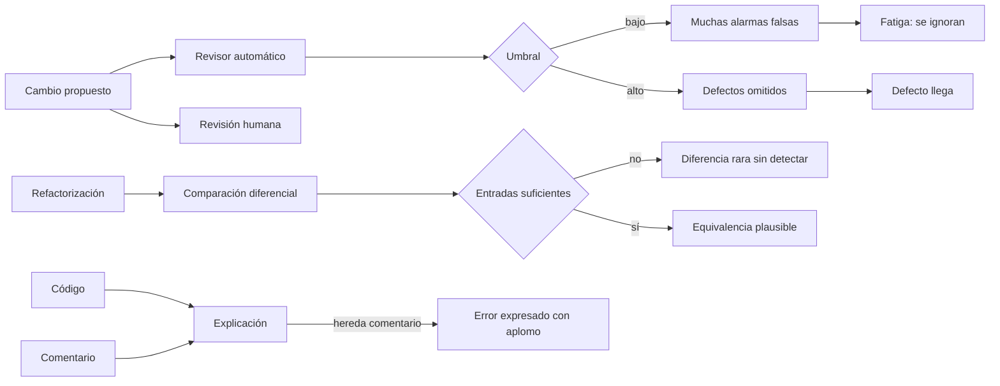
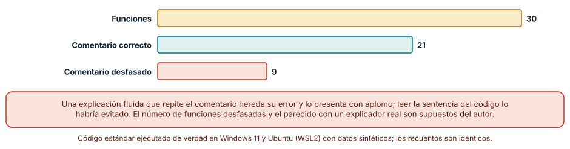

# SE-463 — Revisión, refactorización y explicación asistidas

[← SE-462 — Generación de pruebas, documentación y migraciones](https://github.com/vladimiracunadev-create/modern-software-engineering-program/blob/main/classes/part-38-desarrollo-de-software-asistido-por-ia/se-462-generacion-de-pruebas-documentacion-y-migraciones/README.md) · [↑ Parte 38](https://github.com/vladimiracunadev-create/modern-software-engineering-program/blob/main/classes/part-38-desarrollo-de-software-asistido-por-ia/README.md) · [📚 Índice completo](https://github.com/vladimiracunadev-create/modern-software-engineering-program/blob/main/classes/README.md) · [🌐 Portal](https://vladimiracunadev-create.github.io/modern-software-engineering-program/classes/SE-463.html) · [SE-464 — Context engineering y reducción de ambigüedad →](https://github.com/vladimiracunadev-create/modern-software-engineering-program/blob/main/classes/part-38-desarrollo-de-software-asistido-por-ia/se-464-context-engineering-y-reduccion-de-ambiguedad/README.md)

## Punto profesional y fundamento pedagógico

**Punto profesional.** La clase existe para que uses a un asistente como segundo par de ojos sin convertirlo en la única mirada. Tres tareas parecen naturales para él y esconden trampas distintas: revisar un cambio (donde la utilidad depende de cuántas alarmas falsas cuesta cada defecto hallado), refactorizar (donde el criterio es que el comportamiento no cambie, algo que solo se comprueba con evidencia) y explicar código (donde una explicación fluida puede repetir un comentario desactualizado). La habilidad es decidir qué parte de cada tarea se delega, con qué umbral y con qué comprobación independiente, y reconocer cuándo la respuesta del asistente es una opinión plausible y no una verificación.

**Por qué aparece aquí.** Sigue a **Generación de pruebas, documentación y migraciones**: `SE-462` trató de los artefactos que controlan al código y de su derivación independiente; ahora el asistente ocupa el lugar del revisor y del refactorizador. El caso conductor es el **módulo de calificaciones de la plataforma educativa**, con un cambio por revisar, una función por simplificar y un código que un compañero nuevo debe entender. Es un caso sintético; no se usó ningún revisor automático real.

**Error conceptual que debe corregir.** Creer que «el asistente no encontró problemas» significa que no los hay, y que «el comportamiento es el mismo» significa que se comprobó. La ausencia de hallazgos mide la cobertura del revisor, no la corrección del cambio; y la equivalencia de una refactorización no se prueba con tres ejemplos, sino que se estima con la probabilidad de que las entradas elegidas distingan las dos versiones.

**Secuencia de aprendizaje.** Antes de ver los resultados, predices cuántos defectos reales cubre y cuántas alarmas falsas genera un revisor automático según el umbral; después mides cuántas entradas aleatorias hacen falta para distinguir de la original tres refactorizaciones con diferencias de distinta frecuencia y comparas un explicador que repite el comentario con el código que describe. La secuencia usa predicción, explicación propia, contraste y recuperación. [ICAP](https://icap.education.asu.edu/research) distingue participación de construcción de conocimiento; [How People Learn II](https://nap.nationalacademies.org/catalog/24783/how-people-learn-ii-learners-contexts-and-cultures) respalda diseñar la práctica con contextos reales y retroalimentación.

**Evidencia de aprendizaje.** `revision-asistida.md` con la predicción, las tres figuras reproducidas, el umbral elegido para un revisor con su justificación, una comprobación de equivalencia para una refactorización con el número de entradas usado, un contraste de dos explicaciones con el código y una nota que separe qué es medido, inferido y supuesto.

**Límite de la conclusión.** Las puntuaciones del revisor, la proporción de defectos, las tres refactorizaciones, la distribución de entradas y las nueve funciones con comentario desfasado son construcciones del autor con semilla fija. Las comparaciones entre versiones de la función se ejecutan de verdad, pero con funciones escritas para ilustrar tres tipos de diferencia; no se evaluó ningún revisor ni refactorizador automático.

### Trazabilidad fuente → afirmación

| Fuente primaria u oficial | Afirmación que respalda | Lo que no prueba |
|---|---|---|
| [Bacchelli y Bird, «Expectations, outcomes, and challenges of modern code review»](https://doi.org/10.1109/ICSE.2013.6606617) | Muestra que la revisión de código persigue más que hallar defectos (compartir conocimiento, mantener normas) y que entender el cambio y su contexto es lo más difícil. | No mide el efecto de un revisor automático. |
| [Google: Engineering Practices, code review](https://google.github.io/eng-practices/review/) | Expone una guía pública de revisión: qué buscar (diseño, funcionalidad, pruebas, claridad), el tamaño de los cambios y el equilibrio entre rapidez y calidad. | Es la práctica de una organización; no es un estándar universal. |
| [Fowler, «Refactoring»](https://refactoring.com/) | Define refactorizar como cambiar la estructura sin cambiar el comportamiento observable y la apoya en pruebas que lo comprueban. | No dice cuántas pruebas bastan para afirmar la equivalencia. |
| [Claessen y Hughes, «QuickCheck»](https://doi.org/10.1145/351240.351266) | Propone comprobar propiedades con entradas aleatorias generadas, base de las pruebas de propiedades y de la comparación entre versiones. | Encontrar una diferencia depende de que el generador la alcance. |
| [Hypothesis](https://hypothesis.readthedocs.io/en/latest/) | Documenta una biblioteca de pruebas de propiedades para Python con generación y reducción de casos. | No es parte de los experimentos de la clase, que usan solo la biblioteca estándar. |
| [Python: ast](https://docs.python.org/3/library/ast.html) | Documenta el análisis del árbol sintáctico usado en la comparación de explicaciones. | No decide qué descripción es la correcta. |

## Antes de empezar

Recupera lo aprendido en `SE-462`: un control derivado de aquello que controla hereda su error. La pregunta activa es: **¿cuántas veces aprobaste un cambio porque «no había nada que decir», y qué habrías tenido que mirar para saber que no faltaba nada?**

## Prerrequisitos

- Haber completado `SE-462` o poder explicar el problema del oráculo y la diferencia entre ejecución y detección.
- Python 3.11 o posterior; los experimentos usan solo la biblioteca estándar (`random`, `ast`, `re`).
- Saber leer un diff y una función de varias líneas, y qué es una precisión y una cobertura de detección.

## Problema auténtico

El equipo conectó un revisor automático a su flujo de cambios. Con la configuración por defecto marcó 275 de 400 cambios en un mes; casi todas las alarmas eran estilo, y las personas empezaron a ignorarlo, incluida la única alarma real sobre una condición de frontera. Para simplificar la función de agrupación de notas por curso, otra persona pidió una refactorización; el asistente devolvió una versión más corta que perdía el orden alfabético de los cursos, y las tres pruebas existentes no lo notaron. Un compañero nuevo pidió que le explicaran una función y el asistente resumió su docstring con elocuencia: la docstring decía «multiplica por 4» y el código multiplicaba por 5. Los tres incidentes tienen una raíz común: la salida del asistente se tomó como evidencia cuando era una opinión. La clase enseña a medir al revisor, a comprobar la equivalencia con un número honesto de entradas y a pedir explicaciones que el código desmienta o confirme.

## Objetivos observables

Al terminar podrás:

1. leer el compromiso entre precisión y cobertura de un revisor automático y elegir un umbral según el costo de una alarma falsa y de un defecto omitido;
2. calcular cuántas entradas aleatorias hacen falta para distinguir dos versiones de una función según la frecuencia de la diferencia;
3. comprobar una refactorización con una comparación diferencial entre versiones y declarar el límite de esa comprobación;
4. detectar cuándo una explicación hereda un comentario desactualizado;
5. definir qué parte de la revisión, la refactorización y la explicación se delega y qué parte la conserva una persona.

## Mapa conceptual



El mapa organiza tres mecanismos distintos con el mismo patrón: una señal automática útil con un modo de fallo propio y una comprobación independiente que lo acota. La fatiga por alarmas, la diferencia rara sin detectar y la explicación heredada son los tres fallos que la clase mide.

## Temas y por qué importan

| Tema | Por qué cambia una decisión profesional | Evidencia mínima |
|---|---|---|
| Qué revisa un revisor automático | Define qué sigue siendo responsabilidad humana | lista de qué mira cada uno |
| Precisión y cobertura | Convierte «el revisor funciona» en un número con dos caras | tabla por umbral |
| Fatiga por alarmas | Explica por qué un revisor ruidoso se ignora | alarmas falsas por defecto real |
| Refactorización y equivalencia | Separa «parece igual» de «se comprobó» | probabilidad de detección según entradas |
| Comparación diferencial | Da una comprobación independiente barata | comparación entre original y refactorizada |
| Explicación fiel | Evita transmitir errores de comentarios | contraste de explicación y código |

## Conceptos y decisiones

### 1. Qué hace una revisión y qué parte se delega

Bacchelli y Bird mostraron que la revisión de código cumple funciones que van más allá de encontrar defectos: transferir conocimiento, mantener normas y mejorar la comprensión colectiva del sistema, y que lo más difícil para quien revisa es entender el propósito y el contexto del cambio. La guía de revisión de Google lo expresa como una lista de cosas a mirar: diseño, funcionalidad, complejidad, pruebas, nombres, comentarios y estilo. Un revisor automático puede ayudar en lo mecánico (estilo, errores frecuentes, comprobaciones locales) y en señalar zonas a mirar; es poco fiable en lo que requiere entender la intención (¿esta condición de frontera es la que pide el reglamento?) y no transfiere conocimiento. Delegar la revisión por completo cambia la función del proceso: se obtiene una lista de observaciones y se pierde el aprendizaje compartido. El reparto razonable es que el asistente propone y la persona decide, y que la responsabilidad del cambio quede nombrada.

### 2. Precisión, cobertura y el costo de una alarma

Un revisor automático emite una puntuación de sospecha por cambio y un umbral decide cuáles se marcan. Dos cantidades describen el resultado. La **precisión** es la fracción de lo marcado que era un defecto real; la **cobertura** (o recall), la fracción de los defectos reales que se marcaron. Subir el umbral sube la precisión y baja la cobertura; bajarlo hace lo contrario. No existe un umbral correcto en abstracto: depende del costo de una alarma falsa (tiempo de lectura y desgaste de la atención) frente al costo de un defecto omitido (un incidente en producción). Hay un efecto añadido: cuando la precisión cae, las personas aprenden a ignorar las alarmas, y entonces la cobertura efectiva del proceso se hunde por debajo de la del revisor. Por eso se mide con cambios reales etiquetados, se elige el umbral por escrito y se revisa al cambiar el modelo o el código.

### 3. Refactorizar es cambiar la estructura sin cambiar el comportamiento

Fowler define la refactorización como un cambio en la estructura interna de un software que no altera su comportamiento observable, y la apoya en pruebas que lo comprueban. La parte que se pierde con un asistente es la comprobación: el asistente devuelve una versión más corta o más clara, con total seguridad, y el comportamiento puede haber cambiado en un caso (el orden, un valor límite, una nota igual a cero). Tres cosas ayudan. Hacer pasos pequeños, de modo que una diferencia se pueda localizar. Fijar el comportamiento antes con pruebas de caracterización (`SE-435`), sabiendo que fijan lo que el código hace, no lo que debería hacer. Y comparar de forma diferencial la versión original y la refactorizada sobre muchas entradas. Cuando la refactorización añade un cambio de comportamiento deseado, no es una refactorización: es otro cambio, con su propia revisión.

### 4. La comparación diferencial y su límite

Ejecutar la versión original y la refactorizada con las mismas entradas y comparar las salidas es una comprobación barata y potente, y es la idea de fondo de las pruebas basadas en propiedades que introdujo QuickCheck: generar entradas y comprobar una propiedad. Su alcance depende del generador. Si dos versiones difieren en una fracción *p* de las entradas posibles, *n* entradas independientes las distinguen con probabilidad 1 − (1 − *p*)^n. Una diferencia que ocurre en la mitad de las entradas se ve con cinco; una que ocurre en una de cien exige cientos para tener probabilidad razonable, y una que ocurre en una entre diez mil exige decenas de miles. La comprobación nunca demuestra equivalencia: la hace más o menos plausible. Para acotar el riesgo se enriquece el generador con las fronteras conocidas (cero, vacío, repetidos) y se complementa con revisión humana de la lógica, en la que el asistente puede ayudar a explicar qué cambió.

### 5. Una explicación es tan fiel como su fuente

Cuando se pide al asistente que explique una función, hay dos fuentes posibles para su respuesta: el código y los comentarios o la documentación que lo acompañan. Un modelo que combina ambos puede dar más peso al texto en lenguaje natural, que es más fácil de parafrasear. Si el comentario quedó desactualizado, la explicación hereda su error y lo transmite con la claridad de una explicación correcta. Esto importa especialmente para quien se incorpora a un equipo y confía en la explicación para no leer el código. Las defensas son pedir explicaciones que citen líneas, contrastar los valores concretos con una ejecución (qué devuelve con esta entrada) y tratar un desajuste entre explicación y ejecución como un hallazgo sobre el código, no solo sobre la explicación.

### 400 cambios: un revisor y su umbral

Se generan 400 cambios, de los cuales 80 tienen un defecto real. El revisor puntúa cada cambio con una normal de media 0,68 para los defectuosos y 0,40 para los demás, con desviación de 0,17, y se marcan los de puntuación al menos igual al umbral.

```python
punt = rng.gauss(0.68 if defecto else 0.40, 0.17)
marcados = [d for d in datos if d[0] >= umbral]
precision = aciertos / len(marcados); cobertura = aciertos / 80
```

| Umbral | Cambios marcados | Precisión | Defectos cubiertos | Falsas alarmas |
|---:|---:|---:|---:|---:|
| 0,35 | 275 | 28,7 % | 98,8 % | 196 |
| 0,50 | 161 | 44,7 % | 90,0 % | 89 |
| 0,60 | 100 | 58,0 % | 72,5 % | 42 |
| 0,70 | 56 | 73,2 % | 51,2 % | 15 |
| 0,80 | 30 | 80,0 % | 30,0 % | 6 |

Con el umbral 0,35 el revisor cubre el 98,8 % de los defectos y marca 275 cambios, de los cuales 196 son falsas alarmas: la persona revisa tres cambios para encontrar uno defectuoso. Con 0,80 la precisión sube al 80 % y la cobertura baja al 30 %: se pierden siete de cada diez defectos. Una persona que ha visto cientos de alarmas inútiles tiende a ignorar el revisor, y entonces el umbral bajo ya no da cobertura. El valor útil está entre medias y se elige comparando el costo de revisar una alarma falsa con el de dejar pasar un defecto.


**Cómo leer la figura.** El eje horizontal es el umbral del revisor y el vertical un porcentaje. La línea turquesa es la precisión y la coral discontinua la cobertura de defectos. Mira cómo se cruzan: subir el umbral gana precisión a costa de dejar pasar defectos. **Dónde deja de valer:** las puntuaciones son gaussianas con medias del autor, la proporción de defectos (20 %) es mucho más alta que en un flujo real y las alarmas se suponen independientes. En un flujo con 2 % de cambios defectuosos la precisión sería bastante menor con los mismos umbrales.

### Cuatro versiones refactorizadas: cuántas entradas las distinguen

La función original agrupa pares (curso, nota), calcula el promedio por curso a un decimal y devuelve la lista ordenada por curso. Se comparan cuatro versiones con la original: una **equivalente**, una que **pierde el orden** (devuelve en orden de aparición), una que **descarta la nota 0,0** (trata el cero como ausente) y una que **descarta los cursos con cinco notas o más**. Se generan 20 000 entradas aleatorias (de 1 a 8 pares, cinco cursos, notas de un conjunto de seis valores con un 3 % extra de ceros) y se cuenta en cuántas difiere cada una; con esa fracción *p* se calcula la probabilidad de detectar la diferencia con *n* entradas.

| Refactorización | Entradas que difieren | 5 entradas | 20 | 100 | 1.000 |
|---|---:|---:|---:|---:|---:|
| Equivalente | 0,00 % | 0,0 % | 0,0 % | 0,0 % | 0,0 % |
| Pierde el orden | 67,68 % | 99,6 % | 100,0 % | 100,0 % | 100,0 % |
| Descarta la nota 0,0 | 56,92 % | 98,5 % | 100,0 % | 100,0 % | 100,0 % |
| Descarta cursos con 5 notas o más | 1,04 % | 5,1 % | 18,9 % | 65,0 % | 100,0 % |

Las diferencias frecuentes (orden, cero) se detectan con cinco entradas con más del 98 % de probabilidad. La que ocurre en una de cada cien entradas (1,04 %) se detecta solo en el 5,1 % de los casos con cinco entradas y en el 18,9 % con veinte: una prueba con tres ejemplos escritos a mano casi nunca la encuentra, y se necesitan cientos de entradas para superar el 65 %. La refactorización equivalente no difiere nunca, pero eso no demuestra que lo sea: solo que 20 000 entradas de esa distribución no la distinguieron.


**Cómo leer la figura.** Cada fila es una refactorización y cada columna un número de entradas aleatorias; el color más oscuro es mayor probabilidad de distinguirla de la original. Mira la última fila, que se aclara hacia la derecha: la diferencia rara necesita 1 000 entradas, y la primera fila, equivalente, queda en 0 en todas. **Dónde deja de valer:** las funciones y la distribución de entradas son del autor; un generador mejor (con muchas notas por curso) elevaría la frecuencia de la diferencia rara, y un generador peor la reduciría. La probabilidad supone entradas independientes.

### Treinta funciones: un explicador que repite el comentario

Se generan 30 funciones de una línea con un comentario que dice «Multiplica por *k*»; en 9 el comentario describe otro valor (*k* − 1) porque el código cambió. Un explicador que lee el comentario devuelve el valor que el comentario declara; la comprobación extrae del árbol sintáctico el valor que el código usa realmente.

```python
declarado = int(re.search(r"(\d+)", ast.get_docstring(f).splitlines()[0]).group(1))
real = ast.parse(src).body[0].body[1].value.right.value
```

| Medida | Funciones |
|---|---:|
| Funciones | 30 |
| Comentario correcto | 21 |
| Comentario desfasado | 9 |
| Explicaciones erróneas del que repite el comentario | 9 |

El explicador que repite el comentario acierta en las 21 funciones con comentario correcto y se equivoca en las 9 desfasadas: el 30 % de sus explicaciones es incorrecto y ninguna avisa. Leer el árbol sintáctico, que describe lo que el código hace, coincide con la ejecución en las 30. El experimento es deliberadamente simple: no hay un modelo de lenguaje, solo un procedimiento que ilustra qué ocurre cuando la explicación se apoya en el texto y no en el comportamiento.



**Cómo leer la figura.** La primera barra es el total; la segunda, el grupo en que la explicación acierta; la tercera, el grupo en que hereda el error. **Dónde deja de valer:** el explicador es un procedimiento del autor, no un modelo de lenguaje; la proporción de comentarios desfasados (30 %) es mucho mayor que la de un código mantenido; y las funciones de una línea no tienen la ambigüedad de las reales.

## Definiciones de trabajo

- **precisión:** fracción de lo que el revisor marca que era un defecto real.
- **cobertura (recall):** fracción de los defectos reales que el revisor marca.
- **refactorización:** cambio de la estructura interna que no altera el comportamiento observable.
- **comparación diferencial:** ejecución de dos versiones con las mismas entradas para comparar sus salidas.
- **explicación fiel:** descripción que coincide con lo que el código hace al ejecutarse, no con lo que dice su comentario.

Las definiciones son operativas para el módulo de calificaciones. No convierten términos con una historia más amplia en sinónimos y deben contrastarse con la documentación primaria enlazada al final.

## Ejemplo mínimo

El fragmento compara dos versiones de una función con entradas aleatorias. Antes de ejecutarlo, predice si las encuentra distintas.

```python
import random
def original(xs):
    acum = {}
    for c, n in xs: acum.setdefault(c, []).append(n)
    return [(c, round(sum(v) / len(v), 1)) for c, v in sorted(acum.items())]
def refactorizada(xs):
    acum = {}
    for c, n in xs: acum.setdefault(c, []).append(n)
    return [(c, round(sum(v) / len(v), 1)) for c, v in acum.items()]
rng = random.Random(463)
distintas = sum(original(x) != refactorizada(x) for x in ([(rng.choice("ABC"), rng.choice([4.0, 5.0])) for _ in range(4)] for _ in range(1000)))
print(distintas)
```

La refactorizada pierde el orden y difiere en una fracción grande de las entradas, de modo que un puñado de pruebas la detecta. Registra versión de Python, comando y salida; después restringe las entradas a un único curso y observa que la diferencia desaparece, con lo que la comprobación «pasa» sin que la función sea equivalente.

## Ejemplo profesional

Escenario hipotético, construido para la clase y sin datos reales. El equipo del módulo de calificaciones define un procedimiento para los cambios asistidos. El revisor automático se fija con umbral 0,60 tras medir, en doscientos cambios etiquetados del año anterior, 58 % de precisión y 72 % de cobertura; la persona que revisa lee primero las alarmas y después el diff completo, y la aprobación nombra a quien responde. Para una refactorización de la agrupación por curso, el equipo exige una comparación diferencial con 5 000 entradas generadas con fronteras (cursos repetidos, nota 0,0, lista de un elemento, más de cinco notas por curso) y la ejecución de las pruebas de caracterización; el diff debe ser menor de 40 líneas y no incluir cambios de estilo. Para explicar la función a una persona nueva, el asistente debe citar líneas y se contrasta con tres ejecuciones; el desajuste entre la docstring y el código se registra como defecto de documentación. Escribe la política con dueño y revisión semestral, y compara con el estado inicial: antes un revisor ruidoso se ignoraba y las refactorizaciones se aceptaban si «parecían iguales».

## Práctica guiada

1. Predice cuántas falsas alarmas genera un revisor con umbral 0,35 y anota el número.
2. Reproduce la tabla del revisor con la semilla fijada y elige un umbral justificando el costo de una alarma falsa frente al de un defecto omitido.
3. Escribe tres refactorizaciones de una función propia, una con una diferencia frecuente y otra con una diferencia rara, y mide en cuántas entradas aleatorias difiere cada una.
4. Calcula cuántas entradas necesitas para superar el 95 % de detección de una diferencia del 1 %.
5. Enriquece el generador con las fronteras de tu dominio y mide cuánto sube la frecuencia de la diferencia rara.
6. Toma diez funciones con comentario y comprueba, con una ejecución, cuántos comentarios describen algo distinto del comportamiento.
7. Entrega `revision-asistida.md` y pide a otra persona que proponga una refactorización «equivalente» que tu comprobación no distinga.

## Ejercicios

1. **Umbral:** con un costo de 2 minutos por alarma falsa y 4 horas por defecto omitido, ¿qué umbral de la tabla minimiza el costo esperado por 400 cambios? Calcúlalo.
2. **Detección:** una diferencia aparece en 0,2 % de las entradas. ¿Cuántas entradas aleatorias necesitas para el 90 %?
3. **Frontera:** propón tres entradas de frontera para la agrupación por curso que un generador uniforme casi nunca produciría.
4. **Explicación:** el asistente explica una función citando su docstring y no su código. Describe cómo lo detectarías y qué corregirías.

## Reto verificable

Entrega `revision-asistida.md` con la predicción, las tres tablas, el umbral del revisor elegido con su justificación de costos, una comparación diferencial de al menos 1 000 entradas para una refactorización propia con las fronteras de tu dominio, el cálculo de la probabilidad de detectar una diferencia del 1 % y el contraste de al menos diez explicaciones con la ejecución. Se aprueba si otra persona ejecuta el código desde un checkout limpio, obtiene los mismos números con las mismas semillas y puede proponer una refactorización que tu comparación no distinga. No se aprueba por afirmar que «las pruebas pasan» ni por un umbral sin costos.

## Caso conductor

El módulo de calificaciones es el caso conductor. Esta clase deja el séptimo artefacto: el procedimiento de revisión, refactorización y explicación con sus umbrales. `SE-464` preguntará cómo se reduce la ambigüedad del contexto para que las revisiones y refactorizaciones se apoyen en información correcta, y `SE-465` llevará estas mediciones a evaluaciones formales. Cambia después un solo dato, la proporción de cambios defectuosos (del 20 % al 2 %), y observa cómo cae la precisión con el mismo umbral.

## Preguntas frecuentes

### ¿Un revisor automático reemplaza la revisión humana?

No: cubre lo mecánico y a veces señala zonas de riesgo, pero no transfiere conocimiento ni entiende la intención. El proceso razonable es revisor automático más persona, con el umbral medido.

### ¿Cuántas entradas aleatorias bastan para afirmar que dos versiones son equivalentes?

Ninguna cantidad demuestra equivalencia. Se acota el riesgo: con una diferencia posible del 1 % hacen falta unas 300 para el 95 %, y con una del 0,01 %, miles; se enriquece el generador con fronteras y se añade lectura humana.

### ¿Puedo confiar en la explicación si el asistente cita líneas?

Más que sin citas, y menos que ejecutándola. Comprueba que las líneas citadas dicen lo que se afirma y contrasta con una ejecución de valores concretos.

### ¿Qué hago si el asistente propone una refactorización que además corrige un error?

Sepáralo: la refactorización debe ser equivalente y el arreglo es un cambio de comportamiento con su revisión y su prueba. Mezclarlos impide la comparación diferencial.

## Fallo controlado y diagnóstico

Reproduce el fallo clásico de la clase: **una refactorización con una diferencia rara que aprueba la suite**. Aplica la versión que descarta cursos con cinco notas o más a una suite de tres ejemplos escritos a mano.

Registra síntoma, entrada mínima, hipótesis, observación que descarta cada hipótesis, causa, corrección y prueba de regresión. **Síntoma:** la refactorización pasó todas las pruebas y un curso grande desapareció del informe. **Hipótesis rivales:** (a) la función original ya tenía el defecto; (b) los datos de producción son distintos; (c) ninguna entrada de prueba tenía cinco notas en un curso. **Prueba:** compara las dos versiones con 20 000 entradas aleatorias; si difieren en 1,04 % y las tres de la suite no están entre ellas, la causa es la rareza de la diferencia. **Conclusión:** una suite pequeña de ejemplos no distingue una diferencia rara. **Regresión:** añade al generador de comparación un caso con muchas notas por curso y una prueba que falle si los cursos de la entrada no coinciden con los de la salida. No cambies a la vez la función y el generador.

## Errores comunes y cómo corregirlos

| Síntoma | Causa probable | Corrección |
|---|---|---|
| El revisor automático se ignora | Umbral bajo, precisión baja, fatiga | Medir con cambios etiquetados y subir el umbral |
| Se pierden defectos que el revisor sí podía marcar | Umbral alto sin medir la cobertura | Elegir el umbral con costos explícitos |
| La refactorización cambia el orden o un valor límite | Solo se comprobó con ejemplos | Comparación diferencial con generador enriquecido |
| La explicación repite un error de la documentación | Se apoyó en el comentario | Pedir citas de líneas y contrastar con la ejecución |
| Refactorización y arreglo van en el mismo cambio | No se separaron los propósitos | Un cambio por propósito, con su revisión |

## Entorno y archivos clave

```text
work/SE-463/
├── README.md
├── revision/
│   ├── umbral.py
│   ├── diferencial.py
│   └── explicacion.py
├── tests/test_revision.py
└── evidence/revision-asistida.md
```

El `README` declara plataforma, versión de Python, semillas y comandos. Los experimentos usan solo la biblioteca estándar (`random`, `ast`, `re`) y se ejecutaron con CPython 3.12.9 en Windows 11 y 3.12.3 en Ubuntu bajo WSL2: las salidas fueron idénticas. Los experimentos están en `scripts/experiments_part38_b.py`. Si añades una dependencia (por ejemplo, una biblioteca de pruebas de propiedades), fija procedencia y versión.

## Seguridad, ética y accesibilidad

- un revisor automático que recibe tu código lo procesa fuera de tu entorno: decide qué archivos nunca se envían (`SE-466`);
- una revisión asistida no sustituye la responsabilidad personal por el cambio; nombra a quien aprueba;
- un umbral ajustado para reducir alarmas puede dejar pasar defectos que afectan a pocas personas; considera la gravedad, no solo la frecuencia;
- las alarmas deben presentarse con texto claro y no depender del color para indicar gravedad;
- las guías y artículos citados tienen derechos de autor: cita su estructura y vincula la fuente, no copies su texto.

## Puente hacia el trabajo con agentes

Un agente revisa, refactoriza y explica en una sola sesión, y puede ajustar su propia salida a lo que él mismo comprueba. Pide que la refactorización llegue con la comparación diferencial ejecutada y su número de entradas, que declare qué fronteras incluyó, que no mezcle arreglos con refactorización y que cada explicación cite líneas y valores obtenidos al ejecutar. Revisa especialmente cuando el agente declara «equivalente» sin decir con cuántas entradas, y compara su informe con una comparación hecha por ti con un generador distinto: la diferencia es la medida de cuánta equivalencia puedes darle por supuesta.

## Transferencia

Traslada el análisis a otro dominio (por ejemplo, el cálculo de presupuestos de un taller mecánico): cambia la función, las fronteras y los defectos y conserva el procedimiento de medir precisión y cobertura del revisor, comparar versiones con un generador enriquecido, calcular la probabilidad de detección y contrastar explicaciones con ejecuciones. La transferencia está lograda cuando puedes decir qué diferencia rara de ese dominio tu generador no alcanzaría, no cuando la tabla se parece a la del módulo de calificaciones.

## Evaluación y evidencia

| Criterio | Evidencia para aprobar |
|---|---|
| comprensión | explicación del compromiso precisión-cobertura y de los límites de la comparación diferencial |
| corrección | tablas de umbral, equivalencia y explicación reproducibles con las mismas semillas |
| diseño | procedimiento con umbral medido, generador con fronteras y explicaciones contrastadas |
| diagnóstico | reproducción del fallo «diferencia rara que aprueba la suite» con regresión |
| incertidumbre | declaración de que puntuaciones, funciones y entradas son del autor |
| reproducibilidad | versiones, comandos, salida y límites declarados |

## Fuentes

- [Bacchelli y Bird](https://doi.org/10.1109/ICSE.2013.6606617) — revisión de código moderna: expectativas, resultados y desafíos; autoridad: ICSE 2013.
- [Google: Engineering Practices, code review](https://google.github.io/eng-practices/review/) — guía pública de revisión; autoridad: documentación de Google.
- [Fowler, «Refactoring»](https://refactoring.com/) — definición y práctica de la refactorización; autoridad: autor del texto.
- [Claessen y Hughes, «QuickCheck»](https://doi.org/10.1145/351240.351266) — pruebas de propiedades con entradas aleatorias; autoridad: ICFP 2000.
- [Hypothesis](https://hypothesis.readthedocs.io/en/latest/) — biblioteca de pruebas de propiedades para Python; autoridad: documentación del proyecto.
- [Python: ast](https://docs.python.org/3/library/ast.html) — análisis del árbol sintáctico; autoridad: documentación de Python.

Cada fuente respalda el mecanismo indicado; ninguna demuestra que el 28,7 % de precisión con umbral 0,35, el 5,1 % de detección con cinco entradas o las 9 explicaciones erróneas de 30 se observen en un revisor, un refactorizador o un explicador reales. Esa afirmación depende de la herramienta, del código y de cómo se mida.

## Límites y siguiente paso

Se ejecutaron tres experimentos en Windows y Ubuntu (WSL2) con resultados idénticos: una simulación del umbral de un revisor, una comparación diferencial real entre versiones de una función y una extracción real con `ast` frente a comentarios. No se evaluó ningún revisor, refactorizador ni explicador; las puntuaciones, la proporción de defectos, las funciones, la distribución de entradas y los comentarios desfasados son construcciones del autor. La siguiente clase pregunta cómo se reduce la ambigüedad del contexto para que estas tareas se apoyen en información correcta.

## Glosario

- **precisión:** fracción de lo que el revisor marca que era un defecto real.
- **cobertura (recall):** fracción de los defectos reales que el revisor marca.
- **refactorización:** cambio de la estructura interna que no altera el comportamiento observable.
- **comparación diferencial:** ejecución de dos versiones con las mismas entradas para comparar sus salidas.
- **explicación fiel:** descripción que coincide con lo que el código hace al ejecutarse, no con lo que dice su comentario.

---

[← SE-462 — Generación de pruebas, documentación y migraciones](https://github.com/vladimiracunadev-create/modern-software-engineering-program/blob/main/classes/part-38-desarrollo-de-software-asistido-por-ia/se-462-generacion-de-pruebas-documentacion-y-migraciones/README.md) · [↑ Parte 38](https://github.com/vladimiracunadev-create/modern-software-engineering-program/blob/main/classes/part-38-desarrollo-de-software-asistido-por-ia/README.md) · [📚 Índice completo](https://github.com/vladimiracunadev-create/modern-software-engineering-program/blob/main/classes/README.md) · [🌐 Portal](https://vladimiracunadev-create.github.io/modern-software-engineering-program/classes/SE-463.html) · [SE-464 — Context engineering y reducción de ambigüedad →](https://github.com/vladimiracunadev-create/modern-software-engineering-program/blob/main/classes/part-38-desarrollo-de-software-asistido-por-ia/se-464-context-engineering-y-reduccion-de-ambiguedad/README.md)
