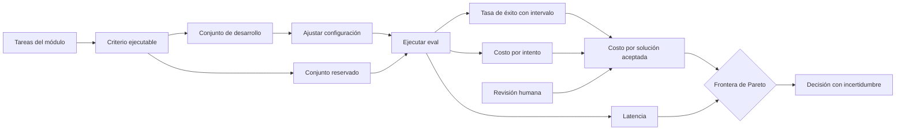
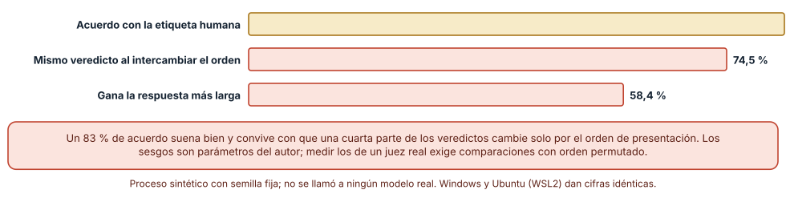

# SE-465 — Evals de exactitud, utilidad, costo y latencia

[← SE-464 — Context engineering y reducción de ambigüedad](https://github.com/vladimiracunadev-create/modern-software-engineering-program/blob/main/classes/part-38-desarrollo-de-software-asistido-por-ia/se-464-context-engineering-y-reduccion-de-ambiguedad/README.md) · [↑ Parte 38](https://github.com/vladimiracunadev-create/modern-software-engineering-program/blob/main/classes/part-38-desarrollo-de-software-asistido-por-ia/README.md) · [📚 Índice completo](https://github.com/vladimiracunadev-create/modern-software-engineering-program/blob/main/classes/README.md) · [🌐 Portal](https://vladimiracunadev-create.github.io/modern-software-engineering-program/classes/SE-465.html) · [SE-466 — Privacidad, propiedad intelectual y código inseguro →](https://github.com/vladimiracunadev-create/modern-software-engineering-program/blob/main/classes/part-38-desarrollo-de-software-asistido-por-ia/se-466-privacidad-propiedad-intelectual-y-codigo-inseguro/README.md)

## Punto profesional y fundamento pedagógico

**Punto profesional.** La clase existe para que dejes de decidir con la impresión de «parece que ahora responde mejor» y midas. Una *eval* es un conjunto de tareas con un criterio de éxito ejecutable, un procedimiento para correrlo y una forma de leer el resultado con su incertidumbre. Para un asistente de programación hay cuatro preguntas que no coinciden: si acierta (exactitud), si sirve a quien lo usa (utilidad), cuánto cuesta cada solución aceptada y cuánto tarda. Un equipo que mide solo la primera elige la configuración más cara; uno que mide solo el costo elige la que falla; uno que no mide la incertidumbre atribuye a la herramienta diferencias que son ruido. La habilidad es diseñar la eval, dimensionarla y leerla sin engañarse.

**Por qué aparece aquí.** Sigue a **Context engineering y reducción de ambigüedad**: `SE-464` diseñó el contexto con la promesa de que mejora el resultado; ahora hay que comprobarlo. Las clases anteriores midieron mecanismos aislados; esta mide el sistema completo con tareas y criterios. El caso conductor es el **módulo de calificaciones de la plataforma educativa**, con un conjunto de tareas de mantenimiento sobre el que comparar configuraciones del asistente. Es un caso sintético; no se evaluó ningún modelo real.

**Error conceptual que debe corregir.** Creer que una diferencia de cinco puntos entre dos configuraciones en un conjunto de cincuenta tareas es una diferencia real. Con tamaños pequeños el intervalo de confianza de cada resultado es tan ancho que se solapan, y ordenar bien dos sistemas cercanos exige cientos de tareas; lo que se interpreta como «mejora» puede ser azar de muestreo.

**Secuencia de aprendizaje.** Antes de ver los resultados, predices cuántas tareas hacen falta para distinguir con fiabilidad un sistema del 70 % de uno del 75 %; después calculas el intervalo de Wilson y la probabilidad de ordenarlos bien con cinco tamaños, comparas seis configuraciones por costo por solución aceptada, latencia y dominancia, y mides los sesgos de posición y de longitud de un juez automático sintético. La secuencia usa predicción, explicación propia, contraste y recuperación. [ICAP](https://icap.education.asu.edu/research) distingue participación de construcción de conocimiento; [How People Learn II](https://nap.nationalacademies.org/catalog/24783/how-people-learn-ii-learners-contexts-and-cultures) respalda diseñar la práctica con contextos reales y retroalimentación.

**Evidencia de aprendizaje.** `eval-diseno.md` con la predicción, las tres figuras reproducidas, un conjunto de al menos veinte tareas del módulo con su criterio ejecutable, el cálculo del tamaño necesario para la diferencia que te interesa, la comparación de al menos tres configuraciones por costo por solución aceptada y una nota que separe qué es medido, inferido y supuesto.

**Límite de la conclusión.** Las tasas de éxito, el costo por intento, la latencia, el costo de revisión de 0,40, el tamaño de los sesgos del juez y la independencia de las tareas son construcciones del autor con semilla fija. El intervalo de Wilson es un cálculo exacto; la comparación de configuraciones y el juez son modelos sintéticos. No se evaluó ningún modelo ni herramienta real, y las cifras no describen ninguna.

### Trazabilidad fuente → afirmación

| Fuente primaria u oficial | Afirmación que respalda | Lo que no prueba |
|---|---|---|
| [Wilson, «Probable Inference, the Law of Succession, and Statistical Inference»](https://doi.org/10.1080/01621459.1927.10502953) | Propone el intervalo de confianza para una proporción que lleva su nombre, adecuado para tamaños pequeños. | No decide si dos proporciones difieren. |
| [Efron, «Bootstrap Methods: Another Look at the Jackknife»](https://doi.org/10.1214/aos/1176344552) | Introduce el bootstrap: remuestrear los datos para estimar la variabilidad de un estadístico. | No corrige tareas correlacionadas ni sesgo de selección. |
| [Chen et al., «Evaluating Large Language Models Trained on Code»](https://arxiv.org/abs/2107.03374) | Define pass@k y evalúa código con pruebas unitarias ejecutables como criterio de éxito. | No dice si tus pruebas representan tu trabajo. |
| [Jimenez et al., «SWE-bench»](https://arxiv.org/abs/2310.06770) | Propone evaluar modelos con problemas reales de repositorios (incidencias y cambios con pruebas), más cercanos al trabajo profesional que ejercicios aislados. | No mide la utilidad en tu repositorio ni el costo de revisión. |
| [Zheng et al., «Judging LLM-as-a-Judge with MT-Bench and Chatbot Arena»](https://arxiv.org/abs/2306.05685) | Examina el uso de modelos como jueces y sus sesgos de posición, verbosidad y autoprefererencia, y su acuerdo con preferencias humanas. | No cuantifica los sesgos de un juez ni de una tarea tuyos. |
| [Jacovi et al., «Stop Uploading Test Data in Plain Text»](https://arxiv.org/abs/2305.10160) | Advierte de la contaminación de los conjuntos de evaluación publicados y propone estrategias para mitigarla. | No detecta contaminación en un modelo concreto. |
| [Anthropic: develop test cases](https://docs.anthropic.com/en/docs/test-and-evaluate/develop-tests) | Recomienda definir criterios de éxito medibles y casos de prueba antes de iterar sobre un prompt. | Es guía de un proveedor. |

## Antes de empezar

Recupera lo aprendido en `SE-464`: el contexto puede medirse por la ambigüedad que deja. La pregunta activa es: **¿qué diferencia entre dos configuraciones del asistente te haría cambiar de herramienta, y con cuántas tareas la distinguirías del azar?**

## Prerrequisitos

- Haber completado `SE-464` o poder explicar cómo se cuenta la ambigüedad de un encargo.
- Python 3.11 o posterior; los experimentos usan solo la biblioteca estándar (`random`, `math`).
- Saber leer una proporción, un intervalo de confianza y qué significa una diferencia significativa.

## Problema auténtico

El equipo probó dos configuraciones del asistente con treinta tareas del módulo: la primera resolvió 21 y la segunda 24. Alguien declaró que la segunda era «mejor» y la adoptó, a un costo tres veces mayor por llamada. Un mes después, con un conjunto distinto, los resultados se invirtieron. En paralelo, otra persona usaba un modelo como juez para comparar respuestas y notó que el juez favorecía la primera respuesta que veía y las más largas; la clasificación cambiaba al intercambiar el orden. Y cuando se midió el costo, resultó que el precio por llamada pesaba menos que el tiempo de revisión humana de cada intento. Los tres tropiezos se resuelven con una eval diseñada: tamaño suficiente, intervalos, costo por solución aceptada y un juez calibrado contra personas.

## Objetivos observables

Al terminar podrás:

1. diseñar un conjunto de tareas con criterios de éxito ejecutables y reservar una parte para comprobación;
2. calcular el intervalo de confianza de una tasa de éxito y la probabilidad de ordenar bien dos sistemas según el tamaño del conjunto;
3. comparar configuraciones por costo por solución aceptada, latencia y dominancia, incluyendo el costo de revisión humana;
4. medir sesgos de posición y de longitud de un juez automático frente a etiquetas humanas;
5. decidir cuándo una diferencia observada justifica cambiar de configuración y cuándo no.

## Mapa conceptual



El mapa separa las **tareas y criterios** de las **medidas** (éxito, costo, latencia) y reúne todas en una decisión sobre una frontera, no sobre un solo número. El conjunto reservado evita que el ajuste sobre el de desarrollo infle la estimación final.

## Temas y por qué importan

| Tema | Por qué cambia una decisión profesional | Evidencia mínima |
|---|---|---|
| Diseño de tareas y criterios | Un criterio ejecutable convierte la opinión en medida | veinte tareas con prueba |
| Tamaño y variabilidad | Determina si una diferencia es señal o ruido | tabla de intervalos y ordenación correcta |
| Utilidad frente a exactitud | Lo que acierta no siempre sirve ni se acepta | tasa de aceptación o tiempo ahorrado |
| Costo por solución aceptada | Incluye reintentos y revisión humana | tabla por configuración |
| Latencia | Condiciona el uso interactivo | latencia por configuración |
| Jueces automáticos | Escalan la evaluación a costa de sesgos | acuerdo con humanos y estabilidad al permutar |

## Conceptos y decisiones

### 1. Qué es una eval y qué no es

Una eval tiene cuatro piezas: un conjunto de tareas, un criterio de éxito aplicable sin intervención humana (o con una intervención medida), un procedimiento reproducible para correrla y una forma de resumir el resultado con su incertidumbre. No es una demo ni un conjunto de ejemplos favoritos. La guía de Anthropic insiste en definir criterios de éxito medibles antes de iterar sobre un prompt, porque lo contrario conduce a ajustar hasta que los ejemplos que se miran funcionan. Para código, el criterio natural es que las pruebas pasen (Chen y sus coautores lo usan para definir pass@k), y los conjuntos más cercanos al trabajo profesional parten de problemas reales de repositorios con sus pruebas (SWE-bench). Ninguno sustituye a un conjunto propio: lo que mide un benchmark público es su distribución de tareas, no la tuya.

### 2. Exactitud no es utilidad

Un asistente puede acertar la tarea y no servir: su solución pasa las pruebas pero es ilegible, rompe las convenciones o tarda en revisarse más de lo que ahorra. Y puede fallar la tarea y aun así ser útil si orienta hacia la solución. Las métricas de utilidad son más difíciles: tasa de aceptación de propuestas, tiempo hasta la solución, edición posterior necesaria, número de rondas. Se miden en uso real o en estudios con personas y suponen variabilidad entre tareas y personas. El experimento controlado de Peng y la prueba aleatorizada de METR (`SE-460`) ilustran que el efecto sobre el tiempo depende del contexto. Una eval honesta declara qué mide: «las pruebas pasan» es exactitud en el sentido de las pruebas, no utilidad.

### 3. Tamaño, intervalos y qué es una diferencia

La tasa de éxito observada en *n* tareas es una estimación con incertidumbre. El intervalo de Wilson da un rango plausible para la tasa verdadera y se comporta bien con tamaños pequeños y tasas extremas. Su ancho decrece con la raíz de *n*: para reducirlo a la mitad hay que cuadruplicar las tareas. Comparar dos sistemas añade otra capa: aun si uno es mejor, un conjunto pequeño puede ordenarlos mal. La probabilidad de que el sistema mejor puntúe más que el peor depende de la diferencia verdadera y de *n*, y para diferencias de pocos puntos exige cientos de tareas. Cuando las tareas son pareadas (las mismas para ambos), la comparación es más sensible porque cancela la dificultad compartida. Y si las tareas comparten dependencias (varias del mismo archivo), no son independientes y los intervalos son optimistas.

### 4. El costo se mide por solución aceptada

El costo por llamada es el número más visible y rara vez el que importa. Lo relevante es cuánto cuesta obtener una solución que pasa: el costo de cada intento dividido por la probabilidad de éxito, más lo que cuesta revisar cada intento. Si revisar un intento cuesta mucho más que generarlo, la configuración más barata por llamada sale cara por solución, porque falla más y cada fallo pasa por una revisión. La **frontera de Pareto** reúne las configuraciones que ninguna otra supera en todas las dimensiones a la vez (éxito, costo, latencia); una configuración dominada no se elige nunca, y entre las no dominadas la elección depende del contexto de uso: un editor interactivo valora la latencia, un trabajo por lotes valora el costo.

### 5. Jueces automáticos: escalan y sesgan

Evaluar respuestas abiertas con personas es lento; usar un modelo como juez escala. Zheng y sus coautores muestran que los jueces fuertes pueden acordar con las preferencias humanas en gran medida, y documentan sesgos concretos: de posición (preferir la primera respuesta), de verbosidad (preferir la más larga) y de autoprefererencia (favorecer respuestas de su propio estilo). Un juez sin calibrar mide en parte sus sesgos. La calibración consiste en comparar sus veredictos con etiquetas humanas en una muestra, permutar el orden para medir la estabilidad y controlar la longitud. Un juez es aceptable para una decisión cuando su acuerdo con las personas, en esa clase de tarea, es conocido y suficiente; no antes. Y las tareas deben protegerse de la **contaminación**: si el conjunto de evaluación se publicó, un modelo pudo verlo en su entrenamiento, y Jacovi y sus coautores proponen prácticas para evitarlo.

### El tamaño del conjunto: intervalos y orden

Dos sistemas tienen tasas de éxito verdaderas del 70 % y del 75 %. Para cada tamaño de conjunto se calcula el intervalo de Wilson al 95 % de la tasa del 70 % y se simulan 2 000 experimentos para contar cuántas veces el sistema del 75 % puntúa estrictamente más que el del 70 %.

```python
def wilson(aciertos, n, z=1.96):
    p = aciertos / n; den = 1 + z*z/n
    centro = (p + z*z/(2*n)) / den
    mitad = z * math.sqrt(p*(1-p)/n + z*z/(4*n*n)) / den
    return centro - mitad, centro + mitad
```

| Tareas | Intervalo al 95 % (70 % observado) | Ancho (puntos) | Ordena bien 70 % vs 75 % |
|---:|---|---:|---:|
| 20 | 48,1 % – 85,5 % | 37,4 | 58,3 % |
| 50 | 56,2 % – 80,9 % | 24,6 | 66,5 % |
| 100 | 60,4 % – 78,1 % | 17,7 | 74,8 % |
| 300 | 64,6 % – 74,9 % | 10,3 | 89,8 % |
| 1.000 | 67,1 % – 72,8 % | 5,7 | 99,2 % |

Con 20 tareas el intervalo abarca 37 puntos y el sistema mejor puntúa más solo el 58,3 % de las veces, apenas por encima de una moneda. Con 100, el intervalo sigue siendo de 17,7 puntos y el orden es correcto tres de cada cuatro veces. Distinguir cinco puntos con holgura (por encima del 90 %) requiere unas 300 tareas o más, y 1.000 para estar casi seguro. El caso de las 30 tareas del problema auténtico (21 frente a 24) queda muy lejos: la diferencia observada de 10 puntos era perfectamente compatible con dos sistemas iguales.


**Cómo leer la figura.** Cada fila es un tamaño de conjunto de tareas; el marcador dorado es el 70 % observado y los marcadores turquesa y coral los límites del intervalo de Wilson al 95 %. Mira cómo se estrecha el intervalo: con 20 tareas el 75 % cabe dentro y con 1 000 queda fuera del intervalo. La probabilidad de ordenar bien los dos sistemas está en la tabla. **Dónde deja de valer:** las dos tasas verdaderas son hipotéticas, las tareas se suponen independientes y de dificultad igual, y se comparan conjuntos distintos para cada sistema; con tareas pareadas la ordenación sería más fiable, con tareas correlacionadas, menos.

### Seis configuraciones: costo por solución aceptada y dominancia

Se definen seis configuraciones sintéticas con tasa de éxito, costo por intento y latencia. El costo por solución aceptada es (costo del intento + costo de revisión) dividido por la tasa de éxito, con un costo de revisión de 0,40 por intento, en una unidad arbitraria.

| Configuración | Éxito | Costo por intento | Latencia (s) | Costo por aceptada | ¿Dominada? |
|---|---:|---:|---:|---:|---|
| Pequeño | 52 % | 0,002 | 1,2 | 0,77 | no |
| Pequeño + reintento | 64 % | 0,004 | 2,6 | 0,63 | sí |
| Mediano | 68 % | 0,010 | 2,5 | 0,60 | no |
| Mediano + contexto | 76 % | 0,018 | 4,1 | 0,55 | no |
| Grande | 80 % | 0,045 | 6,0 | 0,56 | no |
| Grande + contexto + juez | 86 % | 0,110 | 12,0 | 0,59 | no |

El costo por intento varía por un factor de 55 entre la primera y la última configuración (de 0,002 a 0,110), pero el costo por solución aceptada solo entre 0,55 y 0,77: la revisión humana (0,40 por intento) domina el total. La configuración más barata por llamada es la más cara por solución aceptada (0,77), y la mejor, «mediano + contexto» (0,55), casi se iguala con «grande» (0,56) con una latencia 1,5 veces menor. «Pequeño + reintento» está dominada por «mediano» (menos éxito, más costo por aceptada y más latencia): nunca se elegiría. Entre las demás, la elección depende del uso: una edición interactiva elegiría la de menor latencia aceptable; un trabajo por lotes, la de menor costo por aceptada.


**Cómo leer la figura.** El eje horizontal es la latencia y el vertical la tasa de éxito; cada punto es una configuración. El punto coral es la configuración dominada, que tiene más latencia y menos éxito que otra. Mira cómo se paga cada punto de éxito con latencia; el costo por solución aceptada está en la tabla. **Dónde deja de valer:** todos los valores, incluida la revisión de 0,40, son supuestos del autor en una unidad arbitraria; la revisión no depende en realidad del intento (una solución mala se descarta antes) y la tasa de éxito varía por tipo de tarea. La estructura del cálculo se transfiere; los números, no.

### Un juez automático sintético: acuerdo, posición y longitud

Se simulan 1 000 comparaciones entre dos respuestas con calidades normales independientes y longitudes uniformes. El juez puntúa cada respuesta con su calidad más 0,8 por su longitud más ruido, y suma 0,4 a la primera respuesta (sesgo de posición). La etiqueta humana es la respuesta de mayor calidad. Se compara el veredicto con la etiqueta humana, el veredicto al intercambiar el orden y la frecuencia con que gana la más larga.

| Medida | Resultado |
|---|---:|
| Acuerdo con la etiqueta humana | 83,5 % |
| Mismo veredicto al intercambiar el orden | 74,5 % |
| Gana la respuesta más larga | 58,4 % |

El juez acuerda con la etiqueta humana en el 83,5 % de las comparaciones, una cifra que suena buena. Pero un cuarto de sus veredictos (25,5 %) cambia al mostrar las mismas respuestas en el otro orden, y la respuesta más larga gana el 58,4 % de las veces cuando por azar y calidad independiente serían el 50 %. El acuerdo medio esconde los sesgos. Con ellos medidos se puede corregir: evaluar cada par en ambos órdenes y contar solo los veredictos estables, normalizar la longitud, o calibrar con etiquetas humanas de la clase de tarea.



**Cómo leer la figura.** La primera barra es el acuerdo con las personas; las otras dos son las señales de sesgo, y su contraste con la primera es la lección. **Dónde deja de valer:** los pesos de los sesgos (0,8 de longitud, 0,4 de posición) son del autor y la calidad se supone un número; los jueces reales sesgan de formas más variadas y dependientes de la tarea. Medir los de uno real exige permutar el orden y controlar la longitud con datos tuyos.

## Definiciones de trabajo

- **eval:** conjunto de tareas con criterio de éxito ejecutable y procedimiento reproducible para medir un sistema.
- **intervalo de Wilson:** intervalo de confianza para una proporción, adecuado para tamaños pequeños.
- **costo por solución aceptada:** costo total de intentos y revisión dividido por las soluciones que se aceptan.
- **frontera de Pareto:** conjunto de configuraciones que ninguna otra supera en todas las dimensiones a la vez.
- **juez automático:** modelo usado para puntuar o comparar respuestas, cuyo acuerdo con personas debe calibrarse.

Las definiciones son operativas para el módulo de calificaciones. No convierten términos con una historia más amplia en sinónimos y deben contrastarse con la documentación primaria enlazada al final.

## Ejemplo mínimo

El fragmento calcula el intervalo de Wilson para 21 y 24 aciertos de 30. Antes de ejecutarlo, predice si los intervalos se solapan.

```python
import math
def wilson(a, n, z=1.96):
    p = a / n; d = 1 + z * z / n
    c = (p + z * z / (2 * n)) / d
    h = z * math.sqrt(p * (1 - p) / n + z * z / (4 * n * n)) / d
    return round(100 * (c - h), 1), round(100 * (c + h), 1)
print(wilson(21, 30), wilson(24, 30))
```

Los intervalos se solapan ampliamente (aproximadamente 52–83 % y 63–90 %), de modo que la diferencia observada no distingue a los sistemas. Registra versión de Python, comando y salida; después multiplica por diez aciertos y tareas y observa cómo se estrechan.

## Ejemplo profesional

Escenario hipotético, construido para la clase y sin datos reales. El equipo del módulo de calificaciones arma una eval con 120 tareas reales de mantenimiento, cada una con una prueba ejecutable escrita desde la especificación (`SE-462`), y reserva 40 que nadie usa para ajustar. Calcula que para detectar una diferencia de 10 puntos con el 90 % de fiabilidad necesita unas 100 tareas pareadas; con 120 está en el límite y lo declara. Compara tres configuraciones: éxito, costo por intento, latencia y minutos de revisión humana medidos en veinte tareas. La del medio, con contexto diseñado, tiene el menor costo por solución aceptada, y la grande solo gana en las tareas difíciles; el equipo decide usar la mediana por defecto y la grande bajo petición, y lo registra con la condición de revisión: si el éxito de la mediana en el conjunto reservado baja del 70 %, se reevalúa. Valida el juez que usará para las respuestas abiertas contra cincuenta etiquetas de dos personas, comprueba que el veredicto cambia al permutar el orden en el 20 % de los casos y decide evaluar siempre en ambos órdenes. Compara con el estado inicial: antes se cambiaba de herramienta con 30 tareas y una impresión.

## Práctica guiada

1. Predice cuántas tareas necesitas para ordenar bien dos sistemas que difieren en cinco puntos con el 90 % de fiabilidad y anota el número.
2. Implementa el intervalo de Wilson y reproduce la tabla del tamaño con la semilla fijada.
3. Cambia la diferencia a diez puntos y comprueba cuántas tareas bastan.
4. Calcula el costo por solución aceptada de tres configuraciones tuyas con el tiempo de revisión medido, no supuesto.
5. Mide el sesgo de posición de un juez (propio o simulado) evaluando cada par en ambos órdenes.
6. Reserva el 30 % de tus tareas como conjunto de comprobación y compara la tasa de éxito en ambos conjuntos.
7. Entrega `eval-diseno.md` y pide a otra persona que proponga una tarea que tu criterio ejecutable puntúe mal.

## Ejercicios

1. **Intervalo:** un sistema acierta 36 de 50. Calcula el intervalo de Wilson y di si es compatible con un 80 % real.
2. **Tamaño:** estima cuántas tareas necesitas para que el ancho del intervalo del 70 % sea de 10 puntos. ¿Cuántas más para 5 puntos?
3. **Costo:** con éxito 60 %, costo por intento 0,02 y revisión 0,50, calcula el costo por solución aceptada y cuánto cambia si la revisión baja a 0,25.
4. **Juez:** un juez acuerda con las personas el 80 % de las veces y su veredicto cambia al permutar el orden en el 30 % de los casos. ¿Lo usarías? ¿Qué medirías antes?

## Reto verificable

Entrega `eval-diseno.md` con la predicción, las tres tablas, un conjunto de al menos veinte tareas del módulo con criterio ejecutable y una parte reservada, el cálculo del tamaño necesario para la diferencia que te interesa, la comparación de al menos tres configuraciones por costo por solución aceptada con la revisión medida y la calibración de un juez con permutación de orden. Se aprueba si otra persona ejecuta el código desde un checkout limpio, obtiene los mismos números con las mismas semillas y puede decir si una diferencia dada justifica cambiar de configuración. No se aprueba por comparar dos tasas sin intervalo ni por adoptar la configuración más cara sin calcular el costo por solución aceptada.

## Caso conductor

El módulo de calificaciones es el caso conductor. Esta clase deja el noveno artefacto: la eval del asistente con su incertidumbre, su costo y su juez calibrado. `SE-466` preguntará qué riesgos de privacidad, propiedad intelectual y seguridad acompañan a lo que se evalúa, y `SE-467` comparará flujos completos con un diseño pareado. Cambia después un solo dato, la diferencia verdadera entre los dos sistemas, y observa cuántas tareas se necesitan para ordenarlos con el 90 % de fiabilidad.

## Preguntas frecuentes

### ¿Cuántas tareas necesito?

Depende de la diferencia que quieras detectar y de la fiabilidad que exijas. Para cinco puntos, unas 300 con grupos independientes; con tareas pareadas, menos. Calcúlalo antes de recoger las tareas, no después de mirar el resultado.

### ¿Puedo usar un benchmark público en lugar de tareas propias?

Como referencia general, sí; como decisión sobre tu proyecto, no: mide su distribución de tareas. Además puede estar contaminado. Combina ambos y da prioridad al conjunto propio.

### ¿Es válido usar un modelo como juez?

Si se calibra contra personas en tu clase de tarea, se evalúa en ambos órdenes y se controla la longitud, sí, con la incertidumbre declarada. Sin esa calibración es una opinión con aspecto de medida.

### ¿Por qué incluir la revisión humana en el costo?

Porque cada intento que llega a una persona le cuesta tiempo, y ese tiempo suele ser mayor que el costo del modelo. Ignorarlo lleva a elegir la configuración más barata por llamada y más cara por solución.

## Fallo controlado y diagnóstico

Reproduce el fallo clásico de la clase: **una diferencia de diez puntos en treinta tareas que desaparece con más datos**. Compara 21 y 24 aciertos de 30 con sus intervalos de Wilson.

Registra síntoma, entrada mínima, hipótesis, observación que descarta cada hipótesis, causa, corrección y prueba de regresión. **Síntoma:** la configuración «mejor» deja de serlo con un conjunto nuevo. **Hipótesis rivales:** (a) las tareas del segundo conjunto son más difíciles; (b) la configuración cambió; (c) la diferencia inicial era ruido de muestreo. **Prueba:** calcula los intervalos; si se solapan en más de la mitad de su ancho, el primer resultado no distinguía a los sistemas. **Conclusión:** con treinta tareas la incertidumbre es mayor que la diferencia. **Regresión:** añade al proceso un cálculo previo del tamaño necesario y un informe que muestre intervalos junto a cada tasa. No cambies a la vez el conjunto de tareas y la configuración.

## Errores comunes y cómo corregirlos

| Síntoma | Causa probable | Corrección |
|---|---|---|
| Se adopta una configuración por 3 puntos de diferencia | Conjunto pequeño sin intervalos | Calcular tamaño y mostrar intervalos |
| Se ajusta el prompt hasta que pasan los ejemplos | Sin conjunto reservado | Reservar tareas que no se usan para ajustar |
| La configuración más barata sale cara | No se midió la revisión humana | Costo por solución aceptada con revisión medida |
| El juez favorece la primera respuesta | Sesgo de posición | Evaluar en ambos órdenes y contar los estables |
| El resultado público no se reproduce en tu equipo | Distribución de tareas distinta o contaminación | Eval propia con tareas reales y reservadas |

## Entorno y archivos clave

```text
work/SE-465/
├── README.md
├── eval/
│   ├── tareas.json
│   ├── intervalos.py
│   ├── costo.py
│   └── juez.py
├── tests/test_eval.py
└── evidence/eval-diseno.md
```

El `README` declara plataforma, versión de Python, semillas y comandos. Los experimentos usan solo la biblioteca estándar (`random`, `math`) y se ejecutaron con CPython 3.12.9 en Windows 11 y 3.12.3 en Ubuntu bajo WSL2: las salidas fueron idénticas. Los experimentos están en `scripts/experiments_part38_b.py`. Si añades una dependencia, fija procedencia y versión.

## Seguridad, ética y accesibilidad

- las tareas de la eval pueden incluir código y datos reales del proyecto: anonimízalos y no los publiques en claro, para evitar su contaminación y la filtración de información;
- una eval que mide solo exactitud puede premiar soluciones que funcionan para la mayoría y fallan con quienes se desvían (escalas distintas, nombres con caracteres especiales); incluye esos casos;
- los jueces automáticos pueden reproducir sesgos del modelo en contra de ciertos estilos de escritura o idiomas; compara con etiquetas de personas diversas;
- los informes deben presentar intervalos y tablas con texto alternativo, no solo colores;
- los artículos y estándares citados tienen derechos de autor: cita su estructura y vincula la fuente, no copies su texto.

## Puente hacia el trabajo con agentes

Un agente se puede evaluar con las mismas ideas, con dos diferencias: cada tarea es una trayectoria con muchos pasos, cuyo costo y latencia son sumas, y el éxito depende de que el entorno se restablezca idéntico antes de cada intento. Pide al agente que registre pasos, tokens y tiempo; reserva tareas que no vea y repite cada una varias veces, porque el mismo agente puede acertar y fallar la misma tarea. Revisa especialmente las ejecuciones exitosas con costo atípico (un agente que acierta tras cuarenta reintentos no es equivalente a uno que acierta a la primera) y compara el resultado de su autoevaluación con el de tus pruebas: la diferencia mide cuánto puedes fiarte de su informe.

## Transferencia

Traslada el análisis a otro dominio (por ejemplo, un asistente que clasifica incidencias de un taller mecánico): cambia las tareas, el criterio y el costo de revisión y conserva el procedimiento de dimensionar la eval, mostrar intervalos, reservar un conjunto, calcular el costo por solución aceptada y calibrar el juez. La transferencia está lograda cuando puedes decir qué diferencia mínima te haría cambiar de configuración y cuántas tareas necesitas para verla, no cuando la tabla se parece a la del módulo de calificaciones.

## Evaluación y evidencia

| Criterio | Evidencia para aprobar |
|---|---|
| comprensión | explicación de por qué un conjunto pequeño no distingue sistemas cercanos y del costo por solución aceptada |
| corrección | tablas de intervalos, frontera y juez reproducibles con las mismas semillas |
| diseño | eval con criterio ejecutable, conjunto reservado, tamaño calculado y juez calibrado |
| diagnóstico | reproducción del fallo «la diferencia de diez puntos desaparece» con regresión |
| incertidumbre | declaración de que tasas, costos, latencias y sesgos son del autor |
| reproducibilidad | versiones, comandos, salida y límites declarados |

## Fuentes

- [Wilson (1927)](https://doi.org/10.1080/01621459.1927.10502953) — intervalo de confianza para una proporción; autoridad: Journal of the American Statistical Association.
- [Efron (1979)](https://doi.org/10.1214/aos/1176344552) — el bootstrap; autoridad: The Annals of Statistics.
- [Chen et al., «Evaluating Large Language Models Trained on Code»](https://arxiv.org/abs/2107.03374) — pass@k y evaluación por pruebas; autoridad: preprint de OpenAI.
- [Jimenez et al., «SWE-bench»](https://arxiv.org/abs/2310.06770) — evaluación con problemas reales de repositorios; autoridad: ICLR 2024.
- [Zheng et al., «Judging LLM-as-a-Judge with MT-Bench and Chatbot Arena»](https://arxiv.org/abs/2306.05685) — jueces automáticos y sus sesgos; autoridad: NeurIPS 2023.
- [Jacovi et al., «Stop Uploading Test Data in Plain Text»](https://arxiv.org/abs/2305.10160) — contaminación de conjuntos de evaluación; autoridad: EMNLP 2023.
- [Anthropic: develop test cases](https://docs.anthropic.com/en/docs/test-and-evaluate/develop-tests) — criterios de éxito y casos de prueba; autoridad: documentación de Anthropic.

Cada fuente respalda el mecanismo indicado; ninguna demuestra que el 58,3 % de orden correcto con 20 tareas, el costo por aceptada de 0,55 o el 74,5 % de estabilidad del juez se observen en una herramienta real. Esa afirmación depende de las tareas, del modelo y de cómo se mida.

## Límites y siguiente paso

Se ejecutaron tres experimentos en Windows y Ubuntu (WSL2) con resultados idénticos: una simulación de ordenación con cálculo exacto del intervalo de Wilson, un cálculo de costo por solución aceptada y dominancia, y una simulación de un juez sesgado. No se evaluó ningún modelo, herramienta ni juez real; las tasas de éxito, los costos, las latencias, la revisión de 0,40, los pesos de los sesgos y la independencia de las tareas son construcciones del autor. La siguiente clase pregunta qué riesgos de privacidad, propiedad intelectual y seguridad acompañan a lo que se envía y se recibe.

## Glosario

- **eval:** conjunto de tareas con criterio de éxito ejecutable y procedimiento reproducible para medir un sistema.
- **intervalo de Wilson:** intervalo de confianza para una proporción, adecuado para tamaños pequeños.
- **costo por solución aceptada:** costo total de intentos y revisión dividido por las soluciones que se aceptan.
- **frontera de Pareto:** conjunto de configuraciones que ninguna otra supera en todas las dimensiones a la vez.
- **juez automático:** modelo usado para puntuar o comparar respuestas, cuyo acuerdo con personas debe calibrarse.

---

[← SE-464 — Context engineering y reducción de ambigüedad](https://github.com/vladimiracunadev-create/modern-software-engineering-program/blob/main/classes/part-38-desarrollo-de-software-asistido-por-ia/se-464-context-engineering-y-reduccion-de-ambiguedad/README.md) · [↑ Parte 38](https://github.com/vladimiracunadev-create/modern-software-engineering-program/blob/main/classes/part-38-desarrollo-de-software-asistido-por-ia/README.md) · [📚 Índice completo](https://github.com/vladimiracunadev-create/modern-software-engineering-program/blob/main/classes/README.md) · [🌐 Portal](https://vladimiracunadev-create.github.io/modern-software-engineering-program/classes/SE-465.html) · [SE-466 — Privacidad, propiedad intelectual y código inseguro →](https://github.com/vladimiracunadev-create/modern-software-engineering-program/blob/main/classes/part-38-desarrollo-de-software-asistido-por-ia/se-466-privacidad-propiedad-intelectual-y-codigo-inseguro/README.md)
