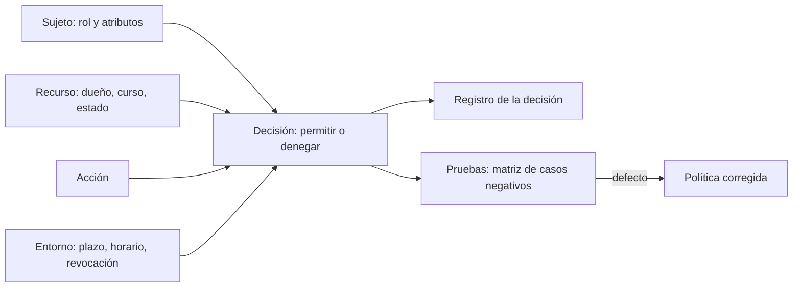
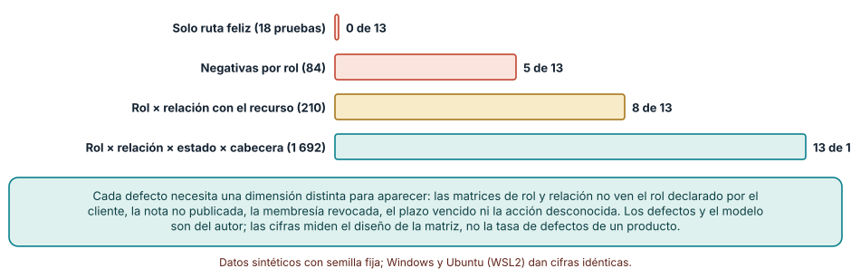
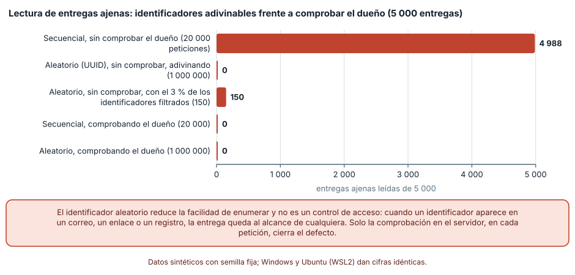
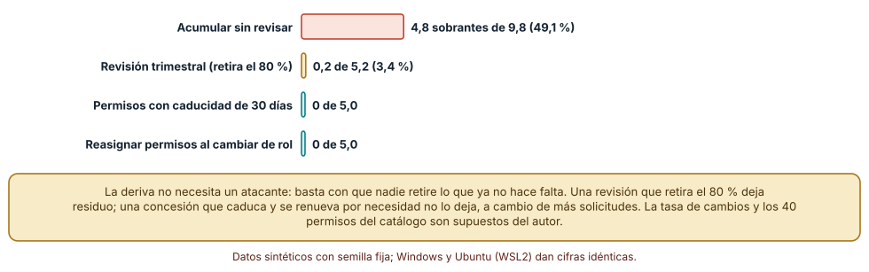

# SE-459 — Autorización, recursos y mínimo privilegio

[← SE-458 — Identidad, autenticación y sesiones](https://github.com/vladimiracunadev-create/modern-software-engineering-program/blob/main/classes/part-38-seguridad-privacidad-y-cumplimiento/se-458-identidad-autenticacion-y-sesiones/README.md) · [↑ Parte 38](https://github.com/vladimiracunadev-create/modern-software-engineering-program/blob/main/classes/part-38-seguridad-privacidad-y-cumplimiento/README.md) · [📚 Índice completo](https://github.com/vladimiracunadev-create/modern-software-engineering-program/blob/main/classes/README.md) · [🌐 Portal](https://vladimiracunadev-create.github.io/modern-software-engineering-program/classes/SE-459.html) · [SE-460 — Validación, codificación y clases de inyección →](https://github.com/vladimiracunadev-create/modern-software-engineering-program/blob/main/classes/part-38-seguridad-privacidad-y-cumplimiento/se-460-validacion-codificacion-y-clases-de-inyeccion/README.md)

## Punto profesional y fundamento pedagógico

**Punto profesional.** La clase existe para que puedas afirmar, con una prueba y no con una impresión, que una persona autenticada solo puede hacer lo que le corresponde sobre los recursos que le corresponden. La habilidad profesional es diseñar la política como una función explícita de rol, relación con el recurso y estado, y probarla con una matriz que incluya los casos negativos, porque los defectos de autorización casi nunca fallan una prueba de ruta feliz.

**Por qué aparece aquí.** Sigue a **Identidad, autenticación y sesiones**: ya sabemos con qué confianza decimos quién llama; ahora la pregunta es qué puede hacer. Es la clase donde más se desvía una revisión que mira solo roles: la mayoría de los incidentes de acceso indebido a datos no ocurren porque un rol tenga un permiso de más sino porque el servidor no comprueba que el recurso pertenezca a quien lo pide. El caso conductor sigue siendo **la plataforma de entregas**: ver una entrega, listar las de un curso, calificar, exportar.

**Error conceptual que debe corregir.** Creer que la autorización es una comprobación de rol en la entrada del endpoint. Un rol responde «¿puede esta clase de persona realizar esta clase de acción?»; la pregunta que protege los datos es «¿puede *esta* persona realizar *esta* acción sobre *este* recurso *ahora*?», y esa pregunta necesita el recurso y su estado.

**Secuencia de aprendizaje.** Antes de mirar los resultados, predices cuántos de trece defectos de autorización plantados detecta una suite que solo prueba la ruta feliz y cuántos una matriz de rol por relación; después mides cuántas entregas ajenas lee un atacante según cómo se generen los identificadores y si se comprueba el dueño, y simulas 24 meses de acumulación de permisos. La secuencia usa predicción, contraste y explicación propia. [ICAP](https://icap.education.asu.edu/research) distingue participar de construir conocimiento; [How People Learn II](https://nap.nationalacademies.org/catalog/24783/how-people-learn-ii-learners-contexts-and-cultures) respalda diseñar la práctica con contextos reales y retroalimentación.

**Evidencia de aprendizaje.** `autorizacion-log.md` con la predicción, la política escrita como función, la matriz de pruebas con sus dimensiones, el resultado de los trece mutantes por diseño de suite, la tabla de identificadores y una nota que separe qué parte es medida, cuál es inferida y cuál es supuesta.

**Límite de la conclusión.** La política de seis roles y siete acciones, los trece defectos plantados y la simulación de permisos son construcciones del autor con semilla fija. Las cifras miden qué dimensiones necesita una suite para ver cada tipo de defecto; no son una tasa de defectos de un producto real. No se probó ningún sistema ajeno ni se usó ninguna herramienta de pruebas de seguridad.

### Trazabilidad fuente → afirmación

| Fuente primaria u oficial | Afirmación que respalda | Lo que no prueba |
|---|---|---|
| [OWASP API Security Top 10 2023: API1 Broken Object Level Authorization](https://owasp.org/API-Security/editions/2023/en/0xa1-broken-object-level-authorization/) | Describe el defecto en que la API acepta un identificador de objeto sin comprobar que quien lo envía tiene derecho sobre él, y lo sitúa como el primer riesgo de la lista de 2023. | No mide su frecuencia en la plataforma. |
| [OWASP Authorization Cheat Sheet](https://cheatsheetseries.owasp.org/cheatsheets/Authorization_Cheat_Sheet.html) | Recomienda denegar por defecto, aplicar mínimo privilegio, validar el permiso en cada petición y probar la autorización. | No define las reglas de negocio de la plataforma. |
| [NIST SP 800-162: control de acceso basado en atributos](https://csrc.nist.gov/pubs/sp/800/162/upd2/final) | Define ABAC: decidir por atributos del sujeto, del objeto y del entorno frente a reglas. | No dice qué atributos elegir. |
| [Sandhu et al., «Role-based access control models»](https://doi.org/10.1109/2.485845) | Formaliza el control de acceso por roles con jerarquías y restricciones. | No cubre la relación del usuario con el recurso individual. |
| [Saltzer y Schroeder](https://doi.org/10.1109/PROC.1975.9939) | Mínimo privilegio, mediación completa y valores por defecto seguros como principios de diseño. | No traduce los principios a la plataforma. |

## Antes de empezar

Recupera lo aprendido en `SE-457` sobre fronteras de confianza y en `SE-458` sobre identidad: lo que llega del cliente lo decide el cliente. La pregunta activa es: **si cambias el identificador de una entrega en la dirección de tu navegador, ¿qué parte del servidor te lo impide, y qué prueba lo demuestra?**

## Prerrequisitos

- Haber completado `SE-458` o poder explicar la diferencia entre autenticar y autorizar.
- Python 3.11 o posterior; los experimentos usan solo la biblioteca estándar (`random`, `itertools`).
- Saber leer una tabla de verdad y una matriz de pruebas.

## Problema auténtico

En un escenario ilustrativo, un estudiante avisó de que, al cambiar el número que aparece en la dirección de su entrega, veía la entrega de un compañero de otro curso. El equipo corrigió el endpoint señalado. Una semana después un estudiante descubrió lo mismo en el endpoint de comentarios, y a la siguiente en el de exportación. Cada vez el código comprobaba que había una sesión válida y que el rol permitía la acción; nunca comprobaba que la entrega pertenecía a quien la pedía. Las pruebas del equipo habían verificado, para cada rol, que la acción permitida funcionaba y que la prohibida fallaba, y todas pasaban. Faltaba una dimensión: la relación con el recurso. Cuando el equipo escribió la política como una función con tres entradas (rol, relación, estado) y generó la matriz completa, encontró cuatro endpoints más con el mismo defecto. La clase enseña a escribir esa función, a probarla con una matriz y a distinguir los controles de acceso de los que solo lo parecen.

## Objetivos observables

Al terminar podrás:

1. escribir una política de autorización como una función explícita de rol, relación con el recurso y estado;
2. generar una matriz de pruebas con casos negativos por dimensión y decir qué defecto detecta cada dimensión;
3. medir cuántos defectos plantados detecta una suite según sus dimensiones y reconocer los que quedan vivos;
4. explicar por qué un identificador impredecible no es un control de acceso;
5. diseñar la concesión de permisos para que no se acumulen y justificar el costo de hacerlo.

## Mapa conceptual



El mapa separa los **insumos** de la decisión (sujeto, recurso, acción, entorno) de la **decisión** misma y de su **registro y prueba**. Un fallo suele estar en un insumo que no llegó a la función: la relación con el recurso, el estado o la revocación.

## Temas y por qué importan

| Tema | Por qué cambia una decisión profesional | Evidencia mínima |
|---|---|---|
| Autenticar no es autorizar | Una sesión válida no dice nada sobre qué recursos se pueden tocar. | Lista de endpoints con la comprobación que hace cada uno |
| Modelos de control de acceso | Roles, atributos y relaciones resuelven preguntas distintas. | Política escrita con las tres dimensiones |
| Autorización a nivel de objeto | Es el defecto más frecuente de las API y no lo ve una prueba por roles. | Prueba con otro dueño por cada endpoint con identificador |
| Probar la negación | Una suite de rutas felices pasa con una política rota. | Matriz con relación, estado y entradas del cliente |
| Mínimo privilegio y acumulación | Los permisos que no se retiran acaban siendo el permiso. | Política de concesión y caducidad con su costo |

## Conceptos y decisiones

### 1. Autenticar no es autorizar

La sesión responde «quién es». La autorización responde «qué puede hacer sobre qué». Son decisiones separadas y la segunda debe repetirse en cada petición, en el servidor, porque el cliente puede enviar lo que quiera: un identificador, un rol, un campo oculto. Saltzer y Schroeder lo llamaron **mediación completa**: cada acceso a cada objeto se comprueba, sin atajos por caché ni por «ya lo comprobamos en la pantalla anterior». Una comprobación en la interfaz (ocultar un botón) mejora la experiencia, no la seguridad. La regla práctica es un solo punto de decisión, invocado en cada acceso, cuya salida es denegar salvo que una regla permita (valor por defecto seguro).

### 2. Roles, atributos y relaciones

El control por **roles** agrupa permisos por función (estudiante, docente, ayudante); es fácil de explicar y de auditar y no distingue entre un docente y *su* curso. El control por **atributos** decide con propiedades del sujeto, del recurso y del entorno (el curso de la entrega, la fecha de publicación de la nota, la hora); es más expresivo y más difícil de razonar porque las reglas se combinan. El control por **relaciones** modela vínculos (es dueño de, está matriculado en, enseña) y es el natural para plataformas con datos de personas. En la práctica se combinan: el rol dice qué *tipo* de acciones existen para quien lo tiene y la relación decide sobre qué recursos. En la plataforma, el estudiante puede ver su entrega, el docente las de sus cursos, el ayudante las de los cursos que se le asignaron sin poder calificar, el coordinador listar y exportar dentro de su programa, el administrador borrar y exportar sin calificar, y la cuenta de servicio solo exportar. La separación de poderes (el administrador no califica) es una restricción que el modelo de roles debe expresar explícitamente.

### 3. La autorización a nivel de objeto

Cuando un endpoint recibe un identificador (`/entregas/4521`), el servidor debe buscar el recurso y comprobar que el sujeto tiene la relación requerida con *ese* recurso. OWASP lo sitúa como el riesgo número uno de las API: la omisión no produce un error, produce una respuesta correcta para la persona equivocada. Cambiar el identificador en la dirección es la prueba más simple del atacante y la que menos recursos exige. La corrección es una comprobación por objeto en cada endpoint, preferiblemente en una capa común para que ningún endpoint nuevo la olvide, y una **respuesta uniforme** para «no existe» y «no es tuyo»: distinguirlas revela qué identificadores existen. El identificador impredecible (UUID) dificulta la enumeración y no sustituye la comprobación: los identificadores se filtran por enlaces, correos, registros y capturas.

### 4. Probar la negación: la matriz

Una prueba de autorización debería poder fallar si la política está rota. Una suite que solo ejecuta cada acción permitida con el rol que la tiene no puede: pasa con cualquier política que permita más. La **matriz** enumera las combinaciones relevantes de rol, acción, relación con el recurso (dueño, mismo curso, otro curso del mismo programa, otro curso, inexistente) y estado (normal, nota no publicada, membresía revocada, plazo vencido) y cada una declara su resultado esperado. Cada dimensión añadida descubre una clase de defecto que la anterior no ve. Dos entradas del cliente merecen una dimensión propia: el rol o el identificador de usuario enviados en la petición, y las acciones que el sistema no conoce, para verificar que la política deniega por defecto. La matriz no se escribe a mano: se genera desde la política y se comprueba contra una referencia independiente, de modo que el costo crece con el número de dimensiones y no con el de casos.

### 5. Mínimo privilegio y acumulación

El mínimo privilegio no es una configuración inicial sino una propiedad que se pierde con el tiempo: cada cambio de función añade permisos y rara vez retira los anteriores. Tras unos meses, la persona tiene todo lo que alguna vez necesitó. Las respuestas son tres: revisar periódicamente y retirar (cuesta trabajo humano y deja residuo), conceder con caducidad y renovar solo lo necesario (cuesta solicitudes y fricción) o reasignar el conjunto completo al cambiar de función (requiere un registro de qué se concedió por qué). Cuanto más sensible el permiso, más corta debe ser la concesión. Las cuentas de servicio siguen la misma regla y suelen ser la excepción olvidada: una cuenta que solo debe exportar no debería poder listar entregas.

### Trece defectos y cuatro diseños de pruebas

Se escribe la política de la plataforma como una función `decide(rol, acción, relación, estado, rol_declarado)` y se plantan trece mutantes, cada uno un defecto realista (el estudiante ve las entregas de quien comparte curso, el docente actúa sobre cualquier curso, se confía en el rol que declara el cliente, la nota se ve antes de publicarla, la membresía revocada sigue valiendo, el administrador califica, una acción desconocida se permite por defecto, entre otros). Cuatro suites derivan del universo de combinaciones.

```python
def decide(role, action, rel, state, override, m=frozenset()):
    if action not in ACCIONES: return "M9" in m
    if override and "M5" in m: role = override
    if rel == "missing" and "M13" not in m: return False
    if state == "revoked" and "M7" not in m: return False
    if role == "estudiante" and action == "view_submission":
        return rel == "owner" or ("M1" in m and rel == "in_course")
    ...
```

| Suite | Pruebas | Mutantes detectados |
|---|---:|---:|
| Solo ruta feliz | 18 | 0 de 13 |
| Negativas por rol (relación típica) | 84 | 5 de 13 |
| Rol × relación con el recurso | 210 | 8 de 13 |
| Rol × relación × estado × cabecera de rol, más acción desconocida | 1 692 | 13 de 13 |

La ruta feliz no detecta ninguno porque todos los mutantes *añaden* permisos. Las negativas por rol ven los que dan una acción a un rol que no debe tenerla; la relación ve los que amplían el alcance del rol; solo el estado y las entradas del cliente ven los cinco restantes (rol declarado por el cliente, nota no publicada, membresía revocada, plazo vencido y acción desconocida).



**Cómo leer la figura.** Cada barra es una suite construida añadiendo una dimensión; el salto entre barras es la clase de defecto que esa dimensión hace visible. **Dónde deja de valer:** los trece defectos son del autor y se plantaron conociendo las dimensiones; la matriz completa de 1 692 pruebas detecta 13 de 13 porque se diseñó para ello. En un producto real quedarán defectos que ninguna dimensión prevista toca (una regla de negocio nueva, un camino alternativo), y la matriz es tan buena como el modelo de dimensiones.

### Identificadores adivinables y comprobación del dueño

Hay 5 000 entregas con identificadores en un espacio de 20 000. Un estudiante atacante tiene 12 propias. Se comparan identificadores secuenciales y aleatorios, con y sin comprobación del dueño, y se supone que el 3 % de los aleatorios aparece en sitios públicos o correos.

| Combinación | Peticiones | Entregas ajenas leídas |
|---|---:|---:|
| Secuencial, sin comprobar el dueño | 20 000 | 4 988 |
| Aleatorio, sin comprobar, adivinando | 1 000 000 | 0 |
| Aleatorio, sin comprobar, con el 3 % filtrado | 150 | 150 |
| Secuencial, comprobando el dueño | 20 000 | 0 |
| Aleatorio, comprobando el dueño | 1 000 000 | 0 |

El identificador aleatorio mejora la fila 2 (adivinar no lee nada) y no la 3 (lo filtrado se lee entero). Solo la comprobación cierra el defecto en las filas 4 y 5.



**Cómo leer la figura.** Cada barra es una combinación de tipo de identificador y comprobación, con las peticiones entre paréntesis, y su longitud son las entregas ajenas leídas. Mira que el identificador aleatorio y la comprobación del dueño cierran el defecto por caminos distintos, y que solo la segunda sobrevive a la filtración. **Dónde deja de valer:** el 3 % de identificadores filtrados y el tamaño del espacio son supuestos del autor; si los identificadores no aparecen jamás fuera de la sesión, el riesgo de la fila 3 es menor, pero esa garantía no se puede comprobar desde el servidor.

### Veinticuatro meses de permisos

Hay 300 personas, un catálogo de 40 permisos y cada una necesita cinco. Cada mes el 5 % cambia de función y pasa a necesitar otros cinco. Cuatro políticas gestionan lo que se concedió antes.

| Política | Permisos por persona | Sobrantes | % sobrante |
|---|---:|---:|---:|
| Acumular sin revisar | 9,8 | 4,8 | 49,1 % |
| Revisión trimestral (retira el 80 % de los sobrantes) | 5,2 | 0,2 | 3,4 % |
| Caducidad de 30 días | 5,0 | 0,0 | 0 % |
| Reasignar al cambiar de función | 5,0 | 0,0 | 0 % |



**Cómo leer la figura.** Cada barra es el residuo de permisos que la persona tiene y ya no necesita; la política que lo deja en cero cuesta trabajo en otro lugar (renovaciones, registro de concesiones). **Dónde deja de valer:** la tasa de cambios, el catálogo de 40 y la eficacia del 80 % son del autor; con una tasa menor, la acumulación es más lenta pero igual de unidireccional. La simulación no mide el costo operativo de renovar.

## Definiciones de trabajo

- **autorización:** decisión de si un sujeto autenticado puede realizar una acción sobre un recurso en un momento dado.
- **autorización a nivel de objeto:** comprobación, en cada acceso, de que el sujeto tiene la relación requerida con el recurso concreto que pide.
- **mínimo privilegio:** principio de conceder a cada sujeto solo los permisos que necesita para su función y solo mientras los necesita.
- **mutante:** versión de un programa con un defecto plantado a propósito para comprobar si una suite de pruebas lo detecta.
- **matriz de autorización:** enumeración de combinaciones de rol, acción, relación con el recurso y estado, cada una con su resultado esperado.

Las definiciones son operativas para la plataforma de entregas. No convierten términos con una historia más amplia en sinónimos y deben contrastarse con la documentación primaria enlazada al final.

## Ejemplo mínimo

El fragmento muestra que una prueba de ruta feliz no puede fallar con una política demasiado permisiva. Antes de ejecutarlo, predice qué imprime.

```python
def ver_entrega(rol, soy_dueno):
    return rol == "estudiante"   # defecto: no mira al dueño
print(ver_entrega("estudiante", True))
print(ver_entrega("estudiante", False))
```

La primera línea imprime `True` y es la única que una prueba de ruta feliz ejecutaría; la segunda imprime `True` y es el defecto. Registra versión de Python, comando y salida; después corrige la función y escribe la prueba que habría fallado.

## Ejemplo profesional

El equipo extrae la política a un módulo con una función `decide(sujeto, acción, recurso, contexto)` y hace que todos los endpoints la invoquen antes de tocar datos; un linter de la revisión de cambios rechaza endpoints con un parámetro de identificador que no llamen a la función. Genera la matriz desde la política (seis roles, siete acciones, cinco relaciones, cuatro estados), la ejecuta en cada cambio y mantiene una lista de mutantes conocidos que la suite debe matar. Para exportaciones usa una cuenta de servicio que solo puede exportar y cuyo token caduca. Responde 404 tanto si la entrega no existe como si no es del solicitante. Cada concesión de permisos tiene una fecha de caducidad de 90 días; el sistema avisa y renueva solo si el responsable lo confirma. El resultado se mide por lo que cambia: los cinco defectos de la primera auditoría ahora están cubiertos por casos de la matriz.

## Práctica guiada

1. Escribe tu predicción: ¿cuántos de los trece defectos detecta una suite de ruta feliz?
2. Escribe la política de la plataforma como función de rol, relación y estado.
3. Genera la matriz de pruebas en cuatro niveles y calcula cuántos mutantes mata cada uno.
4. Identifica con una prueba qué mutantes sobreviven a cada nivel y qué dimensión faltaba.
5. Simula la enumeración de identificadores secuenciales y aleatorios con y sin comprobación.
6. Simula 24 meses de cambios de rol con las cuatro políticas de permisos.
7. Entrega `autorizacion-log.md` y pide a otra persona que escriba un mutante que tu suite no detecte.

## Ejercicios

1. **Dimensión:** elige un mutante que solo detecte la matriz con estado y explica por qué ninguna suite más pequeña lo ve.
2. **Respuesta uniforme:** explica qué información obtiene un atacante de un 403 frente a un 404 y diseña la respuesta que no revela nada.
3. **Identificadores:** demuestra con números que pasar de secuenciales a aleatorios reduce la enumeración pero no el acceso a identificadores filtrados.
4. **Permisos:** propón una política de caducidad para docentes y otra para cuentas de servicio y justifica la diferencia de plazo.

## Reto verificable

Entrega `autorizacion-log.md` con la predicción, la política como función, la matriz de cuatro niveles con sus resultados contra los trece mutantes, la tabla de identificadores y la simulación de permisos. Se aprueba si otra persona ejecuta el código desde un checkout limpio, obtiene las mismas cifras con las mismas semillas y puede decir qué mutante sobrevive a cada nivel y qué prueba lo mataría. No se aprueba por mostrar que los roles «están protegidos» sin una sola prueba con otro dueño ni por afirmar que los identificadores aleatorios resuelven el acceso a objetos.

## Caso conductor

La plataforma de entregas de tareas continúa como caso conductor. Esta clase deja el tercer artefacto: la política como función y su matriz. `SE-460` preguntará qué ocurre cuando la entrada del cliente se interpreta como código. Cambia después un solo dato, el número de relaciones con el recurso (añade «ayudante de otro curso»), y observa qué mutante nuevo aparece.

## Preguntas frecuentes

### ¿Es mejor RBAC o ABAC?

Depende de la pregunta. Los roles son suficientes cuando la decisión solo depende de la función; cuando depende del recurso concreto o de su estado hacen falta atributos o relaciones. La mayoría de las plataformas con datos de personas combinan ambos.

### ¿Qué código HTTP se devuelve cuando no se tiene permiso?

El estándar admite 403 (prohibido) y 404 (no existe). Para recursos cuya existencia es sensible conviene el 404, de modo que «no existe» y «no es tuyo» sean indistinguibles. Registra la decisión real en el servidor con su causa.

### ¿Las pruebas de autorización deben ser automáticas?

Sí, y generadas desde la política. Una revisión manual de cuarenta endpoints deja de ser fiable cuando hay doscientos; una matriz generada crece con el sistema y falla cuando alguien añade un endpoint sin invocar la política.

### ¿Cómo se prueba la separación de poderes?

Con casos negativos explícitos en la matriz: el administrador no califica, el ayudante no califica, la cuenta de servicio no lista. Una separación de poderes no probada es una intención.

## Fallo controlado y diagnóstico

Reproduce el fallo clásico de la clase: **una suite de rutas felices que pasa con una política rota**. Planta el mutante «el estudiante ve las entregas de quien comparte curso» y ejecuta las 18 pruebas de ruta feliz.

Registra síntoma, entrada mínima, hipótesis, observación que descarta cada hipótesis, causa, corrección y prueba de regresión. **Síntoma:** las 18 pruebas pasan y un estudiante lee la entrega de un compañero. **Hipótesis rivales:** (a) la prueba no se ejecutó; (b) el endpoint es distinto del probado; (c) la suite no contiene el caso que viola la política. **Prueba:** ejecuta la petición con el estudiante B sobre la entrega de A; si responde con el contenido, la causa es que ninguna prueba intenta el acceso negativo. **Conclusión:** la suite verificaba que lo permitido funciona y no que lo prohibido falla. **Regresión:** añade la dimensión de relación a la matriz y exige que el mutante muera. No cambies a la vez la política y la suite: primero deja la suite en rojo.

## Errores comunes y cómo corregirlos

| Síntoma | Causa probable | Corrección |
|---|---|---|
| Un estudiante lee la entrega de otro | Se comprueba el rol y no el dueño | Autorización por objeto en cada endpoint con identificador |
| Las pruebas pasan y el defecto existe | Solo hay casos permitidos | Matriz con relación, estado y entradas del cliente |
| El cliente puede elegir su rol | El servidor lee el rol de la petición | Derivar el rol del servidor desde la sesión |
| Un 403 revela qué existe | Respuestas distintas para «no existe» y «no es tuyo» | Respuesta uniforme y registro interno de la causa |
| Cuentas con permisos de funciones anteriores | Concesiones sin caducidad ni revisión | Caducidad, reasignación al cambiar de función o revisión con retiro |

## Entorno y archivos clave

```text
work/SE-459/
├── README.md
├── autorizacion/
│   ├── politica.py
│   ├── matriz.py
│   └── mutantes.py
├── tests/test_autorizacion.py
└── evidence/autorizacion-log.md
```

El `README` declara plataforma, versión de Python, semillas y comandos. Los experimentos usan solo la biblioteca estándar (`random`, `itertools`) y se ejecutaron con CPython 3.12.9 en Windows 11 y 3.12.3 en Ubuntu bajo WSL2: las salidas fueron idénticas. Si añades una dependencia, fija procedencia y versión.

## Seguridad, ética y accesibilidad

- los datos son sintéticos: no uses cuentas ni identificadores reales de personas para probar accesos;
- probar la autorización de un sistema ajeno es acceder sin permiso aunque «solo cambies un número»; hazlo solo contra tu propio entorno o con autorización escrita;
- una política de acceso decide quién ve datos de menores y de calificaciones: documéntala con las razones y quién la revisa;
- las respuestas de denegación deben ser comprensibles para la persona usuaria y accesibles, sin revelar información sobre otras;
- registra las decisiones de acceso sin guardar el contenido del recurso.

## Puente hacia el trabajo con agentes

Un agente al que se le pide «añade autorización a los endpoints» tiende a añadir un decorador de rol y a probar que el rol correcto funciona. Pídele en cambio que escriba la política como una función con rol, relación y estado, que genere la matriz de pruebas desde ella, que plante al menos diez mutantes y muestre cuántos mata cada nivel, y que justifique la respuesta que devuelve cuando la entrega existe pero no es del solicitante. Revisa especialmente que ningún endpoint con identificador deje de invocar la función y que el rol no se lea de la petición. El defecto típico es una suite que solo comprueba lo que funciona.

## Transferencia

Traslada el análisis a otro dominio (por ejemplo, una aplicación de historias clínicas de un centro): cambia los recursos y las relaciones y conserva el procedimiento de escribir la política como función, generar la matriz y plantar mutantes. La transferencia está lograda cuando puedes decir qué dimensión de ese dominio hace visible cada defecto, no cuando la tabla se parece a la de la plataforma.

## Evaluación y evidencia

| Criterio | Evidencia para aprobar |
|---|---|
| comprensión | explicación de por qué rol y relación son preguntas distintas y qué es una autorización por objeto |
| corrección | matriz, mutantes y simulaciones reproducibles con las mismas semillas |
| diseño | política como función, respuesta uniforme y política de concesión con caducidad |
| diagnóstico | reproducción del fallo «ruta feliz que pasa con una política rota» con regresión |
| incertidumbre | declaración de que los defectos, la política y las tasas son del autor |
| reproducibilidad | versiones, comandos, salida y límites declarados |

## Fuentes

- [OWASP API Security Top 10 2023: API1](https://owasp.org/API-Security/editions/2023/en/0xa1-broken-object-level-authorization/) — autorización a nivel de objeto; autoridad: OWASP.
- [OWASP Authorization Cheat Sheet](https://cheatsheetseries.owasp.org/cheatsheets/Authorization_Cheat_Sheet.html) — denegar por defecto, mínimo privilegio y pruebas; autoridad: OWASP.
- [NIST SP 800-162](https://csrc.nist.gov/pubs/sp/800/162/upd2/final) — control de acceso basado en atributos; autoridad: NIST.
- [Sandhu et al., 1996](https://doi.org/10.1109/2.485845) — modelos de control de acceso por roles; autoridad: IEEE Computer.
- [Saltzer y Schroeder, 1975](https://doi.org/10.1109/PROC.1975.9939) — principios de diseño de la protección; autoridad: Proceedings of the IEEE.
- [Jia y Harman, «An analysis and survey of the development of mutation testing»](https://doi.org/10.1109/TSE.2010.62) — fundamento de los mutantes como medida de una suite; autoridad: IEEE Transactions on Software Engineering.

Cada fuente respalda el mecanismo indicado; ninguna demuestra que los trece mutantes, los 4 988 registros o el 49,1 % de permisos sobrantes se observen en un sistema real. Esa afirmación depende de la política, de las pruebas y del ritmo de cambio de roles.

## Límites y siguiente paso

Se ejecutaron tres experimentos con datos sintéticos en Windows y Ubuntu (WSL2) con resultados idénticos. No se probó ningún sistema ajeno ni se usó ninguna herramienta de pruebas de seguridad; la política, los trece defectos, las dimensiones de la matriz, la fracción de identificadores filtrados y la tasa de cambios de rol son construcciones del autor. La siguiente clase pregunta qué ocurre cuando lo que el cliente envía se interpreta como código.

## Glosario

- **autorización:** decisión de si un sujeto autenticado puede realizar una acción sobre un recurso en un momento dado.
- **autorización a nivel de objeto:** comprobación, en cada acceso, de que el sujeto tiene la relación requerida con el recurso concreto que pide.
- **mínimo privilegio:** principio de conceder a cada sujeto solo los permisos que necesita para su función y solo mientras los necesita.
- **mutante:** versión de un programa con un defecto plantado a propósito para comprobar si una suite de pruebas lo detecta.
- **matriz de autorización:** enumeración de combinaciones de rol, acción, relación con el recurso y estado, cada una con su resultado esperado.

---

[← SE-458 — Identidad, autenticación y sesiones](https://github.com/vladimiracunadev-create/modern-software-engineering-program/blob/main/classes/part-38-seguridad-privacidad-y-cumplimiento/se-458-identidad-autenticacion-y-sesiones/README.md) · [↑ Parte 38](https://github.com/vladimiracunadev-create/modern-software-engineering-program/blob/main/classes/part-38-seguridad-privacidad-y-cumplimiento/README.md) · [📚 Índice completo](https://github.com/vladimiracunadev-create/modern-software-engineering-program/blob/main/classes/README.md) · [🌐 Portal](https://vladimiracunadev-create.github.io/modern-software-engineering-program/classes/SE-459.html) · [SE-460 — Validación, codificación y clases de inyección →](https://github.com/vladimiracunadev-create/modern-software-engineering-program/blob/main/classes/part-38-seguridad-privacidad-y-cumplimiento/se-460-validacion-codificacion-y-clases-de-inyeccion/README.md)
