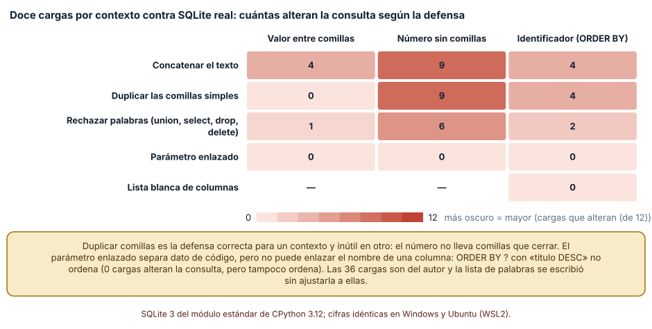
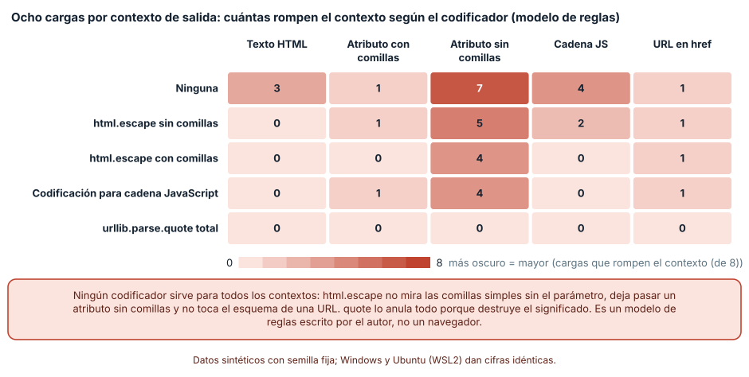
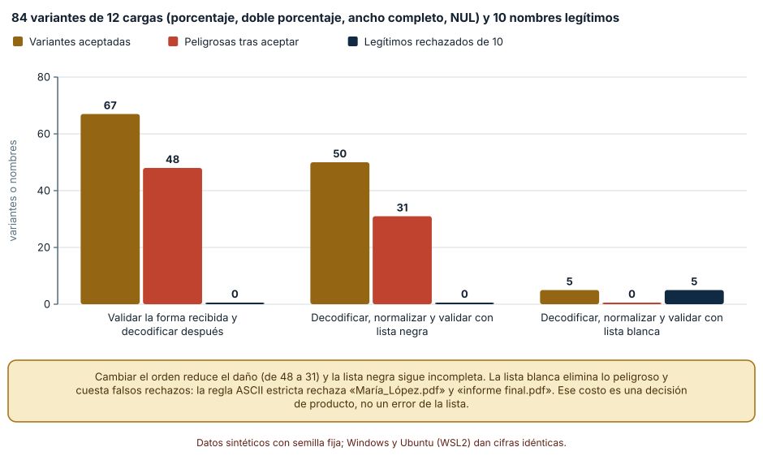

# SE-460 — Validación, codificación y clases de inyección

[← SE-459 — Autorización, recursos y mínimo privilegio](https://github.com/vladimiracunadev-create/modern-software-engineering-program/blob/main/classes/part-38-seguridad-privacidad-y-cumplimiento/se-459-autorizacion-recursos-y-minimo-privilegio/README.md) · [↑ Parte 38](https://github.com/vladimiracunadev-create/modern-software-engineering-program/blob/main/classes/part-38-seguridad-privacidad-y-cumplimiento/README.md) · [📚 Índice completo](https://github.com/vladimiracunadev-create/modern-software-engineering-program/blob/main/classes/README.md) · [🌐 Portal](https://vladimiracunadev-create.github.io/modern-software-engineering-program/classes/SE-460.html) · [SE-461 — Criptografía aplicada y gestión de claves →](https://github.com/vladimiracunadev-create/modern-software-engineering-program/blob/main/classes/part-38-seguridad-privacidad-y-cumplimiento/se-461-criptografia-aplicada-y-gestion-de-claves/README.md)

## Punto profesional y fundamento pedagógico

**Punto profesional.** La clase existe para que entiendas por qué una entrada del cliente se convierte en una vulnerabilidad en el momento en que cambia de papel, de dato a código, y para que dejes de defender con filtros lo que se defiende separando los canales. La habilidad profesional es identificar el intérprete que recibirá cada valor (SQL, HTML, el sistema de archivos, un shell), elegir el mecanismo que separa dato de instrucción para ese intérprete y probarlo con cargas que ataquen la defensa elegida y no solo la más conocida.

**Por qué aparece aquí.** Sigue a **Autorización, recursos y mínimo privilegio**: ya se decidió quién puede qué; ahora se trata de que lo que llega no cambie lo que significa la decisión. Una consulta armada con texto puede devolver filas que la autorización nunca habría permitido. El caso conductor es **la plataforma de entregas**: buscar entregas por título, abrirlas por identificador, ordenarlas, mostrar un comentario y descargar un archivo adjunto.

**Error conceptual que debe corregir.** Creer que la inyección se previene limpiando la entrada. Limpiar cambia la cadena; el defecto está en que un intérprete la reciba mezclada con las instrucciones. Cada filtro que suprime «lo peligroso» define una lista que el atacante recorre buscando lo que se escapó, y cada contexto (texto, número, identificador, atributo, URL) peligra con caracteres distintos.

**Secuencia de aprendizaje.** Antes de mirar el resultado, predices cuántas de doce cargas por contexto alteran una consulta SQL real según la defensa; después pruebas ocho cargas contra cinco codificadores en cinco contextos de salida y comparas tres órdenes de decodificación y validación frente a 84 variantes. La secuencia usa predicción, contraste y explicación propia. [ICAP](https://icap.education.asu.edu/research) distingue participar de construir conocimiento; [How People Learn II](https://nap.nationalacademies.org/catalog/24783/how-people-learn-ii-learners-contexts-and-cultures) respalda diseñar la práctica con contextos reales y retroalimentación.

**Evidencia de aprendizaje.** `inyeccion-log.md` con la predicción, el inventario de intérpretes de la plataforma, las tres tablas, un caso mínimo de cada clase de defecto con su corrección y una nota que separe qué parte es medida, cuál es modelo y cuál es suposición.

**Límite de la conclusión.** Las consultas se ejecutan en SQLite en memoria con un esquema de juguete y las cargas son una lista del autor; los contextos de salida se evalúan con reglas escritas por el autor, no con un navegador, y las 84 variantes provienen de doce cargas base y siete transformaciones. No se atacó ningún sistema ajeno ni se usó ninguna herramienta de pruebas de seguridad. La lista de palabras prohibidas se escribió sin ajustarla a las cargas, pero las cifras no son una tasa de detección.

### Trazabilidad fuente → afirmación

| Fuente primaria u oficial | Afirmación que respalda | Lo que no prueba |
|---|---|---|
| [OWASP SQL Injection Prevention Cheat Sheet](https://cheatsheetseries.owasp.org/cheatsheets/SQL_Injection_Prevention_Cheat_Sheet.html) | Recomienda sentencias parametrizadas como defensa primaria, lista blanca para nombres de tablas y columnas, y trata el escape como último recurso. | No garantiza que una aplicación concreta esté libre de inyección. |
| [OWASP XSS Prevention Cheat Sheet](https://cheatsheetseries.owasp.org/cheatsheets/Cross_Site_Scripting_Prevention_Cheat_Sheet.html) | Indica que la codificación de salida depende del contexto (cuerpo HTML, atributo, JavaScript, URL, CSS). | No sustituye otras defensas como una política de seguridad de contenido. |
| [CWE-89](https://cwe.mitre.org/data/definitions/89.html) | Define la neutralización incorrecta de elementos especiales en un comando SQL. | No mide su frecuencia. |
| [Python: sqlite3](https://docs.python.org/3/library/sqlite3.html) | Documenta los marcadores de posición para valores y que `execute` no ejecuta varias sentencias. | No ofrece enlazar nombres de columnas. |
| [RFC 3986](https://www.rfc-editor.org/rfc/rfc3986) | Define la codificación porcentual y su decodificación. | No dice en qué capa debe aplicarse. |
| [Unicode UAX #15](https://unicode.org/reports/tr15/) | Define las formas de normalización (NFC, NFD, NFKC, NFKD) y que la compatibilidad (NFKC) puede transformar caracteres de ancho completo en caracteres ASCII. | No indica cuándo normalizar. |

## Antes de empezar

Recupera lo aprendido en `SE-457` (la frontera entre el cliente y la API) y en `SE-459` (la política decide, la entrada no). La pregunta activa es: **si escribes `' OR 1=1 --` en el campo de búsqueda de entregas, ¿qué intérprete recibe esa cadena y qué lo separa de las instrucciones?**

## Prerrequisitos

- Haber completado `SE-459` o poder explicar por qué una comprobación de autorización no basta si la entrada altera la consulta.
- Python 3.11 o posterior; los experimentos usan solo la biblioteca estándar (`sqlite3`, `html`, `unicodedata`, `urllib.parse`, `re`).
- Saber leer una consulta SQL con `WHERE` y `ORDER BY`.

## Problema auténtico

En un escenario ilustrativo, la búsqueda de entregas por título de la plataforma construía la consulta con texto. Tras un aviso de seguridad el equipo agregó una función que duplicaba las comillas simples. Tres semanas después alguien notó que la consulta por número de entrega, que no lleva comillas, seguía aceptando `0 OR 1=1` y devolvía todas las entregas. Otro equipo añadió una lista de palabras prohibidas (`union`, `select`, `drop`) y la lista no detuvo `' OR 1=1 --`. El ordenamiento de resultados tomaba el nombre de la columna del cliente, y ni duplicar comillas ni la lista servían ahí porque un nombre de columna no es una cadena. Un cuarto equipo codificó para HTML los comentarios de los docentes y descubrió que un atributo sin comillas seguía permitiendo ejecutar un controlador de eventos. Cada corrección protegía un contexto y dejaba otro. La clase enseña a mirar el intérprete antes que la entrada.

## Objetivos observables

Al terminar podrás:

1. explicar la inyección como un cambio de papel (dato a instrucción) y listar los intérpretes de la plataforma;
2. elegir la defensa correcta por contexto (valor, número, identificador, salida HTML, ruta) y explicar por qué las demás fallan;
3. medir cuántas cargas altera cada defensa con consultas reales de SQLite;
4. aplicar codificación de salida por contexto y reconocer dónde no basta;
5. ordenar decodificación, normalización y validación para que se valide lo que se usará.

## Mapa conceptual


El mapa separa **tratar la forma** de la entrada (decodificar, normalizar, validar) de **separar los canales** para cada intérprete. Las dos etapas se necesitan y ninguna sustituye a la otra: validar la forma no evita que un valor válido se interprete como instrucción.

## Temas y por qué importan

| Tema | Por qué cambia una decisión profesional | Evidencia mínima |
|---|---|---|
| La inyección como cambio de papel | Explica por qué los filtros fallan y la separación de canales no. | Inventario de intérpretes y de qué valor llega a cada uno |
| SQL: parámetros, escape e identificadores | El parámetro cierra valores; los nombres exigen una lista blanca. | Tabla de cargas por contexto y defensa |
| Salida HTML: codificar por contexto | Un solo codificador no sirve para todos los contextos. | Tabla de cargas por contexto de salida |
| Canonicalización y orden de validación | Validar antes de decodificar valida otra cosa de la que se usa. | Comparación de tres órdenes sobre las mismas variantes |
| Otros intérpretes: rutas y procesos | Los mismos principios aplican al sistema de archivos y a los comandos. | Lista de puntos de uso y su defensa |

## Conceptos y decisiones

### 1. La inyección como cambio de papel

Un intérprete (el motor SQL, el navegador, el sistema de archivos, un shell) distingue entre **datos** y **órdenes** por la sintaxis. Si el programa construye una orden pegando texto, la sintaxis del dato puede cerrar el dato y empezar una orden. La cadena `' OR 1=1 --` no es peligrosa en sí: lo es porque, pegada dentro de `WHERE titulo LIKE '%…%'`, las comillas cierran el literal, `OR 1=1` añade una condición siempre verdadera y `--` anula el resto. El principio que lo evita es el mismo en todos los intérpretes: **mantener los canales separados**. En SQL se logra con parámetros enlazados, que el motor recibe aparte de la sentencia; en un proceso, con una lista de argumentos y sin shell; en HTML, con una codificación que convierte los caracteres de control en datos para el contexto concreto; en el sistema de archivos, resolviendo la ruta final y comprobando que sigue dentro de la raíz. Cuando no existe un canal separado (el nombre de una columna en `ORDER BY`), se usa una **lista blanca** con valores de la aplicación, nunca del cliente. Un inventario de intérpretes es la primera pregunta de cualquier revisión.

### 2. SQL: parámetros, escape e identificadores

Un valor enlazado como parámetro llega al motor como dato ya delimitado: no puede cerrar un literal porque ya no hay literal que cerrar. **Duplicar las comillas simples** (escape) es la defensa correcta *solo* para un literal entre comillas simples, y falla en tres situaciones: un número sin comillas (`id = 0 OR 1=1`), un identificador (`ORDER BY …`) y cualquier dialecto con otro carácter de escape (barra invertida en algunos motores, o conjuntos de caracteres que la combinan). Una **lista de palabras prohibidas** actúa sobre la forma textual: se esquiva con mayúsculas combinadas, comentarios dentro de la palabra (`UN/**/ION`), codificaciones o simplemente con una carga que no contenga ninguna palabra de la lista (`' OR 1=1 --` no usa `union`, `select`, `drop` ni `delete`). Un parámetro **no puede enlazar un identificador**: `ORDER BY ?` con `'titulo DESC'` ordena por una constante y no hace lo pedido. Para columnas y direcciones de orden se compara con una lista de valores que la aplicación controla. En CPython 3.12 el módulo `sqlite3` rechaza varias sentencias en una llamada, lo que limita las sentencias apiladas, pero no impide alterar la consulta.

### 3. HTML: codificar según el contexto

El navegador interpreta de manera diferente el cuerpo de un documento, el valor de un atributo, una cadena de JavaScript y una URL. Una codificación para el cuerpo (`<` a `&lt;`) cierra la posibilidad de abrir una etiqueta, pero no impide cerrar un atributo con comillas si el valor se coloca dentro de uno; si el atributo no lleva comillas, el espacio ya termina el valor; en una cadena de JavaScript importan comillas, barras invertidas y saltos de línea, además de la secuencia que cierra la etiqueta de script; en una URL (`href`) importa el esquema (`javascript:`), que ninguna codificación de caracteres detiene porque la cadena es sintácticamente válida. De ahí la regla de OWASP: la codificación **depende del contexto** y se aplica en el momento de generar la salida, no en el de recibir la entrada. Además de codificar, se reducen los contextos peligrosos: siempre comillas en los atributos, ningún dato de usuario dentro de un bloque de script, validación de esquema en las URL con una lista de esquemas permitidos y una política de seguridad de contenido como segunda capa.

### 4. Canonicalizar antes de validar

Un valor pasa por varias transformaciones antes de usarse: decodificación porcentual (a veces dos veces, por capas que se suman), normalización Unicode (la forma de compatibilidad NFKC convierte «＜» de ancho completo en `<`), minúsculas, recorte. Si la validación mira el valor **antes** de que se complete la transformación que lo hará peligroso, valida otra cosa. La regla es validar lo que se va a usar, es decir: aplicar la transformación completa que hará el sistema, validar el resultado y usar ese mismo resultado (no el original). Eso exige conocer el pipeline real: un proxy, un framework y la aplicación decodifican cada uno. Una **lista blanca** de la forma final (caracteres permitidos, longitud, extensiones) es mucho más estable que una lista negra de patrones peligrosos porque no necesita enumerar lo malo; su costo son los falsos rechazos de entradas legítimas fuera de la lista, una decisión de producto que debe tomarse a conciencia.

### 5. Otros intérpretes: archivos y procesos

La misma estructura se repite: una ruta que viene del cliente es dato hasta que el sistema de archivos la resuelve (`..`, enlaces simbólicos, separadores distintos en Windows y POSIX); la defensa es resolver y comprobar el prefijo (la clase `SE-467` la reutiliza). Un comando armado como texto y pasado a un shell es la inyección de orden por excelencia; la defensa es no usar shell, pasar una lista de argumentos y validar los argumentos contra la forma esperada. Una plantilla del servidor que incluye datos del cliente puede ejecutar expresiones; una consulta a un directorio de usuarios y un documento XML con entidades externas son otros intérpretes. La pregunta es siempre la misma: ¿qué programa recibe este valor y qué sintaxis tiene?

### Doce cargas por contexto contra SQLite

Se crea una base en memoria con usuarios y entregas y tres consultas con el mismo defecto de construcción: un literal de texto (`LIKE '%…%'`), un número sin comillas (`id = …`) y un identificador (`ORDER BY …`). Cada una se prueba con doce cargas y cuatro o cinco defensas; una carga cuenta cuando altera lo que la consulta debía hacer (devuelve filas ajenas, ejecuta una subconsulta o interpreta el texto como SQL).

```python
q = "SELECT id,dueno,curso,titulo FROM entregas WHERE dueno='ana@ejemplo.test' AND id = " + carga  # defectuoso
q = "SELECT id,dueno,curso,titulo FROM entregas WHERE dueno=? AND id = ?"                       # correcto
filas = c.execute(q, ("ana@ejemplo.test", carga)).fetchall()
```

| Defensa | Valor entre comillas | Número sin comillas | Identificador (`ORDER BY`) |
|---|---:|---:|---:|
| Concatenar el texto | 4 de 12 | 9 de 12 | 4 de 12 |
| Duplicar las comillas | 0 | 9 | 4 |
| Lista de palabras (`union`, `select`, `drop`, `delete`) | 1 | 6 | 2 |
| Parámetro enlazado | 0 | 0 | 0 (y no ordena) |
| Lista blanca de columnas | — | — | 0 |

Duplicar las comillas deja en cero el texto y en nueve el número. La lista de palabras deja pasar una carga de texto, seis de número y dos de identificador. El parámetro cierra texto y número; para el identificador no sirve (`ORDER BY ?` con `'titulo DESC'` no reordena: la comprobación devolvió `False`) y solo la lista blanca resuelve el caso.



**Cómo leer la figura.** Cada fila es una defensa y cada columna un contexto de la consulta; la intensidad es el número de cargas que alteran la consulta. Mira que ninguna fila queda pálida en las tres columnas: duplicar comillas apaga el texto y no el número, y solo la lista blanca apaga el identificador. **Dónde deja de valer:** las 36 cargas son del autor y SQLite acepta sintaxis que otros motores rechazan (y al revés); la lista de palabras se escribió sin ajustarla a las cargas, pero con otras cargas las cifras cambian. Que la defensa de una celda llegue a cero no demuestra que el motor esté libre de inyección en otro contexto no probado.

### Ocho cargas en cinco contextos de salida

Se definen cinco contextos (texto HTML, atributo con comillas, atributo sin comillas, cadena de JavaScript y URL en `href`) y ocho cargas (`<script>`, `">`, un controlador de eventos con comillas y otro sin ellas, el cierre de un script, una cadena con comillas y un esquema `javascript:`). Una regla por contexto decide si, tras codificar, la carga aún rompe ese contexto. Se aplican cinco codificadores.

| Codificador | Texto HTML | Atributo con comillas | Atributo sin comillas | Cadena JS | URL en `href` |
|---|---:|---:|---:|---:|---:|
| Ninguno | 3 | 1 | 7 | 4 | 1 |
| `html.escape` sin comillas | 0 | 1 | 5 | 2 | 1 |
| `html.escape` con comillas | 0 | 0 | 4 | 0 | 1 |
| Codificación para cadena JavaScript | 0 | 1 | 4 | 0 | 1 |
| `urllib.parse.quote` total | 0 | 0 | 0 | 0 | 0 |

`html.escape` sin comillas deja pasar la comilla doble que cierra un atributo; con comillas cierra el texto, el atributo con comillas y la cadena, pero un atributo sin comillas se rompe con un espacio y la URL sigue aceptando `javascript:`. La codificación porcentual total anula todo porque destruye el significado: una URL válida deja de serlo.



**Cómo leer la figura.** Cada fila es un codificador y cada columna un contexto de salida; la intensidad es el número de cargas que rompen ese contexto. Mira cómo cada fila deja manchas distintas, de modo que ningún codificador sirve para todos, y que solo la última fila queda vacía por destruir el significado. **Dónde deja de valer:** es un modelo de reglas escrito por el autor, no un navegador: no incluye análisis de HTML malformado, mutaciones del analizador ni contextos como CSS. La conclusión (no hay un codificador universal) es robusta; las cifras no.

### Decodificar, normalizar y validar

Se parte de doce cargas base y se generan 84 variantes (original, porcentaje, doble porcentaje, mayúsculas, ancho completo, caracteres de ancho completo en símbolos y un NUL al final). Se prueban tres órdenes, y se evalúan además diez nombres de archivo legítimos.

| Orden y tipo de validación | Aceptadas | Peligrosas tras aceptar | Legítimos rechazados de 10 |
|---|---:|---:|---:|
| Validar lo recibido con lista negra y decodificar después | 67 | 48 | 0 |
| Decodificar, normalizar y validar con lista negra | 50 | 31 | 0 |
| Decodificar, normalizar y validar con lista blanca ASCII | 5 | 0 | 5 |

Invertir el orden baja las aceptadas de 67 a 50 y las peligrosas de 48 a 31: la lista negra sigue incompleta (no contiene `<img`, barras invertidas ni `;`). La lista blanca deja en cero lo peligroso y rechaza la mitad de los nombres legítimos, entre ellos «María_López.pdf» y «informe final.pdf».



**Cómo leer la figura.** Cada grupo es un orden de validación y las barras son las variantes aceptadas (dorada), las que resultan peligrosas tras aceptar (coral) y los nombres legítimos rechazados (azul). Mira que la barra coral desaparece en el tercer grupo y que la azul aparece justo ahí: eliminar lo peligroso tiene un costo. **Dónde deja de valer:** las 84 variantes y la lista negra son del autor, y una lista negra mejor escrita acercaría la fila 2 a cero. El costo de la fila 3 (cinco legítimos rechazados) depende de la regla de caracteres: una lista blanca más amplia (letras con tilde, espacios) lo reduce y exige más cuidado.

## Definiciones de trabajo

- **[inyección](../../../glosario/entradas/i/inyeccion.md):** vulnerabilidad en la que datos controlados por quien ataca se interpretan como instrucciones por un intérprete que los recibe junto con ellas.
- **[consulta parametrizada](../../../glosario/entradas/c/consulta-parametrizada.md):** sentencia SQL enviada al motor separada de los valores, de modo que los valores no pueden alterar su estructura.
- **[codificación de salida](../../../glosario/entradas/c/codificacion-de-salida.md):** transformación de un dato a la sintaxis segura del contexto donde se va a insertar, aplicada al generar la salida.
- **[lista blanca](../../../glosario/entradas/l/lista-blanca.md):** conjunto finito de valores o formas permitidas que se compara con la entrada, en lugar de enumerar lo prohibido.
- **[canonicalización](../../../glosario/entradas/c/canonicalizacion.md):** transformación de una entrada a su forma única y completa (decodificada y normalizada) antes de validarla.

Las definiciones son operativas para la plataforma de entregas. No convierten términos con una historia más amplia en sinónimos y deben contrastarse con la documentación primaria enlazada al final.

## Ejemplo mínimo

El fragmento muestra por qué duplicar comillas no protege un número. Antes de ejecutarlo, predice cuántas filas devuelve.

```python
import sqlite3
c = sqlite3.connect(":memory:")
c.executescript("CREATE TABLE e(id INTEGER, dueno TEXT); INSERT INTO e VALUES (1,'ana'),(2,'bruno'),(3,'bruno');")
carga = "0 OR 1=1"
print(len(c.execute("SELECT * FROM e WHERE dueno='ana' AND id = " + carga.replace("'", "''")).fetchall()))
```

Devuelve 3 filas aunque la persona solo debería ver la suya: la condición `dueno='ana' AND id = 0 OR 1=1` se agrupa como `(…) OR 1=1`. Registra versión de Python, comando y salida; después reemplaza la concatenación por parámetros y comprueba que el resultado es 0 filas.

## Ejemplo profesional

El equipo inventaría los intérpretes de la plataforma: SQL en doce consultas, HTML en nueve plantillas, el sistema de archivos en dos puntos (adjuntos y exportaciones) y un proceso que convierte documentos a PDF. Sustituye cada concatenación de SQL por parámetros enlazados a través de una capa de acceso a datos, define una lista blanca para columnas de orden y sentido, activa el autoescape de la plantilla y revisa los tres lugares donde se desactivaba, valida las URL de los enlaces con una lista de esquemas, resuelve las rutas y comprueba el prefijo de la raíz, y llama al conversor con una lista de argumentos y sin shell. Añade una prueba por intérprete con cargas que atacan la defensa elegida (número sin comillas para SQL, atributo sin comillas para HTML, `%2e%2e%2f` para rutas) y una regla de la revisión de cambios que rechaza construir una consulta con una cadena formateada. En el modelo de la clase, las 17 cargas que alteran la consulta con concatenación pasan a 0 con parámetros y lista blanca; lo que el autoescape no cubre (atributos sin comillas, URL) queda como prueba pendiente.

## Práctica guiada

1. Escribe tu predicción de cuántas de las doce cargas altera cada defensa en cada contexto.
2. Reproduce la base de SQLite y las doce cargas por contexto con la concatenación, la duplicación de comillas, la lista de palabras y el parámetro.
3. Comprueba que `ORDER BY ?` no reordena y escribe la lista blanca de columnas.
4. Aplica cinco codificadores a ocho cargas en cinco contextos con tu propia regla de ruptura y compara con la tabla.
5. Genera 84 variantes de doce cargas y evalúa los tres órdenes de validación; añade diez nombres legítimos propios.
6. Inventaría los intérpretes de la plataforma y escribe la defensa de cada uno.
7. Entrega `inyeccion-log.md` y pide a otra persona que escriba una carga que tu defensa no detenga.

## Ejercicios

1. **Contexto:** explica por qué duplicar las comillas es correcto para un literal de texto y no para un número, y escribe la carga que lo demuestra.
2. **Identificadores:** diseña la lista blanca para ordenar entregas por título, fecha y curso, ascendente o descendente, sin parámetros.
3. **Salida:** elige un contexto de la tabla donde `html.escape` con comillas no basta y propón la defensa adicional.
4. **Orden:** demuestra con una carga de tu autoría que validar antes de decodificar acepta algo peligroso y propón la corrección.

## Reto verificable

Entrega `inyeccion-log.md` con la predicción, las tres tablas, un caso mínimo por clase de defecto con su corrección y el inventario de intérpretes. Se aprueba si otra persona ejecuta el código desde un checkout limpio, obtiene las mismas cifras (todos los experimentos son deterministas) y puede decir qué defensa cierra cada contexto y cuál deja abierto. No se aprueba por mostrar que «una carga conocida ya no funciona» ni por usar una lista de palabras como única defensa.

## Caso conductor

La plataforma de entregas de tareas continúa como caso conductor. Esta clase deja el cuarto artefacto: el inventario de intérpretes y las pruebas por contexto. `SE-461` preguntará cómo se protegen los datos que se guardan y se transmiten con criptografía. Cambia después un solo dato, el dialecto de SQL, y observa qué defensas de escape dejan de valer.

## Preguntas frecuentes

### ¿Los frameworks ya previenen la inyección?

Previenen la forma más común si se usan como están pensados (consultas parametrizadas, autoescape de plantillas). Fallan cuando se desactiva el autoescape, se arma una consulta a mano para un caso especial o se pasa un nombre de columna del cliente. Los frameworks reducen la superficie; no la eliminan.

### ¿Hay que validar la entrada aunque se usen parámetros?

Sí, por otra razón. La validación de forma (longitud, rango, formato) reduce errores y abuso, y es una capa más; no es la defensa contra la inyección, que es la separación de canales. Mezclar ambas ideas es lo que lleva a confiar en un filtro.

### ¿Un firewall de aplicaciones web resuelve el problema?

Reduce ruido y bloquea cargas conocidas, y se esquiva con variantes: el experimento de decodificación muestra cómo. Es una capa adicional, no una corrección del defecto.

### ¿Se codifica al guardar o al mostrar?

Al mostrar, en el contexto concreto. Un dato guardado codificado para HTML queda mal para un correo, un PDF o una API; un dato guardado crudo se codifica para cada salida.

## Fallo controlado y diagnóstico

Reproduce el fallo clásico de la clase: **una defensa correcta en un contexto aplicada a otro**. Duplica las comillas en la consulta por número de entrega y prueba `0 OR 1=1`.

Registra síntoma, entrada mínima, hipótesis, observación que descarta cada hipótesis, causa, corrección y prueba de regresión. **Síntoma:** la función de escape está aplicada y la consulta por número devuelve todas las entregas. **Hipótesis rivales:** (a) la función de escape tiene un error; (b) el motor ignora el escape; (c) el valor no está entre comillas. **Prueba:** imprime la consulta final; si `id = 0 OR 1=1` no contiene ninguna comilla, la causa es que no hay literal que escapar. **Conclusión:** el escape es correcto para un literal y no existe uno aquí; la defensa elegida no corresponde al contexto. **Regresión:** reemplaza la concatenación por un parámetro y añade una prueba por contexto con una carga que ataque ese contexto (`0 OR 1=1` para números, `titulo; DROP` para identificadores). No cambies a la vez la consulta y la validación.

## Errores comunes y cómo corregirlos

| Síntoma | Causa probable | Corrección |
|---|---|---|
| Se escapan comillas y una consulta numérica sigue vulnerable | Defensa de literal aplicada a un número | Parámetros enlazados para todos los valores |
| Una lista de palabras no detiene `' OR 1=1 --` | La carga no contiene ninguna palabra de la lista | Separar canales; usar la lista blanca solo para identificadores |
| El orden de resultados acepta cualquier cosa | Nombre de columna del cliente concatenado | Lista blanca de columnas y sentido definidos por la aplicación |
| Un atributo ejecuta un controlador de eventos | Atributo sin comillas o codificación de otro contexto | Comillas siempre y codificación por contexto |
| Lo validado no es lo usado | Decodificación o normalización posterior a la validación | Canonicalizar, validar y usar el mismo valor |

## Entorno y archivos clave

```text
work/SE-460/
├── README.md
├── inyeccion/
│   ├── sql_contextos.py
│   ├── salida_html.py
│   └── canonicalizar.py
├── tests/test_inyeccion.py
└── evidence/inyeccion-log.md
```

El `README` declara plataforma, versión de Python, semillas y comandos. Los experimentos usan solo la biblioteca estándar (`sqlite3`, `html`, `unicodedata`, `urllib.parse`, `re`) y se ejecutaron con CPython 3.12.9 en Windows 11 y 3.12.3 en Ubuntu bajo WSL2: las salidas fueron idénticas. Si añades una dependencia, fija procedencia y versión.

## Seguridad, ética y accesibilidad

- los datos y las cargas son sintéticos: prueba solo contra tu propia base en memoria, nunca contra un servicio ajeno;
- no publiques cargas diseñadas contra un producto concreto ni las uses fuera del laboratorio;
- la validación de entradas excluye a personas si la lista blanca rechaza nombres con tilde o con la eñe; define reglas que respeten los nombres reales y diga con claridad por qué se rechaza una entrada;
- los mensajes de error no deben revelar la consulta ni el esquema;
- el escape no debe romper la lectura con lector de pantalla: un `&lt;` mostrado literalmente indica codificación doble.

## Puente hacia el trabajo con agentes

Un agente al que se le pide «protege el endpoint contra inyección» puede añadir una función `sanitize()` que elimina comillas y palabras y dejar la concatenación. Pídele en cambio que enumere los intérpretes que recibirán cada valor, que use parámetros para los valores y una lista blanca para los identificadores, que escriba para cada intérprete una prueba con una carga que ataque *esa* defensa (número sin comillas, atributo sin comillas, doble codificación) y que muestre la salida. Revisa que no haya `format`, `%` ni concatenación en las consultas, que el autoescape esté activo y que la validación vaya después de la decodificación. El defecto típico es una función de limpieza que da una falsa sensación de cobertura.

## Transferencia

Traslada el análisis a otro dominio (por ejemplo, una aplicación de reservas con búsqueda por texto): cambia las consultas y las plantillas y conserva el procedimiento de inventariar intérpretes, separar canales y probar la defensa con una carga propia por contexto. La transferencia está lograda cuando puedes decir qué intérprete recibe cada valor y qué lo separa de las instrucciones, no cuando la lista de cargas se parece a la de la plataforma.

## Evaluación y evidencia

| Criterio | Evidencia para aprobar |
|---|---|
| comprensión | explicación de la inyección como cambio de papel y de por qué cada defensa es de un contexto |
| corrección | tablas de SQL, de salida y de orden de validación reproducibles |
| diseño | inventario de intérpretes con su defensa y lista blanca de identificadores |
| diagnóstico | reproducción del fallo «defensa de un contexto aplicada a otro» con regresión |
| incertidumbre | declaración de que cargas, reglas de contexto y listas son del autor |
| reproducibilidad | versiones, comandos, salida y límites declarados |

## Fuentes

- [OWASP SQL Injection Prevention Cheat Sheet](https://cheatsheetseries.owasp.org/cheatsheets/SQL_Injection_Prevention_Cheat_Sheet.html) — sentencias parametrizadas y listas blancas; autoridad: OWASP.
- [OWASP XSS Prevention Cheat Sheet](https://cheatsheetseries.owasp.org/cheatsheets/Cross_Site_Scripting_Prevention_Cheat_Sheet.html) — codificación de salida por contexto; autoridad: OWASP.
- [CWE-89](https://cwe.mitre.org/data/definitions/89.html) — inyección SQL; autoridad: MITRE.
- [Python: sqlite3](https://docs.python.org/3/library/sqlite3.html) — marcadores de posición; autoridad: documentación de Python.
- [RFC 3986](https://www.rfc-editor.org/rfc/rfc3986) — codificación porcentual; autoridad: IETF.
- [Unicode UAX #15](https://unicode.org/reports/tr15/) — formas de normalización; autoridad: Unicode Consortium.
- [OWASP Input Validation Cheat Sheet](https://cheatsheetseries.owasp.org/cheatsheets/Input_Validation_Cheat_Sheet.html) — validación sintáctica y semántica; autoridad: OWASP.

Cada fuente respalda el mecanismo indicado; ninguna demuestra que las cifras de las tablas (9 de 12, 48 de 84, 4 de 8) se observen en una aplicación real. Esa afirmación depende del motor, de la plantilla y del orden en que cada capa transforme la entrada.

## Límites y siguiente paso

Se ejecutaron tres experimentos con datos sintéticos en Windows y Ubuntu (WSL2) con resultados idénticos. No se atacó ninguna aplicación ni servicio reales; las 36 cargas SQL, las 8 de salida, las 12 base y las 7 transformaciones son listas del autor, los contextos de salida son reglas del autor y no un navegador, y la lista de palabras es una elección ilustrativa. La siguiente clase pregunta cómo se protegen los datos con criptografía sin inventarla.

## Glosario

- **[inyección](../../../glosario/entradas/i/inyeccion.md):** vulnerabilidad en la que datos controlados por quien ataca se interpretan como instrucciones por un intérprete que los recibe junto con ellas.
- **[consulta parametrizada](../../../glosario/entradas/c/consulta-parametrizada.md):** sentencia SQL enviada al motor separada de los valores, de modo que los valores no pueden alterar su estructura.
- **[codificación de salida](../../../glosario/entradas/c/codificacion-de-salida.md):** transformación de un dato a la sintaxis segura del contexto donde se va a insertar, aplicada al generar la salida.
- **[lista blanca](../../../glosario/entradas/l/lista-blanca.md):** conjunto finito de valores o formas permitidas que se compara con la entrada, en lugar de enumerar lo prohibido.
- **[canonicalización](../../../glosario/entradas/c/canonicalizacion.md):** transformación de una entrada a su forma única y completa (decodificada y normalizada) antes de validarla.

Conceptos de esta clase en el [glosario del programa](../../../glosario/README.md): [Canonicalización](../../../glosario/entradas/c/canonicalizacion.md) · [Codificación de salida](../../../glosario/entradas/c/codificacion-de-salida.md) · [Consulta parametrizada](../../../glosario/entradas/c/consulta-parametrizada.md) · [Inyección](../../../glosario/entradas/i/inyeccion.md) · [Lista blanca](../../../glosario/entradas/l/lista-blanca.md).

---

[← SE-459 — Autorización, recursos y mínimo privilegio](https://github.com/vladimiracunadev-create/modern-software-engineering-program/blob/main/classes/part-38-seguridad-privacidad-y-cumplimiento/se-459-autorizacion-recursos-y-minimo-privilegio/README.md) · [↑ Parte 38](https://github.com/vladimiracunadev-create/modern-software-engineering-program/blob/main/classes/part-38-seguridad-privacidad-y-cumplimiento/README.md) · [📚 Índice completo](https://github.com/vladimiracunadev-create/modern-software-engineering-program/blob/main/classes/README.md) · [🌐 Portal](https://vladimiracunadev-create.github.io/modern-software-engineering-program/classes/SE-460.html) · [SE-461 — Criptografía aplicada y gestión de claves →](https://github.com/vladimiracunadev-create/modern-software-engineering-program/blob/main/classes/part-38-seguridad-privacidad-y-cumplimiento/se-461-criptografia-aplicada-y-gestion-de-claves/README.md)
