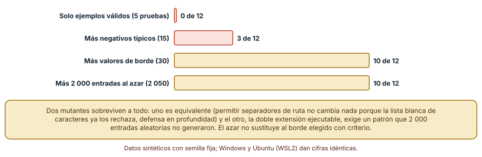
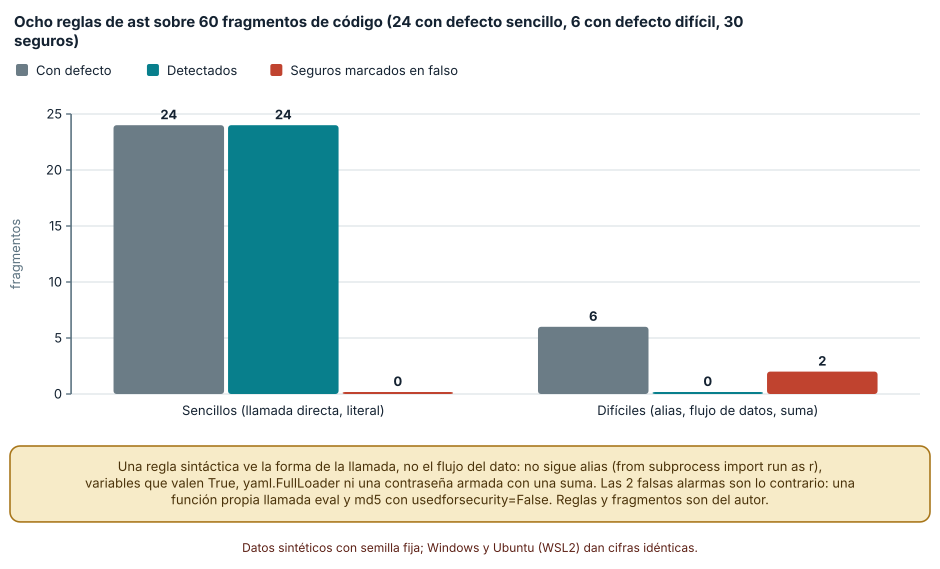
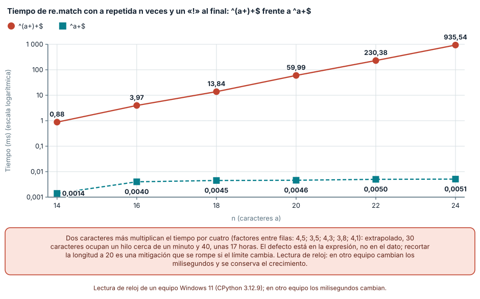

# SE-464 — Secure SDLC, abuso y pruebas negativas

[← SE-463 — Privacidad por diseño y minimización](https://github.com/vladimiracunadev-create/modern-software-engineering-program/blob/main/classes/part-38-seguridad-privacidad-y-cumplimiento/se-463-privacidad-por-diseno-y-minimizacion/README.md) · [↑ Parte 38](https://github.com/vladimiracunadev-create/modern-software-engineering-program/blob/main/classes/part-38-seguridad-privacidad-y-cumplimiento/README.md) · [📚 Índice completo](https://github.com/vladimiracunadev-create/modern-software-engineering-program/blob/main/classes/README.md) · [🌐 Portal](https://vladimiracunadev-create.github.io/modern-software-engineering-program/classes/SE-464.html) · [SE-465 — Vulnerabilidades, divulgación y respuesta →](https://github.com/vladimiracunadev-create/modern-software-engineering-program/blob/main/classes/part-38-seguridad-privacidad-y-cumplimiento/se-465-vulnerabilidades-divulgacion-y-respuesta/README.md)

## Punto profesional y fundamento pedagógico

**Punto profesional.** La clase existe para que puedas integrar la seguridad en el trabajo diario de un equipo sin convertirla en un trámite al final: escribir lo que un abusador intentaría hacer con cada historia de usuario, convertir esos intentos en pruebas que fallen cuando la defensa falla, y saber qué ve y qué no ve cada herramienta automática. La habilidad profesional es elegir y combinar actividades por lo que detectan, no por el nombre del marco que las enumera.

**Por qué aparece aquí.** Sigue a **Privacidad por diseño y minimización**: las clases anteriores trataron defensas concretas (identidad, acceso, entradas, criptografía, secretos, datos). Esta clase pregunta cómo se mantienen en el tiempo con un equipo que cambia el código todos los días. El caso conductor es **la plataforma de entregas**: la historia «un estudiante sube una entrega con un archivo adjunto» y todo lo que un abusador puede hacer con ella.

**Error conceptual que debe corregir.** Creer que un proceso seguro es uno que ejecuta una herramienta de análisis y aprueba cuando el informe sale limpio. Un informe limpio dice que las reglas no encontraron lo que buscan; no dice que el defecto no exista. Y una suite que solo prueba que la subida de archivos válida funciona pasa con un validador que acepta cualquier cosa.

**Secuencia de aprendizaje.** Antes de mirar el resultado, predices cuántos de doce defectos plantados en un validador de subidas detecta una suite con cinco ejemplos válidos y cuánto añaden los negativos, los bordes y 2 000 entradas al azar; después ejecutas ocho reglas de análisis estático sobre 60 fragmentos y mides el tiempo de una expresión regular catastrófica. La secuencia usa predicción, contraste y explicación propia. [ICAP](https://icap.education.asu.edu/research) distingue participar de construir conocimiento; [How People Learn II](https://nap.nationalacademies.org/catalog/24783/how-people-learn-ii-learners-contexts-and-cultures) respalda diseñar la práctica con contextos reales y retroalimentación.

**Evidencia de aprendizaje.** `sdlc-log.md` con la predicción, los casos de abuso de una historia de usuario, la tabla de mutantes por diseño de suite, la medición de las reglas, la curva de la expresión regular y una nota que separe qué parte es medida, cuál es modelo y cuál es suposición.

**Límite de la conclusión.** El validador, los doce mutantes, los 60 fragmentos y las ocho reglas son construcciones del autor con semilla fija; las lecturas de reloj de la expresión regular cambian en cada equipo. No se usó ninguna herramienta comercial de análisis ni se evaluó el proceso de un equipo real. Se cita el marco SSDF de NIST como vocabulario, sin afirmar que la clase lo implemente ni que cumplir sus prácticas garantice seguridad.

### Trazabilidad fuente → afirmación

| Fuente primaria u oficial | Afirmación que respalda | Lo que no prueba |
|---|---|---|
| [NIST SP 800-218 (SSDF) v1.1](https://csrc.nist.gov/pubs/sp/800/218/final) | Organiza prácticas de desarrollo seguro en cuatro grupos: preparar la organización, proteger el software, producir software bien protegido y responder a vulnerabilidades. | No dice qué combinación de prácticas detecta qué defecto ni mide su eficacia. |
| [OWASP SAMM](https://owaspsamm.org/) | Ofrece un modelo de madurez para evaluar y mejorar prácticas de seguridad del software por funciones de negocio. | No sustituye la medición de resultados del equipo. |
| [OWASP Abuse Case Cheat Sheet](https://cheatsheetseries.owasp.org/cheatsheets/Abuse_Case_Cheat_Sheet.html) | Describe cómo derivar casos de abuso de las historias de usuario y convertirlos en requisitos y pruebas. | No lista los abusos de la plataforma. |
| [OWASP Web Security Testing Guide](https://owasp.org/www-project-web-security-testing-guide/) | Proporciona un marco y procedimientos para probar la seguridad de aplicaciones web. | No fija qué probar primero en la plataforma. |
| [Jia y Harman, «An analysis and survey of the development of mutation testing»](https://doi.org/10.1109/TSE.2010.62) | Sustenta la mutación como medida de qué defectos detecta una suite. | No da la tasa de defectos que una suite de seguridad debería detectar. |
| [CWE-1333](https://cwe.mitre.org/data/definitions/1333.html) | Define la complejidad ineficiente de expresiones regulares como debilidad que permite agotar recursos con una entrada preparada. | No mide el tiempo de ninguna expresión de la plataforma. |

## Antes de empezar

Recupera lo aprendido en `SE-459` sobre la matriz de autorización y los mutantes, y en `SE-460` sobre probar la defensa elegida con una carga que la ataque. La pregunta activa es: **si un estudiante hostil recibiera la historia «subir una entrega con un adjunto», ¿qué diez cosas intentaría y cuáles de ellas tienen hoy una prueba que falle si la defensa se rompe?**

## Prerrequisitos

- Haber completado `SE-463` o poder explicar la diferencia entre un identificador y un cuasi-identificador.
- Python 3.11 o posterior; los experimentos usan solo la biblioteca estándar (`ast`, `re`, `random`, `time`).
- Saber escribir una prueba unitaria y leer un árbol sintáctico.

## Problema auténtico

En un escenario ilustrativo, el equipo de la plataforma adoptó una lista de prácticas de desarrollo seguro: revisión de cambios con una casilla de seguridad, un analizador estático en la integración continua y una prueba de penetración anual. Tres meses después un estudiante subió un archivo cuyo nombre incluía una doble extensión ejecutable, el validador lo aceptó y la plataforma lo ofreció a los docentes como descarga. El analizador estático no lo encontró (no hay nada sintáctico que marcar), la casilla de la revisión estaba marcada y la prueba de penetración estaba a nueve meses. Mientras tanto, un campo de búsqueda con una expresión regular `(a+)+` dejó la plataforma sin responder durante cuatro minutos cuando alguien pegó un texto largo. Nada de eso falló un requisito escrito: nadie había escrito los abusos que la historia admitía. La clase enseña a escribirlos, a convertirlos en pruebas y a medir qué detecta cada actividad.

## Objetivos observables

Al terminar podrás:

1. derivar casos de abuso de una historia de usuario y convertirlos en requisitos negativos con una prueba cada uno;
2. medir con mutantes qué detecta una suite según su diseño y reconocer los que sobreviven;
3. escribir reglas de análisis estático para patrones de seguridad y decir qué dejan fuera;
4. reconocer una expresión regular catastrófica, medir su crecimiento y corregirla;
5. ubicar actividades de seguridad en el ciclo de desarrollo y justificar cuáles automatizar.

## Mapa conceptual


El mapa muestra que la prueba negativa nace de un **caso de abuso** y que el análisis automático y las pruebas producen evidencia por versión. El retorno indica que cada vulnerabilidad real agrega un caso de abuso al catálogo.

## Temas y por qué importan

| Tema | Por qué cambia una decisión profesional | Evidencia mínima |
|---|---|---|
| Prácticas de desarrollo seguro | Un vocabulario compartido permite decidir qué falta sin copiar una lista. | Mapa de actividades del equipo contra los grupos de SSDF |
| Casos de abuso | Convierte lo que nadie escribió en un requisito comprobable. | Diez abusos de una historia con su prueba |
| Pruebas negativas y mutación | Una suite se mide por los defectos que mata, no por las líneas que ejecuta. | Tabla de mutantes por diseño de suite |
| Análisis estático de seguridad | Detecta formas, no flujos, y tiene falsas alarmas. | Detección y falsas alarmas por tipo de fragmento |
| Denegación por entrada y fuzzing | El tiempo de respuesta es un requisito de seguridad. | Curva de tiempo de una expresión con n creciente |

## Conceptos y decisiones

### 1. Prácticas de desarrollo seguro y su vocabulario

El Marco de Desarrollo de Software Seguro de NIST (SSDF) agrupa las prácticas en cuatro familias: **preparar la organización** (roles, requisitos de seguridad, herramientas, formación), **proteger el software** (código, build, releases), **producir software bien protegido** (diseño, revisión, pruebas, configuración) y **responder a vulnerabilidades** (identificar, analizar, corregir, aprender). El valor del marco es de vocabulario: permite preguntar «¿qué hacemos hoy en cada familia y qué evidencia produce?». No es una certificación ni una receta: tener una práctica en la lista no prueba que detecte lo que debería. Modelos de madurez como OWASP SAMM ayudan a ver el conjunto y a priorizar mejoras. La disciplina real es la de medir resultados: cuántos defectos de qué clase llegaron a producción y qué actividad habría podido verlos.

### 2. Casos de abuso: lo que nadie escribió

Una historia de usuario describe el uso previsto («como estudiante, subo una entrega con un adjunto para el curso»). Un **caso de abuso** describe qué haría alguien que quiere dañar el sistema con esa misma funcionalidad. Para la subida de la plataforma: un archivo de tamaño cero o de 20 MB, un nombre con separadores de ruta o NUL, una extensión doble, un tipo MIME que no coincide con la extensión, un identificador de curso ajeno, un adjunto con contenido activo (HTML, script), la misma entrega repetida diez mil veces, un nombre de 10 000 caracteres, una subida concurrente que supera la cuota, una subida después del plazo. Cada abuso se convierte en un **requisito negativo** («el sistema rechaza…») y en una prueba que falla si la defensa se rompe. El catálogo crece con los incidentes: cada vulnerabilidad real añade un caso, y lo que los incidentes de otros equipos enseñaron (CWE, listas de OWASP) alimenta la lista inicial. El método de OWASP lo resume en una pregunta por historia: ¿qué podría salir mal si alguien usa esto con mala intención?

### 3. Medir una suite con mutantes

Una suite de seguridad debe poder fallar. La **mutación** lo comprueba introduciendo defectos pequeños y deliberados en el código (un `>=` por `>`, la comprobación de extensión sensible a mayúsculas, la eliminación de un rechazo) y contando cuántos detecta la suite. Los mutantes que sobreviven señalan pruebas que faltan o **mutantes equivalentes**, cambios que no alteran el comportamiento observable. Los equivalentes son frecuentes cuando hay defensa en profundidad: dos comprobaciones rechazan lo mismo, así que quitar una no cambia nada visible. La conclusión no es borrar la comprobación duplicada sino saber qué cubre cada capa. El proceso es el mismo de `SE-459`, aplicado al código de validación: ejemplos válidos, negativos típicos, bordes elegidos con criterio y, como último recurso, entradas aleatorias comparadas con una implementación de referencia.

### 4. Análisis estático de seguridad

Un analizador recorre el árbol sintáctico del programa y marca formas peligrosas: llamadas a `eval`, deserialización insegura, `shell=True`, hash débil para contraseñas, secretos literales, verificación de certificados desactivada. Detecta bien lo que tiene una **forma local reconocible** y mal lo que depende del flujo de datos o de nombres alterados: un alias (`from subprocess import run as r`), una variable que vale `True`, una cadena armada por partes, una configuración de cargador que históricamente era insegura. Genera además falsas alarmas: una función propia llamada `eval` o un uso legítimo de un hash no criptográfico. El resultado práctico es una herramienta que se usa para impedir la **regresión** de patrones conocidos y no para certificar ausencia de defectos. Cada regla debe documentar qué ve, qué no ve y cómo se suprime una falsa alarma con una razón escrita. La ejecución se acompaña del análisis de dependencias conocidas (`SE-465`) y de pruebas dinámicas.

### 5. La entrada que agota recursos

La seguridad incluye la disponibilidad: un servicio caído por una entrada preparada es una vulnerabilidad (CWE-1333). Una expresión regular con **cuantificadores anidados** como `(a+)+$` explora, ante una entrada que casi coincide, un número exponencial de maneras de repartir los caracteres entre los grupos antes de fallar. El tiempo se multiplica por una constante al añadir un carácter, de modo que una entrada de unas pocas decenas de caracteres basta para ocupar un hilo durante minutos. La defensa es reescribir la expresión sin ambigüedad (`^a+$`), usar un motor con tiempo lineal garantizado, limitar el tiempo o la longitud como mitigación y probar con entradas que casi coinciden. Es el mismo principio de `SE-435` (pruebas de carga) aplicado a un solo campo: el peor caso, no el caso típico, define la disponibilidad. La generación de entradas aleatorias o mutadas (fuzzing) automatiza esta búsqueda del peor caso.

### Doce defectos en el validador de subidas

El validador exige un curso entero entre 1 y 9 999, un tamaño positivo y de hasta 10 000 000 bytes, un nombre de hasta 80 caracteres de una lista blanca, sin separadores, sin doble extensión ejecutable, con extensión pdf, png o txt y tipo MIME coherente. Se plantan doce mutantes (tamaño negativo, límite con `>=`, extensión sensible a mayúsculas, extensión buscada como subcadena, doble extensión ejecutable aceptada, MIME sin contrastar, separadores de ruta permitidos, sin lista blanca, sin límite de longitud, nombres ocultos, curso como texto numérico y límite del curso desplazado) y se prueban cuatro suites.

```python
mutantes = [k for k in MUT if k != "N11"]
vivos = [k for k in mutantes if not any(valida(*t, m={k}) != valida(*t) for t in suite)]
```

| Suite | Pruebas | Mutantes detectados |
|---|---:|---:|
| Solo ejemplos válidos | 5 | 0 de 12 |
| Más negativos típicos | 15 | 3 de 12 |
| Más valores de borde | 30 | 10 de 12 |
| Más 2 000 entradas aleatorias contra la referencia | 2 050 | 10 de 12 |

Dos mutantes sobreviven siempre. El que permite separadores de ruta es equivalente: la lista blanca de caracteres ya rechaza `/`, `\` y NUL, por lo que quitar la comprobación específica no cambia nada. El que acepta una doble extensión ejecutable (`a.exe.pdf`) no es equivalente: exige una estructura precisa que 2 000 entradas aleatorias no generaron.



**Cómo leer la figura.** Cada barra añade una clase de prueba a la anterior; la meseta entre la tercera y la cuarta indica que el azar no aportó nada que el borde elegido con criterio no hubiera dado. **Dónde deja de valer:** los doce mutantes y las entradas son del autor; en un validador real el espacio de entrada es mayor y los mutantes equivalentes aparecen en lugares inesperados. El azar mejora cuando se guía por una gramática del formato.

### Ocho reglas de ast sobre 60 fragmentos

Se escriben ocho reglas con `ast` (llamada a `eval` o `exec`, `yaml.load` sin cargador, `pickle.loads`, `shell=True`, `md5`, `verify=False`, contraseña literal y token armado con `random`) y 60 fragmentos: 24 con un defecto sencillo, 24 seguros sencillos, 6 con un defecto difícil (alias, variable que vale `True`, `yaml.FullLoader`, módulo con alias, contraseña por suma de cadenas, una función asignada a otro nombre) y 6 seguros difíciles (comentarios, una cadena que contiene `eval(x)`, una función propia llamada `eval`, una contraseña vacía, `shell=False`, `md5` con `usedforsecurity=False`).

| Tipo de fragmento | Con defecto | Detectados | Seguros marcados |
|---|---:|---:|---:|
| Sencillos (llamada directa, argumento literal) | 24 | 24 | 0 |
| Difíciles (alias, flujo, comentario, suma de cadenas) | 6 | 0 | 2 |

Las reglas encuentran el 100 % de lo sencillo y nada de lo difícil. Las dos falsas alarmas son una función propia llamada `eval` y un `md5` que declara no ser de seguridad.



**Cómo leer la figura.** Cada grupo es un tipo de fragmento; las barras son los que tienen defecto (gris), los detectados (verde azulado) y los seguros marcados en falso (coral). Mira que la barra verde azulada llena el primer grupo y desaparece en el segundo, donde aparece la coral. **Dónde deja de valer:** los fragmentos y las reglas son del autor; los analizadores reales usan análisis de flujo y reducen la segunda fila, sin eliminarla. La cifra no estima la tasa de detección de ninguna herramienta.

### Una expresión que se duplica con cada carácter

Se mide `re.match` con `^(a+)+$` y con `^a+$` sobre `aaa…a!` con n entre 14 y 24.

| n | ms con `^(a+)+$` | ms con `^a+$` | Factor entre filas |
|---:|---:|---:|---:|
| 14 | 0,88 | 0,0014 | — |
| 16 | 3,97 | 0,0040 | 4,5 |
| 18 | 13,84 | 0,0045 | 3,5 |
| 20 | 59,99 | 0,0046 | 4,3 |
| 22 | 230,38 | 0,0050 | 3,8 |
| 24 | 935,54 | 0,0051 | 4,1 |

Cada dos caracteres el tiempo se multiplica por cerca de cuatro; en Ubuntu bajo WSL2 la misma medición dio 1 002,7 ms para n = 24, con el mismo crecimiento. La extrapolación a n = 30 es de cerca de un minuto; a n = 40, de unas 17 horas. La expresión lineal queda en milésimas de milisegundo.



**Cómo leer la figura.** El eje horizontal es el número de letras a y el vertical el tiempo en escala logarítmica; la línea coral es el patrón con cuantificadores anidados y la verde azulada, el lineal. Mira que la coral sube casi en línea recta en esta escala, es decir, exponencialmente, mientras la verde azulada es plana. **Dónde deja de valer:** son lecturas de reloj de un equipo y de la versión del motor de expresiones regulares de CPython 3.12; otras bibliotecas optimizan o limitan algunos casos. La conclusión estable es el crecimiento, no los milisegundos.

## Definiciones de trabajo

- **caso de abuso:** descripción de cómo alguien con mala intención podría usar una funcionalidad prevista para dañar el sistema o a otras personas.
- **requisito negativo:** requisito que declara lo que el sistema debe rechazar o impedir, comprobable con una prueba que falle si la defensa se rompe.
- **mutante equivalente:** variante de un programa que no cambia su comportamiento observable y que, por tanto, ninguna prueba puede detectar.
- **análisis estático:** examen del código sin ejecutarlo, normalmente sobre su árbol sintáctico, para encontrar patrones de defecto.
- **fuzzing:** generación automática de entradas, aleatorias o mutadas, para provocar fallos o comportamientos inesperados.

Las definiciones son operativas para la plataforma de entregas. No convierten términos con una historia más amplia en sinónimos y deben contrastarse con la documentación primaria enlazada al final.

## Ejemplo mínimo

El fragmento muestra que una prueba de ruta feliz no puede fallar con un validador permisivo. Antes de ejecutarlo, predice qué imprime.

```python
def valida(nombre, tam):
    return nombre.endswith(".pdf")        # defecto: no mira el tamaño
print(valida("ensayo.pdf", 120_000), valida("ensayo.pdf", -5))
```

Imprime `True True`; solo la primera llamada la ejecutaría una prueba de ruta feliz, y la segunda es el defecto. Registra versión de Python, comando y salida; después añade el rechazo de tamaños no positivos y la prueba que habría fallado.

## Ejemplo profesional

El equipo toma la historia «subir una entrega con un adjunto», escribe doce casos de abuso con otra persona que no la implementó y los convierte en requisitos negativos con pruebas parametrizadas. Mide la suite con una lista de mutantes del validador y exige que la integración continua falle si el número de mutantes vivos sube. Añade las reglas de `ast` que impiden volver a los patrones que ya causaron incidentes (`shell=True`, `yaml.load`, `eval`) con una guía de supresión que exige una razón escrita; mantiene la revisión de cambios con una pregunta de abuso por cambio, no con una casilla. Prueba cada expresión regular que reciba entrada de usuario con una cadena que casi coincide y fija un límite de longitud y de tiempo. Cada incidente genera un caso de abuso nuevo. El resultado se mide por lo que cambia: en el modelo de la clase, la suite pasa de detectar 0 de 12 defectos plantados a detectar 10, con dos supervivientes declarados.

## Práctica guiada

1. Escribe tu predicción de los mutantes que detecta cada diseño de suite.
2. Deriva diez casos de abuso de la historia de subida de la plataforma y escribe el requisito negativo de cada uno.
3. Implementa el validador de subidas y los doce mutantes, y mide cuatro suites.
4. Para cada mutante vivo decide si es equivalente o falta una prueba, y escríbela.
5. Escribe las ocho reglas de `ast` sobre 60 fragmentos y mide detección y falsas alarmas por tipo.
6. Mide el tiempo de la expresión anidada y de la lineal para n entre 14 y 24 y extrapola a n = 30.
7. Entrega `sdlc-log.md` y pide a otra persona que escriba un mutante que tu suite no mate.

## Ejercicios

1. **Abuso:** elige otra historia de la plataforma (calificar una entrega) y escribe cinco casos de abuso con su requisito negativo.
2. **Equivalencia:** explica por qué quitar una comprobación duplicada puede no cambiar el comportamiento y por qué conviene conservarla.
3. **Reglas:** diseña una regla de `ast` para un patrón que no está en la lista y un fragmento que la engañe.
4. **Disponibilidad:** reescribe `^(\w+\s?)+$` sin ambigüedad y demuestra con un tiempo que ya no crece.

## Reto verificable

Entrega `sdlc-log.md` con la predicción, los abusos con sus requisitos, las tres tablas, la curva de la expresión regular y la lista de mutantes vivos con su explicación. Se aprueba si otra persona ejecuta el código desde un checkout limpio, obtiene las mismas cifras de los experimentos con semilla (los tiempos de reloj del mismo orden) y puede decir qué prueba escribiría para matar cada mutante vivo no equivalente. No se aprueba por entregar un análisis estático «limpio» como evidencia de seguridad ni por una suite que solo contiene ejemplos válidos.

## Caso conductor

La plataforma de entregas de tareas continúa como caso conductor. Esta clase deja el octavo artefacto: el catálogo de casos de abuso con sus pruebas. `SE-465` preguntará qué hace el equipo cuando alguien de fuera encuentra un defecto. Cambia después un solo dato, la lista blanca de extensiones, y observa qué mutante nuevo aparece.

## Preguntas frecuentes

### ¿Basta con ejecutar un analizador estático en la integración continua?

No. Impide la regresión de patrones locales conocidos y no ve defectos de lógica, de autorización ni de flujo. Se complementa con pruebas negativas, revisión de diseño y análisis dinámico.

### ¿Cuántos casos de abuso hay que escribir?

Los que el riesgo justifique: para historias de alto riesgo (subida de archivos, calificaciones, autenticación) una decena, escrita por alguien distinto del autor; para las demás, una pregunta de abuso en la revisión. El catálogo crece con los incidentes.

### ¿La mutación es obligatoria?

No. Es una medida que muestra qué falta en una suite y que conviene aplicar a las partes críticas (validación, autorización, criptografía). Aplicarla a todo el código cuesta mucho tiempo de ejecución.

### ¿Por qué no usar un motor de expresiones regulares rápido?

Un motor más rápido solo mueve el umbral. Lo robusto es una expresión sin ambigüedad o un motor con tiempo lineal garantizado, más un límite de longitud como mitigación.

## Fallo controlado y diagnóstico

Reproduce el fallo clásico de la clase: **una suite que solo contiene ejemplos válidos y aprueba un validador roto**. Planta el mutante «acepta tamaño negativo» y ejecuta los cinco ejemplos válidos.

Registra síntoma, entrada mínima, hipótesis, observación que descarta cada hipótesis, causa, corrección y prueba de regresión. **Síntoma:** las cinco pruebas pasan y la plataforma almacena archivos de tamaño negativo. **Hipótesis rivales:** (a) las pruebas no se ejecutaron; (b) el validador tiene un error en otro camino; (c) la suite no contiene ninguna entrada inválida. **Prueba:** ejecuta el validador con `("a.pdf", -1, "application/pdf", 1)`; si responde `True`, la causa es que ninguna prueba intenta una entrada inválida. **Conclusión:** la suite verificaba lo que el validador acepta y no lo que rechaza. **Regresión:** añade los negativos típicos y los bordes, mide los mutantes y exige que el mutante muera. No cambies a la vez el validador y la suite: primero deja la suite en rojo.

## Errores comunes y cómo corregirlos

| Síntoma | Causa probable | Corrección |
|---|---|---|
| La suite pasa con un validador roto | Solo ejemplos válidos | Negativos, bordes y mutantes |
| El analizador estático está limpio y hay un defecto | El defecto no tiene forma local reconocible | Pruebas negativas y revisión de diseño |
| La plataforma se cuelga con un texto largo | Expresión regular con cuantificadores anidados | Expresión sin ambigüedad, límite de longitud y de tiempo |
| La herramienta genera ruido y nadie la lee | Falsas alarmas sin afinar | Suprimir con razón escrita y medir la precisión |
| Los incidentes se repiten | El aprendizaje no vuelve al catálogo | Cada incidente añade un caso de abuso y una prueba |

## Entorno y archivos clave

```text
work/SE-464/
├── README.md
├── sdlc/
│   ├── validador.py
│   ├── mutantes.py
│   ├── reglas_ast.py
│   └── regex.py
├── tests/test_sdlc.py
└── evidence/sdlc-log.md
```

El `README` declara plataforma, versión de Python, semillas y comandos. Los experimentos usan solo la biblioteca estándar (`ast`, `re`, `random`, `time`) y se ejecutaron con CPython 3.12.9 en Windows 11 y 3.12.3 en Ubuntu bajo WSL2: las cifras con semilla fueron idénticas y los tiempos de reloj difirieron. Si añades una dependencia, fija procedencia y versión.

## Seguridad, ética y accesibilidad

- los fragmentos de código con defectos son sintéticos y no se ejecutan; no ejecutes ni distribuyas cargas diseñadas para dañar;
- no apliques fuzzing ni cargas con expresiones catastróficas a servicios ajenos: es un ataque de denegación de servicio;
- un caso de abuso describe un daño a personas: incluye abusos sobre las personas usuarias (acoso mediante comentarios, suplantación) y no solo sobre el sistema;
- los mensajes de rechazo deben ser comprensibles y accesibles, sin revelar detalles internos;
- las exigencias de seguridad no deben bloquear a personas con lectores de pantalla o dispositivos de entrada alternativos.

## Puente hacia el trabajo con agentes

Un agente al que se le pide «agrega pruebas de seguridad a la subida de archivos» tiende a escribir diez ejemplos válidos con otros nombres. Pídele en cambio que derive los abusos de la historia y los convierta en requisitos negativos, que plante mutantes en el validador y mida cuántos mata cada nivel de la suite, que clasifique los vivos como equivalentes o faltantes con una razón, y que revise las expresiones regulares con una entrada que casi coincide midiendo el tiempo. Revisa que no marque como «cubierto» lo que solo se ejecuta. El defecto típico es una suite con alta cobertura de líneas y ningún caso de rechazo.

## Transferencia

Traslada el análisis a otro dominio (por ejemplo, un formulario de reservas con adjuntos de un taller): cambia la historia y el validador y conserva el procedimiento de derivar abusos, plantar mutantes y medir reglas y expresiones. La transferencia está lograda cuando puedes decir qué mutante sobrevive en ese dominio y qué prueba lo mataría, no cuando la lista de abusos se parece a la de la plataforma.

## Evaluación y evidencia

| Criterio | Evidencia para aprobar |
|---|---|
| comprensión | explicación de caso de abuso, mutante equivalente y alcance del análisis estático |
| corrección | tablas de mutantes, reglas y curva de expresión reproducibles con las mismas semillas |
| diseño | catálogo de abusos con requisitos negativos y pruebas |
| diagnóstico | reproducción del fallo «suite que solo prueba lo válido» con regresión |
| incertidumbre | declaración de que validador, mutantes, fragmentos y reglas son del autor |
| reproducibilidad | versiones, comandos, salida y límites declarados |

## Fuentes

- [NIST SP 800-218 (SSDF)](https://csrc.nist.gov/pubs/sp/800/218/final) — prácticas de desarrollo seguro; autoridad: NIST.
- [OWASP SAMM](https://owaspsamm.org/) — modelo de madurez del software seguro; autoridad: OWASP.
- [OWASP Abuse Case Cheat Sheet](https://cheatsheetseries.owasp.org/cheatsheets/Abuse_Case_Cheat_Sheet.html) — casos de abuso; autoridad: OWASP.
- [OWASP Web Security Testing Guide](https://owasp.org/www-project-web-security-testing-guide/) — procedimientos de prueba; autoridad: OWASP.
- [Jia y Harman, 2011](https://doi.org/10.1109/TSE.2010.62) — pruebas de mutación; autoridad: IEEE Transactions on Software Engineering.
- [CWE-1333](https://cwe.mitre.org/data/definitions/1333.html) — complejidad ineficiente de expresiones regulares; autoridad: MITRE.
- [Python: ast](https://docs.python.org/3/library/ast.html) y [Python: re](https://docs.python.org/3/library/re.html) — árbol sintáctico y expresiones regulares usados en los experimentos; autoridad: documentación de Python.

Cada fuente respalda el mecanismo indicado; ninguna demuestra que los 10 de 12 mutantes, los 24 de 24 defectos sencillos o los 935,54 ms se observen en un equipo o producto reales. Esa afirmación depende del código, de las reglas y del motor.

## Límites y siguiente paso

Se ejecutaron tres experimentos en Windows y Ubuntu (WSL2): validador y reglas con cifras idénticas; la medición de la expresión regular es una lectura de reloj de cada equipo. No se usó ninguna herramienta de análisis comercial ni se evaluó el proceso de un equipo; el validador, los mutantes, los fragmentos y las reglas son construcciones del autor y los porcentajes marcan una frontera, no una tasa. La siguiente clase pregunta qué hace el equipo cuando alguien de fuera encuentra un defecto.

## Glosario

- **caso de abuso:** descripción de cómo alguien con mala intención podría usar una funcionalidad prevista para dañar el sistema o a otras personas.
- **requisito negativo:** requisito que declara lo que el sistema debe rechazar o impedir, comprobable con una prueba que falle si la defensa se rompe.
- **mutante equivalente:** variante de un programa que no cambia su comportamiento observable y que, por tanto, ninguna prueba puede detectar.
- **análisis estático:** examen del código sin ejecutarlo, normalmente sobre su árbol sintáctico, para encontrar patrones de defecto.
- **fuzzing:** generación automática de entradas, aleatorias o mutadas, para provocar fallos o comportamientos inesperados.

---

[← SE-463 — Privacidad por diseño y minimización](https://github.com/vladimiracunadev-create/modern-software-engineering-program/blob/main/classes/part-38-seguridad-privacidad-y-cumplimiento/se-463-privacidad-por-diseno-y-minimizacion/README.md) · [↑ Parte 38](https://github.com/vladimiracunadev-create/modern-software-engineering-program/blob/main/classes/part-38-seguridad-privacidad-y-cumplimiento/README.md) · [📚 Índice completo](https://github.com/vladimiracunadev-create/modern-software-engineering-program/blob/main/classes/README.md) · [🌐 Portal](https://vladimiracunadev-create.github.io/modern-software-engineering-program/classes/SE-464.html) · [SE-465 — Vulnerabilidades, divulgación y respuesta →](https://github.com/vladimiracunadev-create/modern-software-engineering-program/blob/main/classes/part-38-seguridad-privacidad-y-cumplimiento/se-465-vulnerabilidades-divulgacion-y-respuesta/README.md)
