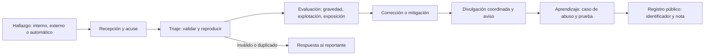
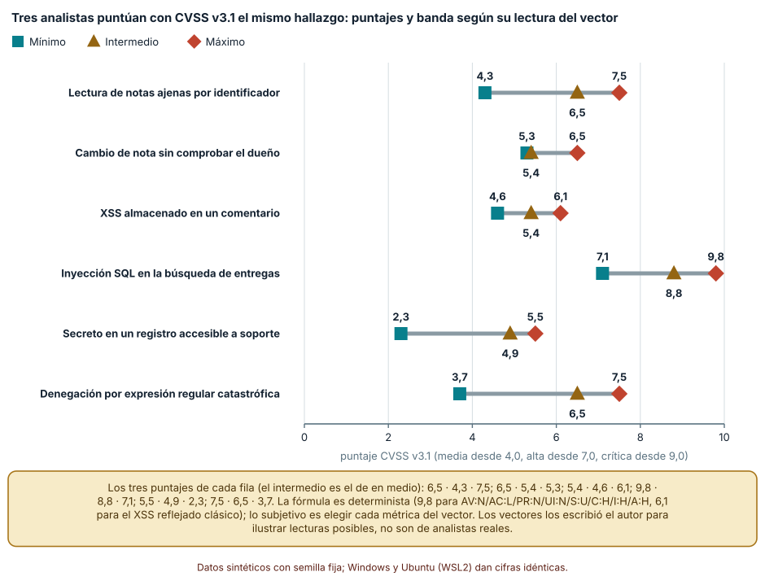
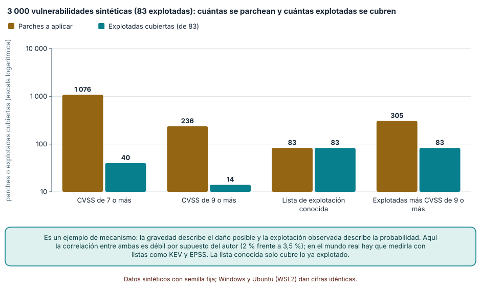
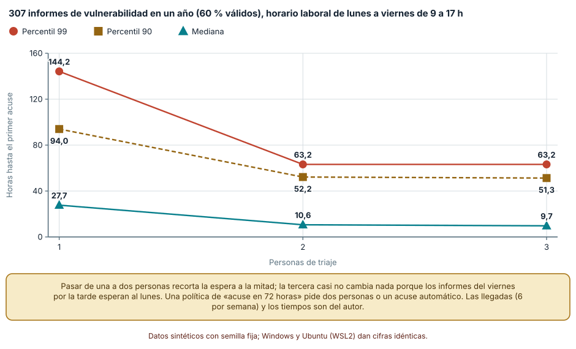

# SE-465 — Vulnerabilidades, divulgación y respuesta

[← SE-464 — Secure SDLC, abuso y pruebas negativas](https://github.com/vladimiracunadev-create/modern-software-engineering-program/blob/main/classes/part-38-seguridad-privacidad-y-cumplimiento/se-464-secure-sdlc-abuso-y-pruebas-negativas/README.md) · [↑ Parte 38](https://github.com/vladimiracunadev-create/modern-software-engineering-program/blob/main/classes/part-38-seguridad-privacidad-y-cumplimiento/README.md) · [📚 Índice completo](https://github.com/vladimiracunadev-create/modern-software-engineering-program/blob/main/classes/README.md) · [🌐 Portal](https://vladimiracunadev-create.github.io/modern-software-engineering-program/classes/SE-465.html) · [SE-466 — Cumplimiento, evidencia y límites legales →](https://github.com/vladimiracunadev-create/modern-software-engineering-program/blob/main/classes/part-38-seguridad-privacidad-y-cumplimiento/se-466-cumplimiento-evidencia-y-limites-legales/README.md)

## Punto profesional y fundamento pedagógico

**Punto profesional.** La clase existe para que sepas qué hacer cuando alguien, dentro o fuera del equipo, encuentra una vulnerabilidad: cómo se recibe el reporte, cómo se puntúa sin engañarse, cómo se decide qué corregir primero, cómo se coordina la divulgación y cómo se aprende del caso. La habilidad profesional es operar un proceso con plazos medibles y no depender de la suerte de que el reporte llegue a la persona correcta.

**Por qué aparece aquí.** Sigue a **Secure SDLC, abuso y pruebas negativas**: el proceso preventivo reduce los defectos que llegan a producción, pero ningún proceso los elimina. Lo que distingue a un equipo maduro es la calidad de su respuesta al hallazgo que no previó. El caso conductor es **la plataforma de entregas**: un investigador externo escribe a las 18:40 de un viernes que puede leer entregas de otros cursos.

**Error conceptual que debe corregir.** Creer que la puntuación de gravedad decide la prioridad. El puntaje CVSS describe características técnicas de la vulnerabilidad, depende de lecturas del vector que varían entre analistas y no dice nada de si se está explotando, de qué activos expone en *esta* plataforma ni de cuánto cuesta corregirla. Priorizar por puntaje solo es priorizar por una opinión con forma de número.

**Secuencia de aprendizaje.** Antes de mirar los resultados, predices cuánto varía el puntaje de seis hallazgos según tres lecturas razonables del vector, cuántas de las vulnerabilidades explotadas cubre una política basada en la gravedad, y cuánto tarda el primer acuse de recibo con una, dos y tres personas de triaje; después comparas las cifras. La secuencia usa predicción, contraste y explicación propia. [ICAP](https://icap.education.asu.edu/research) distingue participar de construir conocimiento; [How People Learn II](https://nap.nationalacademies.org/catalog/24783/how-people-learn-ii-learners-contexts-and-cultures) respalda diseñar la práctica con contextos reales y retroalimentación.

**Evidencia de aprendizaje.** `vulnerabilidades-log.md` con la predicción, la política de recepción y respuesta (plazos de acuse, evaluación y corrección), la tabla de puntajes de seis hallazgos, la comparación de estrategias de priorización, la simulación del triaje y una nota que separe qué parte es medida, cuál es modelo y cuál es suposición.

**Límite de la conclusión.** La fórmula de CVSS v3.1 se implementó según la especificación pública y se comprobó con los ejemplos 9,8 y 6,1; los vectores de los tres «analistas» son del autor, la población de 3 000 vulnerabilidades y su relación entre gravedad y explotación son un supuesto, y las llegadas del triaje (6 por semana) son sintéticas. No se reportó ninguna vulnerabilidad real, no se usaron datos de EPSS ni del catálogo KEV y la clase no da asesoría legal sobre divulgación.

### Trazabilidad fuente → afirmación

| Fuente primaria u oficial | Afirmación que respalda | Lo que no prueba |
|---|---|---|
| [FIRST: especificación de CVSS v3.1](https://www.first.org/cvss/v3.1/specification-document) | Define las métricas base y la fórmula para calcular el puntaje de 0 a 10 y sus bandas cualitativas. | No decide qué lectura del vector es la correcta ni el riesgo en un entorno concreto. |
| [CISA: catálogo de vulnerabilidades explotadas conocidas (KEV)](https://www.cisa.gov/known-exploited-vulnerabilities-catalog) | Publica una lista de vulnerabilidades con evidencia de explotación activa. | No dice cuáles afectan a la plataforma ni cubre las que nadie reportó. |
| [FIRST: EPSS](https://www.first.org/epss/) | Describe un modelo que estima la probabilidad de explotación de cada vulnerabilidad publicada. | No sustituye el conocimiento del contexto ni cubre vulnerabilidades propias sin identificador. |
| [RFC 9116: security.txt](https://www.rfc-editor.org/rfc/rfc9116) | Define un archivo en `/.well-known/` con campos como `Contact` y `Expires` para indicar cómo reportar una vulnerabilidad. | No garantiza que alguien responda el reporte. |
| [CERT/CC: guía de divulgación coordinada](https://vuls.cert.org/confluence/display/CVD) | Describe el proceso de divulgación coordinada entre quien reporta, quien corrige y quienes se ven afectados. | No fija un plazo universal. |
| [Google Project Zero: política de divulgación](https://googleprojectzero.blogspot.com/p/vulnerability-disclosure-policy.html) | Ejemplifica una política con plazo público de 90 días desde el aviso y anuncia un cambio previsto a una política de «Full 60» desde el 2 de febrero de 2027. | No es una norma ni el plazo que corresponde a la plataforma. |
| [Programa CVE](https://www.cve.org/) | Asigna identificadores públicos a vulnerabilidades para que se puedan citar sin ambigüedad. | No evalúa su gravedad. |

## Antes de empezar

Recupera lo aprendido en `SE-464` sobre el catálogo de casos de abuso: cada incidente agrega un caso. La pregunta activa es: **si un investigador te escribe esta noche que puede leer entregas ajenas, ¿quién lo lee, en cuántas horas responde, quién decide la prioridad y qué le prometes sobre la divulgación?**

## Prerrequisitos

- Haber completado `SE-464` o poder explicar qué es un caso de abuso.
- Python 3.11 o posterior; los experimentos usan solo la biblioteca estándar (`math`, `random`).
- Saber qué es un identificador CVE y qué significa «parche».

## Problema auténtico

En un escenario ilustrativo, un investigador envió un reporte detallado al correo general de contacto de la plataforma. El correo lo leyó una persona de soporte el lunes siguiente, que respondió «lo vemos» y lo reenvió al equipo de desarrollo sin prioridad. Tres semanas después, sin noticias, el investigador publicó los detalles. El equipo había puntuado el hallazgo con CVSS como 4,3 («media») y lo tenía en la cola detrás de dos cambios cosméticos; el investigador lo había puntuado como 7,5. Nadie había mentido: leyeron el vector de manera distinta (el privilegio requerido y el alcance). Ninguno miró si ya se estaba usando. La plataforma tenía dos personas que atendían reportes en horario de oficina y ningún plazo comprometido. La clase enseña a operar el proceso: un canal que llega a alguien, plazos medibles, una priorización que no se reduce al puntaje y una divulgación acordada.

## Objetivos observables

Al terminar podrás:

1. diseñar un canal de recepción (archivo `security.txt`, buzón, política) y los plazos de acuse, evaluación y corrección;
2. calcular un puntaje CVSS v3.1 y explicar por qué lecturas razonables del mismo hallazgo cambian la banda;
3. comparar estrategias de priorización (gravedad, explotación conocida, contexto) y decir qué cubre cada una;
4. dimensionar el triaje con una simulación de colas con horario;
5. coordinar una divulgación: plazos, parches, avisos y registro del aprendizaje.

## Mapa conceptual



El mapa separa la **recepción** (que debe llegar a alguien) del **triaje** (validar) y de la **evaluación** (decidir prioridad). La divulgación es un paso planificado y el aprendizaje devuelve el caso al catálogo de pruebas.

## Temas y por qué importan

| Tema | Por qué cambia una decisión profesional | Evidencia mínima |
|---|---|---|
| Canal de recepción y política | Sin un canal conocido, el hallazgo se publica en vez de reportarse. | Archivo `security.txt`, buzón y política con plazos |
| Puntuación de gravedad | Un número comparable ayuda a hablar, si se sabe lo que no dice. | Tabla de puntajes con tres lecturas |
| Priorización por riesgo | La explotación y la exposición cambian el orden más que el puntaje. | Comparación de estrategias de priorización |
| Dimensionar el triaje | El tiempo de respuesta es un requisito con capacidad. | Simulación con una, dos y tres personas |
| Divulgación coordinada | Un plazo claro protege a quien reporta y a quien usa el sistema. | Línea de tiempo y texto de aviso |

## Conceptos y decisiones

### 1. Recibir el reporte: canal, política y plazos

La puerta de entrada de las vulnerabilidades es una decisión de diseño. El archivo `security.txt` (RFC 9116), publicado en `/.well-known/security.txt`, declara al menos un `Contact` y una fecha de `Expires`, y puede apuntar a la política de divulgación y a una clave de cifrado. Un buzón dedicado atendido por personas con nombre y suplente vale más que un correo general. La política escrita dice qué está dentro del alcance (qué dominios, qué tipos de prueba), qué está prohibido (acceder a datos de otras personas más allá de lo necesario para demostrar el defecto, degradar el servicio), cuándo se acusa recibo, cuándo se responde con una evaluación y cuánto se espera para corregir. Incluye una **promesa de no tomar acciones legales** contra quien actúa de buena fe dentro de la política, redactada con asesoría legal. Un plazo que no se cumple es peor que ninguno: el investigador publica cuando se agota su paciencia.

### 2. Puntuar la gravedad sin engañarse

CVSS v3.1 calcula un puntaje de 0 a 10 a partir de ocho métricas base: vector de ataque, complejidad, privilegios requeridos, interacción del usuario, alcance, y el impacto en confidencialidad, integridad y disponibilidad. La fórmula es determinista, y lo subjetivo es cada elección. «¿Se explota desde la red o desde una red adyacente?», «¿requiere una cuenta de estudiante o ninguna?», «¿el alcance cambia a otro componente?» admiten lecturas distintas, y un solo cambio puede cruzar una banda. Se usa como **lenguaje común**, con la tabla de vectores a la vista, no como medida. La cifra no incorpora el contexto: una lectura de notas ajenas es crítica en una plataforma con menores y moderada en un blog. Se complementa con un puntaje ambiental propio (qué activos toca, qué controles compensan) que el equipo escribe en el reporte.

### 3. Priorizar por explotación y exposición

La gravedad técnica es un insumo, no la decisión. Otros dos insumos pesan más: si **hay evidencia de explotación** (catálogos como KEV de CISA listan vulnerabilidades con explotación activa, y modelos como EPSS estiman la probabilidad) y cuánto **expone** en este sistema (el componente afectado, si es alcanzable desde internet, qué datos toca). Una política razonable ordena primero lo explotado y alcanzable, después lo grave y alcanzable, y deja para planificación lo grave pero inalcanzable. Eso no elimina la corrección de lo demás: ordena el tiempo. Para las vulnerabilidades propias de la plataforma no hay catálogo, y la señal de explotación sale de los propios registros: intentos sobre ese endpoint, anomalías de acceso, reportes duplicados (varias personas lo encontraron: probablemente otros también).

### 4. Dimensionar el triaje

El primer acuse de un reporte es un servicio con una cola. Las llegadas son irregulares, parte de los reportes son inválidos o duplicados, el trabajo ocurre en horario de oficina y los fines de semana se acumulan. Con una persona, el tiempo hasta el primer acuse es largo aun con baja carga, porque una tarea larga bloquea a las demás y porque los reportes del viernes por la tarde esperan al lunes. Una segunda persona recorta la espera a la mitad; la tercera ya casi no cambia nada porque el límite pasa a ser el horario. Los remedios son de tres clases: más capacidad, un acuse automático que no dependa de una persona (con un plazo para la evaluación humana) y una guardia de baja frecuencia para casos que lo justifiquen. Como en `SE-436`, la capacidad se decide desde el objetivo (por ejemplo, un percentil 90 del acuse inferior a 48 horas), no desde la intuición.

### 5. Divulgación coordinada y aprendizaje

La **divulgación coordinada** acuerda con quien reporta cuándo se hará público el hallazgo. Los plazos varían: Project Zero publica sus detalles a los 90 días del aviso con independencia de que haya parche (y el texto vigente anuncia un cambio a una política «Full 60» desde febrero de 2027), y el CERT/CC publica una guía con las variantes. Un plazo corto protege a las personas usuarias frente a una vulnerabilidad conocida por pocos pero no corregida; uno largo da tiempo para corregir y para que la mayoría actualice. Hay que decidir además qué se comunica y a quién (aviso a las personas afectadas, identificador CVE si procede, nota técnica) y registrar el caso: qué falló, qué prueba lo habría detectado y qué caso de abuso se añade. El reporte puede ser también un incidente (`SE-465` termina donde empieza la gestión de incidentes de la Parte 41): si hay indicios de explotación, la respuesta cambia de ritmo.

### Un mismo hallazgo, tres puntajes

Se implementa CVSS v3.1 según la especificación (la comprobación da 9,8 para AV:N/AC:L/PR:N/UI:N/S:U/C:H/I:H/A:H y 6,1 para el XSS reflejado clásico AV:N/AC:L/PR:N/UI:R/S:C/C:L/I:L/A:N) y se puntúan seis hallazgos de la plataforma con tres lecturas razonables del vector.

```python
iss = 1 - (1 - CIA[c]) * (1 - CIA[i]) * (1 - CIA[a])
imp = 7.52 * (iss - 0.029) - 3.25 * (iss - 0.02) ** 15 if cambia else 6.42 * iss
ex = 8.22 * AV[av] * AC[ac] * pr * UI[ui]
puntaje = roundup(min(1.08 * (imp + ex), 10)) if cambia else roundup(min(imp + ex, 10))
```

| Hallazgo | Tres puntajes | Rango | Bandas |
|---|---|---:|---|
| Lectura de notas ajenas por identificador | 6,5 · 4,3 · 7,5 | 4,3 – 7,5 | media – alta |
| Cambio de nota sin comprobar el dueño | 6,5 · 5,4 · 5,3 | 5,3 – 6,5 | media |
| XSS almacenado en un comentario | 5,4 · 4,6 · 6,1 | 4,6 – 6,1 | media |
| Inyección SQL en la búsqueda | 9,8 · 8,8 · 7,1 | 7,1 – 9,8 | alta – crítica |
| Secreto en un registro accesible a soporte | 5,5 · 4,9 · 2,3 | 2,3 – 5,5 | baja – media |
| Denegación por expresión regular catastrófica | 7,5 · 6,5 · 3,7 | 3,7 – 7,5 | baja – alta |

El rango llega a 3,8 puntos (la denegación por expresión regular, de baja a alta) y la banda cambia en cuatro de seis hallazgos. Cada diferencia viene de una elección legítima de métrica: red o adyacente, privilegio nulo o bajo, complejidad alta o baja.



**Cómo leer la figura.** Cada fila es un hallazgo y el segmento va del menor al mayor de los tres puntajes de los analistas; el título del eje dice dónde empiezan las bandas media (4,0), alta (7,0) y crítica (9,0). Mira los segmentos que cruzan uno de esos umbrales: ahí la lectura del vector decide la banda, no el hallazgo. **Dónde deja de valer:** los vectores de los tres analistas los escribió el autor para ilustrar lecturas posibles; no son de analistas reales. La fórmula sí es la de la especificación; la conclusión (el puntaje depende de la lectura) no depende de los vectores concretos.

### Gravedad contra explotación

Se simulan 3 000 vulnerabilidades con CVSS de campana alrededor de 6,2 (desviación 1,9). Por supuesto del autor, la probabilidad de explotación es de 2 % si el puntaje es menor que 7 y de 3,5 % si es mayor o igual (una relación débil), de modo que 83 son explotadas. Se comparan cuatro estrategias de parcheo.

| Estrategia | Parches a aplicar | Explotadas cubiertas |
|---|---:|---:|
| CVSS de 7 o más | 1 076 | 40 de 83 |
| CVSS de 9 o más | 236 | 14 de 83 |
| Lista de explotación conocida | 83 | 83 de 83 |
| Explotadas más CVSS de 9 o más | 305 | 83 de 83 |

Parchear todo lo de CVSS 7 o más exige 1 076 acciones y deja 43 explotadas sin cubrir; la lista de explotación conocida cubre las 83 con 83 acciones, pero solo conoce lo ya explotado.



**Cómo leer la figura.** Cada grupo es una estrategia; la barra dorada son los parches a aplicar y la verde azulada, las explotadas que cubre, en escala logarítmica. Mira que la lista de explotación cubre las 83 con 83 parches, mientras CVSS de 7 o más necesita 1 076 para cubrir 40. **Dónde deja de valer:** la relación débil entre gravedad y explotación es un supuesto del autor; en el mundo real hay que medirla con datos de KEV y EPSS. La lista conocida no ve vulnerabilidades explotables todavía no explotadas ni las propias sin identificador, por eso se combina con un criterio de gravedad.

### El primer acuse con una, dos y tres personas

Se simulan 52 semanas con 6 reportes por semana de media (307 en el año), el 40 % inválidos o duplicados con 2 horas de trabajo medio y el 60 % válidos con 6 horas; el primer acuse consume 15 minutos de trabajo y el horario es de lunes a viernes de 9 a 17 h.

| Personas de triaje | Mediana (h) | Percentil 90 (h) | Percentil 99 (h) |
|---:|---:|---:|---:|
| 1 | 27,7 | 94,0 | 144,2 |
| 2 | 10,6 | 52,2 | 63,2 |
| 3 | 9,7 | 51,3 | 63,2 |

La segunda persona recorta la mediana de 27,7 a 10,6 horas y el percentil 90 de 94 a 52. La tercera casi no mejora: el límite pasa a ser el horario, de modo que lo que llega el viernes por la tarde espera hasta el lunes.



**Cómo leer la figura.** El eje horizontal son las personas de triaje y el vertical las horas hasta el primer acuse; cada línea es un percentil. Mira que las tres caen mucho de una a dos personas y casi se aplanan de dos a tres: el límite pasa a ser el horario, no la cola. **Dónde deja de valer:** las llegadas de Poisson, la proporción de inválidos y los tiempos de trabajo son del autor. Un acuse automático inmediato elimina la columna sin añadir personas, y una guardia fuera de horario reduce los percentiles altos.

## Definiciones de trabajo

- **vulnerabilidad:** debilidad en un sistema que una persona atacante puede aprovechar para vulnerar una propiedad de seguridad.
- **divulgación coordinada:** proceso en que quien reporta, quien corrige y, si procede, terceros afectados acuerdan cuándo y cómo se hará pública una vulnerabilidad.
- **CVSS:** sistema de puntuación de 0 a 10 de las características técnicas de una vulnerabilidad según métricas de explotabilidad e impacto.
- **explotación conocida:** evidencia de que una vulnerabilidad se está aprovechando contra sistemas reales.
- **triaje:** primera revisión de un reporte para decidir si es válido, reproducirlo y asignarle prioridad.

Las definiciones son operativas para la plataforma de entregas. No convierten términos con una historia más amplia en sinónimos y deben contrastarse con la documentación primaria enlazada al final.

## Ejemplo mínimo

El fragmento muestra cómo un solo cambio de métrica cruza una banda. Antes de ejecutarlo, predice si el puntaje sube o baja al pasar de privilegios bajos a ninguno.

```python
base = "CVSS:3.1/AV:N/AC:L/PR:L/UI:N/S:U/C:H/I:N/A:N"
print(cvss(base), cvss(base.replace("PR:L", "PR:N")))
```

Imprime `6.5 7.5`: sin exigir una cuenta, el mismo hallazgo pasa de media a alta. Registra versión de Python, comando y salida; después cambia `AV:N` por `AV:A` y observa cuánto baja.

## Ejemplo profesional

El equipo publica `/.well-known/security.txt` con un `Contact` a un buzón con dos responsables y suplentes y un `Expires` a un año vista, y una política con alcance, reglas para quien prueba y plazos: acuse en 24 horas hábiles automáticamente y de una persona en 48, evaluación en 5 días hábiles, corrección o mitigación de las críticas en 14 días y de las altas en 30, y divulgación coordinada a los 90 días o antes si hay parche. El triaje usa un formulario con el vector CVSS, el contexto (datos expuestos, alcance desde internet) y la evidencia de explotación de los propios registros; la prioridad la fija una regla escrita (explotado y alcanzable, grave y alcanzable, el resto). Un hallazgo entra al catálogo de casos de abuso con su prueba y se informa a las personas afectadas con un texto claro. Se mide por lo que cambia: en el modelo de la clase, el percentil 90 del primer acuse pasa de 94 a 52 horas con dos personas, y a un acuse automático inmediato con una guardia.

## Práctica guiada

1. Escribe tu predicción de cuánto varía el puntaje de un hallazgo según la lectura del vector.
2. Implementa CVSS v3.1 y comprueba los puntajes 9,8 y 6,1 antes de usarlo.
3. Puntúa seis hallazgos de la plataforma con tres lecturas razonables y calcula el rango y el cambio de banda.
4. Simula 3 000 vulnerabilidades y compara cuatro estrategias de parcheo; cambia la relación entre gravedad y explotación y observa el efecto.
5. Simula el triaje con una, dos y tres personas con horario y llegadas de Poisson.
6. Escribe el archivo `security.txt` y la política de divulgación con sus plazos.
7. Entrega `vulnerabilidades-log.md` y pide a otra persona que puntúe tus seis hallazgos sin ver tus vectores.

## Ejercicios

1. **Vector:** elige un hallazgo y construye dos lecturas razonables que crucen una banda; explica la elección de cada métrica.
2. **Prioridad:** diseña una regla de prioridad con tres insumos (explotación, exposición, gravedad) y aplícala a cinco hallazgos.
3. **Capacidad:** calcula con tu simulación cuántas personas necesitas para un percentil 90 del acuse inferior a 48 horas y qué otra medida lo logra sin ellas.
4. **Divulgación:** escribe el aviso a las personas afectadas por la lectura de entregas ajenas, sin técnicas de explotación y con una acción concreta.

## Reto verificable

Entrega `vulnerabilidades-log.md` con la predicción, el archivo `security.txt` y la política, la tabla de puntajes, la comparación de estrategias, la simulación del triaje y el aviso de un hallazgo. Se aprueba si otra persona ejecuta el código desde un checkout limpio, obtiene las mismas cifras con las mismas semillas y puede decir qué hallazgo corregiría primero y por qué sin mirar solo el puntaje. No se aprueba por mostrar un puntaje sin vector ni por una política sin plazos medibles.

## Caso conductor

La plataforma de entregas de tareas continúa como caso conductor. Esta clase deja el noveno artefacto: la política de recepción y respuesta con su capacidad dimensionada. `SE-466` preguntará cómo se demuestra todo esto a un tercero y qué límites legales tiene esa demostración. Cambia después un solo dato, la proporción de reportes inválidos del 40 % al 70 %, y observa si la segunda persona sigue siendo necesaria.

## Preguntas frecuentes

### ¿Hay que pagar recompensas?

No es obligatorio. Un programa sin recompensas pero con una política clara, un canal que responde y un agradecimiento público recibe reportes de buena fe; una recompensa económica atrae más volumen y exige más capacidad de triaje. Se decide con el presupuesto y la capacidad.

### ¿Qué hago con un reporte que no puedo reproducir?

Pide detalles, comparte lo que intentaste y registra la conversación. Un reporte no reproducido no es un reporte inválido: puede depender de datos, de una versión o de un camino que no probaste. Cierra solo con la conformidad de quien lo envió o con una explicación documentada.

### ¿Cuándo corresponde pedir un identificador CVE?

Cuando la vulnerabilidad afecta a un producto que otras organizaciones usan y que ellas deben actualizar. Para el código propio de una plataforma alojada que nadie más ejecuta, un registro interno y un aviso suelen bastar.

### ¿Se puede publicar sin parche?

Es una decisión de la coordinación. Si hay explotación activa, avisar a las personas afectadas con mitigaciones puede ser lo correcto aunque no haya parche; si no la hay, se acuerda un plazo. Debe quedar escrita la razón.

## Fallo controlado y diagnóstico

Reproduce el fallo clásico de la clase: **un hallazgo grave que queda en la cola por su puntaje**. Puntúa «lectura de notas ajenas» con la lectura benigna (4,3) y colócalo detrás de otros cambios.

Registra síntoma, entrada mínima, hipótesis, observación que descarta cada hipótesis, causa, corrección y prueba de regresión. **Síntoma:** un reporte con detalles sigue sin corrección a las tres semanas y el investigador lo publica. **Hipótesis rivales:** (a) el reporte llegó tarde; (b) el equipo lo ignoró; (c) el puntaje lo clasificó como media y la cola se ordena por puntaje. **Prueba:** recalcula el puntaje con las otras lecturas; si pasa de 4,3 a 7,5 al cambiar privilegios requeridos, la causa es la lectura del vector y la prioridad sin contexto. **Conclusión:** la prioridad dependía de una opinión con forma de número. **Regresión:** reemplaza la regla por una que incluya explotación y exposición, exige una segunda lectura del vector para todo lo que toque datos de personas y añade el plazo comprometido de evaluación. No cambies a la vez la regla y el equipo.

## Errores comunes y cómo corregirlos

| Síntoma | Causa probable | Corrección |
|---|---|---|
| Un reporte se publica sin respuesta | Canal sin responsable ni plazo | `security.txt`, buzón con suplentes y acuse automático |
| Se discute el puntaje en vez del riesgo | CVSS tratado como medida | Vector a la vista, puntaje ambiental y evidencia de explotación |
| Lo grave espera detrás de lo cosmético | Prioridad por orden de llegada | Regla de prioridad escrita con explotación y exposición |
| El acuse tarda días | Una persona y horario de oficina | Acuse automático, segunda persona y guardia |
| El mismo defecto se repite | Sin caso de abuso ni prueba | Cada incidente añade un caso y una prueba |

## Entorno y archivos clave

```text
work/SE-465/
├── README.md
├── vulnerabilidades/
│   ├── cvss.py
│   ├── prioridad.py
│   ├── triaje.py
│   └── security.txt
├── tests/test_vulnerabilidades.py
└── evidence/vulnerabilidades-log.md
```

El `README` declara plataforma, versión de Python, semillas y comandos. Los experimentos usan solo la biblioteca estándar (`math`, `random`) y se ejecutaron con CPython 3.12.9 en Windows 11 y 3.12.3 en Ubuntu bajo WSL2: las salidas fueron idénticas. Si añades una dependencia, fija procedencia y versión.

## Seguridad, ética y accesibilidad

- los hallazgos y los datos son sintéticos: no publiques detalles de explotación de un sistema real ni del tuyo antes de corregirlo;
- quien reporta merece una respuesta respetuosa, sin amenazas legales cuando actúa de buena fe dentro de la política; consulta con asesoría legal el texto de la política;
- la política de divulgación debe estar redactada en lenguaje claro y en un formato accesible, y el canal debe ser usable sin herramientas especiales;
- la divulgación afecta a personas: el aviso debe decir qué hacer, no solo qué pasó, y no culpar a quien reportó;
- si hay datos personales expuestos, la obligación de notificar a las personas o a la autoridad depende de la norma aplicable: no la resuelve esta clase.

## Puente hacia el trabajo con agentes

Un agente al que se le pide «prioriza estas vulnerabilidades» las ordenará por puntaje CVSS y presentará una lista con apariencia de rigor. Pídele en cambio que muestre el vector de cada una y una segunda lectura alternativa, que añada la evidencia de explotación (registros, catálogos públicos) y la exposición en la plataforma, que ordene con una regla escrita y que marque lo que no puede saber. Revisa que no invente identificadores CVE ni puntajes de EPSS y que no proponga publicar detalles de explotación en un aviso. El defecto típico es una prioridad con falsa precisión.

## Transferencia

Traslada el análisis a otro dominio (por ejemplo, una aplicación de citas para un taller): cambia los activos y el canal y conserva el procedimiento de recibir con plazos, puntuar con vector a la vista, priorizar con explotación y exposición y dimensionar el triaje. La transferencia está lograda cuando puedes decir qué reporte atenderías primero y qué dato te falta para estar seguro, no cuando la política se parece a la de la plataforma.

## Evaluación y evidencia

| Criterio | Evidencia para aprobar |
|---|---|
| comprensión | explicación de qué dice y qué no dice un puntaje CVSS y de la divulgación coordinada |
| corrección | CVSS implementado y verificado, simulaciones reproducibles con las mismas semillas |
| diseño | `security.txt`, política con plazos y regla de prioridad escrita |
| diagnóstico | reproducción del fallo «grave en la cola por su puntaje» con regresión |
| incertidumbre | declaración de que vectores, población y llegadas son del autor |
| reproducibilidad | versiones, comandos, salida y límites declarados |

## Fuentes

- [FIRST: CVSS v3.1](https://www.first.org/cvss/v3.1/specification-document) — fórmula y métricas; autoridad: FIRST.
- [CISA: catálogo KEV](https://www.cisa.gov/known-exploited-vulnerabilities-catalog) — vulnerabilidades explotadas conocidas; autoridad: CISA.
- [FIRST: EPSS](https://www.first.org/epss/) — probabilidad de explotación; autoridad: FIRST.
- [RFC 9116](https://www.rfc-editor.org/rfc/rfc9116) — archivo `security.txt`; autoridad: IETF.
- [CERT/CC: divulgación coordinada](https://vuls.cert.org/confluence/display/CVD) — guía del proceso; autoridad: CERT/CC.
- [Google Project Zero: política de divulgación](https://googleprojectzero.blogspot.com/p/vulnerability-disclosure-policy.html) — ejemplo de plazo público; autoridad: Google.
- [Programa CVE](https://www.cve.org/) — identificadores públicos; autoridad: programa CVE.

Cada fuente respalda el mecanismo indicado; ninguna demuestra que el rango de 3,8 puntos, los 40 de 83 o las 94 horas se observen en un equipo real. Esa afirmación depende de los analistas, de los datos de explotación y de las llegadas.

## Límites y siguiente paso

Se ejecutaron tres experimentos con datos sintéticos en Windows y Ubuntu (WSL2) con resultados idénticos. No se reportó ninguna vulnerabilidad real ni se usaron datos de EPSS o KEV; los vectores de los analistas, la población de 3 000 vulnerabilidades con su relación débil entre gravedad y explotación y las llegadas del triaje son construcciones del autor, y la clase no da asesoría legal. La siguiente clase pregunta cómo se demuestra todo esto a un tercero y qué límites legales tiene esa demostración.

## Glosario

- **vulnerabilidad:** debilidad en un sistema que una persona atacante puede aprovechar para vulnerar una propiedad de seguridad.
- **divulgación coordinada:** proceso en que quien reporta, quien corrige y, si procede, terceros afectados acuerdan cuándo y cómo se hará pública una vulnerabilidad.
- **CVSS:** sistema de puntuación de 0 a 10 de las características técnicas de una vulnerabilidad según métricas de explotabilidad e impacto.
- **explotación conocida:** evidencia de que una vulnerabilidad se está aprovechando contra sistemas reales.
- **triaje:** primera revisión de un reporte para decidir si es válido, reproducirlo y asignarle prioridad.

---

[← SE-464 — Secure SDLC, abuso y pruebas negativas](https://github.com/vladimiracunadev-create/modern-software-engineering-program/blob/main/classes/part-38-seguridad-privacidad-y-cumplimiento/se-464-secure-sdlc-abuso-y-pruebas-negativas/README.md) · [↑ Parte 38](https://github.com/vladimiracunadev-create/modern-software-engineering-program/blob/main/classes/part-38-seguridad-privacidad-y-cumplimiento/README.md) · [📚 Índice completo](https://github.com/vladimiracunadev-create/modern-software-engineering-program/blob/main/classes/README.md) · [🌐 Portal](https://vladimiracunadev-create.github.io/modern-software-engineering-program/classes/SE-465.html) · [SE-466 — Cumplimiento, evidencia y límites legales →](https://github.com/vladimiracunadev-create/modern-software-engineering-program/blob/main/classes/part-38-seguridad-privacidad-y-cumplimiento/se-466-cumplimiento-evidencia-y-limites-legales/README.md)
