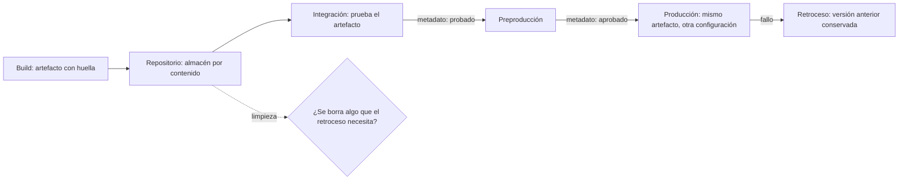
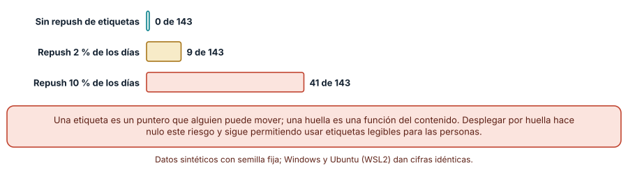
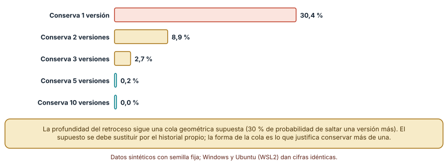

# SE-470 — Artefactos, repositorios y promoción

[← SE-469 — Build reproducible y hermético](https://github.com/vladimiracunadev-create/modern-software-engineering-program/blob/main/classes/part-39-build-release-y-cadena-de-suministro/se-469-build-reproducible-y-hermetico/README.md) · [↑ Parte 39](https://github.com/vladimiracunadev-create/modern-software-engineering-program/blob/main/classes/part-39-build-release-y-cadena-de-suministro/README.md) · [📚 Índice completo](https://github.com/vladimiracunadev-create/modern-software-engineering-program/blob/main/classes/README.md) · [🌐 Portal](https://vladimiracunadev-create.github.io/modern-software-engineering-program/classes/SE-470.html) · [SE-471 — Dependencias directas, transitivas y vendorización →](https://github.com/vladimiracunadev-create/modern-software-engineering-program/blob/main/classes/part-39-build-release-y-cadena-de-suministro/se-471-dependencias-directas-transitivas-y-vendorizacion/README.md)

## Punto profesional y fundamento pedagógico

**Punto profesional.** La clase existe para que decidas dónde vive un artefacto después de construirlo, cómo se le identifica sin ambigüedad y cómo avanza de un entorno a otro sin cambiar. Un repositorio de artefactos no es un disco compartido: es el lugar donde una huella se asocia a un nombre y a un historial de decisiones, y donde se conserva lo necesario para volver atrás. La habilidad profesional es **promover** lo que se probó, no volver a construir lo que se quiere desplegar.

**Por qué aparece aquí.** Sigue a **Build reproducible y hermético**: allí se obtuvo un artefacto con una huella estable; aquí se decide qué hacer con él. Precede a las clases sobre dependencias, procedencia y firmas, que necesitan un artefacto direccionable para colgar de él sus metadatos. El caso conductor es la API de entregas, ya empaquetada, que debe pasar por integración, preproducción y producción.

**Error conceptual que debe corregir.** Creer que «la misma versión» en tres entornos es «el mismo artefacto». Una etiqueta como `1.4.0` o `latest` es un puntero que alguien puede mover; si cada entorno reconstruye a partir de ella, lo que se probó y lo que se despliega pueden diferir sin que ningún registro lo muestre.

**Secuencia de aprendizaje.** Antes de medir, predices qué fracción de los lanzamientos llegará a producción con un artefacto distinto del probado si cada entorno reconstruye con una deriva del 5 % por build; después comparas reconstruir con promover la misma huella, simulas el efecto de etiquetas que se vuelven a publicar y calculas cuántas versiones conservar para poder retroceder. La secuencia usa predicción, modelos con semilla fija y una decisión con costo.

**Evidencia de aprendizaje.** `artefactos-log.md` con la predicción, las tres figuras reproducidas, una política de promoción de la API de entregas (qué se identifica por huella, qué estados existen, quién promueve y con qué evidencia) y una política de retención con su justificación.

**Límite de la conclusión.** Las simulaciones usan tasas de deriva, de repush y de profundidad de retroceso que son supuestos del autor, y el «registro» es un modelo; no se usó ningún registro de contenedores, de paquetes ni de artefactos real, ni se midieron costos de almacenamiento. La cifra de que promover deja en cero la diferencia es consecuencia del modelo, no un hallazgo empírico.

### Trazabilidad fuente → afirmación

| Fuente primaria u oficial | Afirmación que respalda | Lo que no prueba |
|---|---|---|
| [Fowler, «DeploymentPipeline»](https://martinfowler.com/bliki/DeploymentPipeline.html) | Describe un flujo en el que un artefacto se construye una vez y avanza por etapas de verificación hasta el despliegue. | No fija las etapas de la API de entregas ni mide su efecto. |
| [Google SRE: Release Engineering](https://sre.google/sre-book/release-engineering/) | Explica que los builds deben ser herméticos y reproducibles y que se promueve el artefacto resultante entre entornos, en lugar de reconstruirlo. | No demuestra el valor numérico de la deriva por reconstrucción. |
| [OCI Image Specification: descriptores](https://github.com/opencontainers/image-spec/blob/main/descriptor.md) | Define que un descriptor identifica un contenido por su resumen criptográfico (digest), que es direccionamiento por contenido, no por nombre. | No dice cómo debe configurarse un registro concreto. |
| [OCI Distribution Specification](https://github.com/opencontainers/distribution-spec) | Distingue referencias por etiqueta (modificable) de referencias por resumen (inmutable) en la API de un registro. | No cubre las políticas de retención de cada proveedor. |
| [PyPI: ayuda sobre reutilización de nombres de archivo](https://pypi.org/help/) | Documenta que un nombre de archivo ya publicado no puede reutilizarse, lo que fuerza la inmutabilidad de una versión publicada. | No describe registros privados. |

## Antes de empezar

Recupera lo aprendido en `SE-469`: un artefacto reproducible tiene una huella que otra persona puede verificar. La pregunta activa es: **¿cómo se asegura que el artefacto que se despliega es exactamente el que se probó, y cuántas versiones hay que conservar para poder volver?**

## Prerrequisitos

- Haber completado `SE-469` o poder explicar qué es una huella y por qué identifica un contenido.
- Python 3.11 o posterior; las simulaciones usan solo la biblioteca estándar (`random`, `collections`).
- Saber qué es una etiqueta de versión en un sistema de control de versiones y que puede moverse.

## Problema auténtico

La plataforma despliega los viernes a integración y los martes a producción. Una semana, un defecto aparece solo en producción. La revisión muestra que la imagen desplegada se construyó el martes desde la etiqueta `v1.4.0` y que, entre el viernes y el martes, una dependencia sin versión fija publicó una versión nueva. Lo probado el viernes no es lo desplegado el martes, y nada en el registro lo decía: las dos imágenes se llamaban igual.

Más tarde, el defecto obliga a volver a la versión anterior. La política de limpieza del registro borra todo lo que tiene más de 14 días y la versión necesaria fue eliminada; el retroceso exige reconstruir con las mismas incertidumbres que se querían evitar.

## Objetivos observables

Al terminar podrás:

1. distinguir identificar un artefacto por nombre y por huella y decir qué garantiza cada una;
2. diseñar una canalización de promoción en la que lo que se prueba es lo que se despliega, y explicar qué cambia entre entornos (configuración) y qué no (artefacto);
3. calcular, con un modelo, cuántos lanzamientos llegan a producción con un artefacto no probado según la tasa de deriva de la reconstrucción;
4. elegir una política de retención a partir de la distribución de la profundidad de los retrocesos;
5. registrar el estado de promoción de un artefacto como metadatos asociados a su huella.

## Mapa conceptual



El mapa muestra que el artefacto no cambia entre etapas; cambian los metadatos que dicen qué se sabe de él. El repositorio guarda también lo necesario para volver, y la limpieza es la decisión que puede destruirlo.

## Temas y por qué importan

| Tema | Por qué cambia una decisión profesional | Evidencia mínima |
|---|---|---|
| Artefacto y huella | Identificar por contenido permite verificar. | Predicción, traza causal y contraejemplo de **Artefacto y huella** en `artefactos-log.md` |
| Etiquetas mutables | Un puntero movido cambia lo desplegado sin avisar. | Predicción, traza causal y contraejemplo de **Etiquetas mutables** en `artefactos-log.md` |
| Promoción | Reconstruir para cada entorno rompe la cadena de evidencia. | Predicción, traza causal y contraejemplo de **Promoción** en `artefactos-log.md` |
| Metadatos de estado | Separar el artefacto de lo que se sabe de él evita copiarlo. | Predicción, traza causal y contraejemplo de **Metadatos de estado** en `artefactos-log.md` |
| Retención y retroceso | Una limpieza mal calibrada elimina la salida de emergencia. | Predicción, traza causal y contraejemplo de **Retención** en `artefactos-log.md` |

## Conceptos y decisiones

### 1. Artefacto y huella

Un **artefacto** es la salida inmutable de un build: un archivo, una imagen de contenedor, un paquete. Su **huella** (digest) es el resultado de aplicarle una función hash; dos artefactos con la misma huella son el mismo contenido, y un solo byte distinto produce otra huella. Esto permite un direccionamiento por contenido: pedirle al repositorio «dame lo que tiene esta huella» devuelve exactamente eso o nada. Un repositorio de artefactos añade a ese almacén un índice (nombre y versión que apuntan a una huella), metadatos y control de acceso, pero el contenido sigue identificado por su huella. Por eso un registro de contenedores permite referirse a una imagen por etiqueta (`api:1.4.0`) o por resumen (`api@sha256:…`), y solo la segunda es inmutable.

### 2. Etiquetas mutables

Una **etiqueta** es un nombre legible que apunta a una huella y que, en la mayoría de los registros, se puede reasignar. Es cómoda (`latest`, `1.4`, `estable`) y peligrosa para la verificación: quien tiene permiso de escritura puede mover `1.4.0` a otro contenido, por error (una publicación repetida desde otra rama) o con mala intención. El riesgo no es solo el de un atacante; es el de la deriva silenciosa. La práctica robusta es **desplegar por huella** y usar la etiqueta solo como ayuda de lectura para personas, y configurar el registro para que las etiquetas de versión sean inmutables cuando lo permita. Una etiqueta flotante como `latest` es, por definición, una orden de «dame lo que haya hoy».

### 3. Promoción

**Promover** es avanzar un mismo artefacto de una etapa a la siguiente sin reconstruirlo. La razón es lógica: una prueba es evidencia sobre un objeto concreto; si el objeto cambia, la evidencia no se traslada. Cuando cada entorno reconstruye, aparece un hueco entre lo probado y lo desplegado cuyo tamaño es la probabilidad de que el build produzca un resultado distinto. Con un build reproducible ese hueco se acerca a cero, y entonces la reconstrucción solo cuesta tiempo; con uno que no lo es, es un riesgo que crece con cada etapa. Lo que sí cambia entre entornos es la **configuración** (direcciones, credenciales, parámetros), que se inyecta en el despliegue y no se incrusta en el artefacto, porque un artefacto con la configuración dentro no se puede promover.

### 4. Metadatos de estado

Si el artefacto no cambia, ¿cómo se sabe en qué etapa está? Mediante **metadatos asociados a su huella**: «pasó las pruebas de integración en esta fecha», «aprobado para producción por esta persona», «escaneado sin vulnerabilidades críticas». Se guardan en un lugar que pueda consultarse y que no sea modificable por quien construye (un sistema de atestaciones, una base de datos de la canalización, etiquetas de solo adición), y la decisión de promover consulta esos metadatos. Esta separación evita la mala costumbre de copiar el artefacto a un repositorio «de producción», que obliga a comprobar que la copia es idéntica. La forma firmada de estos metadatos se trata en `SE-472` y `SE-473`.

### 5. Retención y retroceso

Un repositorio crece sin límite si no se limpia, y limpiarlo es una decisión con riesgo. El **retroceso** necesita la versión anterior, y a veces una anterior a esa: si la versión actual y la previa comparten un defecto, hay que volver a la tercera. La política de retención debe fundamentarse en la **distribución de la profundidad** del retroceso, no en un número redondo: conservar las últimas N versiones, además de todas las que estuvieron en producción durante un periodo (porque un cliente puede seguir usándolas) y todas las que tengan una atestación vigente. Los artefactos que se conservan deben seguir siendo **verificables** (con su huella, sus atestaciones y la clave pública con la que se firmaron), porque un artefacto que no se puede verificar no sirve para retroceder con confianza.

### Reconstruir o promover

Se simulan 2 000 lanzamientos por celda. En la política de reconstruir, cada entorno construye de nuevo y la probabilidad de que el resultado difiera es 1 %, 5 % o 15 % (una dependencia flotante, una imagen base actualizada, una hora incrustada). En la de promover, se despliega la huella que se probó. De las derivas, el 12 % esconde un defecto que solo vive en el artefacto distinto.

```python
prod_same = True if not rebuild else (rng.random() >= p_drift)
if not prod_same and rng.random() < 0.12: escaped += 1   # defecto que solo vive en el artefacto distinto
```


**Cómo leer la figura.** Cada grupo es una probabilidad de deriva por reconstrucción y cada barra un recuento sobre 2 000 lanzamientos: producciones distintas de lo probado (coral), defectos no vistos en preproducción (dorada) y lo que ocurre si se promueve la misma huella (turquesa). Mira la barra turquesa, siempre en cero, frente a las otras dos. **Dónde deja de valer:** el cero de promover es una consecuencia del modelo (lo desplegado es idéntico por construcción) y el 12 % de defectos escondidos es un supuesto. Lo que la figura enseña es la proporcionalidad: con una deriva del 5 % uno de cada veinte lanzamientos es una apuesta, y con builds reproducibles esa deriva baja hacia cero, pero nunca se debe suponer que lo es sin comprobarlo.

### Etiquetas mutables

Se simulan 1 000 días en los que, con una probabilidad diaria dada, alguien vuelve a publicar la etiqueta de versión; se prueba el viernes de cada semana y se despliega por etiqueta el martes. Se cuenta cuántos de los 143 despliegues llevan un contenido distinto del probado.



**Cómo leer la figura.** Cada barra cuenta despliegues cuyo contenido difiere de lo que se probó; la altura crece con la frecuencia con la que se mueve la etiqueta. Con una frecuencia del 2 % diario el 6,3 % de los despliegues es distinto de lo probado y con una del 10 %, el 28,7 %. **Dónde deja de valer:** el modelo supone un solo despliegue por semana y un solo repush a la vez; si el repush ocurre justo tras la prueba, el efecto es mayor, y si el registro hace inmutables las etiquetas de versión, es nulo. Una etiqueta que nadie mueve es inofensiva solo hasta el día en que alguien la mueve.

### Retención y retroceso

Se simula la profundidad de 10 000 retrocesos con una cola geométrica (30 % de probabilidad de tener que saltar una versión más) y se cuenta qué fracción exige reconstruir según cuántas versiones conserva la limpieza.



**Cómo leer la figura.** Cada barra es la fracción de retrocesos que no puede resolverse con lo conservado; conservar una versión deja un 30,4 % sin salida y cinco bajan la cifra al 0,2 %. **Dónde deja de valer:** la profundidad es un supuesto geométrico; el historial real del equipo la sustituye, y su cola puede ser más gruesa (un defecto latente de meses) o más fina. La retención no es solo un número de versiones: una versión que estuvo en producción o que tiene clientes activos debe conservarse aunque supere el recuento, y conservar sin poder verificar no vale.

## Definiciones de trabajo

- **artefacto:** salida inmutable de un build, identificada por su contenido.
- **huella o digest:** resultado de aplicar una función hash a los bytes de un artefacto.
- **etiqueta:** nombre legible que apunta a una huella y que normalmente se puede reasignar.
- **promoción:** avance de un mismo artefacto a la siguiente etapa sin reconstruirlo.
- **retención:** política que decide qué artefactos se conservan y durante cuánto tiempo.

Las definiciones son operativas para la API de entregas. No convierten términos con una historia más amplia en sinónimos y deben contrastarse con la documentación primaria enlazada al final.

## Ejemplo mínimo

El fragmento muestra la diferencia entre referirse a un contenido por nombre y por huella. Antes de ejecutarlo, predice cuál de las dos referencias cambia si se reemplaza el contenido.

```python
import hashlib
almacen = {}
def publicar(nombre, datos):
    h = hashlib.sha256(datos).hexdigest()
    almacen[h] = datos
    etiquetas = globals().setdefault("etiquetas", {})
    etiquetas[nombre] = h
    return h

h1 = publicar("api:1.4.0", b"version A")
h2 = publicar("api:1.4.0", b"version B")   # la etiqueta se mueve
print(h1 == h2, etiquetas["api:1.4.0"] == h2, h1 in almacen)
```

La huella antigua sigue existiendo y apunta a su contenido; la etiqueta ahora apunta a otro. Registra versión de Python, comando y salida; después modifica el programa para rechazar mover una etiqueta ya publicada.

## Ejemplo profesional

El equipo define la canalización de la API de entregas. El build produce un artefacto y registra su huella; el repositorio acepta etiquetas de versión una sola vez. Integración y preproducción ejecutan sus pruebas contra esa huella y escriben un metadato por etapa (resultado, fecha, versión de las pruebas); la promoción a producción solo se permite si ambos metadatos existen. El despliegue recibe la huella y la configuración del entorno por separado. La política de retención conserva las cinco últimas versiones, todas las que estuvieron en producción en los últimos 90 días y las que tienen una atestación vigente; cada trimestre se ensaya un retroceso a la tercera versión anterior para comprobar que el artefacto y su cadena de verificación siguen disponibles.

## Práctica guiada

1. Escribe un repositorio mínimo con `publicar(nombre, datos)` que guarde por huella y mantenga un índice de nombres a huellas.
2. Predice qué fracción de lanzamientos llegará distinta a producción con una deriva del 5 % y escríbelo antes de medir.
3. Simula 2 000 lanzamientos reconstruyendo y 2 000 promoviendo, y completa la tabla.
4. Simula 1 000 días con repush de etiquetas del 0 %, el 2 % y el 10 % y cuenta los despliegues distintos de lo probado.
5. Simula 10 000 retrocesos con tu estimación de la profundidad y calcula la fracción que exige reconstruir para 1, 2, 3, 5 y 10 versiones conservadas.
6. Escribe la política de promoción y la de retención de la API de entregas, con quién promueve y con qué evidencia.
7. Entrega `artefactos-log.md` y pide a otra persona que encuentre una forma en que tu política deje desplegar algo no probado.

## Ejercicios

1. **Huella:** un registro publica `api:1.4.0` el lunes y, el miércoles, otra construcción vuelve a publicar la misma etiqueta con otro contenido; describe qué comprobación en el despliegue lo habría detectado.
2. **Promoción:** lista qué datos distintos necesita producción respecto de integración y decide cuáles se inyectan y cuáles forman parte del artefacto.
3. **Metadatos:** diseña el esquema mínimo de un metadato de estado (huella, etapa, resultado, quién, cuándo) y decide dónde se guarda para que quien construye no pueda modificarlo.
4. **Retención:** con una distribución de profundidad de retroceso propia (por ejemplo, 70 % de profundidad 1 y 20 % de profundidad 2), calcula cuántas versiones conservar para resolver el 99 % de los casos.

## Reto verificable

Entrega `artefactos-log.md` con la predicción, las tres tablas, la política de promoción (etapas, metadatos, quién promueve) y la de retención de la API de entregas. Se aprueba si otra persona ejecuta las simulaciones desde un checkout limpio, obtiene los mismos números con las mismas semillas y puede decir qué parte de la política impide desplegar un artefacto no probado. No se aprueba por afirmar «usamos la misma imagen en todos los entornos» sin una comprobación de la huella en el despliegue ni por fijar una retención en días sin relacionarla con la profundidad de los retrocesos.

## Caso conductor

La API de entregas es el caso conductor de la [Parte 39](../README.md). Esta clase deja el segundo artefacto: una política de promoción por huella con metadatos de estado y una retención justificada. `SE-471` abre el contenido del artefacto: qué dependencias contiene y de dónde vienen. Cambia después un solo dato, la tasa de deriva, y observa a partir de qué valor la reconstrucción deja de ser aceptable.

## Preguntas frecuentes

### ¿Por qué no reconstruir en producción para usar las últimas correcciones de seguridad?

Porque la corrección se incorpora construyendo una versión nueva, probándola y promoviéndola, no reconstruyendo la misma versión sin pruebas. Una reconstrucción silenciosa mezcla un cambio de seguridad con un cambio de comportamiento sin evidencia de que el segundo no rompa nada.

### ¿Se puede usar `latest`?

Para desarrollo local, sí. Para un entorno compartido o producción, no como referencia de despliegue: `latest` no dice qué se desplegó y no permite retroceder a algo identificable. Si se usa como ayuda de lectura, el despliegue debe registrar la huella a la que apuntaba.

### ¿Hace falta un repositorio para cada entorno?

No. Basta con un repositorio y metadatos de estado, o con espacios de nombres con permisos distintos. Copiar el artefacto entre repositorios obliga a verificar que la copia es idéntica y añade una pieza más que puede fallar.

### ¿Cuánto tiempo hay que conservar un artefacto?

Hasta que ya no pueda necesitarse para retroceder, para reproducir un incidente o para cumplir una obligación (de licencia, de auditoría). La respuesta es una política con fechas y excepciones documentadas, y no la capacidad del disco.

## Fallo controlado y diagnóstico

Reproduce el fallo clásico de la clase: **producción despliega un artefacto distinto del que se probó porque la etiqueta se movió**. Simula una etiqueta de versión que se vuelve a publicar entre la prueba y el despliegue.

Registra síntoma, entrada mínima, hipótesis, observación que descarta cada hipótesis, causa, corrección y prueba de regresión. **Síntoma:** un defecto aparece solo en producción y todas las pruebas pasaron. **Hipótesis rivales:** (a) las pruebas no cubren el caso; (b) la configuración de producción es distinta; (c) el artefacto desplegado no es el probado. **Prueba:** compara la huella desplegada con la registrada en el metadato de la prueba; si difieren, la causa es (c). **Conclusión:** la etiqueta se movió. **Regresión:** haz que el despliegue reciba la huella, que rechace una huella sin metadato de prueba, y que el registro impida reasignar etiquetas de versión.

## Errores comunes y cómo corregirlos

| Síntoma | Causa probable | Corrección |
|---|---|---|
| Un defecto aparece solo en producción | Se reconstruyó o se movió una etiqueta | Desplegar por huella y promover sin reconstruir |
| No se puede volver a la versión anterior | La limpieza borró la versión necesaria | Retención basada en la profundidad de los retrocesos |
| Un artefacto de producción incluye una dirección de integración | Configuración incrustada en el artefacto | Inyectar la configuración en el despliegue |
| Nadie sabe qué pruebas pasó un artefacto | El estado vive en el nombre o en la cabeza de alguien | Metadatos asociados a la huella |
| El artefacto conservado no se puede verificar | Se borró su atestación o su clave pública | Conservar la cadena de verificación con el artefacto |

## Entorno y archivos clave

```text
work/SE-470/
├── README.md
├── registro/
│   ├── almacen.py
│   ├── promocion.py
│   └── retencion.py
├── tests/test_registro.py
└── evidence/artefactos-log.md
```

El `README` declara plataforma, versión de Python, semillas y comandos. Las simulaciones usan solo la biblioteca estándar y se ejecutaron con CPython 3.12.9 en Windows 11 y 3.12.3 en Ubuntu bajo WSL2 con salidas idénticas, porque no hay reloj ni red. Si añades un registro real (de contenedores o de paquetes), fija su versión y declara su política de etiquetas. El código completo del experimento está en `scripts/experiments_part39/e398.py` y se ejecuta con `python scripts/experiments_part39/e398.py`.

## Seguridad, ética y accesibilidad

- un repositorio de artefactos es un objetivo: quien puede escribir en él puede alterar lo que se despliega, de modo que los permisos de publicación y de reasignación de etiquetas son controles de seguridad;
- no incluyas credenciales ni datos personales en los artefactos; los metadatos de estado tampoco deben contener datos personales más allá de la identidad del aprobador;
- conservar artefactos antiguos conserva también sus vulnerabilidades: la retención debe ir acompañada de una política de qué versiones antiguas se pueden desplegar;
- documenta las políticas y las figuras con texto alternativo y en un formato recorrible con lector de pantalla;
- respeta las licencias de los componentes almacenados y las obligaciones de redistribución.

## Puente hacia el trabajo con agentes

Un agente al que se le pide «prepara el despliegue» reconstruirá la imagen en el trabajo de despliegue, la etiquetará con la versión y la desplegará por etiqueta. Pídele en cambio que despliegue la huella registrada por el build, que compruebe que existen los metadatos de las etapas previas, que inyecte la configuración sin tocar el artefacto y que falle si la etiqueta apunta a otra huella. Revisa especialmente si reconstruye «por seguridad» y si deja la limpieza del repositorio sin una política explícita.

## Transferencia

Traslada el análisis a otro tipo de artefacto (un paquete de biblioteca publicado en un índice, una aplicación móvil enviada a una tienda): cambia el almacén y conserva el procedimiento de identificar por contenido, promover sin reconstruir, guardar el estado como metadatos y justificar la retención con la profundidad de los retrocesos. La transferencia está lograda cuando puedes decir qué punto del nuevo almacén permite que lo desplegado difiera de lo probado, no cuando repites los nombres de la API de entregas.

## Evaluación y evidencia

| Criterio | Evidencia para aprobar |
|---|---|
| comprensión | explicación de por qué una etiqueta no identifica un contenido y por qué probar no se traslada a un artefacto reconstruido |
| corrección | tablas de la reconstrucción, las etiquetas y la retención reproducibles con las mismas semillas |
| diseño | política de promoción por huella con metadatos de estado y retención justificada |
| diagnóstico | reproducción del fallo «etiqueta movida» con regresión que compara huellas |
| incertidumbre | declaración de que las tasas son supuestos y de que el cero de la promoción es consecuencia del modelo |
| reproducibilidad | versiones, comandos, salida y límites declarados |

## Fuentes

- [Fowler, «DeploymentPipeline»](https://martinfowler.com/bliki/DeploymentPipeline.html) — artefacto único que avanza por etapas; autoridad: autor del texto.
- [Google SRE: Release Engineering](https://sre.google/sre-book/release-engineering/) — builds herméticos y promoción; autoridad: Google, libro de ingeniería de confiabilidad.
- [OCI Image Specification: descriptores](https://github.com/opencontainers/image-spec/blob/main/descriptor.md) — identificación por resumen; autoridad: Open Container Initiative.
- [OCI Distribution Specification](https://github.com/opencontainers/distribution-spec) — referencias por etiqueta y por resumen; autoridad: Open Container Initiative.
- [PyPI: ayuda](https://pypi.org/help/) — inmutabilidad de los nombres de archivo publicados; autoridad: Python Packaging Authority.

Cada fuente respalda el mecanismo indicado; ninguna demuestra que el 4,7 % de la figura, los 41 de 143 o el 30,4 % de retrocesos fallidos se observen en tu repositorio. Esa afirmación depende de tu build, tu registro y tu historial.

## Límites y siguiente paso

Se ejecutaron tres simulaciones con semilla fija en Windows y Ubuntu (WSL2) con resultados idénticos. No se usó ningún registro real, no se midió ningún despliegue y la deriva del 1, 5 y 15 %, el 12 % de defectos escondidos, el repush del 2 y 10 %, el despliegue semanal y la cola geométrica de profundidad son supuestos del autor. Las atestaciones y las firmas que protegen los metadatos se tratan en `SE-472` y `SE-473`. La siguiente clase se ocupa de lo que contiene el artefacto: dependencias directas, transitivas y vendorizadas.

## Glosario

- **artefacto:** salida inmutable de un build, identificada por su contenido.
- **huella o digest:** resultado de aplicar una función hash a los bytes de un artefacto.
- **etiqueta:** nombre legible que apunta a una huella y que normalmente se puede reasignar.
- **promoción:** avance de un mismo artefacto a la siguiente etapa sin reconstruirlo.
- **retención:** política que decide qué artefactos se conservan y durante cuánto tiempo.

---

[← SE-469 — Build reproducible y hermético](https://github.com/vladimiracunadev-create/modern-software-engineering-program/blob/main/classes/part-39-build-release-y-cadena-de-suministro/se-469-build-reproducible-y-hermetico/README.md) · [↑ Parte 39](https://github.com/vladimiracunadev-create/modern-software-engineering-program/blob/main/classes/part-39-build-release-y-cadena-de-suministro/README.md) · [📚 Índice completo](https://github.com/vladimiracunadev-create/modern-software-engineering-program/blob/main/classes/README.md) · [🌐 Portal](https://vladimiracunadev-create.github.io/modern-software-engineering-program/classes/SE-470.html) · [SE-471 — Dependencias directas, transitivas y vendorización →](https://github.com/vladimiracunadev-create/modern-software-engineering-program/blob/main/classes/part-39-build-release-y-cadena-de-suministro/se-471-dependencias-directas-transitivas-y-vendorizacion/README.md)
