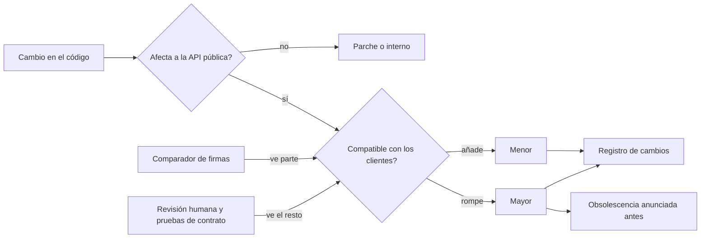
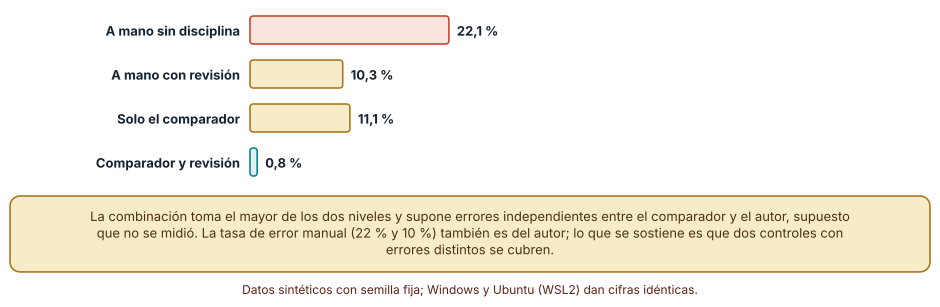

# SE-474 — Versionado, compatibilidad y changelog

[← SE-473 — Firmas, checksums y verificación](https://github.com/vladimiracunadev-create/modern-software-engineering-program/blob/main/classes/part-39-build-release-y-cadena-de-suministro/se-473-firmas-checksums-y-verificacion/README.md) · [↑ Parte 39](https://github.com/vladimiracunadev-create/modern-software-engineering-program/blob/main/classes/part-39-build-release-y-cadena-de-suministro/README.md) · [📚 Índice completo](https://github.com/vladimiracunadev-create/modern-software-engineering-program/blob/main/classes/README.md) · [🌐 Portal](https://vladimiracunadev-create.github.io/modern-software-engineering-program/classes/SE-474.html) · [SE-475 — Feature flags y entrega progresiva →](https://github.com/vladimiracunadev-create/modern-software-engineering-program/blob/main/classes/part-39-build-release-y-cadena-de-suministro/se-475-feature-flags-y-entrega-progresiva/README.md)

## Punto profesional y fundamento pedagógico

**Punto profesional.** La clase existe para que trates un número de versión como lo que es: una **promesa** que hace quien publica a quien depende de su software sobre lo que puede romperse al actualizar. Elegir el número correcto, escribir un registro de cambios que lo justifique y decidir cuándo se retira una funcionalidad son decisiones de compatibilidad, y se equivocan con frecuencia porque el cambio que rompe a un cliente suele ser invisible en la firma de la función.

**Por qué aparece aquí.** Sigue a **Firmas, checksums y verificación**: allí el manifiesto firmado incluyó un nombre, una versión y una secuencia; aquí se establece qué significa esa versión y en qué se diferencia de la secuencia. Precede a las clases de entrega progresiva, que decidirán a quién se le muestra cada versión. El caso conductor es el contrato público de la API de entregas, ahora con un historial de versiones.

**Error conceptual que debe corregir.** Creer que el versionado semántico es una regla que se aplica mirando la firma de las funciones, o que un número menor «es seguro». El número lo decide una persona que juzga el efecto de un cambio sobre los clientes; las herramientas ven la parte sintáctica y se pierden los cambios de comportamiento, que son los que más rompen.

**Secuencia de aprendizaje.** Antes de medir, predices cuántos de catorce cambios típicos de una API reconocería un comparador de firmas con el nivel de versión correcto y qué fracción de cambios se publicaría con un nivel inferior al real con un etiquetado manual; después ejecutas un comparador basado en `ast` sobre cambios reales de una API de cuatro elementos, simulas 3 000 lanzamientos con cuatro políticas de etiquetado y agrupas los cambios por lo que una herramienta puede ver. La secuencia usa predicción, medición de una herramienta y simulación con semilla.

**Evidencia de aprendizaje.** `versionado-log.md` con la predicción, las tres figuras reproducidas, la política de versionado de la API de entregas (qué es API pública, cuándo sube cada número, cómo se deprecia), un registro de cambios del último release y una nota que separe lo que una herramienta ve de lo que debe revisar una persona.

**Límite de la conclusión.** Los catorce cambios son construcciones del autor sobre una API sintética de cuatro elementos públicos; el comparador solo lee firmas de funciones y métodos de Python. Las tasas de error del etiquetado manual (22 % y 10 %) y la independencia entre el comparador y el autor son supuestos. No se analizó ninguna biblioteca real, ningún binario ni ningún protocolo.

### Trazabilidad fuente → afirmación

| Fuente primaria u oficial | Afirmación que respalda | Lo que no prueba |
|---|---|---|
| [Semantic Versioning 2.0.0 (en español)](https://semver.org/lang/es/) | Define MAYOR.MENOR.PARCHE: se incrementa el mayor ante cambios incompatibles de la API pública, el menor ante funcionalidad compatible y el parche ante correcciones compatibles. | No define qué es la API pública de un proyecto concreto ni cómo detectar un cambio incompatible. |
| [Keep a Changelog 1.1.0](https://keepachangelog.com/es-ES/1.1.0/) | Propone un registro de cambios para humanos, por versión y por tipo de cambio (añadido, cambiado, obsoleto, eliminado, corregido, seguridad). | No dice cómo generarlo ni lo hace verdadero. |
| [PEP 440](https://peps.python.org/pep-0440/) | Especifica el formato de versiones de Python y cómo se comparan, que difiere del versionado semántico en detalles como los sufijos. | No exige semántica de compatibilidad. |
| [PEP 387: Backwards Compatibility Policy](https://peps.python.org/pep-0387/) | Describe la política de Python: avisar de la obsolescencia durante al menos dos versiones antes de eliminar. | No es la política de la API de entregas. |
| [Hyrum's Law](https://www.hyrumslaw.com/) | Enuncia que, con suficientes usuarios de una API, cualquier comportamiento observable será usado por alguien, sea o no parte del contrato. | No cuantifica la frecuencia. |
| [Python: módulo ast](https://docs.python.org/3/library/ast.html) | Documenta el árbol sintáctico que usa el comparador para leer las firmas. | No cubre el comportamiento del código. |

## Antes de empezar

Recupera lo aprendido en `SE-473`: el manifiesto firmado liga nombre, versión y secuencia. La pregunta activa es: **¿qué promete el número de versión a quien actualiza y cómo me entero, antes de publicar, de que mi promesa es falsa?**

## Prerrequisitos

- Haber completado `SE-473` o poder explicar la diferencia entre una versión y una secuencia monótona.
- Python 3.11 o posterior; los experimentos usan solo la biblioteca estándar (`ast`, `random`, `collections`).
- Haber visto contratos y compatibilidad de API en la Parte 13.

## Problema auténtico

La API de entregas publica la versión 1.5.0 con una mejora en el listado de entregas: ahora devuelve primero las más recientes. El cambio parece menor y se etiqueta como «menor». Al día siguiente, un cliente de una universidad que tomaba «la primera entrega de la lista» como la más antigua empieza a mostrar calificaciones de la entrega equivocada. La firma de la función no cambió, las pruebas del proyecto pasan, y el registro de cambios decía «mejoras en el listado».

Tres semanas después, el equipo elimina un parámetro deprecado con la versión 2.0.0 y otro cliente, que ignoró los avisos porque estaban en un registro que nadie leía, descubre la ruptura al desplegar.

## Objetivos observables

Al terminar podrás:

1. explicar qué promete cada componente de un número MAYOR.MENOR.PARCHE y qué constituye la API pública de un proyecto;
2. clasificar un cambio como incompatible, compatible con funcionalidad o corrección, y distinguir compatibilidad de código, de datos y de comportamiento;
3. escribir un comparador de firmas con `ast` y decir qué cambios incompatibles no puede ver;
4. combinar un control automático y una revisión humana y calcular cuántos cambios se publican con un nivel inferior al real;
5. redactar un registro de cambios y una política de obsolescencia que los clientes puedan seguir.

## Mapa conceptual



El mapa muestra que el nivel se decide con dos fuentes de información que se complementan: la herramienta que ve la sintaxis y la persona o prueba que ve el comportamiento. La obsolescencia anunciada con antelación suaviza el mayor.

## Temas y por qué importan

| Tema | Por qué cambia una decisión profesional | Evidencia mínima |
|---|---|---|
| Versionado semántico | Es una promesa sobre compatibilidad. | Predicción, traza causal y contraejemplo de **Versionado semántico** en `versionado-log.md` |
| API pública y tipos de compatibilidad | Lo que se promete determina lo que puede romperse. | Predicción, traza causal y contraejemplo de **API pública** en `versionado-log.md` |
| Detección automática y sus límites | Las herramientas ven la firma, no el significado. | Predicción, traza causal y contraejemplo de **Detección** en `versionado-log.md` |
| Registro de cambios | Es el canal por el que el cliente se entera. | Predicción, traza causal y contraejemplo de **Registro de cambios** en `versionado-log.md` |
| Obsolescencia | Convierte una ruptura en una transición. | Predicción, traza causal y contraejemplo de **Obsolescencia** en `versionado-log.md` |

## Conceptos y decisiones

### 1. Versionado semántico como promesa

El **versionado semántico** asigna significado a los tres números de una versión: el **mayor** sube cuando hay cambios incompatibles de la API pública, el **menor** cuando se añade funcionalidad compatible y el **parche** cuando se corrige un error sin cambiar la API. Es una promesa que quien publica hace a quien depende: «si actualizas dentro del mismo mayor, tu código seguirá funcionando». Su valor es que permite expresar rangos de dependencia (`>=1.4,<2`) y automatizar actualizaciones menores. Su debilidad es que depende de que quien publica juzgue bien, y que «compatible» tiene al menos tres sentidos: el código sigue compilando (compatibilidad de código fuente), el binario sigue enlazando (compatibilidad binaria) y el programa se sigue comportando como se esperaba (compatibilidad de comportamiento). Un cambio puede cumplir los dos primeros y violar el tercero.

### 2. API pública y tipos de compatibilidad

La **API pública** es lo que el proyecto promete mantener: funciones y clases documentadas, formatos de entrada y de salida, códigos de error, nombres de campos, orden de los resultados cuando está especificado. Es una decisión de diseño, y en Python no hay un modificador que la marque: se declara con una convención (un guion bajo inicial, una lista `__all__`, la documentación). La compatibilidad de **datos** (un campo que cambia de significado, una escala que pasa de 1–7 a 0–100) y de **comportamiento** (el orden por omisión de un listado, una excepción nueva ante una entrada inválida, un tiempo de espera distinto) forma parte de la promesa aunque la firma no cambie. La ley de Hyrum resume el problema: con suficientes usuarios, todo comportamiento observable será usado por alguien, y lo no documentado también. Declarar explícitamente qué no se promete (el orden, el formato exacto de un mensaje) reduce el área de ruptura.

### 3. Detección automática y sus límites

Un **comparador de firmas** extrae las funciones y métodos públicos de dos versiones y compara sus parámetros: si desaparece un elemento, si cambia el nombre o el orden de un parámetro obligatorio, si se añade uno obligatorio o cambia un valor por omisión, el cambio es incompatible; si se añade un elemento o un parámetro opcional, es compatible con funcionalidad. Es barato, no tiene falsos negativos sobre esas categorías y se puede ejecutar en cada solicitud de integración. Sus límites son dos. Primero, no ve los cambios de **comportamiento** con la firma intacta: una escala distinta, un orden distinto, una excepción nueva. Segundo, puede dar falsas alarmas (hacer opcional un parámetro obligatorio es compatible, pero un comparador conservador lo marca como incompatible). Las pruebas de contrato (Parte 35), los ejemplos ejecutables en la documentación y la revisión humana cubren el comportamiento.

### 4. Registro de cambios

El **registro de cambios** (*changelog*) es el documento por el que el cliente decide si actualizar. Es para humanos, no un volcado del historial de commits: agrupa los cambios por versión y por tipo (añadido, cambiado, obsoleto, eliminado, corregido, seguridad), con la fecha y, para lo incompatible, una guía de migración. Generarlo a partir de mensajes de commit con una convención ayuda a no olvidar cambios, pero la redacción, la clasificación y la advertencia siguen necesitando criterio. Un registro de cambios que dice «mejoras de rendimiento y correcciones» incumple su función. Una entrada útil responde tres preguntas: qué cambió desde el punto de vista del cliente, a quién afecta y qué debe hacer.

### 5. Obsolescencia y ciclo de vida

Una ruptura anunciada es una transición; una ruptura sorpresa es un incidente. La **obsolescencia** (*deprecation*) marca una funcionalidad como pendiente de retiro, con un aviso visible en tiempo de ejecución, una versión en la que se avisa y otra en la que se retira, y la alternativa recomendada. Una política razonable fija una ventana mínima (por ejemplo, avisar durante al menos dos versiones menores o seis meses antes de retirar) y la publica. Además hay que decidir cuánto tiempo se mantienen las versiones antiguas con correcciones de seguridad: sin una fecha de fin de soporte, el ecosistema acumula versiones que nadie arregla. No confundas la **versión** (una promesa semántica, legible) con la **secuencia** de `SE-473` (un contador monótono que usa el verificador para rechazar retrocesos): la primera comunica compatibilidad y la segunda protege contra la repetición.

### Comparador de firmas frente a cambios de una API

Se parte de una API pública de cuatro elementos (subir una entrega, listar entregas, consultar una nota y una clase `Entrega`) y se construyen catorce cambios: añadir, quitar o renombrar, añadir parámetros obligatorios y opcionales, cambiar un valor por omisión, hacer opcional un obligatorio, quitar y añadir métodos, cambiar un interno, cambiar la escala de la nota, el orden del listado, lanzar una excepción nueva y corregir un error. Cada uno tiene un nivel de versión correcto asignado por el autor.

```python
def api(src):
    t = ast.parse(src)
    # nombre -> (parámetros obligatorios, parámetros opcionales con su valor por omisión)
```


**Cómo leer la figura.** Cada fila es un cambio de la API y cada columna un nivel de versión (mayor, menor o parche); el color más oscuro es un nivel más alto. Mira las celdas con borde: ahí el nivel que ve el comparador es distinto del correcto, y las tres últimas filas de cambios invisibles en la firma las ve como parche. **Dónde deja de valer:** los catorce cambios son una muestra del autor y el comparador es una versión sencilla; otros lenguajes con tipos más ricos ven más (tipos de retorno), y Python con anotaciones, algo más. Lo que se sostiene es la frontera: lo que se expresa en la firma lo ve una herramienta; lo que se expresa en el significado, no. La figura omite por espacio dos aciertos (añadir un método a una clase y cambiar un interno privado).

### Qué ve una herramienta

Los catorce cambios se agrupan según lo que una herramienta de firmas puede ver.


**Cómo leer la figura.** Cada barra es un grupo de cambios de la API y su longitud cuántos de los 14 contiene. Mira la segunda barra: tres cambios rompen a los clientes sin que la firma lo diga, y esa es la franja que una herramienta de firmas no puede ver. **Dónde deja de valer:** son porcentajes sobre ocho casos y la proporción real en un proyecto depende de cuánto de su API es sintaxis y cuánto comportamiento. La conclusión robusta es cualitativa: la automatización cubre una parte medible y deja una parte sin cubrir, y esa parte requiere otros controles.

### Etiquetado de 3 000 lanzamientos

Se generan 3 000 lanzamientos con 55 % de parches, 33 % de cambios con funcionalidad y 12 % de incompatibles. El autor etiqueta con error (subestima el nivel con una probabilidad dada), el comparador acierta los incompatibles con la tasa medida arriba (5 de 8), y se prueban cuatro políticas.



**Cómo leer la figura.** Cada barra es el porcentaje de los 1 355 cambios con efecto que se publican con un nivel inferior al real. El comparador solo y la revisión manual cuidadosa tienen tasas parecidas (11,1 % y 10,3 %) por razones distintas; combinarlos, tomando el mayor de los dos niveles, las reduce a 0,8 %. **Dónde deja de valer:** el 22 % y el 10 % de error manual son supuestos del autor, y la combinación supone que los errores del comparador y del autor son independientes, lo que no se midió. Si ambos fallan en los mismos cambios (los de comportamiento), la combinación vale mucho menos. El mensaje es el principio: dos controles con errores distintos se cubren; dos con los mismos errores, no.

## Definiciones de trabajo

- **versionado semántico:** convención de numeración que comunica la compatibilidad mediante MAYOR.MENOR.PARCHE.
- **API pública:** conjunto de interfaces y comportamientos que un proyecto promete mantener.
- **cambio incompatible:** el que puede hacer fallar o cambiar el resultado de un cliente que seguía el contrato.
- **registro de cambios:** documento para humanos que describe qué cambió en cada versión y qué debe hacer el cliente.
- **obsolescencia:** aviso de que una funcionalidad se retirará, con alternativa y plazo.

Las definiciones son operativas para la API de entregas. No convierten términos con una historia más amplia en sinónimos y deben contrastarse con la documentación primaria enlazada al final.

## Ejemplo mínimo

El fragmento compara las firmas de una función en dos versiones. Antes de ejecutarlo, predice qué nivel de versión pide cada cambio.

```python
import ast
def firma(src):
    f = ast.parse(src).body[0]
    return [a.arg for a in f.args.args], len(f.args.defaults)

v1 = "def subir(curso, archivo): pass"
v2 = "def subir(curso, archivo, comentario=None): pass"
v3 = "def subir(curso, archivo, comentario): pass"
print(firma(v1), firma(v2), firma(v3))
```

Pasar de `v1` a `v2` añade un parámetro opcional (menor); pasar a `v3` añade uno obligatorio (mayor). Registra versión de Python, comando y salida; después cambia el cuerpo de la función sin tocar la firma y comprueba que el comparador no lo ve.

## Ejemplo profesional

El equipo escribe una política de versionado de la API de entregas: la API pública son los puntos finales documentados, sus parámetros, sus campos de respuesta, sus códigos de error y el orden de los listados cuando está especificado; el comportamiento no documentado no se promete. Cada solicitud de integración ejecuta el comparador de firmas y las pruebas de contrato, y quien revisa elige el nivel; si hay discrepancia, gana el mayor. Una funcionalidad deprecada emite un aviso en tiempo de ejecución desde la versión que la marca hasta la que la retira, con un mínimo de dos versiones menores y seis meses. El registro de cambios sigue un formato fijo con una sección de migración para cada mayor. Las versiones con correcciones de seguridad se declaran en una tabla de soporte con fechas.

## Práctica guiada

1. Define la API pública de una pequeña biblioteca (cuatro elementos) y escribe sus catorce cambios típicos con el nivel correcto de cada uno.
2. Predice cuántos acierta un comparador de firmas y escríbelo antes de medir.
3. Escribe el comparador con `ast` y ejecútalo sobre los catorce cambios.
4. Agrupa los cambios por lo que la herramienta ve y calcula la proporción de incompatibles invisibles.
5. Simula 3 000 lanzamientos con cuatro políticas de etiquetado y completa la tabla, declarando tus tasas de error.
6. Redacta la política de versionado y obsolescencia de la API de entregas y el registro de cambios del último release.
7. Entrega `versionado-log.md` y pide a otra persona que encuentre un cambio incompatible que tu política no marque.

## Ejercicios

1. **Clasificar:** un listado pasa de devolver 20 elementos por página a devolver 50; decide el nivel de versión y justifica qué tipo de compatibilidad afecta.
2. **Detectar:** escribe un cambio de comportamiento que mantenga la firma y rompa a un cliente razonable; describe qué prueba de contrato lo habría detectado.
3. **Registrar:** redacta la entrada del registro de cambios para la eliminación de un parámetro deprecado, con alternativa y plazo.
4. **Deprecar:** diseña el aviso en tiempo de ejecución de una función deprecada (mensaje, versión de retiro, nivel de aviso) usando el módulo `warnings`.

## Reto verificable

Entrega `versionado-log.md` con la predicción, las tres tablas, la política de versionado y obsolescencia de la API de entregas y el registro de cambios de un release. Se aprueba si otra persona ejecuta el comparador desde un checkout limpio, obtiene las mismas cifras y puede decir qué cambio incompatible pasaría tu política sin marcarse. No se aprueba por afirmar que «seguimos versionado semántico» sin definir la API pública ni por un registro de cambios que se limita a copiar los mensajes de commit.

## Caso conductor

La API de entregas es el caso conductor de la Parte 39. Esta clase deja el sexto artefacto: una política de versionado, compatibilidad y obsolescencia con un registro de cambios. `SE-475` tratará cómo se expone un cambio a una parte de los usuarios antes de declararlo disponible para todos: banderas y entrega progresiva. Cambia después un solo dato, la proporción de cambios de comportamiento, y observa cuánto vale el comparador.

## Preguntas frecuentes

### ¿Hay que seguir el versionado semántico estrictamente?

Si publicas una biblioteca o una API que otros consumen, es lo más útil porque habilita rangos y actualizaciones automáticas. Para una aplicación sin consumidores externos, el número puede ser una fecha o un contador; lo importante es que sea monótono y que el registro de cambios sea veraz.

### ¿Qué hago con los cambios de comportamiento que la firma no muestra?

Trátalos como parte de la API si los clientes pueden depender de ellos y documenta lo que no prometes. Cúbrelos con pruebas de contrato y ejemplos ejecutables, y revisa en cada integración si el cambio altera orden, formatos, escalas, errores o tiempos.

### ¿Un parche puede romper a un cliente?

Sí, y ocurre: una corrección cambia un comportamiento del que alguien dependía. La ley de Hyrum lo describe. La mitigación no es negar el caso sino declarar qué se promete y mantener una vía rápida de retroceso.

### ¿La versión y la secuencia son lo mismo?

No. La versión comunica compatibilidad a las personas y a las herramientas de dependencias. La secuencia es un contador monótono firmado que usa el verificador para rechazar el retroceso. Normalmente avanzan juntas, pero una republicación de contenido antiguo (para un retroceso controlado) lleva una versión nueva y una secuencia mayor.

## Fallo controlado y diagnóstico

Reproduce el fallo clásico de la clase: **un cambio de comportamiento publicado como menor que rompe a un cliente**. Cambia el orden por omisión del listado manteniendo la firma.

Registra síntoma, entrada mínima, hipótesis, observación que descarta cada hipótesis, causa, corrección y prueba de regresión. **Síntoma:** un cliente muestra la entrega equivocada tras actualizar a una versión menor. **Hipótesis rivales:** (a) el cliente usó mal la API; (b) hay un error en el servidor; (c) el comportamiento por omisión cambió y no estaba documentado como promesa. **Prueba:** ejecuta el comparador de firmas (no ve nada) y una prueba de contrato sobre el orden del listado (falla); si la segunda falla, la causa es (c). **Conclusión:** el cambio era incompatible y la herramienta no lo ve. **Regresión:** añade la prueba de contrato del orden, documenta si el orden se promete o no y, si no se promete, hazlo explícito en la documentación y en el registro de cambios.

## Errores comunes y cómo corregirlos

| Síntoma | Causa probable | Corrección |
|---|---|---|
| Un cliente se rompe tras un cambio menor | Cambio de comportamiento con la firma intacta | Pruebas de contrato y revisión del comportamiento observable |
| El número de versión no dice nada | API pública no definida | Declarar la API pública y lo que no se promete |
| Los clientes no se enteran de una ruptura | Registro de cambios genérico o sin aviso previo | Formato fijo, guía de migración y obsolescencia anunciada |
| Versiones antiguas sin correcciones circulan por años | Sin política de fin de soporte | Tabla de versiones soportadas con fechas |
| Se confunde la secuencia firmada con la versión | Dos conceptos tratados como uno | Versión para compatibilidad, secuencia para frescura |

## Entorno y archivos clave

```text
work/SE-474/
├── README.md
├── versionado/
│   ├── api.py
│   ├── comparador.py
│   └── etiquetado.py
├── CHANGELOG.md
├── tests/test_versionado.py
└── evidence/versionado-log.md
```

El `README` declara plataforma, versión de Python, semillas y comandos. Los experimentos usan solo la biblioteca estándar y se ejecutaron con CPython 3.12.9 en Windows 11 y 3.12.3 en Ubuntu bajo WSL2 con salidas idénticas, porque no dependen del reloj ni del sistema. Si añades una herramienta real de comparación de APIs, fija su versión. El código completo del experimento está en `scripts/experiments_part39/e402.py` y se ejecuta con `python scripts/experiments_part39/e402.py`.

## Seguridad, ética y accesibilidad

- una ruptura no anunciada puede dejar fuera de servicio a quien depende de tu API: es un riesgo para personas, no solo una molestia técnica; avisa con antelación y por un canal que lean;
- las correcciones de seguridad son el caso en que se acepta romper antes: documenta la excepción y comunícala con claridad;
- no ocultes en el registro de cambios una vulnerabilidad corregida; el aviso responsable protege a quien actualiza;
- escribe el registro de cambios en un formato recorrible con lector de pantalla y sin depender de color o iconos;
- respeta las licencias de las bibliotecas de comparación y atribuye lo adaptado.

## Puente hacia el trabajo con agentes

Un agente al que se le pide «prepara el release» incrementará el parche por defecto, generará el registro de cambios a partir de los mensajes de commit y afirmará que el cambio es compatible porque las pruebas pasan. Pídele en cambio que ejecute el comparador de firmas, que busque cambios de comportamiento (orden, formato, escala, errores), que proponga el nivel con su justificación y que redacte la entrada del registro de cambios con la acción que debe hacer el cliente. Revisa especialmente si trata «las pruebas pasan» como prueba de compatibilidad y si se limita a copiar los mensajes de commit.

## Transferencia

Traslada el análisis a otra API (un protocolo, un formato de archivo, un esquema de base de datos): cambia qué se considera público y qué herramienta compara y conserva el procedimiento de definir la promesa, detectar lo sintáctico automáticamente, cubrir lo semántico con pruebas y revisión, registrar los cambios para humanos y anunciar las retiradas. La transferencia está lograda cuando puedes decir qué parte de la compatibilidad de la nueva API ve tu herramienta y cuál no.

## Evaluación y evidencia

| Criterio | Evidencia para aprobar |
|---|---|
| comprensión | explicación de qué promete cada número y de los tres sentidos de compatibilidad |
| corrección | tablas del comparador, la agrupación y el etiquetado reproducibles con las mismas semillas |
| diseño | política con API pública definida, controles combinados, registro de cambios y obsolescencia |
| diagnóstico | reproducción del fallo «cambio de comportamiento como menor» con regresión de contrato |
| incertidumbre | declaración de que los catorce cambios y las tasas de error son del autor y de que la independencia no se midió |
| reproducibilidad | versiones, comandos, salida y límites declarados |

## Fuentes

- [Semantic Versioning 2.0.0](https://semver.org/lang/es/) — significado de los componentes de la versión; autoridad: especificación de Tom Preston-Werner.
- [Keep a Changelog 1.1.0](https://keepachangelog.com/es-ES/1.1.0/) — registro de cambios para humanos; autoridad: proyecto Keep a Changelog.
- [PEP 440](https://peps.python.org/pep-0440/) — versiones en Python; autoridad: Python Enhancement Proposals.
- [PEP 387](https://peps.python.org/pep-0387/) — política de compatibilidad hacia atrás de Python; autoridad: Python Enhancement Proposals.
- [Hyrum's Law](https://www.hyrumslaw.com/) — dependencia de comportamientos no documentados; autoridad: autor de la formulación.
- [Python: ast](https://docs.python.org/3/library/ast.html) — árbol sintáctico; autoridad: documentación de Python.

Cada fuente respalda el mecanismo indicado; ninguna demuestra que 10 de 14, el 37,5 % de incompatibles invisibles o el 0,8 % se observen en tu API. Esa afirmación depende de tu contrato y de tus clientes.

## Límites y siguiente paso

Se ejecutaron tres experimentos con una API sintética de cuatro elementos, catorce cambios construidos por el autor y 3 000 lanzamientos simulados con semilla fija, con resultados idénticos en Windows 11 (CPython 3.12.9) y Ubuntu bajo WSL2 (3.12.3). El comparador solo lee firmas de Python; las tasas de error del etiquetado manual y la independencia entre comparador y autor son supuestos; no se analizó ninguna biblioteca real. La siguiente clase se ocupa de otra forma de controlar el efecto de un cambio: ponerlo detrás de una bandera y exponerlo gradualmente.

## Glosario

- **versionado semántico:** convención de numeración que comunica la compatibilidad mediante MAYOR.MENOR.PARCHE.
- **API pública:** conjunto de interfaces y comportamientos que un proyecto promete mantener.
- **cambio incompatible:** el que puede hacer fallar o cambiar el resultado de un cliente que seguía el contrato.
- **registro de cambios:** documento para humanos que describe qué cambió en cada versión y qué debe hacer el cliente.
- **obsolescencia:** aviso de que una funcionalidad se retirará, con alternativa y plazo.

---

[← SE-473 — Firmas, checksums y verificación](https://github.com/vladimiracunadev-create/modern-software-engineering-program/blob/main/classes/part-39-build-release-y-cadena-de-suministro/se-473-firmas-checksums-y-verificacion/README.md) · [↑ Parte 39](https://github.com/vladimiracunadev-create/modern-software-engineering-program/blob/main/classes/part-39-build-release-y-cadena-de-suministro/README.md) · [📚 Índice completo](https://github.com/vladimiracunadev-create/modern-software-engineering-program/blob/main/classes/README.md) · [🌐 Portal](https://vladimiracunadev-create.github.io/modern-software-engineering-program/classes/SE-474.html) · [SE-475 — Feature flags y entrega progresiva →](https://github.com/vladimiracunadev-create/modern-software-engineering-program/blob/main/classes/part-39-build-release-y-cadena-de-suministro/se-475-feature-flags-y-entrega-progresiva/README.md)
