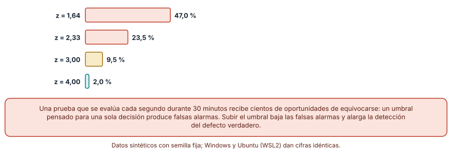

# SE-476 — Canary, blue-green y rollback

[← SE-475 — Feature flags y entrega progresiva](https://github.com/vladimiracunadev-create/modern-software-engineering-program/blob/main/classes/part-39-build-release-y-cadena-de-suministro/se-475-feature-flags-y-entrega-progresiva/README.md) · [↑ Parte 39](https://github.com/vladimiracunadev-create/modern-software-engineering-program/blob/main/classes/part-39-build-release-y-cadena-de-suministro/README.md) · [📚 Índice completo](https://github.com/vladimiracunadev-create/modern-software-engineering-program/blob/main/classes/README.md) · [🌐 Portal](https://vladimiracunadev-create.github.io/modern-software-engineering-program/classes/SE-476.html) · [SE-477 — Instaladores, paquetes y actualizaciones →](https://github.com/vladimiracunadev-create/modern-software-engineering-program/blob/main/classes/part-39-build-release-y-cadena-de-suministro/se-477-instaladores-paquetes-y-actualizaciones/README.md)

## Punto profesional y fundamento pedagógico

**Punto profesional.** La clase existe para que decidas cómo llevar una versión nueva a producción de forma que un defecto dañe a pocas personas, se detecte pronto y se pueda deshacer. Un despliegue **canary** envía una fracción del tráfico a la versión nueva y compara; **blue-green** mantiene dos entornos completos y cambia el tráfico de uno a otro; el **retroceso** (*rollback*) vuelve a la versión anterior. Las tres técnicas se apoyan en una decisión estadística («¿es peor la versión nueva?») y en una decisión de datos («¿puedo volver sin perder nada?»), y las dos se hacen mal con facilidad.

**Por qué aparece aquí.** Sigue a **Feature flags y entrega progresiva**: allí la exposición gradual se controlaba en el código; aquí se controla en la infraestructura, con la versión completa. Precede a las clases sobre instaladores y sobre riesgos de CI. El caso conductor es la API de entregas: la versión 1.5.0 debe llegar a producción con 400 solicitudes por segundo y un porcentaje de error de base del 0,5 %.

**Error conceptual que debe corregir.** Creer que «el canary pasó» significa «la versión es buena» o que el retroceso es siempre un cambio de ruta. El canary solo detecta lo que su métrica y su tamaño pueden distinguir del ruido durante la ventana observada, y el retroceso es un cambio de ruta solo si los datos que escribió la versión nueva son legibles por la anterior.

**Secuencia de aprendizaje.** Antes de medir, predices cuántos segundos tarda un canario del 1 % en detectar un defecto que triplica el error y cuántas reversiones innecesarias produce una prueba estadística evaluada cada segundo; después simulas defectos de distinto tamaño con cinco tamaños de canario, mides las falsas alarmas por umbral y estimas cuándo es posible volver atrás tras una migración. La secuencia usa predicción, simulación en tiempo virtual con semilla fija y un análisis de la reversibilidad de los datos.

**Evidencia de aprendizaje.** `rollout-log.md` con la predicción, las tres figuras reproducidas, la política de despliegue de la API de entregas (fracciones, duración mínima, métricas, umbral, quién puede abortar) y la regla de migraciones compatibles que hace posible el retroceso.

**Límite de la conclusión.** Las solicitudes, los errores y el tiempo son virtuales, con semilla fija y una prueba de dos proporciones aproximada; la «versión nueva» tiene una tasa de error constante y el «tráfico» llega a ritmo uniforme. No se desplegó nada, no se usó ningún balanceador, malla de servicio ni herramienta de despliegue progresivo, y no se midieron latencias, que suelen ser la métrica decisiva. Las probabilidades de la parte de datos (80 % de escritura con el esquema nuevo) son supuestos del autor.

### Trazabilidad fuente → afirmación

| Fuente primaria u oficial | Afirmación que respalda | Lo que no prueba |
|---|---|---|
| [Fowler, «CanaryRelease»](https://martinfowler.com/bliki/CanaryRelease.html) | Describe el despliegue de una versión nueva a un subconjunto de usuarios antes de extenderla a todos. | No dice qué fracción ni cuánto tiempo usar. |
| [Fowler, «BlueGreenDeployment»](https://martinfowler.com/bliki/BlueGreenDeployment.html) | Describe dos entornos de producción idénticos y el cambio de tráfico entre ellos, con el retroceso como vuelta al entorno anterior. | No resuelve la compatibilidad de la base de datos compartida. |
| [Google SRE Workbook: Canarying Releases](https://sre.google/workbook/canarying-releases/) | Explica cómo elegir la población, la duración y las métricas de un canario y cómo evaluar la señal frente al ruido. | No fija los valores de la API de entregas. |
| [Fowler, «ParallelChange» (expandir y contraer)](https://martinfowler.com/bliki/ParallelChange.html) | Propone cambiar una interfaz en tres fases (expandir, migrar, contraer) para que ambas versiones convivan. | No cubre todos los tipos de cambio de datos. |
| [Google SRE: Release Engineering](https://sre.google/sre-book/release-engineering/) | Sitúa el despliegue progresivo y el retroceso en el proceso de entrega. | No cuantifica el efecto sobre la tasa de incidentes. |

## Antes de empezar

Recupera lo aprendido en `SE-475`: una bandera permite exponer un cambio a una parte de las personas y apagarlo sin desplegar. La pregunta activa es: **¿cómo llevo una versión completa a producción exponiendo a pocas personas, decidiendo con datos que son ruidosos, y cómo vuelvo si algo va mal?**

## Prerrequisitos

- Haber completado `SE-475` o poder explicar qué es una segmentación consistente.
- Python 3.11 o posterior; los experimentos usan solo la biblioteca estándar (`random`, `math`, `statistics`).
- Conocer a nivel básico qué es una proporción y una prueba de hipótesis (un valor z).

## Problema auténtico

La plataforma despliega la versión 1.5.0 en todos los servidores a la vez un martes por la mañana. En dos minutos, el error sube del 0,5 % al 1,5 %: un defecto en la gestión de adjuntos. El equipo tarda doce minutos en reconocer el patrón, veinte en decidir el retroceso y cinco en ejecutarlo, y para entonces 80 000 solicitudes habían fallado. Al volver a la versión anterior descubre que durante esos treinta y siete minutos se escribieron registros con un esquema nuevo que la versión anterior no entiende, y hay que repararlos a mano.

La semana siguiente, el mismo equipo prueba con un canario del 5 % y un umbral muy sensible; el sistema revierte tres veces en una hora sin que haya defecto alguno.

## Objetivos observables

Al terminar podrás:

1. distinguir despliegue por oleadas, canary, blue-green y sombra, y decir qué riesgo reduce cada uno;
2. decidir si una versión nueva es peor con una prueba estadística, con su umbral, su ventana y su tasa de falsas alarmas;
3. elegir el tamaño del canario como un compromiso entre usuarios expuestos y tiempo de detección;
4. determinar si un retroceso es posible a partir de la compatibilidad de los datos y aplicar el patrón expandir y contraer;
5. escribir criterios de abortar y de promover que una persona de guardia pueda aplicar sin consultar.

## Mapa conceptual


El mapa muestra tres salidas del canario: revertir, esperar o promover. El rombo final marca el límite del retroceso: el tráfico se puede redirigir en segundos, los datos escritos no.

## Temas y por qué importan

| Tema | Por qué cambia una decisión profesional | Evidencia mínima |
|---|---|---|
| Estrategias de despliegue | Cada una reduce un riesgo distinto. | Predicción, traza causal y contraejemplo de **Estrategias** en `rollout-log.md` |
| Decisión estadística | Con ruido, el umbral decide las falsas alarmas. | Predicción, traza causal y contraejemplo de **Decisión estadística** en `rollout-log.md` |
| Tamaño y duración del canario | Menos exposición implica más tiempo. | Predicción, traza causal y contraejemplo de **Tamaño del canario** en `rollout-log.md` |
| Retroceso y datos | Volver atrás exige datos compatibles. | Predicción, traza causal y contraejemplo de **Retroceso y datos** en `rollout-log.md` |
| Criterios de abortar | Decisiones previas evitan dudar en un incidente. | Predicción, traza causal y contraejemplo de **Criterios** en `rollout-log.md` |

## Conceptos y decisiones

### 1. Estrategias de despliegue

Un despliegue **por oleadas** (*rolling*) reemplaza servidores en lotes: el riesgo se reparte en el tiempo, pero ambas versiones conviven y el retroceso es otra oleada. **Blue-green** mantiene dos entornos completos; el tráfico se dirige a uno, y el otro recibe la versión nueva y se prueba sin usuarios; el cambio es instantáneo y el retroceso, volver a dirigir el tráfico, pero el cambio expone a todas las personas a la vez y el coste es doble infraestructura. **Canary** dirige una fracción pequeña del tráfico a la versión nueva y compara con la anterior en paralelo; reduce el número de personas expuestas al defecto y obtiene evidencia con tráfico real. El **tráfico en sombra** envía copias de las solicitudes reales a la versión nueva sin devolver su respuesta; no expone a nadie, pero no prueba los efectos secundarios y puede duplicar escrituras si no se aísla. Se combinan: blue-green para el cambio, canary para la fracción inicial.

### 2. Decidir con ruido

La pregunta del canario es estadística: ¿la tasa de error de la versión nueva es **mayor** que la de la anterior, o es una fluctuación? Una prueba de dos proporciones calcula un valor z a partir de los errores y las solicitudes de cada grupo; si supera un umbral, se declara peor. El umbral fija el equilibrio entre dos errores: bajo, y se revierte sin defecto (falsa alarma); alto, y tarda más en declararse un defecto real o no se declara uno pequeño. Hay un detalle que se pasa por alto: si la prueba se evalúa cada segundo durante media hora, hay cientos de oportunidades de equivocarse, y un umbral pensado para una sola decisión (z = 1,64, un 5 %) produce reversiones continuas. Hay que fijar de antemano la métrica, el umbral, la duración mínima y cuántas veces se evalúa, o usar métodos secuenciales diseñados para ese uso.

### 3. Tamaño y duración del canario

Con una fracción pequeña, el canario recibe pocas solicitudes por segundo y tarda más en reunir evidencia; con una fracción grande detecta rápido, pero si el defecto es real daña a más personas. El número de personas dañadas hasta la detección es aproximadamente la tasa de errores extra por la fracción por el tiempo de detección; como el tiempo baja más lento que la fracción sube (el tamaño de muestra necesario crece con el cuadrado de la precisión), una fracción pequeña casi siempre daña a menos personas. La **magnitud del defecto** importa más que el tamaño del canario: un aumento de error de 0,1 puntos puede ser indistinguible del ruido en media hora con un 5 % del tráfico, mientras que uno de 1 punto se ve en segundos. Por eso una ventana mínima y un tamaño acordes con el defecto más pequeño que importa son decisiones de diseño, y la ausencia de alarma no es ausencia de defecto.

### 4. Retroceso y datos

El tráfico se redirige en segundos; los datos no. Si la versión nueva escribió registros con un esquema que la anterior no puede leer, volver atrás deja datos que nadie entiende, o los corrompe. El patrón **expandir y contraer** (*parallel change*) evita el problema separando el cambio en tres fases desplegadas por separado. Se **expande**: la base admite ambos esquemas (se añade la columna nueva, nullable) y la versión nueva escribe en los dos. Se **migra**: se copian los datos antiguos al formato nuevo y las lecturas pasan al nuevo. Se **contrae**: cuando ninguna versión desplegable lee lo antiguo, se retira. En las dos primeras fases el retroceso es seguro porque la versión anterior sigue entendiendo lo que se escribió. Un cambio destructivo en el mismo despliegue (renombrar o borrar una columna) hace el retroceso imposible o costoso desde el primer escrito.

### 5. Criterios de abortar y de promover

Una persona de guardia a las tres de la mañana no debería decidir un umbral. Los criterios se escriben antes: qué métricas (errores, latencia en percentiles, saturación, indicadores de negocio), con qué comparación (contra la versión anterior en paralelo, no contra ayer), en qué ventana mínima, qué fracción y qué paso sigue. Se añaden **barandillas** automáticas (un tope de error absoluto que revierte sin esperar la prueba estadística) y reglas humanas (quién puede abortar sin consultar y que abortar nunca se sanciona). Los criterios de promover son tan importantes como los de abortar: promover al 100 % solo si el canario observó la ventana completa, incluyendo los segmentos relevantes (un tipo de dispositivo, una región, un cliente grande) y un ciclo del uso (los cierres de plazo de la plataforma).

### Tiempo hasta detectar

Con 400 solicitudes por segundo, un error de base del 0,5 % y un defecto que lo sube al 1,5 %, se simulan 40 semillas para cinco fracciones de tráfico del canario y una prueba de dos proporciones con z = 3, evaluada cada segundo durante 30 minutos. Se cuentan los errores extra que sufren las personas antes de la detección.

```python
p = (e_c + e_b) / (n_c + n_b)
se = math.sqrt(p * (1 - p) * (1 / n_c + 1 / n_b))
detectar = (e_c / n_c - e_b / n_b) / se > z
```


**Cómo leer la figura.** El eje horizontal es la fracción de tráfico del canario y el vertical el tiempo hasta detectar, los dos en escala logarítmica. La línea turquesa es la mediana y la coral el percentil 95. Mira cómo se cierran las dos líneas: con más tráfico la detección es más rápida y la cola se acorta de 268 a 17 segundos. **Dónde deja de valer:** el defecto es un aumento constante y el tráfico llega de forma uniforme; con tráfico en ráfagas, o con un defecto que solo aparece en algunos segmentos o tras un tiempo (una fuga de memoria), el tiempo de detección es otro. Los valores son medianas de 40 semillas y los percentiles altos tienen más incertidumbre.

### Falsas alarmas

Sin ningún defecto (error del 0,5 % en ambas versiones), se evalúa la prueba cada segundo durante 30 minutos con un canario del 5 % y se cuenta cuántos de 200 episodios terminan en reversión, según el umbral z.



**Cómo leer la figura.** Cada barra es el porcentaje de episodios sin defecto que acaban en una reversión innecesaria. Un umbral del 5 % para una sola decisión revierte el 47 % de los episodios porque se evalúa 1 800 veces. **Dónde deja de valer:** las evaluaciones consecutivas están correlacionadas, de modo que no son 1 800 pruebas independientes; aun así, el efecto es grande. Subir el umbral baja las falsas alarmas y alarga la detección del defecto real: la figura siguiente muestra a qué precio. Existen pruebas secuenciales diseñadas para este uso, que no se evaluaron aquí.

### Tamaño del defecto y retroceso

Con un canario del 5 %, se simulan defectos que suben el error entre 0,1 y 2 puntos y se cuenta cuántas de 40 semillas los detectan en 30 minutos.


**Cómo leer la figura.** El eje horizontal es cuánto sube el error y el vertical la mediana de detección, los dos en escala logarítmica. Mira la caída: cada vez que el defecto se duplica el tiempo baja varias veces, y el defecto pequeño, de 0,10 puntos, se detecta solo en 22 de 40 semillas. **Dónde deja de valer:** el nivel más bajo, +0,1 puntos, solo se detecta en 22 de 40 casos: existe un defecto que este canario y esta ventana no ven, y quien lo ignora cree que su umbral protege más de lo que protege. Para la parte de datos, se simularon 1 000 retrocesos en los que la versión nueva escribió con el esquema nuevo con una probabilidad del 80 %: con expandir y contraer el retroceso sin pérdida fue posible en el 100 % de los casos, con una migración destructiva en el mismo despliegue, en el 18,5 %. El 80 % es un supuesto del autor; la diferencia entre un patrón que lo permite y uno que no es lo que importa.

## Definiciones de trabajo

- **canary:** despliegue de una versión nueva a una fracción pequeña del tráfico para compararla con la anterior.
- **blue-green:** despliegue con dos entornos completos entre los que se cambia el tráfico.
- **retroceso (rollback):** vuelta a la versión anterior tras detectar un problema.
- **línea base:** comportamiento de la versión anterior, medido en paralelo, contra el que se compara el canario.
- **expandir y contraer:** patrón de cambio de datos en tres fases en el que ambas versiones coexisten.

Las definiciones son operativas para la API de entregas. No convierten términos con una historia más amplia en sinónimos y deben contrastarse con la documentación primaria enlazada al final.

## Ejemplo mínimo

El fragmento calcula si un canario con 12 errores en 1 000 solicitudes es peor que una línea base con 50 errores en 19 000. Antes de ejecutarlo, predice si supera el umbral z = 3.

```python
import math
ec, nc, eb, nb = 12, 1000, 50, 19000
p = (ec + eb) / (nc + nb)
z = (ec / nc - eb / nb) / math.sqrt(p * (1 - p) * (1 / nc + 1 / nb))
print(round(z, 2), z > 3)
```

El canario tiene 1,2 % de error frente al 0,26 % de la línea base y el valor z es 5,19: se declara peor. Registra versión de Python, comando y salida; después reduce el canario a 100 solicitudes con 1 error y comprueba que la prueba no concluye nada.

## Ejemplo profesional

El equipo de la API de entregas despliega cada versión en cuatro fases: 1 % durante diez minutos, 5 % durante veinte, 25 % durante treinta y 100 % con la versión anterior conservada una hora. Las métricas son la tasa de error y el percentil 99 de la latencia, comparadas en paralelo con la versión anterior; el umbral es z = 4 con un mínimo de 2 000 solicitudes por fase, una barandilla automática que revierte si el error absoluto del canario supera el 5 % y la regla de que cualquier persona de guardia puede abortar. Ninguna migración destructiva se despliega junto con el código que la usa: las migraciones siguen el patrón expandir y contraer, con una fase por despliegue. Los cierres de plazo se evitan como ventanas de despliegue, y cada fase termina solo si el canario observó un segmento representativo de usuarios.

## Práctica guiada

1. Escribe un simulador de tráfico (400 solicitudes por segundo, 0,5 % de error) y una prueba de dos proporciones.
2. Predice cuánto tarda un canario del 1 % en detectar un defecto que triplica el error y escríbelo antes de medir.
3. Simula 40 semillas con cinco fracciones y completa la tabla de tiempos y errores extra.
4. Mide las falsas alarmas sin defecto para cuatro umbrales z con 200 episodios cada uno.
5. Barre el tamaño del defecto entre 0,1 y 2 puntos y localiza el menor que tu canario detecta en 30 minutos.
6. Diseña una migración de una columna en tres despliegues (expandir, migrar, contraer) y comprueba en cada fase que el retroceso es posible.
7. Entrega `rollout-log.md` con los criterios de abortar y promover y pide a otra persona que proponga un defecto que tu canario no vea.

## Ejercicios

1. **Muestra:** con 400 solicitudes por segundo y un canario del 2 %, calcula cuántas solicitudes recibe en un minuto y si basta para distinguir 0,5 % de 1 % de error.
2. **Umbral:** elige un umbral z para evaluar la prueba cada segundo durante 30 minutos con una tolerancia de una reversión innecesaria por cada diez despliegues; justifica el valor con el experimento.
3. **Datos:** renombrar una columna de `nota` a `calificacion`: escribe las tres fases que lo hacen reversible.
4. **Barandilla:** define una regla automática que revierta sin esperar la prueba estadística y explica qué defecto atrapa que la prueba tardaría en ver.

## Reto verificable

Entrega `rollout-log.md` con la predicción, las tres tablas, la política de despliegue progresivo de la API de entregas y el plan de migración en tres fases. Se aprueba si otra persona ejecuta el simulador desde un checkout limpio, obtiene las mismas cifras con las mismas semillas y puede decir qué aumento de error mínimo detecta tu política en la ventana y qué harías con uno menor. No se aprueba por afirmar «hacemos canary» sin umbral, ventana ni línea base, ni por desplegar una migración destructiva junto al código que la usa.

## Caso conductor

La API de entregas es el caso conductor de la [Parte 39](../README.md). Esta clase deja el octavo artefacto: una política de despliegue progresivo con criterios de abortar y una regla de migraciones reversibles. `SE-477` tratará lo que el servidor no controla: instaladores y actualizaciones en el equipo de la persona usuaria. Cambia después un solo dato, la fracción del canario, y observa cuántas personas se dañan antes de la detección.

## Preguntas frecuentes

### ¿Canary o blue-green?

Responden preguntas distintas. Blue-green da un cambio y un retroceso instantáneos y permite probar el entorno nuevo sin usuarios; no limita la exposición una vez hecho el cambio. Canary limita la exposición y obtiene evidencia con tráfico real. Se combinan: se prueba el entorno verde, se envía una fracción pequeña y se promueve por fases.

### ¿Cuánto tiempo debe durar un canario?

Lo bastante para reunir la muestra que distinga el defecto más pequeño que importa del ruido, y para cubrir los ciclos de uso relevantes (picos, tareas programadas, cierres de plazo). Una duración fija sin referencia a la señal es una costumbre, no una decisión.

### ¿Qué métricas compara un canario?

Las que representan lo que las personas perciben: tasa de errores, latencia en percentiles altos y saturación, más indicadores de negocio cuando existan. Una métrica que solo cambia con retraso (una caída de retención) no sirve en una ventana de minutos.

### ¿Puedo retroceder siempre?

No: el tráfico sí, los datos solo si la versión anterior entiende lo que escribió la nueva. Una migración destructiva, un cambio de formato en un mensaje ya publicado o una operación externa (un correo enviado, un pago) no se deshacen redirigiendo el tráfico. En esos casos la protección es la compatibilidad y la compensación, no el retroceso.

## Fallo controlado y diagnóstico

Reproduce el fallo clásico de la clase: **un canario que revierte sin defecto porque la prueba se evalúa cada segundo con un umbral pensado para una sola decisión**. Evalúa la prueba cada segundo con z = 1,64 durante 30 minutos sin ningún defecto.

Registra síntoma, entrada mínima, hipótesis, observación que descarta cada hipótesis, causa, corrección y prueba de regresión. **Síntoma:** el sistema revierte despliegues buenos, aproximadamente la mitad de las veces. **Hipótesis rivales:** (a) las versiones tienen defectos reales que nadie ve; (b) la línea base es ruidosa; (c) la prueba se evalúa muchas veces con un umbral de una sola decisión. **Prueba:** ejecuta 200 episodios sin defecto; si la fracción de reversiones es de decenas por ciento, la causa es (c). **Conclusión:** el umbral no es adecuado para evaluación repetida. **Regresión:** sube el umbral o usa una prueba secuencial, añade un mínimo de solicitudes antes de evaluar, y deja la tasa de falsas alarmas medida como criterio de aceptación de la política.

## Errores comunes y cómo corregirlos

| Síntoma | Causa probable | Corrección |
|---|---|---|
| El despliegue se revierte sin defecto | Umbral de decisión única evaluado repetidamente | Umbral mayor, mínimo de muestra o prueba secuencial |
| Un defecto pequeño no se detecta | Canario y ventana insuficientes | Definir el defecto mínimo relevante y dimensionar para él |
| Tras revertir hay datos ilegibles | Migración destructiva con el despliegue | Expandir y contraer en despliegues separados |
| Se promueve y falla en un segmento | El canario no cubrió el segmento | Incluir segmentos y ciclos de uso en la ventana |
| Nadie se atreve a abortar | Criterios ambiguos o cultura de culpa | Criterios escritos antes y abortar sin sanción |

## Entorno y archivos clave

```text
work/SE-476/
├── README.md
├── rollout/
│   ├── simulador.py
│   ├── umbrales.py
│   └── datos.py
├── politica-despliegue.md
├── tests/test_rollout.py
└── evidence/rollout-log.md
```

El `README` declara plataforma, versión de Python, semillas y comandos. El simulador usa solo la biblioteca estándar y tiempo virtual: no hay red ni reloj, y los resultados fueron idénticos en CPython 3.12.9 (Windows 11) y 3.12.3 (Ubuntu bajo WSL2). Si añades una herramienta real de despliegue progresivo, fija su versión y declara cómo mide. El código completo del experimento está en `scripts/experiments_part39/e404.py` y se ejecuta con `python scripts/experiments_part39/e404.py`.

## Seguridad, ética y accesibilidad

- un canario expone a personas reales a una versión posiblemente defectuosa: elige la población con criterio, evita exponer primero a quienes tienen más que perder (clientes críticos) y evita ventanas sensibles;
- una versión que corrige una vulnerabilidad no debe esperar a una ventana larga si el riesgo de no desplegar es mayor; documenta esa excepción;
- el tráfico en sombra copia datos reales: aplica las mismas protecciones de privacidad y no dupliques efectos secundarios;
- los paneles y alertas del despliegue deben ser comprensibles con lector de pantalla y sin depender solo del color;
- respeta las licencias de las herramientas de despliegue y atribuye lo adaptado.

## Puente hacia el trabajo con agentes

Un agente al que se le pide «despliega con canary» escribirá una configuración con 10 % durante cinco minutos, comparará con «ayer» y activará la reversión con un umbral de una sola decisión. Pídele en cambio que defina el defecto mínimo que importa, que dimensione la fracción y la ventana con una simulación, que compare en paralelo con la versión anterior, que mida las falsas alarmas y que verifique que la migración sigue el patrón expandir y contraer. Revisa especialmente si ignora los segmentos, si usa una línea base de otro periodo y si despliega a la vez el código y una migración destructiva.

## Transferencia

Traslada el análisis a otro despliegue (una aplicación móvil con publicación escalonada, un cambio de configuración global, una actualización de base de datos): cambia qué se expone y qué métrica se compara y conserva el procedimiento de elegir la fracción y la ventana según el defecto mínimo, medir las falsas alarmas, escribir los criterios antes y asegurar la reversibilidad de los datos. La transferencia está lograda cuando puedes decir qué defecto no vería tu canario y qué operación no podrías deshacer.

## Evaluación y evidencia

| Criterio | Evidencia para aprobar |
|---|---|
| comprensión | explicación de por qué un umbral de decisión única genera reversiones y de por qué el tráfico se redirige y los datos no |
| corrección | tablas de detección, falsas alarmas y tamaño del defecto reproducibles con las mismas semillas |
| diseño | política con fracciones, ventana, métricas, umbral, barandilla y quién puede abortar |
| diagnóstico | reproducción del fallo «reversión sin defecto» con regresión de la tasa medida |
| incertidumbre | declaración de que el defecto, el tráfico y la prueba son simplificaciones y de qué no se midió (latencia, segmentos) |
| reproducibilidad | versiones, comandos, salida y límites declarados |

## Fuentes

- [Fowler, «CanaryRelease»](https://martinfowler.com/bliki/CanaryRelease.html) — despliegue progresivo; autoridad: autor del texto.
- [Fowler, «BlueGreenDeployment»](https://martinfowler.com/bliki/BlueGreenDeployment.html) — dos entornos y cambio de tráfico; autoridad: autor del texto.
- [Google SRE Workbook: Canarying Releases](https://sre.google/workbook/canarying-releases/) — diseño de un canario; autoridad: Google, libro de ingeniería de confiabilidad.
- [Fowler, «ParallelChange»](https://martinfowler.com/bliki/ParallelChange.html) — expandir, migrar y contraer; autoridad: autor del texto.
- [Google SRE: Release Engineering](https://sre.google/sre-book/release-engineering/) — entrega y retroceso; autoridad: Google.

Cada fuente respalda el mecanismo indicado; ninguna demuestra que los 58 segundos, el 47 % de falsas alarmas o el 18,5 % de retrocesos posibles se observen en tu servicio. Esa afirmación depende de tu tráfico, tu métrica y tu esquema.

## Límites y siguiente paso

Se ejecutaron cuatro simulaciones con semilla fija y tiempo virtual, idénticas en Windows 11 (CPython 3.12.9) y Ubuntu bajo WSL2 (3.12.3). No se desplegó nada ni se usó ningún balanceador, malla de servicio o herramienta de entrega progresiva; solo se modeló la tasa de error con una prueba de dos proporciones aproximada, sin latencias, segmentos ni ráfagas, y el 80 % de escritura con el esquema nuevo y la tasa de error de base son supuestos del autor. La siguiente clase se ocupa de lo que el servidor no controla: instaladores, paquetes y actualizaciones en el equipo de la persona usuaria.

## Glosario

- **canary:** despliegue de una versión nueva a una fracción pequeña del tráfico para compararla con la anterior.
- **blue-green:** despliegue con dos entornos completos entre los que se cambia el tráfico.
- **retroceso (rollback):** vuelta a la versión anterior tras detectar un problema.
- **línea base:** comportamiento de la versión anterior, medido en paralelo, contra el que se compara el canario.
- **expandir y contraer:** patrón de cambio de datos en tres fases en el que ambas versiones coexisten.

---

[← SE-475 — Feature flags y entrega progresiva](https://github.com/vladimiracunadev-create/modern-software-engineering-program/blob/main/classes/part-39-build-release-y-cadena-de-suministro/se-475-feature-flags-y-entrega-progresiva/README.md) · [↑ Parte 39](https://github.com/vladimiracunadev-create/modern-software-engineering-program/blob/main/classes/part-39-build-release-y-cadena-de-suministro/README.md) · [📚 Índice completo](https://github.com/vladimiracunadev-create/modern-software-engineering-program/blob/main/classes/README.md) · [🌐 Portal](https://vladimiracunadev-create.github.io/modern-software-engineering-program/classes/SE-476.html) · [SE-477 — Instaladores, paquetes y actualizaciones →](https://github.com/vladimiracunadev-create/modern-software-engineering-program/blob/main/classes/part-39-build-release-y-cadena-de-suministro/se-477-instaladores-paquetes-y-actualizaciones/README.md)
