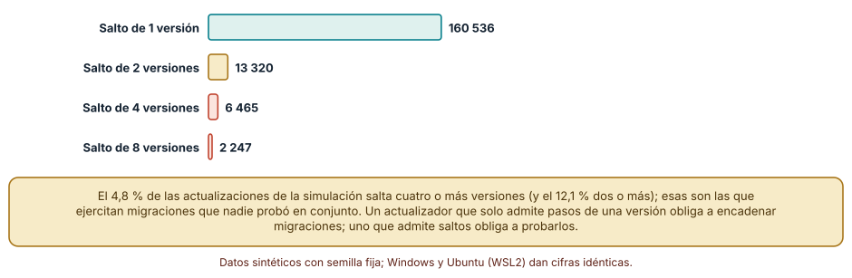

# SE-477 — Instaladores, paquetes y actualizaciones

[← SE-476 — Canary, blue-green y rollback](https://github.com/vladimiracunadev-create/modern-software-engineering-program/blob/main/classes/part-39-build-release-y-cadena-de-suministro/se-476-canary-blue-green-y-rollback/README.md) · [↑ Parte 39](https://github.com/vladimiracunadev-create/modern-software-engineering-program/blob/main/classes/part-39-build-release-y-cadena-de-suministro/README.md) · [📚 Índice completo](https://github.com/vladimiracunadev-create/modern-software-engineering-program/blob/main/classes/README.md) · [🌐 Portal](https://vladimiracunadev-create.github.io/modern-software-engineering-program/classes/SE-477.html) · [SE-478 — Riesgos de CI y dependencias comprometidas →](https://github.com/vladimiracunadev-create/modern-software-engineering-program/blob/main/classes/part-39-build-release-y-cadena-de-suministro/se-478-riesgos-de-ci-y-dependencias-comprometidas/README.md)

## Punto profesional y fundamento pedagógico

**Punto profesional.** La clase existe para que decidas cómo llega tu software al equipo de otra persona, qué ocurre cuando la instalación o la actualización se interrumpe y cuántas versiones distintas estarán en uso al mismo tiempo. En el servidor controlas cuándo se despliega y puedes volver atrás; en el equipo de la persona usuaria no controlas nada de eso: el corte de luz, el disco lleno, la conexión que se cae a mitad de la descarga y la persona que no actualiza durante cuatro meses son condiciones normales. La habilidad profesional es diseñar la instalación y la actualización para que **nunca dejen el programa en un estado a medias**.

**Por qué aparece aquí.** Sigue a **Canary, blue-green y rollback**: allí el equipo decidía el despliegue y podía revertir; aquí la decisión es de quien instala. Precede a **Riesgos de CI y dependencias comprometidas**, que trata la seguridad del canal que construye lo que se instala. El caso conductor es el cliente de línea de órdenes de la plataforma (`entregas-cli`), con el que el alumnado sube sus entregas desde su equipo.

**Error conceptual que debe corregir.** Creer que «instalar» es copiar archivos y que un instalador que funciona sin interrupciones es correcto. Una actualización que escribe los archivos nuevos sobre los antiguos uno a uno deja, ante cualquier interrupción, una mezcla de versiones que no es ni la anterior ni la nueva, y el programa puede no arrancar ni poder repararse solo.

**Secuencia de aprendizaje.** Antes de medir, predices cuántos puntos de interrupción de una actualización de seis módulos dejan una instalación corrupta si se sobrescribe en sitio y si el reemplazo archivo por archivo mejora algo; después inyectas un fallo en cada paso de cuatro estrategias con archivos reales, comprobando el estado final, y simulas 20 000 clientes que abren la aplicación con frecuencias muy distintas para ver cuántas versiones coexisten y qué saltos se realizan. La secuencia usa predicción, inyección de fallos real y una simulación con semilla.

**Evidencia de aprendizaje.** `instalador-log.md` con la predicción, las tres figuras reproducidas, el procedimiento de actualización de `entregas-cli` (preparación, verificación, activación atómica, conservación de la versión anterior, limpieza) y la matriz de rutas de actualización que deben probarse.

**Límite de la conclusión.** La «interrupción» se simula con una excepción en cada paso de un programa Python sobre un directorio temporal; no se cortó la energía, no se probó el comportamiento real de los sistemas de archivos ante un fallo, ni de `fsync`, ni de antivirus o bloqueos de archivos en Windows. La distribución de frecuencias de apertura de los clientes es un supuesto del autor. No se creó ningún instalador real (MSI, `.deb`, paquete de un gestor) ni se probó ningún mecanismo de auto-actualización.

### Trazabilidad fuente → afirmación

| Fuente primaria u oficial | Afirmación que respalda | Lo que no prueba |
|---|---|---|
| [POSIX: rename()](https://pubs.opengroup.org/onlinepubs/9699919799/functions/rename.html) | Especifica que `rename` reemplaza el destino de forma atómica dentro de un mismo sistema de archivos, de modo que se observa el contenido anterior o el nuevo, no una mezcla. | No cubre la durabilidad tras un fallo de energía sin sincronizar. |
| [Python: os.replace](https://docs.python.org/3/library/os.html#os.replace) | Documenta que `os.replace` renombra reemplazando el destino y que la operación es atómica cuando la plataforma lo permite. | No garantiza atomicidad entre sistemas de archivos distintos. |
| [Microsoft: MoveFileExW](https://learn.microsoft.com/en-us/windows/win32/api/winbase/nf-winbase-movefileexw) | Documenta el reemplazo de archivos en Windows, con la opción de reemplazar un destino existente y el comportamiento si el archivo está en uso. | No describe un instalador completo. |
| [The Update Framework (TUF)](https://theupdateframework.io/specification/) | Describe un marco de actualización con metadatos firmados, secuencia y caducidad que protegen al cliente frente a repetición y congelación. | No fija el mecanismo de instalación. |
| [PEP 427: formato wheel](https://peps.python.org/pep-0427/) | Define el formato de distribución de paquetes de Python y su proceso de instalación, que copia archivos y registra metadatos. | No ofrece atomicidad ante interrupciones. |

## Antes de empezar

Recupera lo aprendido en `SE-476`: se puede devolver el tráfico a la versión anterior, pero no siempre los datos. La pregunta activa es: **¿qué estado deja mi actualización si se interrumpe en cualquier punto, y cuántas versiones distintas tendré que soportar a la vez?**

## Prerrequisitos

- Haber completado `SE-476` o poder explicar el patrón de expandir y contraer.
- Python 3.11 o posterior; los experimentos usan solo la biblioteca estándar (`os`, `shutil`, `tempfile`, `hashlib`, `json`, `random`, `collections`).
- Saber qué es un sistema de archivos y que un archivo se escribe en varias operaciones.

## Problema auténtico

La plataforma publica la versión 2.0 de `entregas-cli`. Un estudiante inicia la actualización una hora antes de un plazo; a mitad de la copia, la batería del portátil se agota. Al reiniciar, el programa no arranca: tiene archivos de la versión 2.0 y de la 1.9, y el instalador antiguo ya no puede repararlo. El estudiante pierde la entrega.

Meses después, se descubre que un 11 % de los clientes sigue en versiones con cuatro lanzamientos de retraso. Una migración de configuración que se probó de la versión 1.9 a la 2.0 falla para quien salta desde la 1.6, porque nadie probó ese camino.

## Objetivos observables

Al terminar podrás:

1. comparar formas de distribución (gestor de paquetes, instalador, binario autónomo, auto-actualización) por quién actualiza, qué verifica y qué controla;
2. diseñar una actualización que prepare la versión nueva en un lugar aparte, la verifique y la active con una operación atómica;
3. inyectar un fallo en cada paso de un procedimiento y clasificar el estado final;
4. estimar con un modelo cuántas versiones coexisten y qué saltos de versión deben soportarse;
5. definir la política del canal de actualización: verificación, anti-retroceso, versión mínima y desinstalación sin pérdida de datos.

## Mapa conceptual


El mapa muestra que todo lo que puede fallar ocurre antes de la activación y que la activación es una única operación. La versión anterior se conserva hasta que la nueva ha demostrado que arranca.

## Temas y por qué importan

| Tema | Por qué cambia una decisión profesional | Evidencia mínima |
|---|---|---|
| Formas de distribución | Determinan quién actualiza y qué se verifica. | Predicción, traza causal y contraejemplo de **Distribución** en `instalador-log.md` |
| Atomicidad de la instalación | Una interrupción no debe dejar una mezcla. | Predicción, traza causal y contraejemplo de **Atomicidad** en `instalador-log.md` |
| Verificar antes de activar | Una descarga corrupta no debe llegar a producción. | Predicción, traza causal y contraejemplo de **Verificación** en `instalador-log.md` |
| Sesgo de versiones | Los clientes no actualizan a la vez. | Predicción, traza causal y contraejemplo de **Sesgo de versiones** en `instalador-log.md` |
| Política del canal | Un actualizador es un canal de ataque. | Predicción, traza causal y contraejemplo de **Canal de actualización** en `instalador-log.md` |

## Conceptos y decisiones

### 1. Formas de distribución

Hay cuatro grandes formas. En un **gestor de paquetes** (el del sistema operativo o el de un lenguaje), el gestor descarga, verifica, instala y actualiza; tú publicas en un índice y heredas su modelo de confianza y de dependencias. Un **instalador** nativo (MSI, `.pkg`, `.deb`) copia archivos, registra metadatos y puede ejecutar acciones con privilegios; tiene mucho poder y mucha superficie. Un **binario autónomo** (un archivo ejecutable o un archivo comprimido que se descomprime) es lo más simple de distribuir y deja al usuario la responsabilidad de actualizar. La **auto-actualización** hace que la propia aplicación consulte un canal, descargue y se reemplace; da control al equipo y exige diseñar con cuidado el canal y la instalación atómica. Cada forma reparte distinto quién verifica la integridad, quién actualiza y quién puede desinstalar.

### 2. Atomicidad de la instalación

Una instalación es **atómica** si, ante cualquier interrupción, el estado observable es el anterior completo o el nuevo completo. Copiar archivo por archivo sobre la instalación existente no lo es: el archivo se trunca al abrirlo para escribir y hay un periodo con contenido parcial, y entre archivos hay una mezcla de versiones. Los reemplazos de un solo archivo con un renombrado sí lo son (`rename` en POSIX y su equivalente en Windows reemplazan el destino en una operación), pero un conjunto de archivos reemplazados uno a uno sigue pudiendo quedar mezclado. El patrón robusto es **preparar un directorio nuevo completo** y activar con una única operación atómica: un cambio de puntero (un enlace simbólico, un archivo `current` que contiene el nombre del directorio activo) escrito con un renombrado. Hasta ese instante la versión anterior está intacta. Un detalle de durabilidad: sin sincronizar los datos al disco antes del renombrado, un fallo de energía puede dejar el puntero nuevo apuntando a archivos que no llegaron al disco.

### 3. Verificar antes de activar y conservar la anterior

La verificación ocurre sobre el directorio preparado y antes de la activación: se calcula la huella de cada archivo y se compara con el manifiesto firmado (`SE-473`). Si algo no coincide (una descarga corrupta, un byte alterado), el directorio se descarta y la instalación actual no se ha tocado. Tras activar, la aplicación arranca una comprobación de humo; si falla, se vuelve a apuntar a la versión anterior, que se conserva hasta que la nueva ha funcionado durante un plazo. La migración de datos y configuración del usuario es el punto delicado: debe ser **reversible** o hacerse sobre una copia, porque una migración que reescribe el archivo de configuración con un formato que la versión anterior no lee impide el retroceso (el mismo problema de `SE-476`, ahora sin servidor).

### 4. Sesgo de versiones y rutas de actualización

En el servidor, todos los clientes usan la versión que despliegas. En los equipos de las personas, la distribución de versiones es una **cola larga**: unos actualizan el mismo día, otros cuando abren la aplicación, otros meses después o nunca. Con un lanzamiento cada 14 días y clientes que abren la aplicación cada 1, 2, 3, 7, 14, 30, 60 o 120 días, aparecen en seis meses 22 caminos de actualización distintos y una parte apreciable de los saltos cruza tres o más versiones. Cada camino ejercita migraciones (de configuración, de datos locales, de formatos de archivo) que tienen que haberse probado. Dos estrategias reducen el área: **encadenar** migraciones paso a paso (cada migración solo conoce un salto, pero un salto largo ejecuta muchas) o **soportar saltos** directos desde un conjunto declarado de versiones de origen. Y una **versión mínima soportada** permite declarar que quien está por debajo debe pasar primero por una versión intermedia.

### 5. El canal de actualización como superficie de ataque

Un actualizador es código que se ejecuta con los permisos del usuario, a veces elevados, y que descarga código de la red: es el objetivo ideal de un ataque. Debe aplicar todo lo visto en `SE-473`: verificar una firma con una clave incorporada, rechazar secuencias inferiores (ataque de retroceso), exigir metadatos con caducidad y fallar cerrado. Además debe decidir la **política**: ¿se actualiza solo, se avisa, se fuerza ante una vulnerabilidad crítica?, ¿se puede diferir?, ¿qué ocurre sin red? También la **desinstalación**: qué se elimina, qué datos del usuario se conservan y cómo se respeta que la persona decida. Y los **permisos**: un instalador que pide privilegios de administrador para algo que no los necesita amplía el daño de cualquier error; lo razonable es instalar en el espacio del usuario cuando sea posible.

### Fallo inyectado en cada paso

Se actualiza un directorio con 6 módulos y un manifiesto de la versión 1 a la 2 con cuatro estrategias: A sobrescribir en sitio; B reemplazar cada archivo con un renombrado; C preparar un directorio nuevo y cambiar un puntero; D como C, pero verificando las huellas antes de activar. Se inyecta una interrupción en cada uno de los pasos (cada escritura, cada renombrado) y se comprueba el estado final con el manifiesto.

```python
def tick(self):                      # cada escritura o renombrado cuenta un paso
    self.n += 1
    if self.n == self.crash_at: raise Crash
```


**Cómo leer la figura.** Cada grupo es una estrategia de actualización; la barra gris son los puntos de fallo inyectados y la turquesa los que dejan la instalación en la versión 1 consistente. Mira cómo la barra turquesa solo iguala a la gris con el directorio nuevo y el puntero (C y D). **Dónde deja de valer:** la interrupción es una excepción en un programa, no un corte de energía real; no se probaron los efectos de la caché del sistema de archivos ni la necesidad de sincronizar, ni bloqueos de archivos en Windows ni un antivirus que mantenga un archivo abierto. El resultado es idéntico en Windows y Ubuntu.

### Sesgo de versiones

Se simulan 20 000 clientes que abren la aplicación cada 1, 2, 3, 7, 14, 30, 60 o 120 días (en proporciones iguales, un supuesto) durante 180 días, con un lanzamiento cada 14 días y actualización al abrir. Se mide cuántas versiones de retraso tiene cada cliente en los días 30, 90 y 180.


**Cómo leer la figura.** Cada barra es un día y se divide en el porcentaje de clientes al día (turquesa), con 1 de retraso (gris), con 2 o 3 (dorado) y con 4 o más (coral). Mira cómo aparece el tramo coral entre el día 30 y el 90: con el tiempo, una parte de la flota se queda muy atrás. **Dónde deja de valer:** las frecuencias de apertura y su reparto son un supuesto del autor, y se supone que todos actualizan al abrir; en la realidad algunas personas rechazan o difieren la actualización y otras no tienen red. La forma (una cola de clientes muy atrasados) sí es habitual y el número exacto depende del producto.

### Saltos de versión

Se cuentan las actualizaciones realizadas según cuántas versiones saltan.



**Cómo leer la figura.** Cada barra es el número de actualizaciones de un tamaño de salto; la mayoría salta una versión, y una minoría considerable cruza cuatro u ocho. Cada tamaño de salto es una ruta que ejercita migraciones distintas. **Dónde deja de valer:** los tamaños de salto salen de los períodos de apertura supuestos (quienes abren cada 30, 60 y 120 días saltan 2, 4 y 8 lanzamientos) y de que cada lanzamiento incluye cambios relevantes para todos; si dos de cada tres lanzamientos fueran correcciones sin migración, el número de rutas con migración sería menor. Lo que se sostiene es la conclusión de diseño: probar solo el salto de una versión no cubre lo que ocurre.

## Definiciones de trabajo

- **[instalación atómica](../../../glosario/entradas/i/instalacion-atomica.md):** instalación cuyo estado observable ante cualquier interrupción es el anterior completo o el nuevo completo.
- **[activación](../../../glosario/entradas/a/activacion.md):** operación única que hace que el sistema use la versión nueva.
- **[auto-actualización](../../../glosario/entradas/a/auto-actualizacion.md):** mecanismo por el cual la aplicación consulta, descarga e instala su propia versión nueva.
- **[versión mínima soportada](../../../glosario/entradas/v/version-minima-soportada.md):** versión más antigua desde la que se admite actualizar directamente.
- **[sesgo de versiones](../../../glosario/entradas/s/sesgo-de-versiones.md):** coexistencia de versiones distintas en uso por la cola larga de clientes que actualizan con retraso.

Las definiciones son operativas para la API de entregas. No convierten términos con una historia más amplia en sinónimos y deben contrastarse con la documentación primaria enlazada al final.

## Ejemplo mínimo

El fragmento activa una versión con un cambio de puntero y comprueba que el estado nunca es intermedio. Antes de ejecutarlo, predice qué contiene `current` si la ejecución se interrumpe antes del `os.replace`.

```python
import os, tempfile
raiz = tempfile.mkdtemp()
open(os.path.join(raiz, "current"), "w").write("v1")
open(os.path.join(raiz, "current.tmp"), "w").write("v2")
# ... aquí podría ocurrir una interrupción ...
os.replace(os.path.join(raiz, "current.tmp"), os.path.join(raiz, "current"))
print(open(os.path.join(raiz, "current")).read())
```

Antes del `os.replace`, `current` contiene `v1`; después, `v2`; nunca una mezcla. Registra versión de Python, comando y salida; después sustituye el renombrado por una escritura directa sobre `current` y explica en qué punto podría quedar vacío.

## Ejemplo profesional

El procedimiento de actualización de `entregas-cli` descarga el paquete y su manifiesto firmado a un directorio temporal dentro de la misma partición que la instalación, verifica la firma con la clave incorporada y la secuencia, calcula la huella de cada archivo, descomprime en `versiones/2.0.0/`, ejecuta la migración de configuración sobre una copia y una comprobación de humo (`entregas --version` y una subida de prueba a un entorno de ensayo) y cambia el puntero `actual` con un renombrado. Conserva la versión anterior siete días o hasta que la nueva haya funcionado en tres ejecuciones. Declara una versión mínima desde la que se actualiza directamente (la 1.8) y una tabla de rutas probadas en el CI (1.8→2.0, 1.9→2.0, 1.6→1.8→2.0). Instala en el espacio del usuario, sin privilegios, y la desinstalación elimina la aplicación y pregunta antes de borrar la configuración.

## Práctica guiada

1. Escribe un actualizador de ejemplo con las cuatro estrategias (en sitio, por archivo, directorio y puntero, y con verificación previa).
2. Predice cuántos de los puntos de fallo dejan una instalación corrupta en cada estrategia y escríbelo antes de medir.
3. Inyecta un fallo en cada paso, clasifica el estado final y completa la tabla.
4. Corrompe un byte de un módulo preparado y comprueba qué estrategia lo rechaza.
5. Simula la distribución de versiones con tus propias frecuencias de apertura y cuenta los caminos de actualización y los saltos.
6. Define la versión mínima soportada y la tabla de rutas de actualización que el CI probará.
7. Entrega `instalador-log.md` y pide a otra persona que proponga una interrupción que deje tu actualizador en un estado inconsistente.

## Ejercicios

1. **Atomicidad:** un instalador copia 300 archivos a la carpeta de destino; calcula cuántos puntos de interrupción dejan una mezcla y diseña el cambio mínimo para que ninguno lo haga.
2. **Durabilidad:** explica qué puede ocurrir si se renombra el puntero antes de sincronizar los archivos al disco y se corta la energía, y cómo se evita.
3. **Rutas:** con clientes en las versiones 1.6, 1.8 y 1.9 y la versión 2.0 publicada, enumera las rutas que debes probar y elige entre encadenar migraciones y saltos directos.
4. **Canal:** escribe tres comprobaciones del actualizador que protejan contra un servidor comprometido, y qué hace el cliente si cualquiera falla.

## Reto verificable

Entrega `instalador-log.md` con la predicción, las tres tablas, el procedimiento de actualización de `entregas-cli` y la tabla de rutas probadas. Se aprueba si otra persona ejecuta la inyección de fallos desde un checkout limpio, obtiene la misma clasificación en su sistema y puede decir qué paso del procedimiento hace posible el retroceso. No se aprueba por afirmar «la actualización es segura» sin haber inyectado fallos en cada paso ni por probar solo la ruta de una versión a la siguiente.

## Caso conductor

La API de entregas es el caso conductor de la [Parte 39](../README.md). Esta clase deja el noveno artefacto: un procedimiento de actualización atómica, verificada y reversible para el cliente de línea de órdenes, con una tabla de rutas de actualización. `SE-478` volverá sobre el canal que construye y firma todo esto: el CI y sus dependencias. Cambia después un solo dato, la frecuencia de lanzamientos, y observa cuántos caminos de actualización aparecen.

## Preguntas frecuentes

### ¿Basta con reemplazar el ejecutable?

Si la aplicación es un único archivo sin datos asociados, un renombrado atómico del ejecutable puede bastar (con los matices de Windows, donde un ejecutable en uso no puede reemplazarse y se usa un paso auxiliar). En cuanto hay varios archivos, bibliotecas o configuración, la mezcla de versiones es un riesgo real.

### ¿Hay que forzar las actualizaciones?

Depende del daño del retraso. Para correcciones de seguridad críticas, forzar o limitar el uso de versiones muy antiguas puede estar justificado; para el resto, avisar y permitir diferir respeta a la persona usuaria. La política debe ser explícita, visible y poder explicarse.

### ¿Cuántas versiones antiguas debo soportar?

Las que tus clientes usan de hecho, medidas, y las que tu política declare. Soportar todas es imposible; declarar una versión mínima y una fecha de fin de soporte hace la carga manejable y honesta.

### ¿Qué hago si la actualización falla en el equipo de alguien?

La instalación anterior debe seguir funcionando, el error debe explicar qué ocurrió y qué hacer, y debe haber una vía manual (descargar el instalador completo). Registrar un identificador del fallo sin datos personales ayuda a diagnosticarlo.

## Fallo controlado y diagnóstico

Reproduce el fallo clásico de la clase: **una actualización interrumpida que deja el programa con archivos de dos versiones**. Sobrescribe en sitio y corta en mitad de la copia.

Registra síntoma, entrada mínima, hipótesis, observación que descarta cada hipótesis, causa, corrección y prueba de regresión. **Síntoma:** tras reiniciar, el programa no arranca o falla de forma extraña. **Hipótesis rivales:** (a) la versión nueva tiene un defecto; (b) el disco está dañado; (c) la instalación quedó mezclada por una interrupción. **Prueba:** compara cada archivo con el manifiesto de la versión anterior y de la nueva; si hay archivos de ambas, la causa es (c). **Conclusión:** la actualización no era atómica. **Regresión:** prepara la versión nueva en un directorio aparte, verifica, activa con un cambio de puntero y añade una prueba que inyecte un fallo en cada paso y exija que el estado final sea v1 o v2 completo.

## Errores comunes y cómo corregirlos

| Síntoma | Causa probable | Corrección |
|---|---|---|
| El programa no arranca tras una actualización interrumpida | Archivos de dos versiones | Directorio nuevo y activación atómica |
| Se instala una descarga corrupta | No se verifica antes de activar | Verificar huellas y firma sobre el directorio preparado |
| No se puede volver a la versión anterior | Se borró o la migración fue destructiva | Conservar la anterior y migrar sobre una copia |
| Falla la actualización desde una versión antigua | Ruta no probada | Tabla de rutas y versión mínima soportada |
| El actualizador acepta una versión vieja | Sin secuencia ni firma | Metadatos firmados con secuencia y caducidad |

## Entorno y archivos clave

```text
work/SE-477/
├── README.md
├── actualizador/
│   ├── estrategias.py
│   ├── inyeccion.py
│   └── sesgo.py
├── rutas.md
├── tests/test_actualizador.py
└── evidence/instalador-log.md
```

El `README` declara plataforma, versión de Python, semillas y comandos. La inyección de fallos usa archivos temporales reales y el resultado fue idéntico en CPython 3.12.9 (Windows 11) y 3.12.3 (Ubuntu bajo WSL2); la simulación del sesgo usa semilla fija y también coincide. Si pruebas un instalador real, declara la versión del sistema y si se probó con un antivirus activo. El código completo del experimento está en `scripts/experiments_part39/e405.py` y se ejecuta con `python scripts/experiments_part39/e405.py`.

## Seguridad, ética y accesibilidad

- un actualizador comprometido ejecuta código en miles de equipos: aplica firma, secuencia, caducidad y falla cerrado, y no pidas privilegios que no necesites;
- no recopiles telemetría del instalador sin informar y sin permitir rechazarla; evita datos personales en los informes de fallo;
- respeta la decisión de la persona sobre cuándo actualizar salvo en riesgos de seguridad críticos, y explica el motivo cuando fuerces;
- el instalador y sus mensajes deben ser accesibles: texto claro, compatible con lector de pantalla, sin depender del color, con alternativa de línea de órdenes;
- respeta las licencias de los componentes distribuidos y conserva sus avisos en el instalador.

## Puente hacia el trabajo con agentes

Un agente al que se le pide «añade auto-actualización» escribirá un script que descarga un archivo, lo descomprime sobre la carpeta de instalación y reinicia, sin verificar, sin atomicidad y sin conservar la versión anterior. Pídele en cambio que descargue a un directorio aparte, verifique firma, secuencia y huellas, migre sobre una copia, active con un cambio de puntero atómico y conserve la versión anterior, y que demuestre cada propiedad con una inyección de fallos en cada paso. Revisa especialmente si extrae sobre la instalación en uso, si ignora los bloqueos de archivos en Windows y si no considera las rutas desde versiones antiguas.

## Transferencia

Traslada el análisis a otro tipo de cliente (una aplicación móvil, un complemento de navegador, un firmware de dispositivo): cambia el mecanismo de instalación y las restricciones del sistema y conserva el procedimiento de preparar aparte, verificar, activar de forma atómica, conservar la anterior y probar las rutas de actualización. La transferencia está lograda cuando puedes decir qué operación del nuevo entorno es la atómica y qué ruta de actualización queda sin probar.

## Evaluación y evidencia

| Criterio | Evidencia para aprobar |
|---|---|
| comprensión | explicación de por qué un reemplazo archivo por archivo no es atómico y de por qué la cola de versiones obliga a probar rutas |
| corrección | tabla de la inyección de fallos y de la simulación de versiones reproducibles |
| diseño | procedimiento con preparación aparte, verificación, activación atómica, comprobación de humo y retroceso |
| diagnóstico | reproducción del fallo «instalación mezclada» con regresión por inyección en cada paso |
| incertidumbre | declaración de que la interrupción es una excepción y no un corte real y de que las frecuencias son supuestos |
| reproducibilidad | versiones, comandos, salida y límites declarados |

## Fuentes

- [POSIX: rename()](https://pubs.opengroup.org/onlinepubs/9699919799/functions/rename.html) — reemplazo atómico; autoridad: The Open Group.
- [Python: os.replace](https://docs.python.org/3/library/os.html#os.replace) — renombrado con reemplazo; autoridad: documentación de Python.
- [Microsoft: MoveFileExW](https://learn.microsoft.com/en-us/windows/win32/api/winbase/nf-winbase-movefileexw) — reemplazo de archivos en Windows; autoridad: documentación de Microsoft.
- [The Update Framework](https://theupdateframework.io/specification/) — metadatos firmados con secuencia y caducidad; autoridad: proyecto TUF, CNCF.
- [PEP 427: wheel](https://peps.python.org/pep-0427/) — formato de distribución de paquetes de Python; autoridad: Python Enhancement Proposals.

Cada fuente respalda el mecanismo indicado; ninguna demuestra que los 12 de 14 de mezcla, el 11,2 % de clientes atrasados o los 22 caminos se observen en tu producto. Esa afirmación depende de tu instalador, tu sistema de archivos y tus clientes.

## Límites y siguiente paso

Se ejecutaron cuatro experimentos: una inyección de fallos con archivos reales en un directorio temporal (resultado idéntico en Windows 11 con CPython 3.12.9 y en Ubuntu bajo WSL2 con 3.12.3) y una simulación de 20 000 clientes con semilla fija. La interrupción se simuló con una excepción y no se cortó la energía; no se probó la sincronización al disco, los bloqueos de archivos, ningún antivirus, ningún instalador real ni ningún auto-actualizador, y las frecuencias de apertura y el reparto de clientes son supuestos del autor. La siguiente clase se ocupa del canal que construye y publica todo esto: los riesgos de la integración continua y de las dependencias comprometidas.

## Glosario

- **[instalación atómica](../../../glosario/entradas/i/instalacion-atomica.md):** instalación cuyo estado observable ante cualquier interrupción es el anterior completo o el nuevo completo.
- **[activación](../../../glosario/entradas/a/activacion.md):** operación única que hace que el sistema use la versión nueva.
- **[auto-actualización](../../../glosario/entradas/a/auto-actualizacion.md):** mecanismo por el cual la aplicación consulta, descarga e instala su propia versión nueva.
- **[versión mínima soportada](../../../glosario/entradas/v/version-minima-soportada.md):** versión más antigua desde la que se admite actualizar directamente.
- **[sesgo de versiones](../../../glosario/entradas/s/sesgo-de-versiones.md):** coexistencia de versiones distintas en uso por la cola larga de clientes que actualizan con retraso.

Conceptos de esta clase en el [glosario del programa](../../../glosario/README.md): [Activación](../../../glosario/entradas/a/activacion.md) · [Auto-actualización](../../../glosario/entradas/a/auto-actualizacion.md) · [Instalación atómica](../../../glosario/entradas/i/instalacion-atomica.md) · [Sesgo de versiones](../../../glosario/entradas/s/sesgo-de-versiones.md) · [Versión mínima soportada](../../../glosario/entradas/v/version-minima-soportada.md).

---

[← SE-476 — Canary, blue-green y rollback](https://github.com/vladimiracunadev-create/modern-software-engineering-program/blob/main/classes/part-39-build-release-y-cadena-de-suministro/se-476-canary-blue-green-y-rollback/README.md) · [↑ Parte 39](https://github.com/vladimiracunadev-create/modern-software-engineering-program/blob/main/classes/part-39-build-release-y-cadena-de-suministro/README.md) · [📚 Índice completo](https://github.com/vladimiracunadev-create/modern-software-engineering-program/blob/main/classes/README.md) · [🌐 Portal](https://vladimiracunadev-create.github.io/modern-software-engineering-program/classes/SE-477.html) · [SE-478 — Riesgos de CI y dependencias comprometidas →](https://github.com/vladimiracunadev-create/modern-software-engineering-program/blob/main/classes/part-39-build-release-y-cadena-de-suministro/se-478-riesgos-de-ci-y-dependencias-comprometidas/README.md)
