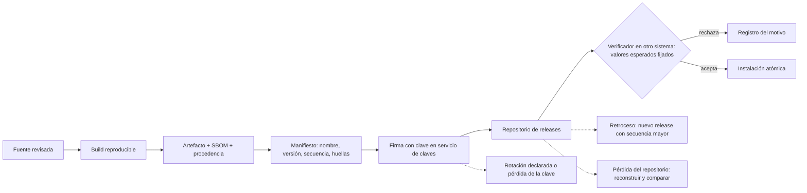

# SE-480 — Proyecto: release firmado y recuperable

[← SE-479 — Taller: verificar la procedencia de un release](https://github.com/vladimiracunadev-create/modern-software-engineering-program/blob/main/classes/part-39-build-release-y-cadena-de-suministro/se-479-taller-verificar-la-procedencia-de-un-release/README.md) · [↑ Parte 39](https://github.com/vladimiracunadev-create/modern-software-engineering-program/blob/main/classes/part-39-build-release-y-cadena-de-suministro/README.md) · [📚 Índice completo](https://github.com/vladimiracunadev-create/modern-software-engineering-program/blob/main/classes/README.md) · [🌐 Portal](https://vladimiracunadev-create.github.io/modern-software-engineering-program/classes/SE-480.html) · [SE-481 — Integración continua y feedback temprano →](https://github.com/vladimiracunadev-create/modern-software-engineering-program/blob/main/classes/part-40-ci-cd-iac-y-platform-engineering/se-481-integracion-continua-y-feedback-temprano/README.md)

## Punto profesional y fundamento pedagógico

**Punto profesional.** El proyecto existe para que construyas un canal de release completo y lo defiendas: que produzca un artefacto reproducible, lo acompañe de un SBOM y una procedencia, lo firme con una política de verificación explícita, permita volver atrás sin perder lo que importa y sobreviva a la pérdida del repositorio de releases y de una clave. La entrega no es el código del canal sino un **expediente de release** con la evidencia de que funciona, la de que falla donde debe y una lista honesta de lo que ningún control del canal ve.

**Por qué aparece aquí.** Cierra la Parte 39 y reúne los doce temas: el build reproducible, la promoción por huella, el inventario fijado, el SBOM y la procedencia, la firma y la verificación, el versionado, las banderas, el despliegue progresivo, la actualización atómica, la defensa del CI y el taller de verificación. Es el proyecto integrador de la parte, y se apoya en el caso conductor: la API de entregas y su cliente de línea de órdenes. Lo que entregues debe poder ser verificado por otra persona sin tu ayuda.

**Error conceptual que debe corregir.** Creer que un canal de release se prueba cuando «publica bien» una vez. Se prueba cuando falla de las maneras previstas: ante un artefacto manipulado, una versión antigua, una clave perdida, un repositorio destruido o un release defectuoso que hay que retirar, el canal rechaza o se recupera y deja constancia. Un canal que solo se ha ejercitado en el camino feliz no tiene evidencia de recuperación.

**Secuencia de aprendizaje.** Antes de construir, predices qué simulacros de recuperación (retroceso, pérdida del repositorio, rotación y pérdida de clave) se resuelven con lo que el canal ya tiene y cuál exige una acción humana; después construyes el canal sintético, lo verificas en dos sistemas operativos cruzando quién construye y quién verifica, ejecutas los cuatro simulacros y compones el expediente con las pruebas y los límites. La secuencia usa predicción, construcción integrada y simulacros con resultado observable.

**Evidencia de aprendizaje.** El expediente `release-dossier/` con el artefacto y su huella, el SBOM, la procedencia, el manifiesto firmado, la política de verificación con los valores esperados, el registro de la verificación en dos sistemas, el registro de los cuatro simulacros, el informe de verificación con tres estados y un `LIMITES.md` que nombre lo que el canal no ve.

**Límite de la conclusión.** El canal es sintético: un árbol de 42 archivos de Python empaquetado en un zip, con SBOM y procedencia simplificados y firmas Ed25519 de `openssl`, ejecutado en un solo proceso por sistema. No hay servidor, red, registro de artefactos, CI real, usuarios ni dispositivos, y los simulacros son lógicos, no operaciones sobre un repositorio de producción. Las mediciones de tiempo son lecturas de un equipo y cambian en cada ejecución. El contenido sigue pendiente de revisión humana independiente.

### Trazabilidad fuente → afirmación

| Fuente primaria u oficial | Afirmación que respalda | Lo que no prueba |
|---|---|---|
| [SLSA v1.0: especificación](https://slsa.dev/spec/v1.0/) | Organiza los requisitos de la cadena de suministro por niveles de garantía sobre el constructor y la procedencia. | No certifica el canal del proyecto. |
| [NIST SP 800-218 (SSDF)](https://csrc.nist.gov/pubs/sp/800/218/final) | Recoge prácticas para producir y publicar software con integridad verificable y para responder a vulnerabilidades. | No indica cómo implementarlas en un proyecto concreto. |
| [The Update Framework](https://theupdateframework.io/specification/) | Describe roles de claves, secuencia, caducidad y recuperación ante el compromiso de claves en sistemas de actualización. | No prescribe la implementación del proyecto. |
| [Samuel et al. (CCS 2010)](https://doi.org/10.1145/1866307.1866315) | Analiza el diseño de sistemas de actualización que sobreviven al compromiso de claves de firma. | No mide la frecuencia de compromisos. |
| [Reproducible Builds: definición](https://reproducible-builds.org/docs/definition/) | Define la reproducibilidad como base de la verificación independiente. | No garantiza la bondad de la fuente. |
| [OWASP Top 10 CI/CD Security Risks](https://owasp.org/www-project-top-10-ci-cd-security-risks/) | Cataloga los riesgos que el expediente debe contemplar en el canal de construcción. | No ordena los riesgos para este proyecto. |

## Antes de empezar

Recupera lo aprendido en `SE-479`: un verificador con valores esperados fijados detecta las manipulaciones que rompen la coherencia y no ve las mentiras coherentes. La pregunta activa es: **¿puedo construir un canal que produzca evidencia verificable por otra persona, falle donde debe y se recupere de lo que se puede perder?**

## Prerrequisitos

- Haber completado `SE-469` a `SE-479`.
- Python 3.11 o posterior y `openssl` 3.x; el proyecto usa `hashlib`, `zipfile`, `json`, `subprocess`, `tempfile` y `unittest`.
- Un segundo sistema operativo (una máquina, una máquina virtual o WSL) para la verificación cruzada; si no lo tienes, declara el límite en `LIMITES.md`.

## Problema auténtico

El equipo de la plataforma debe entregar a la universidad cliente un canal de release «auditable». El cliente pide cuatro cosas: poder reconstruir el release y obtener la misma huella, poder verificar la firma y la procedencia sin pedir nada al equipo, saber qué ocurre si publican una versión defectuosa y saber qué ocurre si pierden la clave de firma. Hasta ahora el equipo tenía scripts que funcionaban en la máquina de una persona, una clave en un directorio de su perfil y la costumbre de «volver a publicar» cuando algo falla.

El proyecto consiste en convertir esas costumbres en un procedimiento con evidencia: qué se construye, cómo se firma, cómo se verifica, cómo se retrocede y cómo se recupera, con las pruebas de que cada afirmación se ejecutó y las de que cada fallo previsto se detecta.

## Objetivos observables

Al terminar podrás:

1. construir un canal de release que produce un artefacto reproducible, un SBOM, una procedencia y un manifiesto firmado con secuencia;
2. verificar el release en un sistema distinto del que lo construyó, con valores esperados fijados fuera del release;
3. ejecutar y registrar simulacros de retroceso, pérdida del repositorio, rotación y pérdida de la clave, y decir cuál exige una acción humana;
4. someter el canal al catálogo de manipulaciones del taller y comprobar que se rechazan, y nombrar los casos coherentes que no;
5. componer un expediente cuya afirmación más fuerte esté respaldada por una prueba ejecutable y cuyo alcance esté declarado.

## Mapa conceptual



El mapa muestra el flujo principal de izquierda a derecha y tres recuperaciones con línea punteada. La verificación en otro sistema es el punto donde la evidencia deja de depender de quien construyó.

## Temas y por qué importan

| Tema | Por qué cambia una decisión profesional | Evidencia mínima |
|---|---|---|
| Expediente de release | Es lo que otra persona revisa sin pedirte nada. | Predicción, traza causal y contraejemplo de **Expediente de release** en `release-dossier/` |
| Criterios de aceptación | Convierten «funciona» en pruebas con resultado. | Predicción, traza causal y contraejemplo de **Criterios de aceptación** en `release-dossier/` |
| Recuperación | Lo que no se ensaya no se sabe que funciona. | Predicción, traza causal y contraejemplo de **Recuperación** en `release-dossier/` |
| Verificación entre sistemas | Demuestra que la evidencia no depende de tu máquina. | Predicción, traza causal y contraejemplo de **Verificación entre sistemas** en `release-dossier/` |
| Alcance y revisión | Declarar lo que no se ve es parte del producto. | Predicción, traza causal y contraejemplo de **Alcance** en `release-dossier/` |

## Conceptos y decisiones

### 1. El expediente de release

El **expediente de release** es el conjunto de documentos y pruebas que permite a otra persona decidir si confía en un release sin recurrir a quien lo produjo. Contiene: el artefacto y su huella; el SBOM con su método y su alcance; la procedencia (constructor, fuente, commit, materiales); el manifiesto con nombre, versión y secuencia, y su firma; la política de verificación con los valores esperados y su origen; los comandos y versiones para reconstruir y verificar; el registro de la verificación en al menos dos sistemas; el registro de los simulacros de recuperación; el informe de verificación con tres estados; y un archivo de límites. El criterio de calidad es operativo: otra persona debe poder reproducir cada afirmación desde un checkout limpio con los comandos del expediente.

### 2. Criterios de aceptación

El proyecto se acepta cuando cada afirmación del expediente tiene una prueba ejecutable con un resultado esperado. Los criterios mínimos son: (a) dos construcciones en entornos distintos producen la misma huella; (b) el release legítimo pasa las doce comprobaciones del verificador en ambos sistemas; (c) las doce manipulaciones del taller se rechazan, cada una por una comprobación nombrada; (d) los seis casos coherentes se documentan como no rechazados, con el control que los vería; (e) un retroceso se logra publicando un release nuevo con la secuencia mayor, y el bundle antiguo se rechaza; (f) tras destruir el repositorio de releases, la reconstrucción desde la fuente produce la misma huella; (g) una rotación declarada con la clave vigente permite verificar con la nueva; (h) la pérdida de la clave sin rotación previa se reconoce como no recuperable por automatización y el expediente dice qué acción humana y por qué canal. Un criterio sin prueba no cuenta.

### 3. Recuperación

Los cuatro simulacros examinan cuatro formas de perder algo. El **retroceso** es la más frecuente: la versión nueva tiene un defecto y se quiere la anterior. El verificador, para evitar que un atacante sirva versiones viejas, rechaza una secuencia menor; por tanto el retroceso no es reinstalar el bundle antiguo, sino publicar el contenido anterior como una versión nueva (aquí, 1.4.2 con secuencia 16) que supera la memoria del cliente. La **pérdida del repositorio** se resuelve porque el build es reproducible: la fuente reconstruye la misma huella y el manifiesto firmado sigue siendo válido. La **rotación** funciona si la declaración de la clave nueva se firmó con la vigente antes de necesitarla. La **pérdida de la clave privada sin rotación previa** no tiene solución automática: los clientes con la clave antigua fijada rechazan toda versión nueva, y la recuperación exige distribuir una clave nueva por un canal que los clientes ya acepten, con una acción humana. Diseñar el canal es decidir de antemano cuál de estas cuatro pérdidas se tolera.

### 4. Verificación entre sistemas

Que tu verificador acepte tu release en tu máquina es una prueba débil: comparte clave, versión de `openssl`, sistema y hábitos con quien lo construyó. La prueba fuerte cruza las roles: se construye y firma en un sistema, se verifica en otro, y viceversa. En el proyecto, el release construido en Windows se verificó sin fallos en Ubuntu y el construido en Ubuntu, en Windows, y ambos tienen la misma huella de artefacto. Esto confirma tres cosas a la vez: el build es reproducible entre sistemas (`SE-469`), la firma es verificable con otra versión de `openssl` (3.5.7 y 3.0.13) y el verificador no depende de ninguna rareza del sistema que lo produjo. No confirma que el canal funcione en un tercer sistema, con una herramienta de construcción distinta ni con una red entre medias.

### 5. Alcance, revisión y mantenimiento

El expediente termina con lo que no ve. Entre los límites obligatorios: el contenido de la fuente puede ser malicioso aunque haya sido aprobado; el constructor puede estar comprometido; la clave puede haberse robado antes de revocarse; el SBOM solo ve las capas que su método ve; la verificación depende de que los valores esperados se hayan obtenido de un canal independiente; los simulacros no son operaciones sobre un repositorio real. Un canal tampoco es un objeto terminado: hay que renovar las claves, caducar los metadatos, ensayar la rotación y el retroceso cada trimestre, actualizar el escáner del CI frente a mutaciones nuevas y volver a reconstruir releases de forma independiente. El expediente debe llevar la fecha y una caducidad: una evidencia de hace dos años no dice nada del canal actual. Y, aunque las pruebas pasen, hace falta una revisión humana independiente que no se ha hecho.

### Verificación entre sistemas

Se genera un release con SBOM, procedencia, manifiesto y firma en Windows y otro en Ubuntu, cada uno con su propio par de claves, se copian a una carpeta compartida y cada sistema verifica ambos.

```text
python scripts/experiments_part39/e408.py make compartido   # en cada sistema: construye y firma, guarda el release y la clave pública
python scripts/experiments_part39/e408.py verify compartido   # en cada sistema: verifica los dos releases
```


**Cómo leer la figura.** A la izquierda está el principio, cada sistema verifica lo que construyó el otro, y a la derecha los dos releases. Las dos cajas turquesa dicen que se verifican sin fallos en los dos sistemas y comparten la huella del artefacto. **Dónde deja de valer:** verificar en dos sistemas del mismo equipo, con una versión de Python y de `openssl` cada uno, es una prueba modesta de portabilidad; no cubre macOS, ni una red entre medias, ni otras herramientas de verificación, y la clave pública se copió por una carpeta compartida, un canal que en un uso real no sería independiente.

### Simulacros de recuperación

Se ejecutan los cuatro simulacros sobre el canal sintético y se registra el resultado observado.


**Cómo leer la figura.** A la izquierda están los simulacros y a la derecha el resultado y cómo se recupera cada uno. Las cajas turquesa se resuelven con un procedimiento, la dorada exige haberlo declarado antes y la coral necesita una acción humana por un canal anterior. **Dónde deja de valer:** son simulacros lógicos de un solo proceso, sin red ni clientes reales; una rotación real debe tener en cuenta clientes desconectados durante meses, y un retroceso real, datos escritos por la versión defectuosa (`SE-476`). Un cuarto simulacro que se resuelve «con una acción humana» necesita que exista un canal de confianza previo; si no lo hay, el producto queda sin actualizaciones seguras.

### Costo del canal

Se mide el tiempo de los pasos del canal sintético en cada sistema.


**Cómo leer la figura.** Cada grupo es un paso del canal de release con una barra coral para Windows y una turquesa para Ubuntu, en milisegundos. Mira que construir y republicar cuestan decenas de milisegundos en Windows y que reconstruir y comparar es casi inmediato en los dos. Es una lectura por barra. **Dónde deja de valer:** son lecturas únicas de un equipo (cambian en cada ejecución), con un árbol de 42 archivos pequeños; en un proyecto real dominan la compilación y la descarga de dependencias, y la firma es insignificante. La diferencia entre sistemas refleja sobre todo el arranque de los procesos de `openssl`. La conclusión que sobrevive es que la firma y la verificación no son una razón de rendimiento para omitir el canal.

## Definiciones de trabajo

- **expediente de release:** conjunto de documentos y pruebas que permite verificar un release sin recurrir a quien lo produjo.
- **criterio de aceptación:** afirmación sobre el canal con una prueba ejecutable y un resultado esperado.
- **simulacro:** ensayo controlado de una pérdida (de una versión, de un repositorio, de una clave) con resultado registrado.
- **rotación declarada:** cambio de clave anunciado con una declaración firmada por la clave vigente antes de usar la nueva.
- **caducidad de la evidencia:** fecha tras la cual un expediente deja de describir el canal actual.

Las definiciones son operativas para la API de entregas. No convierten términos con una historia más amplia en sinónimos y deben contrastarse con la documentación primaria enlazada al final.

## Ejemplo mínimo

El fragmento reconstruye el artefacto dos veces y compara la huella; es el criterio (a) en miniatura. Antes de ejecutarlo, predice si la comparación será verdadera.

```python
import hashlib, io, zipfile
def construir(tree):
    buf = io.BytesIO()
    with zipfile.ZipFile(buf, "w", zipfile.ZIP_STORED) as z:
        for n in sorted(tree):
            zi = zipfile.ZipInfo(n, date_time=(1980, 1, 1, 0, 0, 0)); zi.create_system = 3; zi.external_attr = 0o644 << 16
            z.writestr(zi, tree[n])
    return hashlib.sha256(buf.getvalue()).hexdigest()
arbol = {"a.py": b"x = 1\n", "b.py": b"y = 2\n"}
print(construir(arbol) == construir(dict(reversed(list(arbol.items())))))
```

El resultado es verdadero aunque el orden del diccionario cambie, porque se ordenan los nombres, se fija la fecha y se fija el sistema de creación. Registra versión de Python, comando y salida; después quita `zi.create_system = 3` y repite en otro sistema operativo.

## Ejemplo profesional

El equipo entrega un expediente con esta estructura. `artefacto/` con el zip y su huella; `sbom.json` y `procedencia.json` ligados por huella; `manifiesto.json` y `manifiesto.sig`; `esperados.json` con la clave pública, el nombre, el constructor, el repositorio y la secuencia, con una nota sobre cómo se obtuvo cada valor; `verificar.py` y `casos.py` con las doce manipulaciones y los seis casos coherentes; `registro-verificacion-windows.txt` y `registro-verificacion-ubuntu.txt`; `simulacros.md` con los cuatro simulacros y su resultado; `informe-verificacion.md` con los tres estados; y `LIMITES.md`. Un trabajo trimestral repite la reconstrucción independiente en una máquina distinta, ensaya el retroceso y la rotación y renueva el expediente con nueva fecha. La clave de firma vive en un servicio de claves, hay una clave de reserva fuera de línea y una declaración de rotación preparada.

## Práctica guiada

1. Construye el árbol sintético (o el de tu proyecto) y el build reproducible; comprueba la misma huella en dos sistemas.
2. Predice qué simulacros se resuelven automáticamente y cuál exige una acción humana, y escríbelo antes de ejecutar.
3. Genera el SBOM y la procedencia, ligados al artefacto por su huella, y el manifiesto con nombre, versión y secuencia.
4. Firma con Ed25519 y escribe el verificador de doce comprobaciones con valores esperados fuera del release.
5. Construye las doce manipulaciones y los seis casos coherentes y ejecútalos; registra qué rechaza cada comprobación.
6. Verifica en dos sistemas cruzando quién construye y quién verifica; registra versiones y huellas.
7. Ejecuta los cuatro simulacros y compón el expediente con `LIMITES.md`; pide a otra persona que lo verifique sin tu ayuda.

## Ejercicios

1. **Criterios:** para cada uno de los ocho criterios de aceptación, escribe el comando que lo comprueba y el resultado que lo hace pasar.
2. **Retroceso:** diseña el procedimiento para retirar un release defectuoso cuando ya hay clientes con la secuencia 15 y la versión anterior tiene la 14.
3. **Rotación:** escribe el contenido de la declaración de rotación y la comprobación del cliente, y qué ocurre con un cliente que estuvo seis meses sin actualizar.
4. **Límites:** redacta cinco líneas de `LIMITES.md` que un revisor externo no pueda considerar evasivas, cada una con el control que la cubriría.

## Reto verificable

Entrega el expediente `release-dossier/` completo. Se aprueba si otra persona, desde un checkout limpio y en un sistema distinto del tuyo, ejecuta los comandos del expediente, obtiene la misma huella de artefacto, verifica el release y reproduce el rechazo de las doce manipulaciones, el paso de los seis casos coherentes y el resultado de los cuatro simulacros, y puede decir cuál de tus afirmaciones depende de una acción humana. No se aprueba por entregar el código del canal sin su registro de ejecución, por verificar solo en el sistema que construyó ni por un `LIMITES.md` que no nombre al menos la fuente maliciosa aprobada y la clave robada.

## Caso conductor

La API de entregas cierra aquí su recorrido en la Parte 39: de un build reproducible a un release firmado, verificable y recuperable, con su cliente de línea de órdenes actualizable de forma atómica. La Parte 40 lleva esta cadena a un flujo de CI/CD completo, a la infraestructura como código y a la ingeniería de plataforma. Cambia después un solo dato de tu expediente, la clave de verificación esperada, y comprueba qué afirmaciones dejan de poder sostenerse.

## Preguntas frecuentes

### ¿Es suficiente un proyecto sintético para aprender esto?

Aprende el procedimiento y la forma de la evidencia; no aprende los problemas de un build real (compiladores, dependencias nativas, redes). Por eso `LIMITES.md` es obligatorio y por eso el siguiente paso es aplicar el expediente a un proyecto real, donde aparecerán entradas no declaradas y campos de formato que este no tiene.

### ¿Quién debe verificar el expediente?

Alguien que no lo escribió y que no comparta tu máquina ni tus hábitos: un compañero, el equipo de seguridad del cliente o un tercero. La verificación por su autor sirve para depurar, no para aceptar.

### ¿Qué hago con los casos coherentes?

Documentarlos y asignarles un control de otra naturaleza: revisión de código obligatoria, reconstrucción independiente, claves de vida corta, un registro de transparencia. El expediente no debe prometer que el canal los detecta.

### ¿Cada cuánto se renueva el expediente?

Cada vez que cambia el canal (nuevo constructor, nueva clave, nueva herramienta) y como mínimo con la cadencia de la rotación y de los simulacros. Un expediente sin fecha o con más de un año sin renovar es una evidencia caducada.

## Fallo controlado y diagnóstico

Reproduce el fallo clásico del proyecto: **un retroceso que se intenta reinstalando el bundle firmado antiguo y que el verificador rechaza**. Publica la versión 1.4.1 con secuencia 15 y trata de volver a 1.4.0 reinstalando su bundle.

Registra síntoma, entrada mínima, hipótesis, observación que descarta cada hipótesis, causa, corrección y prueba de regresión. **Síntoma:** al intentar volver a la versión estable, el cliente rechaza el release firmado de 1.4.0. **Hipótesis rivales:** (a) la firma caducó; (b) la clave rotó; (c) la secuencia del bundle antiguo es menor que la que recuerda el cliente. **Prueba:** ejecuta el verificador sobre el bundle antiguo con la memoria de secuencia 15 y lee la comprobación que falla; si dice «secuencia», la causa es (c). **Conclusión:** el anti-retroceso funciona como debe y el procedimiento de retroceso es otro. **Regresión:** documenta que el retroceso es republicar el contenido anterior como una versión nueva con secuencia mayor, añade el simulacro al conjunto de pruebas y comprueba que el bundle antiguo sigue rechazándose.

## Errores comunes y cómo corregirlos

| Síntoma | Causa probable | Corrección |
|---|---|---|
| El cliente rechaza el retroceso | Se reinstala un bundle de secuencia menor | Republicar el contenido anterior con secuencia mayor |
| Los hashes difieren entre sistemas | Campo de formato dependiente del sistema | Fijar el sistema de creación y normalizar el build |
| La verificación pasa solo en la máquina del autor | Valores esperados tomados del release | Configuración independiente y verificación cruzada |
| No hay forma de recuperar la clave | Rotación no preparada | Declaración de rotación firmada y clave de reserva fuera de línea |
| El expediente dice «verificado» sin matices | Resultado booleano | Informe con tres estados y `LIMITES.md` |

## Entorno y archivos clave

```text
release-dossier/
├── README.md                 # cómo reconstruir y verificar, con versiones
├── artefacto/                # zip y huella
├── sbom.json
├── procedencia.json
├── manifiesto.json
├── manifiesto.sig
├── esperados.json            # clave pública, constructor, repositorio, nombre, secuencia
├── verificar.py
├── casos.py                  # 12 manipulaciones y 6 casos coherentes
├── registro-verificacion-windows.txt
├── registro-verificacion-ubuntu.txt
├── simulacros.md
├── informe-verificacion.md   # verificado / no verificado / no verificable
└── LIMITES.md
```

El `README` del expediente declara plataforma, versiones de Python y de `openssl`, comandos y fecha. Los experimentos usan la biblioteca estándar y `openssl`, y se ejecutaron con CPython 3.12.9 en Windows 11 (OpenSSL 3.5.7) y 3.12.3 en Ubuntu bajo WSL2 (OpenSSL 3.0.13): las huellas y los rechazos fueron idénticos y las mediciones de tiempo no. El código del canal está en `scripts/experiments_part39/e408.py` (modos `all`, `make <carpeta>` y `verify <carpeta>`) y se apoya en `release.py` y `common.py` de la misma carpeta. Nunca incluyas en el expediente una clave privada real.

## Seguridad, ética y accesibilidad

- el expediente contiene claves públicas y huellas, nunca claves privadas ni credenciales: revísalo antes de publicarlo;
- un `LIMITES.md` que oculta lo que el canal no ve es una forma de engañar a quien decide; la honestidad del alcance es parte de la ética del release;
- los mensajes de rechazo del verificador deben explicar qué comprobación falló y qué hacer, sin ofrecer una opción para continuar sin entender;
- el expediente y sus tablas deben ser legibles con lector de pantalla, con texto alternativo en las figuras y sin depender del color;
- respeta las licencias de las herramientas y de los componentes del SBOM, y conserva los avisos de autoría.

## Puente hacia el trabajo con agentes

Un agente al que se le pide «prepara el release firmado» generará un script que construye, firma y publica, imprimirá «Verified OK» y afirmará que el canal es seguro. Pídele en cambio que produzca el expediente con los registros de ejecución, que verifique en un segundo sistema, que ejecute las doce manipulaciones y los seis casos coherentes, que ensaye los cuatro simulacros y que escriba `LIMITES.md` con lo que no cubre. Revisa especialmente si omite la verificación cruzada, si toma los valores esperados del release y si presenta la reproducibilidad como prueba de que el contenido es benigno.

## Transferencia

Traslada el proyecto a otro artefacto (una imagen de contenedor, una aplicación móvil, una biblioteca publicada): cambia el formato, la herramienta de firma y el repositorio y conserva el expediente, los criterios de aceptación, la verificación cruzada, los simulacros y los límites. La transferencia está lograda cuando puedes enumerar qué criterio del expediente no tiene equivalente directo en el nuevo artefacto y qué lo sustituye.

## Evaluación y evidencia

| Criterio | Evidencia para aprobar |
|---|---|
| comprensión | explicación de por qué el retroceso es una publicación nueva y de qué pérdida no tiene solución automática |
| corrección | ocho criterios de aceptación con comando y resultado, reproducibles desde un checkout limpio |
| diseño | canal con build reproducible, SBOM, procedencia, manifiesto firmado con secuencia y valores esperados fuera del release |
| diagnóstico | reproducción del fallo «retroceso rechazado» con regresión y simulacros registrados |
| incertidumbre | `LIMITES.md` con la fuente maliciosa aprobada, el constructor comprometido y la clave robada, cada uno con su control |
| reproducibilidad | versiones, comandos, registros de dos sistemas, huellas y fecha del expediente |

## Fuentes

- [SLSA v1.0](https://slsa.dev/spec/v1.0/) — niveles de garantía de la cadena de suministro; autoridad: proyecto SLSA, OpenSSF.
- [NIST SP 800-218](https://csrc.nist.gov/pubs/sp/800/218/final) — prácticas de desarrollo seguro de software; autoridad: NIST.
- [The Update Framework](https://theupdateframework.io/specification/) — roles de claves, secuencia, caducidad y recuperación; autoridad: proyecto TUF, CNCF.
- [Samuel et al., «Survivable key compromise in software update systems»](https://doi.org/10.1145/1866307.1866315) — supervivencia al compromiso de claves; autoridad: ACM CCS 2010.
- [Reproducible Builds: definición](https://reproducible-builds.org/docs/definition/) — reproducibilidad y verificación independiente; autoridad: proyecto Reproducible Builds.
- [OWASP Top 10 CI/CD Security Risks](https://owasp.org/www-project-top-10-ci-cd-security-risks/) — riesgos del canal de construcción; autoridad: OWASP.

Cada fuente respalda el mecanismo indicado; ninguna demuestra que la huella 802052279bf24eb8, los cuatro simulacros o los tiempos de la figura se observen en tu canal. Esa afirmación depende de tu proyecto, tu herramienta de construcción y tus clientes.

## Límites y siguiente paso

Se ejecutó un proyecto de integración con un canal sintético (zip de 42 archivos, SBOM y procedencia simplificados, firmas Ed25519 de `openssl`), con verificación cruzada entre Windows 11 (CPython 3.12.9, OpenSSL 3.5.7) y Ubuntu bajo WSL2 (3.12.3, OpenSSL 3.0.13): las huellas y los rechazos fueron idénticos y los tiempos no. Los simulacros son lógicos, de un solo proceso; no se usó red, servidor, CI real, registro de artefactos ni herramienta de firma o verificación de terceros, y las claves se generan en cada ejecución. El contenido sigue pendiente de revisión humana independiente. La Parte 40 lleva esta cadena a un flujo completo de integración y entrega continuas, a la infraestructura como código y a la ingeniería de plataforma.

## Glosario

- **expediente de release:** conjunto de documentos y pruebas que permite verificar un release sin recurrir a quien lo produjo.
- **criterio de aceptación:** afirmación sobre el canal con una prueba ejecutable y un resultado esperado.
- **simulacro:** ensayo controlado de una pérdida (de una versión, de un repositorio, de una clave) con resultado registrado.
- **rotación declarada:** cambio de clave anunciado con una declaración firmada por la clave vigente antes de usar la nueva.
- **caducidad de la evidencia:** fecha tras la cual un expediente deja de describir el canal actual.

---

[← SE-479 — Taller: verificar la procedencia de un release](https://github.com/vladimiracunadev-create/modern-software-engineering-program/blob/main/classes/part-39-build-release-y-cadena-de-suministro/se-479-taller-verificar-la-procedencia-de-un-release/README.md) · [↑ Parte 39](https://github.com/vladimiracunadev-create/modern-software-engineering-program/blob/main/classes/part-39-build-release-y-cadena-de-suministro/README.md) · [📚 Índice completo](https://github.com/vladimiracunadev-create/modern-software-engineering-program/blob/main/classes/README.md) · [🌐 Portal](https://vladimiracunadev-create.github.io/modern-software-engineering-program/classes/SE-480.html) · [SE-481 — Integración continua y feedback temprano →](https://github.com/vladimiracunadev-create/modern-software-engineering-program/blob/main/classes/part-40-ci-cd-iac-y-platform-engineering/se-481-integracion-continua-y-feedback-temprano/README.md)
