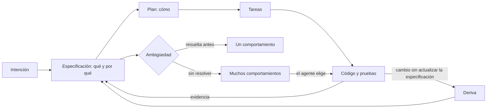
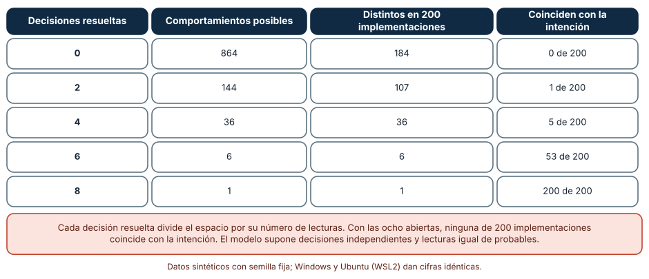

# SE-469 — De la intención a la especificación durable

[← SE-468 — Proyecto: cambio real con trazabilidad y revisión humana](https://github.com/vladimiracunadev-create/modern-software-engineering-program/blob/main/classes/part-38-desarrollo-de-software-asistido-por-ia/se-468-proyecto-cambio-real-con-trazabilidad-y-revision-humana/README.md) · [↑ Parte 39](https://github.com/vladimiracunadev-create/modern-software-engineering-program/blob/main/classes/part-39-spec-agentes-y-ciclo-de-vida-agentic/README.md) · [📚 Índice completo](https://github.com/vladimiracunadev-create/modern-software-engineering-program/blob/main/classes/README.md) · [🌐 Portal](https://vladimiracunadev-create.github.io/modern-software-engineering-program/classes/SE-469.html) · [SE-470 — Constitución, specify, clarify, plan y tasks →](https://github.com/vladimiracunadev-create/modern-software-engineering-program/blob/main/classes/part-39-spec-agentes-y-ciclo-de-vida-agentic/se-470-constitucion-specify-clarify-plan-y-tasks/README.md)

## Punto profesional y fundamento pedagógico

**Punto profesional.** La clase existe para que dejes de tratar la intención como si ya fuera una especificación. Quien trabaja con un agente de código descubre pronto que el agente hace exactamente lo que se le dice y, donde no se le dice nada, hace lo más plausible. La diferencia entre «lo más plausible» y «lo que se quería» es el trabajo del ingeniero. La habilidad es convertir un deseo («avisar a los estudiantes antes de que venzan las entregas») en un documento que otra persona, o un agente, pueda implementar sin adivinar, que pueda comprobarse con una prueba y que siga siendo cierto después de seis cambios.

**Por qué aparece aquí.** Abre la **Parte 39** después de **Proyecto: cambio real con trazabilidad y revisión humana**: la Parte 38 enseñó a usar asistentes sobre un cambio concreto, con trazabilidad y revisión. Ahora el objeto de trabajo cambia: ya no es un cambio sobre un código existente sino la especificación desde la que se construye. El caso conductor de la parte es el **servicio de recordatorios de entrega de la plataforma educativa** (en adelante, *Avisos*): envía a cada estudiante un aviso 72, 24 y 1 hora antes del vencimiento de una entrega, salvo que ya haya entregado o haya silenciado el aviso. Es un caso sintético y deliberadamente pequeño; ningún sistema, institución ni persona reales fueron analizados.

**Error conceptual que debe corregir.** Creer que una especificación es un prompt largo. Un prompt se escribe para una conversación y se pierde con ella; una especificación se escribe para sobrevivir al agente, a la sesión y a quien la redactó. Tiene identificadores que otros documentos citan, criterios que una prueba puede ejecutar, decisiones con su razón y una historia de cambios. Alargar un prompt solo aumenta el número de lugares donde puede esconderse una ambigüedad.

**Secuencia de aprendizaje.** Antes de ver los resultados, predices cuántas versiones distintas del mismo servicio saldrían de un agente que recibe una especificación con ocho ambigüedades sin resolver; después ejecutas un revisor de requisitos sobre 125 frases, cuentas las interpretaciones posibles y las que aparecen realmente, y compruebas con código la trazabilidad entre requisitos y pruebas. La secuencia usa predicción, contraste, explicación propia y recuperación. [ICAP](https://icap.education.asu.edu/research) distingue participación de construcción de conocimiento; [How People Learn II](https://nap.nationalacademies.org/catalog/24783/how-people-learn-ii-learners-contexts-and-cultures) respalda diseñar la práctica con contextos reales y retroalimentación.

**Evidencia de aprendizaje.** `spec-log.md` con la predicción, las tres figuras reproducidas, la reescritura de diez frases vagas de tu proyecto en frases comprobables, una especificación mínima de *Avisos* con identificadores y criterios, y una nota que separe qué parte de cada conclusión es medida, cuál inferida y cuál supuesta.

**Límite de la conclusión.** Las frases de requisitos, el número de ambigüedades y de lecturas por ambigüedad, y los defectos inyectados en la especificación y en las pruebas son construcciones del autor, escritas sabiendo qué buscan los detectores. No se invocó ningún modelo de lenguaje ni se observó ningún equipo real: los experimentos muestran mecanismos de comprobación, no la frecuencia de estos problemas en proyectos reales.

### Trazabilidad fuente → afirmación

| Fuente primaria u oficial | Afirmación que respalda | Lo que no prueba |
|---|---|---|
| [Spec Kit — documentación](https://github.github.io/spec-kit/) y [repositorio](https://github.com/github/spec-kit) | Describe un proceso en que la especificación se centra en el qué y el porqué, deja el cómo para el plan y se convierte en tareas e implementación; define `/speckit.specify` como creación o actualización de la especificación a partir de una descripción en lenguaje natural. | No demuestra que seguir el proceso produzca mejores productos; es la descripción de una herramienta viva. |
| [RFC 2119](https://www.rfc-editor.org/rfc/rfc2119) | Fija el significado de DEBE, NO DEBE y DEBERÍA en especificaciones, de modo que la obligatoriedad no dependa del tono. | No obliga a usar esas palabras en español ni garantiza que una frase con DEBE sea comprobable. |
| [Mavin, Wilkinson, Harwood y Novak, «Easy Approach to Requirements Syntax (EARS)»](https://doi.org/10.1109/RE.2009.9) | Propone plantillas de frase de requisito (cuando, mientras, si) que reducen ambigüedades típicas del lenguaje natural. | No cuantifica la reducción en tu dominio ni sustituye la revisión del contenido. |
| [Cucumber: Gherkin](https://cucumber.io/docs/gherkin/) | Documenta una sintaxis de dado/cuando/entonces para expresar criterios de aceptación ejecutables. | No hace que un escenario esté bien elegido: un escenario ejecutable puede comprobar lo irrelevante. |
| [Python: ast](https://docs.python.org/3/library/ast.html) y [re](https://docs.python.org/3/library/re.html) | Documentan el árbol sintáctico y las expresiones regulares usadas por el revisor y la comprobación de trazabilidad. | No validan los patrones elegidos ni la lista de palabras vagas. |

## Antes de empezar

Recupera lo aprendido en la Parte 38: un asistente es un componente cuyo resultado se verifica, no una autoridad. La pregunta activa es: **¿cuántas veces la última funcionalidad que pediste a una herramienta de IA (o a una persona) salió «bien» pero distinta de la que tenías en la cabeza, y qué frase de tu petición permitía ambas lecturas?**

## Prerrequisitos

- Haber completado `SE-468` o poder explicar cómo se traza un cambio hasta su revisión humana.
- Python 3.11 o posterior; los experimentos usan solo la biblioteca estándar (`re`, `ast`, `random`, `statistics`).
- Saber leer una expresión regular sencilla y una tabla de resultados con una semilla fija.

## Problema auténtico

El equipo de la plataforma educativa encarga a un agente de código el servicio *Avisos* con una sola frase: «Avisa a los estudiantes antes de que venzan las entregas, rápido y sin molestar». El agente entrega en una tarde un servicio que funciona, con pruebas verdes que él mismo escribió. En la revisión aparecen cuatro sorpresas: envía avisos a quien ya entregó, envía los tres avisos de golpe si el servicio estuvo caído, considera «rápido» enviar en lotes cada hora y interpreta «sin molestar» como un máximo de un aviso al día, de modo que el de una hora antes casi nunca sale. Ninguna de las cuatro lecturas es absurda; cada una resuelve una ambigüedad que la frase no resolvía. El defecto no está en el agente sino en un documento que no distingue lo que se quiere de lo que se supone. La clase enseña a escribir ese documento: qué debe contener, cómo se detecta la vaguedad antes de implementar, cuánto cuesta cada ambigüedad que queda y cómo se mantiene la relación entre cada requisito y su prueba cuando el código cambia.

## Objetivos observables

Al terminar podrás:

1. distinguir intención, especificación, plan y código por la pregunta que responde cada uno (qué y por qué, cómo, con qué piezas, hecho);
2. reescribir una frase vaga en una frase con disparador, respuesta y medida que una prueba pueda ejecutar;
3. calcular cuántos comportamientos distintos admite una especificación con ambigüedades sin resolver y cuántas decisiones faltan para que quede uno;
4. comprobar con código que cada requisito tiene un criterio y una prueba, que no hay pruebas huérfanas ni identificadores repetidos, y reconocer qué defectos de la relación requisito-prueba ese código no puede ver;
5. decidir qué es fuente de verdad cuando especificación y código divergen y registrar la decisión.

## Mapa conceptual



El mapa muestra que la especificación es el punto al que vuelve la evidencia y de donde salen plan, tareas y pruebas. Cada ambigüedad sin resolver se resuelve igualmente, pero la resuelve quien implementa y queda escondida en el código. La deriva es la separación entre lo que el documento dice y lo que el sistema hace.

## Temas y por qué importan

| Tema | Por qué cambia una decisión profesional | Evidencia mínima |
|---|---|---|
| Intención, especificación, plan y código | Mezclarlos hace que el «cómo» se cuele en el «qué» y que las razones se pierdan. | Los cuatro documentos de *Avisos* separados |
| Qué hace durable a una especificación | Una especificación que no se puede citar, probar ni versionar se convierte en un recuerdo. | Identificadores, criterios, no-objetivos y registro de decisiones |
| Vaguedad y comprobabilidad | Una frase que no se puede refutar no se puede implementar con certeza. | Resultados del revisor de requisitos sobre 125 frases |
| Espacio de interpretaciones | Cada ambigüedad multiplica los comportamientos posibles; el agente elige por ti. | Tabla de comportamientos posibles y observados |
| Trazabilidad requisito → prueba | Sin ella no se sabe qué se verifica ni qué se rompe al cambiar. | Comprobación de cobertura, huérfanas y pruebas sin aserción |
| Fuente de verdad y deriva | Cuando divergen, alguien debe decidir cuál manda y dejarlo escrito. | Regla de actualización de la especificación en el mismo cambio |

## Conceptos y decisiones

### 1. Intención, especificación, plan y código

La intención es el deseo de alguien: «que los estudiantes no pierdan entregas por olvido». La especificación declara qué comportamiento observable debe tener el sistema para satisfacerla y por qué importa: «cuando falten 72, 24 y 1 hora para el vencimiento y la entrega esté pendiente, el sistema enviará un aviso». El plan decide con qué se construye: una cola en SQLite, un proceso que despierta cada cinco minutos. Las tareas ordenan el trabajo. El código y las pruebas son el resultado. Cada nivel responde una pregunta distinta y, cuando se mezclan, aparecen dos fallos conocidos. El primero es especificar el cómo («usa una tarea cron cada hora») cuando lo que importa es el qué («el aviso llega con un retraso máximo de cinco minutos»), con lo que se fija una solución que quizá no sea la mejor. El segundo es omitir el porqué, de modo que nadie sabe si un requisito puede relajarse cuando choca con otro. Spec Kit, la herramienta de referencia de esta parte, formula esta separación al pedir que la especificación se centre en el qué y el porqué y deje la pila tecnológica para el plan.

### 2. Qué hace durable a una especificación

Una especificación es durable cuando sobrevive a tres cosas: al final de la conversación en que nació, al cambio de agente o de persona que la lee y al paso del tiempo. Para eso necesita cuatro propiedades. Cada requisito tiene un **identificador estable** (`RF-06`) que plan, tareas, pruebas y registro de cambios pueden citar; sin él, «el requisito del aviso tras la caída» es una referencia que cada persona resuelve distinto. Cada requisito tiene un **criterio comprobable**: una condición y un resultado observable que una prueba puede ejecutar. Hay una sección de **no-objetivos** que declara lo que el sistema no hará (por ejemplo, no enviar avisos por SMS en esta versión), porque un agente tiende a completar lo que no se le prohibió. Y hay un **registro de decisiones** con la fecha, la razón y la alternativa descartada, que permite saber por qué una frase dice 24 y no 48. Estas propiedades no dependen de la herramienta: caben en un archivo de texto bajo control de versiones, que es además lo que permite revisar un cambio de especificación con la misma disciplina que un cambio de código.

### 3. Vaguedad y comprobabilidad

Una frase es comprobable si existe una observación que la refute. «El sistema debe enviar los avisos rápido» no la tiene: ¿rápido para quién, medido dónde, con qué carga? La corrección no consiste en sustituir «rápido» por un número arbitrario sino en decidir qué observación importa: «el percentil 95 del retraso entre el instante previsto y la entrega al canal es de 5 minutos o menos con 500 avisos por minuto». Hay plantillas que ayudan. La sintaxis EARS ordena la frase en torno al disparador («Cuando falte 1 hora para el vencimiento…»), el estado («Mientras la entrega esté silenciada…») o la condición no deseada («Si el canal rechaza el envío…»). RFC 2119 fija el significado de DEBE y DEBERÍA para que la obligatoriedad no dependa de quien lee. Gherkin lleva el criterio a la forma dado/cuando/entonces y lo hace ejecutable. Ninguna plantilla garantiza que el contenido sea el correcto: una frase puede tener forma impecable y pedir algo equivocado. Las plantillas reducen un tipo de error, la ambigüedad de forma, y dejan intacto otro, el requisito equivocado.

Un revisor automático puede apoyarse en dos señales. La primera es léxica: palabras como «rápido», «fácil», «adecuado», «etc.» o «escalable» suelen marcar un criterio no dicho. La segunda es estructural: la frase contiene una medida (un número con su unidad) o un estado nombrado. Cada señal falla de forma distinta. La léxica da falsas alarmas cuando la palabra va seguida de su definición («rápido, entendido como un percentil 95 de 5 minutos») y deja pasar la vaguedad que no usa ninguna palabra de la lista («se avisa cuando corresponde»). La estructural da falsas alarmas con frases comprobables que no contienen cifras («cuando el estudiante silencie la entrega, no se enviarán avisos») y deja pasar frases con cifra vacía («responde en 2 segundos o lo que permita la carga»).

### 4. El espacio de interpretaciones

Cada ambigüedad es una decisión que alguien tomará. Si una especificación deja sin resolver ocho decisiones con dos o tres lecturas plausibles cada una, admite el producto de esas lecturas en comportamientos distintos, no la suma. Esto explica por qué dos implementaciones «correctas» de la misma frase difieren en detalles que nadie discutió: no eligieron mal, eligieron. También explica por qué la sensación de que «el agente se equivoca a veces» es engañosa: con muchas ambigüedades abiertas, el agente rara vez coincide con una intención concreta aunque cada una de sus decisiones sea razonable. El orden de magnitud importa más que el valor exacto. Resolver una ambigüedad divide el espacio por el número de sus lecturas; resolver las que más cuestan en caso de error es más rentable que resolver las primeras del documento, cuestión que la clase siguiente (`SE-470`) trata con las preguntas de clarificación.

### 5. Trazabilidad requisito → prueba

La trazabilidad enlaza cada requisito con las pruebas que lo comprueban y cada prueba con el requisito que justifica. Permite responder tres preguntas: qué requisitos no tienen ninguna prueba, qué pruebas no corresponden a ningún requisito vigente y qué se debe volver a ejecutar cuando cambia un requisito. Una comprobación mecánica de identificadores detecta los defectos formales: identificadores repetidos, requisitos sin criterio, requisitos sin prueba y pruebas que citan un identificador inexistente. No detecta los defectos semánticos: una prueba que cita `RF-02` pero afirma algo irrelevante cumple la forma. Tampoco, por sí sola, las pruebas sin aserción, que un recorrido del árbol sintáctico sí encuentra. La conclusión práctica es que la trazabilidad automática reduce el trabajo de revisión pero no lo sustituye: sirve para que la revisión humana se dedique a la pregunta que ninguna herramienta responde, si la prueba comprueba lo que el requisito quiere.

### 6. Fuente de verdad y deriva

Cuando la especificación y el sistema divergen hay tres salidas posibles y conviene decidir cuál se usa antes de que ocurra. En la primera manda la especificación: el código está equivocado y se corrige. En la segunda manda el código: la especificación estaba equivocada y se actualiza para reflejarlo. En la tercera ninguno manda: ambos reflejaban una decisión anterior que cambió y hay que decidir de nuevo. La política que evita la deriva es sencilla de enunciar y difícil de sostener: ningún cambio de comportamiento se fusiona sin el cambio correspondiente en la especificación, en el mismo cambio y con la misma revisión. Cuando el cambio nace en una conversación con un agente, la regla significa que la conversación no es el registro: el registro es el documento. Una especificación que se actualiza «después» se actualiza mal o no se actualiza.

## Qué hace un revisor de requisitos y qué no

Se escribió un revisor de 125 frases de requisitos de *Avisos*: 60 vagas y 65 comprobables. Entre las vagas hay 40 con palabras de la lista («sea rápido», «sea intuitivo»), 15 sin ninguna («se avisa a tiempo», «se gestionan las excepciones») y 5 con una cifra que no compromete a nada («en 2 segundos o lo que permita la carga»). Entre las comprobables hay 50 con disparador y medida, 10 con la palabra de la lista pero con su definición medible a continuación y 5 sin cifra pero con un resultado observable. Se comparan cuatro detectores.

| Detector | Marca | Vagas halladas | Falsas alarmas | Vagas que pasan |
|---|---:|---:|---:|---:|
| Lista de palabras vagas | 50 | 40 | 10 | 20 |
| Falta de medida o estado | 61 | 56 | 5 | 4 |
| Palabra vaga y sin medida | 40 | 40 | 0 | 20 |
| Palabra vaga o sin medida | 71 | 56 | 15 | 4 |

La lista de palabras tiene una precisión del 80,0 % y un recobrado del 66,7 %: de cada cinco frases que marca, una es comprobable, y de cada tres vagas se le escapa una. La falta de medida encuentra 56 de las 60 vagas, y sus 5 falsas alarmas son frases perfectamente comprobables que no contienen cifras. Exigir ambas señales elimina las falsas alarmas y deja pasar 20 frases vagas; exigir una u otra deja pasar solo 4 a cambio de 15 falsas alarmas. No hay un detector que gane en todo: el que se elija depende de si el costo mayor es revisar frases innecesarias o dejar pasar una ambigüedad.


**Cómo leer la figura.** Cada grupo es un detector; las barras son las vagas halladas (verde), las falsas alarmas (roja) y las vagas que pasan (dorada). Mira primero cómo la barra roja baja a cero con el detector «y» y cómo a cambio sube la dorada a 20. **Dónde deja de valer:** las 125 frases, las 15 vagas «sin palabra» y las 5 comprobables «sin cifra» fueron escritas por el autor sabiendo qué buscan los detectores; con requisitos reales la proporción de cada grupo es una medida por obtener y los patrones habría que recalibrarlos.

## Cuántas versiones caben en una especificación ambigua

Se supone una especificación de *Avisos* con ocho decisiones abiertas, con 2, 3, 2, 2, 3, 2, 2 y 3 lecturas plausibles (por ejemplo: ¿el aviso de una hora se envía aunque ya se enviara el de 24?, ¿el silencio vale para todas las entregas o solo para una?, ¿el límite de avisos por día incluye los reintentos?). El número de comportamientos posibles es el producto, 864. Se simulan 200 implementaciones, cada una eligiendo al azar una lectura por decisión abierta, y se cuentan los comportamientos distintos que aparecen y cuántas coinciden con la intención del autor. Después se resuelven 2, 4, 6 y 8 decisiones.

| Decisiones resueltas | Comportamientos posibles | Distintos en 200 implementaciones | Coinciden con la intención |
|---:|---:|---:|---:|
| 0 | 864 | 184 | 0 de 200 |
| 2 | 144 | 107 | 1 de 200 |
| 4 | 36 | 36 | 5 de 200 |
| 6 | 6 | 6 | 53 de 200 |
| 8 | 1 | 1 | 200 de 200 |

Con las ocho decisiones abiertas, 200 implementaciones producen 184 comportamientos distintos y ninguna coincide con la intención. Cada decisión resuelta divide el espacio; con seis resueltas quedan 6 comportamientos y 53 de 200 aciertan al azar (26,5 %). La consecuencia no es que haya que resolverlo todo antes de escribir una línea, sino que las ambigüedades que quedan abiertas son decisiones delegadas, y que delegarlas debe ser una elección deliberada y no un descuido.



**Cómo leer la figura.** El eje horizontal son las decisiones resueltas y el vertical, en escala logarítmica, los comportamientos; la línea gris son los posibles y la roja los distintos que producen 200 implementaciones. Mira primero cómo las dos convergen a 1 al resolver todas las decisiones; cuántas coinciden con la intención está en la nota. **Dónde deja de valer:** el modelo supone decisiones independientes y lecturas igual de probables, y que la lectura 0 es la intención. Un agente real no elige al azar —sus elecciones están correlacionadas con el contexto— y las ambigüedades reales no son independientes; la figura muestra el crecimiento multiplicativo, no la frecuencia con que un agente real acierta.

## Comprobar con código la relación requisito-prueba

Se generó una especificación con 24 requisitos (`RF-01` a `RF-24`) más una entrada con un identificador repetido, y un archivo de 24 pruebas con una marca `# cubre: RF-xx` por prueba. Se inyectaron doce defectos: tres requisitos sin prueba, dos pruebas que citan un identificador que no existe (`RF-99` y `RF-07b`, un identificador renombrado), un identificador repetido en la especificación, dos requisitos sin criterio de aceptación, tres pruebas sin ninguna aserción y una prueba que afirma algo irrelevante (`2 + 2 == 4` bajo `RF-02`). Una comprobación de identificadores y criterios, y después un recorrido del árbol sintáctico de las pruebas, buscan los defectos.

| Defecto inyectado | Cuántos | Lo encuentra la comprobación de identificadores y criterios | Lo encuentra el recorrido del árbol sintáctico |
|---|---:|---|---|
| Requisito sin prueba | 3 | sí (`RF-14`, `RF-19`, `RF-22`) | — |
| Prueba huérfana | 2 | sí (`RF-99`, `RF-07b`) | — |
| Identificador repetido | 1 | sí (`RF-05`) | — |
| Requisito sin criterio | 2 | sí (`RF-04`, `RF-10`) | — |
| Prueba sin aserción | 3 | no | sí (`test_rf07`, `test_rf11`, `test_rf16`) |
| Prueba que afirma algo irrelevante | 1 | no | no |
| **Total** | **12** | **8** | **11** |

La comprobación de identificadores encuentra 8 de los 12 defectos; el recorrido del árbol sintáctico añade los tres de las pruebas sin aserción y llega a 11. El que queda es el más peligroso: una prueba con forma correcta que comprueba otra cosa. Solo una persona que lea la prueba junto al requisito lo ve, o una prueba de mutación (la técnica de la Parte 30 y de `SE-471`) que mutile el comportamiento y observe si algo falla.


**Cómo leer la figura.** Cada barra es un tipo de defecto y su longitud cuántos se inyectaron; verde son los que encuentra la comprobación de identificadores y criterios, azul los que añade el árbol sintáctico y rojo el que nadie ve. Mira primero el segmento rojo del final: una prueba con forma correcta que comprueba otra cosa. **Dónde deja de valer:** los doce defectos fueron inyectados por el autor y la comprobación se escribió para encontrarlos; en un proyecto real habrá defectos de otras formas (marcas en otros formatos, pruebas parametrizadas, requisitos repartidos en varios archivos) que esta comprobación no entiende.

## Definiciones de trabajo

- **intención:** deseo o necesidad de alguien, expresado sin comprometer un comportamiento observable.
- **especificación:** documento versionado que declara qué comportamiento observable debe tener un sistema y por qué, con requisitos identificables y criterios comprobables.
- **requisito comprobable:** frase con un disparador y una respuesta para la que existe una observación que podría refutarla.
- **ambigüedad:** decisión de comportamiento que el documento no resuelve y que, por tanto, toma quien implementa.
- **trazabilidad:** relación mantenida entre cada requisito y las pruebas que lo comprueban y entre cada prueba y el requisito que la justifica.
- **deriva:** separación entre lo que la especificación dice y lo que el sistema hace.

Las definiciones son operativas para el servicio *Avisos*. No convierten términos con una historia más amplia en sinónimos y deben contrastarse con la documentación primaria enlazada al final.

## Ejemplo mínimo

El fragmento muestra la diferencia entre una frase vaga y una comprobable. Antes de ejecutarlo, predice cuál de las dos pasa el revisor.

```python
import re
MEDIDA = re.compile(r"\d+\s?(?:minutos|horas?|segundos)")
def comprobable(frase): return bool(MEDIDA.search(frase))
print(comprobable("Avisar a tiempo"), comprobable("Cuando falte 1 hora para el vencimiento, enviar un aviso en 5 minutos"))
```

La primera devuelve `False`; la segunda, `True`. Escribe después una tercera frase que contenga una cifra y siga siendo vaga («enviar el aviso en 5 minutos o cuando se pueda») y observa que el revisor la deja pasar. Registra versión de Python, comando y salida.

## Ejemplo profesional

Escenario hipotético, construido para la clase y sin datos reales. El equipo toma la frase «avisa a los estudiantes antes de que venzan las entregas, rápido y sin molestar» y la convierte en seis requisitos con identificador: `RF-01` (avisos a las 72, 24 y 1 hora antes), `RF-02` (no repetir un aviso ya enviado), `RF-03` (no avisar si la entrega está `ENTREGADA`), `RF-04` (no avisar si está `SILENCIADA`), `RF-05` (no avisar después del vencimiento) y `RF-06` (tras una caída del servicio, enviar solo el aviso del umbral más cercano). «Rápido» pasa a un requisito no funcional con medida («el percentil 95 del retraso entre el instante previsto y la entrega al canal es de 5 minutos o menos») y «sin molestar» se divide en dos: `RF-06` y un máximo de 3 avisos por entrega y día. La sección de no-objetivos declara que no habrá SMS ni avisos al docente en esta versión. El registro de decisiones anota por qué el umbral de una hora no cuenta para el máximo diario: el último aviso es el que evita la pérdida. Cada requisito tiene su criterio y su prueba con la marca de trazabilidad. Compara con el estado inicial: antes había una frase y ocho decisiones abiertas; ahora hay seis requisitos, dos decisiones registradas y una lista de lo que el sistema no hace, y cualquier agente que lo implemente puede ser comprobado contra los mismos criterios.

## Práctica guiada

1. Toma diez frases de requisitos de un proyecto propio o del corpus sintético y clasifícalas como comprobables o vagas; escribe qué observación refutaría cada comprobable.
2. Predice cuántas implementaciones distintas saldrían de una especificación con ocho decisiones abiertas; escribe el número antes de ejecutar.
3. Ejecuta `python scripts/experiments_part39_a.py 469` y reproduce las tres tablas; cambia el número de decisiones abiertas a cuatro y vuelve a calcular el espacio.
4. Reescribe las diez frases vagas con la plantilla disparador-respuesta-medida y vuelve a pasar el revisor.
5. Escribe la especificación mínima de *Avisos* con identificadores, criterios, no-objetivos y registro de decisiones, y comprueba su trazabilidad con tus propias pruebas.
6. Provoca a propósito una prueba sin aserción y una prueba huérfana y comprueba que la comprobación las encuentra.
7. Entrega `spec-log.md` y pide a otra persona que implemente tres requisitos sin ver tu intención original.

## Ejercicios

1. **Reescribir:** «El historial se conserva el tiempo habitual». Escribe dos versiones comprobables con plazos distintos y di qué decisión de negocio falta para elegir una.
2. **Contar:** una especificación tiene cinco decisiones abiertas con 2, 2, 3, 4 y 2 lecturas. Calcula el número de comportamientos posibles y cuántas decisiones hay que resolver, empezando por las de más lecturas, para que queden menos de 10.
3. **Revisor:** escribe una frase comprobable sin ninguna cifra y otra con cifra que sea vaga, y explica por qué cada una engaña a un detector distinto.
4. **Trazabilidad:** diseña una prueba que cumpla la forma (cita `RF-04`, tiene aserción) pero no compruebe el requisito, y propón una manera de detectarla.

## Reto verificable

Entrega `spec-log.md` con la predicción, las tres tablas reproducidas, la especificación mínima de *Avisos* (al menos seis requisitos con identificador y criterio, una sección de no-objetivos y un registro de dos decisiones), las diez frases reescritas y la declaración del tipo de evidencia de cada afirmación. Se aprueba si otra persona ejecuta el código desde un checkout limpio, obtiene los mismos números con las mismas semillas y puede implementar tres requisitos sin consultar tu intención original. No se aprueba por entregar la frase original con más adjetivos ni por afirmar que una especificación completa elimina el trabajo de revisión.

## Caso conductor

El servicio *Avisos* es el caso conductor de la Parte 39. Esta clase deja el primer artefacto: la especificación mínima con identificadores, criterios, no-objetivos y registro de decisiones. `SE-470` la convertirá en constitución, clarificaciones, plan y tareas con comprobaciones entre artefactos, y `SE-471` medirá cuándo la implementación converge contra ella. Cambia después un solo dato, el número de decisiones abiertas, y observa a partir de cuántas la probabilidad de acertar sin decidir deja de ser razonable para tu equipo.

## Preguntas frecuentes

### ¿Una especificación no es lo mismo que un documento de requisitos de toda la vida?

Comparte el propósito, pero cambia el uso. Una especificación en este sentido está pensada para ser leída por una persona y ejecutada por un agente, y para ser comprobada contra pruebas; por eso exige identificadores, criterios y una relación mantenida con las pruebas. Un documento de requisitos que nadie compara con el sistema es una especificación en el nombre, no en la práctica.

### ¿Hay que especificarlo todo antes de empezar?

No. La clase muestra que cada decisión sin resolver es una decisión delegada. Lo razonable es resolver las que más cuestan si se eligen mal y dejar abiertas, de forma declarada, las que no importan o que conviene aprender construyendo. «Declarada» es la palabra clave: una ambigüedad abierta con una nota («decide el equipo de implementación; se revisa en la integración») es una decisión; una oculta es un riesgo.

### ¿Escribir la especificación en Gherkin o con EARS es obligatorio?

No. Son plantillas que reducen un tipo de error de forma. Lo que importa es que cada requisito tenga un disparador, una respuesta y una observación que lo refute. Una frase en español llano con esas tres cosas es mejor que un escenario Gherkin que comprueba lo irrelevante.

### ¿Quién es la fuente de verdad, la especificación o el código?

Depende de la decisión que se tome ante cada divergencia, y lo importante es tomarla y registrarla. La política que mejor evita la deriva es no fusionar cambios de comportamiento sin el cambio correspondiente en la especificación; el código es la fuente de verdad de lo que el sistema hace, y la especificación, de lo que se decidió que debe hacer. Su diferencia es información.

## Fallo controlado y diagnóstico

Reproduce el fallo clásico de la clase: **una frase que admite varias lecturas y un agente que elige una**. Toma «los avisos deben llegar a tiempo» y escribe dos implementaciones que la cumplen según su lectura.

Registra síntoma, entrada mínima, hipótesis, observación que descarta cada hipótesis, causa, corrección y prueba de regresión. **Síntoma:** el servicio pasa todas sus pruebas y los estudiantes se quejan de que el aviso de una hora llega a veces tras el vencimiento. **Hipótesis rivales:** (a) el agente implementó mal; (b) el canal de envío es lento; (c) «a tiempo» nunca se definió y el agente eligió una lectura que las pruebas del propio agente no contradicen. **Prueba:** busca en la especificación una medida del retraso admisible; si no existe, ninguna implementación podía incumplirla y la causa es la especificación. **Conclusión:** la corrección empieza en el documento (un requisito con percentil y retraso máximo) y sigue en una prueba que lo ejecute. **Regresión:** añade una prueba que simule 500 avisos y exija el retraso máximo. No cambies a la vez el requisito y la implementación.

## Errores comunes y cómo corregirlos

| Síntoma | Causa probable | Corrección |
|---|---|---|
| El agente entrega algo que funciona y no es lo que se quería | Ambigüedades sin resolver que el agente resolvió | Resolver las de mayor costo y declarar las que se delegan |
| Las pruebas pasan pero el comportamiento es otro | Las pruebas las escribió quien implementó, a partir de su propia lectura | Escribir los criterios en la especificación antes de implementar |
| Nadie sabe por qué un requisito dice 24 horas | No hay registro de decisiones | Anotar fecha, razón y alternativa descartada |
| La especificación describe un sistema que ya no existe | Los cambios de comportamiento no actualizan el documento | Exigir el cambio de especificación en el mismo cambio que el de código |
| Se alarga el documento y siguen apareciendo sorpresas | Se añaden adjetivos en vez de criterios | Sustituir cada adjetivo por una observación que lo refute |

## Entorno y archivos clave

```text
work/SE-469/
├── README.md
├── spec/
│   ├── spec.md
│   ├── no-objetivos.md
│   └── decisiones.md
├── comprobacion/
│   ├── revisor.py
│   ├── trazabilidad.py
│   └── espacio.py
├── tests/test_avisos.py
└── evidence/spec-log.md
```

El `README` declara plataforma, versión de Python, semillas y comandos. Los experimentos usan solo la biblioteca estándar (`re`, `ast`, `random`, `statistics`) y se ejecutaron con CPython 3.12.9 en Windows 11 y 3.12.3 en Ubuntu bajo WSL2: las salidas fueron idénticas. Si añades una dependencia, fija procedencia y versión.

## Seguridad, ética y accesibilidad

- una especificación puede contener datos de personas (ejemplos con nombres reales, direcciones de correo) o información interna: usa datos sintéticos y revisa qué se comparte con un agente alojado fuera de tu entorno;
- los requisitos de privacidad (cuánto se conserva el historial, quién ve qué) son requisitos como los demás: sin criterio comprobable, un agente no tiene cómo respetarlos;
- delegar una ambigüedad en un agente es delegar una decisión que afecta a personas; registra quién la toma y con qué criterio, sobre todo si afecta a quién recibe o deja de recibir un aviso;
- las tablas y figuras deben tener texto alternativo y no depender del color; los defectos se distinguen por texto;
- los estándares y las herramientas citados tienen sus licencias: cita su estructura y vincula la fuente, no copies su texto.

## Puente hacia el trabajo con agentes

Pedirle a un agente «escribe una especificación para esto» produce un documento con aspecto de especificación y, casi siempre, con adjetivos donde debería haber medidas. Pídele en cambio que liste las decisiones que su implementación tendría que tomar y que no están resueltas, con las lecturas posibles de cada una, y que reescriba cada frase vaga como disparador, respuesta y medida. Después pasa el revisor, resuelve tú las decisiones de mayor costo y devuelve el documento con los identificadores fijados. Revisa especialmente las pruebas que el agente propone: comprueba que cada una cita el requisito que justifica y que su aserción compara el resultado observable, no la implementación. Si el agente escribe la especificación y las pruebas a partir de la misma lectura, el acuerdo entre ambos no demuestra nada.

## Transferencia

Traslada el análisis a otro dominio (por ejemplo, un sistema de reservas de salas con avisos de cancelación): cambia las frases y las decisiones abiertas y conserva el procedimiento de reescribir cada frase vaga, contar las interpretaciones que quedan, resolver las de mayor costo y comprobar la relación requisito-prueba. La transferencia está lograda cuando puedes decir qué decisiones del nuevo dominio quedan delegadas y por qué, no cuando la tabla se parece a la de *Avisos*.

## Evaluación y evidencia

| Criterio | Evidencia para aprobar |
|---|---|
| comprensión | explicación de la diferencia entre intención, especificación, plan y código y de por qué una ambigüedad es una decisión delegada |
| corrección | tablas del revisor, del espacio de interpretaciones y de la trazabilidad reproducibles con las mismas semillas |
| diseño | especificación mínima con identificadores, criterios, no-objetivos y registro de decisiones |
| diagnóstico | reproducción del fallo «frase con varias lecturas» con regresión |
| incertidumbre | declaración de que las frases, las lecturas y los defectos son construcciones del autor |
| reproducibilidad | versiones, comandos, salida y límites declarados |

## Fuentes

- [Spec Kit — documentación](https://github.github.io/spec-kit/) y [repositorio de Spec Kit](https://github.com/github/spec-kit) — proceso de desarrollo guiado por especificación y comando de especificación; autoridad: GitHub y mantenedores de la comunidad.
- [RFC 2119](https://www.rfc-editor.org/rfc/rfc2119) — significado de DEBE, NO DEBE y DEBERÍA en especificaciones; autoridad: IETF.
- [Mavin et al., «Easy Approach to Requirements Syntax (EARS)»](https://doi.org/10.1109/RE.2009.9) — plantillas de requisitos; autoridad: IEEE International Requirements Engineering Conference, 2009.
- [Cucumber: Gherkin](https://cucumber.io/docs/gherkin/) — sintaxis de criterios de aceptación ejecutables; autoridad: documentación del proyecto.
- [Python: ast](https://docs.python.org/3/library/ast.html), [re](https://docs.python.org/3/library/re.html), [random](https://docs.python.org/3/library/random.html) y [statistics](https://docs.python.org/3/library/statistics.html) — módulos usados en los experimentos; autoridad: documentación de Python.

Cada fuente respalda el mecanismo indicado; ninguna demuestra que el 66,7 % de recobrado del revisor de palabras, las 184 variantes de 864 posibles o los 11 defectos de 12 hallados se observen en un proyecto real. Esa afirmación depende del equipo, del dominio y de la forma de las especificaciones.

## Límites y siguiente paso

Se ejecutaron tres experimentos con datos sintéticos en Windows y Ubuntu (WSL2) con resultados idénticos; no se invocó ningún modelo de lenguaje ni se observó ningún equipo o sistema reales. Las 125 frases, las ocho decisiones abiertas, la independencia entre ellas, los 24 requisitos y los 12 defectos son construcciones del autor, y el revisor se escribió conociendo las frases que lo evalúan. La siguiente clase convierte la especificación en una cadena de artefactos con puertas de control entre ellos: constitución, clarificación, plan y tareas.

## Glosario

- **intención:** deseo o necesidad de alguien, expresado sin comprometer un comportamiento observable.
- **especificación:** documento versionado que declara qué comportamiento observable debe tener un sistema y por qué, con requisitos identificables y criterios comprobables.
- **requisito comprobable:** frase con un disparador y una respuesta para la que existe una observación que podría refutarla.
- **ambigüedad:** decisión de comportamiento que el documento no resuelve y que, por tanto, toma quien implementa.
- **trazabilidad:** relación mantenida entre cada requisito y las pruebas que lo comprueban y entre cada prueba y el requisito que la justifica.
- **deriva:** separación entre lo que la especificación dice y lo que el sistema hace.

---

[← SE-468 — Proyecto: cambio real con trazabilidad y revisión humana](https://github.com/vladimiracunadev-create/modern-software-engineering-program/blob/main/classes/part-38-desarrollo-de-software-asistido-por-ia/se-468-proyecto-cambio-real-con-trazabilidad-y-revision-humana/README.md) · [↑ Parte 39](https://github.com/vladimiracunadev-create/modern-software-engineering-program/blob/main/classes/part-39-spec-agentes-y-ciclo-de-vida-agentic/README.md) · [📚 Índice completo](https://github.com/vladimiracunadev-create/modern-software-engineering-program/blob/main/classes/README.md) · [🌐 Portal](https://vladimiracunadev-create.github.io/modern-software-engineering-program/classes/SE-469.html) · [SE-470 — Constitución, specify, clarify, plan y tasks →](https://github.com/vladimiracunadev-create/modern-software-engineering-program/blob/main/classes/part-39-spec-agentes-y-ciclo-de-vida-agentic/se-470-constitucion-specify-clarify-plan-y-tasks/README.md)
