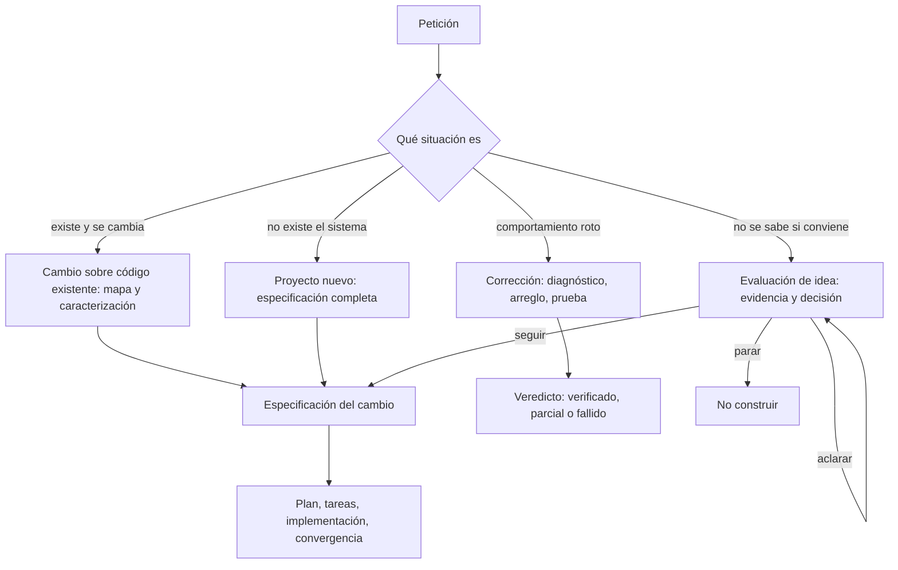

# SE-472 — Greenfield, brownfield, bug fixing e idea assessment

[← SE-471 — Implementación, análisis y convergencia contra SPEC](https://github.com/vladimiracunadev-create/modern-software-engineering-program/blob/main/classes/part-39-spec-agentes-y-ciclo-de-vida-agentic/se-471-implementacion-analisis-y-convergencia-contra-spec/README.md) · [↑ Parte 39](https://github.com/vladimiracunadev-create/modern-software-engineering-program/blob/main/classes/part-39-spec-agentes-y-ciclo-de-vida-agentic/README.md) · [📚 Índice completo](https://github.com/vladimiracunadev-create/modern-software-engineering-program/blob/main/classes/README.md) · [🌐 Portal](https://vladimiracunadev-create.github.io/modern-software-engineering-program/classes/SE-472.html) · [SE-473 — Agentes, herramientas, permisos y límites de autoridad →](https://github.com/vladimiracunadev-create/modern-software-engineering-program/blob/main/classes/part-39-spec-agentes-y-ciclo-de-vida-agentic/se-473-agentes-herramientas-permisos-y-limites-de-autoridad/README.md)

## Punto profesional y fundamento pedagógico

**Punto profesional.** La clase existe para que dejes de usar el mismo método con un agente en cuatro situaciones que no se parecen. Empezar un proyecto desde cero, cambiar uno que ya existe, corregir un error y decidir si una idea merece construirse son trabajos con riesgos distintos, evidencia distinta y un punto de parada distinto. Un agente aplicado con el mismo ritual a los cuatro produce especificaciones donde bastaba una pregunta, parches donde hacía falta un diagnóstico y código donde habría sido más barato no escribir nada. La habilidad es elegir el proceso por la situación, no por costumbre.

**Por qué aparece aquí.** Es la cuarta clase de la **Parte 39**, después de **Implementación, análisis y convergencia contra SPEC**: `SE-471` cerró el ciclo de un proyecto nuevo con especificación, tareas y convergencia. Ahora el mismo servicio de recordatorios de entrega (*Avisos*) se enfrenta a una modificación sobre código existente, a un error de producción y a una idea nueva. Es un caso sintético en el que no se analizó ningún sistema, institución ni persona reales.

**Error conceptual que debe corregir.** Creer que la especificación completa siempre es el primer paso. Para un error, el primer artefacto es un diagnóstico con la reproducción del síntoma; para una idea, es la evidencia de que merece construirse; para un cambio en código ajeno, es un mapa de lo que ya existe. Escribir una especificación de funcionalidad antes de eso formaliza una suposición.

**Secuencia de aprendizaje.** Antes de ver los resultados, predices cuántos archivos tiene que leer un agente para encontrar todos los lugares que usan una función en un repositorio de 300 módulos; después lo mides con cuatro estrategias, compruebas qué políticas de verificación aceptan cuatro tipos de arreglo de cinco errores reales de código, y calculas en qué condiciones compensa evaluar una idea antes de construirla. La secuencia usa predicción, contraste, explicación propia y recuperación. [ICAP](https://icap.education.asu.edu/research) distingue participación de construcción de conocimiento; [How People Learn II](https://nap.nationalacademies.org/catalog/24783/how-people-learn-ii-learners-contexts-and-cultures) respalda diseñar la práctica con contextos reales y retroalimentación.

**Evidencia de aprendizaje.** `situaciones-log.md` con la predicción, las tres figuras reproducidas, el proceso elegido para tres situaciones de tu proyecto con su razón, un diagnóstico de error con su reproducción y una decisión de evaluar o no una idea con el criterio usado, y una nota que separe qué parte de cada conclusión es medida, cuál inferida y cuál supuesta.

**Límite de la conclusión.** El repositorio sintético, los cinco errores con sus arreglos, las tasas de acierto de la evaluación y los valores de construir son construcciones del autor. No se invocó ningún modelo ni se ejecutó ninguna extensión de Spec Kit: las mediciones muestran el costo de leer, la capacidad de una política de verificación y una condición económica, no el comportamiento de un agente.

### Trazabilidad fuente → afirmación

| Fuente primaria u oficial | Afirmación que respalda | Lo que no prueba |
|---|---|---|
| [Spec Kit — repositorio](https://github.com/github/spec-kit) | Presenta cuatro procesos independientes —construir una funcionalidad con especificación, diagnosticar y reparar comportamiento roto, decidir si una idea merece inversión y procesos propios— y aclara que no son fases obligatorias. | No demuestra que cada proceso sea el adecuado en tu equipo. |
| [Spec Kit — guía de corrección de errores](https://github.github.io/spec-kit/guides/bugfix.html) | Separa evaluar, corregir y probar; la evaluación no modifica código, solo la corrección lo hace, la prueba no edita código para que pase, y el veredicto es «verificado», «parcial» o «fallido»; una batería que pasa no basta si no se ejercitó la reproducción original. | No garantiza que el diagnóstico sea correcto: pide revisarlo. |
| [Spec Kit — proyectos existentes](https://github.github.io/spec-kit/how-to/existing-projects.html) | Indica que se puede adoptar el proceso en un repositorio que ya contiene código. | No cuantifica el costo de entender el código existente. |
| [Feathers, «Working Effectively with Legacy Code»](https://www.pearson.com/en-us/subject-catalog/p/working-effectively-with-legacy-code/P200000009466/9780131177055) | Fundamenta las pruebas de caracterización y la búsqueda de costuras antes de cambiar código ajeno. | No se aplica automáticamente a bases de código que un agente modifica. |
| [Python: pathlib](https://docs.python.org/3/library/pathlib.html), [tempfile](https://docs.python.org/3/library/tempfile.html) y [re](https://docs.python.org/3/library/re.html) | Documentan los módulos usados para generar y leer el repositorio sintético. | No validan la estrategia de búsqueda. |

## Antes de empezar

Recupera lo aprendido en `SE-471`: converger es un resultado que otro verifica. La pregunta activa es: **¿qué hiciste la última vez que tuviste que cambiar código que no escribiste: leíste todo, buscaste un nombre o preguntaste a quien sabía, y qué te dejó sin ver?**

## Prerrequisitos

- Haber completado `SE-471` o poder explicar el ciclo implementar → converger con condiciones de parada.
- Python 3.11 o posterior; los experimentos usan solo la biblioteca estándar (`pathlib`, `tempfile`, `re`, `random`).
- Saber leer una función con un defecto y escribir una prueba que lo reproduzca.

## Problema auténtico

*Avisos* lleva un trimestre en producción. En una semana llegan tres peticiones: cambiar los umbrales de aviso para que el curso pueda configurarlos, corregir una queja («a una estudiante le llegó el aviso de 24 horas cuando faltaban 48») y evaluar una idea nueva (avisos por mensajería instantánea). El equipo pide al agente que haga las tres con «la especificación de siempre» y el agente produce tres documentos largos. El primero propone reescribir el módulo de umbrales sin haber leído que otros cuatro módulos lo usan, uno de ellos por una cadena de texto; el segundo diagnostica una condición de carrera inexistente porque nadie le dio los datos del caso; el tercero especifica con detalle una funcionalidad cuyo costo de integración nadie ha estimado. La clase compara cuatro procesos y enseña a elegir.

## Objetivos observables

Al terminar podrás:

1. elegir entre proyecto nuevo, cambio sobre código existente, corrección de error y evaluación de idea según la situación y justificar la elección;
2. explicar por qué leer un repositorio ajeno cuesta más de lo que parece y comparar estrategias de búsqueda por archivos leídos, bytes y cambios encontrados;
3. distinguir una corrección de la causa de una corrección del síntoma y diseñar una verificación que no acepte la segunda;
4. interpretar el veredicto de una corrección (verificado, parcial, fallido) y decir qué evidencia exige cada uno;
5. decidir si evaluar una idea antes de construirla compensa en función de la probabilidad de que sea buena y del costo de construirla.

## Mapa conceptual



Los cuatro caminos tienen artefactos de partida distintos y se reúnen en la especificación del cambio solo cuando hay algo que construir. La evaluación puede terminar sin ninguna línea de código, y esa es una salida legítima.

## Temas y por qué importan

| Tema | Por qué cambia una decisión profesional | Evidencia mínima |
|---|---|---|
| Proyecto nuevo | Se paga la especificación completa porque no hay nada más a lo que agarrarse. | Cadena de `SE-469` a `SE-471` |
| Cambio sobre código existente | El costo está en entender lo que ya hay y en no romperlo. | Mapa de módulos y archivos que cambian |
| Corrección de errores | Un parche del síntoma pasa las pruebas y deja el defecto. | Diagnóstico con reproducción y variantes |
| Evaluación de ideas | Evita construir lo que no vale; es una decisión, no un trámite. | Decisión con evidencia y su costo |
| Estrategias de lectura | La forma de buscar decide qué se ve y qué se escapa. | Archivos leídos y cambios hallados por estrategia |
| Políticas de verificación | Qué se acepta como «arreglado» define qué errores vuelven. | Tabla de aceptación por política y tipo de arreglo |

## Conceptos y decisiones

### 1. Proyecto nuevo: la especificación completa

En un proyecto sin código previo el riesgo es construir lo equivocado con rapidez, y por eso el proceso de `SE-469` a `SE-471` es el apropiado: constitución, especificación con clarificación, plan, tareas, implementación y convergencia. La libertad es grande y el costo de una ambigüedad es alto precisamente porque nada limita las lecturas posibles. El riesgo opuesto también existe: especificar con detalle lo que no se entiende todavía. Una funcionalidad cuya demanda no está probada merece antes una evaluación; una cuya demanda está probada merece la cadena completa.

### 2. Cambio sobre código existente: entender antes de pedir

Con código previo, la especificación del cambio debe nombrar el comportamiento actual y lo que cambia, y el primer artefacto es un **mapa**: qué módulos intervienen, quién usa qué, qué pruebas existen. Un agente al que se le pide cambiar una función sin ese mapa tiene que reconstruirlo, y la forma de hacerlo decide el resultado. Leer todo es fiable y caro: en un repositorio de 300 módulos son más de mil kilobytes, lejos de lo que cabe con comodidad en el contexto de un agente. Buscar el nombre de la función es barato y falla donde el uso no contiene el nombre: una llamada construida con una cadena de texto, un alias, una reflexión. Buscar además lo que importa el módulo que la define añade los usuarios por importación a un costo moderado. Un mapa de arquitectura mantenido hace lo mismo con menos lectura, pero su fiabilidad es la de su actualización: uno de hace un trimestre omite lo que cambió desde entonces. Ninguna estrategia es la mejor; cada una falla donde su supuesto falla, y la que se elija debe acompañarse de una pregunta de verificación («¿hay usos dinámicos?») que cubra su punto ciego.

Las pruebas de caracterización (Feathers) son el complemento natural: antes de cambiar, se fija con pruebas lo que el código hace hoy, y el agente cambia con esa red. Es el mismo principio de `SE-435`, aplicado ahora a un colaborador que no recuerda el módulo.

### 3. Corrección de errores: diagnosticar, arreglar, probar

Spec Kit organiza la corrección en tres pasos que se mantienen separados por una razón: **evaluar** produce un diagnóstico y no cambia código; **corregir** es el único paso que edita fuentes y registra cualquier desviación del diagnóstico; **probar** vuelve a ejecutar la reproducción y las pruebas relevantes, escribe un informe y no edita código para que el resultado pase. El veredicto final es «verificado», «parcial» o «fallido», y solo el primero confirma el arreglo. La guía añade una advertencia que la clase convierte en método: una batería que pasa no basta si la reproducción original nunca se ejercitó. La razón es lógica: un error existe porque la batería existente no lo detectaba, de modo que el código sin corregir también la pasa.

Hay tres clases de arreglo que conviene distinguir. El de la **causa** elimina el defecto. El del **síntoma** hace que la reproducción pase sin eliminar la causa (un caso especial para la entrada exacta del informe). El que **rompe otra cosa** corrige la reproducción y cambia un comportamiento que la batería existente sí cubría o no. Una política de verificación se mide por cuáles de las tres aceptan.

### 4. Evaluación de ideas: una decisión sobre evidencia

La evaluación de una idea no requiere código ni funcionalidad de especificación: reúne evidencia para decidir si vale la pena seguir. Spec Kit la define como una decisión «seguir, aclarar o parar» respaldada por evidencia. Es útil cuando el costo de construir es alto y la probabilidad de que la idea sea buena es incierta. Su valor tiene una expresión sencilla: si la evaluación cuesta poco y distingue razonablemente las ideas buenas de las malas, ahorra construir las malas; si casi todas las ideas son buenas, la evaluación solo retrasa; si casi todas son malas, la evaluación evita casi todo el gasto. Entre esos extremos hay un rango donde compensa, y la clase lo calcula. Parar es un resultado válido: la evaluación que termina en «no construir» no fracasó.

### 5. Elegir el proceso por la situación

La elección se resume en preguntas. ¿Existe ya el sistema? Si no, proyecto nuevo; si sí, mapa y caracterización. ¿Hay un comportamiento que contradice lo esperado? Entonces es una corrección y el artefacto es el diagnóstico. ¿No se sabe si debe hacerse? Evaluación. Muchas peticiones mezclan situaciones: «cambiar los umbrales» puede ser un cambio sobre código existente y, además, ocultar un error latente; «avisos por mensajería» puede empezar como evaluación y terminar como proyecto nuevo. La disciplina consiste en nombrar la situación antes de empezar y revisar el nombre cuando aparezca evidencia nueva.

## Cuatro formas de leer un repositorio ajeno

Se generó un repositorio sintético de 300 módulos de Python (1 004 KB), cada uno con entre una y tres importaciones. La función `calcular_umbral` se define en el módulo `m047` y se usa en cuatro módulos más: dos la importan por nombre, uno la importa con un alias y uno la llama por una cadena de texto construida en tiempo de ejecución. Deben cambiar los cinco. Se comparan cinco estrategias.

| Estrategia | Módulos leídos | KB leídos | Cambios hallados |
|---|---:|---:|---:|
| Leer todo | 300 | 1 004,0 | 5 de 5 |
| Buscar el nombre y leer los que lo contienen | 4 | 11,8 | 4 de 5 |
| Buscar el nombre y el módulo que lo define | 9 | 27,2 | 5 de 5 |
| Mapa de arquitectura vigente y sus módulos | 5 | 15,3 | 5 de 5 |
| Mapa de hace un trimestre (sin el módulo dinámico) | 4 | 11,8 | 4 de 5 |

Buscar el nombre lee 4 módulos y 11,8 KB, el 1,2 % del repositorio, y encuentra 4 de los 5: no ve el uso por cadena de texto. Añadir los módulos que importan el que define la función eleva la lectura a 9 módulos y 27,2 KB y encuentra los cinco, porque el módulo dinámico importa a `m047`. El mapa vigente es el más barato para los cinco (15,3 KB) y su equivalente desactualizado pierde exactamente lo que cambió después. Dos lecciones: la búsqueda barata tiene un punto ciego previsible y se corrige con una pregunta dirigida, y el mapa solo vale lo que valga su mantenimiento.


**Cómo leer la figura.** Cada grupo es una estrategia, con los cambios hallados entre paréntesis; la barra azul oscura son los módulos leídos y la roja los kilobytes, en escala logarítmica. Mira primero la distancia de más de una década entre leer todo y las demás, y que solo la búsqueda por nombre y el mapa viejo se quedan en 4 de 5. **Dónde deja de valer:** el repositorio es sintético, los módulos son pequeños y regulares, hay un solo uso dinámico y la función tiene un nombre poco ambiguo; en un repositorio real los nombres chocan, los usos dinámicos son más y los módulos son más grandes, de modo que las cifras cambiarían aunque el ordenamiento de las estrategias probablemente no.

## Qué arreglo acepta cada política de verificación

Se escribieron cinco errores en el dominio de *Avisos* con cuatro candidatos de arreglo cada uno: el código sin corregir, un arreglo del síntoma (un caso especial para la entrada de la reproducción), un arreglo que rompe otro caso de la batería y un arreglo de la causa. Los errores son: horas restantes calculadas con la parte de segundos de una diferencia en lugar del total; un umbral comparado de forma exclusiva en lugar de inclusiva; un umbral guardado como texto y buscado como número; una lista compartida entre llamadas por un argumento por defecto mutable; y un estado silenciado comparado con distinción de mayúsculas. Cada error tiene una batería existente que el código defectuoso pasa, una reproducción que falla y tres casos vecinos que fallan con el código sin corregir. Se mide cuántos de los cinco casos acepta cada política de verificación.

| Política de verificación | Sin corregir | Arregla el síntoma | Arregla y rompe otro caso | Arregla la causa |
|---|---:|---:|---:|---:|
| Solo la batería existente | 5 de 5 | 5 de 5 | 3 de 5 | 5 de 5 |
| Solo la reproducción | 0 de 5 | 5 de 5 | 5 de 5 | 5 de 5 |
| Batería y reproducción | 0 de 5 | 5 de 5 | 3 de 5 | 5 de 5 |
| Batería, reproducción y casos vecinos | 0 de 5 | 0 de 5 | 1 de 5 | 5 de 5 |

La batería existente acepta el código **sin corregir** en los cinco casos: es la forma de ver por qué «los tests pasan» no es un veredicto. La reproducción rechaza el código defectuoso pero acepta los cinco arreglos del síntoma. Batería y reproducción juntas rechazan dos de los cinco arreglos que rompen otro caso y aceptan los cinco del síntoma. Solo añadir casos vecinos de la reproducción rechaza los arreglos del síntoma y deja pasar únicamente el de la causa. Un arreglo que rompe otro caso se cuela en un caso porque su ruptura no está cubierta por la batería ni por los vecinos; solo una batería mejor lo detectaría.


**Cómo leer la figura.** Cada fila es una política de verificación y cada columna un candidato de arreglo; cuanto más oscura la celda, más arreglos de cinco acepta la política. Mira primero la columna del arreglo del síntoma, oscura hasta la última fila, y la del código sin corregir, que solo la batería sola acepta. **Dónde deja de valer:** los cinco errores, las baterías de tres casos y los arreglos fueron escritos por el autor; un error real puede no tener una reproducción simple, y los casos vecinos de un error real son difíciles de enumerar.

## Cuándo compensa evaluar una idea

Se simulan 20 000 ideas por fila. Construir cuesta 10; una idea buena vale 40 y una mala 0. Evaluar cuesta 1 y da una señal favorable con probabilidad 0,85 si la idea es buena y 0,25 si es mala; la política «evaluar y construir si procede» construye solo con señal favorable. Se compara con construir todo y con no construir nada (valor 0) para distintas proporciones de ideas buenas.

| Ideas buenas | Construir todo | Evaluar y construir si procede | No construir | Mejor opción |
|---:|---:|---:|---:|---|
| 5 % | −8,12 | −2,18 | 0,00 | no construir |
| 10 % | −6,21 | −0,84 | 0,00 | no construir |
| 25 % | −0,19 | 3,38 | 0,00 | evaluar |
| 50 % | 9,68 | 10,33 | 0,00 | evaluar |
| 75 % | 19,74 | 17,29 | 0,00 | construir todo |

Cuando solo el 5 % o el 10 % de las ideas es buena, el valor esperado de evaluar es negativo y la mejor política es no construir nada: la evaluación reduce las pérdidas pero no las elimina. Con el 25 %, evaluar convierte −0,19 en 3,38. Con el 50 % la ventaja es pequeña (10,33 frente a 9,68). Con el 75 %, construir todo gana: evaluar descarta ideas buenas por una señal imperfecta. La evaluación compensa en un rango intermedio, y ese rango depende del costo de construir, no solo de la proporción.


**Cómo leer la figura.** El eje horizontal es la proporción de ideas buenas y el vertical el valor esperado; cada línea es una política. Mira primero dónde se cruzan: no construir gana a la izquierda, evaluar en el centro y construir todo a la derecha. **Dónde deja de valer:** el valor de 40, el costo de 10, la señal de evaluación de 0,85 y 0,25 y la independencia entre ideas son supuestos del autor; en la práctica la proporción de ideas buenas es desconocida y la señal no es binaria. La tabla muestra la forma de la decisión, no cuándo evaluar en tu organización.

## Definiciones de trabajo

- **proyecto nuevo (greenfield):** construcción de un sistema que no existe, sin restricciones de código previo.
- **cambio sobre código existente (brownfield):** modificación de un sistema en uso, que debe preservar su comportamiento salvo en lo que se cambia.
- **diagnóstico:** conclusión razonada de la causa de un comportamiento, con la reproducción que lo respalda.
- **arreglo del síntoma:** modificación que hace pasar la reproducción sin eliminar la causa del defecto.
- **veredicto de corrección:** resultado de la prueba de un arreglo: verificado, parcial o fallido.
- **evaluación de idea:** recolección de evidencia para decidir si una idea merece seguir, aclararse o detenerse.

Las definiciones son operativas para el servicio *Avisos*. No convierten términos con una historia más amplia en sinónimos y deben contrastarse con la documentación primaria enlazada al final.

## Ejemplo mínimo

El fragmento muestra un arreglo del síntoma. Antes de ejecutarlo, predice si la reproducción pasa y si pasa un vecino.

```python
def horas(dias, seg):                      # defecto: usa solo los segundos del día
    return (dias * 86400 + seg) % 86400 // 3600
def horas_parche(dias, seg):               # arregla solo la entrada de la queja
    return 26 if (dias, seg) == (1, 7200) else horas(dias, seg)
print(horas_parche(1, 7200), horas_parche(2, 3600))
```

La reproducción devuelve 26 y el vecino, 1 en lugar de 49. Escribe después el arreglo de la causa (`(dias * 86400 + seg) // 3600`) y comprueba que devuelve 26 y 49. Registra versión de Python, comando y salida.

## Ejemplo profesional

Escenario hipotético, construido para la clase y sin datos reales. El equipo de *Avisos* clasifica sus tres peticiones. La de los umbrales configurables es un cambio sobre código existente: el agente recibe un mapa con los cinco módulos que usan `calcular_umbral` y una pregunta explícita («¿hay usos dinámicos?») para cubrir el punto ciego de la búsqueda por nombre; encuentra el módulo que la llama por una cadena de texto y añade una prueba de caracterización antes de tocarlo. La queja de la estudiante es una corrección: el diagnóstico, escrito antes de cambiar nada, identifica que las horas restantes se calculan con la parte de segundos de la diferencia; la reproducción es la entrada de la queja; la verificación incluye tres casos vecinos (dos días y una hora, tres días exactos, un día exacto) y el veredicto es «verificado» solo cuando los cuatro pasan. La idea de mensajería es una evaluación: el equipo estima que una de cada cuatro ideas similares resultó valiosa, que construir cuesta diez veces más que evaluar y decide evaluar con una encuesta de cinco preguntas y una prueba de integración de dos días; la señal sale desfavorable y se decide parar. Compara con el estado inicial: tres documentos de especificación idénticos frente a tres procesos distintos, uno de los cuales terminó sin escribir código.

## Práctica guiada

1. Clasifica diez peticiones de un proyecto propio en las cuatro situaciones y escribe el artefacto de partida de cada una.
2. Predice cuántos módulos hay que leer para encontrar todos los usos de una función en un repositorio de 300 módulos; escribe el número antes de medir.
3. Ejecuta `python scripts/experiments_part39_a.py 472` y reproduce las tres tablas; cambia el módulo dinámico a un alias y observa qué estrategias lo encuentran.
4. Toma un error corregido recientemente en tu proyecto y escribe su reproducción y tres casos vecinos; comprueba si el arreglo los pasa.
5. Escribe el arreglo del síntoma de ese error y comprueba qué política de verificación lo acepta.
6. Estima la proporción de ideas buenas de tu organización y calcula con la fórmula de la clase si compensa evaluar.
7. Entrega `situaciones-log.md` y pide a otra persona que clasifique tus tres peticiones sin ver tu razón.

## Ejercicios

1. **Situación:** «el aviso de una hora a veces llega tarde y queremos que sea configurable». Separa la petición en dos situaciones y di qué artefacto produce cada una.
2. **Lectura:** diseña una pregunta dirigida que cubra el punto ciego de buscar por nombre y explica qué clase de uso no ve.
3. **Verificación:** escribe tres casos vecinos para un error de redondeo de una nota y di qué arreglo del síntoma detectan.
4. **Evaluar:** con un valor de 60, un costo de construir de 20, un costo de evaluar de 2, una señal de 0,8 y 0,3 y un 20 % de ideas buenas, calcula el valor esperado de las tres políticas.

## Reto verificable

Entrega `situaciones-log.md` con la predicción, las tres tablas, la clasificación de diez peticiones, un diagnóstico con reproducción y casos vecinos para un error real o realista, y una decisión de evaluar o no una idea con su cálculo. Se aprueba si otra persona ejecuta el código desde un checkout limpio, obtiene los mismos números con las mismas semillas y puede decir qué proceso usaría para una petición nueva y por qué. No se aprueba por usar la cadena completa en las cuatro situaciones ni por declarar «verificado» un arreglo cuya reproducción no se ejecutó.

## Caso conductor

El servicio *Avisos* es el caso conductor de la Parte 39. Esta clase deja el cuarto artefacto: la clasificación de las situaciones, el mapa del código existente y el criterio para aceptar una corrección. `SE-473` fijará con qué herramientas y permisos trabaja el agente en cada una de estas situaciones. Cambia después un solo dato, la proporción de ideas buenas, y observa en qué punto cambia la política óptima de tu organización.

## Preguntas frecuentes

### ¿Hay que escribir una especificación para cada corrección de error?

No una de funcionalidad. Hace falta un diagnóstico con la reproducción y los criterios de verificación, que es una especificación del comportamiento esperado en el caso roto. Si el error revela un requisito que faltaba, ese sí se añade a la especificación del sistema.

### ¿Por qué no leer todo el repositorio?

Porque no cabe cómodamente en el contexto de un agente y porque leer mucho no equivale a entender: el agente tiene que decidir qué importa. Leer todo sirve de referencia para medir otras estrategias, no como práctica habitual en repositorios grandes.

### ¿Un veredicto «parcial» es un fracaso?

No: indica que parte de la verificación no pudo completarse (por ejemplo, falta un entorno). Es una información que obliga a completar lo que falta antes de fusionar, y es más honesta que un «verificado» que no ejecutó la reproducción.

### ¿Evaluar una idea no es retrasar la decisión?

Lo es si casi todas las ideas son buenas o si evaluar cuesta casi como construir. La tabla de la clase muestra que compensa en un rango intermedio; fuera de él, o se construye o se descarta. El error es evaluar siempre, igual que construir siempre.

## Fallo controlado y diagnóstico

Reproduce el fallo clásico de la clase: **un arreglo que pasa la reproducción y deja el defecto**. Aplica el arreglo del síntoma de las horas restantes y ejecuta la política de verificación de la reproducción.

Registra síntoma, entrada mínima, hipótesis, observación que descarta cada hipótesis, causa, corrección y prueba de regresión. **Síntoma:** la estudiante deja de quejarse y otra estudiante recibe el aviso equivocado dos semanas después. **Hipótesis rivales:** (a) hubo un error nuevo; (b) el arreglo cubrió solo la entrada de la queja; (c) la batería no detecta el defecto. **Prueba:** ejecuta la reproducción con tres entradas vecinas; si dos fallan, la causa es el arreglo del síntoma. **Conclusión:** la verificación aceptó un arreglo que no eliminó la causa. **Regresión:** añade los casos vecinos como parte de la verificación y exige que el diagnóstico nombre la causa. No cambies a la vez el arreglo y los criterios de aceptación.

## Errores comunes y cómo corregirlos

| Síntoma | Causa probable | Corrección |
|---|---|---|
| El agente cambia una función y rompe un módulo lejano | Búsqueda solo por nombre | Añadir una pregunta por usos dinámicos y una prueba de caracterización |
| El mismo error vuelve con otra entrada | Se arregló el síntoma | Exigir diagnóstico de la causa y casos vecinos |
| «Los tests pasan» y el error sigue | La batería ya pasaba con el error | Ejecutar la reproducción original como criterio |
| Se especifica una funcionalidad que nadie quería | No se evaluó la idea | Evaluar cuando construir es caro y la demanda es incierta |
| El mapa del sistema no refleja el código | Está desactualizado | Fecharlo y regenerarlo con cada cambio estructural |

## Entorno y archivos clave

```text
work/SE-472/
├── README.md
├── situaciones/clasificacion.md
├── lectura/
│   ├── repo_sintetico.py
│   └── estrategias.py
├── correccion/
│   ├── errores.py
│   └── politicas.py
├── evaluacion/valor.py
└── evidence/situaciones-log.md
```

El `README` declara plataforma, versión de Python, semillas y comandos. Los experimentos usan solo la biblioteca estándar y se ejecutaron con CPython 3.12.9 en Windows 11 y 3.12.3 en Ubuntu bajo WSL2: las salidas fueron idénticas. El repositorio sintético se crea en un directorio temporal y se elimina al terminar.

## Seguridad, ética y accesibilidad

- un agente que lee un repositorio ajeno puede acceder a secretos y datos personales: restringe el directorio, revisa qué archivos se envían a un servicio externo y excluye los de configuración sensible;
- una corrección de un error que afecta a personas (un aviso que no llegó) merece comunicar el alcance, no solo el arreglo; registra a quién afectó;
- decidir no construir una idea también afecta a personas; registra quién decide y con qué evidencia, sobre todo si la idea beneficiaba a un grupo con menos voz;
- las tablas y figuras deben tener texto alternativo y no depender del color; los veredictos se distinguen por texto;
- las herramientas citadas tienen licencias: cita su estructura y vincula la fuente, no copies su texto.

## Puente hacia el trabajo con agentes

Pedirle a un agente «arregla este error» sin más le permite elegir el arreglo más corto, que muchas veces es el del síntoma. Pídele en cambio un diagnóstico antes de tocar nada, con la reproducción, la causa propuesta y las pruebas que la distinguirían de otras causas; revisa el diagnóstico tú, autoriza el arreglo y exige después que ejecute la reproducción y tres casos vecinos que tú elegiste. Para un cambio sobre código existente, entrégale un mapa y una pregunta por usos dinámicos, y compara lo que encuentra con tu propia búsqueda. Para una idea, pídele evidencia y una recomendación de seguir, aclarar o parar, y desconfía de una recomendación de seguir que no cite ninguna evidencia externa a su propio razonamiento.

## Transferencia

Traslada el análisis a otro dominio (por ejemplo, el módulo de reservas de una biblioteca): cambia el repositorio, los errores y la idea y conserva el procedimiento de clasificar la petición, elegir una estrategia de lectura con una pregunta que cubra su punto ciego, verificar los arreglos con la reproducción y sus vecinos y calcular si compensa evaluar. La transferencia está lograda cuando puedes decir qué uso del nuevo repositorio no encontraría tu estrategia y qué arreglo del síntoma aceptaría tu verificación, no cuando las cifras se parecen a las de *Avisos*.

## Evaluación y evidencia

| Criterio | Evidencia para aprobar |
|---|---|
| comprensión | explicación de qué situación es cada petición y por qué cambia el artefacto de partida |
| corrección | tablas de lectura, verificación y valor reproducibles con las mismas semillas |
| diseño | mapa, pregunta por usos dinámicos, diagnóstico con vecinos y cálculo de evaluar |
| diagnóstico | reproducción del fallo «arreglo del síntoma» con regresión |
| incertidumbre | declaración de que el repositorio, los errores y los valores son del autor |
| reproducibilidad | versiones, comandos, salida y límites declarados |

## Fuentes

- [Spec Kit — repositorio](https://github.com/github/spec-kit) — procesos de funcionalidad, corrección y evaluación como puntos de entrada independientes; autoridad: GitHub y mantenedores de la comunidad.
- [Spec Kit — guía de corrección de errores](https://github.github.io/spec-kit/guides/bugfix.html) — evaluar, corregir y probar, y veredictos; autoridad: GitHub y mantenedores.
- [Spec Kit — proyectos existentes](https://github.github.io/spec-kit/how-to/existing-projects.html) — adoptar el proceso en un repositorio con código; autoridad: GitHub y mantenedores.
- [Feathers, «Working Effectively with Legacy Code»](https://www.pearson.com/en-us/subject-catalog/p/working-effectively-with-legacy-code/P200000009466/9780131177055) — caracterización y costuras; autoridad: libro de referencia.
- [Python: pathlib](https://docs.python.org/3/library/pathlib.html), [tempfile](https://docs.python.org/3/library/tempfile.html) y [re](https://docs.python.org/3/library/re.html) — módulos usados en el repositorio sintético; autoridad: documentación de Python.

Cada fuente respalda el mecanismo indicado; ninguna demuestra que los 27,2 KB de lectura, los 5 de 5 arreglos del síntoma aceptados por la reproducción o el 25 % de ideas buenas como umbral de evaluación se observen en un proyecto real. Esa afirmación depende del repositorio, de los errores y de la organización.

## Límites y siguiente paso

Se ejecutaron tres experimentos en Windows y Ubuntu (WSL2) con resultados idénticos: la lectura del repositorio sintético y las pruebas de las políticas de verificación son ejecuciones reales de código y el cálculo del valor de evaluar es una simulación con semilla fija. No se invocó ningún modelo, no se ejecutó ninguna extensión de Spec Kit y no se observó ningún sistema real. El repositorio, los cinco errores, las baterías, los arreglos y los parámetros económicos son construcciones del autor, y las estrategias y políticas se evaluaron con casos escritos sabiendo qué buscan. La siguiente clase fija con qué herramientas y permisos trabaja el agente en cada una de estas situaciones.

## Glosario

- **proyecto nuevo (greenfield):** construcción de un sistema que no existe, sin restricciones de código previo.
- **cambio sobre código existente (brownfield):** modificación de un sistema en uso, que debe preservar su comportamiento salvo en lo que se cambia.
- **diagnóstico:** conclusión razonada de la causa de un comportamiento, con la reproducción que lo respalda.
- **arreglo del síntoma:** modificación que hace pasar la reproducción sin eliminar la causa del defecto.
- **veredicto de corrección:** resultado de la prueba de un arreglo: verificado, parcial o fallido.
- **evaluación de idea:** recolección de evidencia para decidir si una idea merece seguir, aclararse o detenerse.

---

[← SE-471 — Implementación, análisis y convergencia contra SPEC](https://github.com/vladimiracunadev-create/modern-software-engineering-program/blob/main/classes/part-39-spec-agentes-y-ciclo-de-vida-agentic/se-471-implementacion-analisis-y-convergencia-contra-spec/README.md) · [↑ Parte 39](https://github.com/vladimiracunadev-create/modern-software-engineering-program/blob/main/classes/part-39-spec-agentes-y-ciclo-de-vida-agentic/README.md) · [📚 Índice completo](https://github.com/vladimiracunadev-create/modern-software-engineering-program/blob/main/classes/README.md) · [🌐 Portal](https://vladimiracunadev-create.github.io/modern-software-engineering-program/classes/SE-472.html) · [SE-473 — Agentes, herramientas, permisos y límites de autoridad →](https://github.com/vladimiracunadev-create/modern-software-engineering-program/blob/main/classes/part-39-spec-agentes-y-ciclo-de-vida-agentic/se-473-agentes-herramientas-permisos-y-limites-de-autoridad/README.md)
