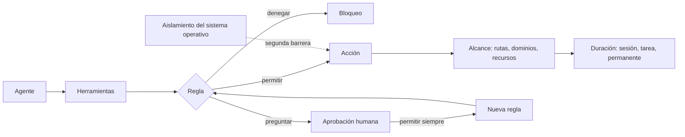
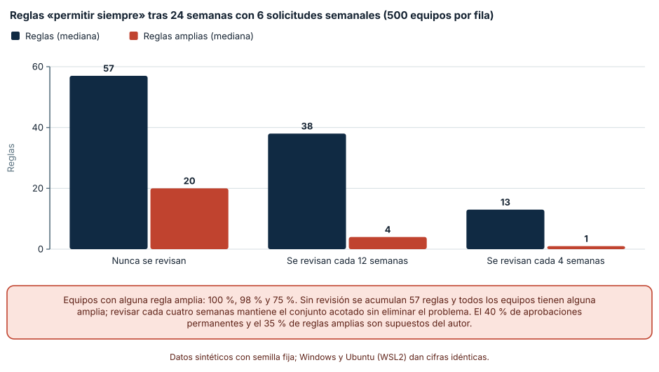

# SE-473 — Agentes, herramientas, permisos y límites de autoridad

[← SE-472 — Greenfield, brownfield, bug fixing e idea assessment](https://github.com/vladimiracunadev-create/modern-software-engineering-program/blob/main/classes/part-39-spec-agentes-y-ciclo-de-vida-agentic/se-472-greenfield-brownfield-bug-fixing-e-idea-assessment/README.md) · [↑ Parte 39](https://github.com/vladimiracunadev-create/modern-software-engineering-program/blob/main/classes/part-39-spec-agentes-y-ciclo-de-vida-agentic/README.md) · [📚 Índice completo](https://github.com/vladimiracunadev-create/modern-software-engineering-program/blob/main/classes/README.md) · [🌐 Portal](https://vladimiracunadev-create.github.io/modern-software-engineering-program/classes/SE-473.html) · [SE-474 — Skills, plugins, hooks y entornos aislados →](https://github.com/vladimiracunadev-create/modern-software-engineering-program/blob/main/classes/part-39-spec-agentes-y-ciclo-de-vida-agentic/se-474-skills-plugins-hooks-y-entornos-aislados/README.md)

## Punto profesional y fundamento pedagógico

**Punto profesional.** La clase existe para que dejes de describir a un agente por lo que sabe y empieces a describirlo por lo que puede hacer. Un agente es un modelo que llama herramientas en un bucle; lo que lo hace peligroso o útil no es su inteligencia sino su autoridad: qué herramientas tiene, con qué permisos, sobre qué recursos y durante cuánto tiempo. La habilidad es diseñar esa autoridad con el mínimo necesario, comprobar que las reglas dicen lo que se cree que dicen y revisarlas antes de que se acumulen.

**Por qué aparece aquí.** Es la quinta clase de la **Parte 39**, después de **Greenfield, brownfield, bug fixing e idea assessment**: `SE-472` eligió el proceso según la situación; ahora hay que decidir con qué manos trabaja el agente en cada una. El caso conductor sigue siendo el **servicio de recordatorios de entrega** (*Avisos*). Es un caso sintético; no se ejecutó ninguna herramienta contra un sistema real y las órdenes que se evalúan son cadenas de texto que nunca se ejecutan.

**Error conceptual que debe corregir.** Creer que una lista de permitidos escrita como prefijos de órdenes («permite `ls`, `git status`») limita al agente a esas órdenes. Una orden compuesta, una sustitución o una ruta fuera del espacio de trabajo cambian lo que ocurre sin cambiar el prefijo. Una regla de permisos es un programa pequeño con sus propios fallos y debe someterse a pruebas como cualquier otro.

**Secuencia de aprendizaje.** Antes de ver los resultados, predices cuántas de dieciséis órdenes peligrosas deja pasar una lista de prefijos; después ejecutas cuatro políticas sobre treinta órdenes, mides el daño posible de cinco mil sesiones con distinta configuración de herramientas y simulas cómo se acumulan las reglas «permitir siempre» a lo largo de veinticuatro semanas. La secuencia usa predicción, contraste, explicación propia y recuperación. [ICAP](https://icap.education.asu.edu/research) distingue participación de construcción de conocimiento; [How People Learn II](https://nap.nationalacademies.org/catalog/24783/how-people-learn-ii-learners-contexts-and-cultures) respalda diseñar la práctica con contextos reales y retroalimentación.

**Evidencia de aprendizaje.** `autoridad-log.md` con la predicción, las tres figuras reproducidas, el inventario de herramientas de un agente de tu proyecto con la autoridad de cada una, una política de permisos con pruebas de las órdenes que debe frenar y dejar pasar y un calendario de revisión de reglas, y una nota que separe qué parte de cada conclusión es medida, cuál inferida y cuál supuesta.

**Límite de la conclusión.** Las treinta órdenes, las doce herramientas, la probabilidad de desvío del 5 % y la dinámica de aprobaciones son construcciones del autor, escritas sabiendo qué busca cada política. Ninguna orden se ejecutó y no se invocó ningún modelo: los experimentos muestran cómo falla un motor de reglas y cómo se acumula la autoridad, no la frecuencia con que un agente real se desvía.

### Trazabilidad fuente → afirmación

| Fuente primaria u oficial | Afirmación que respalda | Lo que no prueba |
|---|---|---|
| [Saltzer y Schroeder, «The protection of information in computer systems»](https://doi.org/10.1109/PROC.1975.9939) | Formula el principio de mínimo privilegio: cada programa y cada usuario debe operar con el menor conjunto de privilegios necesario, lo que limita el daño de un accidente o un uso indebido. | No aplica el principio a agentes basados en modelos de lenguaje; es un fundamento anterior. |
| [Claude Code: permisos](https://code.claude.com/docs/en/permissions) | Documenta reglas de permitir, preguntar y denegar evaluadas en ese orden, de modo que la primera que coincide decide y una regla de permitir no puede hacer excepción a una de denegar; reconoce los separadores de órdenes compuestas y advierte de que los patrones que intentan restringir argumentos son frágiles. | Describe una herramienta concreta y su versión; no es un estándar general ni garantiza que tus reglas estén bien escritas. |
| [Claude Code: aislamiento (sandbox)](https://code.claude.com/docs/en/sandboxing) | Documenta un aislamiento a nivel de sistema operativo del sistema de archivos y de la red para las órdenes de shell, independiente de las reglas de permisos. | No cubre otras herramientas ni otros agentes. |
| [OWASP Top 10 para aplicaciones con LLM](https://genai.owasp.org/llm-top-10/) | Lista riesgos de aplicaciones con modelos de lenguaje, entre ellos agencia excesiva (demasiada funcionalidad, permisos o autonomía). | No cuantifica la frecuencia de cada riesgo. |
| [Python: shlex](https://docs.python.org/3/library/shlex.html) y [posixpath](https://docs.python.org/3/library/os.path.html) | Documentan la división de órdenes en palabras y la normalización de rutas usadas en el motor de reglas. | No son un intérprete de shell: no resuelven todas las construcciones. |

## Antes de empezar

Recupera lo aprendido en `SE-472`: un arreglo se acepta por la verificación que lo prueba, no por el que lo escribe. La pregunta activa es: **¿qué puede hacer hoy el asistente que usas en tu proyecto sin pedirte permiso, y cuántas de esas capacidades has revisado alguna vez?**

## Prerrequisitos

- Haber completado `SE-472` o poder clasificar una petición en nuevo, cambio, corrección o evaluación.
- Python 3.11 o posterior; los experimentos usan solo la biblioteca estándar (`shlex`, `posixpath`, `re`, `random`).
- Saber leer una orden de shell con `&&`, `;`, `|` y una redirección `>`, y distinguir una ruta relativa de una absoluta.

## Problema auténtico

El equipo de *Avisos* da a su agente una lista de órdenes permitidas: `ls`, `cat`, `git status`, `git log`, `git diff`, `python -m pytest`, `grep`, `head`, `tail`. Un día el agente, al resumir un archivo de una entrega de un estudiante que contenía un texto con instrucciones, ejecuta `cat notas.txt; rm -rf /srv/work/datos`. La regla de prefijo la dejó pasar porque la orden empieza por `cat`. Al revisar el incidente, el equipo descubre tres cosas: que la lista no distinguía órdenes compuestas, que `cat` leía fuera del espacio de trabajo con una ruta con `..` y que meses de respuestas «permitir siempre» habían añadido cincuenta reglas, veinte de ellas amplias, que nadie recordaba. La clase enseña a medir la autoridad de un agente, a escribir reglas que se puedan probar y a mantenerlas.

## Objetivos observables

Al terminar podrás:

1. descomponer la autoridad de un agente en herramientas, permisos, alcance y duración, y calcular su radio de daño;
2. escribir reglas de permitir, preguntar y denegar y explicar el orden en que se evalúan y por qué una regla de permitir no puede hacer excepción a una de denegar;
3. probar un motor de reglas con órdenes inocuas y peligrosas, distinguiendo qué falla con prefijos, con análisis de segmentos y con confinamiento de rutas;
4. calcular cómo cambia la probabilidad de daño al quitar herramientas, confinar el alcance y exigir aprobación;
5. diseñar la revisión periódica de las reglas acumuladas.

## Mapa conceptual



La regla decide si una acción procede; el alcance y la duración acotan lo que esa acción puede tocar y por cuánto tiempo. El aislamiento del sistema operativo es una segunda barrera que actúa aunque la regla se equivoque. Las respuestas «permitir siempre» realimentan el conjunto de reglas.

## Temas y por qué importan

| Tema | Por qué cambia una decisión profesional | Evidencia mínima |
|---|---|---|
| Autoridad = herramientas × permisos × alcance × duración | Sin descomponerla no se sabe qué reducir. | Inventario de las doce herramientas con su autoridad |
| Mínimo privilegio | Limita el daño de un accidente o una desviación. | Radio de daño por configuración |
| Reglas de permitir, preguntar y denegar | El orden de evaluación decide qué excepciones son posibles. | Reglas probadas con órdenes inocuas y peligrosas |
| Órdenes compuestas y rutas | Es donde fallan los prefijos. | Tabla de políticas con escapes y fricción |
| Aislamiento del sistema operativo | Una segunda barrera cuando la regla falla. | Declaración de qué cubre y qué no |
| Acumulación de reglas | Las aprobaciones permanentes crecen solas. | Calendario de revisión y reglas amplias a las 24 semanas |

## Conceptos y decisiones

### 1. La autoridad de un agente

La autoridad es todo lo que el agente puede hacer, y tiene cuatro dimensiones. Las **herramientas** son las acciones disponibles: leer archivos, escribir, ejecutar órdenes, enviar correos, escribir en una base de datos. Los **permisos** son las reglas que dicen cuáles de esas acciones proceden sin preguntar. El **alcance** es sobre qué: qué rutas, qué dominios, qué tablas, qué cuentas. La **duración** es por cuánto: una acción, una tarea, una sesión o para siempre. Dos agentes con las mismas herramientas pueden tener autoridades muy distintas: uno que escribe solo en el directorio del proyecto durante una tarea y otro que escribe en cualquier lugar con una credencial permanente. Hablar de «el agente puede usar la shell» sin precisar las otras tres dimensiones es no decir nada sobre el riesgo.

### 2. Mínimo privilegio

Saltzer y Schroeder formularon en 1975 el principio de que cada programa y cada usuario deben operar con el menor conjunto de privilegios necesario para su trabajo; así se limita el daño que puede resultar de un accidente o un error, y se reduce el número de programas con privilegios que hay que revisar. La aplicación a un agente es directa y la clase la formula como tres decisiones: quitar las herramientas que la tarea no necesita (un agente que corrige un error no necesita enviar correos), confinar lo que las herramientas restantes pueden tocar (escribir solo dentro del espacio de trabajo) y exigir aprobación humana para lo que no se puede deshacer. Las tres reducen el daño por razones distintas y se acumulan.

### 3. Permitir, preguntar y denegar

Un conjunto de reglas de tres niveles —permitir, preguntar, denegar— es el diseño habitual. Lo que importa es el orden de evaluación. En la documentación de Claude Code, las reglas se evalúan en el orden denegar, preguntar, permitir, y la primera que coincide decide; la especificidad no cambia el orden, de modo que una regla amplia de denegar bloquea cualquier llamada que coincida aunque exista una regla de permitir más estrecha. La consecuencia es que una denegación es una garantía y una excepción dentro de ella no es posible; si hace falta una excepción, hay que reescribir la denegación. Otra propiedad documentada: las reglas de órdenes reconocen los separadores `&&`, `||`, `;`, `|` y el salto de línea, y para que una orden compuesta proceda sin preguntar cada subcomando debe estar permitido, mientras que una regla de denegar o preguntar se aplica si **cualquiera** de los subcomandos coincide.

### 4. Por qué los patrones sobre argumentos son frágiles

La misma documentación advierte de que los patrones que intentan restringir argumentos son frágiles: una regla para permitir `curl` solo hacia un dominio no cubre las variantes con opciones antes de la dirección, otro protocolo, una redirección o una variable. La razón es general. Un patrón de texto compara cadenas, y la misma acción admite muchas cadenas: hay un número ilimitado de formas de escribir una ruta que sale del espacio de trabajo (`..`, rutas absolutas, enlaces, variables), y la regla debe tratar la ruta como lo que es, una ubicación resuelta, no como un texto. Cuando hace falta restringir el destino de una operación, es más fiable denegar la herramienta que la hace o confinarla a nivel del sistema operativo que escribir un patrón cada vez más largo.

### 5. El aislamiento del sistema operativo como segunda barrera

Las reglas de permisos actúan sobre lo que el agente intenta hacer a través de sus herramientas; el aislamiento a nivel del sistema operativo actúa sobre lo que los procesos pueden hacer, sea cual sea quien los lanzó. Claude Code documenta un aislamiento del sistema de archivos y de la red para las órdenes de shell, implementado con las primitivas del sistema operativo (por ejemplo, Seatbelt en macOS y bubblewrap en Linux y WSL2), independiente de las reglas. Las dos barreras fallan de forma distinta: la regla se equivoca por un patrón mal escrito, el aislamiento por una configuración demasiado abierta, y por eso se usan juntas. El aislamiento no cubre las herramientas que no pasan por la shell ni lo que ocurre dentro de los dominios permitidos.

### 6. La acumulación de reglas

Las respuestas «permitir siempre» crean reglas permanentes. Cada una se decidió con prisa, en un momento concreto, y ninguna se vuelve a mirar. Con el tiempo el conjunto crece, se vuelve inconsistente y contiene reglas más amplias de lo que la decisión original quería: un «permitir siempre» sobre una orden concreta se generaliza a su prefijo. El resultado es una autoridad que nadie diseñó. La contramedida es la misma que para cualquier configuración: una revisión periódica que elimina las reglas no usadas y reexamina las amplias, con un responsable y un calendario. La simulación de esta clase mide cuánto cambia el estado a las 24 semanas.

## Cuatro políticas frente a treinta órdenes

Se escribieron treinta órdenes de shell sobre el espacio de trabajo `/srv/work/entregas`: 14 inocuas (listar, leer un archivo del proyecto, `git status`, ejecutar las pruebas, escribir dentro del espacio) y 16 peligrosas (órdenes compuestas con `curl`, con `rm`, redirecciones fuera del espacio, lecturas con `..` o con una ruta de un directorio hermano cuyo nombre empieza igual, `git push --force`). Ninguna se ejecuta. Se comparan cuatro políticas: permitirlo todo, una lista de permitidos por prefijo, una lista que además analiza los segmentos de órdenes compuestas y sustituciones, y esa misma con confinamiento de rutas y redirecciones al espacio de trabajo.

| Política | Peligrosas permitidas sin preguntar | Peligrosas frenadas | Inocuas frenadas (fricción) |
|---|---:|---:|---:|
| Permitirlo todo | 16 de 16 | 0 de 16 | 0 de 14 |
| Lista por prefijo | 13 de 16 | 3 de 16 | 1 de 14 |
| Lista con análisis de segmentos | 4 de 16 | 12 de 16 | 1 de 14 |
| Segmentos y confinamiento de rutas | 0 de 16 | 16 de 16 | 0 de 14 |

La lista por prefijo deja pasar 13 de las 16 órdenes peligrosas: `ls && curl … | sh`, `cat notas.txt; rm -rf …`, `git status $(curl …)` y la escritura fuera del espacio con `ls > …` empiezan por un prefijo permitido. El análisis de segmentos cierra las órdenes compuestas y las sustituciones y deja pasar cuatro lecturas fuera del espacio (`cat ../../secretos/clave.txt`, `cat /srv/work/entregas-evil/x`, `grep -rn token /srv/work/secretos` y `cat src/../../../etc/hosts`), porque `cat` y `grep` son órdenes de lectura permitidas. El confinamiento de rutas las frena y no frena ninguna orden inocua. El resultado de la última fila es mérito de la construcción: las órdenes se escribieron sabiendo qué reglas las evaluarían.


**Cómo leer la figura.** Cada grupo es una política; las barras son las peligrosas permitidas (roja), las peligrosas frenadas (verde) y las inocuas frenadas (dorada). Mira primero cómo la barra roja se acorta de arriba abajo y que la dorada, el coste en inocuas, es de una como máximo. **Dónde deja de valer:** las treinta órdenes se escribieron para esta comparación y el motor no ejecuta nada ni interpreta toda la sintaxis de la shell (variables, `eval`, funciones, archivos de órdenes); un motor de reglas real enfrenta construcciones que esta tabla no incluye y debe complementarse con aislamiento del sistema operativo.

## El radio de daño según la configuración

Se simulan 5 000 sesiones de 20 acciones cada una. En cada acción el agente se desvía de la tarea con probabilidad 0,05 (por una confusión o por un texto inyectado) y, cuando se desvía, usa una herramienta al azar de las que tiene. De las doce herramientas, seis son de solo lectura o de bajo efecto, cinco son destructivas o salientes (escribir y borrar archivos, ejecutar la shell, enviar correos, empujar a un repositorio remoto, escribir en la base de datos) y una (confirmar cambios localmente) tiene un efecto medio. La tarea necesita seis. Se cuenta qué fracción de las sesiones contiene al menos una acción dañina en cuatro configuraciones.

| Configuración | Sesiones con algún daño | Acciones dañinas por sesión (media) |
|---|---:|---:|
| Todas las herramientas, alcance completo | 41,6 % | 0,53 |
| Solo las herramientas de la tarea (6) | 21,3 % | 0,24 |
| …y escritura confinada al espacio de trabajo | 3,2 % | 0,03 |
| …y lo destructivo exige aprobación humana | 0,0 % | 0,00 |

Quitar las seis herramientas que la tarea no necesita reduce a la mitad la fracción de sesiones con daño (de 41,6 % a 21,3 %); confinar la escritura al espacio de trabajo la reduce a 3,2 %; exigir aprobación para lo destructivo la lleva a cero en este modelo, porque se supone que la persona que aprueba rechaza lo que no corresponde. Esa última suposición es la débil: `SE-477` mide lo que ocurre cuando la aprobación se vuelve rutina.


**Cómo leer la figura.** Cada barra es una configuración acumulativa y su longitud el porcentaje de sesiones con algún daño; las acciones dañinas por sesión están entre paréntesis. Mira primero cómo cada restricción acorta la barra y que la última no existe: el cero supone una aprobación humana perfecta. **Dónde deja de valer:** el 5 % de desvíos, la elección uniforme de herramienta durante el desvío, el 15 % de acciones confinadas que aún llegan a algo dañino y la aprobación perfecta son supuestos del autor; un agente desviado por un texto inyectado no elige al azar, y los desvíos reales se concentran en las herramientas más útiles para el atacante.

## Las reglas «permitir siempre» a lo largo de seis meses

Se simulan 500 equipos durante 24 semanas. Cada semana aparecen 6 solicitudes de aprobación; el 40 % se contesta «permitir siempre» y crea una regla permanente, de la cual el 35 % es amplia (se generaliza al prefijo de la orden). Las reglas se usan con una probabilidad semanal (las amplias más a menudo). Se comparan tres políticas: nunca revisar, revisar cada 12 semanas y revisar cada 4 semanas; la revisión elimina las reglas no usadas desde la revisión anterior y descarta el 70 % de las amplias que encuentra.

| Política de revisión | Reglas a las 24 semanas (mediana) | Reglas amplias (mediana) | Equipos con al menos una regla amplia |
|---|---:|---:|---:|
| Nunca se revisan | 57 | 20 | 100 % |
| Cada 12 semanas | 38 | 4 | 98 % |
| Cada 4 semanas | 13 | 1 | 75 % |

Sin revisión, un equipo típico acumula 57 reglas, 20 de ellas amplias, y todos los equipos tienen al menos una regla amplia. Revisar cada 12 semanas deja 38 y 4; cada 4 semanas, 13 y 1, aunque el 75 % de los equipos conserva una regla amplia. La revisión no elimina el problema, lo mantiene acotado.



**Cómo leer la figura.** Cada grupo es una política de revisión; la barra azul oscura son las reglas totales (mediana) y la roja las amplias. Mira primero cómo bajan las dos al revisar con más frecuencia y que la roja no llega a cero; los equipos con alguna amplia están en la nota. **Dónde deja de valer:** el 40 % de respuestas «permitir siempre», el 35 % de reglas amplias, las probabilidades de uso y el modelo de revisión son supuestos del autor; la dinámica real depende de cómo la herramienta ofrece la opción y de cuánta presión haya por terminar.

## Definiciones de trabajo

- **autoridad de un agente:** conjunto de acciones que puede realizar, determinado por sus herramientas, permisos, alcance y duración.
- **mínimo privilegio:** principio por el que cada componente opera con el menor conjunto de privilegios que su tarea requiere.
- **regla de permisos:** condición sobre una acción que decide si procede, se pregunta o se bloquea.
- **radio de daño:** conjunto de efectos que una acción errónea o maliciosa puede causar con la autoridad disponible.
- **confinamiento:** limitación de lo que una operación puede tocar a una región resuelta (un directorio, un dominio).
- **aislamiento del sistema operativo:** restricción impuesta por el sistema operativo a los procesos, independiente de las reglas del agente.

Las definiciones son operativas para el servicio *Avisos*. No convierten términos con una historia más amplia en sinónimos y deben contrastarse con la documentación primaria enlazada al final.

## Ejemplo mínimo

El fragmento muestra por qué un prefijo no limita una orden compuesta. Antes de ejecutarlo, predice qué imprime.

```python
PERMITIDOS = ("ls", "cat", "git status")
def por_prefijo(cmd): return cmd.startswith(PERMITIDOS)
print(por_prefijo("cat notas.txt"), por_prefijo("cat notas.txt; rm -rf datos"))
```

Imprime `True True`. Reescribe la comprobación para dividir la orden en segmentos (`;`, `&&`, `||`, `|`) y exigir que todos los segmentos estén permitidos, y comprueba que la segunda orden se frena. Añade después `cat ../../secretos/clave.txt` y observa que el análisis de segmentos la deja pasar. Registra versión de Python, comando y salida.

## Ejemplo profesional

Escenario hipotético, construido para la clase y sin datos reales. El equipo de *Avisos* hace el inventario de las doce herramientas de su agente y anota para cada una la autoridad en sus cuatro dimensiones. Para corregir errores, el agente necesita leer, buscar, listar, escribir en el espacio de trabajo, confirmar cambios y consultar la base de pruebas; el resto —borrar archivos, ejecutar la shell sin restricciones, enviar correos, empujar a un remoto, escribir en la base real y abrir direcciones externas— se quita de la tarea. La escritura se confina al directorio del proyecto y las órdenes de shell restantes (pruebas, `git status`) se permiten con análisis de segmentos y confinamiento de rutas, con la denegación explícita de `curl`, `wget` y `rm`. El equipo escribe una batería de cuarenta órdenes, veinte inocuas y veinte peligrosas, que se ejecuta en la integración continua; añade el aislamiento del sistema operativo como segunda barrera y programa una revisión de reglas cada cuatro semanas con un responsable. Compara con el estado inicial: antes la autoridad era la suma de lo que se había ido aprobando; ahora es un diseño con una prueba y un calendario.

## Práctica guiada

1. Haz el inventario de las herramientas de un agente que uses y anota para cada una herramienta, permiso, alcance y duración.
2. Predice cuántas órdenes peligrosas de una lista de dieciséis deja pasar un prefijo; escribe el número antes de ejecutar.
3. Ejecuta `python scripts/experiments_part39_a.py 473` y reproduce las tres tablas; añade tres órdenes peligrosas propias y comprueba cuáles pasan.
4. Escribe una política con denegaciones explícitas y comprueba con una orden compuesta que una regla de permitir no puede hacer excepción a una de denegar.
5. Añade el aislamiento del sistema operativo o describe por escrito qué cubriría y qué no.
6. Calcula el radio de daño de tu configuración con la fórmula de la clase y decide qué herramienta quitarías primero.
7. Entrega `autoridad-log.md` y pide a otra persona que proponga una orden que tu política deje pasar.

## Ejercicios

1. **Inventario:** para un agente que redacta notas de versión, lista cuatro herramientas y cuatro dimensiones de autoridad cada una, y marca cuál quitarías.
2. **Regla:** escribe una denegación y una autorización que se solapen y di cuál manda según el orden denegar, preguntar, permitir.
3. **Rutas:** escribe cinco rutas que escapan de `/srv/work/entregas` y di cuáles detecta una comparación de prefijo y cuáles solo una normalización.
4. **Revisión:** con 6 solicitudes semanales y 40 % de «permitir siempre», estima cuántas reglas se crean en 24 semanas y decide cada cuánto revisarías.

## Reto verificable

Entrega `autoridad-log.md` con la predicción, las tres tablas, el inventario de herramientas con su autoridad, una política de permisos con una batería de al menos veinte órdenes que debe frenar y veinte que debe dejar pasar, y un calendario de revisión con responsable. Se aprueba si otra persona ejecuta el código desde un checkout limpio, obtiene los mismos números con las mismas semillas y no consigue colar una orden peligrosa que tu batería no incluyera, o si lo consigue y tu registro dice cómo lo detectarías. No se aprueba por probar solo las órdenes que la política ya frenaba ni por afirmar que una lista de prefijos limita al agente.

## Caso conductor

El servicio *Avisos* es el caso conductor de la Parte 39. Esta clase deja el quinto artefacto: el inventario de autoridad, la política de permisos con su batería y el calendario de revisión. `SE-474` añadirá los mecanismos con que el agente carga conocimiento y se somete a controles —habilidades, extensiones y ganchos— y entornos aislados donde ejecutar. Cambia después un solo dato, la probabilidad de desvío, y observa a partir de qué valor la aprobación humana pasa a ser la barrera principal y no la última.

## Preguntas frecuentes

### ¿Por qué no basta con una lista de órdenes permitidas?

Porque una orden es una cadena, y la misma cadena puede encadenar otras órdenes, sustituir resultados o apuntar fuera del espacio de trabajo. Una lista de permitidos es útil como parte de una política que analiza segmentos y rutas y se acompaña de aislamiento del sistema operativo; sola, deja pasar lo que el prefijo no revela.

### ¿Denegar es más seguro que preguntar?

Es más predecible: una denegación no depende de que alguien lea con atención. Pero también es más rígida; úsala para lo que no debe ocurrir nunca en esa tarea (borrar el directorio de datos, enviar a direcciones externas) y deja las preguntas para lo que a veces es legítimo. El costo de preguntar de más se estudia en `SE-477`.

### ¿El aislamiento del sistema operativo reemplaza las reglas?

No. Cubre lo que los procesos pueden hacer, no lo que el agente pretende; no cubre las herramientas que no pasan por la shell ni lo que ocurre dentro de los dominios permitidos. Las reglas explican la intención y el aislamiento limita las consecuencias; las dos fallan por motivos distintos.

### ¿Cada cuánto se revisan las reglas?

La simulación sugiere que revisar cada cuatro semanas mantiene el conjunto pequeño y que no revisar lo deja crecer sin control; el intervalo exacto depende de cuántas aprobaciones se conceden. Fija un responsable y registra qué se elimina y por qué.

## Fallo controlado y diagnóstico

Reproduce el fallo clásico de la clase: **una regla de prefijo que deja pasar una orden compuesta**. Ejecuta la política por prefijo sobre las dieciséis órdenes peligrosas.

Registra síntoma, entrada mínima, hipótesis, observación que descarta cada hipótesis, causa, corrección y prueba de regresión. **Síntoma:** el agente ejecutó `cat notas.txt; rm -rf datos` sin preguntar. **Hipótesis rivales:** (a) el agente ignoró la política; (b) la política no incluía `rm`; (c) la política comprobó solo el principio de la cadena. **Prueba:** ejecuta la política sobre la orden y sobre cada segmento por separado; si el segmento `rm` se frena y la orden completa no, la causa es (c). **Conclusión:** la política evaluó el prefijo y no los segmentos. **Regresión:** añade a la batería las órdenes compuestas y con sustituciones y exige que se frenen. No cambies a la vez la política y la batería.

## Errores comunes y cómo corregirlos

| Síntoma | Causa probable | Corrección |
|---|---|---|
| El agente ejecuta algo no previsto con una orden permitida | Comprobación por prefijo | Analizar segmentos y sustituciones antes de decidir |
| Lee archivos fuera del proyecto | Rutas sin resolver | Normalizar y comparar con la ruta del espacio de trabajo, rechazar el byte nulo |
| Una excepción de permitir no surte efecto | Una denegación más amplia manda | Reescribir la denegación en lugar de añadir una excepción |
| Las reglas se acumulan y nadie las conoce | «Permitir siempre» sin revisión | Revisión periódica con responsable y registro |
| La política bloquea trabajo legítimo y se desactiva | Reglas demasiado estrictas sin ajuste | Medir la fricción con una batería de órdenes inocuas y ajustar |

## Entorno y archivos clave

```text
work/SE-473/
├── README.md
├── autoridad/inventario.md
├── permisos/
│   ├── politica.py
│   └── test_politica.py
├── riesgo/radio_de_dano.py
├── revision/acumulacion.py
└── evidence/autoridad-log.md
```

El `README` declara plataforma, versión de Python, semillas y comandos. Los experimentos usan solo la biblioteca estándar; las órdenes son cadenas que nunca se ejecutan. Se ejecutaron con CPython 3.12.9 en Windows 11 y 3.12.3 en Ubuntu bajo WSL2: las salidas fueron idénticas. Si pruebas un motor de permisos real, hazlo en un directorio desechable.

## Seguridad, ética y accesibilidad

- las órdenes de prueba no deben incluir cadenas que se ejecuten por accidente: guárdalas como datos y no las pases a ningún intérprete;
- una política de permisos decide qué datos de personas puede leer el agente: incluye en el inventario los directorios con datos personales y márcalos como denegados por defecto;
- las aprobaciones permanentes trasladan una decisión a quien no estuvo en el momento; registra quién las concede y cuándo caducan;
- las tablas y figuras deben tener texto alternativo y no depender del color; los resultados se distinguen por texto;
- las herramientas citadas tienen licencias y versiones: cita su estructura y vincula la fuente, no copies su texto.

## Puente hacia el trabajo con agentes

Pedirle a un agente «configura tus permisos para trabajar cómodo» le deja decidir su propia autoridad. Pídele en cambio que liste las herramientas que necesita para la tarea concreta y para cada una el alcance mínimo, que proponga las órdenes que debería poder ejecutar y las que no, y que escriba la batería de órdenes inocuas y peligrosas con la que se probará la política. Revisa tú las denegaciones y la batería, y ejecuta la batería con un motor distinto del que usa el agente. Si el agente pide ampliar un permiso a mitad de la tarea, trátalo como una decisión de diseño: ¿falta una herramienta, o se está saliendo de la tarea?

## Transferencia

Traslada el análisis a otro dominio (por ejemplo, un agente que gestiona el calendario y el correo de un docente): cambia las herramientas, los recursos y las órdenes y conserva el procedimiento de descomponer la autoridad, quitar lo que la tarea no necesita, confinar el alcance, exigir aprobación para lo irreversible y revisar las reglas acumuladas. La transferencia está lograda cuando puedes decir qué orden peligrosa de ese dominio dejaría pasar tu política, no cuando la tabla se parece a la de *Avisos*.

## Evaluación y evidencia

| Criterio | Evidencia para aprobar |
|---|---|
| comprensión | explicación de las cuatro dimensiones de la autoridad y del orden de evaluación de las reglas |
| corrección | tablas del motor, del radio de daño y de la acumulación reproducibles con las mismas semillas |
| diseño | inventario, política con batería de veinte y veinte órdenes y calendario de revisión |
| diagnóstico | reproducción del fallo «prefijo que deja pasar una orden compuesta» con regresión |
| incertidumbre | declaración de que las órdenes, los desvíos y las dinámicas son construcciones del autor |
| reproducibilidad | versiones, comandos, salida y límites declarados |

## Fuentes

- [Saltzer y Schroeder](https://doi.org/10.1109/PROC.1975.9939) — mínimo privilegio y protección de la información; autoridad: Proceedings of the IEEE, 1975.
- [Claude Code: permisos](https://code.claude.com/docs/en/permissions) — orden de evaluación, órdenes compuestas y fragilidad de los patrones sobre argumentos; autoridad: documentación de Anthropic.
- [Claude Code: aislamiento (sandbox)](https://code.claude.com/docs/en/sandboxing) — aislamiento de sistema de archivos y red a nivel del sistema operativo; autoridad: documentación de Anthropic.
- [OWASP Top 10 para aplicaciones con LLM](https://genai.owasp.org/llm-top-10/) — riesgos, entre ellos la agencia excesiva; autoridad: proyecto OWASP GenAI.
- [Python: shlex](https://docs.python.org/3/library/shlex.html) y [os.path](https://docs.python.org/3/library/os.path.html) — división de órdenes y normalización de rutas; autoridad: documentación de Python.

Cada fuente respalda el mecanismo indicado; ninguna demuestra que el 41,6 % de sesiones con daño, las 13 de 16 órdenes que pasa un prefijo o las 57 reglas a las 24 semanas se observen en un equipo real. Esa afirmación depende del agente, de las herramientas y de la forma de trabajar.

## Límites y siguiente paso

Se ejecutaron tres experimentos en Windows y Ubuntu (WSL2) con resultados idénticos: el motor de reglas es código real que analiza cadenas sin ejecutarlas, y el radio de daño y la acumulación son simulaciones con semilla fija. No se invocó ningún modelo, no se ejecutó ninguna orden del conjunto de prueba y no se observó ningún sistema real. Las treinta órdenes, las doce herramientas, los desvíos y las respuestas de aprobación son construcciones del autor, y el motor se evaluó con órdenes escritas conociendo sus reglas. No se probó el aislamiento del sistema operativo. La siguiente clase añade los mecanismos que cargan conocimiento y controles en el agente —habilidades, extensiones y ganchos— y los entornos aislados donde se ejecuta.

## Glosario

- **autoridad de un agente:** conjunto de acciones que puede realizar, determinado por sus herramientas, permisos, alcance y duración.
- **mínimo privilegio:** principio por el que cada componente opera con el menor conjunto de privilegios que su tarea requiere.
- **regla de permisos:** condición sobre una acción que decide si procede, se pregunta o se bloquea.
- **radio de daño:** conjunto de efectos que una acción errónea o maliciosa puede causar con la autoridad disponible.
- **confinamiento:** limitación de lo que una operación puede tocar a una región resuelta (un directorio, un dominio).
- **aislamiento del sistema operativo:** restricción impuesta por el sistema operativo a los procesos, independiente de las reglas del agente.

---

[← SE-472 — Greenfield, brownfield, bug fixing e idea assessment](https://github.com/vladimiracunadev-create/modern-software-engineering-program/blob/main/classes/part-39-spec-agentes-y-ciclo-de-vida-agentic/se-472-greenfield-brownfield-bug-fixing-e-idea-assessment/README.md) · [↑ Parte 39](https://github.com/vladimiracunadev-create/modern-software-engineering-program/blob/main/classes/part-39-spec-agentes-y-ciclo-de-vida-agentic/README.md) · [📚 Índice completo](https://github.com/vladimiracunadev-create/modern-software-engineering-program/blob/main/classes/README.md) · [🌐 Portal](https://vladimiracunadev-create.github.io/modern-software-engineering-program/classes/SE-473.html) · [SE-474 — Skills, plugins, hooks y entornos aislados →](https://github.com/vladimiracunadev-create/modern-software-engineering-program/blob/main/classes/part-39-spec-agentes-y-ciclo-de-vida-agentic/se-474-skills-plugins-hooks-y-entornos-aislados/README.md)
