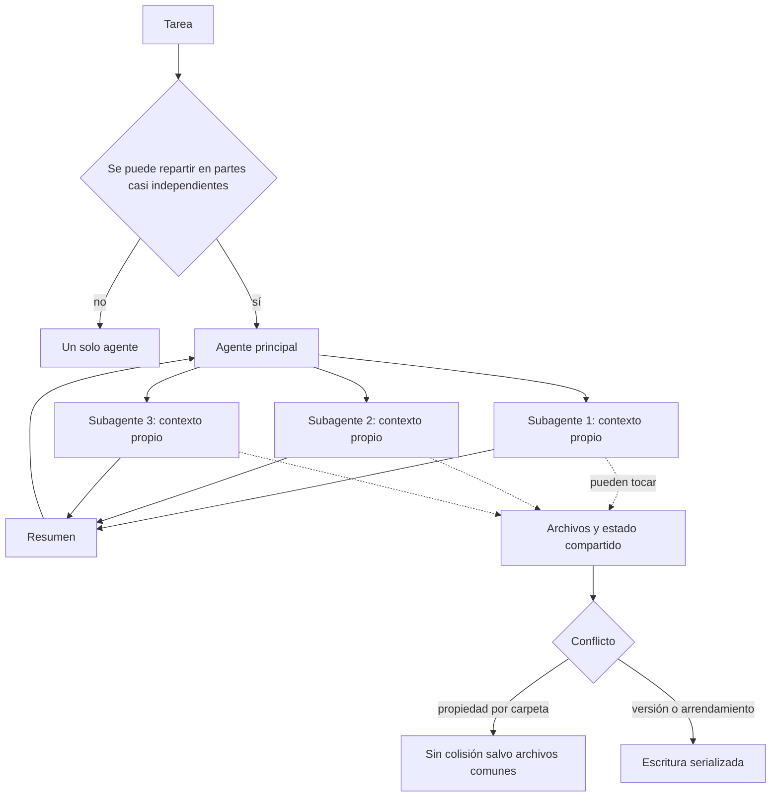
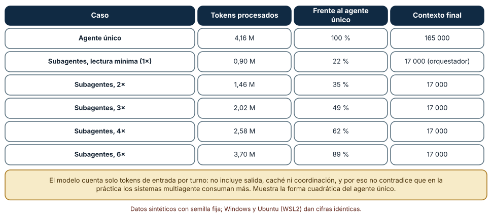
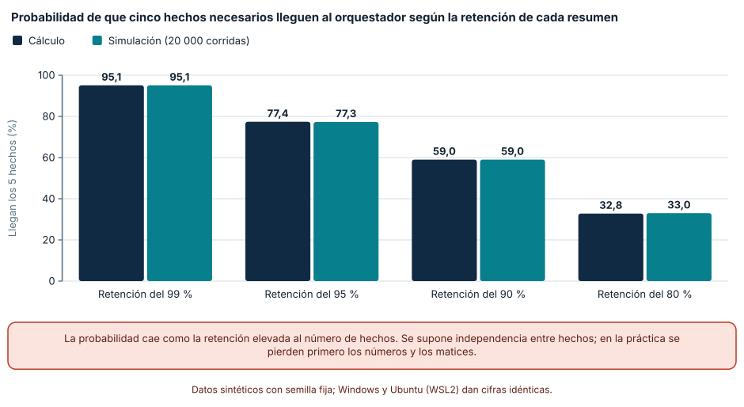

# SE-476 — Delegación, subagentes y sistemas multiagente

[← SE-475 — MCP, recursos, prompts, tools y confianza](https://github.com/vladimiracunadev-create/modern-software-engineering-program/blob/main/classes/part-39-spec-agentes-y-ciclo-de-vida-agentic/se-475-mcp-recursos-prompts-tools-y-confianza/README.md) · [↑ Parte 39](https://github.com/vladimiracunadev-create/modern-software-engineering-program/blob/main/classes/part-39-spec-agentes-y-ciclo-de-vida-agentic/README.md) · [📚 Índice completo](https://github.com/vladimiracunadev-create/modern-software-engineering-program/blob/main/classes/README.md) · [🌐 Portal](https://vladimiracunadev-create.github.io/modern-software-engineering-program/classes/SE-476.html) · [SE-477 — Human-in-the-loop, aprobación y acciones reversibles →](https://github.com/vladimiracunadev-create/modern-software-engineering-program/blob/main/classes/part-39-spec-agentes-y-ciclo-de-vida-agentic/se-477-human-in-the-loop-aprobacion-y-acciones-reversibles/README.md)

## Punto profesional y fundamento pedagógico

**Punto profesional.** La clase existe para que delegues trabajo a otros agentes por una razón que puedas medir y con un contrato que puedas comprobar. Delegar a un subagente ofrece tres cosas —un contexto limpio, paralelismo y separación de responsabilidades— y cobra tres: lectura repetida, información que se pierde en el resumen y conflictos cuando dos agentes tocan lo mismo. La habilidad es decidir qué trabajo se reparte, cómo se define lo que cada agente recibe y devuelve, cómo se evita que dos agentes pisen el mismo archivo y qué se pierde por el camino.

**Por qué aparece aquí.** Es la octava clase de la **Parte 39**, después de **MCP, recursos, prompts, tools y confianza**: `SE-475` examinó lo que un agente consume de servidores externos; ahora el agente consume el trabajo de otros agentes. El caso conductor sigue siendo el **servicio de recordatorios de entrega** (*Avisos*). Es un caso sintético: no se lanzó ningún subagente ni se invocó ningún modelo, y las simulaciones y el experimento con SQLite estudian la aritmética del contexto, las colisiones y los protocolos de escritura, no el comportamiento de agentes reales.

**Error conceptual que debe corregir.** Creer que más agentes equivalen a más capacidad. Un sistema multiagente ayuda cuando el trabajo se puede repartir en partes casi independientes y cuando la información necesaria excede lo que cabe en un contexto; ayuda poco cuando las partes dependen unas de otras o comparten archivos. En ese caso añade coordinación, consume más recursos y puede producir peor resultado que un agente solo.

**Secuencia de aprendizaje.** Antes de ver los resultados, predices la probabilidad de que cuatro agentes que tocan cinco archivos cada uno entre sesenta se pisen al menos una vez; después calculas el contexto procesado con y sin subagentes y cuánta información sobrevive a los resúmenes, mides colisiones con reparto al azar y con propiedad por carpeta, y comparas tres protocolos de escritura sobre una tabla compartida de SQLite. La secuencia usa predicción, contraste, explicación propia y recuperación. [ICAP](https://icap.education.asu.edu/research) distingue participación de construcción de conocimiento; [How People Learn II](https://nap.nationalacademies.org/catalog/24783/how-people-learn-ii-learners-contexts-and-cultures) respalda diseñar la práctica con contextos reales y retroalimentación.

**Evidencia de aprendizaje.** `delegacion-log.md` con la predicción, las tres figuras reproducidas, una descomposición de una tarea de tu proyecto en subtareas con su propietario, su contrato de entrada y salida y los archivos que puede tocar, una decisión de protocolo de escritura para el estado compartido y una nota que separe qué parte de cada conclusión es medida, cuál inferida y cuál supuesta.

**Límite de la conclusión.** Los tamaños de lectura, la redundancia, la retención de hechos, el número de archivos, el reparto de zonas y la tasa de caídas son construcciones del autor con semilla fija. El modelo de contexto cuenta solo tokens de entrada por turno, sin almacenamiento en caché, salida ni costo de coordinación, y por eso no contradice los costos mayores que se informan en la práctica para los sistemas multiagente.

### Trazabilidad fuente → afirmación

| Fuente primaria u oficial | Afirmación que respalda | Lo que no prueba |
|---|---|---|
| [Anthropic: «How we built our multi-agent research system»](https://www.anthropic.com/engineering/multi-agent-research-system) | Describe un agente principal que planifica y crea subagentes en paralelo, cada uno con su propio contexto, que condensan lo hallado para el principal; informa de que en su sistema los agentes consumen unas 4 veces más tokens que una conversación y los multiagente unas 15 veces más, de que los dominios con contexto compartido o muchas dependencias entre agentes no encajan bien y de que la mayoría de las tareas de programación admiten menos paralelismo que la investigación. | Son cifras de un sistema concreto y un momento; no se trasladan a tu tarea. |
| [Claude Code: subagentes](https://code.claude.com/docs/en/sub-agents) | Documenta que cada subagente se ejecuta en su propio contexto con una instrucción de sistema, un acceso a herramientas y permisos independientes, y devuelve un resultado al agente que lo invocó. | No dice cómo dividir una tarea ni cuándo delegar compensa. |
| [Anthropic: «Building effective agents»](https://www.anthropic.com/engineering/building-effective-agents) | Distingue flujos de trabajo orquestados por código de agentes que deciden su propio camino, y recomienda empezar por la solución más simple. | No cuantifica cuándo un patrón supera a otro. |
| [Garcia-Molina y Salem, «Sagas»](https://doi.org/10.1145/38713.38742) | Fundamenta la coordinación de operaciones largas con compensaciones en lugar de bloqueos prolongados. | No trata de agentes. |
| [SQLite: transacciones](https://www.sqlite.org/lang_transaction.html) y [Python: sqlite3](https://docs.python.org/3/library/sqlite3.html) | Documentan las transacciones y el módulo usado en el experimento de protocolos de escritura. | No sustituyen un sistema de control de versiones para código compartido. |

## Antes de empezar

Recupera lo aprendido en `SE-475`: una pieza que viene de otro hay que comprobarla, no creerla. La pregunta activa es: **¿en tu último trabajo en equipo, qué se perdió en el camino entre quien hizo una parte y quien la integró, y quién se dio cuenta?**

## Prerrequisitos

- Haber completado `SE-475` o poder describir qué se comprueba en un mensaje que llega de otro componente.
- Python 3.11 o posterior; los experimentos usan solo la biblioteca estándar (`random`, `sqlite3`, `statistics`).
- Saber leer una probabilidad de colisión como la de que dos conjuntos al azar compartan un elemento.

## Problema auténtico

El equipo de *Avisos* pide a un agente principal que migre el servicio a los nuevos umbrales configurables. El agente reparte el trabajo entre cuatro subagentes: uno para el cálculo de umbrales, otro para el historial, otro para la interfaz del docente y otro para las pruebas. Al integrar, ocurren tres cosas. Dos subagentes editaron el mismo archivo de configuración y el segundo borró los cambios del primero. El resumen que devolvió el subagente de umbrales decía «umbrales configurables listos» y omitía que había dejado el valor por defecto de la hora a 2 en lugar de 1. Y el consumo total fue mayor que el presupuestado, porque los cuatro subagentes volvieron a leer lo mismo. Ninguna de las tres cosas es un fallo de un subagente; son propiedades del reparto. La clase enseña a decidir cuándo delegar, qué contrato firma cada subagente, cómo se evitan los pisotones y cuánta información se pierde.

## Objetivos observables

Al terminar podrás:

1. explicar las tres ventajas de delegar (contexto limpio, paralelismo, separación) y sus tres costos (lectura repetida, pérdida en el resumen, conflictos);
2. calcular el contexto procesado con y sin subagentes y la redundancia de lectura a partir de la cual deja de compensar;
3. estimar la probabilidad de que un conjunto de agentes obtenga todos los hechos necesarios cuando cada resumen retiene cada uno con una probabilidad dada;
4. medir la probabilidad de conflicto de edición con reparto al azar y con propiedad por carpeta, y reconocer el efecto de los archivos compartidos;
5. elegir entre escritura ciega, versión optimista y arrendamiento para un estado compartido y justificar la elección por los lugares donde pierde información o espera.

## Mapa conceptual



El agente principal delega solo cuando el trabajo se puede dividir; los subagentes trabajan con contexto propio y devuelven resúmenes (donde se pierde información). El estado compartido es el punto de conflicto, y su protocolo decide qué se pierde y qué se espera.

## Temas y por qué importan

| Tema | Por qué cambia una decisión profesional | Evidencia mínima |
|---|---|---|
| Cuándo delegar | Delegar sin que el trabajo se reparta suma costo sin sumar capacidad. | Descomposición con las dependencias entre partes |
| Contexto propio y resumen | El aislamiento limpia el contexto y pierde detalle. | Contexto procesado y retención de hechos |
| El contrato de delegación | Un subagente sin objetivo, formato y límites devuelve lo que le parece. | Plantilla de contrato por subagente |
| Conflictos de edición | Dos agentes sobre un mismo archivo pierden trabajo. | Probabilidad de colisión con y sin propiedad |
| Protocolos de escritura sobre estado compartido | Decide qué contribuciones se pierden. | Pérdidas, reintentos y esperas por protocolo |
| Evaluar el sistema, no a cada agente | Cada parte puede estar bien y el conjunto mal. | Criterios sobre el resultado final |

## Conceptos y decisiones

### 1. Por qué delegar y por qué cuesta

Un subagente ofrece tres cosas. **Contexto limpio**: trabaja con su propia ventana, sin arrastrar lo que el agente principal ha leído, y devuelve un resumen en lugar de todo lo que exploró. **Paralelismo**: varios subagentes avanzan a la vez en partes independientes. **Separación de responsabilidades**: cada uno puede tener sus propias instrucciones, herramientas y permisos, de modo que el que revisa no es el que escribe. La contraparte la describe el equipo que construyó el sistema de investigación multiagente de Anthropic con cifras de su caso: los agentes usaron unas cuatro veces más tokens que una conversación y los sistemas multiagente unas quince veces más, y los dominios donde todos los agentes necesitan el mismo contexto o hay muchas dependencias entre ellos no encajan bien. La conclusión práctica es que delegar compensa cuando el valor de la tarea justifica el consumo y cuando el trabajo se reparte de verdad.

### 2. El contrato de delegación

Un subagente no sabe lo que sabe el principal, de modo que lo que recibe debe bastar. Un contrato mínimo tiene cinco partes. El **objetivo**: qué debe lograr y por qué, en términos de un resultado comprobable. Los **límites**: qué archivos y herramientas puede usar y cuáles no. El **formato de salida**: qué debe devolver, con qué estructura y con qué evidencia (la ruta, el comando, el resultado de las pruebas). Las **condiciones de parada**: cuántos intentos, cuánto presupuesto y cuándo debe devolver el control con lo que tenga. Y la **declaración de lo no hecho**: la lista de lo que no pudo comprobar o decidió no hacer. La última es la más descuidada y la que evita que «umbrales configurables listos» oculte un valor por defecto equivocado. Un contrato sin ella invita al resumen optimista.

### 3. Contexto aislado y pérdida en el resumen

Que cada subagente trabaje con su contexto tiene un efecto doble que se puede calcular. Un agente único que lee 20 000 tokens por subtarea acumula su contexto, y cada turno posterior reprocesa todo lo anterior, de modo que el costo de entrada crece de forma cuadrática con el número de subtareas. Con subagentes, cada uno procesa solo su propio contexto y el principal solo los resúmenes. La ventaja desaparece si los subagentes leen lo mismo varias veces porque no comparten lo ya leído, o si la caché de contexto abarata el reprocesamiento del agente único. Y se paga con información: un resumen es una compresión con pérdida. Si cada resumen conserva un hecho necesario con probabilidad `r`, la probabilidad de que lleguen los `k` necesarios es `r^k`, que cae deprisa: con `r` de 0,95 y cinco hechos, el 77 %. La mitigación es pedir en el contrato que los hechos críticos se devuelvan como una lista estructurada y no como prosa, y que el principal compruebe la presencia de cada uno.

### 4. Conflictos: quién puede tocar qué

Dos agentes que editan el mismo archivo producen un conflicto, y la probabilidad es mayor de lo que sugiere la intuición. Es el mismo cálculo del problema de los cumpleaños: con 60 archivos y 5 por agente, dos agentes chocan en el 36,5 % de los repartos al azar y cuatro, en el 94,4 %. La forma de bajar ese número no es la buena suerte sino la **propiedad**: cada agente tiene asignada una zona (una carpeta, un módulo) y solo toca la suya. Con propiedad estricta no hay colisión; con archivos comunes (configuración, esquema, índice) hay una fracción de tareas que cruza las zonas, y ahí el conflicto reaparece, aunque mucho menor. Los archivos comunes son el lugar donde una regla de propiedad debe tener un dueño explícito o una escritura serializada. En el trabajo con código, el aislamiento natural de un agente es una rama o un árbol de trabajo propio y la integración la hace una persona o un paso con pruebas.

### 5. Protocolos de escritura sobre estado compartido

Cuando varios agentes comparten un estado (una lista de tareas, un tablero, un archivo de notas), el protocolo con que escriben decide qué se pierde. La **escritura ciega** lee, modifica y guarda: si dos leen el mismo estado, el último en guardar borra la contribución del anterior. La **versión optimista** añade un número de versión y solo guarda si no cambió desde que leyó; si falló, relee y reintenta. No pierde nada y paga con reintentos. El **arrendamiento** da el derecho de escribir a uno a la vez, con caducidad para que un titular que se cae no bloquee a los demás; no pierde nada y paga con espera. Ninguno es mejor en general: con pocas colisiones, la versión optimista es barata; con muchas, el arrendamiento evita el trabajo repetido; con operaciones que no se pueden repetir, el arrendamiento es la única opción.

### 6. Evaluar el sistema, no cada agente

Un sistema multiagente puede fallar con todos sus agentes funcionando: un subagente deja un valor por defecto equivocado y otro lo usa sin saberlo. Por eso el criterio de aceptación se pone sobre el resultado integrado (los criterios de la especificación de `SE-471`, ejecutados por un verificador independiente) y no sobre la satisfacción de cada contrato. Las pruebas de integración y los criterios ejecutables son el mismo mecanismo de siempre, aplicado a un conjunto que ya no es de un solo autor.

## Qué cuesta delegar en contexto y en hechos

Se calcula el contexto de entrada procesado por un agente único que resuelve ocho subtareas de 20 000 tokens de lectura cada una, con 6 turnos por subtarea y 5 000 tokens de instrucciones, y se compara con ocho subagentes, cada uno con su contexto, que devuelven un resumen de 1 500 tokens a un principal. Como los subagentes no comparten lo leído, se varía la lectura redundante: cuántas veces más leen que el trabajo mínimo.

| Lectura redundante de los subagentes | Tokens procesados con subagentes | Frente al agente único | Contexto final del orquestador |
|---:|---:|---:|---:|
| 1× | 0,90 M | 22 % | 17 000 tokens |
| 2× | 1,46 M | 35 % | 17 000 tokens |
| 3× | 2,02 M | 49 % | 17 000 tokens |
| 4× | 2,58 M | 62 % | 17 000 tokens |
| 6× | 3,70 M | 89 % | 17 000 tokens |

El agente único procesa 4,16 millones de tokens de entrada y termina con un contexto de 165 000 tokens. Con subagentes, el consumo es el 22 % si no hay redundancia, el 49 % si cada uno lee tres veces lo necesario y el 89 % con seis veces; el contexto final del principal es de 17 000 tokens en todos los casos. Este modelo cuenta solo los tokens de entrada de cada turno y no incluye la salida, la caché del contexto repetido ni el costo de coordinar; el estudio de Anthropic informa de que en la práctica el sistema multiagente consume más, no menos, porque lanza muchos subagentes que exploran en paralelo. Las dos cosas no se contradicen: el cálculo mide qué ocurre al reprocesar el contexto acumulado, y el consumo real depende de cuánto se explora.

La otra mitad del costo es la información. Si cada resumen conserva un hecho necesario con probabilidad `r`, se simulan 20 000 corridas con cinco hechos necesarios.

| Hechos que conserva cada resumen | Llegan los 5 (cálculo) | Respuesta final completa (simulación) |
|---:|---:|---:|
| 99 % | 95,1 % | 95,1 % |
| 95 % | 77,4 % | 77,3 % |
| 90 % | 59,0 % | 59,0 % |
| 80 % | 32,8 % | 33,0 % |

Una retención del 95 % por hecho deja la respuesta completa en el 77 % de los casos y una del 80 %, en un tercio. La simulación coincide con el cálculo `r^5` dentro del error de muestreo.



**Cómo leer la figura.** Cada barra es una configuración, con su consumo frente al agente único entre paréntesis, y su longitud los millones de tokens procesados. Mira primero cuántas veces puede leer un subagente de más antes de igualar al agente único: con seis veces el consumo ya es el 89 %. **Dónde deja de valer:** el modelo cuenta solo tokens de entrada por turno, supone subtareas independientes de tamaño igual, no incluye la salida, la caché ni la coordinación, y los números absolutos son del autor; sirve para ver la forma cuadrática del agente único y la redundancia de los subagentes, no para presupuestar.



**Cómo leer la figura.** Cada grupo es una retención por hecho; la barra azul oscura es el cálculo y la verde la simulación. Mira primero que las dos barras de cada grupo coinciden y que la altura cae deprisa: elevar la retención al número de hechos castiga incluso una pérdida pequeña. **Dónde deja de valer:** supone cinco hechos independientes con la misma probabilidad de conservarse; en un resumen real los hechos raros, los números y los matices se pierden primero, y la pérdida se correlaciona con el estilo del resumen.

## Cuándo dos agentes se pisan

Se simulan 20 000 repeticiones por fila con 60 archivos y agentes que tocan 5 cada uno. En el reparto al azar cada agente elige 5 de los 60. En el de propiedad, cada agente tiene una zona de `60 / N` archivos y elige 5 de la suya. En el tercero, además, el 20 % de las tareas toca un archivo de seis comunes (configuración, esquema, índice).

| Agentes | Conflicto con reparto al azar | Conflicto con propiedad por carpeta | Propiedad y 20 % de tareas con archivos comunes |
|---:|---:|---:|---:|
| 2 | 36,5 % | 0,0 % | 0,7 % |
| 3 | 75,3 % | 0,0 % | 2,0 % |
| 4 | 94,4 % | 0,0 % | 3,6 % |
| 6 | 100,0 % | 0,0 % | 8,9 % |
| 8 | 100,0 % | 0,0 % | 16,0 % |

Con cuatro agentes y reparto al azar, el 94,4 % de las repeticiones tiene al menos un archivo editado por dos. La propiedad por carpeta elimina el conflicto cuando todos respetan su zona, y los archivos comunes lo reintroducen: con ocho agentes, el 16,0 % de las repeticiones aún choca en un archivo común. La conclusión práctica es que los archivos comunes necesitan un dueño o una escritura serializada, y que añadir agentes aumenta la probabilidad de conflicto mucho más rápido que el trabajo hecho.


**Cómo leer la figura.** El eje horizontal son los agentes y el vertical la probabilidad de conflicto; la línea roja es el reparto al azar, la verde la propiedad por carpeta y la dorada la propiedad con archivos comunes. Mira primero la distancia entre la roja y las otras dos y que la dorada, aunque pequeña, crece con los agentes. **Dónde deja de valer:** los 60 archivos, los 5 por agente, las zonas iguales y el 20 % de tareas con archivos comunes son supuestos del autor; el trabajo real no elige archivos al azar (se concentra en unos pocos) y la propiedad rara vez se respeta al 100 %.

## Tres protocolos para un estado compartido

Se usa una tabla de SQLite en memoria con una fila de notas. En cada una de 200 rondas, cuatro agentes leen el mismo estado y cada uno intenta añadir su contribución (un carácter) en un orden aleatorio. Se compara la escritura ciega, la versión optimista (el guardado solo procede si la versión no cambió; si falla, el agente relee y reintenta) y un arrendamiento con caducidad (el agente adquiere el derecho de escribir; con probabilidad 0,05 se cae con el derecho adquirido y los demás esperan 5 ticks hasta que caduca).

| Protocolo | Contribuciones perdidas de 800 | Reintentos | Ticks de espera |
|---|---:|---:|---:|
| Escritura ciega | 600 | 0 | 0 |
| Versión optimista | 0 | 1 200 | 0 |
| Arrendamiento con caducidad | 0 | 0 | 980 |

La escritura ciega pierde 600 de las 800 contribuciones: de cada ronda de cuatro, el último que guarda sobrescribe a los demás y solo sobrevive una. La versión optimista no pierde ninguna y paga 1 200 reintentos (6 por ronda, el número esperado cuando los cuatro leen a la vez: 3 + 2 + 1). El arrendamiento tampoco pierde ninguna, no reintenta y paga 980 ticks de espera, de los cuales los caídos aportan una parte.


**Cómo leer la figura.** Cada grupo es un protocolo; las barras son las contribuciones perdidas (roja), los reintentos (dorada) y los ticks de espera (azul oscura). Mira primero que cada protocolo tiene exactamente una barra: cada uno paga por una vía distinta lo que la escritura ciega pierde. **Dónde deja de valer:** las intercalaciones son deterministas y los cuatro agentes leen a la vez en cada ronda, el caso peor para la versión optimista; con menos colisiones los reintentos bajan, y SQLite en memoria no reproduce la latencia ni la concurrencia real. La pérdida de la escritura ciega no depende de los parámetros: es estructural.

## Definiciones de trabajo

- **subagente:** agente lanzado por otro, con su propio contexto, instrucciones, herramientas y permisos, que devuelve un resultado a quien lo invocó.
- **contrato de delegación:** especificación de objetivo, límites, formato de salida, condiciones de parada y declaración de lo no hecho que recibe un subagente.
- **propiedad por carpeta:** asignación de cada archivo o módulo a un único agente que puede modificarlo.
- **versión optimista:** protocolo de escritura que solo guarda si el estado no cambió desde la lectura y reintenta en caso contrario.
- **arrendamiento:** derecho temporal y exclusivo de escribir, con caducidad para que un titular caído no bloquee a los demás.
- **resumen con pérdida:** compresión del trabajo de un subagente que omite parte de lo explorado.

Las definiciones son operativas para el servicio *Avisos*. No convierten términos con una historia más amplia en sinónimos y deben contrastarse con la documentación primaria enlazada al final.

## Ejemplo mínimo

El fragmento muestra la pérdida de la escritura ciega. Antes de ejecutarlo, predice qué contiene `notas`.

```python
notas = ""
lecturas = [notas, notas, notas]          # tres agentes leen a la vez
for i, leido in enumerate(lecturas):
    notas = leido + str(i)                # cada uno guarda lo suyo sobre lo que leyó
print(repr(notas))
```

Imprime `'2'`: sobreviven una de tres contribuciones. Cambia el bucle para que cada agente relea antes de guardar (`notas = notas + str(i)`) y observa la diferencia. Registra versión de Python, comando y salida.

## Ejemplo profesional

Escenario hipotético, construido para la clase y sin datos reales. El equipo de *Avisos* descompone la migración en cuatro partes y revisa si el reparto es real: el cálculo de umbrales y el historial casi no se tocan entre sí, la interfaz depende del cálculo y las pruebas dependen de los tres. Decide delegar solo las dos primeras, con un agente cada una, y dejar la interfaz y las pruebas al agente principal. Cada subagente recibe un contrato de cinco partes y devuelve una lista estructurada de hechos (el valor por defecto de cada umbral, las migraciones aplicadas, los archivos tocados, lo que no pudo comprobar); el principal comprueba cada hecho contra el código. Las zonas son `umbrales/` y `historial/`; el archivo de configuración común tiene un dueño, el principal, y los subagentes le piden los cambios. Para la tabla de tareas compartida usan la versión optimista porque se espera una colisión ocasional. La aceptación se mide con los diecisiete criterios de la especificación ejecutados por el verificador de `SE-471`, no con los informes de los subagentes. Compara con el estado inicial: antes había cuatro agentes con zonas solapadas, resúmenes sin evidencia y una aceptación basada en lo que cada uno decía; ahora hay dos, con zonas y contratos, y se acepta lo que se verifica.

## Práctica guiada

1. Descompón una tarea de tu proyecto en partes y dibuja las dependencias; decide cuáles son realmente independientes.
2. Predice la probabilidad de colisión de cuatro agentes con cinco archivos cada uno entre sesenta; escribe el número antes de simular.
3. Ejecuta `python scripts/experiments_part39_b.py 476` y reproduce las tres tablas; cambia el número de archivos comunes y observa cómo se mueve la última columna.
4. Escribe el contrato de delegación de un subagente con sus cinco partes, incluida la declaración de lo no hecho.
5. Cambia la retención de un resumen a 0,98 y a 0,85 y calcula la probabilidad de recibir seis hechos.
6. Implementa los tres protocolos de escritura sobre una tabla de SQLite con tus propios agentes simulados y compara pérdidas, reintentos y esperas.
7. Entrega `delegacion-log.md` y pide a otra persona que encuentre en tu reparto un archivo que dos agentes puedan tocar.

## Ejercicios

1. **Reparto:** una tarea tiene seis partes con dependencias A→B, A→C, B→D, C→D, D→E y D→F. Indica cuáles se pueden delegar en paralelo y cuántos agentes ayudan realmente.
2. **Contrato:** reescribe «arregla la parte del historial» como un contrato de cinco partes.
3. **Resumen:** un subagente debe devolver siete hechos con una retención por hecho del 92 %; calcula la probabilidad de que lleguen todos y propón un cambio del contrato que la suba.
4. **Protocolo:** para una operación que envía un correo, justifica por qué la versión optimista con reintento es una mala elección y qué protocolo usarías.

## Reto verificable

Entrega `delegacion-log.md` con la predicción, las tres tablas, la descomposición de una tarea con sus dependencias, el contrato de cada subagente, el reparto de zonas con el dueño de los archivos comunes, la elección razonada de un protocolo de escritura y el criterio de aceptación sobre el resultado integrado. Se aprueba si otra persona ejecuta el código desde un checkout limpio, obtiene los mismos números con las mismas semillas y puede decir qué parte de la tarea no delegaría y por qué. No se aprueba por repartir en subagentes una tarea cuyas partes dependen entre sí ni por aceptar el trabajo con el informe de cada subagente.

## Caso conductor

El servicio *Avisos* es el caso conductor de la Parte 39. Esta clase deja el octavo artefacto: la descomposición con zonas, los contratos de delegación, el protocolo de escritura y el criterio de aceptación del conjunto. `SE-477` examina cuándo y cómo interviene una persona, y qué acciones se pueden deshacer. Cambia después un solo dato, el número de archivos comunes, y observa a partir de cuántos la propiedad por carpeta deja de evitar los conflictos.

## Preguntas frecuentes

### ¿Siempre es mejor tener un agente principal y varios subagentes?

No. Es mejor cuando las partes son casi independientes y la información excede un contexto; si las partes se pisan o dependen unas de otras, un agente solo trabajando por turnos suele ser más barato y más fiable. Empieza por lo más simple y reparte cuando puedas medir qué se gana.

### ¿Cómo evito que un subagente me dé un resumen optimista?

Con un contrato que exija una lista estructurada de hechos con su evidencia (ruta, comando, resultado) y una declaración de lo que no pudo comprobar, y comprobando tú esos hechos contra el código. Un resumen en prosa sin evidencia no es verificable.

### ¿Los árboles de trabajo de git resuelven los conflictos?

Aíslan el trabajo, de modo que dos agentes no se pisan mientras trabajan, y trasladan el conflicto al momento de integrar. Eso es una mejora: el conflicto se ve y se resuelve con las herramientas de fusión y las pruebas, en lugar de perder cambios en silencio.

### ¿Qué protocolo de escritura debo usar?

El que corresponda a la operación: versión optimista cuando repetir es barato y las colisiones raras, arrendamiento cuando la operación no se puede repetir o las colisiones son frecuentes, y propiedad cuando puedas evitar el estado compartido. La escritura ciega solo es aceptable cuando perder una contribución no importa.

## Fallo controlado y diagnóstico

Reproduce el fallo clásico de la clase: **dos agentes que reescriben el mismo archivo y uno borra el trabajo del otro**. Ejecuta la escritura ciega con cuatro agentes sobre una fila compartida.

Registra síntoma, entrada mínima, hipótesis, observación que descarta cada hipótesis, causa, corrección y prueba de regresión. **Síntoma:** el archivo de configuración final contiene los cambios de un solo subagente y nadie vio ningún error. **Hipótesis rivales:** (a) un subagente falló y no guardó; (b) el principal descartó cambios al integrar; (c) dos subagentes leyeron el mismo estado y el último en guardar sobrescribió al otro. **Prueba:** reconstruye las lecturas y los guardados con marcas de tiempo; si dos lecturas anteceden a los dos guardados, la causa es (c). **Conclusión:** el protocolo de escritura pierde contribuciones por diseño. **Regresión:** añade una prueba que simule cuatro lectores simultáneos y exija que sobrevivan las cuatro contribuciones. No cambies a la vez el protocolo y el número de agentes.

## Errores comunes y cómo corregirlos

| Síntoma | Causa probable | Corrección |
|---|---|---|
| El sistema consume mucho más que un solo agente y no mejora | Se delegó una tarea con muchas dependencias | Medir el reparto y volver a un agente si las partes no son independientes |
| El resumen omite un detalle decisivo | Contrato sin lista estructurada ni declaración de lo no hecho | Exigir hechos con evidencia y lo no comprobado |
| Dos agentes pisan el mismo archivo | Sin propiedad ni protocolo | Zonas por carpeta, dueño de los archivos comunes, ramas separadas |
| Un agente espera indefinidamente a otro caído | Arrendamiento sin caducidad | Caducidad y reintento por otro titular |
| Todos los informes son verdes y el producto falla | Aceptación por informes | Criterios ejecutables sobre el resultado integrado |

## Entorno y archivos clave

```text
work/SE-476/
├── README.md
├── delegacion/
│   ├── descomposicion.md
│   └── contratos/
│       ├── umbrales.md
│       └── historial.md
├── simulacion/
│   ├── contexto.py
│   ├── colisiones.py
│   └── protocolos.py
├── tests/test_protocolos.py
└── evidence/delegacion-log.md
```

El `README` declara plataforma, versión de Python, semillas y comandos. Los experimentos usan solo la biblioteca estándar, con SQLite en memoria. Se ejecutaron con CPython 3.12.9 en Windows 11 y 3.12.3 en Ubuntu bajo WSL2: las salidas fueron idénticas. Si pruebas subagentes reales, trabaja en ramas o árboles de trabajo separados y registra el modelo y la versión de la herramienta.

## Seguridad, ética y accesibilidad

- un subagente hereda o recibe permisos: dale solo los de su zona y revisa lo que su resumen deja fuera, sobre todo si tocó credenciales o datos de personas;
- un resultado que pasa por varios agentes difumina la responsabilidad: registra quién aprobó qué y evita que un «lo hizo el subagente» sustituya a una decisión humana;
- repartir el trabajo entre agentes no reparte la responsabilidad de las personas que lo despliegan: la aceptación sigue siendo humana;
- las tablas y figuras deben tener texto alternativo y no depender del color; los protocolos se distinguen por texto;
- las herramientas y los estudios citados tienen licencias y condiciones: cita su estructura y vincula la fuente, no copies su texto.

## Puente hacia el trabajo con agentes

Pedirle a un agente «reparte esto entre subagentes» lo deja decidir si el reparto es real. Pídele en cambio que dibuje las dependencias entre las partes, que diga cuáles son independientes y que escriba el contrato de cada subagente con los límites, el formato de salida y la declaración de lo no hecho. Revisa tú las zonas y los archivos comunes y exige que el principal compruebe cada hecho que le devuelven contra el código antes de integrarlo. Si dos subagentes necesitan el mismo archivo, esa es la señal de que el reparto no era tan independiente como parecía y de que hay que volver a un agente o asignar un dueño.

## Transferencia

Traslada el análisis a otro dominio (por ejemplo, una investigación documental sobre normativa de datos con varios agentes lectores): cambia las subtareas, la lectura y los hechos y conserva el procedimiento de comprobar si el trabajo se reparte, escribir el contrato, asignar zonas, elegir el protocolo para el estado compartido y aceptar sobre el resultado integrado. La transferencia está lograda cuando puedes decir qué se pierde en el resumen de esa tarea, no cuando la tabla se parece a la de *Avisos*.

## Evaluación y evidencia

| Criterio | Evidencia para aprobar |
|---|---|
| comprensión | explicación de las ventajas y costos de delegar y de por qué el resultado se evalúa integrado |
| corrección | tablas de contexto, colisiones y protocolos reproducibles con las mismas semillas |
| diseño | descomposición, contratos, zonas con dueño de lo común y protocolo de escritura razonado |
| diagnóstico | reproducción del fallo «escritura ciega que pierde contribuciones» con regresión |
| incertidumbre | declaración de que el modelo de contexto, la retención y las colisiones son construcciones del autor |
| reproducibilidad | versiones, comandos, salida y límites declarados |

## Fuentes

- [Anthropic: «How we built our multi-agent research system»](https://www.anthropic.com/engineering/multi-agent-research-system) — agente principal, subagentes con contexto propio y costos en tokens; autoridad: Anthropic, artículo de ingeniería.
- [Claude Code: subagentes](https://code.claude.com/docs/en/sub-agents) — contexto, herramientas y permisos independientes por subagente; autoridad: documentación de Anthropic.
- [Anthropic: «Building effective agents»](https://www.anthropic.com/engineering/building-effective-agents) — patrones de flujos y agentes y recomendación de simplicidad; autoridad: Anthropic.
- [Garcia-Molina y Salem, «Sagas»](https://doi.org/10.1145/38713.38742) — operaciones largas con compensaciones; autoridad: ACM SIGMOD, 1987.
- [SQLite: transacciones](https://www.sqlite.org/lang_transaction.html) y [Python: sqlite3](https://docs.python.org/3/library/sqlite3.html) — transacciones y módulo del experimento; autoridad: documentación de SQLite y de Python.

Cada fuente respalda el mecanismo indicado; ninguna demuestra que el 22 % de contexto con subagentes, el 94,4 % de colisión con cuatro agentes al azar o los 600 de 800 contribuciones perdidas se observen en un sistema real. Esa afirmación depende de la tarea, de los agentes y del protocolo.

## Límites y siguiente paso

Se ejecutaron tres experimentos en Windows y Ubuntu (WSL2) con resultados idénticos: el contexto y las colisiones son cálculos y simulaciones con semilla fija y los protocolos de escritura son código real sobre SQLite en memoria con intercalaciones deterministas. No se lanzó ningún subagente, no se invocó ningún modelo y no se observó ningún equipo. Los tamaños de lectura, la redundancia, la retención, el número de archivos, el reparto de zonas y la tasa de caídas son construcciones del autor; el modelo de contexto no incluye salida, caché ni coordinación. La siguiente clase examina cuándo y cómo interviene una persona y qué acciones de un agente se pueden deshacer.

## Glosario

- **subagente:** agente lanzado por otro, con su propio contexto, instrucciones, herramientas y permisos, que devuelve un resultado a quien lo invocó.
- **contrato de delegación:** especificación de objetivo, límites, formato de salida, condiciones de parada y declaración de lo no hecho que recibe un subagente.
- **propiedad por carpeta:** asignación de cada archivo o módulo a un único agente que puede modificarlo.
- **versión optimista:** protocolo de escritura que solo guarda si el estado no cambió desde la lectura y reintenta en caso contrario.
- **arrendamiento:** derecho temporal y exclusivo de escribir, con caducidad para que un titular caído no bloquee a los demás.
- **resumen con pérdida:** compresión del trabajo de un subagente que omite parte de lo explorado.

---

[← SE-475 — MCP, recursos, prompts, tools y confianza](https://github.com/vladimiracunadev-create/modern-software-engineering-program/blob/main/classes/part-39-spec-agentes-y-ciclo-de-vida-agentic/se-475-mcp-recursos-prompts-tools-y-confianza/README.md) · [↑ Parte 39](https://github.com/vladimiracunadev-create/modern-software-engineering-program/blob/main/classes/part-39-spec-agentes-y-ciclo-de-vida-agentic/README.md) · [📚 Índice completo](https://github.com/vladimiracunadev-create/modern-software-engineering-program/blob/main/classes/README.md) · [🌐 Portal](https://vladimiracunadev-create.github.io/modern-software-engineering-program/classes/SE-476.html) · [SE-477 — Human-in-the-loop, aprobación y acciones reversibles →](https://github.com/vladimiracunadev-create/modern-software-engineering-program/blob/main/classes/part-39-spec-agentes-y-ciclo-de-vida-agentic/se-477-human-in-the-loop-aprobacion-y-acciones-reversibles/README.md)
