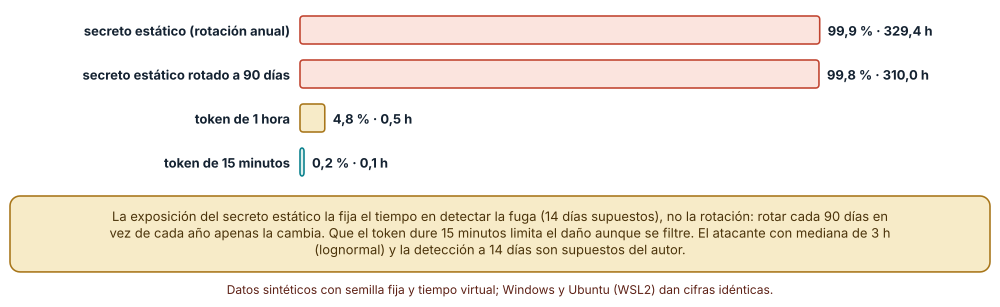

# SE-484 — Credenciales efímeras y OIDC

[← SE-483 — Tests, seguridad y políticas como gates](https://github.com/vladimiracunadev-create/modern-software-engineering-program/blob/main/classes/part-40-ci-cd-iac-y-platform-engineering/se-483-tests-seguridad-y-politicas-como-gates/README.md) · [↑ Parte 40](https://github.com/vladimiracunadev-create/modern-software-engineering-program/blob/main/classes/part-40-ci-cd-iac-y-platform-engineering/README.md) · [📚 Índice completo](https://github.com/vladimiracunadev-create/modern-software-engineering-program/blob/main/classes/README.md) · [🌐 Portal](https://vladimiracunadev-create.github.io/modern-software-engineering-program/classes/SE-484.html) · [SE-485 — Entrega y despliegue continuos →](https://github.com/vladimiracunadev-create/modern-software-engineering-program/blob/main/classes/part-40-ci-cd-iac-y-platform-engineering/se-485-entrega-y-despliegue-continuos/README.md)

## Punto profesional y fundamento pedagógico

**Punto profesional.** La clase existe para que sustituyas la credencial que alguien copió en un secreto del repositorio por una identidad que la canalización demuestra en cada ejecución y que el proveedor cambia por una credencial de minutos. La habilidad profesional es escribir y probar la regla de confianza —quién puede pedir qué, desde dónde y por cuánto tiempo— con la precisión suficiente para que otro repositorio, otra rama o una bifurcación no obtengan el mismo acceso.

**Por qué aparece aquí.** Sigue a **Tests, seguridad y políticas como gates**: la clase anterior dejó una compuerta que bloquea secretos en el repositorio; esta elimina la necesidad de tenerlos. El caso conductor sigue siendo la canalización de la API de entregas, que necesita publicar una imagen y desplegarla en una nube sin guardar ninguna clave de larga vida.

**Error conceptual que debe corregir.** Creer que pasar a identidades federadas basta por sí solo: una regla de confianza con un comodín en el sujeto concede acceso a todos los repositorios de una organización y deja la misma exposición que el secreto estático, con mejor aspecto.

**Secuencia de aprendizaje.** Antes de mirar los resultados, predices cuántos de doce tokens manipulados acepta un verificador que solo comprueba la firma y cuánto dura el riesgo de una credencial filtrada según su vida; después reproduces la verificación por niveles, mides la ventana de exposición y comparas cuatro detectores de secretos. La secuencia usa predicción, explicación propia, contraste y recuperación. [ICAP](https://icap.education.asu.edu/research) distingue participación de construcción de conocimiento; [How People Learn II](https://nap.nationalacademies.org/catalog/24783/how-people-learn-ii-learners-contexts-and-cultures) respalda diseñar la práctica con contextos reales y retroalimentación.

**Evidencia de aprendizaje.** `oidc-log.md` con la predicción, las tres figuras reproducidas, la regla de confianza escrita con emisor, audiencia, sujeto exacto y vida máxima, la lista de permisos del trabajo que pide el token y una nota que separe qué parte de cada conclusión es medida, cuál inferida y cuál supuesta.

**Límite de la conclusión.** Los tokens se firman con una clave compartida (HMAC) para que el experimento sea autocontenido: un proveedor real firma con clave asimétrica y publica sus claves. Los secretos, los registros y el comportamiento del atacante son sintéticos. No se contactó con ninguna nube ni con ningún proveedor de identidad, y no se probó ninguna herramienta de búsqueda de secretos concreta.

### Trazabilidad fuente → afirmación

| Fuente primaria u oficial | Afirmación que respalda | Lo que no prueba |
|---|---|---|
| [GitHub: OpenID Connect en Actions](https://docs.github.com/en/actions/concepts/security/openid-connect) | Explica que cada ejecución puede obtener un token firmado con notificaciones (`iss`, `aud`, `sub`, `ref`, `environment`) que un proveedor valida; indica que el formato por defecto del sujeto cambia para repositorios creados después del 15 de julio de 2026 e incluye identificadores inmutables. | No dice qué regla de confianza escribir en tu nube; el formato exacto debe leerse de la documentación vigente. |
| [RFC 7519: JSON Web Token](https://www.rfc-editor.org/rfc/rfc7519) | Define las notificaciones registradas (`iss`, `sub`, `aud`, `exp`, `nbf`, `iat`) y la obligación de validar la vigencia. | No impone qué valores aceptar; eso es política del receptor. |
| [RFC 8725: buenas prácticas para JWT](https://www.rfc-editor.org/rfc/rfc8725) | Recomienda validar el algoritmo esperado, el emisor y la audiencia, y rechazar `none`. | No sustituye la revisión de la librería concreta que se use. |
| [OpenID Connect Core 1.0](https://openid.net/specs/openid-connect-core-1_0.html) | Especifica el token de identidad y su validación por el receptor. | No describe cómo cada nube convierte el token en credencial temporal. |
| [GitHub Actions: uso seguro](https://docs.github.com/en/actions/reference/security/secure-use) | Recomienda sustituir secretos de larga vida por OIDC y limitar los permisos del token. | No cuantifica el riesgo residual ni cubre todos los proveedores. |

## Antes de empezar

Recupera lo aprendido en `SE-483`: una compuerta de secretos detecta lo que ya está expuesto, no evita que se exponga. La pregunta activa es: **¿qué credencial de larga vida sigue guardada en tu canalización y qué identidad corta podría sustituirla?**

## Prerrequisitos

- Haber completado `SE-483` o poder explicar qué detecta y qué no detecta un buscador de secretos.
- Python 3.11 o posterior; los experimentos usan solo la biblioteca estándar (`hmac`, `hashlib`, `base64`, `json`, `re`, `random`).
- Saber qué es un token firmado y la diferencia entre autenticar (quién eres) y autorizar (qué puedes hacer).

## Problema auténtico

Caso ilustrativo, no un incidente real: la canalización de la API de entregas desplegaba con una clave de acceso de la nube guardada como secreto del repositorio. La clave tenía permisos de administrador «para que no falle», no se había rotado en catorce meses y la podían leer todas las ramas. Cuando alguien imprimió las variables de entorno para depurar, la clave quedó en un registro público de la ejecución. Detectarlo llevó dos semanas; durante ese tiempo cualquiera pudo usarla. El equipo pasó a identidades federadas y escribió una regla de confianza que aceptaba cualquier sujeto que empezara por el nombre de la organización: funcionó, y también aceptaba a los demás repositorios de la organización, incluida una bifurcación de un hackathon. La clase enseña a escribir la regla que el proveedor evalúa, a medirla contra tokens manipulados y a comparar cuánto dura la exposición con cada tipo de credencial.

## Objetivos observables

Al terminar podrás:

1. explicar el flujo de una identidad federada desde el job hasta la credencial temporal;
2. escribir una regla de confianza con emisor, audiencia, sujeto exacto y vida máxima;
3. verificar un token por niveles y decir qué manipulaciones acepta cada nivel;
4. calcular con un modelo cómo cambia la ventana de exposición con la vida de la credencial y con el tiempo de detección;
5. evaluar un detector de secretos con falsos positivos y secretos perdidos y decir por qué no sustituye a la rotación.

## Mapa conceptual


El mapa separa la **identidad** (el token que la canalización presenta), la **regla de confianza** (lo que el receptor acepta) y la **credencial** (lo que se obtiene y expira). El riesgo se concentra en la regla y en los permisos de la credencial, no en el token.

## Temas y por qué importan

| Tema | Por qué cambia una decisión profesional | Evidencia mínima |
|---|---|---|
| Credencial estática y efímera | Lo que expira solo limita el daño de cualquier filtración. | Figura 2 y su comparación |
| Identidad federada (OIDC) | Sustituye un secreto copiado por una identidad demostrable en cada ejecución. | Diagrama del flujo de la canalización |
| Validación de notificaciones | Cada campo sin comprobar es una puerta abierta. | Figura 1 y la regla escrita |
| Permisos del trabajo | Quien puede pedir el token es quien puede obtener la credencial. | Lista de jobs con permiso |
| Detección de secretos | Detecta lo expuesto; no evita la exposición. | Figura 3 y la política de rotación |

## Conceptos y decisiones

### 1. Credenciales estáticas y efímeras

Una **credencial estática** es un secreto que vale hasta que alguien lo revoca: una clave de acceso, un token personal, una contraseña de servicio. Su problema no es que se filtre —cualquier secreto puede filtrarse— sino lo que dura la exposición cuando ocurre: desde el instante de la fuga hasta que se descubre y se revoca. Una **credencial efímera** expira sola en minutos u horas. La diferencia es de orden de magnitud en la ventana de riesgo. Además la estática exige gobernanza: quién la creó, quién la puede leer, cuándo se rotó, qué permisos tiene. Eliminar la credencial elimina esa gobernanza, que casi nunca se hace bien. La regla es: si el proveedor permite una identidad federada, un secreto de larga vida es una deuda que se paga con intereses.

### 2. El flujo de una identidad federada

El esquema general, que GitHub Actions implementa sobre OpenID Connect, tiene cuatro pasos. El job, si tiene permiso para ello, pide al emisor de la plataforma de integración continua un **token de identidad**: un documento firmado que dice quién es (repositorio, rama, entorno, flujo de trabajo), quién lo emitió (`iss`), a quién va dirigido (`aud`), hasta cuándo vale (`exp`) y desde cuándo (`nbf`). El job presenta ese token al proveedor de la nube. El proveedor lo valida (firma con las claves públicas del emisor, vigencia, emisor y audiencia esperados) y comprueba la **regla de confianza** configurada en su lado: «acepto tokens cuyo sujeto sea exactamente este repositorio y esta rama». Si coincide, devuelve una credencial temporal con los permisos del rol asociado. El secreto nunca existió en el repositorio, y el único dato que viaja es un token que vale unos minutos y está dirigido a un receptor concreto.

### 3. La regla de confianza y la validación de notificaciones

La seguridad del esquema vive en la regla de confianza. Cada notificación comprueba una cosa distinta: el **emisor** impide que otro proveedor de identidad se haga pasar por el tuyo; la **audiencia** impide que un token emitido para otro receptor se reutilice contigo; la **vigencia** limita la ventana; la **firma** garantiza que nadie lo modificó; el **sujeto** es lo que dice quién pide. El sujeto es el punto más delicado. Un comodín o un prefijo («todos los repositorios de mi organización») concede acceso a lo que no se quiso: un repositorio de otro equipo, una bifurcación, una rama de un cambio sin revisar. La regla correcta es **exacta**: este repositorio, esta rama protegida o este entorno con aprobación. Además, el formato del sujeto lo define el proveedor de identidad y puede cambiar —GitHub documenta que los repositorios creados después del 15 de julio de 2026 usan un formato inmutable con identificadores—, de modo que la regla se escribe y se revisa contra la documentación vigente, y se prueba con tokens manipulados.

### 4. Permisos del trabajo y alcance del rol

Quien puede pedir el token es quien puede obtener la credencial. Por eso el permiso de pedir identidad se concede solo a los jobs que lo necesitan (el despliegue, no el lint) y nunca a los que ejecutan código de terceros sin revisar (cambios de bifurcaciones). El **rol** que recibe la credencial debe tener el mínimo de permisos: publicar en un registro concreto, desplegar en un servicio concreto. Un rol de administrador convierte cualquier compromiso de la canalización en un compromiso de la cuenta. Conviene separar roles por entorno (pruebas, producción), protegidos por aprobaciones, y escribir qué ocurre si la canalización se compromete: qué podría hacer el atacante en la primera hora.

### 5. Detección de secretos, rotación y límites

La búsqueda de secretos revisa código, historial y registros en busca de cadenas con forma de credencial. Tiene dos errores simétricos: las **falsas alarmas** (identificadores y resúmenes que parecen aleatorios) y los **secretos perdidos** (credenciales con otra forma, como una cabecera de autorización o una URL con contraseña, o contraseñas de baja entropía). Ningún detector sustituye a la rotación: lo que detecta ya estuvo expuesto, y la respuesta correcta a un hallazgo es revocar y reemplazar, no borrar la línea del archivo, porque el historial conserva el valor. La combinación de reglas por prefijo (fiables pero parciales), por asignación sospechosa (más cobertura, algo de ruido) y por entropía (mucho ruido) y el ensayo periódico con un secreto de prueba son prácticas de cobertura, no de garantía.

### Cuántas manipulaciones acepta cada nivel de verificación

Se construyen tres tokens legítimos (el repositorio en la rama principal, en el entorno de producción y en una etiqueta) y doce manipulados: expirado, sin vigencia, audiencia ajena, emisor ajeno, firma alterada, algoritmo `none`, otro repositorio, un prefijo parecido de otra organización, un cambio desde una solicitud de integración, una vida de 24 horas, firmado con otra clave y con inicio de vigencia futuro. Se aplican cinco niveles acumulativos.

```python
def verificar(token, nivel):
    cab, c = decodificar(token)
    if nivel >= 1 and (cab["alg"] != "HS256" or not firma_valida(token)):
        return False
    if nivel >= 2 and ("exp" not in c or c["exp"] <= AHORA or c.get("nbf", 0) > AHORA + 30):
        return False
    if nivel >= 3 and (c["iss"] != EMISOR or c["aud"] != AUDIENCIA):
        return False
    if nivel == 4 and not c["sub"].startswith("repo:org"):
        return False
    if nivel >= 5 and (c["sub"] not in PERMITIDOS or c["exp"] - c["iat"] > 900):
        return False
    return True
```

| Nivel | Manipulados aceptados (de 12) | Legítimos aceptados (de 3) |
|---|---:|---:|
| Solo firma | 9 | 3 |
| + vigencia | 6 | 3 |
| + emisor y audiencia | 4 | 3 |
| + sujeto con prefijo «repo:org» | 4 | 3 |
| + sujeto exacto y vida corta | 0 | 3 |

La firma sola rechaza los tres tokens con firma o algoritmo inválidos y acepta nueve. El prefijo no cambia nada respecto al nivel anterior: los cuatro que quedan empiezan por «repo:org». Solo el sujeto exacto y la vida corta dejan fuera los doce y mantienen los legítimos.


**Cómo leer la figura.** Cada grupo es un nivel de verificación, de menos a más comprobaciones; la barra roja son los tokens manipulados aceptados, de 12, y la verde los legítimos aceptados, de 3. Mira primero cuánto cuesta bajar la barra roja y que se mantiene en 4 aun con el prefijo del sujeto. **Dónde deja de valer:** los doce operadores y los tres legítimos son construcciones del autor y el verificador usa una clave compartida; un token real se verifica con las claves públicas del emisor y el proveedor aplica más comprobaciones. El resultado muestra el efecto de cada notificación, no la tasa de aciertos de un proveedor.

### La ventana de exposición

Se simulan 60 000 filtraciones para cuatro tipos de credencial. El momento de la fuga es aleatorio dentro de la vida de la credencial; la exposición dura hasta que expira o hasta que se detecta (14 días para los secretos estáticos). El atacante tarda un tiempo lognormal con mediana de 3 horas en intentar usarla. Se mide qué fracción de las filtraciones llega a ser utilizable y cuántas horas de exposición media produce.

| Credencial | Filtraciones utilizables | Exposición media |
|---|---:|---:|
| Secreto estático rotado cada año | 99,9 % | 329 h |
| Secreto estático rotado cada 90 días | 99,8 % | 310 h |
| Token de 1 hora | 4,8 % | 0,50 h |
| Token de 15 minutos | 0,18 % | 0,12 h |

Rotar cada 90 días en lugar de cada año apenas reduce la exposición (de 329 a 310 horas), porque la acota el tiempo en detectar la fuga y no el calendario de rotación. Una vida de 15 minutos reduce la fracción utilizable por debajo del 0,2 %.



**Cómo leer la figura.** Cada barra es una política de credencial; el rótulo da la fracción de filtraciones en las que alguien puede usarla y la exposición media en horas. **Dónde deja de valer:** la detección a 14 días, la mediana de 3 horas del atacante y la distribución lognormal son supuestos del autor; un atacante automatizado reduce la mediana a segundos y empeora el token de 15 minutos. Además, una credencial efímera filtrada mientras la canalización sigue en curso puede usarse sin que el atacante necesite esperar.

### Cuatro detectores de secretos

Se generan 1 200 líneas sintéticas: 460 contienen un secreto (con prefijo conocido, clave de nube, clave propia, contraseña débil, cabecera de autorización o URL con credencial) y el resto contiene señuelos (SHA de git, identificadores UUID, imágenes en base64, texto y asignaciones inocuas).

| Detector | Aciertos | Falsos positivos | Secretos perdidos | Precisión | Exhaustividad |
|---|---:|---:|---:|---:|---:|
| Prefijos conocidos | 258 | 0 | 202 | 100 % | 56 % |
| Entropía | 343 | 414 | 117 | 45 % | 75 % |
| Asignación sospechosa | 393 | 4 | 67 | 99 % | 85 % |
| Prefijos + asignación | 393 | 4 | 67 | 99 % | 85 % |

La entropía señala 170 SHA de git, 153 UUID y 91 imágenes como secretos y aun así pierde las contraseñas débiles. Los 67 que pierde el mejor detector son cabeceras de autorización y URL con credencial.


**Cómo leer la figura.** Cada grupo es un detector; las barras son los aciertos (verde), los falsos positivos (roja) y los secretos perdidos (dorada). Mira primero la barra roja de la entropía y la dorada de los prefijos: cada detector falla de una forma distinta. **Dónde deja de valer:** el corpus, las proporciones de cada tipo y los señuelos son del autor y los secretos son cadenas inventadas; los 67 perdidos son una consecuencia de las dos formas que se sembraron, no de las que existan en tu repositorio. Un detector real incluye muchos más formatos y verificación contra el proveedor.

## Definiciones de trabajo

- **[credencial efímera](../../../glosario/entradas/c/credencial-efimera.md):** credencial que expira por sí sola en minutos u horas.
- **[identidad federada](../../../glosario/entradas/i/identidad-federada.md):** identidad que un sistema demuestra con un token firmado que otro sistema acepta según una regla de confianza.
- **[regla de confianza](../../../glosario/entradas/r/regla-de-confianza.md):** condición que el receptor aplica a las notificaciones del token para decidir si entrega una credencial.
- **[sujeto (`sub`)](../../../glosario/entradas/s/sujeto.md):** notificación que identifica quién pide, por ejemplo un repositorio y una rama.
- **[audiencia (`aud`)](../../../glosario/entradas/a/audiencia.md):** receptor al que va dirigido un token; un receptor distinto debe rechazarlo.

Las definiciones son operativas para la canalización de la API de entregas. No convierten términos con una historia más amplia en sinónimos y deben contrastarse con la documentación primaria enlazada al final.

## Ejemplo mínimo

El fragmento firma un token y muestra que alterar una sola notificación invalida la firma. Antes de ejecutarlo, predice si cambiar el sujeto sin volver a firmar deja el token aceptable.

```python
import base64, hashlib, hmac, json

def b64(b): return base64.urlsafe_b64encode(b).rstrip(b"=").decode()
clave = b"clave-sintetica"
carga = b64(json.dumps({"sub": "repo:org/entregas-api"}).encode())
firma = b64(hmac.new(clave, carga.encode(), hashlib.sha256).digest())
carga2 = b64(json.dumps({"sub": "repo:org/otro"}).encode())
firma2 = b64(hmac.new(clave, carga2.encode(), hashlib.sha256).digest())
print(hmac.compare_digest(firma, firma2))
```

Imprime `False`: cualquier cambio de la carga produce otra firma, así que quien no tiene la clave no puede modificar el sujeto. Registra versión de Python, comando y salida; después sustituye la comparación por `startswith("repo:org")` sobre el sujeto y observa qué otros valores acepta.

## Ejemplo profesional

El equipo de la API de entregas retira la clave de la nube del repositorio. El job de despliegue pide el permiso de identidad y ningún otro job lo tiene. En la nube crean un rol que solo puede publicar en un registro y actualizar un servicio, y una regla de confianza con emisor de la plataforma, audiencia propia del receptor, sujeto exacto del repositorio y del entorno de producción —que exige una aprobación humana— y vida máxima del token de quince minutos. Escriben diez pruebas con tokens manipulados (sujeto de otro repositorio, de una bifurcación, de una rama sin proteger, audiencia ajena, expirado) y exigen que todas sean rechazadas. Registran el formato del sujeto con la fecha de la documentación que lo describe y programan una revisión cuando el proveedor anuncie un cambio. Mantienen la búsqueda de secretos como red de seguridad y definen que un hallazgo se atiende revocando primero y limpiando después. Compara con el punto de partida: ahora no hay un secreto que robar, y lo que se puede robar vale quince minutos y un alcance mínimo.

## Práctica guiada

1. Inventaría las credenciales de larga vida que usa una canalización propia: dónde se guardan, quién puede leerlas y cuándo se rotaron.
2. Predice cuántos de doce tokens manipulados acepta un verificador que solo comprueba la firma y escribe tu estimación.
3. Implementa los cinco niveles de verificación y reproduce la tabla; añade una manipulación nueva y observa en qué nivel se detiene.
4. Simula la ventana de exposición con tus supuestos de detección y de atacante y compara una vida de 15 minutos con una de 90 días.
5. Genera un corpus con señuelos y evalúa los cuatro detectores; añade un formato de secreto que ninguno vea.
6. Escribe la regla de confianza para tu despliegue con emisor, audiencia, sujeto exacto y vida máxima.
7. Entrega `oidc-log.md` y pide a otra persona que encuentre un token manipulado que tu verificador acepte.

## Ejercicios

1. **Sujeto:** reescribe una regla que acepta el prefijo de una organización como una regla exacta para una rama y un entorno, y lista tres repositorios que la regla antigua habría aceptado.
2. **Ventana:** calcula cómo cambia la exposición media si el tiempo de detección baja de 14 días a 1 día para un secreto estático y para un token de una hora, y explica por qué la mejora relativa es distinta.
3. **Detector:** diseña un secreto cuyo formato ninguno de los cuatro detectores vea y propón una regla que lo detecte sin aumentar los falsos positivos.
4. **Permisos:** elige tres jobs de la canalización y decide cuáles pueden pedir identidad; justifica por qué una ejecución desde una bifurcación no puede.

## Reto verificable

Entrega `oidc-log.md` con la predicción, las tres tablas, la regla de confianza escrita y las pruebas con tokens manipulados. Se aprueba si otra persona ejecuta el código desde un checkout limpio, obtiene las mismas tablas con las mismas semillas y puede decir qué notificación detiene cada manipulación y qué acceso tendría un atacante con un token válido. No se aprueba por afirmar que «usamos OIDC» sin mostrar la regla ni por dejar un comodín en el sujeto.

## Caso conductor

La canalización de la API de entregas es el caso conductor de la [Parte 40](../README.md). Esta clase deja el cuarto artefacto: la regla de confianza del despliegue, con sus pruebas con tokens manipulados. `SE-485` usará esa identidad para desplegar de forma continua y decidirá qué condiciones hacen falta para exponer una versión. Cambia después un solo dato, la vida máxima del token, y observa cómo cambia la fracción de filtraciones utilizables.

## Preguntas frecuentes

### ¿OIDC elimina por completo los secretos de la canalización?

Elimina los de acceso a la nube, no todos. Siguen existiendo tokens de terceros que no admiten federación o cuyas claves se guardan como secreto. Conviene inventariarlos y tratarlos como deuda con una fecha de rotación.

### ¿Por qué no basta con comprobar que el sujeto empieza por la organización?

Porque aceptas a todos los repositorios de la organización, incluidos los que no deberían desplegar en producción y las bifurcaciones. El prefijo es cómodo y se ve correcto en la configuración; la prueba con un sujeto de otro repositorio lo desmonta en segundos.

### ¿Un token de 15 minutos es seguro si se filtra?

Es mucho menos grave: la ventana es corta y la fracción utilizable baja. No es seguro en sentido absoluto: un atacante automatizado puede usarlo durante esos minutos. Por eso el rol debe tener el mínimo de permisos y la actividad debe quedar registrada.

### ¿Qué hago cuando el detector encuentra un secreto en el historial?

Revoca la credencial y emite una nueva; después, si es necesario, limpia el historial. Limpiarlo sin revocar no protege nada: el valor ya estuvo disponible para quien clonó el repositorio.

## Fallo controlado y diagnóstico

Reproduce el fallo clásico de la clase: **una regla de confianza con prefijo que acepta un repositorio ajeno**. Prueba el verificador de nivel 4 con un token cuyo sujeto es el de otra organización con un nombre parecido.

Registra síntoma, entrada mínima, hipótesis, observación que descarta cada hipótesis, causa, corrección y prueba de regresión. **Síntoma:** un repositorio que no debería poder desplegar obtiene una credencial de producción. **Hipótesis rivales:** (a) el token fue robado; (b) la firma es débil; (c) la regla de confianza acepta más sujetos de los previstos. **Prueba:** decodifica el token y compara su sujeto con la regla; si empieza por el prefijo configurado y pertenece a otra organización, la causa es la regla. **Conclusión:** el prefijo `repo:org` acepta `repo:org-malicioso/…`: la firma era correcta y la regla era demasiado ancha. **Regresión:** sustituye la regla por una lista exacta de sujetos y añade pruebas con sujetos de otro repositorio, otra organización y una bifurcación. No cambies a la vez la regla y la vida del token.

## Errores comunes y cómo corregirlos

| Síntoma | Causa probable | Corrección |
|---|---|---|
| Un repositorio ajeno obtiene credenciales | Sujeto con prefijo o comodín | Sujeto exacto y pruebas con tokens manipulados |
| Un token para otro receptor funciona | No se comprueba la audiencia | Exigir la audiencia propia |
| Un token viejo sigue valiendo | No se valida la vigencia o la vida es larga | Comprobar `exp` y limitar la vida |
| Cualquier job obtiene credenciales | Permiso de identidad concedido a todo el flujo | Concederlo solo al job que despliega |
| Se «limpia» un secreto y se sigue usando | Se borra la línea sin revocar | Revocar y emitir una nueva credencial |

## Entorno y archivos clave

```text
work/SE-484/
├── README.md
├── oidc/
│   ├── tokens.py
│   ├── exposicion.py
│   └── detectores.py
├── tests/test_oidc.py
└── evidence/oidc-log.md
```

El `README` declara plataforma, versión de Python, semillas y comandos. Los experimentos usan solo la biblioteca estándar (`hmac`, `hashlib`, `base64`, `json`, `re`, `random`) y se ejecutaron con CPython 3.12.9 en Windows 11 y 3.12.3 en Ubuntu bajo WSL2: las salidas fueron idénticas. Los secretos del corpus son cadenas inventadas; no pegues credenciales reales en ningún archivo de la práctica.

## Seguridad, ética y accesibilidad

- no uses credenciales reales en las pruebas; genera valores falsos con el formato adecuado y márcalos como tales;
- una regla de confianza amplia es una decisión de riesgo que alcanza a otros equipos: consúltala con quien administra la cuenta;
- la rotación y la revocación deben ensayarse antes del incidente, con un responsable disponible fuera de horario;
- los avisos de un hallazgo deben llegar por un canal accesible y decir qué credencial, dónde y qué hacer;
- documenta las tablas con el texto alternativo de cada figura.

## Puente hacia el trabajo con agentes

Un agente al que se le pide «configura el despliegue con OIDC» probablemente escribirá una regla de confianza con un comodín para que funcione en cualquier rama y declarará el trabajo terminado. Pídele en cambio que escriba la regla con emisor, audiencia, sujeto exacto y vida máxima, que genere tokens manipulados y muestre que se rechazan, que limite el permiso de identidad al job de despliegue y que lea el formato del sujeto de la documentación vigente en lugar de recordarlo. Revisa especialmente si el sujeto tiene un prefijo o un comodín y si el rol tiene permisos de administrador: son los dos defectos que esta clase mostró con datos.

## Transferencia

Traslada el análisis a otro contexto (por ejemplo, un servicio que llama a una API de terceros con una clave): cambia el emisor y el receptor, y conserva el procedimiento de reemplazar la credencial estática por una de corta vida, escribir la regla exacta y probarla con entradas manipuladas. La transferencia está lograda cuando puedes decir qué credencial sigue siendo de larga vida y cuánto tarda en detectarse su filtración, no cuando la regla se parece a la de la plataforma.

## Evaluación y evidencia

| Criterio | Evidencia para aprobar |
|---|---|
| comprensión | explicación del flujo de identidad federada y de qué comprueba cada notificación |
| corrección | tablas de niveles, ventana y detectores reproducibles con las mismas semillas |
| diseño | regla de confianza con emisor, audiencia, sujeto exacto y vida máxima, con permisos mínimos |
| diagnóstico | reproducción del fallo «prefijo que acepta un repositorio ajeno» con regresión |
| incertidumbre | declaración de que tokens, claves, corpus y atacante son sintéticos o del autor |
| reproducibilidad | versiones, comandos, salida y límites declarados |

## Fuentes

- [GitHub: OpenID Connect en Actions](https://docs.github.com/en/actions/concepts/security/openid-connect) — identidad federada para flujos de trabajo y formato del sujeto; autoridad: documentación de GitHub, consultada el 15 de noviembre de 2026.
- [RFC 7519: JSON Web Token](https://www.rfc-editor.org/rfc/rfc7519) — notificaciones registradas y vigencia; autoridad: IETF.
- [RFC 8725: buenas prácticas para JWT](https://www.rfc-editor.org/rfc/rfc8725) — validación del algoritmo, emisor y audiencia; autoridad: IETF.
- [OpenID Connect Core 1.0](https://openid.net/specs/openid-connect-core-1_0.html) — token de identidad y su validación; autoridad: OpenID Foundation.
- [GitHub Actions: uso seguro](https://docs.github.com/en/actions/reference/security/secure-use) — sustituir secretos de larga vida y limitar permisos; autoridad: documentación de GitHub.

Cada fuente respalda el mecanismo indicado; ninguna demuestra que el 99,9 % de filtraciones utilizables, las 329 horas de exposición o los 67 secretos perdidos se observen en tu entorno. Esa afirmación depende de la detección, del atacante y de los formatos de secreto de tu repositorio.

## Límites y siguiente paso

Se ejecutaron tres experimentos con datos sintéticos en Windows y Ubuntu (WSL2) con resultados idénticos. No se contactó con ningún proveedor de identidad ni con ninguna nube, se firmó con una clave compartida en lugar de una asimétrica, y no se probó ninguna herramienta de búsqueda de secretos; los doce operadores de manipulación, los tres tokens legítimos, la detección a 14 días, la mediana de 3 horas del atacante, el corpus de 1 200 líneas y sus señuelos son construcciones del autor. La siguiente clase usa esa identidad para entregar y desplegar de forma continua.

## Glosario

- **[credencial efímera](../../../glosario/entradas/c/credencial-efimera.md):** credencial que expira por sí sola en minutos u horas.
- **[identidad federada](../../../glosario/entradas/i/identidad-federada.md):** identidad que un sistema demuestra con un token firmado que otro sistema acepta según una regla de confianza.
- **[regla de confianza](../../../glosario/entradas/r/regla-de-confianza.md):** condición que el receptor aplica a las notificaciones del token para decidir si entrega una credencial.
- **[sujeto (`sub`)](../../../glosario/entradas/s/sujeto.md):** notificación que identifica quién pide, por ejemplo un repositorio y una rama.
- **[audiencia (`aud`)](../../../glosario/entradas/a/audiencia.md):** receptor al que va dirigido un token; un receptor distinto debe rechazarlo.

Conceptos de esta clase en el [glosario del programa](../../../glosario/README.md): [Audiencia](../../../glosario/entradas/a/audiencia.md) · [Credencial efímera](../../../glosario/entradas/c/credencial-efimera.md) · [Detección de secretos](../../../glosario/entradas/d/deteccion-de-secretos.md) · [Identidad federada](../../../glosario/entradas/i/identidad-federada.md) · [Regla de confianza](../../../glosario/entradas/r/regla-de-confianza.md) · [Sujeto](../../../glosario/entradas/s/sujeto.md).

---

[← SE-483 — Tests, seguridad y políticas como gates](https://github.com/vladimiracunadev-create/modern-software-engineering-program/blob/main/classes/part-40-ci-cd-iac-y-platform-engineering/se-483-tests-seguridad-y-politicas-como-gates/README.md) · [↑ Parte 40](https://github.com/vladimiracunadev-create/modern-software-engineering-program/blob/main/classes/part-40-ci-cd-iac-y-platform-engineering/README.md) · [📚 Índice completo](https://github.com/vladimiracunadev-create/modern-software-engineering-program/blob/main/classes/README.md) · [🌐 Portal](https://vladimiracunadev-create.github.io/modern-software-engineering-program/classes/SE-484.html) · [SE-485 — Entrega y despliegue continuos →](https://github.com/vladimiracunadev-create/modern-software-engineering-program/blob/main/classes/part-40-ci-cd-iac-y-platform-engineering/se-485-entrega-y-despliegue-continuos/README.md)
