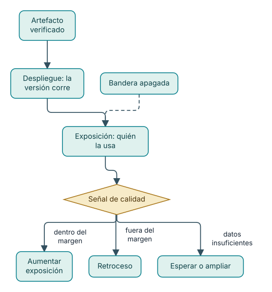
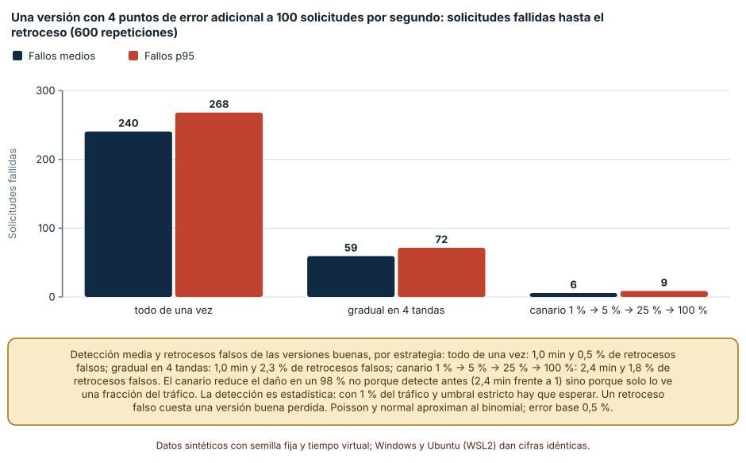
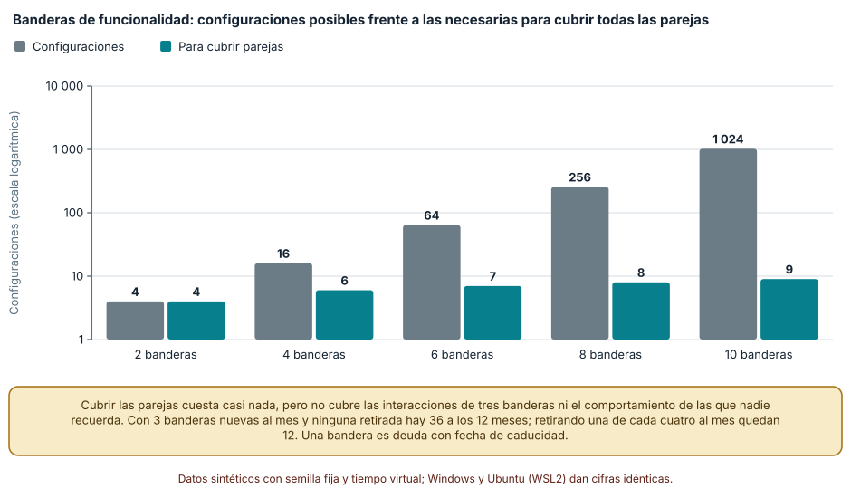

# SE-485 — Entrega y despliegue continuos

[← SE-484 — Credenciales efímeras y OIDC](https://github.com/vladimiracunadev-create/modern-software-engineering-program/blob/main/classes/part-40-ci-cd-iac-y-platform-engineering/se-484-credenciales-efimeras-y-oidc/README.md) · [↑ Parte 40](https://github.com/vladimiracunadev-create/modern-software-engineering-program/blob/main/classes/part-40-ci-cd-iac-y-platform-engineering/README.md) · [📚 Índice completo](https://github.com/vladimiracunadev-create/modern-software-engineering-program/blob/main/classes/README.md) · [🌐 Portal](https://vladimiracunadev-create.github.io/modern-software-engineering-program/classes/SE-485.html) · [SE-486 — Infraestructura como código en pipeline →](https://github.com/vladimiracunadev-create/modern-software-engineering-program/blob/main/classes/part-40-ci-cd-iac-y-platform-engineering/se-486-infraestructura-como-codigo-en-pipeline/README.md)

## Punto profesional y fundamento pedagógico

**Punto profesional.** La clase existe para que distingas entregar de exponer y decidas con números cuánta gente ve una versión nueva antes de saber si funciona. La habilidad profesional no es conocer los nombres de las estrategias de despliegue sino calcular cuánto daño produce una versión defectuosa con cada una, cuánto tarda en detectarse y qué probabilidad hay de que el detector la vea o de que retire una versión buena.

**Por qué aparece aquí.** Sigue a **Credenciales efímeras y OIDC**: la clase anterior dio a la canalización una identidad corta para desplegar; esta decide cómo se despliega. El caso conductor sigue siendo la API de entregas, con picos de uso en los cierres de plazo: una versión defectuosa en ese momento tiene el peor costo posible.

**Error conceptual que debe corregir.** Creer que un despliegue gradual protege por sí solo: un canario con poco tráfico no puede ver una degradación sutil, y un detector con umbral laxo o estricto retira versiones buenas o deja pasar las malas; la estrategia solo vale tanto como la capacidad estadística de ver el problema.

**Secuencia de aprendizaje.** Antes de mirar los resultados, predices cuántas solicitudes fallan si una versión con 4 puntos más de error se despliega de una vez y con un canario, y qué subida del error ve un canario del 1 % en diez minutos; después reproduces tres estrategias, la potencia del canario y el costo de las banderas. La secuencia usa predicción, explicación propia, contraste y recuperación. [ICAP](https://icap.education.asu.edu/research) distingue participación de construcción de conocimiento; [How People Learn II](https://nap.nationalacademies.org/catalog/24783/how-people-learn-ii-learners-contexts-and-cultures) respalda diseñar la práctica con contextos reales y retroalimentación.

**Evidencia de aprendizaje.** `delivery-log.md` con la predicción, las tres figuras reproducidas, la estrategia elegida con su porcentaje de tráfico, su ventana y su umbral de retroceso, una política de banderas con fecha de retiro y una nota que separe qué parte de cada conclusión es medida, cuál inferida y cuál supuesta.

**Límite de la conclusión.** El tráfico de 100 solicitudes por segundo, el error base de 0,5 %, el defecto de 4 puntos, el umbral de significancia de 0,1 % y la aproximación de Poisson (y normal) del recuento de errores son supuestos del autor; el tiempo es virtual. No se desplegó nada ni se midió ningún servicio real, y no se usó ninguna herramienta de despliegue progresivo.

### Trazabilidad fuente → afirmación

| Fuente primaria u oficial | Afirmación que respalda | Lo que no prueba |
|---|---|---|
| [DORA: entrega continua](https://dora.dev/capabilities/continuous-delivery/) | Describe la capacidad de poder liberar cambios a producción de forma segura y sostenible en cualquier momento. | No fija cuántas veces por día desplegar ni garantiza resultados en un equipo concreto. |
| [Fowler: BlueGreenDeployment](https://martinfowler.com/bliki/BlueGreenDeployment.html) | Explica dos entornos idénticos entre los que se cambia el tráfico, con la posibilidad de volver al anterior. | No resuelve los datos compartidos ni los cambios de esquema entre versiones. |
| [Fowler: CanaryRelease](https://martinfowler.com/bliki/CanaryRelease.html) | Describe la exposición de una versión a un subconjunto de usuarios antes del resto. | No dice qué tamaño de subconjunto ni qué señal basta para decidir. |
| [Google SRE Workbook: canarying releases](https://sre.google/workbook/canarying-releases/) | Trata el análisis de canario como una decisión estadística con riesgo de falsos positivos y negativos y con tamaño de muestra. | No sustituye el cálculo para tu tráfico ni da umbrales universales. |
| [Fowler: feature toggles](https://martinfowler.com/articles/feature-toggles.html) | Clasifica las banderas (de lanzamiento, de experimento, operativas, de permisos) y advierte de su costo y de su retiro. | No cuantifica cuántas banderas son demasiadas. |
| [Kubernetes: actualización progresiva](https://kubernetes.io/docs/tutorials/kubernetes-basics/update/update-intro/) | Muestra cómo se reemplazan instancias de forma progresiva con comprobaciones de disponibilidad. | No describe un análisis de calidad de la versión nueva. |

## Antes de empezar

Recupera lo aprendido en `SE-484`: la canalización tiene una identidad corta y acotada para desplegar. La pregunta activa es: **¿cuántas solicitudes fallan antes de que el sistema retire una versión defectuosa, y qué mínimo de tráfico necesita el detector para verla?**

## Prerrequisitos

- Haber completado `SE-484` o poder explicar qué puede hacer la identidad del despliegue.
- Python 3.11 o posterior; los experimentos usan solo la biblioteca estándar (`random`, `math`, `itertools`).
- Saber qué es una tasa de error y qué significa «significativo» en una comparación de proporciones.

## Problema auténtico

Caso ilustrativo, no un incidente real: el día antes del cierre de plazos, la API de entregas se desplegó de una vez a todas las instancias. Una validación nueva rechazaba por error las entregas con nombres de archivo con tilde, y la tasa de error subió del 0,5 % al 4,5 %. Se detectó en una alarma a los 12 minutos, con unos 3 000 fallos acumulados, y se retrocedió a mano. Dos semanas después se probó un canario del 1 % con un criterio de «sin errores en cinco minutos»; una versión con un fallo del 1 % más de error pasó porque, con 300 solicitudes en cinco minutos, tres errores adicionales no se distinguen del azar. El equipo comprendió dos cosas: la estrategia decide cuántos usuarios ven el fallo, y el detector decide si alguien llega a verlo. La clase enseña a calcular ambos.

## Objetivos observables

Al terminar podrás:

1. distinguir entrega continua, despliegue continuo y exposición (liberación) y decir qué decisión humana queda en cada una;
2. comparar despliegue total, gradual y canario por solicitudes fallidas, tiempo de detección y retrocesos falsos;
3. calcular la potencia de un canario para un tráfico, una ventana y un umbral dados;
4. explicar qué separa una bandera de funcionalidad de un despliegue y cuánto cuesta mantenerla;
5. escribir un criterio de retroceso con tráfico mínimo, umbral y plazo.

## Mapa conceptual



El mapa separa **desplegar** (poner la versión en servidores) de **exponer** (decidir quién la usa) y añade un tercer resultado de la señal, «datos insuficientes», que los diagramas simples omiten y que es la situación habitual de un canario pequeño.

## Temas y por qué importan

| Tema | Por qué cambia una decisión profesional | Evidencia mínima |
|---|---|---|
| Entrega, despliegue y exposición | Cada término asigna una decisión a una persona o a una regla; confundirlos oculta quién decide. | Tabla de quién decide qué |
| Estrategias de despliegue | La fracción expuesta decide cuántos usuarios sufren un fallo. | Figura 1 y su comparación |
| Detección estadística | Un canario pequeño no ve cambios pequeños. | Figura 2 y el tráfico mínimo |
| Banderas de funcionalidad | Separan despliegue de exposición y crean una deuda con combinaciones. | Figura 3 y la política de retiro |
| Retroceso y compatibilidad | Volver atrás solo funciona si los datos lo permiten. | Criterio de retroceso escrito |

## Conceptos y decisiones

### 1. Entrega continua, despliegue continuo y exposición

La **entrega continua** (continuous delivery) significa que cada cambio que pasa la canalización queda en un estado que podría desplegarse a producción: la decisión de hacerlo es humana y se puede tomar en cualquier momento. El **despliegue continuo** (continuous deployment) elimina esa decisión: todo cambio que pasa la canalización se despliega automáticamente. Una tercera decisión, la **exposición** (liberación, release), es quién usa la versión nueva y cuándo; puede separarse del despliegue con una bandera o con un porcentaje de tráfico. Las tres se confunden porque en equipos pequeños ocurren a la vez, pero son decisiones distintas con riesgos distintos: desplegar cambia el software que corre, exponer cambia lo que experimentan las personas. DORA mide la capacidad de liberar con seguridad en cualquier momento, no cuántas veces se hace.

### 2. Estrategias de despliegue

El **despliegue de una vez** reemplaza todas las instancias: simple, rápido y con la exposición máxima si falla. El **despliegue progresivo** (rolling) reemplaza las instancias por tandas, con comprobaciones entre ellas; limita el alcance pero mezcla versiones durante el cambio. El **azul-verde** mantiene dos entornos y cambia el tráfico de uno a otro; permite volver al anterior de inmediato, a costa de duplicar infraestructura y de tener que resolver los datos compartidos. El **canario** expone la versión nueva a una fracción pequeña del tráfico real y amplía solo si la señal es buena. Ninguna estrategia ve el defecto por sí misma: reducen cuántos usuarios lo sufren mientras algo —una alarma, una comparación estadística, una persona— lo detecta. Elegir es decidir qué daño máximo se acepta antes de la detección.

### 3. La decisión del canario es estadística

Comparar un canario con la línea base es contrastar dos tasas de error con tráfico finito. Con un 1 % del tráfico a 100 solicitudes por segundo hay 600 solicitudes en diez minutos; con una tasa base de 0,5 % se esperan 3 errores y, para que la probabilidad de que el azar produzca el recuento observado sea inferior al 0,1 %, hacen falta 11. Un aumento de dos puntos produce 15 errores esperados y se detecta el 88 % de las veces; uno de medio punto produce 6 y casi nunca se ve. Hay dos errores simétricos: la **falsa alarma** (retirar una versión buena) y la **omisión** (dejar pasar una mala). Se pueden mover con el umbral, la ventana y la fracción de tráfico, pero no eliminar. Si el servicio recibe poco tráfico, el canario es un trámite, y la decisión debe apoyarse en señales más fuertes o en una espera más larga.

### 4. Banderas de funcionalidad

Una **bandera** (feature flag) es una condición en el código que activa o desactiva un comportamiento sin desplegar. Permite separar la exposición del despliegue: se despliega apagada, se enciende para unas personas y se apaga ante un problema sin volver a la versión anterior. Fowler distingue banderas de lanzamiento (de corta vida), de experimento, operativas (para apagar una dependencia) y de permisos. Tienen un costo: cada bandera duplica las configuraciones posibles del sistema, las combinaciones dejan de probarse y las banderas olvidadas se convierten en código que nadie se atreve a borrar. La disciplina consiste en darle a cada bandera un dueño y una fecha de retiro, y en probar la bandera encendida y apagada. Las banderas de lanzamiento que sobreviven a su lanzamiento son deuda.

### 5. Retroceso, compatibilidad y verificación de salud

Retroceder una versión solo es seguro si lo que esa versión escribió sigue siendo legible por la anterior (la clase 420 lo mide con una migración de esquema). Para exponer una versión nueva hay que decidir además qué significa «sano»: una **comprobación de disponibilidad** (la instancia responde) es la señal más débil; una **tasa de error** de las solicitudes reales es más fuerte; una **medida de negocio** (entregas completadas por minuto) es la más cercana al daño y la más lenta. Un criterio de retroceso escrito indica tráfico mínimo, ventana, umbral y quién puede anularlo. Escribirlo antes del despliegue evita decidirlo bajo presión, cuando el sesgo es esperar un minuto más.

### Tres estrategias frente a la misma versión defectuosa

Se simulan 600 despliegues de una versión que añade 4 puntos de error (de 0,5 % a 4,5 %) a la parte del tráfico que la usa, con 100 solicitudes por segundo y un detector que retira la versión cuando la probabilidad de que el azar produzca el recuento acumulado es inferior al 0,1 %. La primera estrategia expone el 100 % desde el inicio, la segunda lo hace por tandas de 25 %, 50 %, 75 % y 100 % cada 5 minutos y la tercera por 1 %, 5 %, 25 % y 100 % cada 10 minutos. Para medir los retrocesos falsos se repite con una versión sin defecto.

| Estrategia | Fallos medios | Fallos en el p95 | Detección media | Retrocesos falsos |
|---|---:|---:|---:|---:|
| Todo de una vez | 240 | 268 | 1,0 min | 0,5 % |
| Gradual en 4 tandas | 59 | 72 | 1,0 min | 2,3 % |
| Canario 1 % → 5 % → 25 % → 100 % | 6 | 9 | 2,4 min | 1,8 % |

Las tres estrategias detectan el defecto en el 100 % de las repeticiones. El canario reduce los fallos un 98 % no porque detecte antes (tarda más) sino porque solo una fracción pequeña del tráfico ve la versión mala mientras se decide.



**Cómo leer la figura.** Cada grupo es una estrategia de despliegue; la barra azul oscura son las solicitudes fallidas de media y la roja el percentil 95. Mira primero cómo baja el daño de la primera a la tercera estrategia; la detección y los retrocesos falsos están en la nota. **Dónde deja de valer:** el tráfico constante, el error base de 0,5 % y un defecto que afecta a todas las solicitudes de la parte expuesta son supuestos; un defecto que solo afecta a un tipo de usuario se diluye en un canario aleatorio. Los recuentos se generan con una aproximación (Poisson para medias bajas y normal para altas) y el umbral es el que elige el autor.

### La potencia del canario

Se calcula con exactitud, con la cola de la distribución de Poisson, la probabilidad de que un canario detecte una subida del error en diez minutos, para tres fracciones del tráfico y cuatro subidas. El umbral de decisión es el número mínimo de errores cuya probabilidad bajo la tasa base es inferior al 0,1 %: 11 errores con el 1 % del tráfico, 29 con el 5 % y 104 con el 25 %.

| Tráfico del canario | +0,5 puntos | +1 punto | +2 puntos | +4 puntos |
|---|---:|---:|---:|---:|
| 1 % (600 solicitudes) | 4,3 % | 29,4 % | 88,2 % | 99,98 % |
| 5 % (3 000 solicitudes) | 59,7 % | 99,6 % | 100 % | 100 % |
| 25 % (15 000 solicitudes) | 99,997 % | 100 % | 100 % | 100 % |

Con el 1 % del tráfico, una degradación de un punto se detecta menos de una vez de cada tres; con el 5 % se detecta casi siempre.


**Cómo leer la figura.** Cada fila es el tráfico del canario y cada columna una subida del error; cuanto más oscura la celda, más probable es detectarla. Mira primero la esquina de arriba a la izquierda, casi clara: un canario del 1 % no ve una degradación pequeña. **Dónde deja de valer:** el cálculo supone errores independientes y una tasa base conocida y estable; una tasa base que fluctúa con la hora o con el curso, como en los cierres de plazo, hace falsos positivos más probables. La ventana de diez minutos y el 0,1 % son elecciones del autor y se pueden mover a costa de la otra tasa de error.

### Banderas: combinaciones y deuda

Para `n` banderas binarias hay `2^n` configuraciones. Se calcula, con un algoritmo voraz, cuántas configuraciones hacen falta para cubrir todas las parejas de valores, y se simula la acumulación de banderas: 3 nuevas cada mes durante 12 meses, con y sin retiro de una de cada cuatro cada mes.

| Banderas | Configuraciones | Para cubrir parejas | Fracción |
|---:|---:|---:|---:|
| 2 | 4 | 4 | 100 % |
| 4 | 16 | 6 | 37,5 % |
| 6 | 64 | 7 | 10,9 % |
| 8 | 256 | 8 | 3,1 % |
| 10 | 1 024 | 9 | 0,9 % |

Tras doce meses hay 36 banderas si no se retira ninguna y 12 si se retira una de cada cuatro al mes. Cubrir las parejas es barato; lo caro es que nadie sabe qué hace cada bandera.



**Cómo leer la figura.** Cada grupo es un número de banderas binarias; la barra gris son las configuraciones posibles y la verde las que cubren todas las parejas, en escala logarítmica. Mira primero cómo la gris se dispara y la verde casi no se mueve; las banderas que quedan vivas con el tiempo están en la nota. **Dónde deja de valer:** cubrir parejas no cubre las interacciones de tres banderas ni la semántica de una bandera que cambia un contrato; el modelo de retiro (25 % al mes) y la creación de 3 al mes son supuestos del autor.

## Definiciones de trabajo

- **[entrega continua](../../../glosario/entradas/e/entrega-continua.md):** capacidad de que todo cambio verificado pueda desplegarse a producción en cualquier momento por decisión humana.
- **[despliegue continuo](../../../glosario/entradas/d/despliegue-continuo.md):** despliegue automático a producción de todo cambio que pasa la canalización.
- **[canario](../../../glosario/entradas/c/canario.md):** exposición de una versión nueva a una fracción pequeña del tráfico real para decidir si se amplía.
- **[bandera de funcionalidad](../../../glosario/entradas/b/bandera-de-funcionalidad.md):** condición en el código que activa o desactiva un comportamiento sin desplegar.
- **[potencia](../../../glosario/entradas/p/potencia.md):** probabilidad de que un contraste detecte un efecto real de un tamaño dado.

Las definiciones son operativas para la canalización de la API de entregas. No convierten términos con una historia más amplia en sinónimos y deben contrastarse con la documentación primaria enlazada al final.

## Ejemplo mínimo

El fragmento calcula cuántos errores hay que observar en un canario para rechazar el azar al 0,1 %. Antes de ejecutarlo, predice si con 600 solicitudes y una tasa base de 0,5 % el umbral es mayor que 10.

```python
import math
def cola(k, media):
    s, t = 0.0, math.exp(-media)
    for i in range(k):
        s += t
        t *= media / (i + 1)
    return 1 - s

media = 600 * 0.005
k = 1
while cola(k, media) > 0.001:
    k += 1
print(k)
```

Imprime 11: con tres errores esperados, hace falta ver once para que el azar sea una explicación improbable. Registra versión de Python, comando y salida; después cambia el tráfico a 3 000 solicitudes y comprueba que el umbral sube a 29, pero la proporción de errores que lo dispara baja.

## Ejemplo profesional

El equipo de la API de entregas fija su criterio de despliegue. Un canario del 5 % durante diez minutos, porque con el 1 % no podrían ver una degradación de un punto y sus picos de cierre de plazo no dejan margen para un error sutil; si la señal es buena amplían a 25 %, 50 % y 100 % con cinco minutos entre cada paso. El criterio de retroceso es automático: más de 29 errores acumulados en la ventana del canario, con tráfico mínimo de 3 000 solicitudes; si el tráfico es menor, el canario se mantiene sin ampliar hasta alcanzarlo. Los fines de semana de cierre de plazos no se despliega salvo correcciones. Las funcionalidades nuevas se despliegan tras una bandera apagada, con dueño y fecha de retiro a 30 días, y la bandera encendida y apagada se prueban en la canalización. Registran la decisión con su fecha y el dato que la revisaría: si la tasa base cambia o el tráfico baja, el umbral debe recalcularse. Compara con el punto de partida: ahora el daño máximo aceptado antes de la detección es un número y no una sensación.

## Práctica guiada

1. Escribe con tus propias palabras quién decide qué en entrega, despliegue y exposición en un servicio que conozcas.
2. Predice las solicitudes fallidas de una versión con 4 puntos más de error con tres estrategias y escribe los números antes de calcular.
3. Simula las tres estrategias con semilla fija y reproduce la tabla; cambia el defecto a 1 punto y observa qué estrategia lo pierde.
4. Calcula el umbral y la potencia de un canario para tu tráfico y tu tasa base, y decide el tráfico mínimo para ampliar.
5. Cuenta las banderas de un código propio, su dueño y su antigüedad; identifica tres para retirar.
6. Escribe el criterio de retroceso con tráfico mínimo, ventana, umbral y quién puede anularlo.
7. Entrega `delivery-log.md` y pide a otra persona que proponga una degradación que tu canario no vería.

## Ejercicios

1. **Decisiones:** clasifica cinco prácticas (aprobación manual antes de producción, despliegue automático, bandera apagada, canario, retroceso manual) en entrega, despliegue o exposición y justifica.
2. **Potencia:** calcula con cuánto tráfico mínimo un canario de diez minutos detecta una subida de un punto con probabilidad de al menos el 90 %.
3. **Umbral:** explica por qué bajar el umbral de significancia a 0,01 % reduce los retrocesos falsos y reduce la potencia, y qué decisión deja a quien administra el servicio.
4. **Banderas:** decide qué hacer con una bandera de lanzamiento que lleva seis meses encendida para todos, y escribe la prueba que la retira con seguridad.

## Reto verificable

Entrega `delivery-log.md` con la predicción, las tres tablas, el criterio de despliegue (porcentaje, ventana, umbral y tráfico mínimo) y la política de banderas. Se aprueba si otra persona ejecuta el código desde un checkout limpio, obtiene las mismas tablas con las mismas semillas y puede decir qué degradación no detectaría tu canario y cuánto tráfico necesitaría para hacerlo. No se aprueba por describir un canario sin decir su potencia ni por afirmar que el despliegue es «seguro» sin calcular el daño máximo.

## Caso conductor

La canalización de la API de entregas es el caso conductor de la [Parte 40](../README.md). Esta clase deja el quinto artefacto: el criterio de despliegue con su potencia. `SE-486` llevará la infraestructura al mismo flujo, con plan y aplicación, y `SE-492` retomará el retroceso con un esquema que cambia. Cambia después un solo dato, la tasa base de error, y observa cuánto se mueve el umbral.

## Preguntas frecuentes

### ¿Despliegue continuo significa que no hay revisión humana?

No. La revisión ocurre antes de integrar el cambio (revisión de código, compuertas). Lo que desaparece es la aprobación manual posterior a la canalización. Cuando el riesgo es alto, un entorno de producción puede exigir aprobación aunque el resto sea automático.

### ¿Un canario del 1 % es suficiente?

Depende del tráfico y del tamaño de la degradación que quieras ver. Con 600 solicitudes en diez minutos solo ves degradaciones de dos puntos o más. Si tu servicio tiene poco tráfico, un canario del 1 % valida que la versión arranca, no que sea buena.

### ¿Por qué no usar siempre azul-verde, que permite volver al instante?

Porque duplica la infraestructura y no resuelve los datos compartidos: si la versión nueva migra el esquema o escribe en formato nuevo, volver al entorno antiguo no deshace lo escrito. Se combina con compatibilidad entre versiones y con una exposición gradual.

### ¿Cuántas banderas son demasiadas?

No hay número universal. El criterio práctico es que cada bandera tenga dueño, fecha de retiro y pruebas con ambos valores. Cuando nadie sabe qué hace una bandera, ya hay demasiadas.

## Fallo controlado y diagnóstico

Reproduce el fallo clásico de la clase: **un canario del 1 % que deja pasar una degradación real**. Simula una subida de un punto del error con 600 solicitudes en diez minutos y calcula la fracción de veces que se detecta.

Registra síntoma, entrada mínima, hipótesis, observación que descarta cada hipótesis, causa, corrección y prueba de regresión. **Síntoma:** la versión se amplió al 100 % y la tasa de error subió un punto. **Hipótesis rivales:** (a) el canario no estaba funcionando; (b) la degradación apareció después de ampliar; (c) el canario no tenía tráfico suficiente para verla. **Prueba:** calcula el umbral y la potencia; si la potencia es del 29 %, siete de cada diez veces la degradación pasa inadvertida. **Conclusión:** el canario funcionó y no podía ver el problema. **Regresión:** exige un tráfico mínimo para ampliar (3 000 solicitudes) o una ventana mayor, y añade una prueba que simule una subida de un punto y espere el retroceso. No cambies a la vez el tráfico del canario y el umbral.

## Errores comunes y cómo corregirlos

| Síntoma | Causa probable | Corrección |
|---|---|---|
| El canario dice «sin errores» y producción falla | Tráfico insuficiente para ver el cambio | Calcular la potencia y exigir tráfico mínimo |
| Se retiran versiones buenas | Umbral laxo o tasa base inestable | Calcular la tasa de falsas alarmas y usar ventanas comparables |
| Volver atrás no restaura el servicio | Los datos cambiaron de formato | Compatibilidad entre versiones (clase 420) |
| Hay banderas que nadie entiende | Sin dueño ni fecha de retiro | Registro con dueño y retiro a 30 días |
| El despliegue se hace en el peor momento | No hay política de calendario | Ventanas de cambio según el riesgo del negocio |

## Entorno y archivos clave

```text
work/SE-485/
├── README.md
├── entrega/
│   ├── despliegue.py
│   ├── potencia.py
│   └── banderas.py
├── tests/test_entrega.py
└── evidence/delivery-log.md
```

El `README` declara plataforma, versión de Python, semillas y comandos. Los experimentos usan solo la biblioteca estándar (`random`, `math`, `itertools`) y se ejecutaron con CPython 3.12.9 en Windows 11 y 3.12.3 en Ubuntu bajo WSL2: las salidas fueron idénticas. Si añades una herramienta de despliegue progresivo, fija su procedencia y su versión.

## Seguridad, ética y accesibilidad

- un canario expone a personas reales a una versión no probada del todo: elige la fracción pensando en quién sufre el fallo, y evita exponer siempre al mismo grupo;
- una bandera mal configurada puede abrir una funcionalidad privada: trata las banderas de permisos como código de seguridad;
- el criterio de retroceso debe poder ejecutarse sin una persona concreta disponible;
- las alertas del despliegue deben ser legibles sin color y decir qué se retiró y por qué;
- documenta las tablas con el texto alternativo de cada figura.

## Puente hacia el trabajo con agentes

Un agente al que se le pide «despliega con canario» probablemente configurará un porcentaje y una espera fijos, sin calcular si el tráfico alcanza para ver una degradación. Pídele en cambio que calcule el umbral y la potencia con el tráfico y la tasa base medidos, que escriba el criterio de retroceso con tráfico mínimo, y que registre qué banderas crea con dueño y fecha de retiro. Revisa especialmente si propone ampliar tras un tiempo sin comprobar el tráfico recibido y si crea una bandera sin plan de retiro: son los dos defectos que esta clase mostró con números.

## Transferencia

Traslada el análisis a otro servicio (por ejemplo, una aplicación móvil con versiones escalonadas en una tienda): cambia el tráfico, la métrica de salud y la unidad de exposición, y conserva el procedimiento de calcular la potencia, escribir el criterio de retroceso y decidir qué se expone y a quién. La transferencia está lograda cuando puedes decir qué degradación no ves y cuánto tráfico te falta, no cuando el porcentaje se parece al de la plataforma.

## Evaluación y evidencia

| Criterio | Evidencia para aprobar |
|---|---|
| comprensión | explicación de la diferencia entre entrega, despliegue y exposición y de qué decide cada estrategia |
| corrección | tablas de estrategias, potencia y banderas reproducibles con las mismas semillas |
| diseño | criterio de despliegue con porcentaje, ventana, umbral y tráfico mínimo, y política de banderas |
| diagnóstico | reproducción del fallo «canario que no ve la degradación» con regresión |
| incertidumbre | declaración de que tráfico, error base, defecto y umbral son sintéticos o del autor |
| reproducibilidad | versiones, comandos, salida y límites declarados |

## Fuentes

- [DORA: entrega continua](https://dora.dev/capabilities/continuous-delivery/) — capacidad de liberar con seguridad en cualquier momento; autoridad: DORA, Google Cloud.
- [Fowler: BlueGreenDeployment](https://martinfowler.com/bliki/BlueGreenDeployment.html) — dos entornos y cambio de tráfico; autoridad: Martin Fowler.
- [Fowler: CanaryRelease](https://martinfowler.com/bliki/CanaryRelease.html) — exposición a un subconjunto; autoridad: Martin Fowler.
- [Google SRE Workbook: canarying releases](https://sre.google/workbook/canarying-releases/) — decisión estadística del canario; autoridad: Google.
- [Fowler: feature toggles](https://martinfowler.com/articles/feature-toggles.html) — tipos de banderas y su costo; autoridad: Pete Hodgson en martinfowler.com.
- [Kubernetes: actualización progresiva](https://kubernetes.io/docs/tutorials/kubernetes-basics/update/update-intro/) — reemplazo progresivo de instancias; autoridad: documentación de Kubernetes.

Cada fuente respalda el mecanismo indicado; ninguna demuestra que los 240 fallos, el umbral de 11 errores o el 29 % de potencia se observen en tu servicio. Esa afirmación depende del tráfico, de la tasa base y del tamaño de la degradación.

## Límites y siguiente paso

Se ejecutaron tres experimentos con datos sintéticos en Windows y Ubuntu (WSL2) con resultados idénticos. No se desplegó ni se midió ningún servicio real, y no se usó ninguna herramienta de despliegue progresivo; las 100 solicitudes por segundo, el error base de 0,5 %, el defecto de 4 puntos, el umbral de 0,1 %, la aproximación de Poisson y normal, el modelo de retiro de banderas y la independencia de los errores son construcciones del autor. La siguiente clase aplica el mismo flujo a la infraestructura: plan, revisión y aplicación.

## Glosario

- **[entrega continua](../../../glosario/entradas/e/entrega-continua.md):** capacidad de que todo cambio verificado pueda desplegarse a producción en cualquier momento por decisión humana.
- **[despliegue continuo](../../../glosario/entradas/d/despliegue-continuo.md):** despliegue automático a producción de todo cambio que pasa la canalización.
- **[canario](../../../glosario/entradas/c/canario.md):** exposición de una versión nueva a una fracción pequeña del tráfico real para decidir si se amplía.
- **[bandera de funcionalidad](../../../glosario/entradas/b/bandera-de-funcionalidad.md):** condición en el código que activa o desactiva un comportamiento sin desplegar.
- **[potencia](../../../glosario/entradas/p/potencia.md):** probabilidad de que un contraste detecte un efecto real de un tamaño dado.

Conceptos de esta clase en el [glosario del programa](../../../glosario/README.md): [Bandera de funcionalidad](../../../glosario/entradas/b/bandera-de-funcionalidad.md) · [Canario](../../../glosario/entradas/c/canario.md) · [Despliegue continuo](../../../glosario/entradas/d/despliegue-continuo.md) · [Entrega continua](../../../glosario/entradas/e/entrega-continua.md) · [Estrategias de despliegue](../../../glosario/entradas/e/estrategias-de-despliegue.md) · [Potencia](../../../glosario/entradas/p/potencia.md).

---

[← SE-484 — Credenciales efímeras y OIDC](https://github.com/vladimiracunadev-create/modern-software-engineering-program/blob/main/classes/part-40-ci-cd-iac-y-platform-engineering/se-484-credenciales-efimeras-y-oidc/README.md) · [↑ Parte 40](https://github.com/vladimiracunadev-create/modern-software-engineering-program/blob/main/classes/part-40-ci-cd-iac-y-platform-engineering/README.md) · [📚 Índice completo](https://github.com/vladimiracunadev-create/modern-software-engineering-program/blob/main/classes/README.md) · [🌐 Portal](https://vladimiracunadev-create.github.io/modern-software-engineering-program/classes/SE-485.html) · [SE-486 — Infraestructura como código en pipeline →](https://github.com/vladimiracunadev-create/modern-software-engineering-program/blob/main/classes/part-40-ci-cd-iac-y-platform-engineering/se-486-infraestructura-como-codigo-en-pipeline/README.md)
