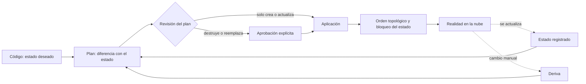
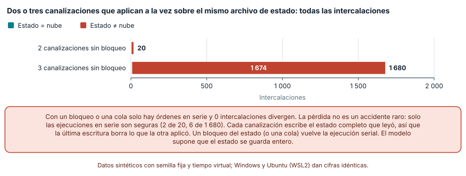
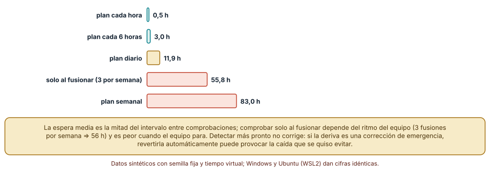

# SE-486 — Infraestructura como código en pipeline

[← SE-485 — Entrega y despliegue continuos](https://github.com/vladimiracunadev-create/modern-software-engineering-program/blob/main/classes/part-40-ci-cd-iac-y-platform-engineering/se-485-entrega-y-despliegue-continuos/README.md) · [↑ Parte 40](https://github.com/vladimiracunadev-create/modern-software-engineering-program/blob/main/classes/part-40-ci-cd-iac-y-platform-engineering/README.md) · [📚 Índice completo](https://github.com/vladimiracunadev-create/modern-software-engineering-program/blob/main/classes/README.md) · [🌐 Portal](https://vladimiracunadev-create.github.io/modern-software-engineering-program/classes/SE-486.html) · [SE-487 — GitOps y reconciliación →](https://github.com/vladimiracunadev-create/modern-software-engineering-program/blob/main/classes/part-40-ci-cd-iac-y-platform-engineering/se-487-gitops-y-reconciliacion/README.md)

## Punto profesional y fundamento pedagógico

**Punto profesional.** La clase existe para que trates los cambios de infraestructura con la misma disciplina que los de código —revisión, verificación automática, aplicación controlada— sin olvidar lo que los distingue: se aplican sobre un sistema vivo que tiene estado, el orden importa y un error puede borrar datos. La habilidad profesional es leer un plan como una predicción que se revisa antes de ejecutarse, proteger el estado compartido y decidir cada cuánto se comprueba que la realidad sigue coincidiendo con el código.

**Por qué aparece aquí.** Sigue a **Entrega y despliegue continuos**: la clase anterior decidió cómo se expone una versión de la aplicación; esta aplica el mismo flujo a lo que la aplicación necesita para existir (redes, bases de datos, colas, roles). El caso conductor sigue siendo la API de entregas, con una base de datos, un almacén de archivos y un balanceador descritos como código.

**Error conceptual que debe corregir.** Creer que tener la infraestructura como código garantiza que la infraestructura coincide con el código: el código describe lo que debería ser; lo que existe es el resultado de aplicarlo, de los cambios manuales y de las aplicaciones simultáneas, y solo una comprobación periódica lo revela.

**Secuencia de aprendizaje.** Antes de mirar los resultados, predices qué fracción de los planes falla si las acciones se aplican en orden arbitrario y cuántas intercalaciones de dos canalizaciones simultáneas dejan el estado distinto de la nube; después reproduces el planificador, el modelo de estado y el efecto de la frecuencia de comprobación. La secuencia usa predicción, explicación propia, contraste y recuperación. [ICAP](https://icap.education.asu.edu/research) distingue participación de construcción de conocimiento; [How People Learn II](https://nap.nationalacademies.org/catalog/24783/how-people-learn-ii-learners-contexts-and-cultures) respalda diseñar la práctica con contextos reales y retroalimentación.

**Evidencia de aprendizaje.** `iac-log.md` con la predicción, las tres figuras reproducidas, la descripción del flujo plan-revisión-aplicación de la plataforma, la política de bloqueo del estado y la frecuencia de detección de deriva elegida, y una nota que separe qué parte de cada conclusión es medida, cuál inferida y cuál supuesta.

**Límite de la conclusión.** El planificador es un modelo mínimo de 12 recursos con dependencias aleatorias, no una herramienta de infraestructura; el modelo de estado supone que cada canalización escribe el estado completo que leyó; las derivas siguen un proceso uniforme o de Poisson. No se creó ningún recurso real, no se usó ningún proveedor de nube ni ninguna herramienta de infraestructura como código, y los resultados describen mecanismos, no el comportamiento de un producto.

### Trazabilidad fuente → afirmación

| Fuente primaria u oficial | Afirmación que respalda | Lo que no prueba |
|---|---|---|
| [Terraform: estado](https://developer.hashicorp.com/terraform/language/state) | Explica que el estado asocia la configuración con los objetos reales, se usa para planificar y puede contener datos sensibles. | No describe el comportamiento de otras herramientas ni lo que ocurre en tu proveedor. |
| [Terraform: bloqueo del estado](https://developer.hashicorp.com/terraform/language/state/locking) | Documenta que las operaciones que pueden escribir el estado lo bloquean para evitar escrituras concurrentes. | No garantiza que el almacén que elijas admita el bloqueo ni cubre cambios hechos fuera de la herramienta. |
| [OpenTofu: documentación](https://opentofu.org/docs/) | Presenta un lenguaje declarativo con planes y aplicaciones, compatible con la misma familia de conceptos. | No equivale a una comparación de herramientas. |
| [Kahn, «Topological sorting of large networks»](https://doi.org/10.1145/368996.369025) | Describe el orden topológico de un grafo dirigido sin ciclos y su cálculo. | No trata las dependencias implícitas ni los tiempos de creación de un proveedor. |
| Morris, *Infrastructure as Code* (O'Reilly, 2.ª ed., 2020, ISBN 978-1-09-811467-1) | Trata la infraestructura como código como práctica de ingeniería: pruebas, entornos y cambios pequeños. | No es una norma ni prescribe una herramienta. |

## Antes de empezar

Recupera lo aprendido en `SE-485`: el criterio de retroceso solo sirve si lo escrito por la versión nueva sigue siendo legible por la anterior. La pregunta activa es: **¿qué ocurre con la infraestructura si se aplican dos cambios a la vez, si se aplican en otro orden o si alguien la modifica a mano?**

## Prerrequisitos

- Haber completado `SE-485` o poder explicar la diferencia entre desplegar y exponer.
- Python 3.11 o posterior; los experimentos usan solo la biblioteca estándar (`random`, `itertools`).
- Saber qué es un grafo de dependencias y una sentencia declarativa frente a una imperativa.

## Problema auténtico

Caso ilustrativo, no un incidente real: el equipo de la API de entregas describió su infraestructura como código y aplicaba los cambios desde dos canalizaciones, una por entorno. Un martes, dos cambios se aplicaron casi a la vez sobre el mismo entorno: uno añadía una cola y el otro un rol; ambos terminaron bien. Al día siguiente el siguiente plan proponía crear la cola de nuevo, porque el archivo de estado no la recordaba. Otro día alguien cambió a mano un grupo de seguridad para atender una urgencia; el cambio no estaba en el código y nadie lo vio durante tres semanas, hasta que un plan proponía «corregirlo» y habría cerrado el acceso de producción. Y una revisión de un cambio aparentemente menor —renombrar una base de datos— mostraba en el plan una palabra que casi nadie leyó: «reemplazar». La clase enseña a modelar estas tres situaciones y a diseñar el flujo que las contiene.

## Objetivos observables

Al terminar podrás:

1. explicar el modelo declarativo de la infraestructura como código: estado deseado, estado real, estado registrado, plan y aplicación;
2. calcular el orden de aplicación de un conjunto de acciones respetando dependencias y detectar un ciclo;
3. distinguir en un plan las acciones que crean, actualizan, destruyen y reemplazan y señalar las que comprometen datos;
4. explicar por qué una aplicación concurrente sin bloqueo pierde cambios y cómo lo evita un bloqueo;
5. elegir la frecuencia de detección de deriva y decir qué hacer cuando se detecta.

## Mapa conceptual



El mapa muestra **tres estados** que pueden divergir (el código, el registrado y la realidad) y dos puntos de control: la revisión del plan antes de aplicar y la comprobación de deriva después. Casi todos los incidentes de esta clase son una divergencia entre dos de los tres.

## Temas y por qué importan

| Tema | Por qué cambia una decisión profesional | Evidencia mínima |
|---|---|---|
| Modelo declarativo | Distingue qué se quiere de cómo se llega; el planificador calcula el cómo. | Descripción de los tres estados |
| Orden y dependencias | Aplicar fuera de orden falla; un ciclo no tiene solución. | Figura 1 y el orden calculado |
| Plan como revisión | El plan es la predicción de lo que se hará; leerlo evita borrar datos. | Plan comentado con las acciones destructivas |
| Estado y bloqueo | Dos aplicaciones sin bloqueo pierden cambios. | Figura 2 y política de bloqueo |
| Deriva | La realidad se aleja del código por cambios manuales; hay que verla y decidir. | Figura 3 y frecuencia elegida |

## Conceptos y decisiones

### 1. El modelo declarativo: tres estados y un plan

En la infraestructura como código **declarativa** se escribe el estado que se desea (hay una base de datos con estas propiedades, una cola con este nombre) y una herramienta calcula las acciones para alcanzarlo. Intervienen tres estados: el **deseado** (el código), el **registrado** (el archivo de estado, que recuerda qué objetos creó la herramienta y con qué propiedades) y el **real** (lo que existe en la nube). El **plan** es la diferencia entre el deseado y el registrado, refinada con lo que la herramienta lee del real; la **aplicación** ejecuta el plan y actualiza el registrado. Esa estructura explica la mayoría de los comportamientos sorprendentes: si el registrado no recuerda un objeto, el plan lo crea de nuevo; si el real cambió fuera de la herramienta, el plan lo revierte o lo ignora según cómo se haya modelado; si el deseado cambia una propiedad que el proveedor no puede modificar en sitio, el plan la **reemplaza**: destruye y vuelve a crear.

### 2. Dependencias y orden de aplicación

Los recursos se relacionan: una base de datos necesita una subred, un servicio necesita un rol. Esas relaciones forman un **grafo dirigido sin ciclos**. Para crear hay que respetar el orden topológico (primero lo que otros necesitan), y para destruir el inverso (primero lo que depende). Calcular el orden es un problema clásico —lo resuelve el algoritmo de Kahn, entre otros— y la herramienta lo hace por ti cuando las dependencias están declaradas; falla cuando existen **dependencias implícitas** que el código no expresa (un recurso que necesita que otro esté listo aunque no lo referencie). Un **ciclo** (A necesita B y B necesita A) no tiene orden posible y debe rechazarse antes de aplicar. Un plan que no puede ordenarse y un orden arbitrario son dos formas de fallar a medias, que dejan la infraestructura en un estado intermedio.

### 3. El plan como revisión

El plan es el documento que más conviene leer: dice qué se creará, qué se cambiará y qué se destruirá. Un plan con diez creaciones es rutina; un plan con una destrucción merece una pausa; un **reemplazo** de un recurso con estado (una base de datos, un volumen) merece una aprobación explícita y una copia verificada. La revisión humana funciona si el plan es legible y si quien lo revisa sabe qué buscar; se refuerza con una **política** que marque automáticamente las acciones destructivas y los permisos amplios. El flujo habitual separa dos momentos: el **plan** se genera y se publica en la revisión del cambio, y la **aplicación** ocurre después de la fusión, con el mismo plan (o uno recalculado y comparado) y con una aprobación cuando contenga acciones destructivas. Aplicar un plan distinto del que se revisó es el equivalente de desplegar un artefacto distinto del probado.

### 4. Estado, bloqueo y concurrencia

El archivo de estado es un recurso compartido. Si dos aplicaciones lo leen, cada una aplica sus cambios y cada una escribe el estado completo que leyó con sus propios cambios, la segunda escritura **borra** lo que registró la primera: la nube tiene ambos cambios, el estado solo uno, y el siguiente plan intentará crear lo que ya existe. Se llama actualización perdida y es una carrera clásica. La defensa es un **bloqueo** del estado durante la operación (o una cola que serialice las aplicaciones), con un tiempo máximo para que un bloqueo huérfano no paralice el trabajo. El estado, además, suele contener datos sensibles (contraseñas generadas, claves): se almacena cifrado y con acceso restringido, y se versiona para poder recuperar una versión anterior.

### 5. Deriva y su frecuencia de detección

La **deriva** es la diferencia entre el estado deseado y el real causada por cambios hechos fuera del flujo: un ajuste manual en una urgencia, una consola abierta, otra automatización. Se detecta ejecutando periódicamente un plan sin aplicar y mirando si propone cambios. La frecuencia de esa comprobación determina cuánto vive una deriva sin que nadie la vea: la espera media es la mitad del intervalo si las derivas llegan en instantes aleatorios. Detectar no es corregir: una deriva puede ser un error o una **corrección de emergencia** legítima que debe incorporarse al código antes de que la próxima aplicación la revierta. Una política razonable detecta con frecuencia, avisa a un responsable y no revierte automáticamente lo que no ha sido clasificado.

### El orden de aplicación de un plan

Se generan 300 casos: un grafo aleatorio de 12 recursos (cada uno depende de algunos anteriores) como estado deseado y un estado real que contiene el 55 % de los recursos, con el 30 % de ellos con una propiedad distinta y a veces un recurso huérfano. El planificador calcula las acciones (crear, actualizar, reemplazar, borrar) y se aplican en dos órdenes: aleatorio y topológico. Se repite la planificación tras aplicar para comprobar que queda vacía, y se inyecta un ciclo en 100 grafos.

| Medida | Resultado |
|---|---|
| Planes que fallan al aplicar en orden aleatorio | 79 % |
| Planes que fallan al aplicar en orden topológico | 0 % |
| Planes que quedan vacíos al repetir la aplicación | 300 de 300 |
| Acciones por plan | 7,76 |
| Acciones destructivas (borrar o reemplazar) por plan | 1,30 |
| Acciones destructivas sobre recursos con estado, por plan | 0,47 |
| Ciclos inyectados que se detectan | 100 de 100 |

En promedio cada plan de este modelo contiene 0,47 acciones destructivas sobre recursos con estado (aproximadamente una cada dos planes), y el planificador no las distingue de una creación: es la revisión (humana o automática) la que las ve.


**Cómo leer la figura.** Cada barra es una comprobación sobre los planes y su longitud el porcentaje de casos; el número de acciones, destructivas y con estado por plan está en la nota. Mira primero la diferencia entre las dos primeras barras: el orden de aplicación es la diferencia entre fallar casi siempre y no fallar. **Dónde deja de valer:** los grafos (densidad de dependencias del 25 %), la proporción de recursos con estado (25 %) y los porcentajes de cambio son supuestos del autor; un proveedor real impone sus propias reglas de qué cambios son en sitio y cuáles son reemplazos. El orden topológico es necesario pero no suficiente: las dependencias implícitas no están en el grafo.

### Dos o tres aplicaciones sin bloqueo

Cada canalización ejecuta tres pasos: leer el estado, aplicar sus cambios a la nube y escribir el estado que leyó más sus cambios. Se enumeran todas las intercalaciones posibles de los pasos de dos canalizaciones (20) y de tres (1 680), y se cuenta en cuántas el estado final difiere de lo que existe en la nube.

| Situación | Intercalaciones | Estado distinto de la nube | Fracción |
|---|---:|---:|---:|
| 2 canalizaciones sin bloqueo | 20 | 18 | 90,0 % |
| 3 canalizaciones sin bloqueo | 1 680 | 1 674 | 99,6 % |
| Con bloqueo o cola | solo órdenes en serie | 0 | 0 % |

Las únicas intercalaciones seguras son las que ejecutan una canalización entera tras otra: 2 de 20 con dos y 6 de 1 680 con tres.



**Cómo leer la figura.** Cada barra es un número de canalizaciones sin bloqueo y su longitud el total de intercalaciones, partido entre las que dejan el estado igual a la nube (verde) y distinto (rojo). Mira primero que casi todo es rojo: solo las ejecuciones en serie son seguras. **Dónde deja de valer:** el modelo asume que cada escritura sustituye todo el estado y que todas las intercalaciones son igual de probables; en la práctica las ventanas de solapamiento son cortas y la probabilidad real es mucho menor, pero la consecuencia —un estado que miente— es la misma. No modela herramientas que fusionan escrituras ni almacenes con versiones.

### Cada cuánto mirar la deriva

Se simulan 5 000 derivas manuales y se mide cuánto tardan en ser detectadas según la frecuencia del plan de comprobación: cada hora, cada 6 horas, diario, semanal y solo al fusionar un cambio (tres fusiones por semana, con llegadas aleatorias).

| Comprobación | Espera media | Percentil 95 |
|---|---:|---:|
| Plan cada hora | 0,5 h | 0,9 h |
| Plan cada 6 horas | 3,0 h | 5,7 h |
| Plan diario | 11,9 h | 22,7 h |
| Solo al fusionar (3 por semana) | 55,8 h | 166,2 h |
| Plan semanal | 83,0 h | 159,3 h |

Comprobar solo al fusionar es peor que un plan diario y depende del ritmo del equipo: si el equipo no fusiona durante una semana, nadie ve la deriva.



**Cómo leer la figura.** Cada barra es una política de comprobación y su longitud, la espera media. **Dónde deja de valer:** las derivas llegan en instantes aleatorios y la comprobación solo mira; la figura no mide qué se hace al detectarla. Si el 20 % de las derivas son correcciones de emergencia legítimas, revertirlas de forma automática puede causar la caída que se quería evitar; detectar pronto sirve si hay un responsable que clasifica.

## Definiciones de trabajo

- **estado deseado:** configuración que el código declara para la infraestructura.
- **plan:** lista de acciones que la herramienta calcularía para llevar el estado registrado y el real al deseado.
- **reemplazo:** acción que destruye un recurso y lo vuelve a crear porque una propiedad no se puede cambiar en sitio.
- **bloqueo del estado:** exclusión mutua que impide que dos operaciones escriban el estado a la vez.
- **deriva:** diferencia entre el estado deseado y el real causada por cambios hechos fuera del flujo de cambios.

Las definiciones son operativas para la plataforma de la API de entregas. No convierten términos con una historia más amplia en sinónimos y deben contrastarse con la documentación primaria enlazada al final.

## Ejemplo mínimo

El fragmento calcula un orden de creación para un grafo pequeño. Antes de ejecutarlo, predice si el orden `base, red, servicio` es válido.

```python
dep = {"servicio": ["base", "rol"], "base": ["red"], "red": [], "rol": []}
orden, visto = [], set()

def visitar(x):
    if x in visto:
        return
    for d in dep[x]:
        visitar(d)
    visto.add(x)
    orden.append(x)

for x in dep:
    visitar(x)
print(orden)
```

Imprime `['red', 'rol', 'base', 'servicio']`: primero lo que otros necesitan. El orden `base, red, servicio` no es válido porque `base` necesita `red` y `servicio` necesita `rol`. Registra versión de Python, comando y salida; después añade `dep["red"] = ["servicio"]` y comprueba que la recursión no termina: un ciclo.

## Ejemplo profesional

El equipo de la API de entregas rediseña el flujo de infraestructura. Cada cambio abre una revisión que ejecuta un plan y lo publica como comentario; una política marca en rojo cualquier acción de borrado o reemplazo y cualquier permiso de administración. Tras la fusión, una canalización aplica el plan guardado de la revisión; si el plan recalculado difiere, se detiene y pide revisión. Los reemplazos de recursos con estado exigen la aprobación de una segunda persona y una copia reciente verificada. El estado se guarda cifrado, con versionado y con bloqueo por entorno; una canalización de comprobación de deriva ejecuta un plan sin aplicar cada seis horas y crea una incidencia con responsable cuando encuentra diferencias. La política es clara: una deriva no se revierte automáticamente; se clasifica en incorporarla al código o corregirla. Registran la decisión con su fecha y el dato que la revisaría: si las derivas por mes superan las diez, se revisa el acceso a la consola. Compara con el punto de partida: ahora el plan se lee, el estado se protege y la realidad se mira cada seis horas.

## Práctica guiada

1. Dibuja los tres estados (deseado, registrado y real) de una infraestructura mínima de la API de entregas y marca en qué se pueden separar.
2. Predice qué fracción de los planes falla al aplicar en orden aleatorio y escribe tu estimación antes de medir.
3. Implementa el planificador de 12 recursos, aplica en orden aleatorio y topológico y reproduce la tabla; inyecta un ciclo y comprueba que se detecta.
4. Enumera las intercalaciones de dos y tres canalizaciones sin bloqueo y cuenta las que dejan el estado inconsistente.
5. Simula derivas con distintas frecuencias de comprobación y compara con tus datos de incidentes.
6. Escribe el flujo plan-revisión-aplicación con las condiciones que exigen aprobación adicional.
7. Entrega `iac-log.md` y pide a otra persona que encuentre un plan con una acción destructiva que tu política no marque.

## Ejercicios

1. **Orden:** dado un grafo de siete recursos con una dependencia implícita no declarada, muestra un orden válido según el grafo que falla al aplicarse y explica cómo se descubre.
2. **Reemplazo:** lista cinco cambios de propiedades de una base de datos y clasifícalos en cambio en sitio o reemplazo, y decide cuáles exigirían copia previa.
3. **Concurrencia:** diseña dos mecanismos para evitar la actualización perdida (bloqueo y cola) y compara qué ocurre si la canalización falla a mitad de la aplicación.
4. **Deriva:** decide la frecuencia de detección y el responsable para un entorno de producción con un costo de 100 unidades por hora de deriva y un costo de 5 unidades por ejecución; razona con los datos de la figura.

## Reto verificable

Entrega `iac-log.md` con la predicción, las tres tablas, el flujo plan-revisión-aplicación, la política de bloqueo y la frecuencia de detección. Se aprueba si otra persona ejecuta el código desde un checkout limpio, obtiene las mismas tablas con las mismas semillas y puede decir qué acción de un plan merece aprobación adicional y qué ocurre si dos aplicaciones coinciden. No se aprueba por describir la herramienta sin modelar el estado ni por afirmar que el estado «siempre coincide» sin una comprobación de deriva.

## Caso conductor

La canalización de la API de entregas es el caso conductor de la [Parte 40](../README.md). Esta clase deja el sexto artefacto: el flujo de infraestructura con revisión del plan, bloqueo del estado y detección de deriva. `SE-487` invertirá la dirección con GitOps, en el que un controlador reconcilia continuamente el clúster con el repositorio, y `SE-488` usará este flujo para crear entornos efímeros. Cambia después un solo dato, la frecuencia de detección, y observa cuánto vive una deriva.

## Preguntas frecuentes

### ¿Aplicar el plan guardado es mejor que recalcularlo al fusionar?

Aplicar el plan revisado garantiza que lo ejecutado es lo leído, pero puede quedar obsoleto si la realidad cambió entre la revisión y la fusión. Una práctica razonable es recalcular y comparar: si coinciden, aplicar; si difieren, detenerse y revisar. Así se evita ejecutar algo que nadie leyó.

### ¿Se puede evitar la deriva prohibiendo los cambios manuales?

Se puede reducir restringiendo el acceso de escritura a la consola, pero las urgencias existen. Es más realista permitir un acceso de emergencia registrado y tener un proceso para incorporar esos cambios al código que revertirlos automáticamente.

### ¿Qué hago si el estado se pierde o se corrompe?

Se recupera desde una versión anterior del almacén (por eso se versiona) o, si no existe, se vuelve a importar cada recurso existente al estado. La segunda opción es lenta y propensa a errores; por eso el estado se protege como un dato crítico.

### ¿Un plan vacío demuestra que la infraestructura es correcta?

No. Demuestra que el estado registrado coincide con el deseado y con lo que la herramienta puede leer. No ve los recursos que no gestiona, ni las propiedades que no modela, ni una configuración incorrecta que el código describe fielmente.

## Fallo controlado y diagnóstico

Reproduce el fallo clásico de la clase: **dos aplicaciones simultáneas que dejan el estado inconsistente**. Simula una de las 18 intercalaciones de dos canalizaciones en las que ambas leen antes de que ninguna escriba.

Registra síntoma, entrada mínima, hipótesis, observación que descarta cada hipótesis, causa, corrección y prueba de regresión. **Síntoma:** el siguiente plan propone crear un recurso que ya existe. **Hipótesis rivales:** (a) alguien borró el estado; (b) la herramienta tiene un defecto; (c) dos aplicaciones se solaparon y la segunda escritura borró el registro de la primera. **Prueba:** compara la nube con el estado y revisa las horas de inicio de las dos aplicaciones; si se solapan y el recurso existe en la nube pero no en el estado, la causa es la actualización perdida. **Conclusión:** el estado no tenía bloqueo; el 90 % de las intercalaciones de dos canalizaciones es inconsistente. **Regresión:** activa el bloqueo del estado (o una cola por entorno) y añade una prueba que lance dos aplicaciones simultáneas y exija que la segunda espere o falle sin escribir. No cambies a la vez el bloqueo y el almacén.

## Errores comunes y cómo corregirlos

| Síntoma | Causa probable | Corrección |
|---|---|---|
| El plan propone crear algo que ya existe | Estado perdido o desactualizado | Bloqueo del estado y versionado; importar si falta |
| Se destruyó una base de datos con un cambio «menor» | Reemplazo no revisado | Política que marca borrados y reemplazos; copia verificada |
| La aplicación falla a mitad | Orden o dependencia implícita | Declarar dependencias; aplicar por orden topológico |
| La deriva se descubre semanas después | Sin comprobación periódica | Plan sin aplicar cada pocas horas con responsable |
| Se aplica un plan distinto del revisado | La realidad cambió entre revisión y aplicación | Recalcular y comparar antes de aplicar |

## Entorno y archivos clave

```text
work/SE-486/
├── README.md
├── iac/
│   ├── planificador.py
│   ├── estado.py
│   └── deriva.py
├── tests/test_iac.py
└── evidence/iac-log.md
```

El `README` declara plataforma, versión de Python, semillas y comandos. Los experimentos usan solo la biblioteca estándar (`random`, `itertools`) y se ejecutaron con CPython 3.12.9 en Windows 11 y 3.12.3 en Ubuntu bajo WSL2: las salidas fueron idénticas. Si añades una herramienta de infraestructura como código, fija su procedencia y su versión, y no ejecutes planes contra una cuenta real sin permiso.

## Seguridad, ética y accesibilidad

- el archivo de estado puede contener secretos: cífralo, restringe quién lo lee y no lo subas al repositorio;
- una aplicación de infraestructura tiene permisos amplios; limita el rol que usa la canalización y exige aprobación para acciones destructivas;
- un borrado o reemplazo puede afectar a personas que dependen del servicio: avisa y programa fuera de los cierres de plazos;
- los planes y las alertas de deriva deben ser legibles en texto, sin depender del color para distinguir un borrado;
- documenta las tablas con el texto alternativo de cada figura.

## Puente hacia el trabajo con agentes

Un agente al que se le pide «aplica este cambio de infraestructura» probablemente ejecutará el plan directamente y afirmará que funcionó. Pídele en cambio que muestre el plan antes de aplicar, que marque las acciones de borrado y reemplazo con el recurso afectado, que confirme que el estado tiene bloqueo y copia, y que no aplique nada destructivo sin tu aprobación escrita. Revisa especialmente si propone aplicar sin leer el plan o si «arregla» una deriva revirtiéndola sin preguntar: son los dos defectos que esta clase mostró con modelos.

## Transferencia

Traslada el análisis a otro tipo de infraestructura (por ejemplo, la configuración de un servicio de correo o de una red doméstica gestionada con código): cambia los recursos y sus dependencias, y conserva el procedimiento de modelar los tres estados, ordenar la aplicación, proteger el estado y decidir cada cuánto se compara con la realidad. La transferencia está lograda cuando puedes decir qué acción de un plan es irreversible y qué ocurre si dos cambios coinciden, no cuando el plan se parece al de la plataforma.

## Evaluación y evidencia

| Criterio | Evidencia para aprobar |
|---|---|
| comprensión | explicación de los tres estados, del plan y de por qué un reemplazo puede destruir datos |
| corrección | tablas de orden, concurrencia y deriva reproducibles con las mismas semillas |
| diseño | flujo plan-revisión-aplicación con política de acciones destructivas, bloqueo y detección de deriva |
| diagnóstico | reproducción del fallo «aplicación simultánea» con regresión |
| incertidumbre | declaración de que grafos, tasas y modelo de estado son sintéticos o del autor |
| reproducibilidad | versiones, comandos, salida y límites declarados |

## Fuentes

- [Terraform: estado](https://developer.hashicorp.com/terraform/language/state) — función del estado y sus datos sensibles; autoridad: documentación de HashiCorp.
- [Terraform: bloqueo del estado](https://developer.hashicorp.com/terraform/language/state/locking) — exclusión de escrituras concurrentes; autoridad: documentación de HashiCorp.
- [OpenTofu: documentación](https://opentofu.org/docs/) — infraestructura declarativa de código abierto; autoridad: proyecto OpenTofu.
- [Kahn, «Topological sorting of large networks»](https://doi.org/10.1145/368996.369025) — orden topológico (Communications of the ACM, 1962); autoridad: artículo con DOI verificado en Crossref.
- Morris, *Infrastructure as Code* (O'Reilly, 2.ª ed., 2020, ISBN 978-1-09-811467-1) — prácticas de ingeniería de infraestructura; autoridad: libro de referencia con ISBN verificado.

Cada fuente respalda el mecanismo indicado; ninguna demuestra que el 79 % de planes que fallan, el 90 % de intercalaciones inconsistentes o las 55,8 horas de deriva se observen en tu infraestructura. Esa afirmación depende de las dependencias, de las ventanas de solapamiento y de las derivas reales.

## Límites y siguiente paso

Se ejecutaron tres experimentos con datos sintéticos en Windows y Ubuntu (WSL2) con resultados idénticos. No se creó ningún recurso real, no se usó ningún proveedor ni herramienta de infraestructura como código, el planificador es un modelo mínimo de 12 recursos y el modelo de estado supone que cada canalización escribe el estado completo; los grafos, las proporciones de recursos con estado, la uniformidad de las derivas y la equiprobabilidad de las intercalaciones son construcciones del autor. La siguiente clase invierte la dirección: un controlador reconcilia de forma continua el clúster con lo que declara el repositorio.

## Glosario

- **estado deseado:** configuración que el código declara para la infraestructura.
- **plan:** lista de acciones que la herramienta calcularía para llevar el estado registrado y el real al deseado.
- **reemplazo:** acción que destruye un recurso y lo vuelve a crear porque una propiedad no se puede cambiar en sitio.
- **bloqueo del estado:** exclusión mutua que impide que dos operaciones escriban el estado a la vez.
- **deriva:** diferencia entre el estado deseado y el real causada por cambios hechos fuera del flujo de cambios.

---

[← SE-485 — Entrega y despliegue continuos](https://github.com/vladimiracunadev-create/modern-software-engineering-program/blob/main/classes/part-40-ci-cd-iac-y-platform-engineering/se-485-entrega-y-despliegue-continuos/README.md) · [↑ Parte 40](https://github.com/vladimiracunadev-create/modern-software-engineering-program/blob/main/classes/part-40-ci-cd-iac-y-platform-engineering/README.md) · [📚 Índice completo](https://github.com/vladimiracunadev-create/modern-software-engineering-program/blob/main/classes/README.md) · [🌐 Portal](https://vladimiracunadev-create.github.io/modern-software-engineering-program/classes/SE-486.html) · [SE-487 — GitOps y reconciliación →](https://github.com/vladimiracunadev-create/modern-software-engineering-program/blob/main/classes/part-40-ci-cd-iac-y-platform-engineering/se-487-gitops-y-reconciliacion/README.md)
