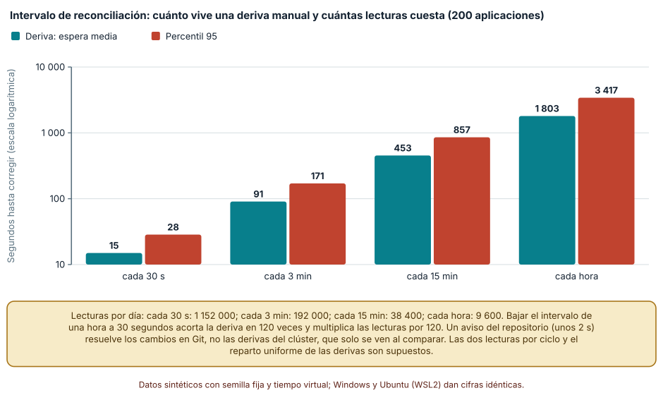
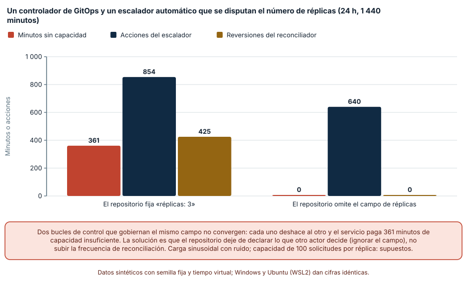
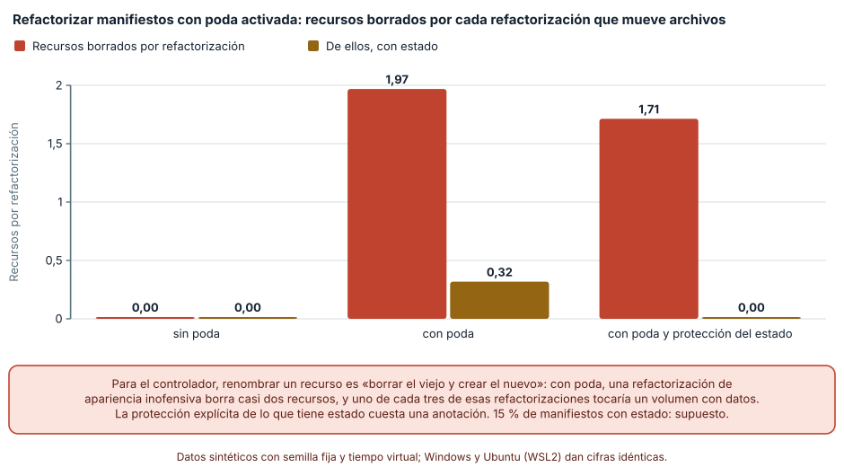

# SE-487 — GitOps y reconciliación

[← SE-486 — Infraestructura como código en pipeline](https://github.com/vladimiracunadev-create/modern-software-engineering-program/blob/main/classes/part-40-ci-cd-iac-y-platform-engineering/se-486-infraestructura-como-codigo-en-pipeline/README.md) · [↑ Parte 40](https://github.com/vladimiracunadev-create/modern-software-engineering-program/blob/main/classes/part-40-ci-cd-iac-y-platform-engineering/README.md) · [📚 Índice completo](https://github.com/vladimiracunadev-create/modern-software-engineering-program/blob/main/classes/README.md) · [🌐 Portal](https://vladimiracunadev-create.github.io/modern-software-engineering-program/classes/SE-487.html) · [SE-488 — Entornos preview y datos seguros →](https://github.com/vladimiracunadev-create/modern-software-engineering-program/blob/main/classes/part-40-ci-cd-iac-y-platform-engineering/se-488-entornos-preview-y-datos-seguros/README.md)

## Punto profesional y fundamento pedagógico

**Punto profesional.** La clase existe para que entiendas GitOps como un bucle de control y no como «un repositorio con archivos de despliegue»: un controlador compara sin descanso lo que declara el repositorio con lo que corre en el clúster y actúa sobre la diferencia. La habilidad profesional es decidir cuán a menudo reconcilia, qué campos le pertenecen a otros controladores y qué debe borrar cuando algo desaparece del repositorio, porque de esas tres decisiones dependen la rapidez con que se corrige una deriva, la estabilidad del sistema y los datos que sobreviven a una refactorización.

**Por qué aparece aquí.** Sigue a **Infraestructura como código en pipeline**: la clase anterior aplicaba cambios desde una canalización que empuja; esta invierte la dirección y deja que el clúster tire de lo que declara el repositorio. El caso conductor sigue siendo la API de entregas desplegada en un clúster, con un escalador automático de réplicas y un volumen para los archivos de las entregas.

**Error conceptual que debe corregir.** Creer que GitOps garantiza que el clúster es lo que dice el repositorio: el controlador reconcilia lo que le toca, puede disputarse un campo con otro controlador, y una poda activada convierte un renombrado en un borrado, de modo que el repositorio y el clúster pueden coincidir y estar equivocados a la vez.

**Secuencia de aprendizaje.** Antes de mirar los resultados, predices cuánto tarda en corregirse una deriva manual con una reconciliación cada tres minutos y qué ocurre si el repositorio fija el número de réplicas mientras un escalador automático también lo decide; después reproduces el efecto del intervalo, la disputa entre controladores y los borrados por poda. La secuencia usa predicción, explicación propia, contraste y recuperación. [ICAP](https://icap.education.asu.edu/research) distingue participación de construcción de conocimiento; [How People Learn II](https://nap.nationalacademies.org/catalog/24783/how-people-learn-ii-learners-contexts-and-cultures) respalda diseñar la práctica con contextos reales y retroalimentación.

**Evidencia de aprendizaje.** `gitops-log.md` con la predicción, las tres figuras reproducidas, el intervalo de reconciliación elegido con su costo, la lista de campos que el repositorio no declara porque pertenecen a otro controlador y la política de poda con su protección de recursos con estado, y una nota que separe qué parte de cada conclusión es medida, cuál inferida y cuál supuesta.

**Límite de la conclusión.** La carga sinusoidal con ruido, la capacidad de 100 solicitudes por réplica, los 200 aplicaciones, las dos lecturas por ciclo, el 15 % de manifiestos con estado y las refactorizaciones aleatorias son supuestos del autor; el tiempo es virtual. No se usó ningún clúster ni controlador real: la clase explica el mecanismo con un modelo, y los nombres de las opciones de las herramientas se leen de su documentación.

### Trazabilidad fuente → afirmación

| Fuente primaria u oficial | Afirmación que respalda | Lo que no prueba |
|---|---|---|
| [OpenGitOps: principios](https://opengitops.dev/) | Define cuatro principios: sistema declarativo, estado deseado versionado e inmutable, extracción automática del estado deseado y reconciliación continua. | No prescribe una herramienta ni resuelve la gestión de secretos. |
| [Argo CD: opciones de sincronización](https://argo-cd.readthedocs.io/en/stable/user-guide/sync-options/) | Documenta la poda de recursos que ya no están en el repositorio y las anotaciones que protegen un recurso de ser podado. | No dice qué política conviene a tu clúster ni cubre otras herramientas. |
| [Argo CD: diferencias](https://argo-cd.readthedocs.io/en/stable/user-guide/diffing/) | Explica cómo ignorar campos concretos (por ejemplo, las réplicas gestionadas por un escalador) para que no se consideren divergencia. | No indica qué campos de tu aplicación pertenecen a otro actor. |
| [Flux: conceptos](https://fluxcd.io/flux/concepts/) | Describe controladores que reconcilian fuentes y aplicaciones y el intervalo de la reconciliación. | No compara herramientas ni mide su costo. |
| [Kubernetes: controladores](https://kubernetes.io/docs/concepts/architecture/controller/) | Describe el bucle de control que acerca el estado actual al deseado y la existencia de varios controladores. | No trata los conflictos entre controladores ni las políticas de poda de herramientas externas. |

## Antes de empezar

Recupera lo aprendido en `SE-486`: existen tres estados (deseado, registrado y real) y la deriva es la diferencia entre el deseado y el real. La pregunta activa es: **¿quién corrige la deriva en un clúster, con qué rapidez y qué ocurre si dos actores se disputan el mismo campo?**

## Prerrequisitos

- Haber completado `SE-486` o poder explicar el plan, el estado y la deriva.
- Python 3.11 o posterior; los experimentos usan solo la biblioteca estándar (`random`, `math`).
- Saber qué es un bucle de control y qué es un manifiesto declarativo.

## Problema auténtico

Caso ilustrativo, no un incidente real: el equipo de la API de entregas adoptó GitOps y declaró en el repositorio tres réplicas del servicio. Un escalador automático de réplicas sube el número cuando aumenta la carga; cada pocos minutos el controlador de GitOps veía que había cinco réplicas, que el repositorio decía tres, y las bajaba. Durante la tarde del cierre de plazos el servicio quedó con menos capacidad que carga durante horas, con ambos controladores trabajando «correctamente». Semanas después, una refactorización movió los manifiestos a otra carpeta y renombró un recurso; con la poda activada, el controlador borró el volumen antiguo, que contenía archivos de entregas, y creó uno vacío con el nombre nuevo. Ninguna de las dos situaciones era un defecto de la herramienta: eran consecuencias de lo que cada controlador consideraba suyo. La clase enseña a modelar ambas.

## Objetivos observables

Al terminar podrás:

1. enumerar los principios de GitOps y distinguir un despliegue por empuje de uno por extracción;
2. calcular el costo y el beneficio de un intervalo de reconciliación en espera de la deriva y en lecturas por día;
3. detectar y resolver una disputa de campos entre un controlador de GitOps y otro actor;
4. explicar por qué una refactorización de manifiestos puede equivaler a un borrado y cómo protegerse;
5. escribir la política de GitOps de un servicio: fuente, intervalo, campos ignorados, poda y reversión.

## Mapa conceptual


El mapa muestra el **bucle** (extraer, comparar, actuar) y un segundo actor que escribe en el mismo clúster. Cuando dos actores gobiernan el mismo campo, el sistema no converge; por eso la política debe decir qué campos pertenecen a quién.

## Temas y por qué importan

| Tema | Por qué cambia una decisión profesional | Evidencia mínima |
|---|---|---|
| Principios de GitOps | Definen qué es y qué no es: sin reconciliación continua es solo un repositorio. | Lista de principios aplicada a la plataforma |
| Extracción frente a empuje | Cambia dónde viven las credenciales de despliegue y quién actúa. | Diagrama del flujo con las credenciales |
| Intervalo de reconciliación | Fija cuánto vive una deriva y cuánto cuesta vigilarla. | Figura 1 y el intervalo elegido |
| Disputa entre controladores | Dos actores sobre un campo producen un sistema que no converge. | Figura 2 y la lista de campos ignorados |
| Poda y reversión | Borrar lo que ya no está declarado destruye datos si no se protege. | Figura 3 y la política de poda |

## Conceptos y decisiones

### 1. Los principios de GitOps

OpenGitOps resume la práctica en cuatro principios. El sistema se describe de forma **declarativa**: el repositorio dice qué debe existir, no cómo llegar. El estado deseado se guarda **versionado e inmutable**: cada cambio es un commit con autor, fecha y motivo, y volver atrás es volver a un commit. El software **extrae automáticamente** el estado deseado: no hay un paso manual que lo copie al clúster. Y lo **reconcilia continuamente**: un agente observa el estado real y corrige la diferencia sin esperar una orden. El último principio es el que distingue GitOps de «guardar los archivos de despliegue en git»: una canalización que aplica una vez y se olvida no corrige nada de lo que ocurra después. De los cuatro principios se deriva una auditoría gratis (el historial de git) y una recuperación sencilla (reaplicar el estado deseado), con las salvedades de los secretos y de los datos.

### 2. Extracción frente a empuje

En el modelo de **empuje**, la canalización tiene credenciales del clúster y ejecuta los cambios. En el de **extracción**, un agente dentro del clúster lee el repositorio y se aplica a sí mismo lo que encuentra. La diferencia de seguridad es concreta: en extracción la canalización de integración no necesita credenciales del clúster (basta con que publique un artefacto y actualice un manifiesto), de modo que comprometer la integración no entrega el control de producción, y el agente solo necesita leer el repositorio. Las credenciales que sí se necesitan se desplazan al agente, que debe estar bien acotado. El modelo de extracción tiene un costo: la corrección ocurre dentro de un intervalo y la visibilidad de un fallo es indirecta (hay que mirar el estado del agente), por lo que una canalización que no espera el resultado puede declarar éxito antes de que el clúster haya convergido.

### 3. El intervalo de reconciliación

El agente repite su ciclo cada cierto intervalo. Una deriva que ocurre en un instante aleatorio espera, de media, la mitad del intervalo: con 3 minutos son 90 segundos; con una hora, 30 minutos. Reducir el intervalo acorta esa espera a cambio de lecturas: cada ciclo consulta el repositorio y el clúster por cada aplicación, y esas lecturas consumen cuota de la interfaz del repositorio y del clúster. Existe una vía intermedia: un **aviso** (webhook) del repositorio dispara una reconciliación inmediata cuando hay un cambio en git, lo que resuelve la latencia de los cambios declarados sin bajar el intervalo, pero no ayuda con las derivas del clúster, que el repositorio no ve. Elegir el intervalo es elegir cuánta deriva se tolera y cuánta carga se acepta.

### 4. Controladores que se disputan un campo

Un clúster tiene muchos actores que escriben: el agente de GitOps, un escalador automático, un operador de base de datos, una persona con una consola. Cada campo debería tener un único dueño. Si el repositorio declara el número de réplicas y un escalador también lo decide, el agente deshace al escalador en cada ciclo y el escalador deshace al agente en cuanto cambia la carga: ninguno converge y el costo es una capacidad que oscila. La solución no es subir ni bajar el intervalo sino **repartir la propiedad**: el repositorio deja de declarar el campo (o el agente lo ignora en la comparación) y el escalador es su único dueño. La regla general es que cada campo declarado en git es una promesa de que nadie más lo gobierna.

### 5. Poda, orden y reversión

Cuando un recurso desaparece del repositorio, el agente puede **podarlo**: borrarlo del clúster. Es lo que se espera de un sistema declarativo, y es también un riesgo: para el agente, mover o renombrar un manifiesto es «borrar el recurso antiguo y crear uno nuevo», y si el recurso antiguo tenía datos (un volumen), se pierden. La protección es explícita: marcar los recursos con estado para que no se podan, o desactivar la poda para ellos y exigir una acción deliberada. La **reversión** de un cambio de GitOps es revertir el commit, y el agente aplica el estado anterior; funciona para el código de despliegue y no revierte los datos escritos entretanto, como se vio en la clase 413. Los **secretos** no pueden vivir en claro en el repositorio: se guardan cifrados o se referencian desde un gestor externo, y la elección determina quién puede leerlos y cómo se rotan.

### Cuánto vive una deriva según el intervalo

Se simulan 6 000 derivas manuales con llegada aleatoria dentro del intervalo y se calcula la espera hasta la siguiente reconciliación; el costo es el número de lecturas diarias para 200 aplicaciones, con dos lecturas por ciclo (repositorio y clúster).

| Intervalo | Espera media | Percentil 95 | Lecturas por día | Cambio en git sin aviso (media) |
|---|---:|---:|---:|---:|
| 30 s | 15 s | 28 s | 1 152 000 | 15 s |
| 3 min | 91 s | 171 s | 192 000 | 90 s |
| 15 min | 453 s | 857 s | 38 400 | 450 s |
| 1 h | 1 803 s | 3 417 s | 9 600 | 1 800 s |

Pasar de una hora a 30 segundos acorta la deriva 120 veces y multiplica las lecturas por 120. Un aviso del repositorio reduce la última columna a unos 2 segundos, pero no cambia las derivas del clúster.



**Cómo leer la figura.** Cada grupo es un intervalo de reconciliación; la barra verde es la espera media y la roja el percentil 95, en segundos y en escala logarítmica. Mira primero que las dos crecen casi en la misma proporción que el intervalo; las lecturas por día que cuesta cada uno están en la nota. **Dónde deja de valer:** el reparto uniforme de las derivas y las dos lecturas por ciclo son supuestos; una herramienta real cachea el repositorio y lee solo lo que cambió, y el costo depende de la API del clúster. El tiempo que tarda en aplicarse una corrección tras detectarla no está incluido.

### Dos controladores sobre un mismo campo

Se simulan 24 horas (1 440 minutos) con una carga sinusoidal entre unas 150 y 1 150 solicitudes por minuto más un ruido gaussiano; cada réplica soporta 100 solicitudes. Un escalador automático fija las réplicas al mínimo necesario en cada minuto. En la primera configuración el repositorio declara tres réplicas y el agente de GitOps repone ese valor cada tres minutos; en la segunda el repositorio omite el campo.

| Configuración | Minutos sin capacidad suficiente | Acciones del escalador | Reversiones del agente |
|---|---:|---:|---:|
| El repositorio fija «réplicas: 3» | 361 | 854 | 425 |
| El repositorio omite el campo de réplicas | 0 | 640 | 0 |

Con el campo en disputa el servicio pasa 361 minutos (6 horas) con menos capacidad que carga y ambos controladores ejecutan más acciones; con una propiedad única no falla ningún minuto.



**Cómo leer la figura.** Cada grupo es una configuración; las barras son los minutos sin capacidad (roja), las acciones del escalador (azul oscura) y las reversiones del reconciliador (dorada). Mira primero las barras roja y dorada del primer grupo, que desaparecen en el segundo. **Dónde deja de valer:** la carga, la capacidad por réplica y la reacción instantánea del escalador son supuestos; uno real tiene retardos y márgenes. El resultado no depende del intervalo: cambiarlo cambia cuánto dura cada oscilación, no su causa.

### Qué borra la poda al refactorizar

Se simulan 4 000 repositorios de 40 manifiestos, el 15 % de recursos con estado; en el 25 % de los casos una refactorización mueve o renombra de uno a tres manifiestos, que para el controlador son un borrado y una creación. Se mide cuántos recursos se borran por refactorización con tres políticas.

| Política de poda | Recursos borrados por refactorización | De ellos, con estado |
|---|---:|---:|
| Sin poda | 0 | 0 |
| Con poda | 1,97 | 0,32 |
| Con poda y protección de recursos con estado | 1,71 | 0 |

Con poda, una refactorización que parece inofensiva borra casi dos recursos y, en uno de cada tres casos, uno con datos. La protección no impide los borrados sin estado, que se recrean, pero evita los que no tienen vuelta atrás.



**Cómo leer la figura.** Cada grupo es una política de poda; la barra roja son los recursos borrados por cada refactorización y la dorada los que tienen estado. Mira primero que la protección casi no reduce los borrados pero lleva la barra dorada a cero. **Dónde deja de valer:** el 15 % de manifiestos con estado, la frecuencia de refactorizaciones y el número de archivos movidos son supuestos; una herramienta real puede reconocer un renombrado por una anotación de identidad y evitar el borrado. El cálculo ilustra el riesgo de la configuración por defecto, no el de un producto concreto.

## Definiciones de trabajo

- **[GitOps](../../../glosario/entradas/g/gitops.md):** práctica en la que el estado deseado se declara y versiona en un repositorio y un agente lo reconcilia continuamente con el estado real.
- **[reconciliación](../../../glosario/entradas/r/reconciliacion.md):** comparación periódica del estado real con el deseado y aplicación de la diferencia.
- **[extracción](../../../glosario/entradas/e/extraccion.md):** modelo en el que el agente que despliega lee el repositorio desde dentro del entorno, en lugar de recibir órdenes desde fuera.
- **[poda](../../../glosario/entradas/p/poda.md):** borrado de los recursos del clúster que ya no figuran en el repositorio.
- **[propietario de un campo](../../../glosario/entradas/p/propietario-de-un-campo.md):** único actor autorizado a gobernar el valor de un campo de un recurso.

Las definiciones son operativas para el despliegue de la API de entregas. No convierten términos con una historia más amplia en sinónimos y deben contrastarse con la documentación primaria enlazada al final.

## Ejemplo mínimo

El fragmento simula el choque de un agente que repone tres réplicas y un escalador que las sube. Antes de ejecutarlo, predice si las réplicas terminan estables.

```python
replicas = 3
for minuto in range(1, 7):
    carga = 500                      # solicitudes por minuto
    necesarias = -(-carga // 100)    # 5
    if replicas < necesarias:
        replicas = necesarias        # escalador
    if minuto % 3 == 0:
        replicas = 3                 # agente de GitOps
    print(minuto, replicas, replicas * 100 >= carga)
```

El resultado alterna entre 5 y 3 réplicas y la capacidad (`True` o `False`) oscila con el ciclo del agente: cada controlador cumple su regla y juntos no convergen. Registra versión de Python, comando y salida; después elimina la línea del agente y observa que la capacidad se estabiliza.

## Ejemplo profesional

El equipo de la API de entregas redacta su política de GitOps. El repositorio declara el servicio, el volumen y el escalador, pero no declara el número de réplicas: ese campo es del escalador. La reconciliación es cada tres minutos con aviso del repositorio, porque tolerar 90 segundos de deriva manual es aceptable y las 192 000 lecturas diarias caben en la cuota; en producción se avisa a un responsable cuando el agente detecta una deriva persistente. La poda está activada con una excepción: todo recurso con estado lleva la anotación de protección y su borrado exige un cambio explícito con aprobación de una segunda persona. Los secretos viven cifrados en el repositorio con una clave que solo conoce el agente. Revertir es revertir el commit, con un ensayo mensual en un entorno de pruebas para comprobar que el estado anterior se vuelve a aplicar y que el volumen sobrevive. Registran la decisión con su fecha y el dato que la revisaría: si las lecturas se acercan al límite, aumentan el intervalo. Compara con el punto de partida: ahora cada campo tiene un dueño, cada borrado un motivo y cada deriva un tiempo de vida conocido.

## Práctica guiada

1. Dibuja los actores que escriben en un clúster de ejemplo (agente, escalador, operador, personas) y asigna un propietario a cada campo importante.
2. Predice cuánto vive una deriva manual con un intervalo de tres minutos y escribe tu estimación antes de calcular.
3. Simula las derivas con cuatro intervalos y reproduce la tabla; añade el aviso del repositorio y calcula qué parte de las derivas resuelve.
4. Simula la disputa entre el agente y un escalador, cuenta los minutos sin capacidad y elimina la disputa quitando el campo del repositorio.
5. Simula refactorizaciones con y sin poda y con y sin protección de recursos con estado.
6. Escribe la política de GitOps con intervalo, campos ignorados, poda, protección y reversión.
7. Entrega `gitops-log.md` y pide a otra persona que encuentre un campo con dos propietarios que tu política no haya visto.

## Ejercicios

1. **Intervalo:** calcula el intervalo máximo para tolerar una deriva media de 60 segundos y las lecturas diarias que produce con 500 aplicaciones; decide si es viable.
2. **Propiedad:** lista cinco campos de un despliegue y asigna un dueño a cada uno; identifica cuáles tendrían dos actores sin una regla de propiedad.
3. **Poda:** diseña dos mecanismos para evitar que un renombrado borre un volumen (protección explícita y confirmación manual) y compara el esfuerzo de cada uno.
4. **Reversión:** explica por qué revertir el commit de una migración de datos no restaura los datos y qué se necesita antes de retroceder.

## Reto verificable

Entrega `gitops-log.md` con la predicción, las tres tablas, la tabla de propietarios por campo, la política de poda y el intervalo elegido con su costo. Se aprueba si otra persona ejecuta el código desde un checkout limpio, obtiene las mismas tablas con las mismas semillas y puede decir qué campo tendría dos propietarios y qué recurso se borraría con una refactorización. No se aprueba por describir el repositorio como «fuente de verdad» sin decir qué actores escriben en el clúster ni por activar la poda sin proteger los recursos con estado.

## Caso conductor

La canalización de la API de entregas es el caso conductor de la [Parte 40](../README.md). Esta clase deja el séptimo artefacto: la política de GitOps con propietarios, intervalo y poda. `SE-488` usará este flujo para crear entornos efímeros con datos seguros, y `SE-492` lo integrará en el camino a producción con retroceso. Cambia después un solo dato, el intervalo de reconciliación, y observa cómo cambian la deriva y las lecturas.

## Preguntas frecuentes

### ¿GitOps sustituye a la canalización de integración continua?

No. La canalización verifica y construye el artefacto; GitOps lo despliega y mantiene su estado. En el modelo de extracción, la canalización termina actualizando un manifiesto del repositorio y el agente hace el resto. Las dos cosas se complementan y ninguna reemplaza a la otra.

### ¿Un intervalo de 30 segundos es mejor que uno de tres minutos?

Corrige antes y cuesta seis veces más lecturas. Vale la pena si una deriva de minutos es costosa para el negocio; si no, es gasto. Un aviso del repositorio da la ventaja principal (aplicar un cambio al instante) sin multiplicar las lecturas.

### ¿Por qué no declarar siempre todos los campos en el repositorio?

Porque algunos campos los gobierna otro actor legítimo. Declararlos crea una disputa. La regla es declarar lo que el repositorio posee e ignorar lo que otro controlador posee, dejando constancia escrita de la división.

### ¿Qué ocurre con los secretos en GitOps?

No pueden estar en claro. Se guardan cifrados con una clave que solo el agente posee, o se referencian desde un gestor externo y el agente los lee en el momento. La rotación debe contemplarse en el diseño: un secreto cifrado en el historial sigue siendo legible con la clave antigua.

## Fallo controlado y diagnóstico

Reproduce el fallo clásico de la clase: **un servicio con menos capacidad que carga porque dos controladores se disputan las réplicas**. Simula 24 horas con el campo declarado en el repositorio.

Registra síntoma, entrada mínima, hipótesis, observación que descarta cada hipótesis, causa, corrección y prueba de regresión. **Síntoma:** en horas de carga el servicio responde con lentitud y el número de réplicas oscila entre tres y cinco. **Hipótesis rivales:** (a) el escalador está mal configurado; (b) el agente de GitOps tiene un defecto; (c) ambos gobiernan el mismo campo y se deshacen mutuamente. **Prueba:** compara la secuencia de cambios de réplicas con el ciclo del agente; si cada subida se deshace en el siguiente ciclo y el historial del recurso muestra dos autores, la causa es la propiedad compartida. **Conclusión:** los dos controladores funcionaban como estaban configurados; la configuración era contradictoria (361 minutos sin capacidad). **Regresión:** quita el campo del repositorio o ignóralo en la comparación y añade una prueba que simule una subida de carga y exija que las réplicas no vuelvan a tres. No cambies a la vez el intervalo y la propiedad del campo.

## Errores comunes y cómo corregirlos

| Síntoma | Causa probable | Corrección |
|---|---|---|
| El número de réplicas oscila | Dos actores gobiernan el mismo campo | Repartir la propiedad; ignorar el campo en el agente |
| Se borró un volumen al reorganizar archivos | Poda activa sin protección | Anotación de protección; confirmación para borrar recursos con estado |
| El clúster tarda en reflejar un cambio | Intervalo largo sin aviso | Webhook del repositorio o intervalo menor |
| La canalización dice «éxito» y el clúster no cambió | No espera la convergencia del agente | Esperar el estado sano del agente antes de declarar éxito |
| Un secreto aparece en claro en el historial | Se subió sin cifrar | Rotar el secreto y cifrar con la clave del agente |

## Entorno y archivos clave

```text
work/SE-487/
├── README.md
├── gitops/
│   ├── intervalo.py
│   ├── disputa.py
│   └── poda.py
├── tests/test_gitops.py
└── evidence/gitops-log.md
```

El `README` declara plataforma, versión de Python, semillas y comandos. Los experimentos usan solo la biblioteca estándar (`random`, `math`) y se ejecutaron con CPython 3.12.9 en Windows 11 y 3.12.3 en Ubuntu bajo WSL2: las salidas fueron idénticas. Si añades un agente de GitOps real, fija su procedencia y su versión, y pruébalo primero en un clúster desechable.

## Seguridad, ética y accesibilidad

- el agente dentro del clúster tiene permisos amplios: acótalos al espacio de nombres que gestiona y revisa quién puede cambiar el repositorio que lee;
- un repositorio de despliegue es un objetivo: protege su rama principal con revisión obligatoria y firma de commits donde se pueda;
- un borrado por poda puede afectar a datos de personas: trátalo como una operación con aprobación, y ensaya la recuperación;
- las alertas de deriva deben decir qué recurso, qué campo y quién lo cambió, en texto accesible;
- documenta las tablas con el texto alternativo de cada figura.

## Puente hacia el trabajo con agentes

Un agente al que se le pide «migra el despliegue a GitOps» probablemente declarará todos los campos de todos los recursos, activará la poda para «mantener limpio» y dará el trabajo por terminado. Pídele en cambio que liste los actores que escriben en el clúster, que asigne un propietario a cada campo y que ignore el campo que gobierna el escalador; que active la poda solo con protección explícita de los recursos con estado; y que ensaye la reversión en un entorno de pruebas. Revisa especialmente si declara las réplicas con un escalador presente y si la poda alcanza un volumen: son los dos defectos que esta clase mostró con modelos.

## Transferencia

Traslada el análisis a otro sistema (por ejemplo, la configuración de una flota de dispositivos que descarga su política de un repositorio): cambia el controlador, el intervalo y los actores que escriben, y conserva el procedimiento de asignar un propietario a cada campo, calcular el costo de vigilar y proteger lo que no se puede recrear. La transferencia está lograda cuando puedes decir qué campo tiene dos dueños y qué se perdería con una refactorización, no cuando la política se parece a la de la plataforma.

## Evaluación y evidencia

| Criterio | Evidencia para aprobar |
|---|---|
| comprensión | explicación de los principios, de extracción frente a empuje y del bucle de reconciliación |
| corrección | tablas de intervalo, disputa y poda reproducibles con las mismas semillas |
| diseño | política con propietarios de campos, intervalo, poda con protección y reversión |
| diagnóstico | reproducción del fallo «dos controladores sobre un campo» con regresión |
| incertidumbre | declaración de que carga, capacidad, proporciones y refactorizaciones son sintéticas o del autor |
| reproducibilidad | versiones, comandos, salida y límites declarados |

## Fuentes

- [OpenGitOps: principios](https://opengitops.dev/) — cuatro principios de GitOps; autoridad: proyecto OpenGitOps de la CNCF.
- [Argo CD: opciones de sincronización](https://argo-cd.readthedocs.io/en/stable/user-guide/sync-options/) — poda y protección de recursos; autoridad: documentación de Argo CD.
- [Argo CD: diferencias](https://argo-cd.readthedocs.io/en/stable/user-guide/diffing/) — campos ignorados en la comparación; autoridad: documentación de Argo CD.
- [Flux: conceptos](https://fluxcd.io/flux/concepts/) — reconciliación e intervalos; autoridad: documentación de Flux.
- [Kubernetes: controladores](https://kubernetes.io/docs/concepts/architecture/controller/) — bucle de control y estado deseado; autoridad: documentación de Kubernetes.

Cada fuente respalda el mecanismo indicado; ninguna demuestra que los 361 minutos sin capacidad, los 1,97 recursos borrados o las 192 000 lecturas diarias se observen en tu clúster. Esa afirmación depende de los actores que escriben, del intervalo y de las refactorizaciones reales.

## Límites y siguiente paso

Se ejecutaron tres experimentos con datos sintéticos en Windows y Ubuntu (WSL2) con resultados idénticos. No se usó ningún clúster ni agente de GitOps reales; la carga sinusoidal con ruido, la capacidad de 100 solicitudes por réplica, la reacción instantánea del escalador, los 200 aplicaciones con dos lecturas por ciclo, el 15 % de manifiestos con estado y las refactorizaciones aleatorias son construcciones del autor, y una herramienta real puede evitar algunos de los borrados que aquí se modelan. La siguiente clase usa este flujo para crear entornos de vista previa con datos que no exponen a nadie.

## Glosario

- **[GitOps](../../../glosario/entradas/g/gitops.md):** práctica en la que el estado deseado se declara y versiona en un repositorio y un agente lo reconcilia continuamente con el estado real.
- **[reconciliación](../../../glosario/entradas/r/reconciliacion.md):** comparación periódica del estado real con el deseado y aplicación de la diferencia.
- **[extracción](../../../glosario/entradas/e/extraccion.md):** modelo en el que el agente que despliega lee el repositorio desde dentro del entorno, en lugar de recibir órdenes desde fuera.
- **[poda](../../../glosario/entradas/p/poda.md):** borrado de los recursos del clúster que ya no figuran en el repositorio.
- **[propietario de un campo](../../../glosario/entradas/p/propietario-de-un-campo.md):** único actor autorizado a gobernar el valor de un campo de un recurso.

Conceptos de esta clase en el [glosario del programa](../../../glosario/README.md): [Extracción](../../../glosario/entradas/e/extraccion.md) · [GitOps](../../../glosario/entradas/g/gitops.md) · [Poda](../../../glosario/entradas/p/poda.md) · [Propietario de un campo](../../../glosario/entradas/p/propietario-de-un-campo.md) · [Reconciliación](../../../glosario/entradas/r/reconciliacion.md).

---

[← SE-486 — Infraestructura como código en pipeline](https://github.com/vladimiracunadev-create/modern-software-engineering-program/blob/main/classes/part-40-ci-cd-iac-y-platform-engineering/se-486-infraestructura-como-codigo-en-pipeline/README.md) · [↑ Parte 40](https://github.com/vladimiracunadev-create/modern-software-engineering-program/blob/main/classes/part-40-ci-cd-iac-y-platform-engineering/README.md) · [📚 Índice completo](https://github.com/vladimiracunadev-create/modern-software-engineering-program/blob/main/classes/README.md) · [🌐 Portal](https://vladimiracunadev-create.github.io/modern-software-engineering-program/classes/SE-487.html) · [SE-488 — Entornos preview y datos seguros →](https://github.com/vladimiracunadev-create/modern-software-engineering-program/blob/main/classes/part-40-ci-cd-iac-y-platform-engineering/se-488-entornos-preview-y-datos-seguros/README.md)
