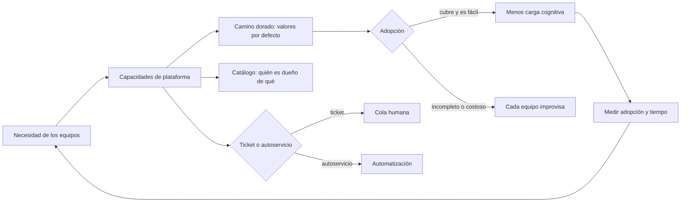
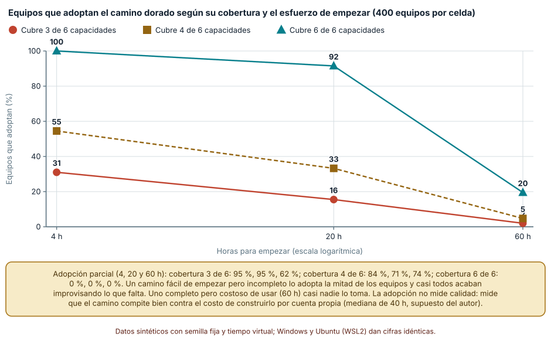
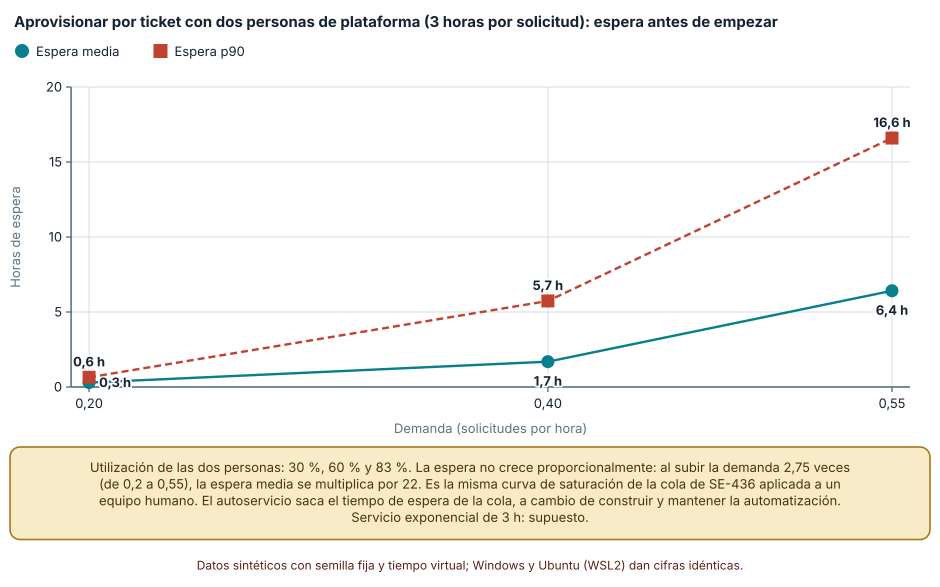

# SE-489 — Developer portals y capacidades de plataforma

[← SE-488 — Entornos preview y datos seguros](https://github.com/vladimiracunadev-create/modern-software-engineering-program/blob/main/classes/part-40-ci-cd-iac-y-platform-engineering/se-488-entornos-preview-y-datos-seguros/README.md) · [↑ Parte 40](https://github.com/vladimiracunadev-create/modern-software-engineering-program/blob/main/classes/part-40-ci-cd-iac-y-platform-engineering/README.md) · [📚 Índice completo](https://github.com/vladimiracunadev-create/modern-software-engineering-program/blob/main/classes/README.md) · [🌐 Portal](https://vladimiracunadev-create.github.io/modern-software-engineering-program/classes/SE-489.html) · [SE-490 — Métricas DORA y mejora sin gaming →](https://github.com/vladimiracunadev-create/modern-software-engineering-program/blob/main/classes/part-40-ci-cd-iac-y-platform-engineering/se-490-metricas-dora-y-mejora-sin-gaming/README.md)

## Punto profesional y fundamento pedagógico

**Punto profesional.** La clase existe para que trates una plataforma interna como un producto con personas usuarias que pueden elegir no usarlo. La habilidad profesional es decidir qué capacidades ofrece (entornos, canalizaciones, bases de datos, observabilidad), cómo las encuentra y las pide un equipo, y qué evidencia muestra que la plataforma reduce trabajo en lugar de añadir un trámite, en vez de medir cuántas cosas construyó.

**Por qué aparece aquí.** Sigue a **Entornos preview y datos seguros**: la clase anterior produjo un entorno efímero con una política de datos; esta lo convierte en una capacidad que cualquier equipo pide sin abrir una incidencia. El caso conductor sigue siendo la plataforma de la API de entregas, ahora con varios equipos que necesitan lo mismo: un servicio con canalización, entorno de pruebas, base de datos y alertas.

**Error conceptual que debe corregir.** Creer que una plataforma se mide por lo que ofrece: se mide por lo que los equipos adoptan y por el tiempo que se ahorran; un camino dorado que cubre la mitad de lo que se necesita o que cuesta más empezar que construirlo a mano se queda sin usuarios, y un catálogo que se rellena de «TBD» parece completo y no informa.

**Secuencia de aprendizaje.** Antes de mirar los resultados, predices qué fracción de los equipos adopta un camino dorado según cuánto cubre y cuánto cuesta empezar, y cuántas entradas de un catálogo de 150 servicios pasan una validación que solo comprueba que los campos existan; después reproduces la adopción, la validación por niveles y la espera de un aprovisionamiento por ticket. La secuencia usa predicción, explicación propia, contraste y recuperación. [ICAP](https://icap.education.asu.edu/research) distingue participación de construcción de conocimiento; [How People Learn II](https://nap.nationalacademies.org/catalog/24783/how-people-learn-ii-learners-contexts-and-cultures) respalda diseñar la práctica con contextos reales y retroalimentación.

**Evidencia de aprendizaje.** `platform-log.md` con la predicción, las tres figuras reproducidas, el catálogo de capacidades de la plataforma con su dueño y su medida de éxito, la política de validación del catálogo y la decisión entre ticket y autoservicio para tres capacidades, y una nota que separe qué parte de cada conclusión es medida, cuál inferida y cuál supuesta.

**Límite de la conclusión.** Los 400 equipos por celda, las seis capacidades, los costos de empezar de 4, 20 y 60 horas, la mediana de 40 horas de construirlo a mano, los 150 servicios con problemas sembrados y la cola con dos personas son sintéticos y elegidos por el autor. No se observó ninguna plataforma, equipo ni portal real y no se usó ninguna herramienta de portal para desarrolladores: la clase explica el mecanismo con modelos.

### Trazabilidad fuente → afirmación

| Fuente primaria u oficial | Afirmación que respalda | Lo que no prueba |
|---|---|---|
| [CNCF: Platforms White Paper](https://tag-app-delivery.cncf.io/whitepapers/platforms/) | Describe una plataforma interna como un conjunto de capacidades ofrecidas como producto a equipos de producto, con autoservicio y un equipo que las mantiene. | No garantiza que una plataforma concreta reduzca la carga de nadie; es una descripción y no una medición. |
| [CNCF: modelo de madurez de la ingeniería de plataformas](https://tag-app-delivery.cncf.io/whitepapers/platform-eng-maturity-model/) | Propone dimensiones (inversión, adopción, interfaces, operaciones, medición) para evaluar la madurez de una plataforma. | Es un marco de referencia y no un estándar; los niveles no son una certificación. |
| [Backstage: catálogo de software](https://backstage.io/docs/features/software-catalog/) | Explica un catálogo basado en metadatos que describen componentes, dueños y relaciones. | No dice qué metadatos son obligatorios en tu organización ni cómo evitar que se desactualicen. |
| Skelton y Pais, *Team Topologies* (IT Revolution, 2019, ISBN 978-1-942788-81-2) | Presenta el equipo de plataforma como habilitador y la carga cognitiva como restricción de diseño. | Es un modelo de organización, no una prueba empírica de sus efectos. |

## Antes de empezar

Recupera lo aprendido en `SE-488`: un entorno efímero necesita una política de datos y de vida. La pregunta activa es: **si otro equipo quiere lo mismo que acabas de construir, ¿cuántas horas y cuántas personas necesita, y qué hace si no encaja con lo que ofreces?**

## Prerrequisitos

- Haber completado `SE-488` o poder explicar la política de datos y de vida de un entorno de vista previa.
- Python 3.11 o posterior; los experimentos usan solo la biblioteca estándar (`random`, `math`).
- Conocer el modelo de colas de la clase 376: la espera crece al acercarse a la saturación.

## Problema auténtico

Caso ilustrativo, no un incidente real: el equipo de plataforma de la organización de la API de entregas construyó una plantilla de servicio con canalización, entorno de pruebas y alertas. La lanzó con un portal y un catálogo. A los tres meses solo dos de ocho equipos la usaban: los otros decían que no cubría las colas de mensajes, que tardaba un día en empezar o que preferían la suya. El catálogo, por su parte, tenía 130 de 150 servicios «completos» según un indicador, pero al buscar un dueño para una alerta nocturna, un tercio de los dueños declarados ya no existía como equipo. Y pedir una base de datos seguía requiriendo una incidencia: con dos personas en plataforma, la espera media pasó de unas horas a casi un día en las semanas de cierre. Nadie había hecho nada mal; el producto no se había tratado como producto. La clase enseña a medir la adopción, la veracidad del catálogo y la espera.

## Objetivos observables

Al terminar podrás:

1. explicar qué es una plataforma interna como producto y qué la distingue de un conjunto de herramientas;
2. calcular con un modelo cómo la cobertura y el costo de empezar determinan la adopción de un camino dorado;
3. validar un catálogo de servicios por niveles y distinguir completo de actual;
4. calcular la espera de un aprovisionamiento por ticket y decidir qué capacidades pasar a autoservicio;
5. definir métricas de la plataforma que no se puedan mejorar con atajos.

## Mapa conceptual



El mapa muestra que la plataforma es un **ciclo de producto**: las necesidades definen las capacidades, la adopción dice si funcionan y la medición realimenta las necesidades. Una capacidad que nadie adopta no es una capacidad: es un costo.

## Temas y por qué importan

| Tema | Por qué cambia una decisión profesional | Evidencia mínima |
|---|---|---|
| Plataforma como producto | Obliga a pensar en personas usuarias, adopción y retirada, no solo en construir. | Lista de capacidades con dueño y medida |
| Camino dorado | Los valores por defecto ahorran decisiones; deben cubrir y ser fáciles de empezar. | Figura 1 y la cobertura elegida |
| Catálogo de servicios | Sin dueño verificado no hay quién responda en un incidente. | Figura 2 y la política de validación |
| Ticket frente a autoservicio | La cola humana se satura antes de lo que parece. | Figura 3 y la decisión por capacidad |
| Métricas de plataforma | Lo que se mide se optimiza: elige medidas que no se falseen. | Métricas con su trampa |

## Conceptos y decisiones

### 1. La plataforma como producto

El documento de la CNCF define una plataforma interna como una colección de capacidades —aprovisionamiento, canalizaciones, observabilidad, seguridad— ofrecidas a los equipos de producto con un enfoque de producto: se conocen sus necesidades, se fijan interfaces, se mide su uso y se retira lo que no sirve. Team Topologies aporta el criterio de diseño: el trabajo de los equipos de producto tiene una **carga cognitiva** limitada, y la plataforma existe para reducirla, no para sumar otra cosa que aprender. De ello se deduce que la plataforma compite con las alternativas que los equipos tienen a mano (construirlo ellos, usar un servicio externo, copiar la solución de otro equipo) y que su éxito no es lo que ofrece sino lo que los equipos eligen. Un equipo de plataforma que mide el número de herramientas entregadas mide su actividad, no su efecto.

### 2. El camino dorado

Un **camino dorado** (o camino pavimentado) es la forma recomendada y soportada de hacer algo común: crear un servicio, desplegarlo, observarlo. Ofrece valores por defecto razonables y automatización de lo repetitivo, y no es obligatorio: quien tiene una necesidad especial puede salirse, asumiendo el mantenimiento de lo que construya. Su adopción depende de dos factores que se pueden modelar. La **cobertura** es qué parte de lo que un equipo necesita está resuelto; lo que falta se improvisa y reintroduce la complejidad que el camino pretendía ahorrar. El **costo de empezar** es el esfuerzo para usarlo; si supera el de construir la alternativa, un equipo racional no lo adopta. Un camino fácil e incompleto lo adopta mucha gente que acaba improvisando; uno completo y costoso lo adopta casi nadie. Los dos factores deben cuidarse a la vez.

### 3. El catálogo de servicios

Un **catálogo** es un inventario de los servicios y componentes con metadatos: quién es el dueño, en qué ciclo de vida está, dónde está su documentación y su guía de operación, qué dependencias tiene y quién está de guardia. Responde a la pregunta que más importa en un incidente: ¿a quién llamo? Su valor depende de que sea **veraz**: un catálogo con el 87 % de los campos rellenos puede tener el 70 % de los datos obsoletos. Hay tres niveles de validación, de menor a mayor esfuerzo: que los campos existan, que sean coherentes con otra fuente (el dueño existe en el registro de equipos) y que estén actualizados (la última revisión es reciente). Medir la completitud solo por presencia invita a rellenar con valores de relleno; las comprobaciones cruzadas y la fecha de revisión son las que distinguen un campo lleno de uno cierto.

### 4. Ticket frente a autoservicio

Una capacidad que se pide por ticket depende de una cola de personas. Las colas tienen una propiedad que se trató en la clase 376: la espera crece de forma no lineal con la utilización. Con dos personas y tres horas por solicitud, subir la demanda de 0,2 a 0,55 solicitudes por hora (2,75 veces) multiplica la espera media por más de veinte. La respuesta habitual es contratar, pero también se puede cambiar la naturaleza del servicio: el **autoservicio** convierte la capacidad en una acción automatizada con validaciones, que no espera a nadie y no depende de la disponibilidad de una persona. Tiene su costo: construir y mantener la automatización y diseñar los límites (cuotas, aprobaciones) que antes aplicaba una persona. No todo debe ser autoservicio: lo raro, caro o de alto riesgo puede merecer una revisión humana.

### 5. Medir la plataforma sin falsearla

Las métricas de una plataforma deben mirar a las personas usuarias: **adopción** (qué fracción de los equipos usa el camino dorado), **tiempo de aprovisionamiento** (cuánto tarda un equipo en tener lo que pide), **satisfacción** (una pregunta periódica y breve), **tiempo hasta el primer despliegue** de un servicio nuevo. Cada métrica tiene un atajo: la adopción sube si se obliga a usar el camino, el tiempo de aprovisionamiento baja si se cierran los tickets sin resolverlos, la satisfacción sube si solo responden los contentos. Por eso se combinan medidas y se pregunta a los equipos que no adoptaron por qué. La plataforma también debe poder **retirar** capacidades: una que nadie usa y alguien mantiene es un costo que se disfraza de inversión.

### Cuántos equipos adoptan el camino dorado

Se simulan 400 equipos por celda. Cada uno necesita cada una de seis capacidades con probabilidad 0,7; el camino cubre las 3, 4 o 6 primeras; las que faltan se improvisan a 25 horas cada una. Construirlo por su cuenta cuesta una mediana de 40 horas (lognormal). Un equipo adopta si empezar con el camino (4, 20 o 60 horas más lo improvisado) cuesta menos que construir.

| Cobertura del camino | 4 h para empezar | 20 h para empezar | 60 h para empezar |
|---|---:|---:|---:|
| 3 de 6 capacidades | 31 % (95 % con algo improvisado) | 16 % (95 %) | 2 % (63 %) |
| 4 de 6 | 55 % (84 %) | 33 % (71 %) | 5 % (74 %) |
| 6 de 6 | 100 % (0 %) | 92 % (0 %) | 20 % (0 %) |

Con cobertura total y 4 horas para empezar adoptan todos; con la mitad y 20 horas, uno de cada seis. Entre los que adoptan un camino incompleto, la mayoría (63 a 95 %) acaba improvisando algo.



**Cómo leer la figura.** El eje horizontal son las horas para empezar, en escala logarítmica, y el vertical el porcentaje de equipos que adoptan el camino; cada línea es una cobertura. Mira primero cómo las tres caen al aumentar el esfuerzo y que solo la cobertura completa se mantiene alta con 20 horas. **Dónde deja de valer:** los equipos eligen solo por horas, la mediana de 40 horas y la necesidad del 70 % por capacidad son supuestos del autor; en una organización real pesan la confianza, la política y la obligación. El resultado muestra la forma de la dependencia, no un porcentaje esperable.

### Cuántas entradas del catálogo están completas y cuántas actuales

Se genera un catálogo de 150 servicios con problemas sembrados: un dueño ausente (10 %), un dueño que ya no existe en el registro de equipos (alrededor del 9 %), un enlace de operación de relleno como «TBD» o «-» (14 %) y una revisión de hace más de 180 días (alrededor del 55 %). Cuatro validaciones se aplican de forma acumulativa.

| Validación | Entradas que pasan | Fracción |
|---|---:|---:|
| Los campos están presentes | 130 | 87 % |
| + el dueño existe en el registro de equipos | 122 | 81 % |
| + el enlace de operación no es de relleno | 108 | 72 % |
| + la revisión es de los últimos 180 días | 43 | 29 % |
| Entradas con algún problema sembrado | 107 | 71 % |

La validación de presencia da por buenas 130 entradas; solo 43 están al día. Medir la completitud con la primera fila produce un 87 % que oculta que siete de cada diez entradas tienen un problema.


**Cómo leer la figura.** Cada barra es una validación acumulada y su longitud las entradas que pasan, con una línea en 150; la última barra son las entradas con algún problema sembrado. Mira primero cómo cae la barra al exigir comprobaciones contra otra fuente: de 130 a 43. **Dónde deja de valer:** las proporciones de cada problema y el límite de 180 días son supuestos del autor, y la validación comprueba la forma del enlace, no que el documento exista o sea útil. Un catálogo real necesita además que alguien lo use en un incidente real para descubrir lo que ninguna regla ve.

### La espera del aprovisionamiento por ticket

Se simula una cola con dos personas de plataforma que atienden cada solicitud en una media de tres horas (distribución exponencial) y solicitudes que llegan a 0,2, 0,4 y 0,55 por hora, con 8 000 solicitudes por caso.

| Demanda | Utilización | Espera media | Espera del percentil 90 |
|---|---:|---:|---:|
| 0,20 por hora | 30 % | 0,3 h | 0,6 h |
| 0,40 por hora | 60 % | 1,7 h | 5,7 h |
| 0,55 por hora | 83 % | 6,4 h | 16,6 h |

Subir la demanda 2,75 veces multiplica la espera media por 22. Con 83 % de utilización una de cada diez solicitudes espera más de 16 horas antes de que alguien empiece.



**Cómo leer la figura.** El eje horizontal es la demanda en solicitudes por hora y el vertical las horas de espera antes de empezar; la línea verde es la espera media, con la utilización junto a cada punto, y la roja el percentil 90. Mira primero cómo las dos se curvan hacia arriba al acercarse a la saturación. **Dónde deja de valer:** las llegadas de Poisson y el servicio exponencial son supuestos; la demanda real llega en ráfagas (cierres de plazos), lo que empeora las colas. El modelo no incluye horarios ni vacaciones, que reducen la capacidad efectiva, ni la retroalimentación (quien espera abre otra solicitud).

## Definiciones de trabajo

- **plataforma interna:** conjunto de capacidades que un equipo ofrece como producto a otros equipos de la organización.
- **camino dorado:** forma recomendada y soportada de realizar una tarea común, no obligatoria.
- **carga cognitiva:** cantidad de cosas que un equipo debe conocer y mantener para hacer su trabajo.
- **catálogo de servicios:** inventario de servicios con sus dueños, ciclo de vida y documentación.
- **autoservicio:** capacidad que un equipo obtiene sin esperar a una persona de otro equipo.

Las definiciones son operativas para la plataforma de la API de entregas. No convierten términos con una historia más amplia en sinónimos y deben contrastarse con la documentación primaria enlazada al final.

## Ejemplo mínimo

El fragmento calcula la espera media de una cola con un servidor y utilización creciente. Antes de ejecutarlo, predice si pasar del 50 % al 90 % de utilización multiplica la espera por menos o por más de cinco.

```python
for rho in (0.5, 0.7, 0.9):
    print(rho, round(rho / (1 - rho), 2))
```

Salen 1,0, 2,33 y 9,0 (en unidades de tiempo de servicio): pasar del 50 al 90 % multiplica la espera por nueve. Es la fórmula del servidor único `ρ/(1−ρ)`; con dos servidores el aumento empieza más tarde y es igual de brusco al final. Registra versión de Python, comando y salida; después evalúa 0,95 y 0,99.

## Ejemplo profesional

El equipo de plataforma de la API de entregas decide tratar sus capacidades como un producto. Para cada una (servicio nuevo, entorno de vista previa, base de datos, cola, alertas) escribe un dueño, una medida de éxito y una fecha de revisión. Para el camino dorado fija una meta de cobertura del 80 % de lo que piden los equipos (medida preguntando a ocho equipos) y un tiempo de empezar de menos de cuatro horas medido desde la solicitud hasta el primer despliegue. El catálogo pasa a validarse cada noche en cuatro niveles; una entrada con dueño inexistente o revisión de más de 180 días abre una incidencia al equipo que figura y baja un indicador de salud visible en el portal. Para el aprovisionamiento, miden la demanda de cada capacidad: la base de datos (0,4 por hora) pasa a autoservicio con cuotas y aprobación solo para producción; el acceso especial queda por ticket. Las métricas son adopción, tiempo hasta el primer despliegue y una pregunta mensual de satisfacción, y cada trimestre entrevistan a un equipo que no adoptó. Compara con el punto de partida: ahora cada capacidad tiene un dueño, una medida y una forma de retirarse.

## Práctica guiada

1. Lista las capacidades que una plataforma ofrece (o debería ofrecer) a tus equipos y asigna dueño y medida de éxito a cada una.
2. Predice qué fracción de equipos adoptaría un camino que cubre la mitad de lo necesario y cuesta veinte horas empezar.
3. Simula la adopción con distintas coberturas y costos, reproduce la tabla y encuentra la combinación que supera el 90 %.
4. Valida un catálogo (real o sintético) en cuatro niveles y calcula cuántas entradas pasan cada uno.
5. Simula la cola de aprovisionamiento con dos personas y distintas demandas; encuentra la utilización a partir de la cual la espera supera una jornada.
6. Decide qué capacidades pasan a autoservicio y cuáles quedan por ticket, con su motivo.
7. Entrega `platform-log.md` y pide a otra persona que encuentre una forma de mejorar tu métrica de adopción sin ayudar a nadie.

## Ejercicios

1. **Adopción:** con los datos de la figura, calcula cuánto debe bajar el costo de empezar un camino de cobertura 4/6 para igualar la adopción de uno de cobertura 6/6 con 20 horas, y decide qué es más barato de mejorar.
2. **Catálogo:** diseña una cuarta comprobación cruzada para el catálogo (por ejemplo, que el equipo de guardia exista y tenga personas) y estima cuántas entradas más descartaría.
3. **Cola:** calcula con la fórmula del servidor único cuántas solicitudes por hora admite una persona (3 h por solicitud) antes de que la espera media supere un día.
4. **Métricas:** propone una métrica de adopción que no se pueda mejorar obligando a usar el camino y una que no se pueda falsear cerrando tickets sin resolverlos.

## Reto verificable

Entrega `platform-log.md` con la predicción, las tres tablas, el catálogo de capacidades con dueño y medida, la política de validación del catálogo y la decisión entre ticket y autoservicio. Se aprueba si otra persona ejecuta el código desde un checkout limpio, obtiene las mismas tablas con las mismas semillas y puede decir qué capacidad pasaría a autoservicio y por qué. No se aprueba por listar herramientas sin medir su adopción ni por dar por bueno un catálogo que solo comprueba que los campos existan.

## Caso conductor

La canalización de la API de entregas es el caso conductor de la Parte 40. Esta clase deja el noveno artefacto: el catálogo de capacidades con sus medidas. `SE-490` medirá la entrega con las métricas DORA y la forma de no falsearlas, y `SE-492` usará estas capacidades para el camino a producción. Cambia después un solo dato, el costo de empezar, y observa cuánto cambia la adopción.

## Preguntas frecuentes

### ¿Hay que obligar a los equipos a usar el camino dorado?

Obligar sube la adopción y borra la señal: ya no sabes si el camino es bueno. Un camino que se elige libremente te dice que funciona. Obligar puede ser razonable para requisitos de seguridad o cumplimiento (por ejemplo, un registro de imágenes aprobado), pero conviene separar lo que es política de lo que es comodidad.

### ¿Un portal es lo mismo que una plataforma?

No. El portal es la interfaz de descubrimiento y autoservicio; la plataforma son las capacidades detrás. Un portal sin capacidades es un directorio, y capacidades sin portal se descubren por boca a boca.

### ¿Cuántas personas debe tener un equipo de plataforma?

Depende de cuántos equipos atiende y de cuánto está automatizado. Una regla práctica es que la espera por ticket sea un dato que se mide: si la utilización pasa del 70 %, hay que automatizar o ampliar antes de que la espera se dispare.

### ¿Cómo evito que el catálogo se desactualice?

Con validaciones automáticas que cruzan el catálogo con otras fuentes (registro de equipos, repositorios, guardias) y con una fecha de revisión visible. Una entrada sin revisar baja su indicador y abre una incidencia al equipo; la alternativa es depender de la memoria de las personas.

## Fallo controlado y diagnóstico

Reproduce el fallo clásico de la clase: **un catálogo que parece completo y no responde quién es el dueño en un incidente**. Valida las 150 entradas solo por presencia y luego con los cuatro niveles.

Registra síntoma, entrada mínima, hipótesis, observación que descarta cada hipótesis, causa, corrección y prueba de regresión. **Síntoma:** durante un incidente nocturno, el dueño declarado de un servicio no existe como equipo. **Hipótesis rivales:** (a) la persona que buscaba se equivocó; (b) el catálogo no se actualizó; (c) el indicador de completitud solo comprobaba que el campo estuviera relleno. **Prueba:** valida contra el registro de equipos; si 87 entradas pasan la presencia y fallan la coherencia, el enlace o la actualidad, la causa es el indicador. **Conclusión:** el 87 % de completitud ocultaba que el 71 % tenía algún problema. **Regresión:** sustituye el indicador por los cuatro niveles, publica la fracción que pasa el último y añade una prueba que siembre un dueño inexistente y exija que se marque. No cambies a la vez el indicador y la lista de campos.

## Errores comunes y cómo corregirlos

| Síntoma | Causa probable | Corrección |
|---|---|---|
| Nadie usa el camino dorado | Cobertura baja o costo de empezar alto | Medir ambos; ampliar la cobertura o simplificar el inicio |
| La adopción sube y nadie está contento | Se obligó a usarlo | Medir satisfacción y preguntar a quien no adoptó |
| El catálogo está lleno de «TBD» | Se mide la completitud por presencia | Validaciones cruzadas y fecha de revisión |
| La espera por ticket se dispara en cierres | Utilización cercana a la saturación | Autoservicio para lo frecuente; medir la utilización |
| Se mantienen capacidades que nadie usa | No hay política de retirada | Revisión periódica con adopción y retirada |

## Entorno y archivos clave

```text
work/SE-489/
├── README.md
├── plataforma/
│   ├── adopcion.py
│   ├── catalogo.py
│   └── cola.py
├── tests/test_plataforma.py
└── evidence/platform-log.md
```

El `README` declara plataforma, versión de Python, semillas y comandos. Los experimentos usan solo la biblioteca estándar (`random`, `math`) y se ejecutaron con CPython 3.12.9 en Windows 11 y 3.12.3 en Ubuntu bajo WSL2: las salidas fueron idénticas. Si añades un portal real, fija su procedencia y su versión.

## Seguridad, ética y accesibilidad

- un portal concentra información sensible (quién es dueño de qué, cómo se opera): controla quién lo ve y registra los cambios;
- las métricas de adopción son de la plataforma y no de los equipos: no las uses para evaluar personas;
- el portal y la documentación deben cumplir los criterios de accesibilidad (teclado, contraste, lector de pantalla), porque son la interfaz de trabajo de todos los equipos;
- un autoservicio sin cuotas es un riesgo de costo y de seguridad: define límites y revisiones donde el riesgo lo justifique;
- documenta las tablas con el texto alternativo de cada figura.

## Puente hacia el trabajo con agentes

Un agente al que se le pide «crea un portal para desarrolladores» probablemente generará un catálogo con campos obligatorios, rellenará los vacíos con valores plausibles y declarará el inventario completo. Pídele en cambio que valide cada entrada contra otra fuente (el registro de equipos, el repositorio), que marque las que no pasan sin inventar el dato, que mida la adopción de cada capacidad y que proponga qué retirar. Revisa especialmente si rellena campos con valores inventados y si mide la completitud solo por presencia: son los dos defectos que esta clase mostró con datos.

## Transferencia

Traslada el análisis a otra organización (por ejemplo, la oficina de datos de una universidad que ofrece plantillas de proyectos): cambia las capacidades, la demanda y las personas, y conserva el procedimiento de medir cobertura y costo de empezar, validar el inventario contra otra fuente y calcular la espera de lo que se pide por ticket. La transferencia está lograda cuando puedes decir qué capacidad retirarías y qué entrada del inventario no creerías, no cuando la lista se parece a la de la plataforma.

## Evaluación y evidencia

| Criterio | Evidencia para aprobar |
|---|---|
| comprensión | explicación de la plataforma como producto y de cobertura y costo de empezar como factores de adopción |
| corrección | tablas de adopción, catálogo y cola reproducibles con las mismas semillas |
| diseño | catálogo de capacidades con dueño y medida, y decisión ticket-autoservicio por capacidad |
| diagnóstico | reproducción del fallo «catálogo completo y falso» con regresión |
| incertidumbre | declaración de que equipos, necesidades, costos y problemas del catálogo son sintéticos o del autor |
| reproducibilidad | versiones, comandos, salida y límites declarados |

## Fuentes

- [CNCF: Platforms White Paper](https://tag-app-delivery.cncf.io/whitepapers/platforms/) — plataformas internas como producto; autoridad: CNCF TAG App Delivery.
- [CNCF: modelo de madurez de la ingeniería de plataformas](https://tag-app-delivery.cncf.io/whitepapers/platform-eng-maturity-model/) — dimensiones de madurez; autoridad: CNCF TAG App Delivery.
- [Backstage: catálogo de software](https://backstage.io/docs/features/software-catalog/) — catálogo basado en metadatos; autoridad: documentación de Backstage.
- Skelton y Pais, *Team Topologies* (IT Revolution, 2019, ISBN 978-1-942788-81-2) — equipo de plataforma y carga cognitiva; autoridad: libro de referencia con ISBN verificado.

Cada fuente respalda el mecanismo indicado; ninguna demuestra que el 100 % de adopción con cobertura total, el 29 % de entradas al día o las 6,4 horas de espera se observen en tu organización. Esa afirmación depende de lo que tus equipos necesitan, de cómo se mantiene el catálogo y de tu demanda.

## Límites y siguiente paso

Se ejecutaron tres experimentos con datos sintéticos en Windows y Ubuntu (WSL2) con resultados idénticos. No se observó ninguna plataforma, equipo ni portal reales y no se usó ninguna herramienta de portal; los 400 equipos por celda, las seis capacidades, los costos de empezar, la mediana de 40 horas, los 150 servicios con problemas sembrados, el límite de 180 días y la cola con dos personas son construcciones del autor, y los equipos del modelo deciden solo por horas. La siguiente clase mide la entrega con métricas y estudia cómo se falsean.

## Glosario

- **plataforma interna:** conjunto de capacidades que un equipo ofrece como producto a otros equipos de la organización.
- **camino dorado:** forma recomendada y soportada de realizar una tarea común, no obligatoria.
- **carga cognitiva:** cantidad de cosas que un equipo debe conocer y mantener para hacer su trabajo.
- **catálogo de servicios:** inventario de servicios con sus dueños, ciclo de vida y documentación.
- **autoservicio:** capacidad que un equipo obtiene sin esperar a una persona de otro equipo.

---

[← SE-488 — Entornos preview y datos seguros](https://github.com/vladimiracunadev-create/modern-software-engineering-program/blob/main/classes/part-40-ci-cd-iac-y-platform-engineering/se-488-entornos-preview-y-datos-seguros/README.md) · [↑ Parte 40](https://github.com/vladimiracunadev-create/modern-software-engineering-program/blob/main/classes/part-40-ci-cd-iac-y-platform-engineering/README.md) · [📚 Índice completo](https://github.com/vladimiracunadev-create/modern-software-engineering-program/blob/main/classes/README.md) · [🌐 Portal](https://vladimiracunadev-create.github.io/modern-software-engineering-program/classes/SE-489.html) · [SE-490 — Métricas DORA y mejora sin gaming →](https://github.com/vladimiracunadev-create/modern-software-engineering-program/blob/main/classes/part-40-ci-cd-iac-y-platform-engineering/se-490-metricas-dora-y-mejora-sin-gaming/README.md)
