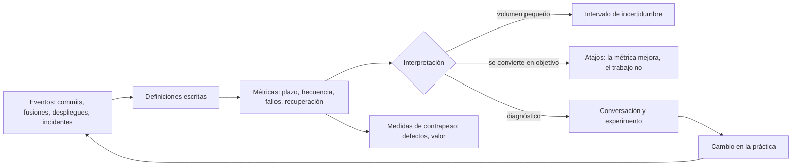
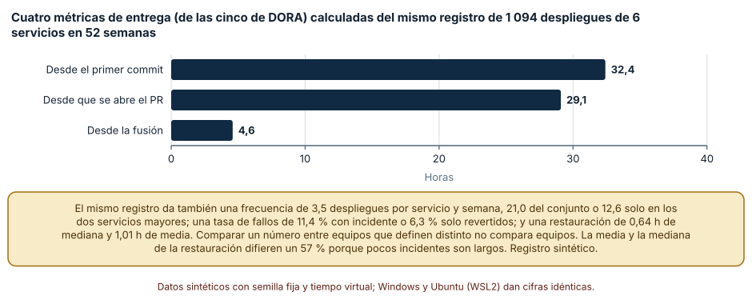
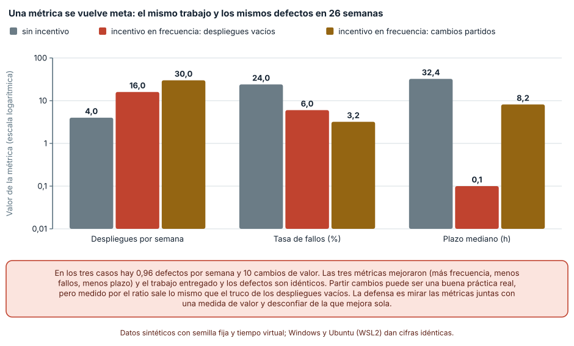

# SE-490 — Métricas DORA y mejora sin gaming

[← SE-489 — Developer portals y capacidades de plataforma](https://github.com/vladimiracunadev-create/modern-software-engineering-program/blob/main/classes/part-40-ci-cd-iac-y-platform-engineering/se-489-developer-portals-y-capacidades-de-plataforma/README.md) · [↑ Parte 40](https://github.com/vladimiracunadev-create/modern-software-engineering-program/blob/main/classes/part-40-ci-cd-iac-y-platform-engineering/README.md) · [📚 Índice completo](https://github.com/vladimiracunadev-create/modern-software-engineering-program/blob/main/classes/README.md) · [🌐 Portal](https://vladimiracunadev-create.github.io/modern-software-engineering-program/classes/SE-490.html) · [SE-491 — Taller: endurecer un pipeline vulnerable →](https://github.com/vladimiracunadev-create/modern-software-engineering-program/blob/main/classes/part-40-ci-cd-iac-y-platform-engineering/se-491-taller-endurecer-un-pipeline-vulnerable/README.md)

## Punto profesional y fundamento pedagógico

**Punto profesional.** La clase existe para que midas la entrega de software sin engañarte ni dejar que otros se engañen. La habilidad profesional es leer una métrica DORA con la desconfianza de quien conoce tres hechos: que depende de una definición que alguien eligió, que se vuelve ruido cuando el volumen es pequeño y que, apenas se convierte en objetivo, se puede mejorar sin mejorar nada.

**Por qué aparece aquí.** Sigue a **Developer portals y capacidades de plataforma**: la clase anterior propuso medir adopción y tiempos de la plataforma; esta generaliza el problema a la entrega de todos los equipos. El caso conductor sigue siendo la canalización de la API de entregas, que ya tiene integración, despliegue progresivo, infraestructura declarada y entornos efímeros: ahora hay que saber si todo eso mejora algo.

**Error conceptual que debe corregir.** Creer que una métrica de entrega es un hecho que se lee en un panel: es el resultado de definiciones (cuándo empieza un cambio, qué cuenta como fallo), de un volumen (cuántos despliegues hay) y de incentivos (qué se premia), y los tres pueden mover el número sin mover la realidad.

**Secuencia de aprendizaje.** Antes de mirar los resultados, predices cuánto cambia el plazo mediano de entrega si lo mides desde el primer commit o desde la fusión, y cuántas veces dos equipos idénticos difieren cinco puntos en su tasa de fallos en un mes; después reproduces el cálculo con cuatro definiciones, un caso en el que la métrica mejora y el trabajo no, y el ruido de la tasa de fallos según el volumen. La secuencia usa predicción, explicación propia, contraste y recuperación. [ICAP](https://icap.education.asu.edu/research) distingue participación de construcción de conocimiento; [How People Learn II](https://nap.nationalacademies.org/catalog/24783/how-people-learn-ii-learners-contexts-and-cultures) respalda diseñar la práctica con contextos reales y retroalimentación.

**Evidencia de aprendizaje.** `dora-log.md` con la predicción, las tres figuras reproducidas, las definiciones escritas de cada métrica para la plataforma (inicio, fin, qué cuenta), el panel de métricas con su intervalo de incertidumbre y su pareja de medidas de contrapeso, y una nota que separe qué parte de cada conclusión es medida, cuál inferida y cuál supuesta.

**Límite de la conclusión.** El registro de 1 094 despliegues de seis servicios en 52 semanas, las tasas de fallo del 12 %, las distribuciones de los plazos y las restauraciones, el incentivo sobre la frecuencia y el volumen mensual son sintéticos y elegidos por el autor. No se midió ningún equipo real ni se usó ninguna herramienta de métricas; las cifras muestran mecanismos y no valores de referencia para tu equipo.

### Trazabilidad fuente → afirmación

| Fuente primaria u oficial | Afirmación que respalda | Lo que no prueba |
|---|---|---|
| [DORA: guía de métricas](https://dora.dev/guides/dora-metrics/) | Define las métricas de rendimiento de entrega en dos grupos: rendimiento (plazo de los cambios, frecuencia de despliegue, tiempo de recuperación de un despliegue fallido) e inestabilidad (tasa de fallos de cambios y tasa de retrabajo de despliegues). | No fija una única definición operativa válida para todos los equipos ni valores objetivo para el tuyo. |
| Forsgren, Humble y Kim, *Accelerate* (IT Revolution, 2018, ISBN 978-1-942788-33-1) | Presenta la investigación que relaciona las métricas de entrega con resultados organizativos. | La asociación estadística no implica que forzar una métrica produzca el resultado. |
| [Forsgren et al., «The SPACE of Developer Productivity»](https://doi.org/10.1145/3454122.3454124) | Argumenta que la productividad tiene varias dimensiones y que una sola métrica no la resume. | No ofrece un panel concreto ni valida métricas particulares. |
| [Wilson, «Probable inference, the law of succession, and statistical inference»](https://doi.org/10.1080/01621459.1927.10502953) | Propone un intervalo de confianza para una proporción que se comporta bien con muestras pequeñas. | No decide qué diferencia es relevante para el negocio. |

## Antes de empezar

Recupera lo aprendido en `SE-489`: una métrica con atajo deja de medir lo que se pretendía. La pregunta activa es: **¿qué número mostrarías para decir que tu equipo entrega mejor, y qué tendrías que hacer para mejorarlo sin entregar mejor?**

## Prerrequisitos

- Haber completado `SE-489` o poder explicar por qué las métricas de una plataforma se combinan.
- Python 3.11 o posterior; los experimentos usan solo la biblioteca estándar (`random`, `math`).
- Saber calcular una mediana, un percentil y una proporción, y qué es un intervalo de confianza.

## Problema auténtico

Caso ilustrativo, no un incidente real: la dirección pidió un panel con las métricas DORA de los seis servicios de la plataforma. El primer panel mostró un plazo de entrega de cuatro horas y medio y una tasa de fallos del 6 %; la persona responsable lo celebró. Un mes después, otro equipo calculó el plazo desde el primer commit y obtuvo 32 horas, y contó como fallo cada despliegue que causó un incidente, no solo los que se revirtieron, y obtuvo el 11 %. Nadie mentía: eran definiciones distintas. Después la dirección fijó como objetivo «más despliegues por semana» y, en un mes, la frecuencia se multiplicó por cuatro porque alguien automatizó despliegues de configuración que no cambiaban nada; la tasa de fallos bajó al 6 % por la misma razón y los defectos que llegaban a producción siguieron igual. Y dos equipos con la misma práctica aparecieron con 5 puntos de diferencia en un mes sin que nada hubiera cambiado. La clase enseña a medir con las tres trampas a la vista.

## Objetivos observables

Al terminar podrás:

1. nombrar las métricas de entrega de DORA y escribir una definición operativa de cada una para un sistema;
2. calcularlas desde un registro de eventos con distintas definiciones y mostrar cuánto cambia el resultado;
3. reproducir un caso en el que una métrica mejora sin mejorar el trabajo y proponer una medida de contrapeso;
4. calcular el intervalo de una tasa mensual y decir cuándo una diferencia entre equipos es ruido;
5. escribir una política de uso de las métricas que las trate como diagnóstico y no como objetivo.

## Mapa conceptual



El mapa separa las **definiciones** (que convierten eventos en métricas), la **interpretación** (donde el ruido y el incentivo deforman) y el **uso** (diagnóstico o objetivo). Las medidas de contrapeso cierran el ciclo: impiden que una sola métrica se optimice a costa de otra.

## Temas y por qué importan

| Tema | Por qué cambia una decisión profesional | Evidencia mínima |
|---|---|---|
| Qué miden las métricas | Hay dos dimensiones, rendimiento e inestabilidad, y se miran juntas. | Las definiciones escritas |
| Definiciones | El mismo registro da 4,6 o 32 horas según dónde se empiece a contar. | Figura 1 y la tabla de definiciones |
| Atajos | Cuando la métrica es objetivo se puede mejorar sin cambiar el trabajo. | Figura 2 y el contrapeso |
| Ruido | Con pocos despliegues una diferencia entre equipos puede ser azar. | Figura 3 y los intervalos |
| Uso como diagnóstico | El mismo número ayuda o daña según quién y para qué lo usa. | Política de uso |

## Conceptos y decisiones

### 1. Qué miden las métricas de entrega

La guía de DORA agrupa las métricas en dos dimensiones. El **rendimiento** (throughput) describe la velocidad con que los cambios llegan a producción: el **plazo de los cambios** (tiempo desde que un cambio se confirma en el control de versiones hasta que se despliega en producción), la **frecuencia de despliegue** y el **tiempo de recuperación de un despliegue fallido**. La **inestabilidad** describe la calidad de esas entregas: la **tasa de fallos de los cambios** (fracción de despliegues que requieren una intervención inmediata, normalmente un retroceso o una corrección urgente) y la **tasa de retrabajo** (fracción de despliegues no planificados que ocurren a consecuencia de un incidente). Las dos dimensiones se miran juntas porque la velocidad sin estabilidad es acumular deuda y la estabilidad sin velocidad es no entregar. La investigación publicada en *Accelerate* encontró que las organizaciones con mejores valores en ambas dimensiones obtenían mejores resultados; es una asociación, no una receta.

### 2. Las definiciones deciden el número

Cada métrica exige decisiones que la guía deja al equipo. Para el **plazo**, ¿cuándo empieza el cambio: en el primer commit, al abrir la solicitud de integración, al fusionarla? La diferencia puede ser de un orden de magnitud. Para la **frecuencia**, ¿qué es un despliegue: cada servicio o cada versión del conjunto, solo producción o también preproducción? Para los **fallos**, ¿cuenta cualquier incidente atribuible, o solo lo que se revirtió? Para la **recuperación**, ¿se mide desde el inicio del fallo, desde su detección o desde el aviso? Cuando dos equipos usan decisiones distintas, sus números no son comparables aunque se llamen igual. La práctica mínima es escribir las definiciones, versionarlas junto al código del panel y cambiarlas solo con un aviso, porque un cambio de definición produce un salto en la serie que parece una mejora o un deterioro.

### 3. Cuando la métrica es la meta

Se atribuye a Goodhart y a Campbell la observación de que una medida deja de ser buena cuando se convierte en objetivo, porque las personas optimizan la medida y no aquello que representaba. Las métricas de entrega son un terreno fértil: la frecuencia sube con despliegues vacíos o con cambios artificialmente partidos; la tasa de fallos baja cuando crece el denominador sin que cambien los defectos; el plazo baja si se cuenta desde otro punto. No hace falta mala fe: basta que el panel se use para evaluar. La defensa no es no medir sino (a) usar las métricas como **diagnóstico** de un sistema y no como evaluación de personas, (b) emparejar cada métrica con una de **contrapeso** (defectos que llegan a producción, valor entregado) que se movería si el truco existiera, y (c) mirar el desglose, no el promedio. SPACE añade que la productividad es multidimensional y que ninguna métrica aislada la captura.

### 4. Volumen pequeño y ruido

Una tasa mensual calculada con pocos despliegues es una estimación con mucho error. Si la probabilidad real de fallo es del 12 % y el equipo despliega 8 veces al mes, la tasa observada puede ser del 0 % o del 37 % sin que nada haya cambiado. El **intervalo de confianza** de una proporción cuantifica ese margen: el intervalo de Wilson se comporta bien con muestras pequeñas y es preferible al intervalo normal, que puede salir de [0, 1]. Dos consecuencias: comparar la tasa mensual de dos equipos pequeños es comparar ruido, y detectar una mejora real exige volumen o ventanas largas. La alternativa es agregar (el trimestre en lugar del mes), mostrar el intervalo en el panel y fijar de antemano qué diferencia se considera relevante, de modo que no se reaccione a cada oscilación.

### 5. Usar las métricas para mejorar

Las métricas valen cuando abren una conversación: «el plazo desde el primer commit es de 32 horas y desde la fusión de 4,6; ¿qué pasa en las 27 horas anteriores?». Esa pregunta lleva a ramas largas, revisiones lentas o trabajo en curso acumulado, y se contesta con un experimento (limitar el trabajo en curso, acortar las ramas) cuyo efecto se mide con la misma definición. Un uso sano tiene cuatro rasgos: las métricas son del **equipo** y no de individuos; se muestran con su incertidumbre; se acompañan de una medida de contrapeso y de una lectura cualitativa (una encuesta breve, una conversación); y el equipo puede **proponer cambiar la métrica** si deja de reflejar su trabajo. Cuando el panel se usa para ordenar a los equipos, el sistema aprende a optimizar el panel.

### Un registro, cuatro definiciones

Se genera un registro de 52 semanas de seis servicios con tasas de despliegue distintas (de 1 a 8 por semana): 1 094 despliegues, cada uno con la fecha del primer commit del cambio (mediana 30 horas antes del despliegue), la de apertura de la solicitud de integración, la de la fusión (mediana 5 horas antes), un 12 % de fallos de los que el 60 % se revierte y una restauración lognormal de mediana 0,75 horas.

| Métrica | Definición A | Definición B | Definición C |
|---|---|---|---|
| Frecuencia de despliegue | 3,5 por servicio y semana | 21,0 del conjunto por semana | 12,6 solo de los dos servicios mayores |
| Plazo de entrega (mediana) | 32,4 h desde el primer commit | 29,1 h desde que se abre la solicitud | 4,6 h desde la fusión |
| Tasa de fallos | 11,4 % con incidente | 6,3 % solo los revertidos | — |
| Recuperación tras un fallo | 0,64 h mediana | 1,01 h media | — |

El plazo varía siete veces, la tasa de fallos casi dos, y la media de la recuperación supera a la mediana en un 57 % porque pocos incidentes son largos. El percentil 90 del plazo desde el primer commit es de 83,5 horas, 2,6 veces su mediana.



**Cómo leer la figura.** Cada barra es una definición del plazo de entrega y su longitud las horas de la mediana, calculadas sobre el mismo registro. Mira primero la distancia entre la primera barra y la última: cambia la definición, no el equipo; la frecuencia, los fallos y la restauración están en la nota. **Dónde deja de valer:** los plazos, las tasas y las restauraciones son sintéticos y las definiciones son tres entre muchas; la guía de DORA no impone cuál elegir. Lo que debe generalizarse es la magnitud de la variación, no los valores: en un registro real, la diferencia entre definiciones puede ser mayor o menor.

### Cuando la métrica es la meta

Durante 26 semanas, un equipo entrega 10 cambios de valor por semana con una tasa de defectos del 12 % por cambio (0,96 defectos por semana, los mismos en los tres casos). Sin incentivo despliega 4 veces por semana. Con un incentivo en la frecuencia se prueban dos atajos: añadir 12 despliegues vacíos por semana (de configuración, que no cambian el comportamiento) o partir cada cambio en tres despliegues.

| Caso | Despliegues por semana | Tasa de fallos | Plazo mediano | Defectos por semana | Cambios de valor |
|---|---:|---:|---:|---:|---:|
| Sin incentivo | 4 | 24,0 % | 32,4 h | 0,96 | 10 |
| Despliegues vacíos | 16 | 6,0 % | 0,1 h | 0,96 | 10 |
| Cambios partidos | 30 | 3,2 % | 8,2 h | 0,96 | 10 |

Las tres métricas mejoran: más frecuencia, menos fallos, menos plazo. El trabajo entregado y los defectos que llegan a producción son exactamente los mismos.



**Cómo leer la figura.** Cada grupo es una métrica y cada barra un caso: sin incentivo (gris), con despliegues vacíos (roja) y partiendo los cambios (dorada), en escala logarítmica. Mira primero que en las tres métricas las barras roja y dorada «mejoran» frente a la gris sin que cambie el trabajo; los defectos y cambios de valor, idénticos, están en la nota. **Dónde deja de valer:** partir cambios en piezas pequeñas es una práctica recomendada con beneficios reales (menos riesgo por despliegue), de modo que la tercera fila mezcla una mejora genuina con el efecto aritmético del denominador; la tabla no distingue entre ambos, y por eso hacen falta las dos últimas columnas. Las 26 semanas y el reparto de defectos son supuestos.

### El ruido de la tasa mensual

Se simulan 6 000 meses para equipos con 8, 30 y 100 despliegues mensuales y una probabilidad real de fallo del 12 %. Se mide cuántas veces dos equipos idénticos difieren en 5 puntos o más en su tasa y con qué frecuencia una mejora real (de 12 % a 8 %) se ve como una mejora en el mes. Se añade el semiancho del intervalo de confianza normal del 95 %.

| Volumen mensual | Semiancho del intervalo | Equipos idénticos que difieren ≥ 5 puntos | Mejora real que se ve |
|---|---:|---:|---:|
| 8 despliegues | ±22,5 puntos | 69 % | 42 % |
| 30 despliegues | ±11,6 puntos | 55 % | 61 % |
| 100 despliegues | ±6,4 puntos | 29 % | 80 % |

Con ocho despliegues al mes casi siete de cada diez meses muestran una diferencia de cinco puntos entre dos equipos idénticos, y una mejora real del 12 al 8 % solo se ve en el 42 % de los meses, menos que lanzar una moneda.


**Cómo leer la figura.** El eje horizontal son los despliegues al mes, en escala logarítmica, y el vertical el porcentaje de meses; la línea roja son los meses en que dos equipos idénticos difieren, y la verde los meses en que se ve una mejora real. Mira primero la distancia entre las dos con pocos despliegues: el ruido es mayor que la señal. **Dónde deja de valer:** el intervalo es el normal (Wald), que se aproxima mal con 8 despliegues y debería sustituirse por el de Wilson; la independencia entre despliegues y una probabilidad de fallo constante son supuestos que los equipos reales violan (hay rachas y estacionalidad). La mejora se mide como «tasa observada menor que la del otro equipo», una regla que un equipo real aplicaría con más criterio.

## Definiciones de trabajo

- **plazo de los cambios:** tiempo desde que un cambio se confirma en el control de versiones hasta que se despliega en producción.
- **frecuencia de despliegue:** número de despliegues a producción en un periodo, con la unidad de despliegue declarada.
- **tasa de fallos de los cambios:** fracción de los despliegues que requieren una intervención inmediata tras ejecutarse.
- **tiempo de recuperación:** tiempo que tarda en restaurarse el servicio tras un despliegue fallido.
- **medida de contrapeso:** medida que empeoraría si otra se mejorara con un atajo.

Las definiciones son operativas para la canalización de la API de entregas. No convierten términos con una historia más amplia en sinónimos y deben contrastarse con la documentación primaria enlazada al final.

## Ejemplo mínimo

El fragmento calcula el intervalo de una tasa con pocos despliegues. Antes de ejecutarlo, predice si con 1 fallo de 8 despliegues el intervalo del 95 % excluye el 12 %.

```python
import math
def wilson(k, n, z=1.96):
    p = k / n
    c = (p + z * z / (2 * n)) / (1 + z * z / n)
    h = z * math.sqrt(p * (1 - p) / n + z * z / (4 * n * n)) / (1 + z * z / n)
    return round(c - h, 3), round(c + h, 3)

print(wilson(1, 8), wilson(12, 100))
```

Imprime `(0.022, 0.471)` y `(0.07, 0.198)`: con 8 despliegues el intervalo va del 2 % al 47 % e incluye el 12 %; con 100 despliegues se estrecha y también lo incluye. Registra versión de Python, comando y salida; después prueba con 0 fallos de 8 y observa que el límite superior sigue siendo 0,324: cero fallos observados no es cero riesgo.

## Ejemplo profesional

El equipo de la API de entregas escribe sus definiciones antes de construir ningún panel. El plazo empieza en la fusión a la troncal y termina cuando el despliegue a producción es sano (no cuando se lanza); una segunda serie mide desde el primer commit para ver cuánto se pierde antes de integrar. La frecuencia cuenta solo despliegues de cambios de comportamiento a producción, por servicio. Un fallo es cualquier despliegue seguido de un retroceso, una corrección urgente o una incidencia de gravedad alta en las dos horas siguientes. La recuperación se mide desde la detección. Cada métrica se muestra por trimestre con su intervalo de Wilson y se acompaña de dos contrapesos: defectos que llegan a producción por cambio y entregas completadas por los estudiantes (una medida de valor). El panel pertenece a cada equipo y no se usa para compararlos; una vez al trimestre cada equipo elige una métrica para mejorar y un experimento, y se revisa el efecto con la misma definición. Registran las definiciones con su fecha y el cambio que las revisaría. Compara con el punto de partida: ahora un número puede defenderse, tiene un margen y no premia un truco.

## Práctica guiada

1. Escribe una definición operativa de las cuatro métricas para un sistema que conozcas, con evento inicial, evento final y qué cuenta.
2. Predice cuánto cambia el plazo mediano si lo mides desde el primer commit o desde la fusión y escribe tu estimación.
3. Genera el registro sintético, calcula las métricas con tres definiciones y reproduce la tabla.
4. Simula el incentivo sobre la frecuencia con los dos atajos y comprueba que los defectos no cambian.
5. Simula el ruido mensual para 8, 30 y 100 despliegues y calcula el intervalo de Wilson para cada uno.
6. Elige una medida de contrapeso para cada métrica y justifica qué movimiento delataría un atajo.
7. Entrega `dora-log.md` y pide a otra persona que proponga un atajo para una de tus métricas que tu contrapeso no detecte.

## Ejercicios

1. **Definición:** escribe dos definiciones razonables de «fallo» y calcula cómo cambia la tasa del registro con cada una; decide cuál usarías para una conversación con la dirección.
2. **Contrapeso:** para el plazo de entrega, propone un atajo (por ejemplo, fusionar sin revisar) y una medida que lo delate.
3. **Ruido:** calcula el número mínimo de despliegues al mes para que el semiancho del intervalo del 95 % sea menor de 5 puntos con una tasa del 10 %, y decide si es alcanzable para un equipo pequeño.
4. **Política:** redacta tres reglas de uso del panel (quién lo ve, para qué se usa y qué se prohíbe hacer con él) y justifica cada una con un hallazgo de la clase.

## Reto verificable

Entrega `dora-log.md` con la predicción, las tres tablas, las definiciones escritas, el intervalo de cada métrica y las medidas de contrapeso. Se aprueba si otra persona ejecuta el código desde un checkout limpio, obtiene las mismas tablas con las mismas semillas y puede decir qué atajo mejoraría tu panel sin mejorar el trabajo y qué medida lo mostraría. No se aprueba por mostrar un panel sin definiciones ni por comparar equipos con tasas mensuales de pocos despliegues.

## Caso conductor

La canalización de la API de entregas es el caso conductor de la Parte 40. Esta clase deja el décimo artefacto: el panel de métricas con sus definiciones, sus intervalos y sus contrapesos. `SE-491` endurecerá la canalización con un taller y `SE-492` entregará el camino a producción con retroceso, cuya mejora se medirá con este panel. Cambia después un solo dato, el punto de inicio del plazo, y observa cuánto cambia la métrica.

## Preguntas frecuentes

### ¿Qué definición de plazo es la correcta?

Ninguna lo es de forma absoluta. DORA lo define desde la confirmación del cambio hasta producción, pero qué cuenta como «confirmación» es una decisión del equipo. Lo importante es escribirla, aplicarla siempre igual y no compararla con la de otros equipos sin saber la suya.

### ¿Las métricas DORA sirven para evaluar a las personas?

No. Miden un sistema de entrega y dependen de muchos factores que una persona no controla. Usarlas para evaluar individuos incentiva atajos y destruye la confianza en los datos. SPACE recomienda además no reducir la productividad a una sola dimensión.

### ¿Por qué tratar la recuperación con la mediana y la media?

Porque suelen divergir: pocos incidentes largos elevan la media. La mediana dice qué ocurre típicamente y la media incluye la cola. Si la cola es lo que preocupa, se mira un percentil alto, y se declara cuál.

### ¿Cuánto volumen hace falta para fiarse de una tasa?

Depende de la tasa y del margen que toleres. Para estimar una tasa del 10 % con un margen de ±5 puntos hacen falta unos 140 despliegues; con menos, la tendencia sobre varios meses y el intervalo en el panel son más honestos que un porcentaje con decimales.

## Fallo controlado y diagnóstico

Reproduce el fallo clásico de la clase: **una métrica que mejora cuando se convierte en meta mientras el trabajo no cambia**. Simula 26 semanas con un incentivo sobre la frecuencia de despliegue y añade 12 despliegues vacíos por semana.

Registra síntoma, entrada mínima, hipótesis, observación que descarta cada hipótesis, causa, corrección y prueba de regresión. **Síntoma:** la frecuencia se multiplicó por cuatro, la tasa de fallos bajó del 24 % al 6 % y los defectos en producción siguen igual. **Hipótesis rivales:** (a) el equipo mejoró su práctica; (b) los defectos se detectan antes y se corrigen sin llegar a producción; (c) la métrica está inflada por despliegues sin cambio de comportamiento. **Prueba:** cuenta los despliegues que contienen cambios de comportamiento y compara los defectos por semana con los de antes; si ambos son idénticos y el plazo mediano cae a 0,1 horas, la causa es el denominador. **Conclusión:** la métrica mejoró porque creció el número de despliegues sin valor, no porque lo hiciera la entrega. **Regresión:** redefine la frecuencia para contar solo despliegues de comportamiento, añade como contrapeso los defectos por cambio y una prueba que simule despliegues vacíos y exija que la métrica no cambie. No cambies a la vez la definición y el incentivo.

## Errores comunes y cómo corregirlos

| Síntoma | Causa probable | Corrección |
|---|---|---|
| Dos equipos reportan plazos muy distintos | Definiciones diferentes | Escribir y versionar las definiciones; comparar solo con la misma |
| La frecuencia sube y la entrega no mejora | La métrica es objetivo y se cuentan despliegues vacíos | Contar solo cambios de comportamiento; añadir contrapeso |
| Un equipo pequeño «empeora» de un mes a otro | Ruido del volumen | Intervalo de Wilson; agregar por trimestre |
| El panel se usa para clasificar equipos | Uso como evaluación | Política de uso como diagnóstico; el panel es del equipo |
| La recuperación parece buena y los incidentes largos duelen | Se mira solo la mediana | Mostrar un percentil alto y la media |

## Entorno y archivos clave

```text
work/SE-490/
├── README.md
├── dora/
│   ├── registro.py
│   ├── incentivos.py
│   └── ruido.py
├── tests/test_dora.py
└── evidence/dora-log.md
```

El `README` declara plataforma, versión de Python, semillas y comandos. Los experimentos usan solo la biblioteca estándar (`random`, `math`) y se ejecutaron con CPython 3.12.9 en Windows 11 y 3.12.3 en Ubuntu bajo WSL2: las salidas fueron idénticas. Si añades una herramienta de métricas, fija su procedencia y su versión, y documenta las definiciones que aplica.

## Seguridad, ética y accesibilidad

- las métricas pueden usarse contra las personas; define de antemano quién las ve y para qué, y no las asocies a evaluaciones individuales;
- los eventos de un registro pueden revelar horarios y hábitos de personas: agrégalos antes de mostrarlos;
- una métrica que se falsea erosiona la confianza del equipo y de la dirección: es un riesgo ético además de técnico;
- el panel debe ser accesible, con tablas y texto alternativos y sin depender del color para distinguir un deterioro;
- documenta las tablas con el texto alternativo de cada figura.

## Puente hacia el trabajo con agentes

Un agente al que se le pide «calcula las métricas DORA del repositorio» probablemente contará los commits como cambios, tomará la fecha de fusión como inicio y dará una tasa de fallos con dos decimales, sin intervalo. Pídele en cambio que escriba las definiciones antes de calcular, que muestre el resultado con al menos dos definiciones, que añada el intervalo de Wilson y que proponga una medida de contrapeso por métrica. Revisa especialmente si el plazo empieza en un punto que no declaró y si presenta como mejora una diferencia dentro del ruido: son los dos defectos que esta clase mostró con datos.

## Transferencia

Traslada el análisis a otro sistema de entrega (por ejemplo, la publicación de una biblioteca de código abierto con releases mensuales): cambia los eventos, el volumen y los incentivos, y conserva el procedimiento de escribir las definiciones, calcular con varias, mostrar el intervalo y emparejar cada métrica con un contrapeso. La transferencia está lograda cuando puedes decir qué diferencia es ruido y qué atajo no detectarías, no cuando el panel se parece al de la plataforma.

## Evaluación y evidencia

| Criterio | Evidencia para aprobar |
|---|---|
| comprensión | explicación de las dos dimensiones y de por qué las definiciones deciden el número |
| corrección | tablas de definiciones, incentivos y ruido reproducibles con las mismas semillas |
| diseño | definiciones escritas, intervalos y medidas de contrapeso para cada métrica |
| diagnóstico | reproducción del fallo «métrica que mejora al volverse meta» con regresión |
| incertidumbre | declaración de que el registro, las tasas y el incentivo son sintéticos o del autor |
| reproducibilidad | versiones, comandos, salida y límites declarados |

## Fuentes

- [DORA: guía de métricas](https://dora.dev/guides/dora-metrics/) — definición de las métricas de rendimiento e inestabilidad de la entrega; autoridad: DORA, Google Cloud, consultada el 15 de noviembre de 2026.
- Forsgren, Humble y Kim, *Accelerate* (IT Revolution, 2018, ISBN 978-1-942788-33-1) — investigación sobre métricas de entrega y resultados; autoridad: libro de referencia con ISBN verificado.
- [Forsgren et al., «The SPACE of Developer Productivity»](https://doi.org/10.1145/3454122.3454124) — productividad multidimensional (ACM Queue, 2021); autoridad: artículo con DOI verificado en Crossref.
- [Wilson, «Probable inference, the law of succession, and statistical inference»](https://doi.org/10.1080/01621459.1927.10502953) — intervalo para proporciones (Journal of the American Statistical Association, 1927); autoridad: artículo con DOI verificado en Crossref.

Cada fuente respalda el mecanismo indicado; ninguna demuestra que el plazo de 32,4 horas, la tasa del 24 % o el 69 % de diferencias por ruido se observen en tu equipo. Esa afirmación depende de tus definiciones, de tu volumen y de tus incentivos. La atribución de la idea de que una medida deja de ser buena al convertirse en objetivo a Goodhart y Campbell es una referencia habitual que esta clase no verificó con una fuente primaria.

## Límites y siguiente paso

Se ejecutaron tres experimentos con datos sintéticos en Windows y Ubuntu (WSL2) con resultados idénticos. No se midió ningún equipo real ni se usó ninguna herramienta de métricas; el registro de 1 094 despliegues, las tasas de fallo, las distribuciones de plazos y recuperaciones, el incentivo sobre la frecuencia y la independencia entre despliegues son construcciones del autor, y el intervalo de la tercera figura es el normal y no el de Wilson. La siguiente clase aplica todo lo anterior a un taller: endurecer una canalización vulnerable.

## Glosario

- **plazo de los cambios:** tiempo desde que un cambio se confirma en el control de versiones hasta que se despliega en producción.
- **frecuencia de despliegue:** número de despliegues a producción en un periodo, con la unidad de despliegue declarada.
- **tasa de fallos de los cambios:** fracción de los despliegues que requieren una intervención inmediata tras ejecutarse.
- **tiempo de recuperación:** tiempo que tarda en restaurarse el servicio tras un despliegue fallido.
- **medida de contrapeso:** medida que empeoraría si otra se mejorara con un atajo.

---

[← SE-489 — Developer portals y capacidades de plataforma](https://github.com/vladimiracunadev-create/modern-software-engineering-program/blob/main/classes/part-40-ci-cd-iac-y-platform-engineering/se-489-developer-portals-y-capacidades-de-plataforma/README.md) · [↑ Parte 40](https://github.com/vladimiracunadev-create/modern-software-engineering-program/blob/main/classes/part-40-ci-cd-iac-y-platform-engineering/README.md) · [📚 Índice completo](https://github.com/vladimiracunadev-create/modern-software-engineering-program/blob/main/classes/README.md) · [🌐 Portal](https://vladimiracunadev-create.github.io/modern-software-engineering-program/classes/SE-490.html) · [SE-491 — Taller: endurecer un pipeline vulnerable →](https://github.com/vladimiracunadev-create/modern-software-engineering-program/blob/main/classes/part-40-ci-cd-iac-y-platform-engineering/se-491-taller-endurecer-un-pipeline-vulnerable/README.md)
