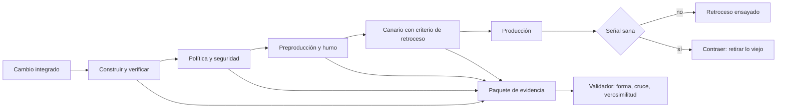
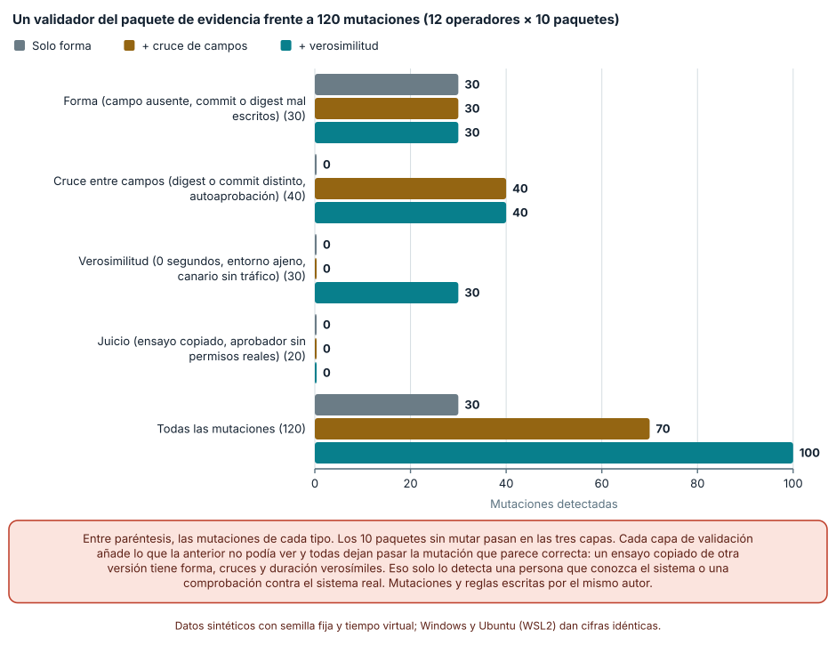

# SE-492 — Proyecto: camino a producción con rollback

[← SE-491 — Taller: endurecer un pipeline vulnerable](https://github.com/vladimiracunadev-create/modern-software-engineering-program/blob/main/classes/part-40-ci-cd-iac-y-platform-engineering/se-491-taller-endurecer-un-pipeline-vulnerable/README.md) · [↑ Parte 40](https://github.com/vladimiracunadev-create/modern-software-engineering-program/blob/main/classes/part-40-ci-cd-iac-y-platform-engineering/README.md) · [📚 Índice completo](https://github.com/vladimiracunadev-create/modern-software-engineering-program/blob/main/classes/README.md) · [🌐 Portal](https://vladimiracunadev-create.github.io/modern-software-engineering-program/classes/SE-492.html) · [SE-493 — Señales, eventos y observabilidad útil →](https://github.com/vladimiracunadev-create/modern-software-engineering-program/blob/main/classes/part-41-observabilidad-sre-e-incidentes/se-493-senales-eventos-y-observabilidad-util/README.md)

## Punto profesional y fundamento pedagógico

**Punto profesional.** El proyecto existe para que entregues un camino completo a producción que pueda defenderse ante otra persona: qué comprueba cada etapa, qué evidencia deja, cómo se vuelve atrás y qué parte del riesgo sigue sin cubrirse. La habilidad profesional no es encadenar herramientas sino demostrar tres cosas con datos: que cada compuerta tiene una razón, que el retroceso funciona con los datos y no solo con el código, y que el paquete de evidencia dice algo verdadero.

**Por qué aparece aquí.** Cierra la **Parte 40** después de **Taller: endurecer un pipeline vulnerable**: ya hay integración con política de troncal (`SE-481`), un grafo de trabajos (`SE-482`), compuertas y excepciones (`SE-483`), identidades de corta vida (`SE-484`), un criterio de despliegue (`SE-485`), un flujo de infraestructura (`SE-486`), una política de GitOps (`SE-487`), entornos de vista previa (`SE-488`), una plataforma (`SE-489`), un panel con contrapesos (`SE-490`) y un flujo endurecido (`SE-491`). El proyecto los ensambla. El caso conductor es la canalización de la API de entregas llevada a producción.

**Error conceptual que debe corregir.** Creer que un camino a producción con muchas etapas es un camino seguro: sin un ensayo de retroceso con los datos reales, sin saber qué fallo tiene un solo guardián y sin un paquete de evidencia que cruce sus propios campos, las etapas son un ritual.

**Secuencia de aprendizaje.** Antes de mirar los resultados, predices qué versión de la aplicación puede volver atrás tras una migración de esquema según cómo se haya hecho, cuántos de doce fallos típicos escapan si quitas una compuerta y qué fracción de 120 paquetes de evidencia manipulados detecta un validador de forma; después reproduces el retroceso con una base de datos real, la ablación de compuertas y el validador por capas. La secuencia usa predicción, explicación propia, contraste y recuperación. [ICAP](https://icap.education.asu.edu/research) distingue participación de construcción de conocimiento; [How People Learn II](https://nap.nationalacademies.org/catalog/24783/how-people-learn-ii-learners-contexts-and-cultures) respalda diseñar la práctica con contextos reales y retroalimentación.

**Evidencia de aprendizaje.** `release-path-log.md` con la predicción, las tres figuras reproducidas, el diagrama del camino con sus compuertas y su evidencia, el plan de migración con ensayo de retroceso, el paquete de evidencia de una versión y la lista de lo que ningún validador ve, y una nota que separe qué parte de cada conclusión es medida, cuál inferida y cuál supuesta.

**Límite de la conclusión.** La matriz de doce fallos y de ocho compuertas, los costos relativos de 1 a 100, los 120 paquetes mutados y las reglas del validador son juicios del autor; la migración usa SQLite en memoria como modelo de una base de datos y su resultado depende de la versión del motor. No se desplegó nada en producción, no se midió ninguna canalización real y el contenido sigue pendiente de revisión humana independiente.

### Trazabilidad fuente → afirmación

| Fuente primaria u oficial | Afirmación que respalda | Lo que no prueba |
|---|---|---|
| [Fowler: ParallelChange](https://martinfowler.com/bliki/ParallelChange.html) | Describe el patrón expandir, migrar y contraer para cambiar una interfaz o un esquema sin romper a los consumidores. | No indica cuánto tiempo debe pasar entre fases ni cómo se coordinan varios equipos. |
| [Fowler y Sadalage: Evolutionary Database Design](https://martinfowler.com/articles/evodb.html) | Propone cambios de base de datos pequeños, versionados y aplicados de forma continua junto con el código. | No resuelve el volumen de datos ni los tiempos de bloqueo de una migración concreta. |
| [SLSA: niveles de la especificación](https://slsa.dev/spec/v1.1/levels) | Define niveles de garantía sobre cómo se produce un artefacto y qué procedencia se registra. | No dice que un artefacto con procedencia sea correcto; solo de dónde y cómo se construyó. |
| [Google SRE Book: Release Engineering](https://sre.google/sre-book/release-engineering/) | Describe una práctica de ingeniería de entregas con construcciones herméticas, despliegues reproducibles y aprobaciones registradas. | Es la experiencia de una organización concreta; no una norma. |
| [SQLite: ALTER TABLE](https://www.sqlite.org/lang_altertable.html) | Documenta qué cambios de esquema admite el motor, entre ellos renombrar, añadir y borrar columnas. | Una base de producción tiene otras limitaciones, bloqueos y costos. |
| Humble y Farley, *Continuous Delivery* (Addison-Wesley, 2010, ISBN 978-0-321-60191-9) | Presenta la canalización de despliegue, las etapas y la importancia del retroceso. | No cuantifica el valor de cada etapa. |

## Antes de empezar

Recupera los artefactos de la parte: la política de troncal, el grafo de trabajos, las compuertas con sus excepciones, la identidad de despliegue, el criterio del canario, el flujo de infraestructura, la política de GitOps, los entornos de vista previa, el catálogo de capacidades, el panel y el flujo endurecido. La pregunta activa es: **si esta versión falla a las tres de la tarde de un cierre de plazos, ¿cuánto tarda el sistema en volver a un estado bueno, qué datos se pierden y qué prueba lo demuestra?**

## Prerrequisitos

- Haber completado `SE-481` a `SE-491` o contar con sus artefactos.
- Python 3.11 o posterior; los experimentos usan la biblioteca estándar (`sqlite3`, `random`, `itertools`).
- Saber qué es una migración de esquema y qué hace un consumidor de una versión antigua de la API.

## Problema auténtico

Caso ilustrativo, no un incidente real: la API de entregas necesitaba renombrar una columna del nombre del estudiante. La versión nueva de la aplicación se desplegó con un canario sano, y a las dos horas una métrica de negocio (entregas completadas por minuto) cayó. El equipo decidió retroceder a la versión anterior. La versión anterior leía la columna con el nombre viejo y la migración la había renombrado: cada lectura fallaba. El retroceso empeoró el incidente. Una segunda vez el equipo añadió la columna nueva sin quitar la vieja, pero la versión nueva escribía solo en la nueva; al retroceder, la versión anterior leyó cinco de diez registros vacíos. Una tercera vez, alguien «limpió» la columna vieja un día después del despliegue, cuando el retroceso aún era posible. Cada vez el código era correcto y la canalización estaba en verde. El proyecto enseña a diseñar el cambio de datos que hace posible el retroceso y a ensayarlo antes del incidente.

## Objetivos observables

Al terminar podrás:

1. diseñar el camino de una versión desde la integración hasta producción, con la compuerta, la evidencia y el responsable de cada etapa;
2. planificar un cambio de esquema en tres fases (expandir, migrar, contraer) y ensayar el retroceso con una base de datos;
3. construir la matriz de qué compuerta detecta qué fallo y calcular qué ocurre al quitar cada una;
4. definir un paquete de evidencia de una versión y un validador que cruce sus campos;
5. defender el camino con criterios de salida y una lista honesta de lo que no cubre.

## Mapa conceptual



El mapa tiene dos recorridos: el **camino** de la versión (de izquierda a derecha) y el **paquete de evidencia** que cada etapa alimenta. El retroceso solo es una flecha válida si el cambio de datos lo permitió; la contracción final es lo único que cierra esa puerta.

## Temas y por qué importan

| Tema | Por qué cambia una decisión profesional | Evidencia mínima |
|---|---|---|
| El camino completo | Cada etapa existe por un fallo que detecta; sin la matriz son rituales. | Diagrama con compuerta y evidencia por etapa |
| Migración con retroceso | Volver atrás el código no revierte los datos; el cambio de esquema decide si se puede. | Figura 1 y el plan en tres fases |
| Ablación de compuertas | Algunos fallos tienen un único guardián; quitarlo los hace escapar. | Figura 2 y la matriz de fallos |
| Paquete de evidencia | Un paquete válido en forma puede ser falso en contenido. | Figura 3 y el validador por capas |
| Criterios de salida | Sin criterios no hay forma de decir que está terminado. | Lista de criterios con su prueba |

## Conceptos y decisiones

### 1. El camino a producción como sistema

Un camino a producción es la secuencia de etapas por las que pasa una versión desde que se integra hasta que sirve tráfico real, y cada etapa tiene una razón: detectar una clase de fallo antes de que cueste más. La integración con política de troncal detecta choques; la construcción y la verificación detectan regresiones de comportamiento; las comprobaciones de seguridad y política detectan secretos, dependencias vulnerables y configuraciones peligrosas; la preproducción detecta fallos de integración con el entorno; el canario detecta defectos que solo aparecen con tráfico real; la observación en producción detecta lo que ninguna etapa anterior vio. Cada paso hacia la derecha detecta lo que los anteriores no podían, y cuesta más cuando falla. El diseño no consiste en añadir etapas sino en que cada fallo relevante tenga al menos un guardián barato y, si es grave, uno más.

### 2. Retroceso: el código vuelve, los datos no

Retroceder una versión sustituye el código que corre por el anterior; no deshace lo que la versión nueva escribió ni lo que cambió en el esquema. Por eso la compatibilidad de los datos es lo que decide si el retroceso es posible. El patrón de **cambio en paralelo** (expandir, migrar, contraer) lo garantiza: se **expande** el esquema añadiendo lo nuevo sin quitar lo viejo (una columna nueva, tolerante a los dos); se **migra** el código para escribir en ambos lugares y leer del nuevo, y se rellenan los datos antiguos; solo cuando la versión nueva lleva el tiempo suficiente en producción y el retroceso ya no se contempla, se **contrae** retirando lo viejo. Esta última fase es la única irreversible, y debería tener su propio cambio, con su propia aprobación y fecha. Un renombrado directo, una escritura solo en lo nuevo y una contracción anticipada son los tres errores que cierran la puerta del retroceso.

### 3. La matriz de fallos y las compuertas

Para saber si el camino es suficiente se construye una matriz con los fallos que se quieren cubrir y las compuertas que pueden detectar cada uno: un error de sintaxis lo ven el análisis y las pruebas unitarias; una dependencia vulnerable, solo el escaneo de dependencias; un permiso excesivo en la infraestructura, la política sobre el plan; un fallo que aparece solo con tráfico real, el canario y la alerta. La **ablación** consiste en quitar una compuerta y ver qué ocurre: algunos fallos se detectan más tarde, a un costo mayor; otros dejan de detectarse. Los fallos con un único guardián son el riesgo concentrado. La matriz es juicio de quien la escribe, y por eso se revisa con incidentes reales: cada incidente es un fallo que la matriz no tenía o un guardián que no funcionó.

### 4. El paquete de evidencia

Cada versión llega a producción con un paquete que responde a las preguntas de una auditoría futura: qué commit se construyó, qué resumen tiene el artefacto, qué plan de infraestructura se revisó, quién aprobó (distinto de quien escribió), cuándo se ensayó el retroceso y con qué resultado, cuánto tráfico vio el canario y qué lista de componentes lo acompaña. Un **validador** del paquete aplica tres capas: de **forma** (los campos existen y tienen el formato correcto), de **cruce** (el resumen desplegado coincide con el construido, el commit probado con el desplegado, el aprobador no es el autor, el ensayo no ha caducado) y de **verosimilitud** (el ensayo duró más de unos segundos, se hizo en un entorno permitido, el canario tuvo tráfico suficiente). Cada capa detecta lo que la anterior no puede, y todas dejan pasar el paquete que parece correcto y no lo es.

### 5. Criterios de salida y lo que no cubre

Un camino a producción se da por terminado cuando cumple criterios comprobables y no cuando alguien lo cree razonable: que el retroceso se ha ensayado con los datos en el último mes; que cada fallo de la matriz tiene al menos un guardián y los de mayor impacto dos; que el paquete de las últimas diez versiones pasa el validador; que el panel de entrega muestra sus intervalos y sus contrapesos; que las excepciones vigentes tienen caducidad. A ello se añade siempre una lista de **lo que no se cubre**: fallos sin guardián, datos que no se pueden revertir (correos enviados, pagos), dependencias externas y errores humanos en la aprobación. Esa lista no es una confesión sino una herramienta de gestión del riesgo: dice dónde mirar cuando algo salga mal.

### Volver atrás tras migrar el esquema

Se modela con SQLite en memoria una tabla de estudiantes con diez registros: cinco creados antes del despliegue por la versión anterior (que solo conoce la columna `name`) y cinco creados después por la versión nueva (que usa `full_name`). Se prueban cuatro estrategias de migración y, tras cada una, se ejecuta la versión anterior leyendo los diez registros.

| Estrategia de migración | Lecturas con error | Lecturas vacías | Lecturas correctas |
|---|---:|---:|---:|
| Renombrar la columna de golpe | 10 | 0 | 0 |
| Expandir sin doble escritura | 0 | 5 | 5 |
| Expandir con doble escritura | 0 | 0 | 10 |
| Contraer antes de tiempo | 10 | 0 | 0 |

Solo la estrategia de expandir con doble escritura deja las diez lecturas correctas. Las otras tres convierten el retroceso en una falla total (errores en las diez lecturas) o parcial (la mitad de los registros vacíos).


**Cómo leer la figura.** Cada barra es una estrategia de migración partida entre lecturas correctas (verde), vacías (dorado) y con error (rojo). Mira primero que solo la doble escritura es verde entera y que contraer antes de tiempo vuelve a romperlo todo. **Dónde deja de valer:** SQLite en memoria con diez filas modela la compatibilidad, no los tiempos ni los bloqueos de una migración con millones de filas, y las órdenes de renombrar y borrar columnas dependen de la versión del motor. Una base de producción exige además un plan de relleno gradual de los datos antiguos y la comprobación de que ninguna consulta de otros sistemas usa la columna vieja.

### Qué ocurre al quitar una compuerta

Se define una matriz de doce fallos típicos (error de sintaxis, regresión lógica, contrato roto, dependencia vulnerable, secreto en el repositorio, permiso excesivo, migración incompatible, fuga de memoria, bandera mal configurada, fallo con tráfico real, certificado a punto de vencer, deriva manual) y de ocho compuertas, con un costo relativo según la etapa en que se detecta (1 en la revisión hasta 100 en producción). Con todas las compuertas el costo total es 214. Se quita una compuerta cada vez.

| Compuerta que se quita | Fallos detectados más tarde | Fallos que escapan | Costo relativo |
|---|---:|---:|---:|
| Revisión y lint | 1 | 0 | 215 |
| Pruebas unitarias | 1 | 0 | 216 |
| Pruebas de integración | 1 | 0 | 220 |
| Escaneo de dependencias y secretos | 0 | 2 | 802 |
| Política sobre el plan de infraestructura | 1 | 1 | 604 |
| Humo en preproducción | 1 | 0 | 229 |
| Canario con métricas | 3 | 0 | 439 |
| Alerta en producción | 0 | 1 | 414 |

Quitar compuertas baratas apenas cambia el costo porque otra detecta lo mismo un poco más tarde. Quitar el escaneo multiplica el costo por 3,7 porque dos fallos dejan de tener guardián. Un fallo (el certificado que vence) solo lo ve la alerta de producción incluso con todo en su sitio.


**Cómo leer la figura.** Cada grupo es la compuerta que se quita, con el costo relativo entre paréntesis; la barra dorada son los fallos que se detectan más tarde y la roja los que escapan. Mira primero las barras rojas: solo desaparecen fallos cuando la compuerta era la única que veía esa clase. **Dónde deja de valer:** la matriz de qué compuerta ve qué fallo y los costos relativos son un juicio del autor, no una medición; en tu sistema los guardianes y los costos serán otros. Lo transferible es el método: quitar de a una y contar los fallos sin guardián.

### Un validador del paquete de evidencia frente a 120 mutaciones

Se genera un paquete correcto para cada una de 10 versiones y se aplican 12 mutaciones por paquete (120): tres de forma (quitar un campo, abreviar el commit, quitar el algoritmo del resumen), cuatro de cruce (resumen o commit desplegado distinto, aprobación por la persona autora, ensayo de hace 90 días), tres de verosimilitud (ensayo de 0 segundos, entorno ajeno, canario con 12 solicitudes) y dos de juicio (un ensayo copiado de otra versión, un aprobador sin permisos reales). Tres validadores se aplican por capas.

| Tipo de mutación | Solo forma | + cruce de campos | + verosimilitud |
|---|---:|---:|---:|
| Forma (3 operadores, 30 casos) | 30 | 30 | 30 |
| Cruce (4 operadores, 40 casos) | 0 | 40 | 40 |
| Verosimilitud (3 operadores, 30 casos) | 0 | 0 | 30 |
| Juicio (2 operadores, 20 casos) | 0 | 0 | 0 |
| Todas las mutaciones (120) | 30 | 70 | 100 |

Los 10 paquetes sin mutar pasan las tres capas. Las 20 mutaciones de juicio no las ve ninguna: un ensayo copiado de otra versión tiene forma, cruces y duración verosímiles.



**Cómo leer la figura.** Cada grupo es un tipo de mutación, con su total entre paréntesis; las barras son las mutaciones que detecta cada capa acumulada: solo forma (gris), más cruce de campos (dorada) y más verosimilitud (verde). Mira primero el grupo de juicio, sin barras: lo que parece correcto pasa las tres capas. **Dónde deja de valer:** las mutaciones y las reglas las escribió el mismo autor, de modo que el 83 % (100 de 120) muestra una frontera y no una tasa de detección; los paquetes son sintéticos y el validador no consulta ningún sistema real (si el aprobador tiene permisos, si el ensayo ocurrió). La última fila, el 17 % que ningún validador de texto ve, es el motivo por el que existe la revisión humana.

## Definiciones de trabajo

- **camino a producción:** secuencia de etapas, compuertas y evidencia por las que pasa una versión hasta servir tráfico real.
- **cambio en paralelo:** patrón de expandir, migrar y contraer para modificar una interfaz o un esquema sin romper a sus consumidores.
- **ablación:** retirada de un componente para medir qué dejaba de ocurrir sin él.
- **paquete de evidencia:** conjunto de datos que prueban cómo se construyó, verificó, aprobó y ensayó una versión.
- **criterio de salida:** condición comprobable que debe cumplirse para dar un trabajo por terminado.

Las definiciones son operativas para el proyecto de la API de entregas. No convierten términos con una historia más amplia en sinónimos y deben contrastarse con la documentación primaria enlazada al final.

## Ejemplo mínimo

El fragmento ensaya el retroceso con una base de datos real en memoria. Antes de ejecutarlo, predice si la versión anterior puede leer el registro tras renombrar la columna.

```python
import sqlite3
db = sqlite3.connect(":memory:")
db.execute("CREATE TABLE a (id INTEGER, name TEXT)")
db.execute("INSERT INTO a VALUES (1, 'ana')")
db.execute("ALTER TABLE a RENAME COLUMN name TO full_name")
try:
    print(db.execute("SELECT name FROM a").fetchone())
except sqlite3.OperationalError as e:
    print("error:", e)
```

Imprime `error: no such column: name`: la versión anterior no puede leer. Registra versión de Python, versión de SQLite (`sqlite3.sqlite_version`), comando y salida; después sustituye el renombrado por `ADD COLUMN full_name` y un `UPDATE` que copie `name`, y comprueba que la lectura antigua vuelve a funcionar.

## Ejemplo profesional

El equipo de la API de entregas ensambla su camino. Cada versión pasa por la integración con ramas de menos de dos días, el grafo de trabajos con un camino crítico de 14 minutos, las compuertas ordenadas por razón de detección, el escaneo de secretos que siempre bloquea, la política sobre el plan de infraestructura, una preproducción con datos sintéticos, un canario del 5 % con criterio de retroceso automático y la observación de las métricas con intervalos. Los cambios de esquema siguen el cambio en paralelo: el equipo ensaya el retroceso cada mes en preproducción, con la versión anterior leyendo los datos que escribió la nueva, y la contracción es un cambio aparte, treinta días después, con aprobación de una segunda persona. El paquete de evidencia se genera en cada despliegue y un validador de tres capas bloquea el despliegue si falta algo; una vez por trimestre una persona revisa diez paquetes al azar y busca el tipo de mutación que el validador no ve. Los criterios de salida están escritos y se revisan en la reunión de cada trimestre. Registran la decisión con su fecha y el dato que la revisaría: si un incidente muestra un fallo sin guardián, se añade a la matriz. Compara con el punto de partida: ahora el retroceso se ensayó, cada fallo tiene guardián y el paquete dice qué se hizo y qué se asume.

## Práctica guiada

1. Dibuja el camino a producción de un servicio que conozcas, con la compuerta, la evidencia y el responsable de cada etapa.
2. Predice si la versión anterior puede leer los datos tras renombrar una columna y tras añadir una nueva sin doble escritura.
3. Reproduce las cuatro estrategias de migración con SQLite y comprueba las lecturas de la versión anterior en cada una.
4. Construye tu matriz de doce fallos y ocho compuertas, calcula el costo total y realiza la ablación de cada compuerta.
5. Define el paquete de evidencia de una versión, escribe el validador por capas y pásalo por 120 mutaciones propias.
6. Escribe los criterios de salida de la parte con la prueba que demuestra cada uno y la lista de lo que no se cubre.
7. Entrega `release-path-log.md` y pide a otra persona que encuentre un paquete que tu validador acepte y que ella consideraría falso.

## Ejercicios

1. **Migración:** diseña las tres fases de un cambio que divide una columna de nombre completo en nombre y apellidos, e indica en cuál ya no se puede retroceder.
2. **Ablación:** añade a la matriz un fallo con un único guardián y calcula cuánto sube el costo total al quitarlo; propón un segundo guardián.
3. **Validador:** diseña una cuarta capa que consulte un sistema real (por ejemplo, la lista de personas con permiso de aprobación) y estima qué mutaciones de juicio detectaría.
4. **Criterios:** redacta cinco criterios de salida verificables para tu camino y la prueba o la consulta que demuestra cada uno.

## Reto verificable

Entrega `release-path-log.md` con la predicción, las tres tablas, el diagrama del camino con compuertas y evidencia, el plan de migración con ensayo de retroceso, el paquete de evidencia de una versión y la lista de lo que ningún validador ve. Se aprueba si otra persona ejecuta el código desde un checkout limpio, obtiene las mismas tablas con las mismas semillas y puede decir qué compuerta no se debería quitar, en qué fase de una migración ya no se puede volver atrás y qué paquete falso pasaría tu validador. No se aprueba por describir etapas sin la matriz que las justifica ni por afirmar que el retroceso funciona sin haberlo ensayado con datos.

## Caso conductor

La canalización de la API de entregas cierra aquí su recorrido en la Parte 40. Este proyecto deja el duodécimo artefacto: el camino a producción con retroceso ensayado y paquete de evidencia, que alimenta la Parte 41, donde las señales de producción (observabilidad, SLO, incidentes) deciden si una versión sana lo es de verdad. Cambia después un solo dato, la fase en que contraes el esquema, y observa cuándo el retroceso deja de ser posible.

## Preguntas frecuentes

### ¿Siempre hay que poder retroceder?

No siempre es posible: hay cambios con efectos externos (correos enviados, pagos) que no se deshacen. Para esos casos el plan es «avanzar con una corrección» (roll forward) y el criterio es escrito de antemano. Lo importante es saber, antes del incidente, cuáles se pueden retroceder y cuáles no.

### ¿Por qué esperar para contraer?

Porque contraer elimina la posibilidad de retroceso y de coexistencia entre versiones. Esperar un periodo en producción con la versión nueva sana, con los datos estables y sin consultas que usen lo viejo, convierte la contracción en un cambio pequeño y deliberado.

### ¿Un paquete de evidencia sustituye una auditoría?

No. El paquete deja las pruebas a mano y detecta incoherencias, pero no prueba que el aprobador revisó de verdad ni que el ensayo fue representativo. Reduce el trabajo de la auditoría y concentra la atención humana en lo que un validador no ve.

### ¿Cuántas compuertas son suficientes?

Las que cubran cada fallo relevante con al menos un guardián barato y, para los graves, un segundo. La matriz lo dice mejor que un número: añadir una compuerta que repite lo que otra ve cuesta tiempo; quitar la única que ve un fallo grave cuesta mucho más.

## Fallo controlado y diagnóstico

Reproduce el fallo clásico del proyecto: **un retroceso que empeora el incidente porque la versión anterior no puede leer los datos migrados**. Ejecuta el renombrado de golpe y lee con la versión anterior.

Registra síntoma, entrada mínima, hipótesis, observación que descarta cada hipótesis, causa, corrección y prueba de regresión. **Síntoma:** tras retroceder, las diez lecturas fallan. **Hipótesis rivales:** (a) el artefacto retrocedido es el incorrecto; (b) la configuración de la versión anterior cambió; (c) el esquema ya no es compatible con la versión anterior. **Prueba:** ejecuta la consulta de la versión anterior contra el esquema actual; si el error es de columna inexistente, la causa es el esquema. **Conclusión:** el retroceso de código no revirtió la migración; el renombrado cerró la puerta. **Regresión:** sustituye el renombrado por el cambio en paralelo (añadir, escribir en ambas, rellenar, contraer más tarde) y añade una prueba de ensayo que ejecute la versión anterior sobre el esquema posterior al despliegue y exija diez lecturas correctas. No cambies a la vez el esquema y el código de lectura.

## Errores comunes y cómo corregirlos

| Síntoma | Causa probable | Corrección |
|---|---|---|
| El retroceso falla con errores de columna | Renombrado o borrado directo | Cambio en paralelo: expandir, migrar, contraer |
| Tras retroceder faltan datos | La versión nueva escribe solo en lo nuevo | Doble escritura y relleno de los datos antiguos |
| Un fallo grave llega a producción sin ser visto | Fallo con un solo guardián que se desactivó | Matriz de fallos y ablación periódica |
| El paquete de evidencia pasa y es falso | Solo valida forma | Capas de cruce y verosimilitud; muestra revisada por una persona |
| Nadie sabe si el retroceso funciona | Nunca se ensayó | Ensayo mensual con datos y registro del resultado |

## Entorno y archivos clave

```text
work/SE-492/
├── README.md
├── camino/
│   ├── migracion.py
│   ├── ablacion.py
│   └── paquete.py
├── tests/test_camino.py
├── evidencia/
│   └── paquete-ejemplo.json
└── evidence/release-path-log.md
```

El `README` declara plataforma, versión de Python, versión de SQLite, semillas y comandos. Los experimentos usan la biblioteca estándar (`sqlite3`, `random`, `itertools`) y se ejecutaron con CPython 3.12.9 en Windows 11 (SQLite 3.45.3) y 3.12.3 en Ubuntu bajo WSL2 (SQLite 3.45.1): las cifras publicadas fueron idénticas. No ejecutes migraciones contra una base real sin copia verificada.

## Seguridad, ética y accesibilidad

- un retroceso mal diseñado puede dejar sin servicio a quienes dependen de la plataforma en el peor momento: ensáyalo fuera de los cierres de plazos;
- el paquete de evidencia puede contener nombres de personas y de entornos: limita quién lo lee y qué se conserva;
- la persona que aprueba debe tener el contexto y el permiso para decir que no; una aprobación de trámite es un fallo de gobierno;
- los criterios de salida y las alertas del camino deben poder leerse en texto, con lector de pantalla y sin depender del color;
- documenta las tablas con el texto alternativo de cada figura.

## Puente hacia el trabajo con agentes

Un agente al que se le pide «prepara el despliegue a producción con retroceso» probablemente escribirá un script que despliega, añadirá un paso de retroceso que reinstala la versión anterior y declarará el camino completo. Pídele en cambio que diseñe el cambio de esquema en tres fases, que ensaye el retroceso con una base de datos y muestre las diez lecturas, que construya la matriz de fallos y haga la ablación, que genere el paquete de evidencia con un validador que cruce campos y que liste lo que el validador no ve. Revisa especialmente si renombra o borra una columna en el mismo despliegue y si el ensayo de retroceso usa datos de la versión nueva: son los dos defectos que este proyecto mostró con una base real.

## Transferencia

Traslada el proyecto a otro sistema (por ejemplo, una aplicación móvil con un backend compartido y versiones antiguas instaladas en los teléfonos): cambia los consumidores, el esquema y las etapas, y conserva el procedimiento de cambiar en paralelo, ensayar el retroceso, hacer la ablación de las compuertas y validar el paquete de evidencia. La transferencia está lograda cuando puedes decir qué versión antigua sigue viva y qué fallo solo tiene un guardián, no cuando el diagrama se parece al de la plataforma.

## Evaluación y evidencia

| Criterio | Evidencia para aprobar |
|---|---|
| comprensión | explicación de por qué el retroceso depende de los datos y de qué decide cada etapa |
| corrección | tablas de migración, ablación y validador reproducibles con las mismas semillas |
| diseño | camino con compuerta y evidencia por etapa, plan en tres fases y paquete de evidencia con validador |
| diagnóstico | reproducción del fallo «retroceso que no puede leer los datos» con regresión |
| incertidumbre | declaración de que matriz, costos, mutaciones y reglas son juicios del autor |
| reproducibilidad | versiones (incluida la de SQLite), comandos, salida y límites declarados |

## Fuentes

- [Fowler: ParallelChange](https://martinfowler.com/bliki/ParallelChange.html) — patrón expandir, migrar y contraer; autoridad: Martin Fowler.
- [Fowler y Sadalage: Evolutionary Database Design](https://martinfowler.com/articles/evodb.html) — cambios de base de datos continuos; autoridad: Martin Fowler y Pramod Sadalage.
- [SLSA: niveles de la especificación v1.1](https://slsa.dev/spec/v1.1/levels) — procedencia y garantías de un artefacto; autoridad: proyecto SLSA, OpenSSF.
- [Google SRE Book: Release Engineering](https://sre.google/sre-book/release-engineering/) — práctica de ingeniería de entregas; autoridad: Google.
- [SQLite: ALTER TABLE](https://www.sqlite.org/lang_altertable.html) — cambios de esquema admitidos por el motor; autoridad: documentación de SQLite.
- Humble y Farley, *Continuous Delivery* (Addison-Wesley, 2010, ISBN 978-0-321-60191-9) — canalización de despliegue y retroceso; autoridad: libro de referencia con ISBN verificado.

Cada fuente respalda el mecanismo indicado; ninguna demuestra que los 10 errores, el costo de 802 o el 83 % de detección se observen en tu sistema. Esa afirmación depende de tu esquema, de tu matriz de fallos y de tus reglas de validación.

## Límites y siguiente paso

Se ejecutaron tres experimentos en Windows y Ubuntu (WSL2) con cifras publicadas idénticas. No se desplegó nada en producción ni se midió ninguna canalización real; la matriz de doce fallos y ocho compuertas, los costos relativos, los 120 paquetes mutados y las reglas del validador son juicios del autor (que escribió las mutaciones y el validador), la migración usa SQLite en memoria con diez filas y el contenido sigue pendiente de revisión humana independiente. La Parte 41 continúa con la observabilidad: cómo se sabe, en producción, si la versión que pasó todo el camino está sana.

## Glosario

- **camino a producción:** secuencia de etapas, compuertas y evidencia por las que pasa una versión hasta servir tráfico real.
- **cambio en paralelo:** patrón de expandir, migrar y contraer para modificar una interfaz o un esquema sin romper a sus consumidores.
- **ablación:** retirada de un componente para medir qué dejaba de ocurrir sin él.
- **paquete de evidencia:** conjunto de datos que prueban cómo se construyó, verificó, aprobó y ensayó una versión.
- **criterio de salida:** condición comprobable que debe cumplirse para dar un trabajo por terminado.

---

[← SE-491 — Taller: endurecer un pipeline vulnerable](https://github.com/vladimiracunadev-create/modern-software-engineering-program/blob/main/classes/part-40-ci-cd-iac-y-platform-engineering/se-491-taller-endurecer-un-pipeline-vulnerable/README.md) · [↑ Parte 40](https://github.com/vladimiracunadev-create/modern-software-engineering-program/blob/main/classes/part-40-ci-cd-iac-y-platform-engineering/README.md) · [📚 Índice completo](https://github.com/vladimiracunadev-create/modern-software-engineering-program/blob/main/classes/README.md) · [🌐 Portal](https://vladimiracunadev-create.github.io/modern-software-engineering-program/classes/SE-492.html) · [SE-493 — Señales, eventos y observabilidad útil →](https://github.com/vladimiracunadev-create/modern-software-engineering-program/blob/main/classes/part-41-observabilidad-sre-e-incidentes/se-493-senales-eventos-y-observabilidad-util/README.md)
