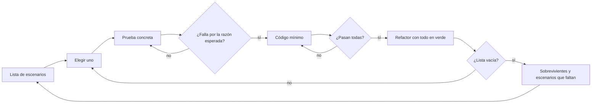
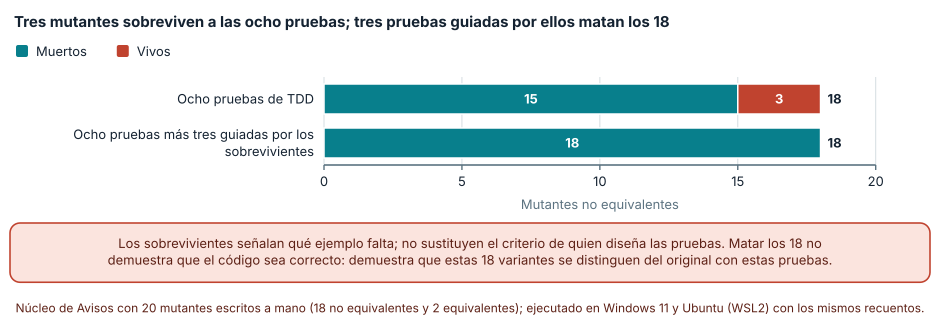

# SE-482 — TDD: ciclo rojo-verde-refactor y diseño emergente

[← SE-481 — Mapa de metodologías: qué decide cada una y cómo elegir](https://github.com/vladimiracunadev-create/modern-software-engineering-program/blob/main/classes/part-40-metodologias-de-desarrollo-de-tdd-a-odd/se-481-mapa-de-metodologias-que-decide-cada-una-y-como-elegir/README.md) · [↑ Parte 40](https://github.com/vladimiracunadev-create/modern-software-engineering-program/blob/main/classes/part-40-metodologias-de-desarrollo-de-tdd-a-odd/README.md) · [📚 Índice completo](https://github.com/vladimiracunadev-create/modern-software-engineering-program/blob/main/classes/README.md) · [🌐 Portal](https://vladimiracunadev-create.github.io/modern-software-engineering-program/classes/SE-482.html) · [SE-483 — TDD en la práctica: escuelas de Londres y clásica, y sus límites →](https://github.com/vladimiracunadev-create/modern-software-engineering-program/blob/main/classes/part-40-metodologias-de-desarrollo-de-tdd-a-odd/se-483-tdd-en-la-practica-escuelas-de-londres-y-clasica-y-sus-limites/README.md)

## Punto profesional y fundamento pedagógico

**Punto profesional.** La clase existe para que practiques TDD como una técnica con controles y no como la consigna «escribe las pruebas primero». La técnica tiene tres decisiones que importan: qué prueba escribir ahora, qué código mínimo la pasa y cuándo mejorar el diseño con la red de seguridad en verde. Quien las toma bien produce, al final, un conjunto de pruebas y una implementación que se explican mutuamente; quien las toma mal produce pruebas que nunca fallaron, o código que pasa por una trampa que nadie refutó. Con un agente de código el riesgo se agrava, porque un agente puede escribir una prueba y la implementación juntas en un solo paso y saltarse la parte donde la prueba falla, que es la que demuestra que la prueba sirve.

**Por qué aparece aquí.** Sigue a **Mapa de metodologías** porque TDD es la metodología cuyo oráculo (pruebas de ejemplo escritas una a una) se mide con más facilidad y la que más comparten las demás: BDD, ATDD y ODD la usan como ciclo interno. En la Parte 30 aprendiste a diseñar pruebas; aquí aprendes el orden y los controles con que se producen.

**Error conceptual que debe corregir.** Creer que TDD consiste en escribir todas las pruebas antes del código. Kent Beck lo dejó escrito para evitar justamente esa lectura: se parte de una **lista** de escenarios, se convierte **exactamente uno** en prueba concreta, se hace pasar esa prueba y todas las anteriores, y solo entonces se pasa al siguiente. Escribir diez pruebas antes de cualquier código no es TDD: es diseñar a ciegas diez interfaces.

**Secuencia de aprendizaje.** Antes de ejecutar, predices cuántos de los 18 defectos sembrados mueren tras cada una de ocho pruebas escritas en orden; después ejecutas el ciclo completo con ocho versiones sucesivas del código, compruebas que cada prueba falló antes y pasó después, miras la curva de mutantes muertos y escribes las pruebas que guían los sobrevivientes.

**Evidencia de aprendizaje.** `tdd-log.md` con la lista de escenarios, ocho entradas rojo-verde-refactor con el mensaje de fallo de cada rojo, la curva de mutantes muertos, tres pruebas añadidas a partir de los sobrevivientes y una nota que separe qué es medido y qué es opinión sobre diseño.

**Límite de la conclusión.** La curva de mutantes muertos se mide sobre 18 variantes escritas por el autor y sobre una función de veinte líneas. Esta clase **no mide** que TDD produzca mejor diseño, menos defectos ni más velocidad; esas afirmaciones aparecen en la literatura y en el debate público entre sus defensores y críticos, y requieren estudios con equipos que aquí no se hicieron. No se invocó ningún modelo de lenguaje.

### Trazabilidad fuente → afirmación

| Fuente primaria u oficial | Afirmación que respalda | Lo que no prueba |
|---|---|---|
| [Beck, «Canon TDD»](https://tidyfirst.substack.com/p/canon-tdd) | Describe el flujo: lista de escenarios, una prueba concreta a la vez, hacer pasar todas, refactor opcional, repetir hasta vaciar la lista; separa el diseño de la interfaz del de la implementación. | No demuestra que TDD mejore la calidad. |
| [Fowler, «Test Driven Development»](https://martinfowler.com/bliki/TestDrivenDevelopment.html) | Resume el ciclo y sitúa a TDD como una técnica de diseño y de prueba. | Es un resumen, no una medición. |
| [Fowler, Beck y Heinemeier Hansson, «Is TDD Dead?»](https://martinfowler.com/articles/is-tdd-dead/) | Muestra que el valor de TDD como guía de diseño es objeto de desacuerdo entre profesionales con experiencia. | No resuelve el desacuerdo. |
| [Python: `unittest`](https://docs.python.org/3/library/unittest.html) | Documenta el marco de pruebas usado por el laboratorio. | No valida el diseño de las pruebas. |
| [DeMillo, Lipton y Sayward, «Hints on Test Data Selection»](https://doi.org/10.1109/C-M.1978.218136) | Fundamenta medir una suite con mutantes. | No dice que los mutantes imiten defectos reales. |

## Antes de empezar

Recupera lo aprendido en `SE-481`: una prueba protege contra los defectos que cambian su resultado. La pregunta activa es: **¿cuándo fue la última vez que viste fallar una prueba antes de escribir el código que la hace pasar, y qué habrías aprendido si la prueba hubiera pasado de inmediato?**

## Prerrequisitos

- Haber completado `SE-481` o poder explicar qué es un mutante y un oráculo.
- Python 3.11 o posterior con `unittest`; el laboratorio no usa dependencias externas.
- Saber leer un mensaje de fallo de una aserción y distinguir un fallo por la razón esperada de uno por un error de sintaxis o de importación.

## Problema auténtico

El equipo de la plataforma debe construir la regla de avisos desde cero. La persona más experimentada dice «hagámoslo con TDD». Otra pregunta: ¿escribimos las ocho pruebas y después el código? Una tercera propone pedir al agente «implementa avisos con sus pruebas» y revisar el resultado. Las tres versiones se llaman «con pruebas» y producen artefactos distintos. En la primera, cada prueba falló antes de pasar; en la segunda, las ocho pruebas se diseñaron sin que el código les devolviera información; en la tercera, la implementación y las pruebas salieron del mismo razonamiento y las pruebas confirman lo que el código hace.

La clase reconstruye el ciclo real. Se parte de una función que devuelve una lista vacía y se avanza ocho veces: cada vez se escribe una prueba, se comprueba que falla con la versión actual, se escribe el código mínimo que la pasa, se comprueba que pasan todas las anteriores y se mide cuántos de los 18 defectos sembrados mueren. El resultado muestra qué compra cada prueba, cuáles protegen reglas que ningún defecto sembrado toca y qué defectos sobreviven a las ocho, que son los que dicen cuál es la novena prueba.

## Objetivos observables

Al terminar podrás:

1. ejecutar el ciclo de la técnica (lista de escenarios, una prueba, código mínimo, refactor) y registrar la evidencia de cada rojo y cada verde;
2. explicar por qué una prueba que pasa de inmediato no aporta información y qué hacer cuando ocurre;
3. leer la curva de mutantes muertos tras cada prueba y usar los sobrevivientes para decidir qué escenario falta en la lista;
4. distinguir un refactor (conserva el comportamiento con las pruebas en verde) de un cambio de comportamiento disfrazado;
5. enunciar con honestidad qué afirma la literatura sobre TDD y diseño, y qué se midió aquí.

## Mapa conceptual



El mapa muestra las dos puertas del ciclo: la prueba debe fallar por la razón esperada antes de escribir código, y todas las pruebas deben pasar antes de refactorizar. El último paso reabre la lista: lo que el conjunto no mata se convierte en escenarios nuevos.

## Temas y por qué importan

| Tema | Por qué cambia una decisión profesional | Evidencia mínima |
|---|---|---|
| Lista de escenarios | Decide en qué orden se descubre el comportamiento. | Una lista inicial y su evolución |
| Rojo por la razón correcta | Una prueba que falla por un error de sintaxis no demuestra nada. | El mensaje de fallo de cada paso |
| Código mínimo y trampas | La versión más simple puede ser una constante que pasa la prueba y obliga a la siguiente a generalizar. | Las versiones sucesivas del código |
| Verde antes de refactor | Refactorizar con una prueba en rojo mezcla dos cambios. | Todas las pruebas verdes antes de cada refactor |
| Curva de mutantes | Muestra qué compra cada prueba y cuál no aporta nada nuevo. | Mutantes muertos tras cada prueba |
| Sobrevivientes | Indican qué escenario falta en la lista. | Tres pruebas guiadas por los sobrevivientes |

## Conceptos y decisiones

### 1. La lista de escenarios

El primer paso de la técnica es analítico: listar los comportamientos que el cambio debe cumplir, incluidos los casos raros («¿qué pasa si el servicio estuvo caído?»). La lista no es un compromiso; se amplía a medida que se aprende. En el laboratorio la lista inicial de *Avisos* tiene ocho elementos: ningún aviso lejos del vencimiento, aviso a las 72 horas, no repetir un aviso enviado, no avisar a quien ya entregó, no avisar tras el vencimiento, tras una caída solo el más urgente, el silencio deja pasar la última hora y el silencio es por curso. El orden importa porque cada escenario obliga a una decisión de diseño: el segundo obliga a distinguir una entrega lejana de una cercana; el tercero, a recordar qué se envió.

### 2. Rojo: la prueba debe fallar por la razón esperada

Una prueba que pasa de inmediato no ha aportado información: o el comportamiento ya existía o la prueba no comprueba lo que dice. Una prueba que falla por un error ajeno al comportamiento (un nombre mal escrito, una importación) tampoco: no distingue entre «el comportamiento falta» y «la prueba está rota». El control es ver el mensaje de fallo y comprobar que describe la diferencia entre lo esperado y lo obtenido. Es el control más barato de la técnica y el que más se omite cuando quien escribe la prueba y el código es el mismo agente en el mismo paso.

### 3. Verde: el código más simple que pasa

La versión mínima puede ser deliberadamente ingenua: devolver una constante, o tratar solo el caso de la prueba. No es pereza; es un método. Cada prueba posterior obliga a generalizar solo lo que la prueba exige, y evita escribir comportamiento que nadie comprobó. En el laboratorio, la versión 1 solo sabe del umbral de 72 horas; la versión 2 recuerda lo enviado; la 5 es la primera que usa la lista de umbrales y calcula el más urgente. Si una versión mínima pasa la prueba y se comprueba que la siguiente prueba la hace fallar, el ciclo está cumpliendo su función de descubrir la generalización.

### 4. Refactor: cambiar la estructura sin tocar el comportamiento

El refactor ocurre solo con todas las pruebas en verde y se detiene si alguna falla: si falla, el cambio no era un refactor. Es el momento del diseño: nombres, duplicación, una función extraída. Es también el punto donde la afirmación más repetida sobre TDD («produce mejor diseño») se pone a prueba, y es donde los profesionales discrepan. Las pruebas protegen el refactor, pero no lo guían: el diseño que sale depende de quien refactoriza. Esta clase no mide ese efecto.

### 5. Qué compra cada prueba

La curva de mutantes muertos tras cada prueba (1, 6, 8, 9, 9, 11, 14, 15) no crece de forma pareja. La primera prueba mata solo un mutante; la segunda, que obliga a decidir qué hace el aviso de 72 horas, mata cinco; la quinta no mata ninguno, porque protege una regla (no avisar tras el vencimiento) que ninguno de los 18 mutantes elimina. Esto no la hace innecesaria: significa que **la curva de mutantes mide solo contra las variantes que se sembraron**. Una prueba que protege una regla real y no mata mutantes sembrados es una señal de que la lista de mutantes es incompleta, no de que la prueba sobre.

### 6. Los sobrevivientes como siguiente escenario

Las ocho pruebas dejan vivos tres mutantes: avisar en el instante exacto del vencimiento, invertir la comparación de avisos ya enviados y avisar una hora antes de lo debido. Cada uno es una pregunta: ¿qué ocurre cuando faltan 0 horas? ¿qué ocurre si el aviso de 24 horas ya se envió y estamos en la zona del de 72? ¿qué ocurre en el par 73 y 72 horas? Son escenarios de borde que la lista no tenía. En la práctica, la lista se enriquece así: con los casos que el código sembrado revela, con los que aparecen en producción y con los que alguien objeta en una revisión.

## Ocho pasos, ocho rojos y ocho verdes

Se escribieron ocho versiones sucesivas de `due_reminders`. La primera devuelve una lista vacía; la segunda solo sabe del umbral de 72 horas; la tercera añade la memoria de lo enviado; la cuarta ignora las entregas ya entregadas; la quinta ignora las vencidas; la sexta generaliza a los tres umbrales y a la caída del servicio; la séptima añade el silencio por persona; la octava lo corrige a silencio por curso. Cada versión se obtuvo con el cambio mínimo que pasa la prueba nueva.

```python
# Versión 1: pasa solo la prueba del aviso a las 72 horas
def due_reminders(deliveries, now, silenced, sent):
    out = []
    for d in deliveries:
        if d["due"] - now <= 72:
            out.append((d["id"], 72))
    return out
```

Para cada paso se comprobaron tres cosas con código: que la prueba nueva falla con la versión anterior (rojo), que pasa con la nueva (verde) y que las anteriores siguen pasando. En los ocho pasos las tres comprobaciones salieron como se esperaba, y la versión final es idéntica, carácter por carácter, a la función original. Una precisión sobre el primer paso: la primera prueba se ejecutó contra una función que aún lanza `NotImplementedError` (el código todavía no existía), y por eso figura como roja; contra la función vacía de la versión 0 habría pasado de inmediato, como muestra el ejemplo mínimo.


**Cómo leer la figura.** El eje horizontal es la prueba que se añade en cada paso del ciclo rojo-verde y el vertical los mutantes muertos acumulados; la línea discontinua marca los 18 posibles. La curva sube rápido con las primeras pruebas (de 1 a 6 en el segundo paso), se aplana hacia el final y tiene un tramo plano en la quinta prueba, que protege una regla que ningún mutante elimina. Qué hace cada prueba queda en la tabla. **Dónde deja de valer:** el orden de las ocho pruebas es el del autor y la curva cambia con otro orden; los mutantes los escribió el autor. La figura muestra el mecanismo de medir qué compra cada prueba, no una tasa general.

## El ciclo y sus dos controles

El ciclo tiene tres movimientos y dos controles. Los movimientos son escribir una prueba que falla, hacerla pasar con el código más simple y mejorar el diseño con todo en verde. Los controles son que la prueba falle por la razón esperada y que ningún refactor cambie el comportamiento. Sin los controles, el ciclo se vuelve un ritual con el mismo aspecto: una persona (o un agente) escribe la prueba y el código a la vez, ve que pasa y lo llama TDD.


**Cómo leer la figura.** Las cuatro cajas son el ciclo, de izquierda a derecha y de arriba abajo; la última, «Siguiente», recuerda que elegir la prueba que más enseña es parte de la técnica. **Dónde deja de valer:** el diagrama es una simplificación; la descripción de Beck añade que la lista se amplía durante el trabajo y que hay una separación entre diseñar la interfaz (cómo se invoca el comportamiento) y la implementación (cómo se logra), con momentos distintos para cada una.

## Los sobrevivientes dicen qué prueba falta

Tras las ocho pruebas sobreviven tres mutantes. Se escribieron tres pruebas más, cada una dirigida a uno. La primera comprueba el instante exacto del vencimiento (faltan 0 horas, ningún aviso). La segunda comprueba el límite entre 73 y 72 horas (a las 73 no hay aviso, a las 72 sí). La tercera comprueba que un aviso de 24 horas ya enviado impide que salga el de 72. Con las tres, los 18 mutantes mueren, y las tres pruebas pasan con la función original.



**Cómo leer la figura.** Cada barra es un conjunto de pruebas y sus tramos cuentan los 18 mutantes no equivalentes: teal los que mueren y coral los que sobreviven. Las ocho pruebas de TDD dejan vivos tres; añadir tres pruebas guiadas por esos sobrevivientes los mata todos. La tabla dice qué hace mal cada sobreviviente (M01, M12 y M16) y qué prueba lo mata. **Dónde deja de valer:** matar los 18 no demuestra que el código sea correcto; demuestra que estas 18 variantes se distinguen del original con estas pruebas. Un defecto que no se parezca a ninguna de ellas puede seguir vivo, y un mutante nuevo mañana puede sobrevivir. La técnica de mutantes sirve para dirigir la atención, no para dar certeza.

## Definiciones de trabajo

- **Rojo:** estado en que una prueba nueva falla por la razón esperada.
- **Verde:** estado en que todas las pruebas pasan.
- **Refactor:** cambio de estructura que conserva el comportamiento, hecho con todas las pruebas en verde.
- **Lista de escenarios:** inventario vivo de comportamientos por comprobar.
- **Triangulación:** generalizar el código solo cuando una segunda prueba lo exige.
- **Prueba que pasa de inmediato:** prueba que no aporta información hasta que se demuestre lo contrario.

## Ejemplo mínimo

Primera prueba de la lista: «lejos del vencimiento no hay aviso».

```python
def test_sin_aviso_lejos(fn):
    assert fn([delivery("a", 200)], 0, frozenset(), set()) == []
```

Con una función que devuelve siempre `[]`, la prueba pasa de inmediato: es un caso del que no se puede extraer nada, y el ciclo lo reconoce porque no hubo rojo. La segunda prueba es la que hace falta: «a las 72 horas hay aviso». Falla con la función vacía, con el mensaje `assert [] == [('a', 72)]`, y esa es la razón correcta. La versión mínima que la pasa es el bucle de la versión 1.

## Ejemplo profesional

*Escenario ilustrativo: las cifras y los resultados que aparecen en este ejemplo son supuestos de la narración, no mediciones.*

El equipo añade «silenciar un curso» con TDD. La lista tiene cinco escenarios y la primera decisión es el vocabulario: ¿qué es «silenciar»? Antes de la primera prueba se acuerda con las docentes que un curso silenciado deja de recibir los avisos de 72 y 24 horas pero conserva el de 1 hora. La persona que programa escribe la prueba del aviso de 1 hora en un curso silenciado y la ve fallar con el mensaje esperado; escribe el código mínimo; escribe la prueba del aviso de 24 horas en el mismo curso y la ve fallar; descubre que la versión mínima silencia por persona, no por curso, porque la prueba de «otro curso» aún no existía; añade esa prueba y corrige. El ciclo no impide el error (la versión 7 silencia por persona), pero lo hace visible en cuanto el siguiente escenario lo expone. Al final el equipo ejecuta una lista de diez mutantes y compara.

## Práctica guiada

1. Escribe tu lista de escenarios para una función pequeña de tu proyecto y ordénala por lo que cada uno obliga a decidir.
2. Escribe la primera prueba y ejecútala: anota el mensaje de fallo y confirma que es la razón esperada.
3. Escribe la versión más ingenua que la pasa. Escribe la segunda prueba y comprueba que la ingenua falla.
4. Ejecuta `python scripts/experiments_part40_a.py 482` y compara tu curva con la medida.
5. Siembra cinco mutantes en tu función, ejecuta tu suite y anota los sobrevivientes. Escribe una prueba para cada uno.

## Ejercicios

1. **Básico.** Explica por qué la prueba 1 de la lista pasa de inmediato con la función vacía y qué haría un equipo que quiera que toda prueba falle primero.
2. **Intermedio.** Reordena las ocho pruebas de modo que la curva de mutantes muertos suba más rápido y justifica con el experimento cuál es el orden que obliga a menos generalización.
3. **Avanzado.** Escribe tres mutantes de `due_reminders` que sobrevivan a las once pruebas y explica qué comportamiento no observan.

## Reto verificable

Entrega `tdd-log.md` con: la lista de escenarios; ocho entradas con prueba, mensaje de rojo, código mínimo y estado de las anteriores; la curva de mutantes muertos; los sobrevivientes y las pruebas que los matan; y un párrafo que diga qué afirma la literatura sobre TDD y diseño y qué parte de eso no mediste. Es válido si otra persona reproduce la curva con los mismos mutantes.

## Caso conductor

*Avisos* es el servicio de recordatorios de la plataforma. El ciclo se reconstruye sobre su regla central y las ocho versiones sucesivas son el recorrido que el equipo habría hecho. El resultado alimenta `SE-483`, donde la misma regla se prueba con dos estilos de prueba distintos.

## Preguntas frecuentes

### ¿Hay que escribir todas las pruebas primero?

No. La descripción de Beck pide una lista de escenarios y una prueba concreta a la vez. Escribir todas las pruebas antes del código es una lectura equivocada de la técnica.

### ¿TDD mejora el diseño?

Es la afirmación más debatida. Hay profesionales con mucha experiencia en ambos lados, y las fuentes de esta clase muestran el desacuerdo. Lo que sí se puede afirmar es que el ciclo produce una red de pruebas que permite refactorizar con confianza; que el diseño resultante sea mejor depende de quién refactoriza.

### ¿Qué hago si la prueba pasa de inmediato?

Averigua por qué. Si el comportamiento ya existía, la prueba es redundante o confirma una regla ya protegida. Si la prueba no comprueba lo que dice, corrígela hasta que falle por la razón esperada. No la dejes: una prueba que nunca falló no tiene información.

### ¿Qué hace un agente con TDD?

Puede seguir el ciclo si se le exige, pero tiende a escribir prueba e implementación juntas. El control es pedirle que ejecute la prueba sola, muestre el mensaje de fallo y solo entonces escriba el código.

## Fallo controlado y diagnóstico

**Fallo.** Se escribe la prueba del silencio y se escribe a la vez el código de silencio por persona. La prueba pasa a la primera. El cambio parece correcto, pero la prueba «el silencio es por curso» no estaba en la lista.

**Diagnóstico paso a paso.** (1) La prueba nunca vio un rojo, así que no hay evidencia de que detecte algo. (2) Se siembra el mutante «silencia a la persona en todos los cursos»: sobrevive. (3) La causa es que ningún ejemplo tenía dos cursos para una persona. (4) Se añade el escenario a la lista.

**Corrección.** Se añade la prueba, se ve fallar con la versión por persona, se corrige a clave por curso y se comprueba que el mutante ahora muere. La lección es el control del rojo: sin él, el defecto se habría quedado.

## Errores comunes y cómo corregirlos

- **Escribir todas las pruebas antes del código.** Elimina la retroalimentación. Corrige eligiendo una a la vez.
- **No ver el rojo.** Una prueba que nunca falló no tiene evidencia. Corrige ejecutándola sola.
- **Rojo por la razón equivocada.** Un error de importación no es un rojo. Corrige leyendo el mensaje.
- **Refactorizar con una prueba en rojo.** Mezcla dos cambios. Corrige llevando todo a verde primero.
- **Cambiar comportamiento durante el refactor.** Si una prueba se rompe, el cambio no era un refactor.
- **Concluir que el diseño es bueno porque hay pruebas.** Las pruebas protegen el diseño, no lo garantizan.

## Entorno y archivos clave

- `scripts/experiments_part40_lab.py`: lista de ocho pruebas (`TDD_TESTS`) y mutantes.
- `scripts/experiments_part40_a.py`: ciclo con ocho versiones sucesivas; se ejecuta con `python scripts/experiments_part40_a.py 482`.
- `content/part-40/figures/`: figuras de la clase.
- Solo la biblioteca estándar.

## Seguridad, ética y accesibilidad

Las pruebas ejecutan código del propio laboratorio. Si se aplican a un agente, el agente no debe poder modificar la prueba que lo evalúa en el mismo paso en que escribe el código: una suite que el agente puede reescribir no es un oráculo. Ética: usar la curva de mutantes para comparar personas es un mal uso, porque mide una suite, no a quien la escribió. Las figuras son tablas y diagramas con texto alternativo completo; ninguna información depende solo del color.

## Puente hacia el trabajo con agentes

El ciclo es el protocolo más barato para delegar sin perder control: pide al agente la prueba, ejecútala tú (o la integración continua) y comprueba el rojo; después pide el código mínimo y comprueba el verde; el refactor lo propone y lo aprueba una persona con las pruebas en verde. El patrón que falla es el del agente que escribe prueba e implementación a la vez y las entrega juntas: no hay rojo observado, y la prueba puede estar confirmando lo que el código hace. Cuando el agente propone una prueba, pídele también un mutante que debería matar; si la prueba no mata su propio mutante, no sirve.

## Transferencia

Aplica el ciclo a una función de tu proyecto que tenga reglas con bordes: un cálculo de fechas, un límite, una conversión. Escribe la lista, avanza una prueba a la vez y mide cuántos mutantes sembrados mueren tras cada prueba. Si una prueba no mata ninguno, pregunta si protege una regla real o si sobra. Compara el orden en que descubriste las reglas con el que habrías tenido escribiendo código y pruebas juntos.

## Evaluación y evidencia

| Criterio | Evidencia aceptable | Rechazo |
|---|---|---|
| Rojo observado | Mensaje de fallo de cada paso | «Me fijé que fallaba» |
| Código mínimo | Versiones sucesivas | Solo la versión final |
| Anteriores en verde | Ejecución de la suite completa por paso | Solo la prueba nueva |
| Sobrevivientes usados | Pruebas añadidas con su mutante | Pruebas añadidas sin motivo |
| Afirmaciones sobre diseño | Atribuidas y con su límite | Presentadas como medidas |

## Fuentes

- Beck, K. [«Canon TDD»](https://tidyfirst.substack.com/p/canon-tdd).
- Fowler, M. [«Test Driven Development»](https://martinfowler.com/bliki/TestDrivenDevelopment.html).
- Fowler, M., Beck, K. y Heinemeier Hansson, D. [«Is TDD Dead?»](https://martinfowler.com/articles/is-tdd-dead/).
- Python Software Foundation. [`unittest`](https://docs.python.org/3/library/unittest.html).
- DeMillo, R., Lipton, R. y Sayward, F. [«Hints on Test Data Selection»](https://doi.org/10.1109/C-M.1978.218136).

## Límites y siguiente paso

El ciclo se reconstruyó sobre una función de veinte líneas con 18 mutantes del autor. No se midió el efecto de TDD en el diseño, la calidad o la velocidad de un equipo. El siguiente paso, `SE-483`, compara los dos estilos de prueba que conviven dentro de TDD: el clásico, que comprueba resultados, y el de Londres, que comprueba interacciones.

## Glosario

| Término | Definición breve |
|---|---|
| Rojo | Prueba nueva que falla por la razón esperada |
| Verde | Todas las pruebas pasan |
| Refactor | Cambio de estructura sin cambiar comportamiento |
| Lista de escenarios | Inventario vivo de comportamientos por comprobar |
| Triangulación | Generalizar solo cuando otra prueba lo exige |
| Sobreviviente | Mutante que ninguna prueba mata |

---

[← SE-481 — Mapa de metodologías: qué decide cada una y cómo elegir](https://github.com/vladimiracunadev-create/modern-software-engineering-program/blob/main/classes/part-40-metodologias-de-desarrollo-de-tdd-a-odd/se-481-mapa-de-metodologias-que-decide-cada-una-y-como-elegir/README.md) · [↑ Parte 40](https://github.com/vladimiracunadev-create/modern-software-engineering-program/blob/main/classes/part-40-metodologias-de-desarrollo-de-tdd-a-odd/README.md) · [📚 Índice completo](https://github.com/vladimiracunadev-create/modern-software-engineering-program/blob/main/classes/README.md) · [🌐 Portal](https://vladimiracunadev-create.github.io/modern-software-engineering-program/classes/SE-482.html) · [SE-483 — TDD en la práctica: escuelas de Londres y clásica, y sus límites →](https://github.com/vladimiracunadev-create/modern-software-engineering-program/blob/main/classes/part-40-metodologias-de-desarrollo-de-tdd-a-odd/se-483-tdd-en-la-practica-escuelas-de-londres-y-clasica-y-sus-limites/README.md)
