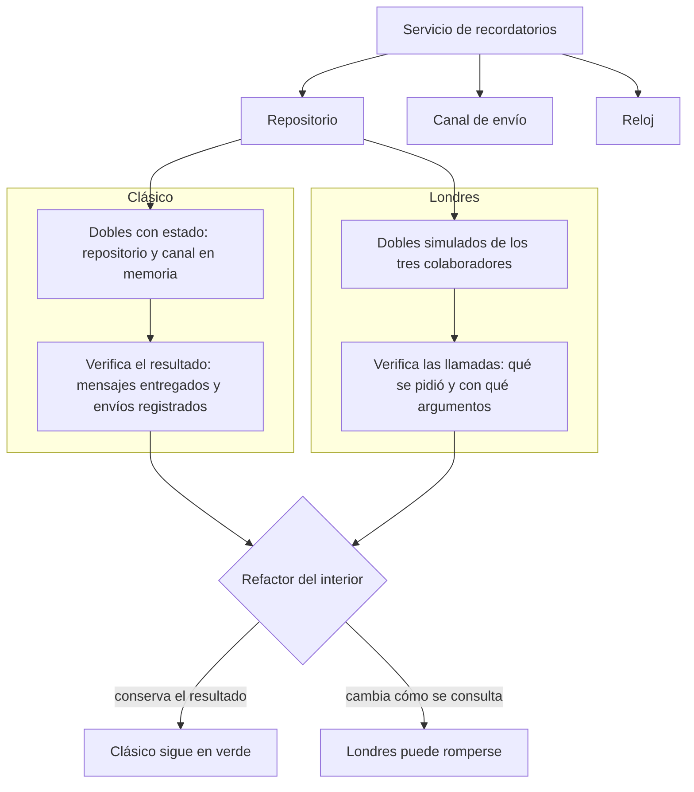

# SE-483 — TDD en la práctica: escuelas de Londres y clásica, y sus límites

[← SE-482 — TDD: ciclo rojo-verde-refactor y diseño emergente](https://github.com/vladimiracunadev-create/modern-software-engineering-program/blob/main/classes/part-40-metodologias-de-desarrollo-de-tdd-a-odd/se-482-tdd-ciclo-rojo-verde-refactor-y-diseno-emergente/README.md) · [↑ Parte 40](https://github.com/vladimiracunadev-create/modern-software-engineering-program/blob/main/classes/part-40-metodologias-de-desarrollo-de-tdd-a-odd/README.md) · [📚 Índice completo](https://github.com/vladimiracunadev-create/modern-software-engineering-program/blob/main/classes/README.md) · [🌐 Portal](https://vladimiracunadev-create.github.io/modern-software-engineering-program/classes/SE-483.html) · [SE-484 — BDD: ejemplos, conversación y lenguaje compartido →](https://github.com/vladimiracunadev-create/modern-software-engineering-program/blob/main/classes/part-40-metodologias-de-desarrollo-de-tdd-a-odd/se-484-bdd-ejemplos-conversacion-y-lenguaje-compartido/README.md)

## Punto profesional y fundamento pedagógico

**Punto profesional.** La clase existe para que elijas con criterio qué comprueba una prueba: el **resultado** que el servicio deja en el mundo o las **llamadas** que hace a sus colaboradores. Es la diferencia práctica entre las dos escuelas de TDD y decide cuánto cuesta cambiar el código mañana. Una suite acoplada a cómo el servicio consulta a sus colaboradores obliga a reescribir pruebas cada vez que el servicio reorganiza su interior; una suite que mira solo resultados tolera el refactor, pero puede no ver un defecto que el servicio comete contra un colaborador. Quien conoce el mecanismo elige por colaborador y por cambio, no por escuela.

**Por qué aparece aquí.** Sigue a **TDD: ciclo rojo-verde-refactor y diseño emergente** porque el ciclo no dice cómo se escribe cada prueba cuando el código colabora con un repositorio, un canal de envío y un reloj. Ahí las escuelas se separan. La Parte 24 trató la inyección de dependencias y la Parte 30 los dobles de prueba; aquí se miden sus consecuencias sobre un refactor.

**Error conceptual que debe corregir.** Creer que «mock» y «stub» son sinónimos y que una escuela es la correcta. Fowler distingue dos cosas: el tipo de **doble** (un objeto que sustituye a un colaborador) y el tipo de **verificación** (sobre el estado resultante o sobre el comportamiento, es decir, las llamadas recibidas). La escuela clásica prefiere objetos reales y dobles solo cuando es incómodo usar el real; la de Londres (también llamada mockista) sustituye los colaboradores con comportamiento interesante y verifica las interacciones. Cada una tiene un costo distinto y los dos aparecen en equipos competentes.

**Secuencia de aprendizaje.** Antes de ejecutar, predices cuántos de cuatro refactores que conservan el comportamiento romperán cada estilo de prueba y cuántos de seis defectos detectará cada uno; después ejecutas las dos suites sobre el mismo servicio, comparas y decides qué estilo usarías para cada colaborador.

**Evidencia de aprendizaje.** `estilos-log.md` con tu predicción, las dos suites escritas por ti, la tabla de refactores y defectos y una regla por colaborador (repositorio, canal, reloj) que diga qué estilo usas y por qué.

**Límite de la conclusión.** Las dos suites las escribió el autor sobre un servicio de unas treinta líneas con tres colaboradores. El resultado (un refactor de cuatro rompe la suite de Londres y ninguno rompe la clásica; ambas detectan los seis defectos) depende de cómo se escribieron las suites: una suite de Londres menos estricta no habría roto, y una clásica que verificara el orden de llamadas tampoco. No se midió ningún equipo.

### Trazabilidad fuente → afirmación

| Fuente primaria u oficial | Afirmación que respalda | Lo que no prueba |
|---|---|---|
| [Fowler, «Mocks Aren't Stubs»](https://martinfowler.com/articles/mocksArentStubs.html) | Distingue dobles con estado y objetos simulados, verificación de estado y de comportamiento, y los estilos clásico y mockista de TDD (también llamados de Detroit y de Londres); analiza el acoplamiento de las pruebas a la implementación. | No dice cuál conviene a un proyecto concreto. |
| [Beck, «Canon TDD»](https://tidyfirst.substack.com/p/canon-tdd) | Separa el diseño de la interfaz (cómo se invoca el comportamiento) del de la implementación. | No prescribe un estilo de dobles. |
| [Python: `unittest.mock`](https://docs.python.org/3/library/unittest.mock.html) | Documenta los objetos simulados, las aserciones sobre llamadas y los valores de retorno usados en la suite de Londres. | No valida el diseño de las pruebas. |
| [Meyer, «Applying Design by Contract»](https://doi.org/10.1109/2.161279) | Fundamenta que una interfaz es un contrato entre quien llama y quien implementa, la razón de que un cambio de interfaz sea distinto de un refactor. | No elige entre estilos de prueba. |

## Antes de empezar

Recupera lo aprendido en `SE-482`: el refactor se hace con las pruebas en verde y no debe romper ninguna. La pregunta activa es: **la última vez que refactorizaste un servicio sin cambiar su comportamiento, ¿cuántas pruebas tuviste que modificar, y cuántas de esas modificaciones eran por un cambio de comportamiento?**

## Prerrequisitos

- Haber completado `SE-482` o poder explicar el ciclo rojo-verde-refactor y por qué el refactor no debe romper pruebas.
- Conocer en la Parte 24 qué es una dependencia inyectada y, en la Parte 30, qué es un doble de prueba.
- Python 3.11 o posterior con `unittest` y `unittest.mock`.

## Problema auténtico

El servicio de recordatorios ya no es una función pura. Ahora lee las entregas de un repositorio, envía los mensajes por un canal y consulta la hora a un reloj. El equipo discute cómo probarlo. Una persona quiere simular los tres colaboradores y verificar que el servicio los llame como debe. Otra quiere usar versiones reales en memoria y comprobar lo que queda después. Ambas escriben suites que pasan con el código actual. Tres semanas después alguien reorganiza el servicio: pide al repositorio todas las entregas y filtra dentro, en vez de pedir solo las pendientes. El comportamiento externo no cambia. Una suite sigue en verde. La otra se rompe en cuatro pruebas y nadie sabe si hay un defecto.

La clase reproduce la situación con el mismo servicio y dos suites. Se aplican cuatro refactores que conservan el comportamiento, un cambio de interfaz de un colaborador y seis defectos reales de comportamiento, y se cuenta qué hace cada suite. El resultado no declara una escuela vencedora: muestra qué acoplamiento introduce cada estilo y qué ventaja compra.

## Objetivos observables

Al terminar podrás:

1. distinguir doble con estado y objeto simulado, y verificación de estado y de comportamiento;
2. escribir la misma prueba en estilo clásico y en estilo de Londres sobre el mismo servicio;
3. clasificar un cambio como refactor, cambio de contrato o defecto según qué parte observable altera;
4. predecir qué estilo se rompe ante un refactor que cambia cómo se consulta a un colaborador;
5. elegir el estilo por colaborador con un argumento sobre costo de cambio y riesgo de defecto.

## Mapa conceptual



El mapa muestra que ambos estilos prueban el mismo servicio y difieren en dónde cortan la colaboración. La diferencia aparece cuando el interior cambia sin cambiar el resultado.

## Temas y por qué importan

| Tema | Por qué cambia una decisión profesional | Evidencia mínima |
|---|---|---|
| Doble y verificación | Mezclarlos produce discusiones sin objeto. | Tabla con tus dobles y su tipo de verificación |
| Acoplamiento a la implementación | Determina cuántas pruebas se tocan al refactorizar. | Pruebas rotas por cada refactor |
| Detección de defectos | Un estilo que no detecta defectos de colaboración no protege. | Defectos detectados por cada estilo |
| Cambio de contrato | Renombrar un puerto no es un refactor; rompe ambos estilos. | Un cambio de contrato clasificado como tal |
| Diseño desde fuera | La escuela de Londres descubre interfaces simulando antes de implementar. | Una interfaz descubierta con dobles |
| Criterio por colaborador | Lento, externo o no determinista pide doble; local y puro, real. | Una regla por colaborador |

## Conceptos y decisiones

### 1. Dobles, stubs, mocks y fakes

Un **doble** es un objeto que ocupa el lugar de un colaborador en una prueba. Fowler distingue varios: un *stub* devuelve respuestas preparadas; un *fake* tiene una implementación real pero simplificada (una base de datos en memoria); un *mock* se programa con expectativas sobre las llamadas que recibirá. En Python, `unittest.mock.Mock` sirve para los tres usos según cómo se configure. Lo importante no es el nombre sino qué se verifica después: si el estado resultante o las llamadas recibidas.

### 2. Verificación de estado y de comportamiento

La **verificación de estado** comprueba qué quedó en el mundo tras ejecutar: qué mensajes entregó el canal, qué envíos registró el repositorio. La **verificación de comportamiento** comprueba cómo el servicio trató a sus colaboradores: que llamó a `send` una vez, con tal argumento, antes de llamar a `mark_sent`. La primera es sobre lo observable desde fuera; la segunda, sobre la conversación interna. Una puede ser la misma que la otra cuando el colaborador es el canal que entrega el mensaje (la llamada **es** el efecto), y diferente cuando el colaborador es una consulta (pedir las entregas pendientes no es un efecto, es un detalle).

### 3. Escuela clásica y escuela de Londres

La **escuela clásica** (de Detroit, por el origen de XP) usa objetos reales cuando puede y dobles cuando el real es lento, externo o no determinista, y verifica estado. La **escuela de Londres** (mockista) simula los colaboradores con comportamiento interesante y verifica interacciones; descubre las interfaces escribiendo la prueba primero desde el exterior hacia dentro. Fowler anota que muchos mockistas rechazan que se les distinga con un nombre aparte, y dedica una sección al acoplamiento de las pruebas a la implementación, que es la tensión principal entre los dos estilos. En la práctica muchos equipos usan ambos según el colaborador.

### 4. Refactor frente a cambio de contrato

Un **refactor** cambia la estructura interna y conserva el comportamiento observable. Un **cambio de contrato** altera la interfaz de un colaborador: renombrar un puerto, añadir un parámetro obligatorio. Rompe cualquier prueba que use esa interfaz, con independencia del estilo. Es importante clasificar bien: cuando una prueba se rompe tras un cambio de contrato no hay nada que corregir en la prueba salvo adaptarla, y quien lo llama «refactor» induce a error en la revisión.

### 5. Por qué un refactor rompe una prueba de Londres

Si el servicio pasa de pedir `pending_deliveries()` a pedir `all_deliveries()` y filtrar, la prueba de Londres que prepara `pending_deliveries.return_value` recibe un objeto simulado sin preparar donde esperaba una lista; el servicio falla. No hay defecto: el resultado habría sido el mismo con un repositorio real. La prueba **fijó una elección de diseño interno** (qué consulta se hace) y la hizo parte del contrato de la prueba. La prueba clásica, con un repositorio en memoria que implementa las dos consultas, no lo nota.

### 6. Por qué la suite clásica también puede fallar

Un doble con estado debe mantenerse. Si el repositorio real cambia y el doble no, la prueba pasa contra un comportamiento que ya no existe. Es el costo opuesto: un doble con estado es código que puede mentir. Además, en la suite clásica un defecto de colaboración que no deja huella en el estado (llamar dos veces a un servicio idempotente, enviar por un canal equivocado si el doble no distingue canales) pasa desapercibido. El estilo de Londres lo vería y la clásica, solo si el doble registra lo bastante.

## Un servicio, cuatro refactores y seis defectos

El servicio tiene tres colaboradores: un repositorio con las consultas `pending_deliveries`, `all_deliveries` y `sent_for` y el comando `mark_sent`; un canal con `send`; y un reloj con `now`. Para cada entrega pendiente calcula el tiempo restante, elige el aviso más urgente que no se haya enviado, envía por el canal y, solo si el envío tuvo éxito, registra el envío de ese umbral y de los anteriores.

**Suite clásica.** Usa un repositorio en memoria (con las tres consultas), un canal que guarda los mensajes y puede fallar para un estudiante, y un reloj fijo. Comprueba: un aviso a las 76 horas llega al estudiante correcto y deja registrados los umbrales de 72 y 24; una segunda ejecución a las 77 no envía nada más; si el canal falla, no queda nada registrado; y cuando el canal se recupera, el aviso sale.

**Suite de Londres.** Usa simulados de los tres colaboradores, configurados con valores de retorno para las consultas. Comprueba: `pending_deliveries` se llama una vez, `send` se llama una vez con el estudiante correcto, `mark_sent` se llama con los umbrales de 72 y 24 en ese orden, `send` ocurre antes que `mark_sent`, y si `send` lanza `ConnectionError`, `mark_sent` no se llama.

Se aplicaron cuatro refactores que conservan el comportamiento: leer el reloj una vez por ejecución (R1), pedir todas las entregas y filtrar en el servicio (R2), extraer el cálculo del umbral a un método (R3) y leer lo registrado antes de calcular el tiempo restante (R4). Se aplicó un cambio de contrato: el servicio llama a `record_notice` en vez de `mark_sent` (R5). Y seis defectos de comportamiento: no registrar el envío, registrar solo el umbral enviado, registrar antes de enviar (se pierde el aviso si el canal falla), incluir entregas ya entregadas, avisar al destinatario equivocado y enviar dos veces.


**Cómo leer la figura.** Cada fila es un cambio al servicio; las dos últimas columnas dicen qué hace cada suite. En los refactores, «pasa» es lo deseable y «FALLA» es una falsa alarma; en los defectos, «detecta» es lo deseable. **Dónde deja de valer:** las dos suites son del autor sobre un servicio pequeño. La de Londres rompió en R2 porque se escribió con `pending_deliveries.return_value` fijo; con otra redacción habría tolerado ese refactor. La figura muestra un mecanismo (acoplar la prueba a una consulta) y no una tasa.

El resultado separa dos cosas que suelen confundirse. Las dos suites detectaron los seis defectos: ninguna escuela protege menos contra defectos de comportamiento cuando las pruebas están bien escritas. La diferencia está en el costo del cambio: un refactor de cuatro rompió una suite, y el cambio de contrato rompió las dos, que es lo correcto, porque es un cambio de contrato.

## Dónde corta cada estilo

La diferencia entre estilos se puede dibujar. El servicio colabora con tres elementos. La suite clásica sustituye al repositorio y al canal con dobles que tienen estado y mira después lo que quedó. La suite de Londres sustituye a los tres con simulados y mira las llamadas. El corte de la clásica está más cerca del resultado observable y el de Londres, más cerca de la conversación interna.


**Cómo leer la figura.** El rectángulo oscuro es el servicio; los tres rectángulos del medio, sus colaboradores; los dos de abajo, qué mira cada estilo. **Dónde deja de valer:** el dibujo simplifica: una suite clásica real suele usar un repositorio real en memoria y un canal doble, mezclando ambos, y una suite de Londres bien hecha simula solo los colaboradores con comportamiento propio y deja reales los objetos de valor.

## Cuándo usar cada estilo

No hay una regla universal, hay criterios por colaborador. Un colaborador lento, externo o no determinista (un canal que envía por la red, un reloj) se sustituye siempre; la pregunta es si con un doble con estado o con un simulado. Cuando la llamada **es** el efecto que importa (enviar un mensaje), verificar la llamada es verificar el efecto, y los dos estilos coinciden. Cuando el colaborador es una consulta (traer las entregas), fijar en la prueba qué consulta se hace es acoplarse a la implementación. Al diseñar de fuera hacia dentro sin saber aún qué colaborará, el estilo de Londres ayuda a descubrir las interfaces. Y un cambio de interfaz de un colaborador rompe a ambos estilos.


**Cómo leer la figura.** Cada fila es una situación; la segunda columna dice qué estilo conviene y la tercera, por qué. **Dónde deja de valer:** la tabla es una guía de criterio, no una medida; lo medido está en la primera figura. Un equipo con mucha experiencia en un estilo lo aplica mejor que uno nuevo en otro, y esa familiaridad pesa más que cualquier regla.

## Definiciones de trabajo

- **Doble:** objeto que sustituye a un colaborador en una prueba.
- **Fake / doble con estado:** implementación simplificada que se puede consultar después.
- **Simulado (mock):** doble programado con expectativas sobre las llamadas que recibirá.
- **Verificación de estado:** aserción sobre el resultado que queda tras ejecutar.
- **Verificación de comportamiento:** aserción sobre las llamadas que el sujeto hizo.
- **Cambio de contrato:** alteración de la interfaz de un colaborador; no es un refactor.

## Ejemplo mínimo

Una misma comprobación en los dos estilos. Clásico:

```python
repo = FakeRepo([delivery("a", 100)])
canal = FakeChannel()
ReminderService(repo, canal, FakeClock(76)).run()
assert [m[0] for m in canal.messages] == ["e1"]
assert repo.sent_for("a") == {24, 72}
```

Londres:

```python
manager = Mock()
repo, canal, reloj = manager.repo, manager.channel, manager.clock
repo.pending_deliveries.return_value = [delivery("a", 100)]
repo.sent_for.return_value = set()
reloj.now.return_value = 76
ReminderService(repo, canal, reloj).run()
assert repo.mark_sent.call_args_list == [call("a", 72), call("a", 24)]
```

La primera mira qué quedó; la segunda, qué se pidió y en qué orden.

## Ejemplo profesional

*Escenario ilustrativo: las cifras y los resultados que aparecen en este ejemplo son supuestos de la narración, no mediciones.*

El equipo decide la política de dobles para *Avisos*. Para el **canal**, que envía mensajes por la red, usa un doble que registra lo que recibe y puede fallar bajo demanda; la verificación de la llamada es la verificación del efecto. Para el **reloj**, un reloj fijo, porque el tiempo es una entrada y no una conversación. Para el **repositorio**, un repositorio real en memoria que implemente la misma interfaz que el de producción, porque las consultas son detalles que pueden cambiar. La suite clásica protege los refactores; un par de pruebas de contrato con el repositorio real de producción garantizan que el doble no miente. Para un nuevo servicio que aún no tiene colaboradores definidos, se usa el estilo de Londres en la primera semana para descubrir las interfaces y se reescribe después con dobles con estado cuando el diseño se estabiliza.

## Práctica guiada

1. Predice: de los cuatro refactores, ¿cuántos romperá cada estilo?
2. Escribe las dos suites para un servicio con tres colaboradores de tu proyecto.
3. Ejecuta `python scripts/experiments_part40_a.py 483` y compara con tu predicción.
4. Aplica un refactor propio (por ejemplo, partir el método en dos) y anota qué pruebas se rompen en cada estilo.
5. Clasifica cada colaborador de tu servicio (lento, externo, no determinista, local, puro) y elige el doble.

## Ejercicios

1. **Básico.** Explica la diferencia entre un fake y un simulado con un ejemplo del servicio de avisos.
2. **Intermedio.** Reescribe la prueba de Londres de modo que tolere el refactor R2 y explica qué verificación perdiste.
3. **Avanzado.** Diseña un cambio de contrato (R5) que no rompa ninguna de las dos suites usando un adaptador, y explica qué costo añade.

## Reto verificable

Entrega `estilos-log.md` con las dos suites, la tabla de los cuatro refactores, un cambio de contrato y seis defectos para tu servicio, y una regla por colaborador. Es válido si otra persona puede ejecutar los cambios y obtener la misma tabla.

## Caso conductor

*Avisos* pasa de función pura a servicio con tres colaboradores. Las dos suites se escriben sobre ese servicio y servirán en `SE-491`, donde el mismo cambio («silenciar un curso») se hace con cinco metodologías.

## Preguntas frecuentes

### ¿Los simulados son malos?

No. Son la herramienta adecuada para verificar un efecto que es una llamada (enviar un mensaje, cobrar). El problema aparece cuando se usan para fijar consultas internas.

### ¿La escuela clásica no puede acoplarse a la implementación?

Sí. Un doble con estado puede exponer detalles que luego las pruebas leen, y una prueba clásica que inspecciona campos privados también se acopla. El acoplamiento es una propiedad de qué se verifica, no de la escuela.

### ¿Qué hago con un agente que escribe pruebas con simulados por defecto?

Pídele que justifique cada simulado: «¿es un efecto o una consulta?». Las consultas se sustituyen con un doble con estado o con el objeto real.

### ¿Un cambio de contrato es un refactor?

No. Cambia la interfaz observable por quien llama; las pruebas que la usan se rompen, y adaptarlas no es un fallo del estilo.

## Fallo controlado y diagnóstico

**Fallo.** Un refactor que pide todas las entregas y filtra rompe cuatro pruebas de Londres sin que haya un defecto. El equipo concluye que «las pruebas son frágiles» y empieza a evitarlas.

**Diagnóstico paso a paso.** (1) Se ejecuta la suite clásica sobre el mismo cambio: pasa. (2) Se compara el resultado externo con un repositorio real: igual. (3) Se localiza en la prueba de Londres la línea que fija la consulta (`pending_deliveries.return_value`). (4) Se clasifica el cambio: refactor.

**Corrección.** Se sustituye el simulado del repositorio por un repositorio en memoria y se deja el simulado solo para el canal. Las cuatro pruebas pasan a verificar estado. El costo es mantener el repositorio en memoria y garantizar con una prueba de contrato que se parece al real.

## Errores comunes y cómo corregirlos

- **Simular un colaborador puro.** Si el colaborador es una función sin efectos, úsalo real.
- **Fijar consultas.** Verificar que se llamó a una consulta es acoplar la prueba al interior; verifica el efecto.
- **Doble con estado que miente.** Si el doble no se parece al real, la prueba pasa contra una ficción; añade una prueba de contrato.
- **Llamar «refactor» a un cambio de interfaz.** Corrige la clasificación antes de culpar a las pruebas.
- **Una suite sin defectos sembrados.** Una suite que solo comprueba que no se rompe nada no se sabe si detecta algo.
- **Elegir por la escuela del último libro.** Elige por colaborador y por cambio.

## Entorno y archivos clave

- `scripts/experiments_part40_a.py`: servicio, cuatro refactores, un cambio de contrato, seis defectos y las dos suites; `python scripts/experiments_part40_a.py 483`.
- `unittest.mock` de la biblioteca estándar.
- `content/part-40/figures/`: figuras de la clase.

## Seguridad, ética y accesibilidad

Un simulado del canal evita enviar mensajes reales durante las pruebas: es también una medida de seguridad y de privacidad (nadie recibe un aviso de prueba). Un doble no debe contener datos personales reales. Ética: una suite que se rompe en cada refactor enseña a evitar el refactor; lo que parece un problema de herramienta es un problema de diseño de pruebas. Las figuras son tablas y diagramas con texto alternativo; no dependen del color.

## Puente hacia el trabajo con agentes

Un agente que escribe pruebas elige por defecto el estilo que le salga más fácil, y con colaboradores simulados es el de Londres: la prueba sale sin tener que construir un doble con estado. El resultado es una suite fuertemente acoplada a su implementación. La instrucción de repositorio que corrige esto es una línea: «para colaboradores que son consultas o funciones puras usa objetos reales o dobles con estado; simula solo los que producen un efecto externo». Y la comprobación es mecánica: tras cualquier refactor propuesto por el agente, la suite debe seguir en verde sin modificar ninguna prueba; si el agente modifica pruebas para que el refactor pase, el cambio no era un refactor.

## Transferencia

Toma un servicio de tu proyecto con dos o tres colaboradores. Clasifica cada uno (efecto, consulta, entrada de tiempo, función pura). Escribe una prueba de cada estilo y aplica un refactor propio de dos líneas (cambiar el orden de lecturas, pedir más y filtrar). Anota qué se rompió. Con esa evidencia redacta una regla de equipo de tres líneas.

## Evaluación y evidencia

| Criterio | Evidencia aceptable | Rechazo |
|---|---|---|
| Predicción | Antes de ejecutar | Posterior |
| Dos suites | Ejecutables y reproducibles | Solo descritas |
| Clasificación de cambios | Refactor, contrato o defecto con razón | Sin clasificar |
| Regla por colaborador | Una por colaborador con su costo | «Usamos mocks» |
| Límite | Dice que las suites son del autor | Presenta una tasa |

## Fuentes

- Fowler, M. [«Mocks Aren't Stubs»](https://martinfowler.com/articles/mocksArentStubs.html).
- Beck, K. [«Canon TDD»](https://tidyfirst.substack.com/p/canon-tdd).
- Python Software Foundation. [`unittest.mock`](https://docs.python.org/3/library/unittest.mock.html).
- Meyer, B. [«Applying Design by Contract»](https://doi.org/10.1109/2.161279).

## Límites y siguiente paso

Las dos suites son del autor sobre un servicio pequeño; no se midió ningún equipo ni se cubren los efectos de cada estilo sobre el diseño. El siguiente paso, `SE-484`, pasa del programador a la conversación: BDD escribe los ejemplos con el vocabulario del negocio y los ejecuta como pruebas.

## Glosario

| Término | Definición breve |
|---|---|
| Doble | Objeto que sustituye a un colaborador |
| Fake | Doble con una implementación real simplificada |
| Simulado (mock) | Doble con expectativas sobre las llamadas |
| Verificación de estado | Aserción sobre el resultado que queda |
| Verificación de comportamiento | Aserción sobre las llamadas hechas |
| Cambio de contrato | Alteración de la interfaz de un colaborador |
