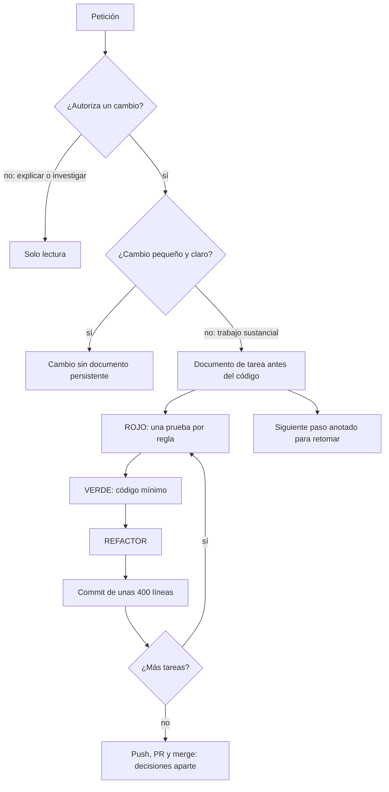

# SE-490 — ODD: desarrollo orgánico y su contraste con SDD

[← SE-489 — EDD: evaluaciones como especificación y puerta de release](https://github.com/vladimiracunadev-create/modern-software-engineering-program/blob/main/classes/part-40-metodologias-de-desarrollo-de-tdd-a-odd/se-489-edd-evaluaciones-como-especificacion-y-puerta-de-release/README.md) · [↑ Parte 40](https://github.com/vladimiracunadev-create/modern-software-engineering-program/blob/main/classes/part-40-metodologias-de-desarrollo-de-tdd-a-odd/README.md) · [📚 Índice completo](https://github.com/vladimiracunadev-create/modern-software-engineering-program/blob/main/classes/README.md) · [🌐 Portal](https://vladimiracunadev-create.github.io/modern-software-engineering-program/classes/SE-490.html) · [SE-491 — Taller: un mismo cambio con cinco metodologías →](https://github.com/vladimiracunadev-create/modern-software-engineering-program/blob/main/classes/part-40-metodologias-de-desarrollo-de-tdd-a-odd/se-491-taller-un-mismo-cambio-con-cinco-metodologias/README.md)

## Punto profesional y fundamento pedagógico

**Punto profesional.** La clase existe para que sepas leer un **flujo de trabajo para agentes de código** como lo que es: un conjunto de reglas con una razón cada una y con evidencia de distinta calidad. ODD (*Organic Driven Development*) es el flujo que describe el ecosistema Gentle AI para los agentes que ya usas: decide primero si tu petición autoriza un cambio, trata explicar e investigar como lecturas, crea un documento de tarea para el trabajo sustancial, hace test-first por defecto cuando hay una prueba determinista relevante y confirma cambios en tramos revisables. No es una metodología académica y casi toda su evidencia es la documentación del propio proyecto. Enseñarlo exige decirlo, mostrar lo que se puede comprobar mecánicamente de él y contrastarlo con SDD sin inflar ninguna de las dos.

**Por qué aparece aquí.** Cierra el bloque de metodologías de la parte antes del taller. Sigue a **EDD** porque ODD se ocupa de la parte del flujo que ni una especificación ni una evaluación resuelven: cómo se **autoriza**, se **acota** y se **retoma** el trabajo de un agente entre sesiones. Prepara la Parte 41, donde el harness del agente se estudia en detalle.

**Error conceptual que debe corregir.** Creer que un flujo documentado con un nombre atractivo tiene evidencia de efectividad. La documentación de un proyecto dice lo que el proyecto hace y quiere hacer; no demuestra que el flujo reduzca defectos o sesiones perdidas. Lo que sí se puede comprobar es la **forma** del flujo en un historial de Git: si el documento de tarea existe antes del primer código, si los commits caben en el tamaño que declara y si hubo un tramo rojo seguido de uno verde.

**Secuencia de aprendizaje.** Antes de ejecutar, predices qué reglas incumple un historial de Git en que el código se escribió primero, en un solo commit, y el documento de tarea después; después creas con Git real dos historiales en un directorio temporal, ejecutas las pruebas de cada commit y mides tres reglas del flujo; contrastas con SDD y decides qué parte del flujo adoptarías.

**Evidencia de aprendizaje.** `odd-log.md` con tu predicción, los dos historiales y su evaluación, un documento de tarea de un cambio tuyo con alcance, tareas, evidencia y siguiente paso, la lista de lo que el comprobador no puede ver y una nota que separe lo comprobado, lo documentado por el proyecto y lo supuesto.

**Límite de la conclusión.** Los dos historiales son sintéticos y las reglas son las que la documentación declara, leídas por el autor; el umbral de 400 líneas es el que la documentación llama «unas 400 líneas modificadas». **No se instaló ni se ejecutó Gentle AI**, de modo que no se comprobó que la herramienta cumpla lo que su documentación describe. No se midió ningún efecto del flujo en equipos. No se invocó ningún modelo de lenguaje.

### Trazabilidad fuente → afirmación

| Fuente primaria u oficial | Afirmación que respalda | Lo que no prueba |
|---|---|---|
| [Gentle AI, «Intended Usage»](https://github.com/Gentleman-Programming/gentle-ai/blob/main/docs/intended-usage.md) | Describe ODD: autorización primero, lecturas sin cambios, documento `odd/tasks/<feature-name>.md` con alcance, tareas, evidencia y siguiente paso antes de tocar el código, test-first por defecto cuando existe una prueba determinista, commits de unas 400 líneas modificadas, y push, pull request y merge como decisiones aparte. | Es documentación del proyecto y no una evaluación independiente; el texto sigue la rama principal y puede cambiar. |
| [Repositorio de Gentle AI](https://github.com/Gentleman-Programming/gentle-ai) | Es el origen del flujo y de sus herramientas. | No se ejecutó. |
| [Artículo sobre ODD (cursosdesarrolloweb)](https://cursosdesarrolloweb.com/articulos/organic-driven-development-odd/) | Es un texto de terceros que presenta ODD frente al SDD que usaba ese ecosistema; la documentación oficial no hace esa comparación. | Es una opinión de terceros; se enseña como contraste por verificar. |
| [Beck, «Canon TDD»](https://tidyfirst.substack.com/p/canon-tdd) | Describe el flujo rojo-verde-refactor sobre el que ODD declara apoyarse por defecto. | No trata agentes. |
| [Git: `git log`](https://git-scm.com/docs/git-log) | Documenta `--numstat` y las opciones usadas para medir el tamaño de cada commit. | No define qué tamaño es adecuado. |
| [Böckeler, «Understanding Spec-Driven-Development»](https://martinfowler.com/articles/exploring-gen-ai/sdd-3-tools.html) | Aporta los niveles de SDD con los que se contrasta. | No trata ODD. |

## Antes de empezar

Recupera lo aprendido en `SE-489`: una decisión de publicar necesita una medida con su variación. La pregunta activa es: **¿cuántas veces un agente (o una persona) cambió algo en tu repositorio sin que nadie hubiera autorizado el cambio, y qué te habría avisado antes?**

## Prerrequisitos

- Haber completado `SE-489` y `SE-482` (ciclo rojo-verde-refactor).
- Saber usar Git: `init`, `add`, `commit`, `log` y `show`.
- Python 3.11 o posterior con `subprocess` y `tempfile`; Git instalado.

## Problema auténtico

Un agente de código recibe la petición «explícame cómo funciona el silencio de un curso». Responde con una explicación y, de paso, «arregla» una línea que le parecía incorrecta. Nadie le había pedido cambiar nada. Otro día, le piden el silencio por curso y entrega un único commit de 463 líneas con el código, pruebas que él mismo escribió y la reorganización de dos archivos. Al día siguiente, otra sesión del agente no recuerda qué había decidido ni qué faltaba: empieza de nuevo. Tres problemas distintos (autorización, tamaño de lo revisable, continuidad) con una sola raíz: nadie fijó reglas de trabajo para quien no tiene memoria entre sesiones.

ODD ataca ese conjunto con cinco reglas. La clase no las evalúa por sus resultados, que nadie midió; comprueba lo que se puede comprobar de su forma con dos historiales de Git reales, y muestra qué queda fuera de cualquier comprobador: que el documento de tarea diga la verdad.

## Objetivos observables

Al terminar podrás:

1. enunciar las reglas del flujo ODD tal como las documenta el proyecto y distinguir lo que es regla de lo que es recomendación;
2. crear un historial de Git reproducible y medir orden, tamaño y estado de las pruebas de cada commit;
3. escribir un documento de tarea con alcance, tareas, evidencia y siguiente paso, y usarlo para retomar un trabajo;
4. contrastar ODD con SDD por el problema que ataca cada uno y por su evidencia;
5. decidir qué reglas de ODD adoptarías en un flujo propio y cómo las harías cumplir sin depender de una herramienta.

## Mapa conceptual



El mapa tiene dos bifurcaciones antes de escribir una línea: si la petición autoriza un cambio y si el cambio es sustancial. Todo lo demás es el ciclo de TDD con un límite de tamaño y una nota para la sesión siguiente.

## Temas y por qué importan

| Tema | Por qué cambia una decisión profesional | Evidencia mínima |
|---|---|---|
| Autorización antes que acción | Explicar no es cambiar; sin esa frontera, el agente actúa por su cuenta. | Una petición clasificada como lectura |
| Documento de tarea | Es la memoria entre sesiones y el registro del alcance. | Documento con cuatro secciones |
| Test-first por defecto | Da el oráculo antes del código cuando existe uno determinista. | Un rojo y un verde por regla |
| Commits revisables | Un cambio de 463 líneas no se revisa. | Tamaño de cada commit |
| Push, PR y merge aparte | Separa la decisión de entregar de la de implementar. | Una política escrita |
| Contraste con SDD | Son dos respuestas a problemas distintos. | Tabla de contraste con su evidencia |

## Conceptos y decisiones

### 1. La autorización va primero

Según la documentación de Gentle AI, ODD empieza por decidir si la petición autoriza un cambio: explicar e investigar se quedan en lectura; el agente explora el código existente, pregunta solo por decisiones que no puede tomar con seguridad e implementa el trabajo autorizado con las comprobaciones aplicables. La regla es una frontera de permiso, no un hallazgo técnico: separa «entender» de «cambiar» con el mismo cuidado con que un sistema de permisos separa lectura de escritura (`SE-473`). Su valor depende de que el agente la cumpla, y eso es verificable solo con un registro de qué hizo en cada petición.

### 2. El documento de tarea como memoria

Para el trabajo sustancial, el flujo exige crear antes de modificar el código un documento `odd/tasks/<nombre>.md` con **alcance**, **tareas**, **evidencia** y **siguiente paso**. Es el artefacto que permite a otra sesión retomar: qué se acordó, qué falta, qué se comprobó y qué se hace a continuación. La documentación añade una copia en una memoria persistente del agente y una regla de conciliación entre ambas, y precisa que si falta la memoria se informa, no se da por bueno. Los cambios de alcance aceptados actualizan las tareas afectadas; los hallazgos no amplían la autorización en silencio. En esta clase solo se estudia el documento, que es lo que cualquier persona puede reproducir.

### 3. Test-first por defecto, con excepción declarada

La documentación fija como defecto el ciclo rojo-verde-refactor cuando existe una prueba determinista relevante y un resultado esperado claro: se observa el rojo antes de implementar y el verde después. Si no hay prueba determinista, se explica la excepción y se ejecutan igualmente comprobaciones funcionales. Añade dos reglas finas: una prueba roja por cada regla pedida, y una prueba por cada comando u opción existente tocada que demuestre que su comportamiento anterior se mantiene, sin otros casos. Es TDD con un acotamiento: no escribir pruebas «por si acaso».

### 4. Commits en tramos revisables

El flujo pide confirmar las unidades de trabajo en la rama de la funcionalidad en tramos revisables de unas 400 líneas modificadas, y que una unidad de alto riesgo vaya en su propio commit. El número es una convención, y su razón es de revisión: una persona (o un agente revisor) puede leer 400 líneas con atención; 463 de una vez, con reorganizaciones mezcladas, no. El tamaño se puede medir con `git log --numstat`. Lo que no se puede medir es si un commit pequeño es coherente.

### 5. Entregar es otra decisión

La documentación separa el trabajo de implementar del de entregar: push, pull request y merge son decisiones aparte. Es la misma idea de `SE-477` (acciones reversibles y aprobación): lo que sale del entorno local es una acción que se confirma, no una consecuencia automática de «terminar».

### 6. Contraste con SDD

SDD (`SE-488`) ataca la pregunta de qué fuente manda: la especificación. ODD ataca la pregunta de cómo se autoriza, se acota y se retoma el trabajo de un agente. Se pueden usar juntos: una especificación define el qué; un documento de tarea, el avance de una sesión concreta. Un artículo de terceros presenta ODD como sucesor del SDD que ese ecosistema usaba; la documentación oficial no hace esa comparación, de modo que se toma como una opinión por contrastar. Lo que sí se puede decir con precisión es qué artefacto produce cada uno: SDD, una especificación que vive con el sistema; ODD, un documento por tarea que vive con la rama.

## Dos historiales de Git reales

Se creó con Git real, en un directorio temporal, un historial A de cuatro commits: un documento de tarea con alcance, tareas, evidencia pendiente y siguiente paso; un commit con una prueba y una función vacía (rojo); un commit con la función mínima (verde); y un commit que actualiza la evidencia y el siguiente paso. Y un historial B de dos commits: uno con la función, ciento cincuenta funciones de relleno y las pruebas, y otro, después, con el documento de tarea. Un comprobador de unas cuarenta líneas recorre cada historial: ve si el documento aparece antes del primer commit con código, mide las líneas de cada commit con `--numstat` y ejecuta las pruebas en cada commit para saber si estaba en rojo o en verde.


**Cómo leer la figura.** Cada barra es un historial de Git real y su largo las líneas de su commit más grande; la línea discontinua es el límite de 400 líneas de la regla. El historial ordenado tiene 13 líneas como máximo y el comprobador no halla nada; el desordenado concentra el código en un commit de 463 líneas, incumple el límite y también las otras dos reglas (documento de tarea antes del primer código y un tramo rojo seguido de uno verde), que quedan en la tabla. **Dónde deja de valer:** los historiales son sintéticos y el relleno de B es un artificio para pasar de 400 líneas; los umbrales y reglas son los que la documentación declara. El comprobador ve la forma del flujo, no su cumplimiento real en un equipo.

El experimento muestra también lo que el comprobador obliga a decidir. Para saber si un commit estaba en rojo hay que ejecutar las pruebas en ese commit, lo que exige poder reconstruir el estado del repositorio en cada uno. Y la regla de las 400 líneas cuenta líneas añadidas más borradas, de modo que un archivo generado o un movimiento de código cuenta igual que las líneas escritas.

## El flujo y sus pasos

El flujo de un cambio sustancial tiene seis pasos: autorización con exploración de solo lectura, documento de tarea, rojo, verde, refactor y commits pequeños, con push, pull request y merge decididos aparte. Para un cambio pequeño y entendido se omite el documento persistente.


**Cómo leer la figura.** Las seis cajas siguen el orden del flujo; la última recoge que las entregas se deciden aparte. **Dónde deja de valer:** los pasos proceden de la documentación del proyecto y el diagrama los ordena de la misma forma; no hay un estudio independiente que los valide. La clase los enseña como descripción de un flujo concreto, con sus límites.

## Qué puede ver el comprobador

Los cuatro aspectos que se pueden comprobar del flujo tienen distinta calidad. El orden entre el documento y el primer código se ve con el historial, y un documento vacío también cumple la regla. El tamaño de cada commit se ve con la estadística de Git, y las líneas generadas cuentan igual que las escritas. El estado de las pruebas se ve ejecutándolas, y una prueba que no afirma nada pone el commit en verde. Que el documento sea cierto y sirva para retomar no lo ve ninguna máquina.


**Cómo leer la figura.** Cada fila va de un aspecto del flujo ODD (izquierda) a si la máquina lo comprueba (centro: teal si lo comprueba, coral si no) y a su límite (derecha). La máquina comprueba el orden, el tamaño y el estado de las pruebas con el historial de Git; que el documento sea cierto y útil para retomar el trabajo solo lo sabe una persona. **Dónde deja de valer:** el comprobador es el de esta clase; uno más elaborado vería más. Para el último aspecto, la prueba es humana: alguien que no estuvo retoma el trabajo solo con el documento y dice si pudo.

## Definiciones de trabajo

- **ODD (desarrollo orgánico):** flujo de trabajo para agentes de código descrito por el proyecto Gentle AI.
- **Documento de tarea:** archivo con alcance, tareas, evidencia y siguiente paso, creado antes de tocar el código.
- **Tramo revisable:** commit de un tamaño que una persona puede leer con atención (unas 400 líneas modificadas, según la documentación).
- **Rojo y verde:** estado de las pruebas antes y después de implementar.
- **Decisión de entrega:** push, pull request o merge, separados de la implementación.
- **Siguiente paso:** línea del documento que permite retomar sin la sesión anterior.

## Ejemplo mínimo

Un documento de tarea de cinco líneas útiles:

```markdown
# Tarea: silenciar un curso
## Alcance
Un estudiante puede silenciar un curso; el aviso de la última hora se conserva.
## Tareas
- [ ] prueba roja del silencio
- [ ] implementación mínima
## Evidencia
(pendiente)
## Siguiente paso
escribir la prueba roja
```

Cualquier sesión que lo lea sabe qué se hace, qué falta y por dónde seguir. Si «Evidencia» sigue diciendo «pendiente» al cerrar la tarea, el documento no cumple su función.

## Ejemplo profesional

*Escenario ilustrativo: las cifras y los resultados que aparecen en este ejemplo son supuestos de la narración, no mediciones.*

El equipo adopta tres reglas de ODD sin instalar nada: toda petición de un agente se clasifica en lectura o cambio al empezar (una línea en el registro de la sesión); todo trabajo de más de un archivo tiene un documento de tarea creado antes del primer cambio; y la integración continua rechaza un pull request con más de 400 líneas modificadas en un commit, salvo que el commit lleve la etiqueta «generado» o «movimiento». Añade una comprobación de dos líneas que verifica que el documento exista antes del primer commit con código. Tras un mes mide: el tamaño medio de commit baja a 90 líneas; un agente ya no propone cambios en peticiones de explicación; y retomar un trabajo en otra sesión toma minutos. Reconoce que no sabe cuánto de la mejora se debe a las reglas y cuánto a que alguien las vigila.

## Práctica guiada

1. Predice qué reglas incumple el historial B.
2. Ejecuta `python scripts/experiments_part40_b.py 490` y compara con tu predicción.
3. Escribe un documento de tarea para un cambio de tu proyecto y pide a otra persona que diga qué haría a continuación solo con él.
4. Escribe un comprobador de dos reglas para tu repositorio (documento antes del código, tamaño de commit).
5. Compara ODD con tu flujo actual: qué regla ya cumples, cuál no y por qué.

## Ejercicios

1. **Básico.** Explica por qué un documento de tarea con «Evidencia: pendiente» al cerrar no cumple su función.
2. **Intermedio.** Añade al comprobador la regla «una prueba roja por cada regla pedida» y descríbela con una limitación.
3. **Avanzado.** Diseña la prueba humana de que el documento sirve: una persona que retoma el trabajo solo con él, y qué mides.

## Reto verificable

Entrega `odd-log.md` con tus dos historiales (o los de la clase), la evaluación de cada regla, un documento de tarea real y la lista de lo que el comprobador no ve. Es válido si otra persona puede recrear los historiales y obtener la misma evaluación.

## Caso conductor

En *Avisos*, el silencio de un curso es el cambio sustancial que abre el documento de tarea. El flujo se compara con los otros en el taller `SE-491`, donde el mismo cambio se hace con cinco metodologías, y alimenta la política de `SE-492`.

## Preguntas frecuentes

### ¿ODD es una metodología reconocida?

No es una metodología académica; es el flujo que documenta un proyecto concreto para los agentes que configura. La clase lo enseña por eso con su evidencia declarada: documentación del propio proyecto.

### ¿Necesito Gentle AI para aplicar estas reglas?

No. Las reglas (autorización, documento de tarea, test-first, commits pequeños, entregar aparte) se pueden aplicar con instrucciones de repositorio y comprobaciones de integración continua.

### ¿ODD sustituye a SDD?

Resuelven problemas distintos. Un artículo de terceros lo presenta como relevo; la documentación oficial no lo afirma. Se pueden combinar: una especificación para el qué, un documento de tarea para el avance.

### ¿Y si no hay prueba determinista posible?

La documentación prevé explicar la excepción y ejecutar comprobaciones funcionales; para componentes probabilísticos, `SE-489` aporta la puerta de evaluación.

## Fallo controlado y diagnóstico

*Escenario ilustrativo: las cifras de este fallo son supuestos de la narración, no mediciones.*

**Fallo.** Un agente entrega un único commit de 463 líneas con el documento de tarea creado después. La revisión se aprueba sin lectura profunda y un defecto del silencio llega a producción.

**Diagnóstico paso a paso.** (1) El comprobador señala tres incumplimientos: documento tardío, commit de 463 líneas, ningún tramo rojo-verde. (2) Se mide cuántas líneas eran reorganización y cuántas lógica nueva: 380 y 83. (3) Se localiza el defecto en las 83. (4) Se constata que un commit de las 83 líneas se habría revisado con atención.

**Corrección.** Se separa la reorganización en su propio commit, se exige el documento antes del primer cambio y se pide una prueba roja por regla. El comprobador entra en la integración continua con el límite y una etiqueta para movimientos.

## Errores comunes y cómo corregirlos

- **Adoptar el nombre sin las reglas.** Corrige escribiendo qué regla se cumple y cómo se comprueba.
- **Un documento de tarea que nadie actualiza.** Corrige con «siguiente paso» obligatorio al terminar cada sesión.
- **Commits de tamaño límite que mezclan cambios.** Corrige separando reorganización y lógica.
- **Confundir cumplimiento de forma con calidad.** Corrige añadiendo la prueba humana de retomar.
- **Dejar que el agente decida entregar.** Corrige reservando push, PR y merge.
- **Presentar la documentación de un proyecto como evidencia.** Corrige atribuyendo y buscando medición propia.

## Entorno y archivos clave

- `scripts/experiments_part40_b.py`: creación de los historiales y comprobador; `python scripts/experiments_part40_b.py 490`.
- Git instalado; `tempfile` crea un directorio temporal que se borra al terminar.
- `content/part-40/figures/`: figuras.

## Seguridad, ética y accesibilidad

El laboratorio crea repositorios solo en un directorio temporal y ejecuta únicamente pruebas del propio laboratorio; si aplicas el comprobador a un repositorio ajeno, ejecutar pruebas de cada commit es ejecutar código de terceros y debe hacerse en un entorno aislado y sin credenciales. La separación entre lectura y cambio es una medida de seguridad: un agente que cambia cuando se le pide explicar amplía su superficie sin autorización. Ética: delegar a un agente exige que alguien responda por lo que hace; las reglas de entrega aparte dejan esa responsabilidad en una persona. Accesibilidad: un documento de tarea en texto plano es legible con cualquier tecnología de apoyo; las figuras tienen texto alternativo completo.

## Puente hacia el trabajo con agentes

ODD es, en sí, un puente: sus reglas existen porque un agente no tiene memoria entre sesiones, actúa dentro de lo que le dicen y produce cambios que una persona debe revisar. Si no usas esa herramienta, las mismas reglas se aplican con instrucciones de repositorio: una línea que obligue a clasificar la petición, una plantilla de documento de tarea, un límite de tamaño en la integración continua y una regla de que push y merge los decide una persona. Lo que no se delega es la prueba humana de que el documento sirve para retomar: es la única verificación del flujo que ninguna máquina hace.

## Transferencia

Elige un cambio de tu proyecto y haz el flujo completo con papel y Git: documento de tarea, una prueba roja, el código mínimo, un commit por unidad. Mide con el comprobador de la clase. Después pide a otra persona que retome el trabajo con solo el documento y anota qué le faltó.

## Evaluación y evidencia

| Criterio | Evidencia aceptable | Rechazo |
|---|---|---|
| Reglas atribuidas | Cada regla con su fuente y su límite | Reglas presentadas como evidencia |
| Historiales reproducibles | Comando y resultado | Capturas |
| Comprobador | Ejecutado sobre dos historiales | Descrito |
| Documento de tarea | Con las cuatro secciones y siguiente paso | Lista de tareas sola |
| Límite | Dice que no se midió efecto en equipos | Afirma beneficios |

## Fuentes

- Gentle AI. [«Intended Usage»](https://github.com/Gentleman-Programming/gentle-ai/blob/main/docs/intended-usage.md) y [repositorio](https://github.com/Gentleman-Programming/gentle-ai).
- Artículo de terceros sobre ODD en [cursosdesarrolloweb](https://cursosdesarrolloweb.com/articulos/organic-driven-development-odd/).
- Beck, K. [«Canon TDD»](https://tidyfirst.substack.com/p/canon-tdd).
- Git. [`git log`](https://git-scm.com/docs/git-log).
- Böckeler, B. [«Understanding Spec-Driven-Development»](https://martinfowler.com/articles/exploring-gen-ai/sdd-3-tools.html).

## Límites y siguiente paso

No se ejecutó Gentle AI ni se midió el efecto de ODD en equipos; los historiales son sintéticos y las reglas son las que la documentación declara. El siguiente paso, `SE-491`, es el taller: el mismo cambio, silenciar un curso, con cinco metodologías, medido con los mismos mutantes.

## Glosario

| Término | Definición breve |
|---|---|
| ODD | Flujo de trabajo para agentes de código descrito por Gentle AI |
| Documento de tarea | Alcance, tareas, evidencia y siguiente paso |
| Tramo revisable | Commit de tamaño que se puede leer con atención |
| Rojo y verde | Estado de las pruebas antes y después de implementar |
| Decisión de entrega | Push, PR o merge, aparte de implementar |
| Siguiente paso | Línea que permite retomar sin la sesión anterior |

---

[← SE-489 — EDD: evaluaciones como especificación y puerta de release](https://github.com/vladimiracunadev-create/modern-software-engineering-program/blob/main/classes/part-40-metodologias-de-desarrollo-de-tdd-a-odd/se-489-edd-evaluaciones-como-especificacion-y-puerta-de-release/README.md) · [↑ Parte 40](https://github.com/vladimiracunadev-create/modern-software-engineering-program/blob/main/classes/part-40-metodologias-de-desarrollo-de-tdd-a-odd/README.md) · [📚 Índice completo](https://github.com/vladimiracunadev-create/modern-software-engineering-program/blob/main/classes/README.md) · [🌐 Portal](https://vladimiracunadev-create.github.io/modern-software-engineering-program/classes/SE-490.html) · [SE-491 — Taller: un mismo cambio con cinco metodologías →](https://github.com/vladimiracunadev-create/modern-software-engineering-program/blob/main/classes/part-40-metodologias-de-desarrollo-de-tdd-a-odd/se-491-taller-un-mismo-cambio-con-cinco-metodologias/README.md)
