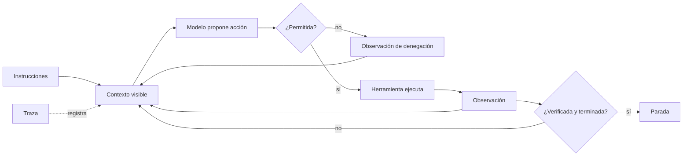
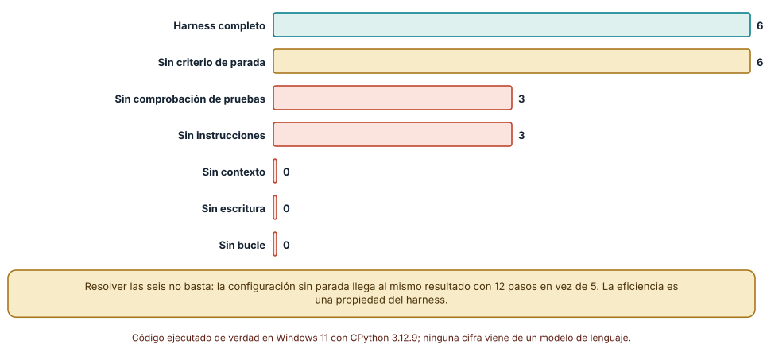
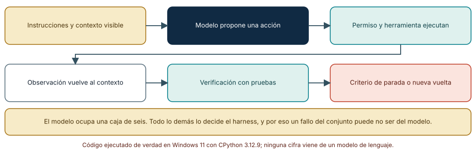

# SE-493 — Anatomía de un harness: modelo, contexto, herramientas y bucles

[← SE-492 — Proyecto: política metodológica de equipo con evidencia](https://github.com/vladimiracunadev-create/modern-software-engineering-program/blob/main/classes/part-40-metodologias-de-desarrollo-de-tdd-a-odd/se-492-proyecto-politica-metodologica-de-equipo-con-evidencia/README.md) · [↑ Parte 41](https://github.com/vladimiracunadev-create/modern-software-engineering-program/blob/main/classes/part-41-harness-y-agentic-engineering/README.md) · [📚 Índice completo](https://github.com/vladimiracunadev-create/modern-software-engineering-program/blob/main/classes/README.md) · [🌐 Portal](https://vladimiracunadev-create.github.io/modern-software-engineering-program/classes/SE-493.html) · [SE-494 — Instrucciones de repositorio y cumplimiento determinista →](https://github.com/vladimiracunadev-create/modern-software-engineering-program/blob/main/classes/part-41-harness-y-agentic-engineering/se-494-instrucciones-de-repositorio-y-cumplimiento-determinista/README.md)

## Punto profesional y fundamento pedagógico

**Punto profesional.** La clase existe para que dejes de atribuir al modelo todo lo que hace un agente de código. Cuando un agente corrige bien un error o destruye un directorio, el resultado depende de un conjunto de piezas que no son el modelo: las instrucciones que recibe, el contexto que ve en cada paso, las herramientas que puede invocar, los permisos que las acotan, el bucle que repite la secuencia, la condición que lo detiene y la verificación que decide si lo hecho cuenta. Ese conjunto se llama **harness** (arnés). Un ingeniero que lo ve como una arquitectura puede ubicar un fallo, cambiar una pieza y medir el efecto; uno que lo ve como «el prompt» cambia palabras hasta que algo mejora y no sabe por qué.

**Por qué aparece aquí.** Sigue a la Parte 40 porque las metodologías de allí (pruebas, ejemplos, contratos, especificaciones, evaluaciones) producen *oráculos*, y un oráculo solo sirve si algo lo ejecuta en el momento correcto y obliga a respetarlo. El harness es ese algo. La Parte 39 enseñó a especificar y delegar; esta parte enseña a construir el entorno donde la delegación ocurre con control.

**Error conceptual que debe corregir.** Creer que mejorar un agente es mejorar el modelo o el prompt. Una configuración con el mismo modelo guionizado resuelve 6 de 6 tareas o 0 de 6 según qué pieza falte. La mayor parte de las fallas que se observan en un agente de código son fallas del entorno: no veía el resultado de su paso anterior, no tenía la herramienta, nadie le exigió ejecutar las pruebas, nadie lo detuvo.

**Secuencia de aprendizaje.** Antes de ejecutar, predices qué pasa con la tarea cuando quitas cada pieza; después ejecutas siete configuraciones sobre seis tareas, comparas con lo que predijiste y dibujas la anatomía con el nombre de la pieza que explica cada diferencia.

**Evidencia de aprendizaje.** `harness-anatomia.md` con el diagrama de las piezas de un harness que usas, una tabla de ablación con tu predicción y el resultado medido, y una frase por pieza que diga qué falla cuando falta.

**Límite de la conclusión.** El «modelo» del laboratorio es una política escrita a mano y determinista; no se invocó ningún modelo de lenguaje. La clase mide el efecto de las piezas del harness sobre una política fija, no cómo se comporta un modelo real dentro de ellas. Las seis tareas son de una a tres líneas.

### Trazabilidad fuente → afirmación

| Fuente primaria u oficial | Afirmación que respalda | Lo que no prueba |
|---|---|---|
| [Böckeler, «Harness engineering for coding agent users»](https://martinfowler.com/articles/exploring-gen-ai/harness-engineering.html) | Define harness como todo lo que rodea al modelo (Agent = Model + Harness) y distingue guías previas a la acción de sensores posteriores. | No mide qué parte del resultado se debe al harness. |
| [Anthropic, «Building effective agents»](https://www.anthropic.com/engineering/building-effective-agents) | Describe el agente como un modelo que usa herramientas dentro de un bucle y recomienda la solución más simple que funcione. | No dice cuál configuración conviene a un caso concreto. |
| [Yao et al., «ReAct»](https://arxiv.org/abs/2210.03629) | Presenta el patrón de intercalar razonamiento y acción con observaciones. | No valida el patrón para código de producción. |
| [Anthropic, «Effective harnesses for long-running agents»](https://www.anthropic.com/engineering/effective-harnesses-for-long-running-agents) | Documenta fallos de agentes que abarcan varias ventanas de contexto y el papel del entorno. | Es una experiencia de un equipo, no una tasa. |
| [Python: `subprocess`](https://docs.python.org/3/library/subprocess.html) | Documenta cómo el laboratorio ejecuta las pruebas en un proceso aparte. | No valida el diseño del laboratorio. |

## Antes de empezar

Recupera lo aprendido en `SE-492`: una política de equipo asigna evidencia según el riesgo de un cambio. Una política que nadie ejecuta es un documento. La pregunta activa es: **si el agente que trabaja en tu repositorio ignorara hoy una de tus reglas, ¿qué parte del entorno lo notaría y qué parte lo dejaría pasar?**

## Prerrequisitos

- Haber completado la Parte 40, en particular `SE-491` y `SE-492`, o poder explicar qué es un oráculo y por qué una política necesita evidencia.
- Haber trabajado con especificaciones y delegación a agentes (Parte 39).
- Python 3.11 o posterior y la biblioteca estándar; el laboratorio crea directorios temporales y los borra.
- Leer un mensaje de fallo de `unittest`.

## Problema auténtico

El equipo de *Avisos* prueba un asistente de código sobre seis tareas pequeñas de mantenimiento. Un miércoles el asistente corrige las seis; el jueves, con el mismo modelo, deja tres sin resolver y declara terminadas las tres. Alguien propone cambiar el modelo, otra persona reescribir el prompt. Nadie mira qué cambió en el entorno: el jueves se había eliminado del archivo de instrucciones la línea que pedía ejecutar las pruebas antes de terminar.

La clase reconstruye ese diagnóstico con un harness mínimo. Se parte de una configuración completa y se quita una pieza por vez. Cada ausencia produce un patrón de fallo distinto, y el patrón, leído con cuidado, señala la pieza. Esa es la habilidad que se entrena: pasar de «el agente falló» a «falló esta pieza del entorno, por esta razón».

## Objetivos observables

Al terminar podrás:

1. nombrar las piezas de un harness (instrucciones, contexto, herramientas, permisos, bucle, parada, verificación, traza) y decir qué decide cada una;
2. distinguir una falla del modelo de una falla del entorno usando la traza de pasos;
3. predecir y medir el efecto de quitar una pieza sobre tareas resueltas, pasos consumidos y terminaciones en falso;
4. explicar por qué declarar terminada una tarea sin verificarla es el fallo más caro y el más silencioso;
5. situar un producto de agentes que conozcas en este esquema sin confundir lo que trae incorporado con lo que tú configuras.

## Mapa conceptual

El mapa muestra que el modelo ocupa un solo nodo. Los demás son decisiones del harness: qué entra al contexto, qué se puede ejecutar, qué cuenta como terminado y qué queda registrado. La flecha de la observación al contexto es la que cierra el bucle; sin ella el agente no ve el resultado de su paso anterior.

## Temas y por qué importan

| Tema | Por qué cambia una decisión profesional | Evidencia mínima |
|---|---|---|
| Definición de harness | Permite ubicar un fallo en una pieza concreta en vez de en «la IA». | Un diagrama de piezas de un producto real |
| Contexto entre pasos | Sin él, el agente repite el primer paso indefinidamente. | Traza con pasos repetidos |
| Herramientas | Lo que el agente no puede hacer, no lo hará; lo que puede, lo hará sin entender. | Lista de herramientas ofrecidas |
| Bucle y parada | El bucle permite corregir; la parada limita el costo. | Pasos consumidos por tarea |
| Verificación | Decide si «terminado» significa «pasó» o «lo dije». | Terminaciones en falso |
| Instrucciones | Son la única pieza que dependía de que el modelo las leyera. | Efecto de quitarlas |
| Traza | Sin ella, ninguna de las demás se puede diagnosticar. | Registro de cada paso |

## Conceptos y decisiones

### 1. Agent = modelo + harness

Böckeler resume la idea con una ecuación: un agente es el modelo más todo lo que lo rodea. La definición es deliberadamente amplia y ella misma propone acotarla al caso de los agentes de código: parte del harness ya viene incorporado en el producto (el mensaje de sistema, el mecanismo de recuperación de código), y el usuario construye un harness *exterior* con lo que el producto ofrece (instrucciones del repositorio, hooks, permisos, compuertas de verificación). En esta clase el harness es lo exterior más lo mínimo interior que el laboratorio necesita para ejecutarse.

La consecuencia práctica es que existen dos grupos de fallas con tratamientos opuestos. Una falla del modelo (razona mal, inventa una función) se trata cambiando de modelo, dividiendo la tarea o dándole más información. Una falla del entorno (no ve el resultado, no puede escribir, nadie verifica) se trata cambiando el entorno, y cambiar de modelo no la arregla. La traza es lo que permite distinguirlas.

### 2. El bucle y el contexto que lo cierra

Un agente de código es un bucle: el modelo decide una acción, el harness la ejecuta, la observación se agrega al contexto y se vuelve a empezar. El patrón ReAct lo formalizó como razonamiento intercalado con acción y observación. Lo esencial para esta clase es que el bucle solo funciona si la observación llega al modelo en el paso siguiente. En el laboratorio, la configuración sin contexto entre pasos entrega al modelo una historia vacía en cada vuelta; la política guionizada, que decide a partir de lo que ve, vuelve a leer el archivo doce veces y no escribe nada. El fallo se parece a «el modelo es lento» y es exactamente lo contrario: es un modelo que nunca ve que ya hizo algo.

### 3. Herramientas: la superficie de lo posible

Las herramientas son las acciones que el harness acepta traducir en efectos: leer un archivo, aplicar un cambio, ejecutar pruebas. Cada una amplía lo que el agente puede lograr y lo que puede romper. Quitar la herramienta de escritura deja al agente leyendo en bucle, porque la política no tiene otra salida: el agente no «sabe» que no puede escribir hasta que lo intenta, y el harness que no lo registra deja una traza idéntica a la del contexto perdido. Esa ambigüedad vuelve en `SE-503` y se resuelve con un campo de la traza.

### 4. Parada y verificación: cuándo termina y quién lo decide

Un bucle necesita dos condiciones distintas que se confunden. La **parada** limita el costo: un tope de pasos, un presupuesto, una señal de falta de progreso. La **verificación** decide si el trabajo cuenta como hecho: las pruebas pasan, el linter calla. En la tabla de ablación la configuración sin criterio de parada resuelve las seis tareas, pero gasta 12 pasos en cada una (el tope técnico) en vez de 5: el trabajo se hace y se desperdicia. La configuración sin verificación resuelve tres y declara terminadas las otras tres. Son fallos de naturaleza distinta: uno cuesta dinero, el otro cuesta confianza.

### 5. Instrucciones: la única pieza que depende de que se lea

Las instrucciones del repositorio (un archivo `AGENTS.md`, por ejemplo) se inyectan en el contexto, y el modelo decide si las sigue. En el laboratorio, la línea «antes de declarar la tarea terminada, ejecuta las pruebas» es lo único que hace a la política verificar. Sin ella, tres tareas con una primera corrección plausible pero errónea quedan terminadas en falso. Es la pieza más barata de escribir y la más frágil: no hay nada que garantice que se cumpla. `SE-494` trata cómo reforzarla con cumplimiento determinista.

### 6. La traza: lo que permite diagnosticar todo lo demás

Un harness que no registra cada paso (qué acción, con qué resultado, con qué contexto visible, qué herramientas estaban ofrecidas) deja el diagnóstico al instinto. La traza es una pieza más, y es la que convierte a las otras en observables.

## Qué ocurre cuando falta una pieza

Se ejecutaron siete configuraciones sobre las seis tareas (`T1` a `T6`: funciones de una a tres líneas con un error y una prueba). Tres de ellas, `T4`, `T5` y `T6`, tienen una primera corrección plausible y errónea que solo la prueba delata.

**Cómo leer la figura.** Cada barra son las seis tareas de una configuración del harness, partidas en verde (resueltas), coral (terminadas en falso) y gris (sin resolver); entre paréntesis están los pasos medios. Mira primero las barras grises enteras, los componentes que impiden resolver, y las dos de mitad coral, el peor fallo: declarar terminada una tarea que no pasa. **Dónde deja de valer:** la política es un guion; no representa la distribución de errores de un modelo real, y con otro modelo las cifras serían distintas. Lo que se generaliza es la *forma* de cada fallo: una pieza ausente deja una firma distinta en los pasos y en el resultado.

**Cómo leer la figura.** Las barras ordenan las configuraciones por tareas resueltas. Dos configuraciones empatan con el harness completo o a media altura, pero por razones opuestas: la que no tiene parada resuelve todo y desperdicia pasos; la que no verifica resuelve la mitad y miente sobre el resto. **Dónde deja de valer:** el conteo de tareas resueltas oculta el costo en pasos y la gravedad de la terminación en falso; no se debe usar solo para comparar harness.

**Cómo leer la figura.** Seis cajas en dos filas recorren una vuelta del bucle; solo la segunda caja de la primera fila es el modelo. **Dónde deja de valer:** es el caso de un agente de código con herramientas locales; un agente conversacional sin herramientas no tiene permiso ni verificación, y uno multiagente (`SE-500`) tiene varios bucles que se coordinan.

## Definiciones de trabajo

- **Harness:** todo lo que rodea al modelo en un agente: instrucciones, contexto, herramientas, permisos, bucle, parada, verificación y registro.
- **Bucle del agente:** secuencia repetida de acción, ejecución, observación y nueva decisión.
- **Observación:** resultado de una acción que el harness devuelve al contexto.
- **Terminación en falso:** el agente declara terminada una tarea cuya verificación no pasa.
- **Ablación:** quitar una pieza para medir qué cambia.
- **Traza:** registro ordenado de cada acción, su resultado y el estado del harness en ese paso.

## Ejemplo mínimo

La tarea `T1`: `add(a, b)` devuelve `a - b`. El harness completo hace cuatro pasos: lee `calc.py`; aplica el reemplazo `a - b` por `a + b`; ejecuta las pruebas, que pasan; y el agente declara la tarea terminada. En la traza aparecen exactamente `read`, `write`, `run_tests` y la solicitud de cierre. Quitar la herramienta de escritura produce una traza de doce lecturas; quitar el contexto, otra de doce lecturas. Las dos trazas son iguales y los fallos distintos: por eso la traza necesita más que el nombre de la herramienta.

## Ejemplo profesional

*Escenario ilustrativo: las cifras y los resultados que aparecen en este ejemplo son supuestos de la narración, no mediciones.*

El equipo adopta un asistente de código para el mantenimiento de *Avisos*. Durante dos semanas todo va bien; en la tercera, tres cambios llegan a revisión con las pruebas en rojo. La revisión encuentra que el asistente los dio por terminados. Tres hipótesis compiten: el modelo empeoró, el prompt cambió, el entorno cambió. La persona responsable revisa las trazas de los tres casos y encuentra que ninguno ejecutó las pruebas. Revisa el archivo de instrucciones: una reorganización había movido la línea de verificación a un archivo que el producto ya no cargaba. La corrección no toca el modelo: restaura la línea y añade una compuerta (`SE-499`) que rechaza la terminación sin pruebas en verde. La lección es la separación de hipótesis: un registro que permita decir «no se ejecutó la herramienta de pruebas» vale más que cualquier cambio de prompt.

## Práctica guiada

1. Elige un agente de código que uses y anota sus piezas: qué archivo de instrucciones carga, qué herramientas ofrece, qué permisos pide, qué tope de pasos tiene, qué hace al terminar y dónde queda el registro.
2. Predice qué pasaría con una tarea sencilla si quitaras cada pieza, y escribe tu predicción antes de ejecutar nada.
3. Ejecuta `python scripts/experiments_part41_a.py 493` y compara con tu predicción; anota las diferencias.
4. Abre la traza de una tarea con el harness completo y marca el paso donde el contexto cambia el comportamiento.
5. Dibuja la anatomía de tu agente con el nombre de la pieza más débil.

## Ejercicios

1. **Básico.** Explica por qué la configuración sin criterio de parada y la configuración sin bucle tienen resultados opuestos aunque ambas «tocan el bucle».
2. **Intermedio.** Diseña una octava configuración (por ejemplo, un tope de pasos de 4) y predice cuántas tareas resuelve; ejecútala modificando `L.Config` y compara.
3. **Avanzado.** Propón qué campo añadirías a la traza para distinguir «sin contexto» de «sin herramienta de escritura» y qué costo tiene registrarlo.

## Reto verificable

Entrega `harness-anatomia.md` con: el diagrama de las piezas de un harness real que uses, la tabla de ablación con tu predicción y el resultado, y una frase por pieza que diga cuál es su fallo característico. Es válido si otra persona, leyendo solo tu traza de una tarea, identifica la pieza que falla.

## Caso conductor

El caso conductor de la parte es el **arnés del equipo de *Avisos***: el entorno donde un asistente de código mantiene el repositorio del servicio de recordatorios. En esta clase el arnés es un laboratorio de seis tareas; en las siguientes se le añaden instrucciones con cumplimiento, permisos, contexto con relevo, paradas, aislamiento, compuertas, coordinación, evaluación y gobierno, hasta el proyecto de `SE-504`.

## Preguntas frecuentes

### ¿Harness y framework de agentes son lo mismo?

No. Un framework es una biblioteca para construir agentes; el harness es el entorno configurado alrededor de un agente concreto. Puede construirse con un framework, con un producto de agentes de código o con un script. Lo que define al harness es qué decide (permisos, parada, verificación), no qué biblioteca usa.

### ¿El harness lo escribo yo o lo trae el producto?

Ambos. Böckeler distingue un harness incorporado (el mensaje de sistema y las herramientas del producto) de uno exterior que configura quien lo usa. Saber cuál es cuál importa porque solo el exterior puedes cambiarlo, y porque una actualización del producto puede cambiar el interior sin avisarte.

### ¿Por qué usar una política guionizada en vez de un modelo real?

Porque la pregunta es qué hace el harness, y con un modelo real el resultado mezcla el efecto del entorno con la variación del modelo. La política guionizada fija esa variación y deja visible el efecto del entorno. La contrapartida es que no dice nada sobre un modelo real.

### ¿Un harness mejor reemplaza a un modelo mejor?

No hay medida aquí que lo diga. Lo que se midió es que un harness con una pieza ausente falla de forma sistemática con una política fija; qué parte del rendimiento de un agente real se debe a cada elemento exige una evaluación con modelos reales, que esta clase no hizo.

## Fallo controlado y diagnóstico

**Fallo.** Se ejecuta la configuración «sin instrucciones» y tres tareas quedan terminadas en falso: `T4`, `T5` y `T6`. Las pruebas del repositorio fallan. El agente informó éxito.

**Diagnóstico paso a paso.** (1) La traza de `T4` muestra `read`, `write` y la solicitud de cierre; no hay `run_tests`. (2) En las tres tareas, la primera corrección era plausible pero errónea (`* 10` en vez de `* 100`, por ejemplo). (3) En las tres tareas que sí se resuelven, la primera corrección era la correcta, y por eso la ausencia de verificación no se notó. (4) La causa es que la única pieza que obligaba a verificar era una línea de instrucciones.

**Corrección.** Restaurar la línea de instrucciones no basta como garantía: se añade una verificación obligatoria en el harness (`SE-499`) que rechaza la terminación sin pruebas en verde. La lección es que una pieza que depende de la lectura del modelo es frágil frente a una que el harness impone.

## Errores comunes y cómo corregirlos

- **Atribuir todo al modelo.** Síntoma: se cambia de modelo y el fallo persiste. Causa: la falla era del entorno. Corrección: leer la traza antes de cambiar el modelo.
- **Confundir dos fallos con la misma traza.** Síntoma: se «arregla» el contexto cuando faltaba una herramienta. Causa: la traza no registra qué herramientas se ofrecieron. Corrección: añadir ese campo.
- **Medir solo tareas resueltas.** Síntoma: dos configuraciones empatan. Causa: se ignora el costo y la terminación en falso. Corrección: registrar pasos y terminaciones en falso.
- **Tratar las instrucciones como una garantía.** Síntoma: una regla no se cumple de vez en cuando. Causa: depende de que el modelo la lea. Corrección: mecanizar lo mecanizable.
- **Cambiar dos piezas a la vez.** Síntoma: no se sabe cuál arregló el fallo. Corrección: una pieza por experimento.

## Entorno y archivos clave

- `scripts/experiments_part41_lab.py`: harness mínimo (`Config`, `Harness`, `scripted_policy`) y seis tareas.
- `scripts/experiments_part41_a.py`: ablación de la clase; se ejecuta con `python scripts/experiments_part41_a.py 493`.
- `content/part-41/figures/`: figuras de la clase.
- Solo la biblioteca estándar; el laboratorio crea directorios con `tempfile` y los elimina al terminar.

## Seguridad, ética y accesibilidad

El laboratorio escribe y borra solo dentro de directorios temporales propios y ejecuta únicamente las pruebas de la tarea en un proceso aparte. En un harness real, cada pieza que añadas (herramientas, red, credenciales) amplía lo que un error puede dañar; se desarrolla desde `SE-495`. Ética: atribuir un fallo del entorno a una persona o al modelo sin leer la traza es un diagnóstico injusto. Las figuras son tablas, barras y diagramas con texto alternativo completo; ninguna información depende solo del color.

## Puente hacia el trabajo con agentes

Este es el puente por definición: la clase describe el objeto con el que vas a trabajar el resto de la parte. El hábito que se lleva es preguntar, ante cualquier resultado de un agente, cuál de las piezas lo explica. Con un asistente real, pide o configura el registro de cada paso y revisa primero lo que el agente *pudo* hacer (herramientas y permisos) antes de lo que *decidió* hacer.

## Transferencia

Toma un agente de código que uses a diario y escribe su anatomía en una página: qué le pasa al contexto cuando la sesión se alarga, qué herramientas tiene, quién decide que algo está terminado, qué queda registrado. Marca la pieza que más depende de la buena voluntad del modelo y propone cómo convertirla en algo que el harness imponga.

## Evaluación y evidencia

| Criterio | Evidencia aceptable | Rechazo |
|---|---|---|
| Piezas identificadas | Diagrama con las piezas de un harness real | Lista genérica copiada |
| Predicción previa | Predicción escrita antes de ejecutar | Predicción redactada después |
| Fallo atribuido a una pieza | Traza con el patrón característico | «Parece un problema del modelo» |
| Separación modelo/entorno | Hipótesis refutable por cada fallo | Una sola explicación para todo |
| Límite declarado | Qué no mide la política guionizada | Generalizar a modelos reales |

## Fuentes

- Böckeler, B. [«Harness engineering for coding agent users»](https://martinfowler.com/articles/exploring-gen-ai/harness-engineering.html).
- Anthropic. [«Building effective agents»](https://www.anthropic.com/engineering/building-effective-agents).
- Yao, S. et al. [«ReAct: Synergizing Reasoning and Acting in Language Models»](https://arxiv.org/abs/2210.03629).
- Anthropic. [«Effective harnesses for long-running agents»](https://www.anthropic.com/engineering/effective-harnesses-for-long-running-agents).
- Python Software Foundation. [`subprocess`](https://docs.python.org/3/library/subprocess.html) y [`tempfile`](https://docs.python.org/3/library/tempfile.html).

## Límites y siguiente paso

Se midieron siete configuraciones sobre seis tareas con una política guionizada, en Windows 11 con CPython 3.12.9. No se midió ningún modelo real, ningún producto de agentes, ningún equipo ni ninguna tarea de más de tres líneas. El siguiente paso, `SE-494`, trata la pieza más frágil de las que aparecieron, las instrucciones, y qué parte de ellas se puede convertir en una comprobación que no dependa de que el modelo las lea.

## Glosario

| Término | Definición breve |
|---|---|
| Harness | Todo lo que rodea al modelo en un agente |
| Bucle del agente | Acción, ejecución, observación y nueva decisión |
| Observación | Resultado de una acción devuelto al contexto |
| Terminación en falso | Declarar terminada una tarea que no pasa su verificación |
| Ablación | Quitar una pieza para medir su efecto |
| Traza | Registro ordenado de cada paso del agente |
