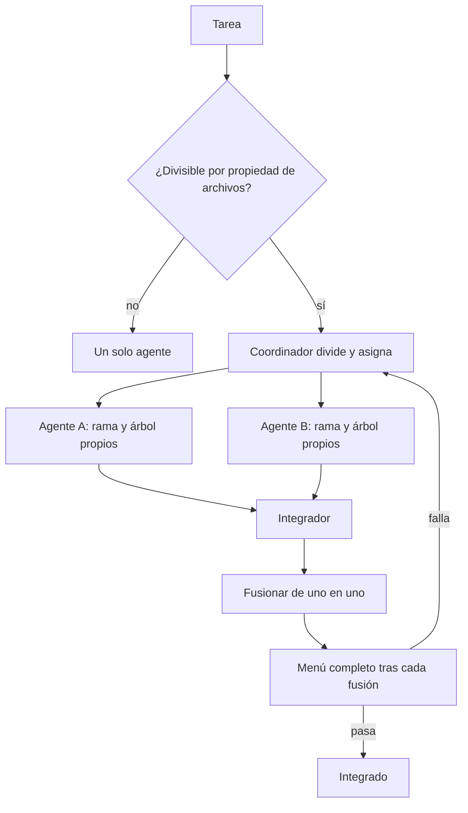
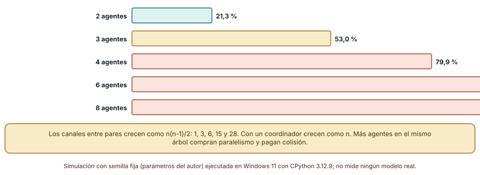
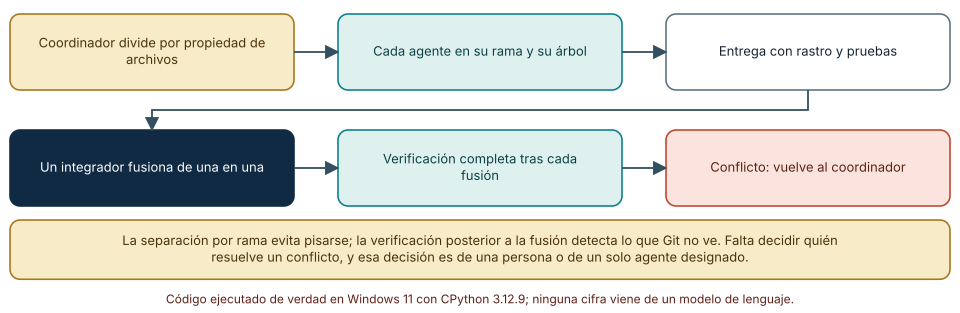

# SE-500 — Multiagente y coordinación dentro del harness

[← SE-499 — Verificación, gates y menú único de validación](https://github.com/vladimiracunadev-create/modern-software-engineering-program/blob/main/classes/part-41-harness-y-agentic-engineering/se-499-verificacion-gates-y-menu-unico-de-validacion/README.md) · [↑ Parte 41](https://github.com/vladimiracunadev-create/modern-software-engineering-program/blob/main/classes/part-41-harness-y-agentic-engineering/README.md) · [📚 Índice completo](https://github.com/vladimiracunadev-create/modern-software-engineering-program/blob/main/classes/README.md) · [🌐 Portal](https://vladimiracunadev-create.github.io/modern-software-engineering-program/classes/SE-500.html) · [SE-501 — Observabilidad y evals del propio harness →](https://github.com/vladimiracunadev-create/modern-software-engineering-program/blob/main/classes/part-41-harness-y-agentic-engineering/se-501-observabilidad-y-evals-del-propio-harness/README.md)

## Punto profesional y fundamento pedagógico

**Punto profesional.** La clase existe para que decidas cuándo añadir un segundo agente y cómo coordinarlo sin multiplicar los fallos. Más agentes prometen paralelismo y especialización; también multiplican los puntos de contacto: dos agentes que editan los mismos archivos se pisan, dos que parten de supuestos distintos producen piezas que no encajan, y cada canal de comunicación es un lugar donde se pierde contexto. La decisión profesional es un **diseño de coordinación**: qué se divide (por propiedad de archivos o módulos), cómo se aísla cada trabajo (ramas y árboles de trabajo), quién integra y qué se verifica *después* de integrar.

**Por qué aparece aquí.** Sigue al menú de validación (`SE-499`) porque multiplicar agentes sin un oráculo que verifique la integración multiplica el riesgo. Precede a la observabilidad (`SE-501`): con varios agentes, sin trazas es imposible saber qué hizo cada uno.

**Error conceptual que debe corregir.** Creer que dos agentes terminan en la mitad de tiempo y que una fusión de Git sin conflicto es una integración correcta. En el experimento, un agente renombra una función y otro añade un uso de la función con el nombre antiguo; Git fusiona sin conflicto, y las pruebas fallan. El conflicto textual es el caso fácil; el semántico no lo ve ninguna herramienta de fusión.

**Secuencia de aprendizaje.** Antes de ejecutar, predices cuántos de cuatro escenarios de dos agentes terminan en conflicto y cuántos fusiones limpias pasan las pruebas; después ejecutas cuatro fusiones reales de Git, simulas cuántas veces coinciden agentes en algún archivo y diseñas la coordinación mínima para tu harness.

**Evidencia de aprendizaje.** `coordinacion-multiagente.md` con la decisión de si un segundo agente se justifica, la división por propiedad, el aislamiento por rama, el integrador y las compuertas posteriores a la fusión.

**Límite de la conclusión.** Los cuatro escenarios son del autor, las ramas las crea el laboratorio con Git local y los «agentes» son ediciones guionizadas; la simulación de solapamiento usa 40 archivos y 3 por tarea, parámetros del autor. No se midió ningún sistema multiagente real ni su eficacia frente a un solo agente.

### Trazabilidad fuente → afirmación

| Fuente primaria u oficial | Afirmación que respalda | Lo que no prueba |
|---|---|---|
| [Anthropic, «How we built our multi-agent research system»](https://www.anthropic.com/engineering/multi-agent-research-system) | Describe un sistema con un agente líder que coordina subagentes en paralelo y discute sus compromisos de costo y coordinación. | Es un caso de investigación, no de ingeniería de código. |
| [Cognition, «Don't Build Multi-Agents»](https://cognition.ai/blog/dont-build-multi-agents) | Argumenta que compartir contexto y decisiones entre agentes es difícil y que decisiones implícitas en conflicto producen resultados frágiles. | Es una posición de un equipo, no una medición. |
| [Anthropic, «Building effective agents»](https://www.anthropic.com/engineering/building-effective-agents) | Recomienda empezar con la solución más simple y añadir complejidad solo cuando mejora el resultado. | No fija cuándo conviene un segundo agente. |
| [Git: `git-worktree`](https://git-scm.com/docs/git-worktree) | Documenta árboles de trabajo múltiples vinculados a un repositorio. | No evita conflictos semánticos. |
| [Git: `git-merge`](https://git-scm.com/docs/git-merge) | Documenta cuándo una fusión termina limpia o con conflicto. | No dice si el resultado es correcto. |

## Antes de empezar

Recupera lo aprendido en `SE-499`: el menú decide si un cambio se acepta. La pregunta activa es: **si dos agentes trabajaran hoy a la vez en tu repositorio, ¿qué comprobación te diría que sus dos cambios, correctos por separado, siguen siéndolo juntos?**

## Prerrequisitos

- Haber completado `SE-493` a `SE-499`.
- Manejar ramas y fusiones de Git; conocer qué es un conflicto de fusión.
- Python 3.11 o posterior y Git instalado.

## Problema auténtico

El equipo lanza dos agentes: uno modernizará el módulo de cálculo de fechas y otro añadirá una función de reportes. Cada uno entrega una rama con sus pruebas en verde. Al fusionar, Git no marca ningún conflicto y la integración continua falla: el primer agente renombró una función que el segundo usa por su nombre antiguo. Ambos habían trabajado bien con lo que veían, y ninguno veía lo que hacía el otro.

La clase reproduce cuatro situaciones con ramas reales (archivos distintos, mismo archivo en zonas lejanas, mismas líneas y un renombre con un uso concurrente) y simula cuántas veces coincidirían dos a ocho agentes en algún archivo. La conclusión no es «no uses varios agentes», sino cuándo el paralelismo compensa y qué coordinación mínima necesita.

## Objetivos observables

Al terminar podrás:

1. decidir si una tarea justifica más de un agente según su divisibilidad y su costo de coordinación;
2. dividir el trabajo por propiedad de archivos o módulos y aislar cada agente en una rama o árbol de trabajo;
3. distinguir conflictos textuales de semánticos y diseñar la verificación posterior a la fusión;
4. calcular cómo crece el número de canales de comunicación con el número de agentes;
5. escribir las reglas de un integrador único y de resolución de conflictos.

## Mapa conceptual

El mapa tiene una decisión inicial (¿divisible?) y un lazo final (la verificación tras cada fusión devuelve al coordinador). El integrador es un nodo único: la fusión se hace de uno en uno para saber cuál la rompió.

## Temas y por qué importan

| Tema | Por qué cambia una decisión profesional | Evidencia mínima |
|---|---|---|
| Cuándo un segundo agente se justifica | El paralelismo tiene costo de coordinación. | Decisión escrita con la división |
| Propiedad de archivos | Evita que dos agentes editen lo mismo. | Mapa de archivos por agente |
| Aislamiento por rama y árbol | Cada agente trabaja sobre su copia. | Ramas o árboles de trabajo |
| Conflicto textual y semántico | La fusión limpia no es una integración correcta. | Pruebas tras fusionar |
| Canales de comunicación | Crecen como n(n−1)/2 entre pares. | Cuenta de canales |
| Integrador único | Alguien decide el orden y resuelve los conflictos. | Reglas del integrador |

## Conceptos y decisiones

### 1. Cuándo no usar más de un agente

Anthropic recomienda empezar con la solución más simple y añadir complejidad solo cuando mejora el resultado. Cognition va más lejos y sostiene que, con la tecnología actual, repartir una tarea entre agentes que no comparten contexto produce decisiones implícitas que se contradicen. La posición razonable es condicional: un segundo agente se justifica si la tarea se divide en partes con interfaces claras y poco acopladas, si el beneficio (tiempo, especialización) supera el costo de coordinar y si hay una verificación que valide la integración. En una tarea con mucho acoplamiento, lo más seguro es un solo agente con un bucle más largo.

### 2. Propiedad de archivos: dividir para no pisarse

La forma más eficaz de evitar conflictos es no producirlos: asignar a cada agente un conjunto de archivos o módulos de los que es propietario y prohibir a los demás modificarlos. Si una tarea exige tocar un archivo ajeno, se pide al propietario (o al coordinador) y se registra. La simulación muestra por qué es necesario: con 40 archivos y 3 por tarea, la probabilidad de que dos agentes toquen algún archivo en común es del 21,3 %; con cuatro agentes, 79,9 %; con seis, 98,4 %. Sin un reparto explícito, a partir de cuatro agentes el choque es lo normal.

### 3. Aislamiento por rama y árbol de trabajo

Cada agente trabaja en su propia rama y, si comparten máquina, en su propio árbol de trabajo (`git worktree`), de modo que los archivos en disco no se pisen mientras trabajan. El aislamiento evita la interferencia en tiempo real; no evita el conflicto en la integración. Es la misma idea que el entorno desechable de `SE-498` aplicada a la coordinación.

### 4. Conflicto textual y conflicto semántico

Un **conflicto textual** ocurre cuando dos ramas modifican las mismas líneas: Git lo detecta y obliga a decidir. En el experimento, «mismas líneas» termina en conflicto, y es el caso bien resuelto por la herramienta. Un **conflicto semántico** ocurre cuando los cambios son compatibles para Git e incompatibles para el programa: un renombre y un uso del nombre antiguo, un cambio de firma y una llamada con la firma anterior, dos funciones que asumen invariantes opuestos. En el experimento, esa fusión es limpia y las pruebas fallan. La defensa es ejecutar el menú completo (`SE-499`) después de cada fusión, no solo en cada rama.

### 5. El costo de comunicar

Si cada agente debe estar al tanto de lo que hacen los demás, el número de canales entre pares crece como n(n−1)/2: 1, 3, 6, 15 y 28 para 2, 3, 4, 6 y 8 agentes. Un coordinador central lo reduce a n, a costa de convertirse en el cuello de botella y en el único punto que debe entender el conjunto. El sistema de investigación de Anthropic usa un agente líder que reparte trabajo a subagentes paralelos, y comenta los costos de ese diseño; la lección transferible es que la coordinación es trabajo y que se diseña.

### 6. El integrador único

La fusión se hace de uno en uno por un integrador (una persona o un agente designado) con una regla fija: fusionar una rama, ejecutar el menú completo, y solo si pasa fusionar la siguiente. Si falla, se sabe qué rama lo rompió y el trabajo vuelve al coordinador con la traza. El integrador es también quien resuelve los conflictos, o quien decide devolver la rama a su autor: tener varios resolviendo conflictos con criterios distintos reproduce el problema original.

## Cuatro fusiones y una simulación

Cada escenario crea un repositorio local con un módulo, un archivo de notas y una prueba; dos ramas parten del mismo commit y editan según el caso; después se fusionan y se ejecutan las pruebas si la fusión fue limpia. La simulación de solapamiento usa semilla 500 y 4 000 repeticiones por fila.

**Cómo leer la figura.** Cada fila es un escenario; «Fusión de Git» es lo que informa la herramienta y «Pruebas tras fusionar» lo que dice el oráculo. La última fila es la importante: limpia para Git, rota para el programa. **Dónde deja de valer:** cuatro escenarios construidos con ediciones guionizadas; Git decide con su algoritmo y su configuración por defecto, y otros algoritmos de fusión o herramientas darían resultados distintos en los casos límite.

**Cómo leer la figura.** Cada barra es la probabilidad de que al menos dos de los agentes elijan un mismo archivo, con 40 archivos y tres por tarea elegidos al azar. Sube rápido porque el número de pares crece con el cuadrado de los agentes. **Dónde deja de valer:** las tareas reales no eligen archivos al azar: se concentran en unos pocos archivos populares, lo que empeora el choque, o se reparten por módulos, lo que lo reduce.

**Cómo leer la figura.** Seis cajas definen tres roles (coordinador, agentes con aislamiento, integrador) y el lazo de vuelta cuando una verificación falla. **Dónde deja de valer:** es una coordinación centralizada, simple y con cuello de botella; en un proyecto con muchos agentes o con tareas que requieren negociar interfaces, hacen falta mecanismos adicionales que esta clase no cubre.

## Definiciones de trabajo

- **Propiedad de archivos:** asignación exclusiva de quién puede modificar cada archivo.
- **Árbol de trabajo (`worktree`):** copia de trabajo adicional del mismo repositorio.
- **Conflicto textual:** dos ramas modifican las mismas líneas.
- **Conflicto semántico:** cambios compatibles para la fusión e incompatibles para el programa.
- **Integrador:** quien fusiona las ramas y ejecuta la verificación.
- **Canal de coordinación:** vía por la que dos agentes se comunican.

## Ejemplo mínimo

Dos agentes parten de la rama principal. El agente A renombra `calc` como `sumar`; el agente B cambia `f5` para que llame a `calc(4)`. Las dos ramas pasan sus pruebas. Tras fusionar B en A, `git merge` informa «Merge made by the 'ort' strategy» (fusión limpia), y la prueba de `f5` falla con `NameError: name 'calc' is not defined`. La compuerta posterior a la fusión es lo único que lo vio.

## Ejemplo profesional

*Escenario ilustrativo: las cifras y los resultados que aparecen en este ejemplo son supuestos de la narración, no mediciones.*

El equipo prueba tres agentes en un refactor de módulos: uno sobre el paquete de fechas, otro sobre el de reportes y otro sobre las pruebas de integración. Define la propiedad por carpeta y un integrador. En la primera semana ocurren dos hechos. Dos veces un agente necesita un cambio en una carpeta ajena y lo pide al coordinador, que lo reparte; el costo es una espera. Una vez, la fusión de las carpetas de fechas y de reportes pasa limpia y el menú falla porque reportes usaba una función con una firma cambiada. El equipo mide que el trabajo tardó un poco menos que con un solo agente y que dedicó más tiempo a coordinar que a escribir. Decide que, para refactores con interfaces claras, dos agentes compensan; para tres, aún no. La lección es que la decisión se toma con los costos de coordinación, no con el entusiasmo.

## Práctica guiada

1. Elige una tarea de tu proyecto y decide si se divide en partes con interfaces claras; escribe la división por propiedad de archivos.
2. Ejecuta `python scripts/experiments_part41_b.py 500` y compara las cuatro fusiones con tu predicción.
3. Crea dos ramas en un repositorio de prueba con un renombre y un uso concurrente y confirma que la fusión es limpia y las pruebas fallan.
4. Escribe las reglas del integrador (orden, verificación, qué hacer ante un fallo).
5. Calcula los canales entre pares para el número de agentes que tienes en mente.

## Ejercicios

1. **Básico.** Explica por qué «mismo archivo, zonas lejanas» se fusiona limpio y «mismas líneas» no.
2. **Intermedio.** Cambia en la simulación el número de archivos a 200 y mide cómo cambia la probabilidad de choque con 4 y 6 agentes; interpreta el resultado.
3. **Avanzado.** Diseña un conflicto semántico que no se detecte con las pruebas del proyecto y propón qué compuerta nueva lo atraparía.

## Reto verificable

Entrega `coordinacion-multiagente.md` con: la decisión sobre si se justifica un segundo agente (con la división propuesta), el mapa de propiedad, el aislamiento elegido, las reglas del integrador y una demostración reproducible de un conflicto semántico con la compuerta que lo detecta. Es válido si otra persona reproduce la demostración con tu script.

## Caso conductor

En el arnés de *Avisos* los agentes se reparten por carpetas: cálculo de fechas, envío y reportes. El integrador ejecuta el menú de `SE-499` tras cada fusión. En `SE-504` el harness mínimo usa un solo agente, pero su diseño admite este reparto, y la observabilidad de `SE-501` sirve para ver qué hizo cada uno.

## Preguntas frecuentes

### ¿Más agentes significan más rápido?

No necesariamente. El tiempo ahorrado en paralelo se paga en coordinación, integración y verificación, y si las partes están muy acopladas se paga más de lo que se ahorra. Se decide con una medición de tu caso, no con la expectativa.

### ¿Y si los agentes comparten contexto?

Reduce las decisiones implícitas en conflicto, que es el problema que señala Cognition, y lo paga en tamaño de contexto y en acoplamiento. No hay una respuesta general; el criterio es que lo que decida un agente y afecte a otro quede escrito donde ambos lo vean.

### ¿Un agente puede revisar a otro?

Puede, como un control más. Es inferencial y puede compartir sesgos con el revisado; no sustituye al menú ni a la revisión humana de lo de riesgo alto (`SE-502`).

### ¿Quién resuelve un conflicto?

El integrador, con una regla: devolver la rama al autor con la traza o resolver y registrar la decisión. Dos agentes resolviendo el mismo conflicto es el problema que se intentaba evitar.

## Fallo controlado y diagnóstico

**Fallo.** Tras fusionar dos ramas «limpias», la integración continua falla con un error de nombre en una función de reportes.

**Diagnóstico paso a paso.** (1) La fusión no marcó conflicto. (2) Las dos ramas pasaban sus pruebas por separado. (3) Una rama renombró la función que la otra usaba. (4) Ninguna prueba combinaba ambas piezas hasta la integración.

**Corrección.** Se añade el menú completo después de cada fusión en el flujo del integrador y se agrega una prueba de integración entre fechas y reportes. La lección es que cada agente verifica su parte y alguien debe verificar la suma.

## Errores comunes y cómo corregirlos

- **Dos agentes editando los mismos archivos.** Síntoma: conflictos frecuentes. Corrección: propiedad de archivos.
- **Confiar en la fusión limpia.** Síntoma: fallos en integración sin conflicto. Corrección: menú completo tras cada fusión.
- **Fusionar todo de golpe.** Síntoma: no se sabe qué rama rompió. Corrección: fusionar de una en una.
- **Más agentes por defecto.** Síntoma: se tarda más. Corrección: decidir con el acoplamiento y el costo de coordinación.
- **Varios resolviendo conflictos.** Síntoma: criterios contradictorios. Corrección: un integrador.

## Entorno y archivos clave

- `scripts/experiments_part41_b.py`: fusiones reales y simulación de solapamiento; se ejecuta con `python scripts/experiments_part41_b.py 500`.
- Git instalado; los repositorios se crean en directorios temporales y se eliminan.
- Solo la biblioteca estándar más Git.

## Seguridad, ética y accesibilidad

Cada agente adicional amplía la superficie de acción y las credenciales en juego: aplica a cada uno los permisos mínimos de `SE-495`. Un agente que revisa a otro no debe poder modificar el código que revisa. Ética: no presentes como trabajo humano el que hicieron agentes en paralelo si la organización o la licencia exigen declararlo. Las figuras son tablas, barras y diagramas con texto alternativo completo; ninguna información depende solo del color.

## Puente hacia el trabajo con agentes

Antes de lanzar dos agentes, escribe para cada uno el conjunto de archivos que posee, la interfaz que expone a los demás y el comando de verificación; el segundo agente recibe esa interfaz como dato, no como suposición. Exige que cada entrega incluya la traza y el resultado del menú, y ejecuta tú el menú tras cada fusión. El patrón que falla es lanzar agentes «para ir más rápido» sin definir quién integra.

## Transferencia

Aplica el análisis a la última tarea grande de tu equipo: ¿se podía dividir por propiedad? ¿cuántos archivos compartían las partes? ¿qué prueba habría atrapado un conflicto semántico? Si la respuesta a la primera es «no», el equipo ahorró dinero no usando más agentes.

## Evaluación y evidencia

| Criterio | Evidencia aceptable | Rechazo |
|---|---|---|
| Justificación | Decisión con acoplamiento y costo de coordinación | «Para ir más rápido» |
| División | Mapa de archivos por agente | «Cada uno hace su parte» |
| Aislamiento | Ramas o árboles de trabajo | Edición en el mismo directorio |
| Integración | Menú completo tras cada fusión | Prueba solo por rama |
| Límite | Conflicto semántico demostrado | Confiar en la fusión limpia |

## Fuentes

- Anthropic. [«How we built our multi-agent research system»](https://www.anthropic.com/engineering/multi-agent-research-system).
- Cognition. [«Don't Build Multi-Agents»](https://cognition.ai/blog/dont-build-multi-agents).
- Anthropic. [«Building effective agents»](https://www.anthropic.com/engineering/building-effective-agents).
- Git. [`git-worktree`](https://git-scm.com/docs/git-worktree) y [`git-merge`](https://git-scm.com/docs/git-merge).

## Límites y siguiente paso

Se ejecutaron cuatro fusiones con ramas reales de Git y una simulación de solapamiento con parámetros del autor, en Windows 11 con CPython 3.12.9 y Git 2.55. Los agentes son ediciones guionizadas: no se midió ningún sistema multiagente real ni su beneficio frente a un solo agente. El siguiente paso, `SE-501`, trata cómo saber qué hace el harness: trazas, métricas y evaluaciones del propio harness.

## Glosario

| Término | Definición breve |
|---|---|
| Propiedad de archivos | Asignación exclusiva de quién modifica qué |
| Árbol de trabajo | Copia de trabajo adicional del mismo repositorio |
| Conflicto textual | Dos ramas modifican las mismas líneas |
| Conflicto semántico | Compatible para la fusión, incompatible para el programa |
| Integrador | Quien fusiona y verifica |
| Canal de coordinación | Vía de comunicación entre dos agentes |
