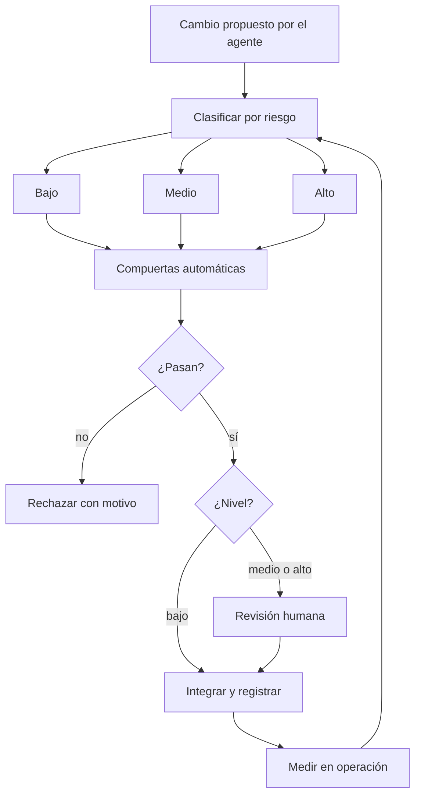
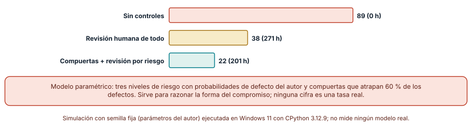

# SE-502 — AI-DLC, gobierno y vibe coding frente a agentic engineering

[← SE-501 — Observabilidad y evals del propio harness](https://github.com/vladimiracunadev-create/modern-software-engineering-program/blob/main/classes/part-41-harness-y-agentic-engineering/se-501-observabilidad-y-evals-del-propio-harness/README.md) · [↑ Parte 41](https://github.com/vladimiracunadev-create/modern-software-engineering-program/blob/main/classes/part-41-harness-y-agentic-engineering/README.md) · [📚 Índice completo](https://github.com/vladimiracunadev-create/modern-software-engineering-program/blob/main/classes/README.md) · [🌐 Portal](https://vladimiracunadev-create.github.io/modern-software-engineering-program/classes/SE-502.html) · [SE-503 — Taller: diagnosticar el fallo de un harness →](https://github.com/vladimiracunadev-create/modern-software-engineering-program/blob/main/classes/part-41-harness-y-agentic-engineering/se-503-taller-diagnosticar-el-fallo-de-un-harness/README.md)

## Punto profesional y fundamento pedagógico

**Punto profesional.** La clase existe para que puedas explicar a una organización qué significa trabajar con agentes *con gobierno* y qué lo separa del *vibe coding*. Hasta aquí el curso trató controles técnicos del harness: instrucciones, permisos, contexto, parada, sandbox, compuertas, coordinación, trazas. Gobernar es decidir **cuánto control exige cada cambio** según su riesgo, quién aprueba qué, qué queda registrado y cómo se mide el resultado. La diferencia entre desarrollo asistido sin gobierno y agentic engineering no es la herramienta: es que el segundo declara qué se verifica, qué se revisa y quién responde.

**Por qué aparece aquí.** Sigue a la observabilidad y las evaluaciones (`SE-501`), que dan los datos para gobernar, y precede al taller (`SE-503`) y al proyecto (`SE-504`), que integran todo. Retoma la política de equipo de `SE-492` y la lleva al contexto de agentes.

**Error conceptual que debe corregir.** Creer que gobernar es revisar todo o prohibir. En el modelo paramétrico de la clase, revisar todo cada cambio con un revisor humano deja escapar 38 defectos por cada mil cambios con 271 horas de revisión; un esquema con compuertas automáticas y revisión solo de lo de riesgo medio y alto deja escapar 22 con 201 horas. Revisar más no es controlar mejor: el control se concentra donde el riesgo es mayor.

**Secuencia de aprendizaje.** Antes de ejecutar, predices qué modo (sin controles, revisión total, compuertas con revisión por riesgo) deja escapar menos defectos y a qué costo en horas; después clasificas doce cambios con reglas deterministas, ejecutas el modelo de tres modos y escribes una política de gobierno de una página.

**Evidencia de aprendizaje.** `gobierno-de-agentes.md` con la clasificación de riesgo (reglas y casos), la evidencia exigida por nivel, las aprobaciones humanas, el registro de decisiones y la métrica con la que se revisará la política.

**Límite de la conclusión.** El modelo usa tres niveles de riesgo con probabilidades de defecto del autor, compuertas que atrapan 60 % y revisores que atrapan 55 %; son supuestos, no tasas medidas. La clasificación por rutas es una regla del autor. No se midió ninguna organización ni la eficacia de ningún marco de gobierno, y las menciones a AI-DLC, NIST AI RMF y *vibe coding* describen lo que dicen sus fuentes. No se invocó ningún modelo.

### Trazabilidad fuente → afirmación

| Fuente primaria u oficial | Afirmación que respalda | Lo que no prueba |
|---|---|---|
| [AWS, «Open-Sourcing Adaptive Workflows for AI-DLC»](https://aws.amazon.com/blogs/devops/open-sourcing-adaptive-workflows-for-ai-driven-development-life-cycle-ai-dlc/) | Presenta AI-DLC como un flujo con fases Inception, Construction y Operations, profundidad adaptable y puntos de aprobación humana con trazabilidad de extremo a extremo. | No mide su efecto en productividad ni en calidad. |
| [Willison, «Not all AI-assisted programming is vibe coding»](https://simonwillison.net/2025/Mar/19/vibe-coding/) | Propone distinguir el uso de un modelo como asistente cuyo código se revisa y entiende del *vibe coding*, donde no se revisa. | Es una posición personal, no una definición normativa. |
| [NIST, AI Risk Management Framework](https://www.nist.gov/itl/ai-risk-management-framework) | Organiza la gestión de riesgos de IA en funciones de gobierno, mapeo, medición y gestión. | No es específico de desarrollo de software con agentes. |
| [OWASP, «LLM06:2025 Excessive Agency»](https://genai.owasp.org/llmrisk/llm062025-excessive-agency/) | Recomienda limitar autonomía y exigir aprobación humana para acciones de alto impacto. | No define niveles de riesgo de un cambio de código. |
| [Böckeler, «Harness engineering»](https://martinfowler.com/articles/exploring-gen-ai/harness-engineering.html) | Plantea el papel de la persona como quien dirige y mejora el harness a partir de los fallos. | No es una norma de gobierno. |

## Antes de empezar

Recupera lo aprendido en `SE-492`: una política asigna menos evidencia a lo de bajo riesgo y más a lo de alto. La pregunta activa es: **si mañana un agente integrara un cambio en tu repositorio sin que nadie lo mirara, ¿cuál sería el peor cambio que podría pasar y qué lo habría detenido?**

## Prerrequisitos

- Haber completado `SE-492` y `SE-493` a `SE-501`.
- Conocer qué es una aprobación de cambios y un registro de decisiones.
- Python 3.11 o posterior; solo la biblioteca estándar.

## Problema auténtico

Dos equipos usan asistentes de código. El primero acepta lo que el asistente propone si «parece bien»; el segundo, con el mismo asistente, clasifica cada cambio por riesgo, exige el menú completo para todos, revisión humana para los de riesgo medio y alto y un registro de quién aprobó qué. Tras un trimestre, el primero ha ido más rápido y ha tenido dos incidentes en producción; el segundo, más lento en los cambios riesgosos y sin incidentes. Nadie puede decir si la diferencia viene del gobierno o de la suerte, pero ambos equipos pueden decir qué harían distinto.

La clase no promete cifras reales. Ofrece una clasificación determinista de riesgo, un modelo explícito de costos y defectos que escapan, y una política escrita que se puede revisar con datos propios (`SE-501`).

## Objetivos observables

Al terminar podrás:

1. clasificar cambios por riesgo con reglas deterministas sobre rutas, tamaño y dependencias, y declarar cómo pueden eludirse;
2. asignar evidencia y aprobación por nivel de riesgo, con la revisión humana donde más rinde;
3. explicar con qué criterio una organización distingue *vibe coding* de ingeniería agéntica: qué se verifica, qué se revisa y quién responde;
4. describir AI-DLC y el marco de gestión de riesgos de NIST sin atribuirles resultados que sus fuentes no miden;
5. escribir una política de gobierno de una página con el registro de decisiones y la métrica de revisión.

## Mapa conceptual



El mapa es un embudo con dos puertas: las compuertas automáticas para todos y la revisión humana para lo medio y alto. El lazo final (medir en operación) devuelve información a la clasificación: una política se ajusta con lo que escapó.

## Temas y por qué importan

| Tema | Por qué cambia una decisión profesional | Evidencia mínima |
|---|---|---|
| Clasificación de riesgo | Decide cuánto control recibe cada cambio. | Reglas y casos de prueba |
| Evidencia por nivel | Evita revisar todo igual. | Tabla nivel → evidencia |
| Aprobación humana | Concentra la atención donde el costo del error es mayor. | Quién aprueba cada nivel |
| *Vibe coding* frente a agentic engineering | Separa uso sin revisión de uso verificado. | Criterio escrito |
| AI-DLC | Un flujo con fases, profundidad adaptable y aprobaciones. | Descripción con límites |
| Registro y medición | Sin ellos la política no se corrige. | Registro de decisiones y métrica |

## Conceptos y decisiones

### 1. Gobierno es proporcionalidad

Gobernar el desarrollo con agentes es decidir cuánto control reciben distintos cambios. La proporcionalidad es la idea central de los marcos de riesgo: NIST organiza la gestión del riesgo de IA en funciones (gobernar, mapear, medir y gestionar) y su valor para esta clase es la secuencia, no el catálogo: se define quién decide, se identifica qué puede salir mal, se mide y se actúa. OWASP, por su parte, recomienda limitar la autonomía de un agente y exigir aprobación humana para acciones de alto impacto. Ambos coinciden en la forma: más control donde el daño potencial es mayor.

### 2. Clasificar el riesgo con reglas

Una clasificación determinista usa señales que un programa puede leer: qué rutas toca (`.github/`, `infra/`, `auth/` y `migrations/` son de riesgo alto; documentación, de bajo), cuántas líneas cambia, si modifica dependencias, si toca código sin tocar pruebas. En el ejemplo, de doce cambios, cuatro son de riesgo bajo, cuatro medio y cuatro alto. Las reglas son baratas, auditables y reproducibles; también son eludibles: un cambio peligroso en una ruta que no figura en la lista se clasifica bajo. Se complementan con la revisión humana de las propias reglas y con reglas conservadoras (ante la duda, el nivel superior).

### 3. Evidencia y aprobación por nivel

Para cada nivel se define una evidencia mínima y una aprobación. Por ejemplo: bajo, el menú completo en verde (`SE-499`) y registro; medio, el menú completo, la traza de la sesión y una revisión humana del cambio; alto, todo lo anterior, una segunda persona, y un plan de reversión (`SE-498`). La evidencia sube de nivel en nivel y la aprobación humana se concentra donde importa. En el modelo de la clase, esa concentración recorta el trabajo de revisión de 271 a 201 horas por mil cambios y reduce los defectos que escapan de 38 a 22 porque las compuertas automáticas cubren a todos.

### 4. *Vibe coding* y agentic engineering

Willison propone reservar *vibe coding* para el uso de un modelo en que no se revisa el código, y llamar de otra forma al uso en que el código se revisa, prueba y entiende. Adoptemos esa distinción como criterio operativo: la diferencia no es qué herramienta se usa, sino qué se verifica, qué se revisa y quién responde. El *vibe coding* es razonable para prototipos desechables donde nadie depende del resultado; es un problema cuando lo que se produce entra en un sistema que otros usan sin que nadie haya verificado ni entendido el código. La ingeniería agéntica declara lo contrario: cada cambio pasa por compuertas, y los de riesgo tienen una persona que lo entiende y firma.

### 5. AI-DLC como ejemplo de flujo gobernado

AWS publicó AI-DLC (AI-Driven Development Life Cycle) como un flujo que parte de una intención del desarrollador y organiza el trabajo en tres fases (Inception, Construction y Operations), con la profundidad de cada etapa adaptada al problema, aprobaciones humanas en los puntos de decisión y trazabilidad de artefactos, decisiones y conversaciones. Es un ejemplo de un flujo con control proporcional y registro de decisiones. La fuente es una publicación del proveedor que presenta el diseño y no mide su efecto en productividad ni en calidad; se estudia como forma de organizar el gobierno, no como evidencia de que funcione.

### 6. Registro y revisión de la política

Una política que nadie mide no se corrige. Se registra, para cada cambio integrado, el nivel de riesgo asignado, la evidencia presentada y quién aprobó; se mide cuántos defectos escaparon por nivel (incidentes, reversiones) y cuántas horas de revisión se gastaron. Con esos datos se ajustan las reglas: un defecto en un cambio de riesgo bajo es un caso nuevo para el clasificador. Es el mismo ciclo de `SE-501` aplicado a la política en vez de al harness.

## Una clasificación y un modelo de tres modos

La clasificación es determinista, con reglas sobre rutas, tamaño y dependencias, y se aplicó a doce cambios del autor. El modelo paramétrico usa 20 000 cambios con semilla 502: probabilidades de nivel 70 %, 25 % y 5 %; de defecto 5 %, 15 % y 35 %; compuertas que atrapan 60 % y revisión humana que atrapa 55 %.


**Cómo leer la figura.** Cada columna es un nivel de riesgo y contiene los cambios que las reglas le asignan, de bajo a alto. Mira primero qué rutas llevan al riesgo alto (workflow, autenticación, migración) y que una ruta fuera de la lista caería en el nivel bajo. **Dónde deja de valer:** las reglas son del autor y no han visto cambios adversos; un cambio de riesgo alto escrito en una ruta no listada pasa como bajo. La revisión humana de las reglas es parte de la política.



**Cómo leer la figura.** Cada barra es un modo de trabajo; el rótulo añade las horas de revisión por mil cambios. El tercero escapa menos y cuesta menos horas que el segundo porque las compuertas automáticas cubren a todos y la revisión humana se concentra donde la probabilidad de defecto es mayor. **Dónde deja de valer:** el resultado es consecuencia de los parámetros; con compuertas que atrapan 20 %, la ventaja del tercer modo casi desaparece. La figura enseña cómo razonar el compromiso, no qué valores tiene.


**Cómo leer la figura.** Seis cajas recorren el ciclo: acordar el alcance, construir con compuertas, clasificar, decidir el nivel de control y registrar y medir. **Dónde deja de valer:** es una simplificación común a varios flujos, entre ellos AI-DLC; no reproduce sus etapas ni su vocabulario, y no sustituye la lectura de su documentación.

## Definiciones de trabajo

- **Gobierno:** conjunto de decisiones sobre quién aprueba qué y con qué evidencia.
- **Nivel de riesgo:** categoría del cambio según el daño potencial.
- **Proporcionalidad:** más control donde el daño potencial es mayor.
- ***Vibe coding*:** uso de un modelo para generar código sin revisarlo ni entenderlo.
- **Agentic engineering:** desarrollo con agentes bajo compuertas, revisión por riesgo y registro.
- **Registro de decisiones:** historial de quién aprobó qué, con qué evidencia.

## Ejemplo mínimo

Una clasificación de riesgo por rutas en pocas líneas:

```python
def nivel(rutas: list[str], lineas: int, toca_dependencias: bool) -> str:
    if any(r.startswith((".github/", "infra/", "auth/", "migrations/")) for r in rutas):
        return "alto"
    sin_prueba = any(r.startswith("src/") for r in rutas) and not any(r.startswith("tests/") for r in rutas)
    if toca_dependencias or lineas > 300 or sin_prueba:
        return "medio"
    return "bajo"
```

Con `[".github/workflows/ci.yml"]` devuelve `alto`; con `["src/a.py"]` sin prueba, `medio`; con `["docs/guia.md"]`, `bajo`. Las reglas se prueban con casos como cualquier otra regla mecánica (`SE-494`).

## Ejemplo profesional

*Escenario ilustrativo: las cifras y los resultados que aparecen en este ejemplo son supuestos de la narración, no mediciones.*

El equipo escribe su política en una página: tres niveles, la evidencia y la aprobación de cada uno, y la regla de que ningún cambio de riesgo alto se integra sin dos personas y un plan de reversión. Al segundo mes registra un incidente en un cambio clasificado como bajo: una modificación de documentación que alteraba un archivo de configuración incluido en el sitio. Añade la regla («los archivos incluidos en el sitio se tratan como medios») y el caso al conjunto de pruebas del clasificador. La política es otra pieza del harness que se mide y se corrige. Lo que el equipo no puede afirmar es qué parte de la reducción de incidentes se debe a la política y qué parte a que el asistente mejoró.

## Práctica guiada

1. Clasifica por riesgo los últimos veinte cambios de tu repositorio con reglas escritas, y revisa tres que clasificaste distinto a mano.
2. Define la evidencia y la aprobación de cada nivel.
3. Ejecuta `python scripts/experiments_part41_b.py 502` y cambia los parámetros del modelo para ver cuándo deja de convenir el tercer modo.
4. Escribe la política de una página con el registro y la métrica.
5. Elige un caso donde el *vibe coding* sea aceptable en tu organización y escribe el criterio que lo permite.

## Ejercicios

1. **Básico.** Explica por qué la revisión humana de todo deja escapar más defectos que las compuertas con revisión por riesgo en este modelo.
2. **Intermedio.** Cambia la eficacia de las compuertas de 60 % a 30 % y describe qué pasa con la ventaja del tercer modo.
3. **Avanzado.** Propón tres reglas de clasificación que un agente podría eludir sin mala fe y cómo las endurecerías.

## Reto verificable

Entrega `gobierno-de-agentes.md` con: la clasificación de riesgo con sus reglas y al menos diez casos de prueba, la tabla de evidencia y aprobación por nivel, el criterio para distinguir *vibe coding* de ingeniería agéntica, el registro de decisiones y la métrica con que se revisará la política. Es válido si otra persona clasifica los mismos cambios con tus reglas y obtiene los mismos niveles.

## Caso conductor

La política de *Avisos* extiende a agentes la de `SE-492`: los cambios del asistente se clasifican por riesgo, pasan el menú de `SE-499` y se revisan según el nivel. Sus reglas de clasificación viven en el repositorio y se prueban como las demás. La política es la entrada del proyecto de `SE-504`.

## Preguntas frecuentes

### ¿El *vibe coding* está prohibido?

No. Es una práctica legítima para prototipos desechables y exploración. El problema es dejar que entre sin verificación en algo que otros usan; la política declara dónde se permite y dónde no.

### ¿AI-DLC reemplaza a mi proceso?

No hay evidencia en la fuente de que lo haga mejor; es un flujo publicado por un proveedor, con ideas útiles (fases, profundidad adaptable, aprobaciones y trazabilidad). Se adaptan las ideas que encajan.

### ¿Quién responde si el agente se equivoca?

La persona o el equipo que aprobó la integración y la organización que lo desplegó. El agente no es responsable en ningún sentido jurídico ni profesional; la política debe nombrar a quien responde por cada nivel.

### ¿Hay que medir la productividad?

Medir tiempos y horas de revisión es útil para ajustar la política; atribuirlos a individuos o compararlos sin control es engañoso. Esta clase no midió productividad.

## Fallo controlado y diagnóstico

**Fallo.** Un cambio de dependencias entra clasificado como medio, con revisión humana, y llega a producción con una versión vulnerable de una biblioteca.

**Diagnóstico paso a paso.** (1) El clasificador detectó el cambio de dependencias y asignó riesgo medio. (2) La revisión humana verificó que las pruebas pasaban y el código funcionaba. (3) Nadie consultó una base de vulnerabilidades. (4) La causa es que la evidencia exigida para ese nivel no incluía un análisis de dependencias.

**Corrección.** Se añade al menú una compuerta de dependencias y se sube de nivel el cambio que las toca. La lección es que un nivel de riesgo se define por la evidencia que exige, y que una política se corrige con sus incidentes.

## Errores comunes y cómo corregirlos

- **Revisar todo igual.** Síntoma: fatiga y revisiones superficiales. Corrección: concentrar la revisión por riesgo.
- **Clasificar solo por tamaño.** Síntoma: cambios pequeños y peligrosos que pasan. Corrección: rutas y tipo de cambio.
- **Una política sin registro.** Síntoma: no se puede corregir. Corrección: registrar nivel, evidencia y aprobador.
- **Llamar *vibe coding* a todo uso de agentes.** Síntoma: debates sin criterio. Corrección: definir por verificación y revisión.
- **Atribuir resultados a un marco sin evidencia.** Síntoma: «AI-DLC redujo los incidentes». Corrección: separar descripción de medición.

## Entorno y archivos clave

- `scripts/experiments_part41_b.py`: clasificación y modelo de tres modos; se ejecuta con `python scripts/experiments_part41_b.py 502`.
- `AGENTS.md` y `docs/PEDAGOGICAL-STANDARD.md` de este repositorio: ejemplo de reglas de gobierno con validadores.
- Semilla fija 502; 20 000 cambios.
- Solo la biblioteca estándar.

## Seguridad, ética y accesibilidad

Una política de gobierno debe nombrar a quien responde por cada nivel; diluir la responsabilidad en «el agente» es un error ético y, a menudo, legal. Los registros de decisiones pueden contener datos de personas; trátalos con las reglas de acceso del proyecto. Las exigencias regulatorias (por ejemplo, sobre sistemas de IA) dependen de la jurisdicción y del uso; esta clase no las cubre ni las interpreta. Las figuras son tablas, barras y diagramas con texto alternativo completo; ninguna información depende solo del color.

## Puente hacia el trabajo con agentes

Dile al agente el nivel de riesgo de su tarea y la evidencia que debe entregar, y exige que su resumen cite el resultado del menú y la traza; el nivel lo decide el harness, no el agente. Para cambios de nivel medio o alto, la persona revisora lee el diff, no el resumen del agente. El patrón que falla es aceptar el resumen del agente («todo verificado») sin la salida del menú, o dejar que el agente clasifique su propio cambio.

## Transferencia

Escribe la política de una página para tu equipo: tres niveles, las reglas que los clasifican, la evidencia por nivel, quién aprueba y qué se registra. Aplícala retroactivamente a los últimos treinta cambios y cuenta cuántos habrían recibido más o menos control del que tuvieron; los desajustes son la primera agenda de mejora.

## Evaluación y evidencia

| Criterio | Evidencia aceptable | Rechazo |
|---|---|---|
| Clasificación | Reglas con casos de prueba | «Depende del criterio» |
| Evidencia por nivel | Tabla nivel → evidencia y aprobador | Todo igual |
| *Vibe coding* | Criterio por verificación y revisión | Definición por herramienta |
| Descripción de marcos | Atribuida a su fuente con su límite | Resultados no medidos |
| Registro y métrica | Qué se registra y cómo se revisa | Sin medición |

## Fuentes

- AWS. [«Open-Sourcing Adaptive Workflows for AI-Driven Development Life Cycle (AI-DLC)»](https://aws.amazon.com/blogs/devops/open-sourcing-adaptive-workflows-for-ai-driven-development-life-cycle-ai-dlc/).
- Willison, S. [«Not all AI-assisted programming is vibe coding (but vibe coding rocks)»](https://simonwillison.net/2025/Mar/19/vibe-coding/).
- NIST. [AI Risk Management Framework](https://www.nist.gov/itl/ai-risk-management-framework).
- OWASP Gen AI Security Project. [«LLM06:2025 Excessive Agency»](https://genai.owasp.org/llmrisk/llm062025-excessive-agency/).
- Böckeler, B. [«Harness engineering for coding agent users»](https://martinfowler.com/articles/exploring-gen-ai/harness-engineering.html).

## Límites y siguiente paso

Se clasificaron doce cambios con reglas del autor y se simularon 20 000 con parámetros del autor y semilla 502, en Windows 11 con CPython 3.12.9. No se midió ninguna organización, ni el efecto de AI-DLC, ni la eficacia de ningún marco, ni la productividad. El siguiente paso, `SE-503`, es un taller: diagnosticar seis fallos inyectados en el harness a partir de su traza.

## Glosario

| Término | Definición breve |
|---|---|
| Gobierno | Decisiones sobre quién aprueba qué y con qué evidencia |
| Nivel de riesgo | Categoría del cambio según el daño potencial |
| Proporcionalidad | Más control donde el daño potencial es mayor |
| Vibe coding | Generar código con un modelo sin revisarlo ni entenderlo |
| Agentic engineering | Desarrollo con agentes bajo compuertas, revisión y registro |
| Registro de decisiones | Historial de quién aprobó qué con qué evidencia |
