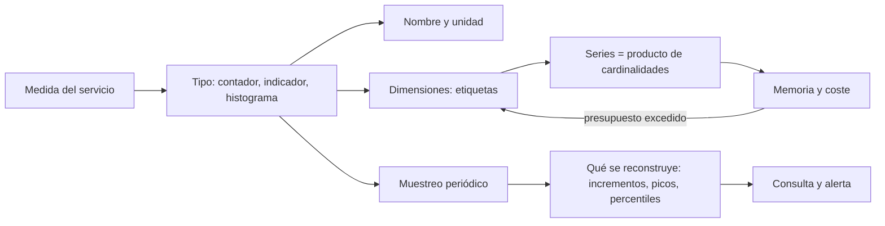
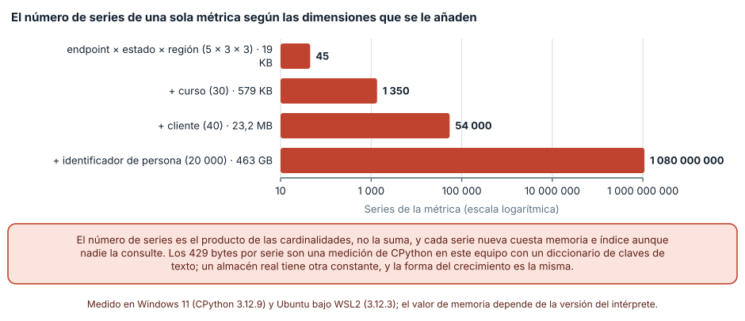
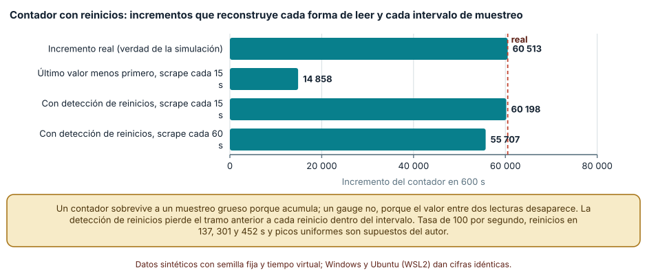

# SE-495 — Métricas, dimensiones y cardinalidad

[← SE-494 — Logs estructurados y correlación](https://github.com/vladimiracunadev-create/modern-software-engineering-program/blob/main/classes/part-41-observabilidad-sre-e-incidentes/se-494-logs-estructurados-y-correlacion/README.md) · [↑ Parte 41](https://github.com/vladimiracunadev-create/modern-software-engineering-program/blob/main/classes/part-41-observabilidad-sre-e-incidentes/README.md) · [📚 Índice completo](https://github.com/vladimiracunadev-create/modern-software-engineering-program/blob/main/classes/README.md) · [🌐 Portal](https://vladimiracunadev-create.github.io/modern-software-engineering-program/classes/SE-495.html) · [SE-496 — Trazas distribuidas y contexto →](https://github.com/vladimiracunadev-create/modern-software-engineering-program/blob/main/classes/part-41-observabilidad-sre-e-incidentes/se-496-trazas-distribuidas-y-contexto/README.md)

## Punto profesional y fundamento pedagógico

**Punto profesional.** La clase existe para que diseñes métricas que se puedan agregar, consultar y pagar: para que elijas el tipo correcto (contador, indicador o histograma), para que calcules cuántas series crea una dimensión antes de añadirla y para que sepas qué reconstruye un muestreo periódico y qué se le escapa. Una métrica mal diseñada falla en silencio: o cuesta una fortuna, o no muestra el pico que importaba.

**Por qué aparece aquí.** Sigue a **Logs estructurados y correlación**: los eventos conservan el detalle y son caros de consultar a escala; las métricas resumen y son baratas, a cambio de perder lo que no se previó como dimensión. Esta clase decide qué se resume y cómo. El caso conductor sigue siendo la API de entregas.

**Error conceptual que debe corregir.** Creer que añadir una etiqueta «cuesta una línea» y que un percentil mensual se calcula promediando los percentiles de cada servidor. Cada combinación de etiquetas es una serie nueva, y los percentiles solo se agregan con histogramas compatibles.

**Secuencia de aprendizaje.** Antes de ver los resultados predices cuántas series tiene una métrica al añadirle curso y cliente, cuánto de un contador con reinicios reconstruye una resta ingenua y con qué frecuencia se ve un pico de 20 segundos con un muestreo de 60. Después contrastas con tres experimentos y escribes el presupuesto de series de tu servicio. La secuencia usa predicción, explicación propia, contraste y recuperación. [ICAP](https://icap.education.asu.edu/research) distingue participación de construcción de conocimiento; [How People Learn II](https://nap.nationalacademies.org/catalog/24783/how-people-learn-ii-learners-contexts-and-cultures) respalda diseñar la práctica con contextos reales y retroalimentación.

**Evidencia de aprendizaje.** `metricas-log.md` con la predicción, las tres figuras reproducidas, un catálogo de las métricas de la API con tipo, unidad, dimensiones y presupuesto de series y una nota que separe lo medido de lo supuesto.

**Límite de la conclusión.** Los contadores, los picos y las latencias son sintéticos y con semilla fija. La memoria por serie (429 bytes) es una medición de CPython sobre un diccionario, no de un almacén real de métricas, y no se usó ningún sistema como Prometheus.

### Trazabilidad fuente → afirmación

| Fuente primaria u oficial | Afirmación que respalda | Lo que no prueba |
|---|---|---|
| [Prometheus: modelo de datos](https://prometheus.io/docs/concepts/data_model/) | Cada combinación única de nombre de métrica y etiquetas identifica una serie temporal. | No fija el límite de series que tu servidor soporta. |
| [Prometheus: tipos de métricas](https://prometheus.io/docs/concepts/metric_types/) | Define contador, indicador (gauge), histograma y resumen y el comportamiento ante reinicios. | No decide qué tipo corresponde a tu medida. |
| [Prometheus: nombres y etiquetas](https://prometheus.io/docs/practices/naming/) | Recomienda unidades base y avisa de que cada valor de etiqueta crea una serie nueva, por lo que no deben usarse para valores no acotados. | No lista tus dimensiones. |
| [Prometheus: histogramas y resúmenes](https://prometheus.io/docs/practices/histograms/) | Explica que los cuantiles de un histograma se estiman por interpolación dentro de la cubeta y que los de un resumen no se agregan. | No da la precisión de tu diseño de cubetas. |

## Antes de empezar

Recupera lo aprendido en `SE-494`: un evento conserva el detalle y cuesta almacenamiento. La pregunta activa es: **¿qué resumen numérico de la API de entregas cabe en un almacén de métricas, qué dimensiones puede llevar y qué pierde por el camino?**

## Prerrequisitos

- Haber completado `SE-494` o poder explicar qué es un campo de un registro estructurado.
- Python 3.11 o posterior; los experimentos usan solo la biblioteca estándar (`random`, `math`, `tracemalloc`).
- Nociones de percentil (`SE-436`) y de producto de cardinalidades.

## Problema auténtico

Para entender por qué las entregas fallan en un curso concreto, alguien añade la etiqueta `course_id` a la métrica de peticiones. Al día siguiente añade `tenant_id`. El panel funciona; una semana después el almacén de métricas llega al límite de memoria y descarta series al azar. Con un identificador de persona como etiqueta, que alguien propuso «por si acaso», habría necesitado mil millones de series. Por otra parte, el panel de CPU muestra siempre un 40 % y un servicio que se satura 20 segundos cada cinco minutos sigue pareciendo sano. Y el contador de entregas procesadas cae a cero cada vez que un trabajador se reinicia: el panel «entregas de la última hora» da cifras absurdas después de cada despliegue. Los tres problemas son una sola pregunta: ¿qué sobrevive a un resumen?

## Objetivos observables

Al terminar podrás:

1. elegir entre contador, indicador e histograma para una medida y justificarlo;
2. calcular el número de series de una métrica y su memoria estimada antes de añadir una dimensión;
3. reconstruir el incremento de un contador con reinicios y cuantificar lo que se pierde por intervalo de muestreo;
4. estimar con qué probabilidad un muestreo periódico ve un pico de cierta duración;
5. comparar cubetas de histograma por su error en p50, p95 y p99 y elegirlas según el objetivo.

## Mapa conceptual



El mapa separa el **tipo** (que decide qué operaciones son válidas), las **dimensiones** (que deciden el coste) y el **muestreo** (que decide qué se ve). El presupuesto de series cierra el ciclo y obliga a quitar etiquetas.

## Temas y por qué importan

| Tema | Por qué cambia una decisión profesional | Evidencia mínima |
|---|---|---|
| Tipos de métrica | El tipo decide qué se puede calcular sin error. | Predicción, traza causal y contraejemplo de **Tipos de métrica** en `metricas-log.md` |
| Dimensiones y cardinalidad | Cada etiqueta multiplica las series. | Predicción, traza causal y contraejemplo de **Dimensiones y cardinalidad** en `metricas-log.md` |
| Contadores y reinicios | Un contador reiniciado engaña a una resta simple. | Predicción, traza causal y contraejemplo de **Contadores y reinicios** en `metricas-log.md` |
| Muestreo y picos | Un indicador muestreado cada minuto no ve lo que dura segundos. | Predicción, traza causal y contraejemplo de **Muestreo y picos** en `metricas-log.md` |
| Histogramas y cuantiles | El diseño de cubetas fija el error del percentil. | Predicción, traza causal y contraejemplo de **Histogramas y cuantiles** en `metricas-log.md` |

## Conceptos y decisiones

### 1. Tipos de métrica

Un **contador** solo crece (peticiones atendidas, errores) y vuelve a cero al reiniciarse el proceso; su valor absoluto no importa, sí su incremento en un intervalo, de ahí que se consulte como tasa. Un **indicador** (gauge) sube y baja y mide un estado instantáneo (conexiones abiertas, memoria usada, longitud de una cola); no se puede reconstruir lo que ocurrió entre dos lecturas. Un **histograma** cuenta observaciones en cubetas de límites fijos (≤ 100 ms, ≤ 250 ms…) y permite estimar percentiles y agregar entre instancias sumando contadores de cubeta. Un **resumen** calcula cuantiles en el proceso y es exacto allí, pero no se puede agregar entre procesos. El tipo importa porque define qué operaciones son válidas: sumar contadores de varios servidores es correcto; promediar sus p99 no lo es (`SE-436`).

### 2. Nombres, unidades y etiquetas

Una métrica lleva un nombre que dice qué mide y en qué unidad (`entregas_recibidas_total`, `entregas_duracion_segundos`). Se usan unidades base (segundos, bytes) para que dos equipos no mezclen milisegundos con segundos, y el sufijo `_total` para los contadores. Las **etiquetas** (dimensiones) permiten cortar la métrica por endpoint, estado, región o versión. Una buena etiqueta tiene pocos valores posibles, conocidos y estables. Una mala etiqueta tiene valores abiertos o sin cota (un identificador de usuario, una URL completa con parámetros, un mensaje de error): cada valor nuevo crea una serie nueva que se queda en memoria.

### 3. Dimensiones y cardinalidad

El número de series de una métrica es el producto de las cardinalidades de sus etiquetas, no la suma. Con endpoint (5), estado (3) y región (3), son 45. Añadir curso (30) multiplica por 30 y deja 1 350; añadir cliente (40) deja 54 000; añadir un identificador de persona con 20 000 valores deja 1 080 millones. La memoria es proporcional: con 429 bytes por serie en la medición, 54 000 series son unos 23 MB y 1 080 millones serían 463 GB. Cada serie existe aunque nadie la consulte, y el coste aparece como lentitud de las consultas, memoria y, al final, series descartadas. La respuesta de diseño no es evitar dimensiones, sino presupuestarlas: cada métrica declara su máximo de series y una prueba lo comprueba en integración.

### Explosión de series

Se calcula el número de series con cuatro escalones de dimensiones y se mide, con `tracemalloc`, cuánta memoria ocupan 54 000 claves con valores en un diccionario de CPython.

```python
store[("api", "e%d" % (i % 5), "r%d" % (i % 3), "c%d" % (i % 30), "t%d" % (i % 40), "p%d" % i)] = [0.0, 0.0]
used = tracemalloc.get_traced_memory()[0] - base      # 429 bytes por serie
```

| Dimensiones | Series | Memoria estimada |
|---|---:|---:|
| endpoint × estado × región (5 × 3 × 3) | 45 | 19 KB |
| + curso (30) | 1 350 | 579 KB |
| + cliente (40) | 54 000 | 23,2 MB |
| + identificador de persona (20 000) | 1 080 000 000 | 463 GB |



**Cómo leer la figura.** Cada barra es una combinación de dimensiones de una sola métrica y su largo, el número de series que genera, en escala logarítmica (cada marca es diez veces la anterior); junto a cada nombre va la memoria estimada. Los tres primeros pasos multiplican las series por 30 y por 40; el último, al añadir el identificador de una persona, las multiplica por 20 000 y llega a 1 080 millones, que es más memoria de la que cualquier almacén de métricas ofrece. **Dónde deja de valer:** los 429 bytes son una medición de CPython en este equipo con un diccionario de claves de texto; un almacén real tiene su propia constante (índices invertidos, compresión) y el crecimiento sigue siendo el mismo producto. Cardinalidades reales no son uniformes: la mayoría de los cursos tiene pocas entregas y no aparece nunca en la mayoría de las combinaciones, lo que reduce las series reales por debajo del producto.

### 4. Contadores y reinicios

Un contador se lee periódicamente (cada 15 o 60 segundos) y su utilidad es el **incremento** entre lecturas. Si el proceso se reinicia entre dos lecturas, el valor vuelve a cero y la resta `último − primero` da un número menor que el real, o negativo. Las herramientas detectan el reinicio cuando una lectura es menor que la anterior y suman el valor nuevo completo como incremento desde cero. Eso es una reconstrucción correcta salvo por una cosa: lo contado entre la última lectura anterior al reinicio y el propio reinicio se pierde, y con un intervalo largo se pierde más.

### Contador con reinicios y pico de un indicador

Se simula un contador de 100 incrementos por segundo (Poisson) durante 600 s con tres reinicios (a los 137, 301 y 452 s), leído cada 15 y cada 60 s, y se calculan tres incrementos. Aparte, un pico de un indicador de 5, 20 y 60 segundos se coloca al azar 3 000 veces y se cuenta cuántas veces cae al menos una lectura dentro.

```python
aware = sum((b - a) if b >= a else b for a, b in zip(points, points[1:]))   # reconstrucción con reinicios
first = math.ceil(start / interval) * interval;  seen += first <= start + dur
```

| Lectura | Resultado |
|---|---:|
| Incremento real | 60 513 |
| Último menos primero, scrape cada 15 s | 14 858 |
| Con detección de reinicios, scrape cada 15 s | 60 198 (pierde 0,5 %) |
| Con detección de reinicios, scrape cada 60 s | 55 707 (pierde 7,9 %) |
| Pico de 20 s visto con lectura cada 15 s | 100 % |
| Pico de 20 s visto con lectura cada 60 s | 32,9 % |
| Pico de 20 s visto con lectura cada 300 s | 6,7 % |



**Cómo leer la figura.** Cada barra es una forma de reconstruir el incremento de un contador de 600 segundos con tres reinicios; la línea discontinua es el incremento real. Restar el último valor del primero da una cifra muy inferior porque pierde todo lo anterior al último reinicio; con detección de reinicios se acerca al real y con scrape más espaciado (60 segundos) se aleja un poco más. La parte del pico de un gauge, que depende del intervalo de muestreo, queda en la tabla. **Dónde deja de valer:** la tasa de 100 por segundo y los tres reinicios son supuestos del autor; los picos al azar siguen una distribución uniforme. Un pico de 5 segundos se ve solo en el 8,8 % de los casos con lectura cada minuto: no hay intervalo seguro, solo una elección entre coste y probabilidad de ver. Para lo breve se usa un **máximo por intervalo** (el proceso conserva el mayor valor entre lecturas) o un histograma.

### 5. Histogramas y cuantiles

Un histograma divide el rango en cubetas y guarda cuántas observaciones cayeron en cada una; el percentil se estima por interpolación lineal dentro de la cubeta donde cae. El error nunca es menor que el ancho de esa cubeta. Si las cubetas están pensadas para otro rango de valores (de 5 ms a 10 s con pasos de ×2.5), la cubeta donde cae el p99 de una API de 600 ms es ancha y el error es grande. La decisión de diseño es poner cubetas finas donde está el objetivo (el umbral del SLO, por ejemplo 300 ms) y gruesas donde no importa. La agregación entre servidores es suma de contadores de cubeta con cubetas **idénticas**; cubetas distintas entre versiones impiden agregar.

### Percentiles estimados con tres diseños de cubetas

Se generan 100 000 latencias lognormales (mediana 120 ms, σ = 0,7) y se estiman p50, p95 y p99 con tres diseños: lineal de 100 ms (20 cubetas), exponencial de factor 2 desde 5 ms y las cubetas por defecto de una biblioteca conocida (5 ms a 10 s). Se compara con el percentil exacto.

```python
est = low + (high - low) * ((target - acc) / c if c else 0)    # interpolación dentro de la cubeta
```

| Diseño | p50 | p95 | p99 |
|---|---:|---:|---:|
| Exacto | 120,5 ms | 381,0 ms | 608,2 ms |
| Lineal de 100 ms | 127,9 (+6 %) | 387,5 (+2 %) | 612,6 (+1 %) |
| Exponencial ×2 | 126,5 (+5 %) | 458,1 (+20 %) | 632,2 (+4 %) |
| Por defecto (5 ms a 10 s) | 134,2 (+11 %) | 443,7 (+16 %) | 776,4 (+28 %) |


**Cómo leer la figura.** Cada grupo de barras es un percentil (mediana, p95 y p99) de 100 000 latencias; la barra gris es el valor exacto y las otras son lo que estiman tres diseños de cubetas de histograma. Cuanto más cerca de la altura de la barra gris, mejor estima el diseño: el lineal se acerca en los tres percentiles, el exponencial yerra el p95 (458,1 frente a 381) y el de cubetas por defecto, el p99 (776,4 frente a 608,2). El error relativo de cada celda queda en la tabla. **Dónde deja de valer:** los datos son una lognormal sintética con una sola moda; una distribución con una cola bimodal concentra el error en otra cubeta. Si cae el percentil justo en el límite de una cubeta, el error cambia de signo: no hay un diseño que sea bueno para todos los datos.

## Definiciones de trabajo

- **serie temporal:** secuencia de valores de una métrica con un nombre y un conjunto único de etiquetas.
- **cardinalidad:** número de valores distintos de una etiqueta, o número de series que resulta de combinar varias.
- **contador:** métrica que solo crece, salvo reinicios del proceso, y se consulta por su incremento.
- **indicador:** métrica que sube y baja y mide un estado en un instante.
- **histograma:** métrica que cuenta observaciones en cubetas de límites fijos y permite estimar percentiles.

Las definiciones son operativas para la API de entregas. No convierten términos con una historia más amplia en sinónimos y deben contrastarse con la documentación primaria enlazada al final.

## Ejemplo mínimo

El fragmento reconstruye el incremento de un contador con un reinicio. Antes de ejecutarlo, predice el resultado.

```python
def increase(points):
    return sum((b - a) if b >= a else b for a, b in zip(points, points[1:]))

print(increase([100, 160, 230, 15, 90]))
```

Imprime 220: 60 y 70 antes del reinicio, 15 desde cero y 75 después. La resta ingenua daría −10. Registra versión de Python, comando y salida; después añade un segundo reinicio y verifica que el resultado sigue siendo correcto salvo lo anterior a cada reinicio.

## Ejemplo profesional

Supón, como caso hipotético de la plataforma y no como medición, que el equipo revisa las métricas de la API. El catálogo queda así: `entregas_recibidas_total` (contador) con endpoint, estado y región (45 series), `entregas_duracion_segundos` (histograma) con endpoint y estado (15 series × 14 cubetas = 210) y cubetas finas alrededor de 0,3 s, `entregas_en_cola` (indicador) sin etiquetas y `entregas_pico_cola` (máximo por intervalo) para ver picos. El curso y el cliente no se añaden como etiquetas: los diez clientes mayores tienen una métrica propia (10 series más) y el resto se consulta en los eventos de `SE-494`. Una prueba de integración arranca el servicio con datos sintéticos, cuenta las series que expone y falla si pasan de 500. El panel de «entregas de la última hora» deja de usar la resta y emplea la función de incremento con detección de reinicios. El equipo no concluye que las métricas son exactas: anota que un pico de 5 segundos sigue sin verse con lectura cada 15 s en una de cada tres ocasiones.

## Práctica guiada

1. Predice el número de series y la memoria de cada escalón de dimensiones antes de ejecutar.
2. Ejecuta `python scripts/experiments_part41_a.py e423` y compara; anota la mayor diferencia con tu predicción.
3. Cambia los tres reinicios del contador por seis y mide cuánto pierde cada intervalo de lectura.
4. Cambia la duración del pico a 10 segundos y el intervalo a 30 y compara con la fracción teórica `duración / intervalo`.
5. Diseña cubetas para un objetivo de p99 ≤ 300 ms y mide el error en p50, p95 y p99 con los mismos datos.
6. Escribe el catálogo de métricas de un servicio propio con tipo, unidad, etiquetas y presupuesto de series.
7. Entrega `metricas-log.md` y pide a otra persona que proponga una etiqueta que rompa tu presupuesto.

## Ejercicios

1. **Series:** una métrica tiene endpoint (8), método (4), estado (6) y región (3); calcula las series y cuántas quedarían al añadir versión (7) y cliente (200).
2. **Reinicios:** la secuencia de lecturas 500, 640, 12, 95, 180 pertenece a un contador; calcula el incremento con y sin tratamiento de reinicios.
3. **Picos:** un indicador de CPU se lee cada 30 s; calcula la probabilidad de ver un pico de 12 s y qué métrica añadirías para no depender de la suerte.
4. **Cubetas:** diseña siete cubetas para un objetivo de p95 ≤ 250 ms y justifica los límites.

## Reto verificable

Entrega `metricas-log.md` con la predicción, las tres tablas de resultados reproducidas con las mismas semillas, un catálogo de métricas de un servicio propio con presupuesto de series y la prueba de integración que lo comprueba. Se aprueba si otra persona ejecuta el código desde un checkout limpio, obtiene los mismos números y no consigue añadir una etiqueta sin que la prueba falle. No se aprueba por listar métricas sin tipo ni por afirmar que «el panel muestra todo».

## Caso conductor

La API de entregas es el caso conductor de la [Parte 41](../README.md). Esta clase deja el tercer artefacto: un catálogo de métricas con tipo, unidad, dimensiones y presupuesto. `SE-496` pregunta cómo seguir una petición entre servicios con trazas, y `SE-497` convierte estas métricas en indicadores y objetivos. Cambia después un solo dato, el número de clientes, y observa cuánto se acerca la métrica al límite.

## Preguntas frecuentes

### ¿Puedo usar el identificador de usuario como etiqueta si son pocos?

Mientras sean pocos y acotados, sí; el problema es que «pocos» crece sin que nadie lo decida. Una etiqueta con valores que dependen de datos de entrada es una fuga de cardinalidad en espera. Si necesitas el detalle por persona, es un evento, no una métrica.

### ¿Por qué un histograma y no un resumen?

Porque un histograma se puede agregar entre instancias sumando cubetas y un resumen no. El resumen es exacto en el proceso donde se calcula, pero sus cuantiles no se combinan, y en un servicio con muchas réplicas se necesita el percentil del conjunto.

### ¿Con qué frecuencia debo muestrear?

Con la que permita ver lo que importa a un coste aceptable. Un intervalo de 15 s ve la mayoría de las fluctuaciones de decenas de segundos, no las de segundos, y multiplica por cuatro el almacenamiento respecto de uno de 60 s. Para lo breve conviene un máximo por intervalo o un histograma.

### ¿Los contadores de reinicio pierden datos?

Solo lo ocurrido entre la última lectura anterior al reinicio y el propio reinicio. Es una pérdida acotada por el intervalo de lectura, y por eso se prefiere leer cada 15 s si los reinicios son frecuentes.

## Fallo controlado y diagnóstico

Reproduce el fallo clásico de la clase: **añadir una etiqueta de cardinalidad abierta a una métrica**. Añade el identificador de entrega como etiqueta y observa el número de series tras mil peticiones.

Registra síntoma, entrada mínima, hipótesis, observación que descarta cada hipótesis, causa, corrección y prueba de regresión. **Síntoma:** el almacén de métricas se queda sin memoria dos días después de un despliegue que «solo añadió una etiqueta». **Hipótesis rivales:** (a) el tráfico creció; (b) hay una fuga en el servidor de métricas; (c) una etiqueta produce una serie por petición. **Prueba:** cuenta las series por métrica antes y después del despliegue; si una sola métrica pasó de 45 a miles de series con cada petición nueva, la hipótesis (c) explica la señal. **Conclusión:** el crecimiento lo causó la etiqueta con valores abiertos. **Regresión:** añade una prueba que levante el servicio, genere mil peticiones distintas y falle si el número de series supera el presupuesto. No cambies a la vez la etiqueta y el servidor.

## Errores comunes y cómo corregirlos

| Síntoma | Causa probable | Corrección |
|---|---|---|
| El almacén de métricas se queda sin memoria | Etiqueta con valores abiertos | Presupuestar series y probar el número en integración |
| El contador cae a cero tras un despliegue | Reinicio del proceso | Consultar incrementos con detección de reinicios |
| El indicador nunca muestra el pico | Intervalo de lectura mayor que la duración del pico | Registrar un máximo por intervalo o un histograma |
| El p99 del panel no coincide con la muestra | Percentiles promediados o cubetas anchas | Agregar histogramas con cubetas idénticas y finas en el objetivo |
| Dos equipos miden lo mismo con unidades distintas | Sin convención de nombres | Unidades base y sufijos estándar |

## Entorno y archivos clave

```text
work/SE-495/
├── README.md
├── metricas/
│   ├── series.py
│   ├── contadores.py
│   └── histogramas.py
├── tests/test_metricas.py
└── evidence/metricas-log.md
```

El `README` declara plataforma, versión de Python, semillas y comandos. Los experimentos usan solo la biblioteca estándar y se ejecutaron con CPython 3.12.9 en Windows 11 y 3.12.3 en Ubuntu bajo WSL2 con cifras idénticas; el valor de memoria por serie (429 bytes) lo midió `tracemalloc` en esos intérpretes y puede variar con otra versión. Para recuperar el estado, borra `work/SE-495/` y repite los scripts. Si añades una dependencia, fija procedencia y versión.

## Seguridad, ética y accesibilidad

- una etiqueta con identificadores de persona convierte una métrica en un registro de datos personales sin las protecciones de uno: evítalo;
- las métricas de errores por cliente pueden revelar el comportamiento de una institución: restringe el acceso al detalle;
- los datos son sintéticos: no uses cifras de clientes reales sin autorización y anonimización;
- documenta las tablas y las figuras con texto alternativo y en un formato que un lector de pantalla pueda recorrer;
- respeta las licencias de los libros y artículos y atribuye lo adaptado.

## Puente hacia el trabajo con agentes

Un agente al que se le pide «añade métricas» suele crear un contador por función, con la ruta completa y el identificador de usuario como etiquetas, y a veces un histograma con las cubetas por defecto. Pídele en cambio que parta del catálogo, que declare tipo, unidad y presupuesto de series, que elija cubetas alrededor del objetivo, que no use etiquetas de valores abiertos y que escriba una prueba que cuente las series. Revisa especialmente si propone etiquetas con datos de entrada, si usa un indicador para algo que es un contador y si el panel calcula tasas con la resta ingenua.

## Transferencia

Traslada el catálogo a otro componente (una cola de trabajos o un caché): define tipo, unidad, etiquetas y presupuesto. La transferencia está lograda cuando puedes decir qué dimensión añadirías si hiciera falta y cuánto costaría en series, no cuando existe un panel.

## Evaluación y evidencia

| Criterio | Evidencia para aprobar |
|---|---|
| comprensión | explicación del producto de cardinalidades y de los límites de un muestreo periódico |
| corrección | tablas de series, de contadores y de cubetas reproducibles con las mismas semillas |
| diseño | catálogo de métricas con tipo, unidad, etiquetas y presupuesto de series |
| diagnóstico | reproducción del fallo «etiqueta de valores abiertos» con regresión |
| incertidumbre | declaración de que los contadores, los picos y las latencias son sintéticos y de que la memoria es de CPython |
| reproducibilidad | versiones, comandos, salida y límites declarados |

## Fuentes

- [Prometheus: modelo de datos](https://prometheus.io/docs/concepts/data_model/) — series por nombre y etiquetas; autoridad: documentación del proyecto Prometheus.
- [Prometheus: tipos de métricas](https://prometheus.io/docs/concepts/metric_types/) — contador, indicador, histograma y resumen; autoridad: documentación del proyecto Prometheus.
- [Prometheus: nombres y etiquetas](https://prometheus.io/docs/practices/naming/) — unidades y cardinalidad; autoridad: documentación del proyecto Prometheus.
- [Prometheus: histogramas y resúmenes](https://prometheus.io/docs/practices/histograms/) — estimación de cuantiles por cubeta; autoridad: documentación del proyecto Prometheus.
- [Dean y Barroso, «The tail at scale»](https://doi.org/10.1145/2408776.2408794) — importancia de la latencia de cola; autoridad: Communications of the ACM, 2013.

Cada fuente respalda el mecanismo indicado; ninguna demuestra que 463 GB, 55 707 incrementos o un error del 28 % en el p99 se observen en un sistema real. Esa afirmación depende del almacén, de las etiquetas y de los datos.

## Límites y siguiente paso

Se ejecutaron tres experimentos con tiempo virtual y semillas fijas en Windows y Ubuntu (WSL2) con resultados idénticos, salvo la memoria por serie, que es una medición de CPython. No se usó ningún almacén de métricas real; las dimensiones, el contador de 100 incrementos por segundo con tres reinicios, los picos al azar y las latencias lognormales son construcciones del autor, y las cubetas se evaluaron con los mismos datos que las motivaron. La siguiente clase pregunta cómo seguir una petición entre servicios con trazas y dónde se rompe ese seguimiento.

## Glosario

- **serie temporal:** secuencia de valores de una métrica con un nombre y un conjunto único de etiquetas.
- **cardinalidad:** número de valores distintos de una etiqueta, o número de series que resulta de combinar varias.
- **contador:** métrica que solo crece, salvo reinicios del proceso, y se consulta por su incremento.
- **indicador:** métrica que sube y baja y mide un estado en un instante.
- **histograma:** métrica que cuenta observaciones en cubetas de límites fijos y permite estimar percentiles.

---

[← SE-494 — Logs estructurados y correlación](https://github.com/vladimiracunadev-create/modern-software-engineering-program/blob/main/classes/part-41-observabilidad-sre-e-incidentes/se-494-logs-estructurados-y-correlacion/README.md) · [↑ Parte 41](https://github.com/vladimiracunadev-create/modern-software-engineering-program/blob/main/classes/part-41-observabilidad-sre-e-incidentes/README.md) · [📚 Índice completo](https://github.com/vladimiracunadev-create/modern-software-engineering-program/blob/main/classes/README.md) · [🌐 Portal](https://vladimiracunadev-create.github.io/modern-software-engineering-program/classes/SE-495.html) · [SE-496 — Trazas distribuidas y contexto →](https://github.com/vladimiracunadev-create/modern-software-engineering-program/blob/main/classes/part-41-observabilidad-sre-e-incidentes/se-496-trazas-distribuidas-y-contexto/README.md)
