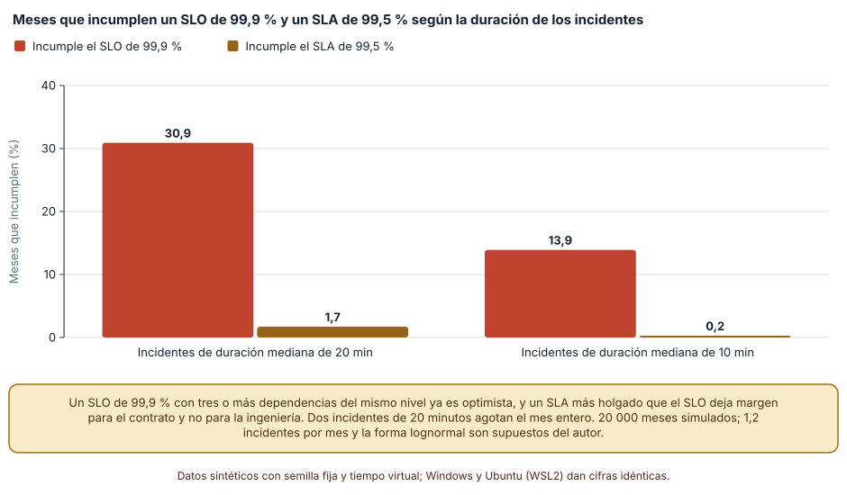

# SE-497 — SLI, SLO, SLA y presupuestos de error

[← SE-496 — Trazas distribuidas y contexto](https://github.com/vladimiracunadev-create/modern-software-engineering-program/blob/main/classes/part-41-observabilidad-sre-e-incidentes/se-496-trazas-distribuidas-y-contexto/README.md) · [↑ Parte 41](https://github.com/vladimiracunadev-create/modern-software-engineering-program/blob/main/classes/part-41-observabilidad-sre-e-incidentes/README.md) · [📚 Índice completo](https://github.com/vladimiracunadev-create/modern-software-engineering-program/blob/main/classes/README.md) · [🌐 Portal](https://vladimiracunadev-create.github.io/modern-software-engineering-program/classes/SE-497.html) · [SE-498 — Alertas accionables y fatiga →](https://github.com/vladimiracunadev-create/modern-software-engineering-program/blob/main/classes/part-41-observabilidad-sre-e-incidentes/se-498-alertas-accionables-y-fatiga/README.md)

## Punto profesional y fundamento pedagógico

**Punto profesional.** La clase existe para que conviertas «el servicio debe ser fiable» en una promesa medible: un indicador (SLI) que mida lo que siente quien usa el servicio, un objetivo (SLO) con ventana y un presupuesto de error que diga cuánto fallo se puede gastar y quién decide qué hacer cuando se acaba. Distingue además el objetivo interno del acuerdo con consecuencias contractuales (SLA).

**Por qué aparece aquí.** Sigue a **Trazas distribuidas y contexto**: con las señales disponibles hay que decidir cuáles definen «funciona». Prepara `SE-498`, donde las alertas se derivan del consumo del presupuesto. El caso conductor sigue siendo la API de entregas.

**Error conceptual que debe corregir.** Creer que un SLO es «el mayor número posible» y que se mide en cualquier sitio. Un objetivo sin ventana, sin punto de medición y sin consecuencia es una aspiración, y el 100 % es un objetivo que ningún sistema ni ningún usuario necesita.

**Secuencia de aprendizaje.** Antes de ver los resultados predices cuánto del presupuesto mensual consume un corte de 30 minutos a las 3 de la madrugada y a las 2 de la tarde, cuánto cambia la disponibilidad entre medir en el servidor y en el cliente, y con qué frecuencia incumple el objetivo un servicio con 1,2 incidentes al mes. Después contrastas con tres experimentos y escribes el SLO de la API con su política. La secuencia usa predicción, explicación propia, contraste y recuperación. [ICAP](https://icap.education.asu.edu/research) distingue participación de construcción de conocimiento; [How People Learn II](https://nap.nationalacademies.org/catalog/24783/how-people-learn-ii-learners-contexts-and-cultures) respalda diseñar la práctica con contextos reales y retroalimentación.

**Evidencia de aprendizaje.** `slo-log.md` con la predicción, las tres figuras reproducidas, el SLI, el SLO y el SLA propuestos para la API de entregas, el cálculo del presupuesto y la política de qué ocurre al agotarlo.

**Límite de la conclusión.** El tráfico, los incidentes y las tasas de fallo son sintéticos y con semilla fija. No se midió ningún servicio real ni se usó ninguna herramienta de SLO; los objetivos de 99,9 % y 99,5 % son ejemplos, no recomendaciones.

### Trazabilidad fuente → afirmación

| Fuente primaria u oficial | Afirmación que respalda | Lo que no prueba |
|---|---|---|
| [Google SRE: Service Level Objectives](https://sre.google/sre-book/service-level-objectives/) | Define SLI, SLO y SLA y recomienda elegir indicadores desde la perspectiva de quien usa el servicio y objetivos con ventana. | No fija el SLO de tu servicio. |
| [Google SRE Workbook: Implementing SLOs](https://sre.google/workbook/implementing-slos/) | Describe cómo derivar un SLI como proporción de eventos buenos sobre válidos, el presupuesto de error y una política de acción al agotarlo. | No decide cuántos nueves necesitas. |
| [Google SRE: Monitoring Distributed Systems](https://sre.google/sre-book/monitoring-distributed-systems/) | Propone latencia, tráfico, errores y saturación como señales de las que derivar indicadores. | No da umbrales. |
| [Dean y Barroso, «The tail at scale»](https://doi.org/10.1145/2408776.2408794) | Muestra que objetivos sobre la media ocultan la latencia de cola, que domina en sistemas con muchos componentes. | No mide tu cola. |

## Antes de empezar

Recupera lo aprendido en `SE-493` a `SE-496`: las señales dicen qué ocurre y dónde. La pregunta activa es: **¿qué proporción de las entregas de la API debe salir bien, medida dónde y durante cuánto tiempo, para que podamos decir que cumplimos, y qué hacemos cuando no?**

## Prerrequisitos

- Haber completado `SE-495` o poder explicar qué es un contador de peticiones con etiqueta de estado.
- Python 3.11 o posterior; los experimentos usan solo la biblioteca estándar (`random`, `math`).
- Nociones de proporción y de percentil.

## Problema auténtico

La plataforma firma con una universidad un acuerdo de 99,9 % de disponibilidad mensual. A las 03:00 de un martes un corte de 30 minutos deja la API caída. En el panel de «minutos buenos» consume el 69 % del presupuesto del mes; en el de «peticiones buenas» apenas el 9 %, porque de noche casi nadie sube entregas. Tres semanas después, un corte de 30 minutos a las 14:00 del día del plazo consume el 166 % del presupuesto contado por peticiones, y el 69 % contado por minutos. Las dos mediciones son legítimas y llevan a decisiones opuestas. Mientras tanto, el servidor informa 99,93 % de éxito y los clientes de una red móvil informan 97,96 %: el acuerdo no dice dónde se mide. La clase enseña a escribir una promesa que no admita las dos lecturas.

## Objetivos observables

Al terminar podrás:

1. escribir un SLI como proporción de eventos buenos sobre eventos válidos, con su punto de medición;
2. fijar un SLO con ventana y calcular su presupuesto en minutos y en peticiones;
3. explicar por qué contar peticiones y contar minutos dan consumos distintos para el mismo incidente;
4. calcular la disponibilidad compuesta de dependencias en serie y el riesgo de incumplir un objetivo por mes;
5. escribir una política de presupuesto con consecuencias y un responsable.

## Mapa conceptual


El mapa separa el **indicador** (qué se mide y dónde), el **objetivo** (qué se promete internamente y en qué ventana) y el **contrato** (qué se debe si no se cumple). El presupuesto de error es la variable que conecta la ingeniería con las decisiones de producto.

## Temas y por qué importan

| Tema | Por qué cambia una decisión profesional | Evidencia mínima |
|---|---|---|
| SLI | Un indicador mal elegido optimiza lo que no se siente. | Predicción, traza causal y contraejemplo de **SLI** en `slo-log.md` |
| SLO y ventana | El objetivo sin ventana no se puede incumplir ni cumplir. | Predicción, traza causal y contraejemplo de **SLO y ventana** en `slo-log.md` |
| Presupuesto de error | Convierte la fiabilidad en una moneda de decisión. | Predicción, traza causal y contraejemplo de **Presupuesto de error** en `slo-log.md` |
| Dónde se mide | El servidor no ve lo que no llegó. | Predicción, traza causal y contraejemplo de **Dónde se mide** en `slo-log.md` |
| SLA y composición | Un contrato no puede prometer más que sus dependencias. | Predicción, traza causal y contraejemplo de **SLA y composición** en `slo-log.md` |

## Conceptos y decisiones

### 1. SLI

Un **indicador de nivel de servicio (SLI)** es una medida cuantitativa de un aspecto del servicio que importa a quien lo usa. La forma más útil es una proporción: eventos buenos entre eventos válidos, expresada como porcentaje. Para la API de entregas, «una entrega es buena si el servidor responde con éxito y en menos de 1 s». Los eventos válidos excluyen lo que no es culpa del servicio (una petición mal formada). La definición exige tres decisiones que se escriben: qué es «bueno» (estado y umbral de latencia), qué es «válido» (qué se excluye) y dónde se mide. Un SLI de disponibilidad sin umbral de latencia da por buena una respuesta correcta que llega en un minuto.

### 2. SLO y ventana

Un **objetivo de nivel de servicio (SLO)** fija el valor que se espera del SLI durante una ventana: «el 99,9 % de las entregas son buenas en una ventana móvil de 28 días». Dos decisiones lo hacen operativo. La **ventana** (móvil o calendario, de días o de un trimestre) determina cuánto tiempo recuerda el sistema un mal día: una ventana corta olvida pronto, una larga castiga mucho tiempo. El **valor** determina el coste: pasar de 99,9 % a 99,99 % divide por diez el fallo permitido y suele multiplicar el coste de redundancia y de operación. El 100 % no es un objetivo razonable porque la fiabilidad que supera lo que la persona usuaria percibe (su propia red, su dispositivo) no se nota y se paga con la velocidad de cambio.

### 3. Presupuesto de error

El **presupuesto de error** es el fallo que el SLO permite: 1 − objetivo. Con 99,9 % en 30 días son 43,2 minutos de caída total, o 0,1 % de las peticiones. Convierte la fiabilidad en una moneda: mientras queda presupuesto, el equipo puede desplegar con ritmo y asumir riesgo; cuando se agota, una **política de presupuesto** acordada de antemano dice qué cambia (pausar despliegues no urgentes, dedicar el sprint a fiabilidad, escalar a quien decide). Sin política, el presupuesto es un número en un panel. La política debe tener un responsable que la aplique y una excepción explícita para lo que el presupuesto no puede frenar (una corrección de seguridad).

### Peticiones o minutos

Se modela un mes de 30 días con tráfico diurno (hasta 100 peticiones por segundo) y nocturno (5 por segundo), 104,4 millones de peticiones, y un objetivo de 99,9 %. Se calcula cuánto presupuesto consume cada uno de tres incidentes con dos maneras de contar: por **peticiones** (cuántas fallaron) y por **minutos malos** (cuántos minutos tuvieron más de un 1 % de errores).

```python
by_requests = bad / month_requests              # peticiones fallidas / peticiones del mes
by_time = bad_minutes / (30 * 1440)             # minutos malos / minutos del mes
```

| Incidente | Disponibilidad por peticiones | Presupuesto por peticiones | Presupuesto por minutos |
|---|---:|---:|---:|
| Corte total de 30 min a las 03:00 | 99,991 % | 8,6 % | 69,4 % |
| Corte total de 30 min a las 14:00 | 99,834 % | 166 % | 69,4 % |
| 5 % de errores durante 8 h desde las 09:00 | 99,879 % | 121 % | 1 111 % |


**Cómo leer la figura.** Cada grupo de barras es un incidente y cada barra el porcentaje del presupuesto de error mensual que consume, medido por peticiones (coral) o por minutos (teal), en escala logarítmica; la línea discontinua es el presupuesto agotado. El mismo corte de 30 minutos consume 8,6 por ciento por peticiones de madrugada y 166 por ciento a las 14:00, porque depende del tráfico; por minutos consume lo mismo, 69,4. Un 5 por ciento de errores durante 8 horas consume 121 por peticiones y 1 111 por minutos. **Dónde deja de valer:** el perfil de tráfico (5 por segundo de noche, hasta 100 de día) y el umbral de 1 % para el minuto malo son supuestos del autor. Ninguna forma de contar es neutral: la elección expresa qué se quiere proteger, y debe constar en el SLO.

### 4. Dónde se mide

Un SLI medido en el servidor ve lo que el servidor recibió. No ve la petición que no llegó (un fallo de DNS, de red del cliente, de balanceador). Medido en el cliente (en una aplicación o con sondas externas), ve la experiencia completa pero incluye lo que el equipo no controla. La elección es un compromiso: el punto de medición más cercano a la persona es el más fiel y el menos accionable. Un patrón frecuente es medir en el balanceador de entrada, que ve todo lo que llega al sistema, y complementarlo con una sonda externa para lo que no llega. Los **reintentos** complican la lectura: un reintento exitoso oculta un fallo de intento y, si el fallo es persistente, el reintento no ayuda aunque multiplique la carga.

### Servidor, cliente y reintentos

Se simulan 200 000 solicitudes. Cada intento falla por red del cliente con 2 % y por el servidor con 0,05 %; además un 0,03 % de las peticiones falla de forma persistente (siempre). Se compara el éxito medido en el servidor, en el cliente con un intento y con tres intentos, suponiendo fallos independientes o con el fallo persistente.

```python
retry_indep += not all(fails)                      # tres intentos, todos independientes
retry_real += (not persistent) and not all(fails)   # un fallo pegado a la petición no se arregla reintentando
```

| Dónde y cómo se mide | Éxito |
|---|---:|
| En el servidor | 99,927 % |
| En el cliente, un intento | 97,961 % |
| Tres intentos si todos los fallos fueran independientes | 99,9995 % |
| Tres intentos con un 0,03 % de fallos pegados a la petición | 99,9705 % |


**Cómo leer la figura.** Cada barra es un lugar y una forma de medir, y su largo el porcentaje de fallos de las 200 000 solicitudes, en escala logarítmica. El servidor ve menos fallos que el cliente porque no ve a quien no llegó; tres intentos independientes bajarían los fallos a 0,0005 por ciento, pero cuando el fallo va pegado a la petición los reintentos no ayudan y quedan unas cien veces más fallos que esa cifra. **Dónde deja de valer:** el 2 % de fallos de red, el 0,05 % del servidor y el 0,03 % persistente son supuestos del autor, y los fallos reales se agrupan en el tiempo (una caída dura minutos, no fracciones independientes). Un SLO que dependa de reintentos debe declararlo, porque un reintento exitoso también consume capacidad.

### 5. SLA y composición

Un **acuerdo de nivel de servicio (SLA)** es un compromiso con una consecuencia (un crédito, una penalización) si no se cumple. Debe ser menos exigente que el SLO interno: el SLO es el margen de seguridad, y el SLA lo que se puede prometer sin pagar con frecuencia. Además, un servicio no puede prometer más disponibilidad que sus dependencias en serie: si necesita cinco servicios que fallan de forma independiente, la disponibilidad compuesta es el producto. Cinco dependencias de 99,9 % dan 99,501 %; ocho dan 99,203 %. La redundancia, la degradación elegante y los reintentos mejoran ese producto solo si las fallas son independientes. Una dependencia que cae por una causa común (el mismo proveedor, la misma región) rompe el cálculo.

### Composición y meses que incumplen

Se calcula la disponibilidad compuesta de 1, 3, 5 y 8 dependencias de 99,9 %. Aparte, se simulan 20 000 meses con 1,2 incidentes de media (Poisson) y duración lognormal (σ = 1) de mediana 20 minutos y 10 minutos, y se cuenta cuántos meses superan los 43,2 minutos de un SLO de 99,9 % y los 216 minutos de un SLA de 99,5 %.

```python
down = sum(rng.lognormvariate(math.log(mttr), 1.0) for _ in range(poisson(rng, 1.2)))
slo += down > 43.2;  sla += down > 216
```

| Caso | Resultado |
|---|---:|
| 1 dependencia de 99,9 % | 99,900 % |
| 3 dependencias | 99,700 % |
| 5 dependencias | 99,501 % |
| 8 dependencias | 99,203 % |
| Incidentes de mediana 20 min: meses que incumplen el SLO de 99,9 % | 30,9 % |
| Incidentes de mediana 20 min: meses que incumplen el SLA de 99,5 % | 1,72 % |
| Incidentes de mediana 10 min: SLO / SLA | 13,9 % / 0,2 % |



**Cómo leer la figura.** Cada grupo de barras es una duración mediana de los incidentes mensuales y cada barra el porcentaje de meses que incumple un objetivo: el SLO de 99,9 por ciento (coral) o el SLA de 99,5 (dorada). Con incidentes más largos se incumple más, y el SLO, más exigente, se incumple mucho más que el SLA. La disponibilidad de cinco dependencias de 99,9 por ciento en serie (99,501) queda en la tabla. **Dónde deja de valer:** la tasa de 1,2 incidentes por mes y la forma lognormal son supuestos del autor; en la práctica los incidentes se agrupan (una mala semana). El resultado ordena palancas — el tiempo de recuperación pesa tanto como el número de incidentes — pero no mide la tuya.

## Definiciones de trabajo

- **SLI:** medida cuantitativa de un aspecto del servicio, normalmente la proporción de eventos buenos sobre eventos válidos.
- **SLO:** valor objetivo de un SLI durante una ventana de tiempo.
- **SLA:** compromiso contractual con una consecuencia si no se cumple un nivel de servicio.
- **presupuesto de error:** cantidad de fallo que el SLO permite en la ventana, igual a uno menos el objetivo.
- **política de presupuesto:** acuerdo previo sobre qué cambia cuando el presupuesto se agota o se consume demasiado rápido.

Las definiciones son operativas para la API de entregas. No convierten términos con una historia más amplia en sinónimos y deben contrastarse con la documentación primaria enlazada al final.

## Ejemplo mínimo

El fragmento calcula el presupuesto de error de un SLO de 99,9 % en 30 días. Antes de ejecutarlo, predice el resultado.

```python
objective = 0.999
minutes = 30 * 24 * 60
print(round((1 - objective) * minutes, 1), "min;", round((1 - objective) * 1_000_000), "de cada millón de peticiones")
```

Imprime `43.2 min; 1000 de cada millón de peticiones`. Registra versión de Python, comando y salida; después calcula el presupuesto de 99,99 % y de 99 % y compara con lo que tardaría una persona en reaccionar a una alerta.

## Ejemplo profesional

Supón, como caso hipotético de la plataforma y no como medición, que el equipo define para la API de entregas el siguiente SLO. SLI: proporción de peticiones de entrega con respuesta exitosa en menos de 1 s, entre las peticiones válidas, medida en el balanceador de entrada. SLO: 99,9 % en una ventana móvil de 28 días. SLA con la universidad: 99,5 % mensual, con crédito si no se cumple. Presupuesto: 28 días × 1 440 min × 0,1 % = 40,3 minutos de caída total o 0,1 % de las peticiones. Política: al consumir el 50 % del presupuesto en una semana, el equipo revisa los incidentes; al agotarlo, se pausan los despliegues no urgentes y el sprint se dedica a fiabilidad hasta recuperar el 25 %. Una sonda externa mide la API cada minuto desde cinco regiones para lo que el balanceador no ve. Por último, el equipo escribe el límite de la promesa: el SLO no cubre la red del cliente ni los periodos de mantenimiento anunciados y las dependencias externas (almacenamiento y correo) tienen SLO propios, de modo que la disponibilidad compuesta esperada es 99,7 %, y se acuerda con producto que el objetivo se revise a los tres meses. No concluyen que 99,9 % sea correcto, sino que ahora es una promesa que se puede incumplir y que se enterarán de que se ha incumplido.

## Práctica guiada

1. Predice cuánto presupuesto consume cada uno de los tres incidentes con las dos formas de contar y escribe los números.
2. Ejecuta `python scripts/experiments_part41_a.py e425` y compara; anota la mayor diferencia con tu predicción.
3. Cambia el perfil de tráfico a uno plano de 50 peticiones por segundo y mide si las dos formas de contar coinciden.
4. Cambia la duración mediana de los incidentes a 5 minutos y calcula cuántos meses incumplen el SLO.
5. Calcula la disponibilidad compuesta de tu servicio con sus dependencias reales y compárala con tu SLO.
6. Escribe una política de presupuesto de una página con responsable, umbrales y excepciones.
7. Entrega `slo-log.md` y pide a otra persona que encuentre un incidente que cumple el SLO y deja mal a una persona usuaria.

## Ejercicios

1. **Presupuesto:** calcula el presupuesto en minutos y en peticiones de un SLO de 99,95 % en 28 días con 80 millones de peticiones.
2. **SLI:** escribe el SLI de «consultar una calificación» con su definición de bueno, de válido y de punto de medición.
3. **Composición:** un servicio depende de cuatro servicios de 99,95 % en serie y de uno en paralelo redundante de 99,9 % por rama; calcula su disponibilidad.
4. **Política:** redacta qué ocurre cuando el presupuesto de 28 días se consume 3 veces más rápido de lo normal durante dos días seguidos.

## Reto verificable

Entrega `slo-log.md` con la predicción, las tres tablas de resultados reproducidas con las mismas semillas, el SLI, el SLO y el SLA de la API de entregas con su cálculo de presupuesto y la política de acción. Se aprueba si otra persona ejecuta el código desde un checkout limpio, obtiene los mismos números y no puede encontrar un incidente que cumpla el SLO y falle al producto según su definición. No se aprueba por fijar «el 99,99 %» sin cálculo ni por medir solo el servidor.

## Caso conductor

La API de entregas es el caso conductor de la [Parte 41](../README.md). Esta clase deja el quinto artefacto: un SLO con presupuesto y política. `SE-498` convierte el consumo del presupuesto en alertas que merecen una página, y `SE-499` define qué hace la persona de guardia al recibirla. Cambia después un solo parámetro, la duración mediana de los incidentes, y observa cuántos meses incumplen el objetivo.

## Preguntas frecuentes

### ¿Por qué no prometer 100 %?

Porque ningún sistema lo alcanza, el último nueve cuesta mucho más que el anterior y la persona usuaria no puede percibir una fiabilidad mayor que la de su propia red. Además, el presupuesto de error es lo que permite cambiar el sistema; con 100 % no hay margen para desplegar.

### ¿Cuál es la diferencia entre SLO y SLA?

El SLO es un objetivo interno que guía decisiones de ingeniería; el SLA es un compromiso externo con consecuencias. El SLA debe ser más laxo que el SLO para que haya un margen antes de pagar. Un SLO puede incumplirse sin consecuencia contractual; la consecuencia es la política de presupuesto.

### ¿Se mide por peticiones o por tiempo?

Depende de lo que se quiera proteger. Por peticiones se pondera por el uso, y es lo más cercano a la experiencia de quien usa el servicio. Por tiempo es más fácil de explicar a un contrato pero ignora el tráfico. Lo importante es declarar la elección y mostrar que, para tus incidentes, ambas dan una conclusión coherente.

### ¿Qué hago si el presupuesto se agota?

Lo que dice la política. Lo habitual es pausar los cambios de riesgo, dedicar tiempo a las causas de los incidentes y escalar la decisión a quien responde por el producto. La política debe escribirse antes de necesitarla.

## Fallo controlado y diagnóstico

Reproduce el fallo clásico de la clase: **cumplir el SLO en promedio mientras un grupo de personas lo sufre**. Calcula el SLO mensual agregado de la API y compáralo con el de la ventana del día del plazo.

Registra síntoma, entrada mínima, hipótesis, observación que descarta cada hipótesis, causa, corrección y prueba de regresión. **Síntoma:** el panel muestra 99,95 % en el mes y la universidad reclama porque el día del plazo no pudo entregar durante media hora. **Hipótesis rivales:** (a) el panel está mal calculado; (b) la universidad mide otra cosa; (c) el SLO agrega un mes y diluye el incidente en tráfico normal. **Prueba:** calcula el éxito de ese día y de esa hora; si baja de 99,9 % y el mes sigue en 99,95 %, la hipótesis (c) explica la señal. **Conclusión:** una ventana larga promedia el daño con los días sanos. **Regresión:** añade al informe un SLO por ventana corta o por segmento (hora pico, institución grande) y una alerta de consumo rápido (`SE-498`). No cambies a la vez la ventana y el objetivo.

## Errores comunes y cómo corregirlos

| Síntoma | Causa probable | Corrección |
|---|---|---|
| El SLO se cumple y hay quejas | Se mide donde no se ve el problema, o se promedia una ventana larga | Medir cerca de la persona y añadir ventana corta o segmento |
| Dos paneles dan consumos opuestos | Uno cuenta peticiones y otro minutos | Declarar la forma de contar en el SLO |
| El presupuesto se agota y no pasa nada | No hay política con responsable | Escribir la política y asignar a quien decide |
| El SLA es más estricto que el SLO | Se firmó sin margen interno | Fijar el SLA por debajo del SLO |
| El SLO supera el de las dependencias | Se ignoró la composición en serie | Calcular el producto y revisar redundancia |

## Entorno y archivos clave

```text
work/SE-497/
├── README.md
├── slo/
│   ├── presupuesto.py
│   ├── medicion.py
│   └── composicion.py
├── tests/test_slo.py
└── evidence/slo-log.md
```

El `README` declara plataforma, versión de Python, semillas y comandos. Los experimentos usan solo la biblioteca estándar y se ejecutaron con CPython 3.12.9 en Windows 11 y 3.12.3 en Ubuntu bajo WSL2 con cifras idénticas. Para recuperar el estado, borra `work/SE-497/` y repite los scripts. Si añades una dependencia, fija procedencia y versión.

## Seguridad, ética y accesibilidad

- un SLO que solo mide el promedio puede esconder que un grupo (una institución pequeña, una red móvil, una persona con tecnología de apoyo) recibe peor servicio: mide por segmento cuando haya riesgo de exclusión;
- un SLA con penalizaciones puede incentivar a esconder incidentes: separa quién mide de quién paga;
- las sondas externas usan cuentas de prueba y no datos reales de estudiantes;
- documenta las tablas y las figuras con texto alternativo y en un formato que un lector de pantalla pueda recorrer;
- respeta las licencias de los libros y artículos y atribuye lo adaptado.

## Puente hacia el trabajo con agentes

Un agente al que se le pide «define SLOs» propondrá 99,9 % o 99,99 % para todo, medidos en el servidor y con una ventana de 30 días, sin política ni responsable. Pídele en cambio que parta de lo que experimenta quien usa el servicio, que escriba el SLI con eventos buenos y válidos, que fije la ventana y el punto de medición, que calcule el presupuesto en minutos y en peticiones, que calcule la composición con las dependencias reales y que redacte la política con un responsable. Revisa especialmente si el objetivo es el mismo para endpoints con importancia distinta y si el SLA es más exigente que el SLO.

## Transferencia

Traslada el análisis a otro servicio (una plataforma de pagos o un buscador): escribe su SLI, su SLO y su política y calcula el presupuesto. La transferencia está lograda cuando puedes decir qué incidente cumpliría el SLO y dejaría mal a una persona usuaria, no cuando el panel muestra un porcentaje.

## Evaluación y evidencia

| Criterio | Evidencia para aprobar |
|---|---|
| comprensión | explicación de SLI, SLO, SLA y presupuesto y de por qué el 100 % no es un objetivo |
| corrección | tablas de consumo, de punto de medición y de composición reproducibles con las mismas semillas |
| diseño | SLI, SLO, SLA y política de presupuesto con responsable |
| diagnóstico | reproducción del fallo «cumplir en promedio mientras un grupo lo sufre» con regresión |
| incertidumbre | declaración de que el tráfico, los incidentes y las tasas de fallo son sintéticos |
| reproducibilidad | versiones, comandos, salida y límites declarados |

## Fuentes

- [Google SRE: Service Level Objectives](https://sre.google/sre-book/service-level-objectives/) — definición de SLI, SLO y SLA; autoridad: libro de ingeniería de confiabilidad de Google.
- [Google SRE Workbook: Implementing SLOs](https://sre.google/workbook/implementing-slos/) — proporción de eventos buenos, presupuesto y política; autoridad: Google, SRE Workbook.
- [Google SRE: Monitoring Distributed Systems](https://sre.google/sre-book/monitoring-distributed-systems/) — señales de oro; autoridad: libro de ingeniería de confiabilidad de Google.
- [Dean y Barroso, «The tail at scale»](https://doi.org/10.1145/2408776.2408794) — latencia de cola; autoridad: Communications of the ACM, 2013.
- [Python: random](https://docs.python.org/3/library/random.html) — generador usado en los experimentos; autoridad: documentación de Python.

Cada fuente respalda el mecanismo indicado; ninguna demuestra que 8,6 %, 166 %, 97,961 % o 30,9 % de meses incumplidos se observen en un sistema real. Esa afirmación depende del tráfico, de los incidentes y de cómo se mide.

## Límites y siguiente paso

Se ejecutaron tres experimentos con tiempo virtual y semillas fijas en Windows y Ubuntu (WSL2) con resultados idénticos. No se midió ningún servicio real; el perfil de tráfico, los tres incidentes, las tasas de fallo de red y de servidor, el 1,2 de incidentes por mes y la forma lognormal de su duración son construcciones del autor, y los fallos se tratan como independientes salvo el persistente. La siguiente clase pregunta qué cambios del presupuesto merecen despertar a una persona y cuáles solo un correo.

## Glosario

- **SLI:** medida cuantitativa de un aspecto del servicio, normalmente la proporción de eventos buenos sobre eventos válidos.
- **SLO:** valor objetivo de un SLI durante una ventana de tiempo.
- **SLA:** compromiso contractual con una consecuencia si no se cumple un nivel de servicio.
- **presupuesto de error:** cantidad de fallo que el SLO permite en la ventana, igual a uno menos el objetivo.
- **política de presupuesto:** acuerdo previo sobre qué cambia cuando el presupuesto se agota o se consume demasiado rápido.

---

[← SE-496 — Trazas distribuidas y contexto](https://github.com/vladimiracunadev-create/modern-software-engineering-program/blob/main/classes/part-41-observabilidad-sre-e-incidentes/se-496-trazas-distribuidas-y-contexto/README.md) · [↑ Parte 41](https://github.com/vladimiracunadev-create/modern-software-engineering-program/blob/main/classes/part-41-observabilidad-sre-e-incidentes/README.md) · [📚 Índice completo](https://github.com/vladimiracunadev-create/modern-software-engineering-program/blob/main/classes/README.md) · [🌐 Portal](https://vladimiracunadev-create.github.io/modern-software-engineering-program/classes/SE-497.html) · [SE-498 — Alertas accionables y fatiga →](https://github.com/vladimiracunadev-create/modern-software-engineering-program/blob/main/classes/part-41-observabilidad-sre-e-incidentes/se-498-alertas-accionables-y-fatiga/README.md)
