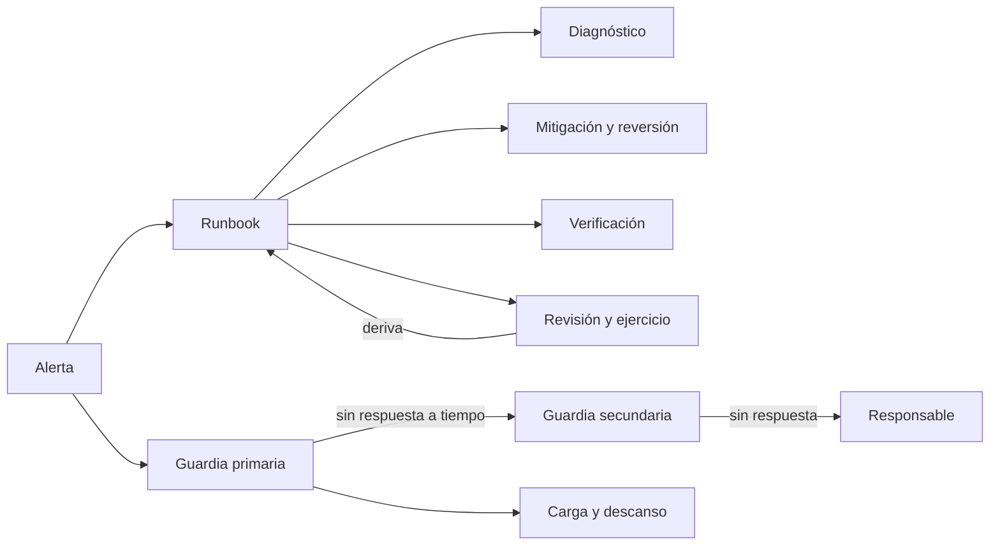
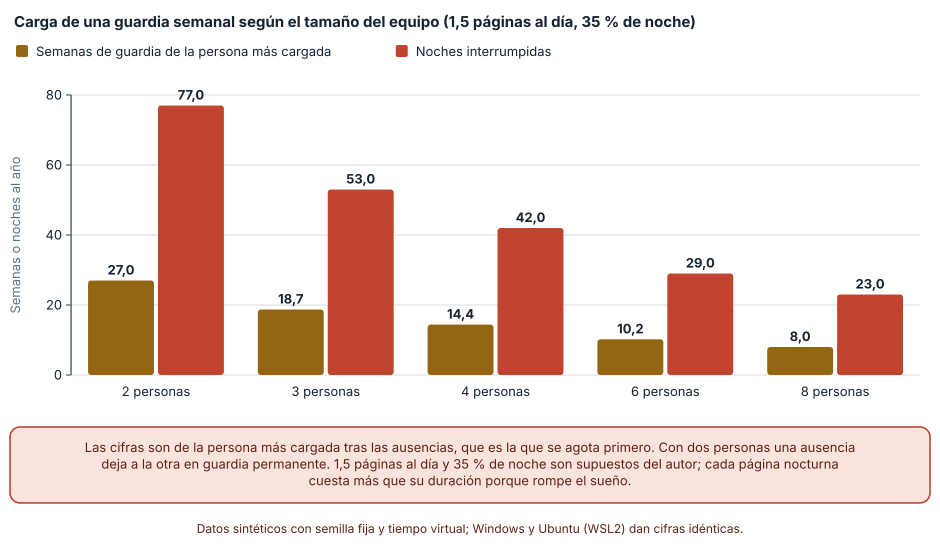

# SE-499 — Runbooks, on-call y escalamiento

[← SE-498 — Alertas accionables y fatiga](https://github.com/vladimiracunadev-create/modern-software-engineering-program/blob/main/classes/part-41-observabilidad-sre-e-incidentes/se-498-alertas-accionables-y-fatiga/README.md) · [↑ Parte 41](https://github.com/vladimiracunadev-create/modern-software-engineering-program/blob/main/classes/part-41-observabilidad-sre-e-incidentes/README.md) · [📚 Índice completo](https://github.com/vladimiracunadev-create/modern-software-engineering-program/blob/main/classes/README.md) · [🌐 Portal](https://vladimiracunadev-create.github.io/modern-software-engineering-program/classes/SE-499.html) · [SE-500 — Gestión de incidentes y comunicación →](https://github.com/vladimiracunadev-create/modern-software-engineering-program/blob/main/classes/part-41-observabilidad-sre-e-incidentes/se-500-gestion-de-incidentes-y-comunicacion/README.md)

## Punto profesional y fundamento pedagógico

**Punto profesional.** La clase existe para que conviertas una página en una respuesta: un runbook que una persona cansada pueda seguir a las tres de la madrugada, una rotación de guardia con una carga que se pueda sostener y un escalamiento que llegue a alguien aunque la primera persona no conteste. Una alerta bien diseñada sin runbook pide acción sin decir cuál; un runbook sin guardia sostenible depende de héroes.

**Por qué aparece aquí.** Sigue a **Alertas accionables y fatiga**: allí se decidió qué merece una página; aquí, qué ocurre después de recibirla. Prepara `SE-500`, donde varias personas coordinan una respuesta. El caso conductor sigue siendo la API de entregas.

**Error conceptual que debe corregir.** Creer que un runbook es documentación y que la guardia es cuestión de voluntad. Un runbook es una interfaz entre la alerta y la acción que se prueba como el código, y la guardia es un sistema con carga, descanso y fallos comunes que se dimensiona.

**Secuencia de aprendizaje.** Antes de ver los resultados predices cuántas noches interrumpidas tiene al año una persona en un equipo de dos y en uno de seis, qué fracción de las páginas atiende un escalamiento de tres niveles cuando una parte de los fallos comparte causa y cuántas mutaciones de un runbook detecta un verificador de forma. Después contrastas con tres experimentos y escribes el runbook de una alerta de la API. La secuencia usa predicción, explicación propia, contraste y recuperación. [ICAP](https://icap.education.asu.edu/research) distingue participación de construcción de conocimiento; [How People Learn II](https://nap.nationalacademies.org/catalog/24783/how-people-learn-ii-learners-contexts-and-cultures) respalda diseñar la práctica con contextos reales y retroalimentación.

**Evidencia de aprendizaje.** `guardia-log.md` con la predicción, las tres figuras reproducidas, el runbook de una alerta de la API con su verificador y una propuesta de rotación con carga calculada.

**Límite de la conclusión.** La carga, las probabilidades de respuesta y los runbooks son sintéticos y con semilla fija. No se midió ninguna guardia real ni se usó ninguna herramienta de gestión de guardias; las cifras muestran un mecanismo, no el tamaño de equipo que tu sistema necesita.

### Trazabilidad fuente → afirmación

| Fuente primaria u oficial | Afirmación que respalda | Lo que no prueba |
|---|---|---|
| [Google SRE: Being On-Call](https://sre.google/sre-book/being-on-call/) | Describe la carga de la guardia, la necesidad de un número mínimo de personas y la importancia de limitar las interrupciones. | No fija el número para tu equipo. |
| [Google SRE Workbook: On-Call](https://sre.google/workbook/on-call/) | Propone medir la carga de la guardia, revisar las alertas y reducir la fatiga con datos. | No da cifras universales. |
| [PagerDuty Incident Response](https://response.pagerduty.com/) | Documenta públicamente roles, preparación de la guardia y procesos de respuesta y escalamiento de una empresa. | No es un estándar. |
| [Google SRE: Practical Alerting](https://sre.google/sre-book/practical-alerting/) | Recomienda que cada alerta tenga una acción clara y que la documentación acompañe la alerta. | No da el formato del runbook. |

## Antes de empezar

Recupera lo aprendido en `SE-498`: una página que no pide acción cuesta credibilidad. La pregunta activa es: **cuando suena la alerta de consumo 14,4× a las 03:10, ¿qué hace exactamente la persona de guardia en los primeros cinco minutos y a quién llama si no puede?**

## Prerrequisitos

- Haber completado `SE-498` o poder explicar qué es una página y una alerta de consumo.
- Python 3.11 o posterior; los experimentos usan solo la biblioteca estándar (`random`, `math`, `datetime`).
- Nociones de rotación y de probabilidad independiente.

## Problema auténtico

La alerta de consumo de la API de entregas suena a las 03:10. La persona de guardia, que lleva en el equipo tres semanas, abre el enlace del runbook: «Revisar el estado de los servicios. Reiniciar si hace falta. Avisar al responsable». No dice cuáles servicios, qué comando, qué resultado esperar ni a qué responsable. Revisa los pods, reinicia el que parece caído y la alerta sigue encendida. Llama al secundario, que está en un avión; el responsable tiene el teléfono apagado. Cuarenta minutos después, un compañero despierto en otra zona horaria lee un chat y resuelve revirtiendo el despliegue, algo que el runbook no mencionaba. En el análisis posterior se descubre además que el equipo de guardia son dos personas y que una de ellas estuvo de vacaciones dos de las últimas seis semanas. La clase enseña a diseñar las tres partes: el runbook, la rotación y el escalamiento.

## Objetivos observables

Al terminar podrás:

1. escribir un runbook con disparador, impacto, diagnóstico, mitigación, verificación, reversión y escalamiento, ejecutable por quien no conoce el sistema;
2. calcular la carga de una guardia (semanas, noches interrumpidas) según el tamaño del equipo y las ausencias;
3. calcular la probabilidad de atención de una política de escalamiento y el efecto de una causa común;
4. verificar un runbook con reglas de forma y reconocer lo que solo detecta su ejecución;
5. proponer un ritmo de revisión y de ejercicio de los runbooks.

## Mapa conceptual



El mapa separa el **contenido** (runbook), las **personas** (guardia y niveles) y el **mantenimiento** (revisión y ejercicio). Una alerta que llega a un runbook sin guardia que responda, o a una guardia sin runbook, deja el ciclo abierto.

## Temas y por qué importan

| Tema | Por qué cambia una decisión profesional | Evidencia mínima |
|---|---|---|
| Estructura de un runbook | Una persona cansada necesita pasos, no explicaciones. | Predicción, traza causal y contraejemplo de **Estructura de un runbook** en `guardia-log.md` |
| Carga de la guardia | El tamaño del equipo decide cuántas noches se interrumpen. | Predicción, traza causal y contraejemplo de **Carga de la guardia** en `guardia-log.md` |
| Escalamiento | Un nivel solo cubre un fallo; la causa común cubre varios. | Predicción, traza causal y contraejemplo de **Escalamiento** en `guardia-log.md` |
| Verificación de runbooks | La forma se comprueba; el significado se ejecuta. | Predicción, traza causal y contraejemplo de **Verificación de runbooks** en `guardia-log.md` |
| Mantenimiento | Un runbook sin revisar se vuelve falso. | Predicción, traza causal y contraejemplo de **Mantenimiento** en `guardia-log.md` |

## Conceptos y decisiones

### 1. Estructura de un runbook

Un **runbook** es el documento operativo que acompaña a una alerta y dice qué hacer. Su lector es una persona cansada, posiblemente nueva, a la que quizás se despertó hace dos minutos. Por eso su estructura es corta y fija: **disparador** (qué alerta lo activa y qué significa), **impacto** (a quién afecta y cuánto), **diagnóstico** (qué mirar, con comandos o enlaces concretos y qué resultado esperar), **mitigación** (acciones ordenadas, cada una con su salida esperada), **reversión** (cómo deshacer cada acción que cambia algo), **verificación** (cómo saber que el servicio se recuperó) y **escalamiento** (a quién llamar y cuándo). Los pasos destructivos (reiniciar, borrar, revertir) se marcan como tales y llevan su reversión. Un runbook de este tipo cambia la pregunta de «¿qué hago?» a «¿qué paso es el siguiente?».

Un fragmento de runbook para la alerta de consumo de la API de entregas puede verse así:

```markdown
## Alerta: EntregasConsumoRapido
Disparador: errores > 1,44 % durante 1 h y 5 min (consumo 14,4× del SLO).
Impacto: entregas rechazadas; el presupuesto de 28 días se agota en unas 47 h.
1. Comprobar el estado: `kubectl get pods -n entregas` -> esperado: todos Running.
2. Comprobar la última versión desplegada: `kubectl rollout history deployment/api -n entregas`.
3. [DESTRUCTIVO] Si hubo despliegue en las últimas 2 h: `kubectl rollout undo deployment/api -n entregas`
   -> esperado: "rolled back"; reversión: `kubectl rollout undo` otra vez.
4. Verificar: `curl -fsS https://entregas.example/health` -> esperado: estado ok; errores < 0,1 % en 5 min.
Escalamiento: sin mejora en 15 min -> guardia secundaria; en 30 min -> responsable de la plataforma.
```

### 2. Carga de la guardia

La guardia es un sistema con una capacidad. Una persona en guardia una semana de cada n atiende todas las páginas de esa semana, y las nocturnas interrumpen el sueño. Con pocas personas, cada una pasa muchas semanas en guardia al año, y las ausencias (vacaciones, enfermedad, formación) concentran la carga en quienes quedan. El libro de SRE parte de que no más del 25 % del tiempo de una persona debe ser de guardia y deduce de ahí un mínimo de personas para sostener una rotación continua con primaria y secundaria (ocho en un solo sitio), además de limitar las incidencias por turno. La medida concreta que decide si una guardia es sostenible es la de noches interrumpidas por persona y año, no el número de páginas.

### Carga según el tamaño del equipo

Se simulan 300 años de una guardia semanal con 1,5 páginas al día (35 % de ellas de noche) y 4 semanas de ausencia por persona. Cuando la persona de turno está ausente, la sustituye la siguiente de la rotación. Se reporta, para la persona más cargada, las semanas de guardia, las noches interrumpidas y las páginas nocturnas.

```python
person = next((p for p in order if w not in absent[p]), order[0])   # sustituye la siguiente persona disponible
hit[person] += poisson(rng, rate_day * night_share) > 0              # noche con al menos una página
```

| Personas | Semanas de guardia al año | Noches interrumpidas al año | Páginas nocturnas al año |
|---:|---:|---:|---:|
| 2 | 27,0 | 77 | 99 |
| 3 | 18,7 | 53 | 68 |
| 4 | 14,4 | 42 | 54 |
| 6 | 10,2 | 29 | 37 |
| 8 | 8,0 | 23 | 29 |



**Cómo leer la figura.** Cada grupo de barras es un tamaño del equipo; la barra dorada son las semanas de guardia al año de la persona más cargada y la coral sus noches interrumpidas. Con dos personas la carga es de 27 semanas y 77 noches; con ocho baja a 8 semanas y 23 noches, y la mayor parte de la mejora ya ocurre al pasar de dos a cuatro. Las páginas nocturnas al año quedan en la tabla. **Dónde deja de valer:** 1,5 páginas al día y 35 % de noche son supuestos del autor; en un servicio sano las páginas son muchas menos, lo que mejora todas las filas. Las páginas reales se agrupan en incidentes y días malos, y una noche con diez páginas pesa más que diez noches con una.

### 3. Escalamiento

El **escalamiento** define qué ocurre si la persona de guardia no responde. Cada nivel tiene un tiempo máximo (cinco minutos es habitual para el reconocimiento) tras el cual la página pasa al siguiente: guardia primaria, secundaria, responsable. La probabilidad de que alguien conteste mejora de manera notable con niveles independientes: con 85 % de respuesta por nivel y fallos independientes, tres niveles atienden el 99,8 % de las páginas en 15 minutos, frente al 84,8 % de un solo nivel. El límite es la **causa común**: si el 30 % de los fallos de respuesta comparte origen (la misma zona sin cobertura, el mismo canal de avisos caído, el mismo evento que despierta a todos a la vez), los dos primeros niveles fallan juntos y la cobertura se reduce al 96,9 %. Se mitiga con canales distintos (llamada y mensaje), niveles en zonas distintas y una prueba periódica de que cada canal funciona.

### Una página con y sin escalamiento

Se simulan 20 000 páginas. Cada persona responde con probabilidad 0,85 (los dos primeros niveles) y 0,90 (el responsable) dentro de su ventana, con tiempos de 5 y 10 minutos de espera. En el segundo escenario, el 30 % de los fallos comparte causa y afecta a los dos primeros niveles.

```python
for level, (p, delay) in enumerate(((0.85, 0), (0.85, 5), (0.90, 10))):
    if shared_fail and level < 2: continue                 # causa común: los dos primeros no responden
    if rng.random() < p: t = delay + rng.uniform(0, 5); break
```

| Escenario | Sin escalar | Tres niveles (15 min) | Mediana / p99 hasta atender |
|---|---:|---:|---:|
| Fallos independientes | 84,8 % | 99,8 % | 2,9 / 12,8 min |
| 30 % comparten causa | 59,9 % | 96,9 % | 4,0 / 14,8 min |


**Cómo leer la figura.** Cada grupo de barras es un escenario de fallos y su largo el porcentaje de páginas atendidas: la barra coral sin escalar y la teal con tres niveles de cinco minutos, en 15 minutos. Escalar sube la fracción atendida en los dos escenarios y, cuando una parte de los fallos comparten causa, la sube más. Las medianas y percentiles de minutos hasta atender quedan en la tabla. **Dónde deja de valer:** las probabilidades de respuesta, los tiempos de espera y el 30 % de causa común son supuestos del autor; ninguno proviene de una herramienta de guardia. El modelo supone que el tercer nivel nunca falla por causa común, lo que es optimista.

### 4. Verificar un runbook

La comprobación de **forma** es mecánica: están todos los campos, cada paso tiene comando y salida esperada, cada paso destructivo está marcado y tiene reversión, la fecha de verificación es reciente, la alerta referenciada existe y el escalamiento tiene un contacto. La comprobación de **significado** no: que el comando haga lo que dice, que apunte al entorno correcto, que la salida esperada sea la real y que el propietario siga en el equipo. Esa solo la hace quien ejecuta el runbook, preferentemente en un entorno de pruebas y en un ejercicio programado. Por eso el verificador de forma es necesario y no basta: detecta lo olvidado, no lo erróneo.

### Un verificador frente a 240 mutaciones

Se escriben ocho runbooks base con cuatro campos de metadatos y tres pasos, y diez operadores de mutación aplicados 24 veces cada uno. El verificador comprueba campos, fechas (menos de 90 días), referencia a una alerta existente, escalamiento no vacío, pasos con comando y salida esperada y reversión de los pasos destructivos.

```python
if any(w in comando for w in DESTRUCTIVE) and (not s["destructivo"] or s["reversion"] in ("", "no aplica")): problema
```

| Mutación | Detectadas |
|---|---:|
| Quita un campo obligatorio | 24 de 24 |
| Vacía la salida esperada | 24 de 24 |
| Quita la reversión de un paso destructivo | 24 de 24 |
| Envejece la verificación | 24 de 24 |
| Alerta con errata | 24 de 24 |
| Escalamiento «TBD» | 24 de 24 |
| Intercambia el contenido de dos pasos | 0 de 24 |
| Apunta al entorno equivocado | 0 de 24 |
| Cambia el comando por otro plausible | 0 de 24 |
| Propietario inexistente | 0 de 24 |


**Cómo leer la figura.** Cada barra es un tipo de mutación de un runbook (24 de cada una) y el tramo teal son las que el verificador detecta y el coral las que deja pasar. Las seis mutaciones que rompen la forma se detectan por completo; las cuatro que cambian el sentido sin romper la forma (intercambiar pasos, apuntar al entorno equivocado, cambiar el comando por otro plausible, un propietario inexistente) no se detectan nunca: solo las ve quien ejecuta el runbook. **Dónde deja de valer:** las ocho bases y los diez operadores son construcciones del autor, y el verificador se afinó mirando las mismas mutaciones. Las 96 que se escapan son errores de significado y son justo las que causan un incidente: un runbook bien formado y falso se ejecuta con confianza. Solo un ejercicio de ejecución real las descubre.

### 5. Mantenimiento

Un runbook envejece cuando cambia el sistema: se renombra un servicio, cambia el comando de despliegue, se mueve la consola. Tres hábitos lo mantienen: **dueño** (cada runbook tiene un equipo responsable), **fecha de verificación** (la última vez que alguien lo ejecutó, no la última vez que se editó) y **ejercicio** (una prueba programada en un entorno seguro, en la que alguien ajeno al autor sigue el runbook). Cada incidente real se convierte en una revisión: si el runbook faltó, se corrige. La automatización de pasos seguros (comprobar el estado, recopilar datos) reduce errores humanos; la de pasos destructivos exige más cuidado porque amplifica un error de significado.

## Definiciones de trabajo

- **runbook:** documento operativo que acompaña a una alerta y describe diagnóstico, mitigación, verificación, reversión y escalamiento.
- **guardia (on-call):** turno en que una persona o grupo responde a las páginas de un servicio.
- **escalamiento:** paso de una página al siguiente nivel de respuesta cuando el anterior no contesta a tiempo.
- **causa común:** origen compartido por varios fallos que los hace dejar de ser independientes.
- **ejercicio de runbook:** ejecución programada de un runbook por alguien distinto de su autor para comprobar que funciona.

Las definiciones son operativas para la API de entregas. No convierten términos con una historia más amplia en sinónimos y deben contrastarse con la documentación primaria enlazada al final.

## Ejemplo mínimo

El fragmento detecta los pasos de un runbook sin salida esperada. Antes de ejecutarlo, predice el resultado.

```python
steps = [{"comando": "kubectl get pods", "esperado": "Running"}, {"comando": "kubectl rollout undo deployment/api", "esperado": ""}]
print([i + 1 for i, s in enumerate(steps) if not s["esperado"].strip()])
```

Imprime `[2]`. Registra versión de Python, comando y salida; después añade la comprobación de que los pasos destructivos tienen reversión y prueba con un paso que la omite.

## Ejemplo profesional

Supón, como caso hipotético de la plataforma y no como medición, que el equipo reescribe el runbook de `EntregasConsumoRapido` con el formato anterior, lo añade al repositorio junto al código del servicio y escribe un verificador que se ejecuta en la integración continua (campos, comandos con salida esperada, reversión de lo destructivo, fecha menor de 90 días y alerta existente en el catálogo). Cada trimestre una persona que no escribió el runbook lo ejecuta en el entorno de pruebas, con un despliegue defectuoso inyectado, y anota qué paso falló o confundió. La rotación pasa de dos a seis personas con una primaria y una secundaria; el responsable de la plataforma actúa de tercer nivel; el escalamiento usa llamada telefónica y mensaje en canales distintos, y una vez al mes una prueba envía una página falsa a cada nivel. El cálculo de carga sale de la simulación: con seis personas, 10 semanas de guardia y unas 29 noches interrumpidas al año para la persona más cargada si el servicio sigue generando 1,5 páginas diarias; el equipo fija como meta bajar a 0,5 páginas diarias antes de ampliar el alcance del servicio. No concluyen que la guardia es sostenible: la declaran sostenible cuando la medida de noches interrumpidas lo confirme durante un trimestre.

## Práctica guiada

1. Predice las semanas y las noches interrumpidas de la persona más cargada para dos, cuatro y ocho personas.
2. Ejecuta `python scripts/experiments_part41_b.py e427` y compara; anota la mayor diferencia con tu predicción.
3. Cambia las páginas diarias de 1,5 a 0,5 y mide cuántas personas bastan para mantener menos de 15 noches interrumpidas al año.
4. Cambia el porcentaje de causa común de 30 a 10 y a 50 y mide la cobertura del escalamiento.
5. Escribe el runbook de una alerta de un servicio propio con la estructura de esta clase y ejecútalo en un entorno de pruebas.
6. Escribe un verificador de forma de tu runbook y una mutación que no detecte.
7. Entrega `guardia-log.md` y pide a otra persona que siga tu runbook sin ayuda y anote dónde se detuvo.

## Ejercicios

1. **Runbook:** reescribe «reiniciar el servicio si falla» como un paso con comando, salida esperada, marca de destructivo y reversión.
2. **Carga:** una guardia de cuatro personas recibe 0,8 páginas al día con 40 % de noche; calcula las noches con al menos una página esperadas por semana de guardia.
3. **Escalamiento:** tres niveles con 90 %, 80 % y 95 % de respuesta; calcula la cobertura con fallos independientes y con un 20 % de causa común en los dos primeros.
4. **Verificación:** propone dos comprobaciones de significado que un ejercicio ejecutaría y que el verificador de forma no puede hacer.

## Reto verificable

Entrega `guardia-log.md` con la predicción, las tres tablas de resultados reproducidas con las mismas semillas, un runbook de una alerta de un servicio propio con su verificador, el resultado de que otra persona lo ejecutó y una propuesta de rotación con carga calculada. Se aprueba si otra persona ejecuta el código desde un checkout limpio, obtiene los mismos números y completa el runbook sin preguntar. No se aprueba por entregar un documento sin ejecutarlo ni por afirmar que «la guardia es voluntaria».

## Caso conductor

La API de entregas es el caso conductor de la Parte 41. Esta clase deja el séptimo artefacto: un runbook verificable con una rotación y un escalamiento dimensionados. `SE-500` pasa de la respuesta individual a la coordinada: qué hacen varias personas cuando el incidente es mayor, cómo se comunican y quién decide. Cambia después un solo parámetro, el número de personas de la rotación, y observa cuánto cae la carga de la persona más expuesta.

## Preguntas frecuentes

### ¿Cuánto debería durar un runbook?

Lo que cabe en una pantalla por alerta: un disparador, un impacto, entre tres y siete pasos y un escalamiento. Si necesita más, probablemente son dos runbooks (diagnóstico y mitigación) o una automatización pendiente.

### ¿Puede un runbook ser un script?

Sí, y es deseable para los pasos seguros. Un script reduce errores, pero también los amplifica si es incorrecto, y esconde el razonamiento al lector. La práctica habitual es un runbook con enlaces a scripts de lectura y confirmación explícita antes de los pasos que cambian algo.

### ¿Cuántas personas hacen falta para una guardia?

Depende de las páginas, de su hora y de las ausencias. El libro de SRE deriva ocho personas de su regla de no pasar más del 25 % del tiempo de guardia, para una rotación continua en un solo sitio con primaria y secundaria. La tabla de esta clase muestra el mecanismo: con dos personas una de cada cinco noches se interrumpe, con ocho una de cada dieciséis. Más personas, menos carga, hasta que el aprendizaje de cada una se diluye.

### ¿Qué hago si la guardia es solo voluntaria?

Una guardia que depende de voluntarios es frágil porque se apoya en personas concretas. Debe formalizarse con compensación, límites de carga y una rotación definida; si el equipo es demasiado pequeño, hay que reducir el alcance de lo que se opera o la exigencia del SLO.

## Fallo controlado y diagnóstico

Reproduce el fallo clásico de la clase: **un runbook bien formado que ya no es verdad**. Cambia el nombre del despliegue en el sistema pero no en el runbook y ejecútalo.

Registra síntoma, entrada mínima, hipótesis, observación que descarta cada hipótesis, causa, corrección y prueba de regresión. **Síntoma:** la persona de guardia ejecuta el paso 3 del runbook y el comando devuelve «deployment not found». **Hipótesis rivales:** (a) hay un problema de permisos; (b) el entorno está mal; (c) el runbook usa un nombre antiguo. **Prueba:** lista los despliegues del entorno y compara con el comando; si el nombre cambió, la hipótesis (c) explica la señal. **Conclusión:** el verificador de forma habría aprobado el runbook porque su fecha era reciente y su estructura completa. **Regresión:** añade una comprobación que ejecute los pasos de solo lectura en el entorno de pruebas cada noche, un ejercicio trimestral de los pasos destructivos y la actualización del runbook en la misma revisión que renombra el servicio. No cambies a la vez el nombre y el comando.

## Errores comunes y cómo corregirlos

| Síntoma | Causa probable | Corrección |
|---|---|---|
| El runbook dice «revisa los servicios» | Pasos sin comando ni salida esperada | Un paso por acción, con comando y resultado esperado |
| La guardia es siempre la misma persona | Equipo pequeño o ausencias sin plan | Calcular la carga y ampliar la rotación o reducir el alcance |
| La página no llega a nadie | Un solo canal y una causa común | Niveles en zonas y canales distintos y prueba periódica |
| El runbook falla al ejecutarse | Deriva: el sistema cambió | Fecha de verificación, ejercicio y cambio conjunto con el sistema |
| Un paso destructivo empeora el incidente | Sin reversión ni confirmación | Marcar lo destructivo y exigir reversión |

## Entorno y archivos clave

```text
work/SE-499/
├── README.md
├── guardia/
│   ├── carga.py
│   ├── escalamiento.py
│   └── runbook.py
├── runbooks/entregas-consumo-rapido.md
├── tests/test_guardia.py
└── evidence/guardia-log.md
```

El `README` declara plataforma, versión de Python, semillas y comandos. Los experimentos usan solo la biblioteca estándar y se ejecutaron con CPython 3.12.9 en Windows 11 y 3.12.3 en Ubuntu bajo WSL2 con cifras idénticas. Los comandos de los runbooks son ejemplos y no se ejecutaron contra ningún clúster. Para recuperar el estado, borra `work/SE-499/` y repite los scripts. Si añades una dependencia, fija procedencia y versión.

## Seguridad, ética y accesibilidad

- una guardia continua daña el descanso y la salud: define límites de carga, compensación y derecho a desconectar, y mide las noches interrumpidas por persona;
- los runbooks contienen comandos con privilegios: no incluyas credenciales, y exige confirmación en los pasos destructivos;
- el canal de escalamiento debe ser accesible para todas las personas de la rotación (texto, vibración, alternativas al sonido);
- documenta las tablas y las figuras con texto alternativo y en un formato que un lector de pantalla pueda recorrer;
- respeta las licencias de los libros y artículos y atribuye lo adaptado.

## Puente hacia el trabajo con agentes

Un agente al que se le pide «escribe el runbook de esta alerta» producirá un texto plausible con comandos genéricos (`kubectl get pods`, `systemctl restart`) que parecen razonables y pueden apuntar al entorno equivocado o no existir. Pídele en cambio que use solo comandos que pueda justificar con la documentación de tu sistema, que marque lo destructivo con su reversión, que indique la salida esperada de cada paso y que lo ejecute en un entorno de pruebas antes de entregarlo. Revisa especialmente los nombres de recursos, los espacios de nombres y los pasos que reinician o borran: son los errores de significado que ningún verificador de forma detecta.

## Transferencia

Traslada el diseño a otro servicio (un sistema de pagos o una cola de trabajos): escribe su runbook, calcula la carga de su guardia y dimensiona el escalamiento. La transferencia está lograda cuando puedes decir qué paso del runbook sería falso con un cambio previsible del sistema y cómo te enterarías, no cuando existe un documento.

## Evaluación y evidencia

| Criterio | Evidencia para aprobar |
|---|---|
| comprensión | explicación de la estructura del runbook, de la carga y de la causa común |
| corrección | tablas de carga, de escalamiento y de verificación reproducibles con las mismas semillas |
| diseño | runbook ejecutado por otra persona, rotación y escalamiento con canales distintos |
| diagnóstico | reproducción del fallo «runbook bien formado y falso» con regresión |
| incertidumbre | declaración de que la carga, las probabilidades y los runbooks son sintéticos |
| reproducibilidad | versiones, comandos, salida y límites declarados |

## Fuentes

- [Google SRE: Being On-Call](https://sre.google/sre-book/being-on-call/) — carga y tamaño de la guardia; autoridad: libro de ingeniería de confiabilidad de Google.
- [Google SRE Workbook: On-Call](https://sre.google/workbook/on-call/) — medir y mejorar la guardia; autoridad: Google, SRE Workbook.
- [PagerDuty Incident Response](https://response.pagerduty.com/) — procesos públicos de guardia y respuesta; autoridad: documentación pública de PagerDuty.
- [Google SRE: Practical Alerting](https://sre.google/sre-book/practical-alerting/) — alertas con acción clara; autoridad: libro de ingeniería de confiabilidad de Google.
- [Python: datetime](https://docs.python.org/3/library/datetime.html) — fechas usadas por el verificador; autoridad: documentación de Python.

Cada fuente respalda el mecanismo indicado; ninguna demuestra que 77 noches interrumpidas, 96,9 % de cobertura o 144 de 240 mutaciones detectadas se observen en un sistema real. Esa afirmación depende del servicio, de la carga y del equipo.

## Límites y siguiente paso

Se ejecutaron tres experimentos con tiempo virtual y semillas fijas en Windows y Ubuntu (WSL2) con resultados idénticos. No se midió ninguna guardia real ni se ejecutó ningún runbook contra un sistema; la carga de 1,5 páginas al día, las probabilidades de respuesta, el 30 % de causa común, las ocho bases y los diez operadores son construcciones del autor, y el verificador se afinó con las mismas mutaciones que lo evalúan. La siguiente clase pregunta qué hacen varias personas cuando el incidente supera lo que un runbook y una persona pueden resolver.

## Glosario

- **runbook:** documento operativo que acompaña a una alerta y describe diagnóstico, mitigación, verificación, reversión y escalamiento.
- **guardia (on-call):** turno en que una persona o grupo responde a las páginas de un servicio.
- **escalamiento:** paso de una página al siguiente nivel de respuesta cuando el anterior no contesta a tiempo.
- **causa común:** origen compartido por varios fallos que los hace dejar de ser independientes.
- **ejercicio de runbook:** ejecución programada de un runbook por alguien distinto de su autor para comprobar que funciona.

---

[← SE-498 — Alertas accionables y fatiga](https://github.com/vladimiracunadev-create/modern-software-engineering-program/blob/main/classes/part-41-observabilidad-sre-e-incidentes/se-498-alertas-accionables-y-fatiga/README.md) · [↑ Parte 41](https://github.com/vladimiracunadev-create/modern-software-engineering-program/blob/main/classes/part-41-observabilidad-sre-e-incidentes/README.md) · [📚 Índice completo](https://github.com/vladimiracunadev-create/modern-software-engineering-program/blob/main/classes/README.md) · [🌐 Portal](https://vladimiracunadev-create.github.io/modern-software-engineering-program/classes/SE-499.html) · [SE-500 — Gestión de incidentes y comunicación →](https://github.com/vladimiracunadev-create/modern-software-engineering-program/blob/main/classes/part-41-observabilidad-sre-e-incidentes/se-500-gestion-de-incidentes-y-comunicacion/README.md)
