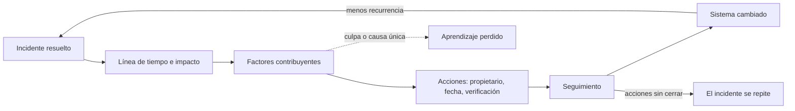

# SE-501 — Postmortems sin culpa y aprendizaje

[← SE-500 — Gestión de incidentes y comunicación](https://github.com/vladimiracunadev-create/modern-software-engineering-program/blob/main/classes/part-41-observabilidad-sre-e-incidentes/se-500-gestion-de-incidentes-y-comunicacion/README.md) · [↑ Parte 41](https://github.com/vladimiracunadev-create/modern-software-engineering-program/blob/main/classes/part-41-observabilidad-sre-e-incidentes/README.md) · [📚 Índice completo](https://github.com/vladimiracunadev-create/modern-software-engineering-program/blob/main/classes/README.md) · [🌐 Portal](https://vladimiracunadev-create.github.io/modern-software-engineering-program/classes/SE-501.html) · [SE-502 — Continuidad, disaster recovery y ejercicios →](https://github.com/vladimiracunadev-create/modern-software-engineering-program/blob/main/classes/part-41-observabilidad-sre-e-incidentes/se-502-continuidad-disaster-recovery-y-ejercicios/README.md)

## Punto profesional y fundamento pedagógico

**Punto profesional.** La clase existe para que conviertas un incidente en cambios del sistema: que escribas un postmortem que describa lo ocurrido sin buscar a quién culpar, que veas los factores contribuyentes en lugar de una única causa y que fijes acciones con propietario, fecha y criterio de verificación que se cierren de verdad. Un postmortem es útil si el sistema cambia; el documento, por sí solo, no es evidencia de aprendizaje.

**Por qué aparece aquí.** Sigue a **Gestión de incidentes y comunicación**: allí se coordinó la respuesta y se registró la línea de tiempo; aquí lo registrado se analiza. Prepara `SE-502`, donde se ensaya lo que aún no ha ocurrido. El caso conductor sigue siendo la API de entregas.

**Error conceptual que debe corregir.** Creer que «sin culpa» significa «sin responsabilidad» y que los cinco porqués llevan a la causa raíz. Sin culpa quiere decir que se busca por qué la acción tenía sentido para quien la tomó; y en un sistema con causas que convergen, la cadena de porqués llega a la raíz que la persona eligió seguir.

**Secuencia de aprendizaje.** Antes de ver los resultados predices cuántos incidentes quedan al tercer año si se completan el 30 % o el 90 % de las acciones, cuántas causas raíz distintas declararán 400 analistas sobre el mismo incidente y qué fracción de los defectos de un postmortem detecta un verificador de forma. Después contrastas con tres experimentos y escribes el postmortem de un incidente de la API. La secuencia usa predicción, explicación propia, contraste y recuperación. [ICAP](https://icap.education.asu.edu/research) distingue participación de construcción de conocimiento; [How People Learn II](https://nap.nationalacademies.org/catalog/24783/how-people-learn-ii-learners-contexts-and-cultures) respalda diseñar la práctica con contextos reales y retroalimentación.

**Evidencia de aprendizaje.** `postmortem-log.md` con la predicción, las tres figuras reproducidas, el postmortem de un incidente de la API de entregas con factores, acciones verificables y un plan de seguimiento, y una nota que separe lo simulado de lo que habría que observar en incidentes propios.

**Límite de la conclusión.** Los incidentes, el grafo de factores, los documentos y las tasas de cumplimiento son sintéticos y con semilla fija. No se analizó ningún incidente real ni se midió ninguna cultura de equipo; los dos postmortems públicos citados se usan como ejemplos de práctica, no como datos.

### Trazabilidad fuente → afirmación

| Fuente primaria u oficial | Afirmación que respalda | Lo que no prueba |
|---|---|---|
| [Google SRE: Postmortem Culture](https://sre.google/sre-book/postmortem-culture/) | Propone postmortems sin culpa, con criterios para escribirlos, revisarlos y compartirlos, y acciones con seguimiento. | No garantiza que tu equipo aprenda. |
| [Google SRE Workbook: Postmortem Culture](https://sre.google/workbook/postmortem-culture/) | Describe cómo introducir la práctica, qué errores evitar y cómo medir su adopción. | No mide el efecto de tus acciones. |
| [Cook, «How Complex Systems Fail»](https://how.complexsystems.fail/) | Argumenta que los fallos de sistemas complejos tienen múltiples causas contribuyentes y que la «causa raíz» es una atribución posterior. | No prueba que cada incidente tenga N causas. |
| [Fischhoff, «Hindsight ≠ foresight» (1975)](https://doi.org/10.1037/0096-1523.1.3.288) | Mostró que conocer el desenlace hace parecer más probable y más previsible lo ocurrido. | No mide el sesgo en equipos de software. |
| [Dekker, «The Field Guide to Understanding “Human Error”» (2014)](https://openlibrary.org/isbn/9781472439055) | Plantea que el «error humano» es un síntoma de problemas del sistema y que debe explicarse, no usarse como causa. | No ofrece un formato único. |
| [GitLab, «Postmortem of database outage of January 31» (2017)](https://about.gitlab.com/blog/2017/02/10/postmortem-of-database-outage-of-january-31/) | Ejemplo público de postmortem con línea de tiempo, múltiples fallos de recuperación y acciones. | No generaliza a otras organizaciones. |

## Antes de empezar

Recupera lo aprendido en `SE-500`: el incidente deja una línea de tiempo y una clasificación. La pregunta activa es: **¿qué debe haber cambiado en la API de entregas dentro de tres meses para decir que aprendimos de este incidente, y cómo lo comprobamos?**

## Prerrequisitos

- Haber completado `SE-500` o poder explicar qué es una línea de tiempo de incidente.
- Python 3.11 o posterior; los experimentos usan solo la biblioteca estándar (`random`, `math`).
- Nociones de grafo dirigido y de lista de acciones con propietario.

## Problema auténtico

La API de entregas rechazó entregas durante 47 minutos porque venció un certificado. El postmortem original dice: «Causa raíz: error humano; el operador no renovó el certificado a tiempo. Acción: tener más cuidado.» No tiene hora de detección, el impacto es «muchos estudiantes» y la acción no tiene responsable ni fecha. Seis meses después, un certificado distinto vence y el incidente se repite. Al revisar, el grafo real tenía al menos cinco factores: la renovación era manual, la alerta de vencimiento existía y estaba silenciada por fatiga, el runbook no la mencionaba, el propietario del certificado se había ido del equipo y el despliegue de ese día no tenía verificación posterior. «Error humano» era una conclusión; los factores eran el análisis. La clase enseña a escribir el segundo y a evitar el primero.

## Objetivos observables

Al terminar podrás:

1. escribir un postmortem sin culpa con resumen, impacto cuantificado, línea de tiempo, factores contribuyentes, lo que funcionó y acciones verificables;
2. explicar por qué una cadena de «cinco porqués» produce raíces distintas según quien la siga, y recorrer el grafo completo de factores;
3. calcular el efecto del cumplimiento de las acciones sobre la recurrencia;
4. verificar la forma de un postmortem y reconocer lo que ningún verificador de forma ve;
5. diseñar un seguimiento de acciones con propietario, fecha y criterio de verificación.

## Mapa conceptual



El mapa separa el **relato** (línea de tiempo e impacto), el **análisis** (factores) y el **cambio** (acciones y seguimiento). El aprendizaje solo existe en el último paso: un postmortem que no llega a F es documentación.

## Temas y por qué importan

| Tema | Por qué cambia una decisión profesional | Evidencia mínima |
|---|---|---|
| Postmortem sin culpa | La culpa esconde información y desincentiva el reporte. | Predicción, traza causal y contraejemplo de **Postmortem sin culpa** en `postmortem-log.md` |
| Línea de tiempo e impacto | Sin horas ni cifras no se puede analizar ni comparar. | Predicción, traza causal y contraejemplo de **Línea de tiempo e impacto** en `postmortem-log.md` |
| Factores contribuyentes | Una causa única esconde las que convergen. | Predicción, traza causal y contraejemplo de **Factores contribuyentes** en `postmortem-log.md` |
| Acciones y seguimiento | Una acción sin dueño ni verificación no se cumple. | Predicción, traza causal y contraejemplo de **Acciones y seguimiento** en `postmortem-log.md` |
| Calidad del documento | Lo que se puede revisar mecánicamente se revisa. | Predicción, traza causal y contraejemplo de **Calidad del documento** en `postmortem-log.md` |

## Conceptos y decisiones

### 1. Postmortem sin culpa

Un **postmortem** (o revisión posterior al incidente) es el documento que reconstruye un incidente para aprender de él. **Sin culpa** significa que el análisis parte de que cada persona actuó con la mejor información y las herramientas disponibles, y se pregunta por qué esa acción tenía sentido en ese momento, qué señales faltaban y qué lo hacía fácil de equivocar. No elimina la responsabilidad: la desplaza del individuo al sistema que dejó un camino fácil hacia el fallo. La razón es práctica: si nombrar una acción propia tiene consecuencias personales, la información se esconde, y sin información el análisis es mentira. El **sesgo de retrospectiva** refuerza el problema: quien conoce el desenlace lo ve como previsible. Lo que hoy parece una negligencia evidente («¿cómo no vio que vencía?») era, a las 14:00 de ese día, una señal más entre cuarenta. La frase «error humano» no es una causa: es el punto donde un análisis se detuvo antes de preguntar por qué ocurrió.

### 2. Línea de tiempo e impacto

La línea de tiempo registra, con horas y fuente, qué ocurrió, qué se observó y qué se decidió: cuándo empezó el efecto, cuándo se detectó y quién, cuándo se declaró, cada mitigación intentada y su resultado, cuándo se verificó la recuperación. Se separa lo que se sabía en cada momento de lo que se supo después. El **impacto** se cuantifica: peticiones o entregas afectadas, duración, instituciones, presupuesto de error consumido. «Muchos estudiantes» no permite comparar con otro incidente ni medir si una acción redujo el efecto; «1 240 entregas rechazadas en 47 minutos, 12 % del tráfico en esa franja» sí.

### 3. Factores contribuyentes, no una causa

Los fallos en sistemas complejos suelen necesitar varias condiciones a la vez: ninguna basta sola y cada una es normal por separado. El método de los **cinco porqués** pregunta «¿por qué?» repetidamente hasta llegar a una causa; su límite es que supone una cadena. En un grafo donde un efecto tiene varias causas, cada persona elige una rama y llega a una raíz distinta, y la que elige depende de lo que le resulta familiar. Para evitarlo se recorre el grafo completo: se listan los factores (técnicos, de proceso, de organización), se marcan los que, de haber sido distintos, habrían evitado o reducido el incidente y se deciden acciones por factor, sin forzar una jerarquía.

### Cinco porqués sobre un grafo

Se construye un grafo de 12 factores contribuyentes a un incidente de certificado vencido y de despliegue sin verificación (cada factor tiene de cero a dos causas). Se simulan 400 analistas que recorren el grafo eligiendo una causa al azar en cada paso hasta llegar a una raíz, y 2 000 grupos de cuatro analistas que juntan sus factores.

```python
while FACTORS[node]:
    node = rng.choice(FACTORS[node]); chain.add(node)      # una rama elegida al azar en cada porqué
coverage = len(chain) / len(factors)
```

| Resultado | Valor |
|---|---:|
| Causas raíz distintas declaradas por 400 analistas | 6 |
| Raíz más frecuente: «pipeline sin etapa de humo» | 110 de 400 (28 %) |
| Segunda: «presión por el plazo» | 101 de 400 (25 %) |
| Las otras cuatro raíces | 44 a 52 cada una |
| Factores del grafo que recorre una cadena (media) | 24,0 % |
| Factores cubiertos por cuatro analistas independientes | 61,3 % |


**Cómo leer la figura.** Cada barra es una causa raíz declarada y su largo los analistas, de 400, que la declaran tras seguir una cadena de porqués sobre el mismo grafo de 12 factores contribuyentes. El método no converge: aparecen seis raíces distintas, porque cada cadena recorre solo una parte del grafo. La fracción del grafo que ve una cadena y la que ven cuatro analistas independientes quedan en la tabla. **Dónde deja de valer:** el grafo (un síntoma, doce factores, doce aristas) es un caso construido por el autor para la clase y las elecciones al azar son uniformes; los analistas reales no eligen al azar sino por familiaridad, lo que concentra aún más. Esto no prueba que cada incidente tenga doce factores, solo que el método de una cadena pierde información cuando las causas convergen.

### 4. Acciones y seguimiento

Un postmortem se mide por los cambios que produce. Cada acción tiene: **propietario** (una persona o un equipo, no «alguien»), **fecha**, **descripción concreta** y **criterio de verificación** (cómo sabremos que funciona: una prueba que falla antes y pasa después, una alerta que se dispara en un ejercicio). Se priorizan las acciones que eliminan o reducen el efecto de un factor (automatizar la renovación) sobre las que piden atención humana («tener más cuidado»). Un seguimiento visible (una lista abierta que alguien revisa semanalmente) es lo que separa un postmortem de un trámite. La tasa de acciones completadas es la primera métrica de salud de la práctica.

### Cumplimiento de acciones y recurrencia

Se simulan 12 causas con tasas de incidente proporcionales a 1/k y 40 incidentes esperados el primer año. Cada vez que ocurre un incidente de una causa, con probabilidad c se completa su acción correctiva y la tasa de esa causa se reduce al 40 %. Se simulan tres años con 300 repeticiones para tres niveles de cumplimiento.

```python
n = poisson(rng, rate[i]); years[y] += n
for _ in range(n):
    if rng.random() < c: rate[i] *= 0.4          # la acción completada reduce la tasa de esa causa
```

| Acciones completadas | Año 1 | Año 2 | Año 3 |
|---:|---:|---:|---:|
| 30 % | 40,2 | 16,7 | 11,2 |
| 60 % | 40,2 | 9,7 | 5,9 |
| 90 % | 40,7 | 6,1 | 3,4 |


**Cómo leer la figura.** El eje horizontal es el año y el vertical los incidentes por año; cada línea es un porcentaje de acciones correctivas completadas. Todas parten del mismo punto, unos 40 incidentes; cuanto mayor es el cumplimiento, más rápido bajan, y las acciones que no se completan dejan las causas activas: con 30 por ciento todavía hay 11,2 incidentes en el tercer año. **Dónde deja de valer:** el 40 % de reducción por acción, las 12 causas independientes y la tasa proporcional a 1/k son supuestos del autor; en un sistema real las acciones interactúan y aparecen causas nuevas, de modo que el número no baja de forma indefinida. La figura es un argumento sobre el mecanismo: la mayor palanca de la práctica es cerrar las acciones.

### 5. Calidad del documento

Parte de la calidad de un postmortem se puede comprobar mecánicamente: ausencia de lenguaje de culpa, impacto con cifras, horas en la línea de tiempo, al menos dos factores, y acciones con propietario, fecha válida y criterio de verificación. Esas comprobaciones captan lo olvidado, no lo erróneo. Un documento puede pasarlas todas y culpar por implicación («como siempre, el turno de noche…»), proponer acciones vagas con un criterio de verificación vacío («se revisará») o contener una hora que no corresponde a lo ocurrido. Por eso la revisión humana de un compañero ajeno al incidente sigue siendo necesaria.

### Un verificador frente a 180 mutaciones

Se escribe un postmortem base (que el verificador acepta) y nueve operadores de mutación aplicados 20 veces. El verificador busca ocho expresiones de culpa, exige cifras en el impacto, horas en cada punto de la línea de tiempo, al menos dos factores y propietario, fecha y verificación en cada acción.

```python
if any(w in text for w in BLAME): problems.append("lenguaje de culpa")
if len(doc.get("factores", [])) < 2: problems.append("menos de dos factores contribuyentes")
```

| Mutación | Detectadas |
|---|---:|
| Culpa explícita («negligencia») | 20 de 20 |
| Acción sin propietario | 20 de 20 |
| Impacto sin cifras | 20 de 20 |
| Línea de tiempo sin hora | 20 de 20 |
| Una sola causa («error humano») | 20 de 20 |
| Culpa implícita («como siempre, el turno de noche…») | 0 de 20 |
| Acción vaga con verificación débil | 0 de 20 |
| Hora inventada fuera de orden | 0 de 20 |
| Acción desproporcionada con propietario genérico | 0 de 20 |


**Cómo leer la figura.** Cada barra es un tipo de mutación de un postmortem (20 de cada una) y el tramo teal son las que el verificador detecta y el coral las que deja pasar. Detecta las que rompen la forma (culpa explícita, acción sin propietario, impacto sin cifras, hora ausente, una sola causa) y no detecta las que cambian el sentido sin tocar la forma, como la culpa implícita o una hora inventada fuera de orden. **Dónde deja de valer:** el postmortem base, la lista de ocho expresiones de culpa y los nueve operadores son construcciones del autor, y el verificador se afinó con las mismas mutaciones que lo evalúan. Los cuatro defectos que se escapan son los que más importan: culpar sin nombrar, prometer sin poder verificar. Un documento limpio no es un documento que enseña.

## Definiciones de trabajo

- **postmortem:** documento que reconstruye un incidente para aprender de él y cambiar el sistema.
- **postmortem sin culpa:** análisis que parte de que cada persona actuó con la mejor información disponible y busca los factores del sistema.
- **factor contribuyente:** condición que, de haber sido distinta, habría evitado o reducido el incidente.
- **sesgo de retrospectiva:** tendencia a ver como previsible un desenlace conocido.
- **acción correctiva verificable:** cambio con propietario, fecha y criterio que permite comprobar que funciona.

Las definiciones son operativas para la API de entregas. No convierten términos con una historia más amplia en sinónimos y deben contrastarse con la documentación primaria enlazada al final.

## Ejemplo mínimo

El fragmento busca expresiones de culpa en un texto. Antes de ejecutarlo, predice el resultado.

```python
BLAME = ("negligencia", "descuido", "error humano", "debió haber")
text = "El fallo se debió a un descuido del operador de turno."
print([w for w in BLAME if w in text.lower()])
```

Imprime `['descuido']`. Registra versión de Python, comando y salida; después reescribe la frase sin culpa («el certificado vencía sin que ninguna alerta llegara a una persona») y comprueba que el verificador la acepta.

## Ejemplo profesional

Supón, como caso hipotético de la plataforma y no como medición, que el equipo escribe el postmortem del incidente del certificado con esta estructura. Resumen: entregas rechazadas durante 47 minutos por un certificado vencido. Impacto: 1 240 entregas rechazadas, 12 % de las peticiones en la franja, 4 instituciones afectadas, 31 % del presupuesto de error de 28 días. Línea de tiempo con horas: 14:02 vence el certificado, 14:09 salta la alerta de consumo, 14:21 se identifica la causa, 14:49 se instala el certificado nuevo. Factores: renovación manual, alerta de vencimiento silenciada por fatiga (`SE-498`), runbook sin mención, propietario ausente, sin verificación posterior al despliegue. Lo que funcionó: la alerta de consumo detectó en 7 minutos y el escalamiento llegó a la segunda persona en 4. Acciones: automatizar la renovación (equipo de plataforma, 15 de diciembre, criterio: el certificado de pruebas se renueva solo), alerta de vencimiento a 21 días con ticket y página a los 7 (equipo de guardia, 1 de diciembre, criterio: se dispara en el entorno de pruebas), añadir el paso al runbook (responsable de la API, 20 de noviembre) y designar dos propietarios por certificado. Un compañero ajeno al incidente revisa el documento antes de publicarlo. Cada lunes, alguien revisa la lista abierta y publica la tasa de acciones completadas. El equipo no concluye que el incidente no volverá: concluye que lo sabrá si vuelve y por qué.

## Práctica guiada

1. Predice los incidentes del año 3 para 30 %, 60 % y 90 % de cumplimiento y escribe el número antes de medir.
2. Ejecuta `python scripts/experiments_part41_b.py e429` y compara; anota la mayor diferencia con tu predicción.
3. Cambia el efecto de una acción de 0,4 a 0,7 y mide cuánto sube el año 3 al 90 %.
4. Añade dos aristas al grafo de factores y mide cuántas raíces distintas declaran 400 analistas.
5. Escribe el postmortem de un incidente de un servicio propio con la estructura de esta clase.
6. Escribe un verificador de forma con cinco reglas y una mutación que no detecte.
7. Entrega `postmortem-log.md` y pide a otra persona que lea el documento y encuentre una frase que culpe por implicación.

## Ejercicios

1. **Reescritura:** reescribe sin culpa «el desarrollador no probó el cambio y rompió producción».
2. **Factores:** a partir de un incidente que conozcas, lista al menos cinco factores y marca cuáles habrían evitado o reducido el efecto.
3. **Acciones:** convierte «mejorar el monitoreo» en una acción con propietario, fecha, descripción concreta y criterio de verificación.
4. **Seguimiento:** diseña una lista de seguimiento con tres campos más allá del texto de la acción y una regla para las que superan la fecha.

## Reto verificable

Entrega `postmortem-log.md` con la predicción, las tres tablas de resultados reproducidas con las mismas semillas, el postmortem de un incidente de un servicio propio (o inventado con datos sintéticos) con factores y acciones verificables, y el resultado de la revisión de una persona ajena. Se aprueba si otra persona ejecuta el código desde un checkout limpio, obtiene los mismos números y no encuentra en tu documento lenguaje de culpa ni acciones sin propietario, fecha y verificación. No se aprueba por entregar una plantilla vacía ni por declarar «error humano» como causa.

## Caso conductor

La API de entregas es el caso conductor de la Parte 41. Esta clase deja el noveno artefacto: un postmortem con factores y acciones verificables y un seguimiento. `SE-502` pregunta cómo preparar lo que todavía no ha ocurrido: continuidad, recuperación y ejercicios. Cambia después un solo parámetro, el cumplimiento de las acciones, y observa cuánto pesa en el tercer año.

## Preguntas frecuentes

### ¿«Sin culpa» significa que nadie responde de nada?

No. Significa que el análisis no busca a quién sancionar para explicar un fallo del sistema, porque eso esconde información. Las decisiones siguen siendo de alguien y se discuten con rigor; se distingue entre un error esperable en las condiciones y una negligencia deliberada, que es excepcional y se trata por otra vía.

### ¿Los cinco porqués están mal?

No están mal, tienen un límite. Funcionan bien con cadenas simples y mal con causas convergentes. Lo sano es usarlos para profundizar en cada rama de un grafo de factores y no para elegir una sola.

### ¿Hay que escribir un postmortem de cada incidente?

De los que superan un umbral (una severidad, un presupuesto consumido, un hallazgo nuevo) y de los casi incidentes que enseñaron algo. Lo importante es que el criterio sea conocido y que los postmortems escritos se terminen y se revisen.

### ¿Se deben publicar los postmortems?

Internamente, sí, para que otros equipos aprendan. Externamente depende: algunas organizaciones publican versiones resumidas. Deben proteger datos personales y detalles que faciliten un ataque.

## Fallo controlado y diagnóstico

Reproduce el fallo clásico de la clase: **cerrar un postmortem con «error humano» como causa y una acción sin dueño**. Ejecuta el verificador sobre ese documento.

Registra síntoma, entrada mínima, hipótesis, observación que descarta cada hipótesis, causa, corrección y prueba de regresión. **Síntoma:** el mismo incidente se repite seis meses después y el postmortem anterior dice «tener más cuidado». **Hipótesis rivales:** (a) la persona no tuvo cuidado; (b) la acción se olvidó por falta de seguimiento; (c) el sistema seguía permitiendo el fallo. **Prueba:** compara los factores del incidente con las acciones cerradas; si ninguna acción cambió un factor, la hipótesis (c) explica la repetición. **Conclusión:** la acción no tenía propietario ni criterio de verificación, y no modificaba ninguna condición del sistema. **Regresión:** añade el verificador a la plantilla del postmortem (acción sin propietario, fecha o verificación, lenguaje de culpa, un solo factor) y una revisión semanal de la lista de acciones. No cambies a la vez el formato y el seguimiento.

## Errores comunes y cómo corregirlos

| Síntoma | Causa probable | Corrección |
|---|---|---|
| El postmortem culpa a una persona | Análisis detenido en «error humano» | Preguntar por qué la acción tenía sentido y qué lo facilitó |
| El incidente se repite | Acciones sin propietario, fecha o verificación | Acciones verificables y seguimiento semanal |
| Cada analista concluye algo distinto | Cadena lineal sobre causas que convergen | Recorrer el grafo de factores con varias personas |
| No se puede comparar con otro incidente | Impacto sin cifras | Cuantificar entregas, duración y presupuesto consumido |
| El documento está limpio y no enseña | Se revisó solo la forma | Revisión de una persona ajena al incidente |

## Entorno y archivos clave

```text
work/SE-501/
├── README.md
├── postmortem/
│   ├── recurrencia.py
│   ├── factores.py
│   └── verificador.py
├── plantillas/postmortem.md
├── tests/test_postmortem.py
└── evidence/postmortem-log.md
```

El `README` declara plataforma, versión de Python, semillas y comandos. Los experimentos usan solo la biblioteca estándar y se ejecutaron con CPython 3.12.9 en Windows 11 y 3.12.3 en Ubuntu bajo WSL2 con cifras idénticas. Para recuperar el estado, borra `work/SE-501/` y repite los scripts. Si añades una dependencia, fija procedencia y versión.

## Seguridad, ética y accesibilidad

- un postmortem puede contener datos personales y detalles de vulnerabilidades: revisa qué se publica y a quién, y elimina nombres de personas salvo roles;
- el entorno del postmortem debe ser psicológicamente seguro: quien teme sanciones esconde información, y quien la esconde deja el sistema sin corregir;
- cuando un incidente afecta a personas usuarias de un modo relevante (pérdida de datos, plazos incumplidos), comunica lo ocurrido a quienes corresponda con claridad;
- documenta las tablas y las figuras con texto alternativo y en un formato que un lector de pantalla pueda recorrer;
- respeta las licencias de los libros y artículos y atribuye lo adaptado.

## Puente hacia el trabajo con agentes

Un agente al que se le pide «escribe el postmortem de este incidente» producirá un documento fluido con una causa raíz clara y acciones razonables, y probablemente inventará horas, cifras y relaciones causales que no están en los registros. Pídele en cambio que parta de la línea de tiempo y de los datos que le des, que marque lo que desconoce, que proponga factores con la evidencia que los sustenta, que no use lenguaje de culpa y que deje las acciones sin propietario ni fecha hasta que una persona las asigne. Revisa especialmente las horas, las cifras de impacto y las afirmaciones de causa sin fuente.

## Transferencia

Traslada el formato a otro tipo de evento (un casi incidente, un despliegue fallido, un problema de calidad de datos): reconstruye su línea de tiempo, lista sus factores y define las acciones. La transferencia está lograda cuando puedes decir qué factor no habría salido con una cadena de porqués y qué acción comprobarías en un ejercicio, no cuando existe un documento firmado.

## Evaluación y evidencia

| Criterio | Evidencia para aprobar |
|---|---|
| comprensión | explicación de «sin culpa», del sesgo de retrospectiva y de la diferencia entre cadena y grafo |
| corrección | tablas de recurrencia, de factores y de verificador reproducibles con las mismas semillas |
| diseño | postmortem con línea de tiempo, impacto, factores y acciones verificables con seguimiento |
| diagnóstico | reproducción del fallo «error humano y acción sin dueño» con regresión |
| incertidumbre | declaración de que los incidentes, el grafo y los documentos son sintéticos |
| reproducibilidad | versiones, comandos, salida y límites declarados |

## Fuentes

- [Google SRE: Postmortem Culture](https://sre.google/sre-book/postmortem-culture/) — práctica sin culpa; autoridad: libro de ingeniería de confiabilidad de Google.
- [Google SRE Workbook: Postmortem Culture](https://sre.google/workbook/postmortem-culture/) — adopción y errores comunes; autoridad: Google, SRE Workbook.
- [Cook, «How Complex Systems Fail»](https://how.complexsystems.fail/) — múltiples causas contribuyentes; autoridad: texto del autor, Richard I. Cook.
- [Fischhoff, «Hindsight ≠ foresight»](https://doi.org/10.1037/0096-1523.1.3.288) — sesgo de retrospectiva; autoridad: Journal of Experimental Psychology, 1975.
- [Dekker, «The Field Guide to Understanding “Human Error”»](https://openlibrary.org/isbn/9781472439055) — ISBN 978-1-4724-3905-5; autoridad: libro, CRC Press, 2014.
- [GitLab, postmortem de la interrupción de la base de datos del 31 de enero de 2017](https://about.gitlab.com/blog/2017/02/10/postmortem-of-database-outage-of-january-31/) — ejemplo público de postmortem; autoridad: publicación de la propia organización.

Cada fuente respalda el mecanismo indicado; ninguna demuestra que 6 raíces distintas, 3,4 incidentes en el año 3 o 100 de 180 mutaciones detectadas se observen en un equipo real. Esa afirmación depende de la cultura, del sistema y de los incidentes.

## Límites y siguiente paso

Se ejecutaron tres experimentos con tiempo virtual y semillas fijas en Windows y Ubuntu (WSL2) con resultados idénticos. No se analizó ningún incidente real; el grafo de 12 factores, los analistas que eligen ramas al azar, las 12 causas con tasas 1/k, el 40 % de reducción por acción, el documento base y los nueve operadores son construcciones del autor, y el verificador se afinó con las mismas mutaciones que lo evalúan. La siguiente clase pregunta cómo prepararse para el fallo que aún no ha ocurrido: continuidad, recuperación y ejercicios.

## Glosario

- **postmortem:** documento que reconstruye un incidente para aprender de él y cambiar el sistema.
- **postmortem sin culpa:** análisis que parte de que cada persona actuó con la mejor información disponible y busca los factores del sistema.
- **factor contribuyente:** condición que, de haber sido distinta, habría evitado o reducido el incidente.
- **sesgo de retrospectiva:** tendencia a ver como previsible un desenlace conocido.
- **acción correctiva verificable:** cambio con propietario, fecha y criterio que permite comprobar que funciona.

---

[← SE-500 — Gestión de incidentes y comunicación](https://github.com/vladimiracunadev-create/modern-software-engineering-program/blob/main/classes/part-41-observabilidad-sre-e-incidentes/se-500-gestion-de-incidentes-y-comunicacion/README.md) · [↑ Parte 41](https://github.com/vladimiracunadev-create/modern-software-engineering-program/blob/main/classes/part-41-observabilidad-sre-e-incidentes/README.md) · [📚 Índice completo](https://github.com/vladimiracunadev-create/modern-software-engineering-program/blob/main/classes/README.md) · [🌐 Portal](https://vladimiracunadev-create.github.io/modern-software-engineering-program/classes/SE-501.html) · [SE-502 — Continuidad, disaster recovery y ejercicios →](https://github.com/vladimiracunadev-create/modern-software-engineering-program/blob/main/classes/part-41-observabilidad-sre-e-incidentes/se-502-continuidad-disaster-recovery-y-ejercicios/README.md)
