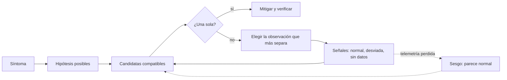

# SE-503 — Taller: diagnosticar con telemetría incompleta

[← SE-502 — Continuidad, disaster recovery y ejercicios](https://github.com/vladimiracunadev-create/modern-software-engineering-program/blob/main/classes/part-41-observabilidad-sre-e-incidentes/se-502-continuidad-disaster-recovery-y-ejercicios/README.md) · [↑ Parte 41](https://github.com/vladimiracunadev-create/modern-software-engineering-program/blob/main/classes/part-41-observabilidad-sre-e-incidentes/README.md) · [📚 Índice completo](https://github.com/vladimiracunadev-create/modern-software-engineering-program/blob/main/classes/README.md) · [🌐 Portal](https://vladimiracunadev-create.github.io/modern-software-engineering-program/classes/SE-503.html) · [SE-504 — Proyecto: operación observable y recuperable →](https://github.com/vladimiracunadev-create/modern-software-engineering-program/blob/main/classes/part-41-observabilidad-sre-e-incidentes/se-504-proyecto-operacion-observable-y-recuperable/README.md)

## Punto profesional y fundamento pedagógico

**Punto profesional.** El taller existe para que practiques lo que ocurre en un incidente real: diagnosticar con señales que faltan, que llegan tarde o que mienten. Aprenderás a distinguir «normal» de «sin datos», a contar cuántas hipótesis sobreviven a lo que sabes, a elegir la siguiente observación por lo que separa hipótesis y no por lo que cuesta menos, y a sospechar de la propia telemetría cuando falla justo cuando el sistema falla.

**Por qué aparece aquí.** Sigue a **Continuidad, disaster recovery y ejercicios**: en un desastre, las herramientas de observación son las primeras en degradarse. Integra todo lo anterior de la parte (señales, registros, métricas, trazas, objetivos, alertas, guardia, incidentes, postmortems) en una práctica de diagnóstico, y prepara el proyecto final. El caso conductor sigue siendo la API de entregas.

**Error conceptual que debe corregir.** Creer que la ausencia de una señal significa que no ocurre, y que se diagnostica mirando primero lo más fácil de consultar. Una señal ausente puede estar normal o puede no estar siendo registrada, y la telemetría pierde líneas, a menudo más cuando más falla el sistema.

**Secuencia de aprendizaje.** Antes de resolver el escenario predices cuántas hipótesis sobrevivirán, qué estrategia de observación aísla más rápido la falla y cuánto se subestima una tasa de error si el agente pierde las líneas de error con mayor probabilidad. Después ejecutas el taller, compruebas con tres experimentos y escribes tu bitácora de diagnóstico. La secuencia usa predicción, explicación propia, contraste y recuperación. [ICAP](https://icap.education.asu.edu/research) distingue participación de construcción de conocimiento; [How People Learn II](https://nap.nationalacademies.org/catalog/24783/how-people-learn-ii-learners-contexts-and-cultures) respalda diseñar la práctica con contextos reales y retroalimentación.

**Evidencia de aprendizaje.** `diagnostico-log.md` con la predicción, el diagnóstico del escenario paso a paso (observación, hipótesis que descarta, hipótesis que queda), las tres figuras reproducidas y una lista de las señales que habría que añadir para que el escenario fuera inequívoco.

**Límite de la conclusión.** Las diez fallas, las doce señales, sus firmas y las pérdidas de líneas son una construcción del autor y no describen ningún sistema real. Las firmas son binarias (la señal se desvía o no), cuando las señales reales son continuas y ruidosas; los resultados ordenan estrategias, no estiman cuántos pasos necesitará una guardia.

### Trazabilidad fuente → afirmación

| Fuente primaria u oficial | Afirmación que respalda | Lo que no prueba |
|---|---|---|
| [Google SRE: Effective Troubleshooting](https://sre.google/sre-book/effective-troubleshooting/) | Describe el diagnóstico como un ciclo de hipótesis, pruebas y descarte, con problemas de reporte, examen y corrección. | No da un algoritmo para tu sistema. |
| [Google SRE: Monitoring Distributed Systems](https://sre.google/sre-book/monitoring-distributed-systems/) | Propone las cuatro señales de oro y distingue síntoma de causa. | No cubre telemetría perdida. |
| [Cook, «How Complex Systems Fail»](https://how.complexsystems.fail/) | Describe que los sistemas complejos operan en modo degradado y que la atribución a una causa es posterior al hecho. | No mide diagnósticos. |
| [Fischhoff, «Hindsight ≠ foresight» (1975)](https://doi.org/10.1037/0096-1523.1.3.288) | Muestra que conocer el desenlace sesga el juicio sobre lo que era previsible, relevante para lo que parecía obvio durante el diagnóstico. | No mide el sesgo en equipos de operaciones. |
| [OpenTelemetry: Signals](https://opentelemetry.io/docs/concepts/signals/) | Define las señales de telemetría que pueden faltar o degradarse. | No cuantifica las pérdidas. |

## Antes de empezar

Recupera lo aprendido en toda la parte: qué señales existen (`SE-493` a `SE-496`), qué promesa defendemos (`SE-497`), cuándo se avisa (`SE-498`), quién responde (`SE-499`, `SE-500`) y cómo se aprende (`SE-501`, `SE-502`). La pregunta activa es: **con la mitad de las señales caídas o dudosas, ¿qué puedo afirmar, qué no y qué miro a continuación?**

## Prerrequisitos

- Haber completado `SE-502` o poder explicar qué es un RPO y un mapa de dependencias.
- Python 3.11 o posterior; los experimentos usan solo la biblioteca estándar (`random`, `itertools`).
- Nociones de combinaciones, de entropía como «cuánto reparte una pregunta» y de sesgo de selección.

## Problema auténtico

A las 14:03 la API de entregas devuelve errores 5xx y su p99 se dispara. Se sabe que no han cambiado ni la versión desplegada ni las conexiones a la base de datos, y que no hay fallos de resolución, errores de TLS, cambios en la caché ni errores 429. No hay datos de la profundidad de la cola, ni de los reinicios de contenedores, ni del uso de disco, ni de la memoria: el agente de métricas del nodo está caído desde las 13:50. Alguien propone «mirar los registros», pero los registros del incidente conservan menos líneas de error de las que hubo, porque el agente descarta más cuanto más falla el sistema. La guardia debe decidir entre una dependencia externa caída, un DNS inestable o un despliegue, sin saber cuáles de las señales que no ve están normales y cuáles faltan. El taller convierte esa situación en un procedimiento.

## Objetivos observables

Al terminar podrás:

1. representar un diagnóstico como una tabla de firmas (qué señal se desvía con cada falla) y calcular los candidatos que sobreviven a lo observado;
2. distinguir una señal normal de una señal sin datos y medir cuánto aumenta la ambigüedad cuando faltan señales;
3. comparar estrategias de observación por pasos y coste hasta aislar la falla;
4. estimar el sesgo de una tasa de error leída en registros cuando la pérdida depende del error;
5. escribir una bitácora de diagnóstico con hipótesis, descartes y siguiente observación.

## Mapa conceptual



El mapa separa lo **observado** (con tres estados), lo **compatible** (hipótesis que sobreviven) y lo **siguiente** (la observación que más separa). La flecha de puntos advierte que la telemetría perdida se confunde con normalidad.

## Temas y por qué importan

| Tema | Por qué cambia una decisión profesional | Evidencia mínima |
|---|---|---|
| Firmas y candidatas | Convierte el diagnóstico en eliminación explícita. | Predicción, traza causal y contraejemplo de **Firmas y candidatas** en `diagnostico-log.md` |
| Normal frente a sin datos | Una señal ausente amplía el conjunto de candidatas. | Predicción, traza causal y contraejemplo de **Normal frente a sin datos** en `diagnostico-log.md` |
| Siguiente observación | Elegir lo más informativo ahorra pasos y coste. | Predicción, traza causal y contraejemplo de **Siguiente observación** en `diagnostico-log.md` |
| Telemetría que se pierde | La pérdida correlacionada con el fallo subestima el fallo. | Predicción, traza causal y contraejemplo de **Telemetría que se pierde** en `diagnostico-log.md` |
| Bitácora | Escribir hipótesis y descartes evita el sesgo de lo evidente. | Predicción, traza causal y contraejemplo de **Bitácora** en `diagnostico-log.md` |

## Conceptos y decisiones

### 1. Firmas y candidatas

Una **firma** es el conjunto de señales que se desvían cuando ocurre una falla concreta. La tabla de firmas es el modelo mínimo de un diagnóstico: cada fila una falla posible y cada columna una señal. Las diez fallas de este taller y sus firmas (las señales que se desvían, de las doce disponibles) son:

| Falla | Señales que se desvían |
|---|---|
| Certificado vencido | errores 5xx; errores de TLS |
| Base saturada | errores 5xx; latencia p99; conexiones a la base |
| Cola atrasada | latencia p99; profundidad de la cola |
| Despliegue defectuoso | errores 5xx; latencia p99; reinicios de contenedores; versión desplegada |
| Caché fría | latencia p99; conexiones a la base; tasa de aciertos de caché |
| DNS inestable | errores 5xx; latencia p99; fallos de resolución |
| Disco lleno | errores 5xx; profundidad de la cola; reinicios de contenedores; uso de disco |
| Dependencia externa caída | errores 5xx; latencia p99; profundidad de la cola |
| Fuga de memoria | latencia p99; reinicios de contenedores; memoria del proceso |
| Límite de cuota | errores 5xx; errores 429 |

Dado lo observado, una falla es **candidata** si su firma coincide con todas las señales que se han mirado: las que se observaron desviadas deben estar en su firma, y las que se observaron normales no deben estarlo. Las señales sin datos no excluyen a nadie. El diagnóstico es la reducción del conjunto de candidatas hasta que queda una o hasta que la siguiente observación decide entre las que quedan.

### 2. Normal frente a sin datos

Cada señal tiene tres estados posibles durante un incidente: **desviada**, **normal** y **sin datos**. Confundir los dos últimos es el error más caro, porque una señal que no se está registrando se lee, por costumbre, como una señal sin problema. Con las doce señales y la tabla anterior, un escenario con cinco señales conocidas deja una sola candidata; el mismo escenario con tres señales más sin datos deja cuatro. Esta es la función `candidatos`, que se puede ejecutar y modificar:

```python
def candidatos(observado):          # observado: señal -> True (desviada), False (normal) o None (sin datos)
    return [f for i, f in enumerate(FALLAS)
            if all(v is None or MATRIZ[i][SENALES.index(k)] == int(v) for k, v in observado.items())]
```

Con el escenario del problema (5xx y p99 desviadas; conexiones, resolución, TLS, caché, 429 y versión normales; cola, reinicios, disco y memoria sin datos), queda una sola candidata: **dependencia externa caída**. Si la señal de fallos de resolución estuviera sin datos en lugar de normal, quedan dos: DNS inestable y dependencia externa caída. Si fuera la versión desplegada, quedan dos: despliegue defectuoso y dependencia externa. Si las tres (resolución, versión y conexiones) estuvieran sin datos, quedan cuatro. La conclusión práctica es que la fiabilidad de un diagnóstico depende más de qué señales estén verificadas como normales que de cuántas estén desviadas.

### Fallas indistinguibles al faltar señales

Se calculan, para todas las combinaciones de señales ausentes de tamaño 0, 1, 2, 3, 4 y 6, cuántas clases de firma distintas quedan entre las diez fallas, cuántas fallas se identifican sin ambigüedad (su firma es única entre las visibles) y el mayor grupo de fallas indistinguibles.

```python
key = tuple(f[i] for i in keep)             # firma restringida a las señales que quedan
sigs[key] = sigs.get(key, 0) + 1
```

| Señales ausentes | Clases distinguibles | Fallas sin ambigüedad | Mayor grupo indistinguible | Combinaciones |
|---:|---:|---:|---:|---:|
| 0 | 10,00 | 10,00 | 1 | 1 |
| 1 | 9,92 | 9,83 | 2 | 12 |
| 2 | 9,76 | 9,52 | 2 | 66 |
| 3 | 9,47 | 8,95 | 3 | 220 |
| 4 | 9,00 | 8,10 | 4 | 495 |
| 6 | 7,50 | 5,78 | 5 | 924 |


**Cómo leer la figura.** El eje horizontal es el número de señales ausentes, de doce, y el vertical el número de fallas, de diez; la línea teal son las clases de falla distinguibles y la coral las fallas que se identifican sin ambigüedad, en promedio. Con todas las señales se distinguen las diez; al faltar señales las dos líneas bajan, y la de fallas sin ambigüedad baja más rápido. El mayor grupo indistinguible y las combinaciones posibles quedan en la tabla. **Dónde deja de valer:** la matriz es del autor, con señales binarias y sin ruido; las señales reales son continuas, se desvían a destiempo y no siempre se desvían. La tabla sirve para contar ambigüedades, no para estimar probabilidades. Lo que falta importa más que cuántas faltan.

### 3. Elegir la siguiente observación

Cuando queda más de una candidata, hay que decidir qué mirar. Tres criterios habituales: lo **más barato** primero (porque ya está en un panel), lo que **mejor reparte** las candidatas (el que divide el conjunto lo más cerca posible de la mitad, la mayor ganancia de información), o **al azar** (lo que ocurre cuando no hay criterio). Lo más barato es una buena regla cuando todas las señales separan igual, y una mala cuando las baratas son las que menos separan, como un indicador que se desvía con casi todas las fallas. La ganancia de información exige conocer la tabla de firmas, lo que justifica construirla antes del incidente. En la práctica, el criterio combina las dos: la que más separa por unidad de coste.

### Tres estrategias de observación

Se simulan 4 000 diagnósticos de una falla elegida al azar entre las diez, con las doce señales disponibles y costes de observación de 1 a 4 (la de memoria cuesta 4; las de conexiones, resolución y caché, 3). En cada paso se elige una señal sin usar, se observa su valor real para la falla verdadera y se eliminan las candidatas que no coinciden, hasta que queda una sola.

```python
pick = max(unused, key=lambda s: -abs(sum(MATRIX[c][s] for c in candidates) - len(candidates) / 2) - 0.01 * cost[s])
candidates = [c for c in candidates if MATRIX[c][pick] == MATRIX[truth][pick]]
```

| Estrategia | Observaciones hasta aislar | Coste medio |
|---|---:|---:|
| Mayor ganancia de información | 3,59 | 4,98 |
| La más barata primero | 6,09 | 8,49 |
| Al azar | 5,81 | 12,08 |


**Cómo leer la figura.** Cada grupo de barras es una estrategia para elegir la siguiente observación; la barra teal son las observaciones hasta aislar la falla y la dorada el coste medio. Elegir la observación que mejor reparte las hipótesis restantes aísla la falla con menos observaciones y menos coste (3,59 y 4,98) que mirar primero lo más barato (6,09 y 8,49) o elegir al azar (5,81 y 12,08). **Dónde deja de valer:** las firmas son binarias y sin ruido, y las observaciones nunca fallan; con medidas ruidosas hay que repetirlas y la ventaja de elegir bien se reduce. Los costes de 1 a 4 son del autor. Además, una buena estrategia necesita que la tabla de firmas sea correcta: si la tabla está equivocada, el procedimiento aísla con total seguridad la falla equivocada.

### 4. Telemetría que se pierde

La telemetría falla justo cuando el sistema falla. Los agentes tienen búferes que se desbordan con la carga, las líneas de error son más largas y más caras de enviar, un servicio que se reinicia pierde lo que no había enviado, y un nodo caído deja de informar del todo. Lo que importa es que la pérdida **no es independiente del fallo**: si se pierden más líneas de error que de éxito, la tasa de error que se lee en los registros subestima la real, justo durante el incidente. Y una ausencia de líneas de error se lee como «no hay errores».

### Tasa de error leída en registros con pérdida selectiva

Se generan 9 000 líneas de un incidente con un 12 % de errores reales. Se conservan según tres modelos de pérdida: igual para todas (2 %), con un 25 % de pérdida en las líneas de error y con un 50 %. Se calcula la tasa de error que mediría quien leyera solo las líneas conservadas.

```python
lines = [(rng.random() < 0.12, rng.random()) for _ in range(60 * 150)]       # mismas líneas en los tres modelos
if u > (drop_err if is_err else drop_ok): kept += 1;  kept_err += is_err
```

| Modelo de pérdida | Tasa real | Tasa observada | Líneas conservadas |
|---|---:|---:|---:|
| Igual para todas las líneas (2 %) | 12,53 % | 12,51 % | 98,0 % |
| 25 % de pérdida en las líneas de error | 12,53 % | 10,20 % | 95,4 % |
| 50 % de pérdida en las líneas de error | 12,53 % | 6,99 % | 92,1 % |


**Cómo leer la figura.** Cada grupo de barras es un modelo de pérdida de líneas del agente de registros; la barra azul es la tasa de error real y la coral la que se lee en los registros conservados. Si se pierde igual proporción de cualquier línea la tasa observada coincide con la real; si el agente pierde más líneas de error que de éxito, la tasa observada baja y el incidente parece menos grave de lo que fue. **Dónde deja de valer:** los porcentajes de pérdida son supuestos del autor, no una medición de ningún agente, y la pérdida real tampoco es constante durante un incidente. Se pueden detectar estas pérdidas comparando los registros con una fuente independiente (el contador de errores del balanceador) y alertando cuando las cifras no coincidan.

### 5. La bitácora de diagnóstico

Escribir el diagnóstico mientras se hace tiene dos efectos: obliga a separar lo observado de lo supuesto y deja la línea de tiempo que usará el postmortem (`SE-501`). Cada entrada tiene cuatro campos: **hora**, **observación** (con su estado: desviada, normal o sin datos), **hipótesis que queda o que se descarta** y **siguiente paso con su razón**. Una entrada como «hora 14:12, conexiones a la base: normal (panel X); descarta base saturada y caché fría; siguiente: tasa de resolución, porque separa DNS de dependencia» se puede revisar y se puede equivocar de forma visible.

## Definiciones de trabajo

- **firma de una falla:** conjunto de señales que se desvían cuando ocurre esa falla.
- **candidata:** falla cuya firma coincide con todas las señales observadas.
- **señal sin datos:** señal que no se está registrando o consultando y que no permite concluir que esté normal.
- **ganancia de información:** reducción de la incertidumbre que produce una observación; mide cuánto separa las hipótesis restantes.
- **pérdida selectiva de telemetría:** pérdida de datos que depende del propio fallo y sesga lo que se observa.

Las definiciones son operativas para la API de entregas. No convierten términos con una historia más amplia en sinónimos y deben contrastarse con la documentación primaria enlazada al final.

## Ejemplo mínimo

El fragmento calcula los candidatos con una tabla reducida de tres fallas y tres señales. Antes de ejecutarlo, predice el resultado.

```python
fallas = {"dns": (1, 1, 0), "base": (0, 1, 1), "cuota": (1, 0, 0)}
señales = ["5xx", "p99", "conexiones"]
observado = {"5xx": True, "p99": True, "conexiones": None}
print([f for f, firma in fallas.items() if all(v is None or firma[señales.index(k)] == int(v) for k, v in observado.items())])
```

Imprime `['dns']`: la base no tiene 5xx y la cuota no desvía p99. Registra versión de Python, comando y salida; después cambia `conexiones` a `True` y a `False` y observa qué candidatas quedan.

## Ejemplo profesional

Supón, como caso hipotético de la plataforma y no como medición, que el equipo ejecuta el taller con el escenario del problema. La guardia abre la bitácora a las 14:05 y anota: 5xx desviada, p99 desviada, conexiones a la base normal, fallos de resolución normal, errores de TLS normal, caché normal, 429 normal, versión desplegada sin cambio; profundidad de la cola, reinicios, disco y memoria sin datos por la caída del agente. La función de candidatas devuelve una sola: dependencia externa caída. Antes de actuar, la persona de guardia hace dos cosas: verifica que las señales que dio por normales lo estén de verdad (la de resolución, comparándola con la del balanceador, y la de versión, comprobando el último despliegue en el historial) y mira la señal más separadora que aún falta, la profundidad de la cola, a través de la consola del broker, porque ya no depende del agente caído. La cola está atrasada: coincide con la falla. Mitiga activando la ruta degradada de `SE-439` que acepta las entregas sin esperar al almacenamiento, verifica el SLI y deja anotado en el postmortem que el agente de métricas no tenía alerta propia. El equipo no concluye que el diagnóstico fue correcto por haber coincidido: concluye que cada paso tiene su razón escrita y se puede discutir.

## Práctica guiada

1. Predice cuántas candidatas quedan si una sola de las señales que dimos por normales estuviera sin datos, para cada una de las seis.
2. Ejecuta `python scripts/experiments_part41_b.py e431` y compara; anota la mayor diferencia con tu predicción.
3. Modifica la tabla de firmas para que dos fallas tengan la misma firma y comprueba qué hace cada estrategia.
4. Cambia el coste de la memoria del proceso de 4 a 1 y observa cómo cambia la estrategia de ganancia.
5. Cambia la pérdida de las líneas de error a 75 % y calcula la tasa observada.
6. Escribe la bitácora del escenario de la clase con las cuatro columnas.
7. Entrega `diagnostico-log.md` y pide a otra persona que proponga una señal más que habría que añadir para que el escenario sea inequívoco.

## Ejercicios

1. **Candidatas:** con 5xx desviada, p99 normal y errores 429 desviada, indica qué fallas quedan y qué observación elegirías para confirmar.
2. **Sin datos:** en el escenario del problema, ¿qué observaciones debes verificar como normales antes de aceptar que solo queda una candidata?
3. **Estrategia:** si dos señales separan igual pero una cuesta 4 veces más, ¿cuál eliges? Si la barata se desvía con casi todas las fallas, ¿cambia tu respuesta?
4. **Sesgo:** un contador del balanceador dice 5 000 errores y los registros 3 200 en el mismo intervalo; ¿qué pérdida estimas y qué alerta propones?

## Reto verificable

Entrega `diagnostico-log.md` con la predicción, las tres tablas de resultados reproducidas con las mismas semillas, la bitácora del escenario con las cuatro columnas, el resultado de la función de candidatas con tres variaciones de lo que falta y una propuesta de qué telemetría añadir y cómo vigilarla. Se aprueba si otra persona ejecuta el código desde un checkout limpio, obtiene los mismos números y puede seguir tu bitácora hasta la misma conclusión. No se aprueba por diagnosticar sin escribir las hipótesis descartadas ni por dar por normales las señales sin datos.

## Caso conductor

La API de entregas es el caso conductor de la Parte 41. El taller deja el undécimo artefacto: una bitácora de diagnóstico y una lista de telemetría que vigilar. `SE-504` reúne todo en un paquete operativo reproducible: señales, objetivos, alertas, runbooks, copias y ejercicios. Cambia después un solo dato, qué señal falta, y observa cómo cambia el conjunto de candidatas.

## Preguntas frecuentes

### ¿Cómo sé que una señal está normal y no caída?

Comparándola con una fuente independiente o comprobando que sigue llegando: un latido (una métrica que siempre existe) por agente, una alerta cuando falta, y una segunda medida del mismo fenómeno desde otro punto (el balanceador y la aplicación). Una señal sin latido no se puede leer como normal.

### ¿Es siempre mejor elegir la observación más informativa?

Casi siempre, salvo que sea muy cara, arriesgada o lenta. Si la observación más informativa exige entrar en producción con permisos elevados, puede convenir una menos informativa y más segura. El criterio es la ganancia por unidad de coste y de riesgo.

### ¿Cómo evito quedarme con la hipótesis más cómoda?

Anotando las hipótesis rivales antes de mirar, buscando la observación que podría refutar la preferida y pidiendo a otra persona que defienda la alternativa. El sesgo de retrospectiva y la confirmación empujan hacia lo que parece obvio.

### ¿Sirve este modelo si las señales no son binarias?

Sirve como disciplina, no como cálculo. Con señales continuas hay que decidir cuándo una señal está «desviada» y cuánta incertidumbre tiene esa decisión; el procedimiento (candidatas, siguiente observación, bitácora) se mantiene.

## Fallo controlado y diagnóstico

Reproduce el fallo clásico del taller: **tratar «sin datos» como «normal»**. Pon la señal de fallos de resolución sin datos en el escenario del problema.

Registra síntoma, entrada mínima, hipótesis, observación que descarta cada hipótesis, causa, corrección y prueba de regresión. **Síntoma:** el equipo actúa sobre la dependencia externa y los errores continúan porque era un DNS inestable. **Hipótesis rivales:** (a) la dependencia externa estaba caída y no se corrigió bien; (b) hay dos fallas a la vez; (c) la señal de resolución estaba sin datos y se leyó como normal. **Prueba:** ejecuta la función de candidatas con la señal de resolución como `None`; si devuelve DNS inestable y dependencia externa caída, la hipótesis (c) explica la señal. **Conclusión:** la candidata única era un artefacto de leer una ausencia como normalidad. **Regresión:** añade a la bitácora una columna que obligue a anotar el estado de cada señal (desviada, normal, sin datos) y un latido por agente que genere una alerta si falta. No cambies a la vez la bitácora y la telemetría.

## Errores comunes y cómo corregirlos

| Síntoma | Causa probable | Corrección |
|---|---|---|
| El equipo actúa sobre la causa equivocada | Una señal sin datos se leyó como normal | Tres estados por señal y latido por agente |
| El diagnóstico tarda en converger | Se miran primero las señales más baratas | Elegir la que más separa las candidatas, ponderada por coste |
| La tasa de error parece menor que la real | Pérdida selectiva de líneas de error | Comparar con una fuente independiente y alertar si divergen |
| Dos personas concluyen cosas distintas | Hipótesis no escritas | Bitácora con observación, hipótesis y siguiente paso |
| La tabla de firmas aísla la falla equivocada | La tabla estaba mal | Revisarla tras cada incidente y probarla con inyección de fallos |

## Entorno y archivos clave

```text
work/SE-503/
├── README.md
├── diagnostico/
│   ├── firmas.py
│   ├── estrategias.py
│   └── perdida.py
├── bitacora/escenario-14-03.md
├── tests/test_diagnostico.py
└── evidence/diagnostico-log.md
```

El `README` declara plataforma, versión de Python, semillas y comandos. Los experimentos usan solo la biblioteca estándar y se ejecutaron con CPython 3.12.9 en Windows 11 y 3.12.3 en Ubuntu bajo WSL2 con cifras idénticas. Para recuperar el estado, borra `work/SE-503/` y repite los scripts. Si añades una dependencia, fija procedencia y versión.

## Seguridad, ética y accesibilidad

- diagnosticar bajo presión favorece atajos peligrosos (permisos elevados, comandos con efectos): exige confirmación para lo que cambia algo y registra quién y por qué;
- los datos de un incidente pueden incluir información personal: no los copies a canales abiertos ni a herramientas externas sin autorización;
- la fatiga empeora el juicio: en incidentes largos, relevos y descansos forman parte del procedimiento;
- documenta las tablas y las figuras con texto alternativo y en un formato que un lector de pantalla pueda recorrer;
- respeta las licencias de los libros y artículos y atribuye lo adaptado.

## Puente hacia el trabajo con agentes

Un agente al que se le pide «diagnostica este incidente a partir de los registros» producirá una narrativa coherente que supone que los registros están completos y que lo que no aparece no ocurrió. Pídele en cambio que enumere las señales con tres estados, que liste las hipótesis compatibles y las que descarta con la observación que lo justifica, que marque qué falta o puede faltar, que proponga la siguiente observación con su razón y que no ejecute nada con efectos. Revisa especialmente si trata la ausencia de líneas como evidencia y si afirma una causa única con señales sin datos.

## Transferencia

Traslada el procedimiento a otro sistema (un buscador o un sistema de pagos): construye una tabla de firmas de sus diez fallas más probables, calcula las ambigüedades que dejan las señales que faltan y elige la primera observación. La transferencia está lograda cuando puedes decir qué fallas se confundirían y qué señal las separa, no cuando la tabla tiene diez filas.

## Evaluación y evidencia

| Criterio | Evidencia para aprobar |
|---|---|
| comprensión | explicación de los tres estados de una señal y de la pérdida selectiva |
| corrección | tablas de ambigüedad, de estrategias y de pérdida reproducibles con las mismas semillas |
| diseño | bitácora con hipótesis, descartes y siguiente observación, y lista de telemetría a vigilar |
| diagnóstico | reproducción del fallo «sin datos leído como normal» con regresión |
| incertidumbre | declaración de que las fallas, las firmas, las señales y las pérdidas son sintéticas |
| reproducibilidad | versiones, comandos, salida y límites declarados |

## Fuentes

- [Google SRE: Effective Troubleshooting](https://sre.google/sre-book/effective-troubleshooting/) — diagnóstico como ciclo de hipótesis y descarte; autoridad: libro de ingeniería de confiabilidad de Google.
- [Google SRE: Monitoring Distributed Systems](https://sre.google/sre-book/monitoring-distributed-systems/) — señales de oro y síntoma frente a causa; autoridad: libro de ingeniería de confiabilidad de Google.
- [Cook, «How Complex Systems Fail»](https://how.complexsystems.fail/) — operación en modo degradado y atribución posterior; autoridad: texto del autor, Richard I. Cook.
- [Fischhoff, «Hindsight ≠ foresight»](https://doi.org/10.1037/0096-1523.1.3.288) — sesgo de retrospectiva; autoridad: Journal of Experimental Psychology, 1975.
- [OpenTelemetry: Signals](https://opentelemetry.io/docs/concepts/signals/) — señales de telemetría; autoridad: proyecto OpenTelemetry (CNCF).

Cada fuente respalda el mecanismo indicado; ninguna demuestra que 5,78 fallas identificables con seis señales ausentes, 3,59 observaciones o una tasa de error del 6,99 % se observen en un sistema real. Esa afirmación depende del sistema, de sus señales y de su telemetría.

## Límites y siguiente paso

Se ejecutaron tres experimentos con tiempo virtual y semillas fijas en Windows y Ubuntu (WSL2) con resultados idénticos. No se diagnosticó ningún incidente real; las diez fallas, las doce señales, la tabla de firmas binaria, los costes de observación, la pérdida selectiva de líneas y el escenario de las 14:03 son construcciones del autor, la estrategia de ganancia se evaluó con la misma tabla con la que decide y no se modelaron señales ruidosas. La siguiente clase reúne las piezas de la parte en un paquete operativo reproducible y verificable.

## Glosario

- **firma de una falla:** conjunto de señales que se desvían cuando ocurre esa falla.
- **candidata:** falla cuya firma coincide con todas las señales observadas.
- **señal sin datos:** señal que no se está registrando o consultando y que no permite concluir que esté normal.
- **ganancia de información:** reducción de la incertidumbre que produce una observación; mide cuánto separa las hipótesis restantes.
- **pérdida selectiva de telemetría:** pérdida de datos que depende del propio fallo y sesga lo que se observa.

---

[← SE-502 — Continuidad, disaster recovery y ejercicios](https://github.com/vladimiracunadev-create/modern-software-engineering-program/blob/main/classes/part-41-observabilidad-sre-e-incidentes/se-502-continuidad-disaster-recovery-y-ejercicios/README.md) · [↑ Parte 41](https://github.com/vladimiracunadev-create/modern-software-engineering-program/blob/main/classes/part-41-observabilidad-sre-e-incidentes/README.md) · [📚 Índice completo](https://github.com/vladimiracunadev-create/modern-software-engineering-program/blob/main/classes/README.md) · [🌐 Portal](https://vladimiracunadev-create.github.io/modern-software-engineering-program/classes/SE-503.html) · [SE-504 — Proyecto: operación observable y recuperable →](https://github.com/vladimiracunadev-create/modern-software-engineering-program/blob/main/classes/part-41-observabilidad-sre-e-incidentes/se-504-proyecto-operacion-observable-y-recuperable/README.md)
