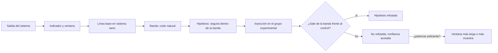
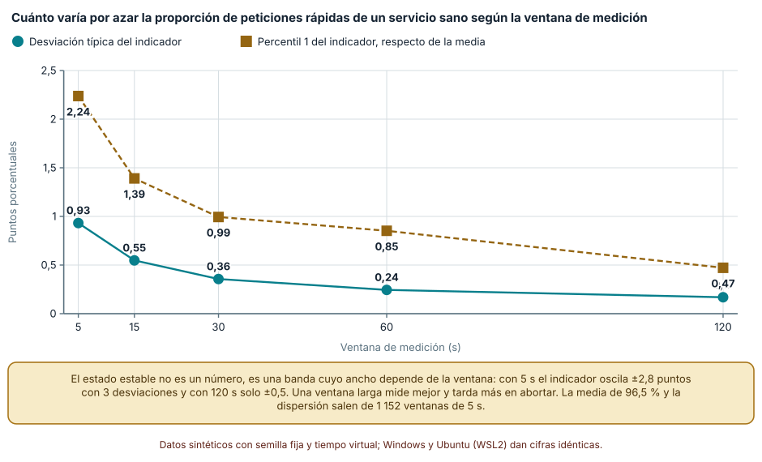

# SE-505 — Principios de la ingeniería del caos: estado estable e hipótesis

[← SE-504 — Proyecto: operación observable y recuperable](https://github.com/vladimiracunadev-create/modern-software-engineering-program/blob/main/classes/part-41-observabilidad-sre-e-incidentes/se-504-proyecto-operacion-observable-y-recuperable/README.md) · [↑ Parte 42](https://github.com/vladimiracunadev-create/modern-software-engineering-program/blob/main/classes/part-42-ingenieria-del-caos/README.md) · [📚 Índice completo](https://github.com/vladimiracunadev-create/modern-software-engineering-program/blob/main/classes/README.md) · [🌐 Portal](https://vladimiracunadev-create.github.io/modern-software-engineering-program/classes/SE-505.html) · [SE-506 — Diseñar experimentos de fallo: alcance y radio de impacto →](https://github.com/vladimiracunadev-create/modern-software-engineering-program/blob/main/classes/part-42-ingenieria-del-caos/se-506-disenar-experimentos-de-fallo-alcance-y-radio-de-impacto/README.md)

## Punto profesional y fundamento pedagógico

**Punto profesional.** La clase existe para que conviertas «el sistema aguanta» en una afirmación que pueda salir falsa: un **estado estable** medido como salida del sistema, con su ruido natural, y una **hipótesis** que diga qué se mantendrá y con qué banda cuando se inyecte una falla. Un experimento sin estado estable no puede refutar nada; un estado estable sin banda refuta al azar la mitad de las veces.

**Por qué aparece aquí.** Abre la Parte 42 sobre la resiliencia de la Parte 36 (calidad, rendimiento y resiliencia: `SE-438` trata timeouts, retries, backoff y jitter y `SE-439` circuit breakers, bulkheads y degradación), sobre los fallos parciales y la clase de caos controlado `SE-394` de la Parte 32 y sobre los indicadores y objetivos de la Parte 41 (`SE-497`). Aquellas clases enseñan los mecanismos; esta fija la pregunta previa a cualquier inyección: ¿qué significa «el sistema sigue bien» y cuánto ruido tiene esa medida cuando no se toca nada? Usa además los percentiles de `SE-436`. El caso conductor es el cliente de la API de entregas.

**Error conceptual que debe corregir.** Creer que el estado estable es un número («99,9 % de disponibilidad») y que la hipótesis se refuta cuando el indicador baja de ese número. El indicador oscila por azar, la oscilación depende de la ventana de medición, y una regla sin banda refuta hipótesis verdaderas o confirma falsas.

**Secuencia de aprendizaje.** Antes de ver los resultados predices cuánto varía por azar un indicador sano según la longitud de la ventana, qué fracción de ventanas sanas refuta cada regla y cuánto tarda en verse un efecto pequeño. Después contrastas la predicción con tres experimentos y reescribes una hipótesis con banda y ventana. [ICAP](https://icap.education.asu.edu/research) distingue participación de construcción de conocimiento; [How People Learn II](https://nap.nationalacademies.org/catalog/24783/how-people-learn-ii-learners-contexts-and-cultures) respalda diseñar la práctica con contextos reales y retroalimentación.

**Evidencia de aprendizaje.** `hipotesis-log.md` con la predicción, las tres figuras reproducidas, la hipótesis de tu servicio escrita con su métrica, su banda, su ventana y su regla de refutación, y una nota que separe lo que el experimento muestra de lo que habría que comprobar en un sistema real.

**Límite de la conclusión.** Los servicios, el 0,4 % de errores de fondo, la cola larga de las latencias y el efecto de 4 ms son sintéticos, con semilla fija y tiempo virtual. No se midió ningún sistema real; las cifras muestran un mecanismo, no el ruido de tu indicador.

### Trazabilidad fuente → afirmación

| Fuente primaria u oficial | Afirmación que respalda | Lo que no prueba |
|---|---|---|
| [Principles of Chaos Engineering](https://principlesofchaos.org/) | Pide construir la hipótesis sobre el comportamiento del estado estable y centrarse en la salida medible del sistema (rendimiento, tasas de error, percentiles de latencia) y no en atributos internos. | No dice qué métrica usar en tu sistema. |
| [Netflix: «Chaos Engineering Upgraded» (2015)](https://netflixtechblog.com/chaos-engineering-upgraded-878d341f15fa) | Describe un experimento con estado estable (inicios de reproducción por segundo), hipótesis, variable (30 ms de latencia a 20 % y luego 50 % del tráfico) y búsqueda de una desviación estadísticamente significativa entre el grupo de variable y el de control. | No dice que los umbrales de Netflix sirvan en otro servicio. |
| [Google SRE: Service Level Objectives](https://sre.google/sre-book/service-level-objectives/) | Define indicadores como medidas cuantitativas del nivel de servicio y recomienda agregarlas en ventanas y expresarlas como percentiles. | No fija el valor de tu indicador. |
| [Google SRE: Embracing Risk](https://sre.google/sre-book/embracing-risk/) | Presenta el presupuesto de error como la diferencia entre el objetivo y el 100 %, que se puede gastar en cambios y experimentos. | No dice cuánto presupuesto dedicar a experimentos. |

## Antes de empezar

Piensa en un servicio que declara tiempos de espera, reintentos y un cortacircuitos: la declaración no dice si resiste, y para comprobarlo hace falta decidir contra qué se compara. La pregunta activa es: **si inyectas 4 ms de lentitud en el almacenamiento y el indicador baja 0,6 puntos, ¿es un efecto o es ruido, y cuánto tienes que esperar para decidirlo?**

## Prerrequisitos

- Conocer qué es un tiempo de espera, un reintento y un cortacircuitos (`SE-438`, `SE-439`); `SE-507` los somete a fallas.
- Conocer un indicador de nivel de servicio (`SE-497`) y los percentiles de latencia (`SE-436`).
- Python 3.11 o posterior; los experimentos usan solo la biblioteca estándar.

## Problema auténtico

El equipo de la API de entregas escribe su primera hipótesis: «con 100 ms más de latencia en el almacenamiento, las entregas rápidas no bajarán». Corre el experimento dos minutos. El indicador de entregas aceptadas en menos de 120 ms pasa de 96,5 % a 96,1 % y alguien declara «refutada». Otra persona repite con la dependencia sana, mide 96,2 % durante un minuto y declara «refutada también». La reunión termina en que el experimento «es poco fiable». La causa no es el experimento sino una hipótesis sin banda: nadie había medido cuánto oscila el indicador cuando no se toca nada.

## Objetivos observables

Al terminar podrás:

1. definir un estado estable como una salida medible del sistema y escribirlo con su métrica, su ventana y su banda;
2. medir el ruido de un indicador en un sistema sano y calcular cuántas ventanas sanas refuta cada regla (el experimento A/A);
3. escribir una hipótesis falsable con la forma «bajo la condición X, la métrica M seguirá dentro de [a, b] en el grupo experimental y en el de control»;
4. estimar qué efecto puede detectar una ventana de una duración dada y cuándo el experimento no es capaz de refutar;
5. distinguir una métrica de negocio de una técnica y decir cuál prefiere cada nivel de decisión.

## Mapa conceptual



El mapa separa lo que se **mide** (indicador y ventana), lo que se **aprende del sistema sano** (línea base y banda) y lo que se **decide** (la hipótesis y la regla de refutación). La rama «no refutada» termina en una pregunta, no en una conclusión: ¿el experimento habría podido refutarla?

## Temas y por qué importan

| Tema | Por qué cambia una decisión profesional | Evidencia mínima |
|---|---|---|
| Estado estable como salida | Medir síntomas observables evita validar mecanismos internos que nadie percibe. | Predicción, traza causal y contraejemplo de **Estado estable como salida** en `hipotesis-log.md` |
| Ruido y ventana | El ancho de la banda depende del tiempo que se mide. | Predicción, traza causal y contraejemplo de **Ruido y ventana** en `hipotesis-log.md` |
| Reglas de refutación | Una regla sin banda refuta la mitad de las veces por azar. | Predicción, traza causal y contraejemplo de **Reglas de refutación** en `hipotesis-log.md` |
| Potencia y efectos pequeños | Un experimento que no puede detectar el efecto buscado no confirma nada. | Predicción, traza causal y contraejemplo de **Potencia y efectos pequeños** en `hipotesis-log.md` |
| Grupo de control | La comparación en la misma ejecución absorbe las variaciones comunes. | Predicción, traza causal y contraejemplo de **Grupo de control** en `hipotesis-log.md` |

## Conceptos y decisiones

### Del diseño declarado al experimento

Un diseño **declara** resiliencia cuando dice que hay tiempos de espera, reintentos y cortacircuitos; una resiliencia **demostrada** es el comportamiento observado cuando alguien provocó la falla. La [definición oficial](https://principlesofchaos.org/) describe la ingeniería del caos como la disciplina de experimentar sobre un sistema para ganar confianza en su capacidad de resistir condiciones turbulentas, y su método tiene cuatro pasos: definir el estado estable como una salida medible que indica comportamiento normal; formular la hipótesis de que continuará en un grupo de control y en uno experimental; introducir variables que reflejen eventos reales; e intentar refutar la hipótesis buscando una diferencia entre ambos grupos. Esta clase desarrolla los dos primeros pasos, que son los que casi nadie escribe; `SE-507` muestra qué ocurre cuando se hace el tercero sobre cinco clientes que declaran lo mismo. No es «romper cosas al azar» (el azar elige objetivos, la hipótesis decide qué se aprende) ni una prueba de carga (que busca el límite de capacidad con una dependencia sana).

### 1. El estado estable es una salida

Los [principios](https://principlesofchaos.org/) piden centrarse en la salida medible del sistema, no en sus atributos internos: el rendimiento global, las tasas de error y los percentiles de latencia son candidatos. La razón es que el experimento busca verificar que el sistema funciona, no cómo funciona. Un hilo ocupado, una cola de 40 elementos o una CPU al 70 % son estados internos que pueden cambiar sin que nadie lo note; el porcentaje de entregas aceptadas a tiempo es lo que percibe una persona. Netflix usa como estado estable los **inicios de reproducción por segundo**, una métrica de negocio que sube y baja con el día de la semana, pero con una forma predecible que sirve de proxy del comportamiento sano.

Hay dos niveles de métrica. Las **métricas de negocio** (entregas completadas por minuto, reproducciones iniciadas) responden a «¿hubo daño a las personas?» y reaccionan tarde y con ruido. Las **métricas técnicas** (tasa de error, p99 de latencia, utilización de la cola) responden a «¿qué se movió?», reaccionan rápido y pueden moverse sin daño. El estado estable de una hipótesis debería ser de negocio o del indicador de nivel de servicio, y las técnicas son las que se vigilan para abortar y para diagnosticar (`SE-506`). Mezclarlos produce hipótesis que se refutan por un hilo más ocupado que no importa a nadie.

### 2. Ruido y ventana: la banda del estado estable

Un indicador calculado sobre una ventana de pocas peticiones oscila por azar. Si la proporción verdadera de peticiones rápidas es 96,5 % y la ventana contiene n peticiones independientes, la desviación típica es `sqrt(p(1-p)/n)`. Con 90 peticiones por segundo, una ventana de 5 s tiene unas 450 peticiones y una desviación de 0,9 puntos; una de 120 s tiene 10 800 y 0,17. En la práctica es algo mayor porque las peticiones no son independientes (las colas las correlacionan), y por eso se mide en lugar de calcularse.

Se simula el servicio sano con un 0,4 % de errores de fondo y una cola larga de latencia (σ = 0,6 sobre 40 ms), con 24 ejecuciones de 240 s, y se mide la proporción de peticiones correctas y rápidas (menos de 120 ms) en ventanas de 5, 15, 30, 60 y 120 s. Sin ninguna inyección, la proporción media es 96,5 %.

```python
sli = lambda r, a, b: sum(1 for i, t in enumerate(r.t0) if a <= t < b and r.outcome[i] == "ok" and r.latency[i] <= 120) / n_en(r, a, b)
ventanas = [sli(r, a, a + w) for r in corridas for a in range(0, 240 - w + 1, w)]
```



**Cómo leer la figura.** El eje horizontal es la longitud de la ventana y el vertical, la dispersión del indicador en un sistema sano; la línea inferior es cuánto queda por debajo de la media el 1 % de las ventanas más bajas. Con 5 s, la dispersión es de 0,93 puntos y el 1 % peor queda 2,2 puntos por debajo de la media; con 120 s, 0,17 y 0,5. **Dónde deja de valer:** la dispersión decrece aproximadamente con la raíz de la longitud (de 5 a 120 s la ventana es 24 veces mayor y la dispersión baja 5,5 veces, cerca de √24 ≈ 4,9); una ventana larga no ayuda si el sistema tiene ciclos propios (picos de las 23:50) que la ventana mezcla, y nunca se debe medir la línea base en un día excepcional.

La consecuencia práctica es que el estado estable no es un número sino una **banda** (por ejemplo, media menos tres desviaciones medidas con la ventana del experimento). El estado estable de una hipótesis se escribe con la métrica, la ventana y la banda: «proporción de entregas correctas en menos de 120 ms, ventana de 60 s, dentro de 96,5 % ± 0,7 puntos».

### 3. Reglas de refutación y refutaciones falsas

Una **regla de refutación** decide, a partir de una ventana, si la hipótesis queda refutada. Se evalúa antes con un **experimento A/A**: se aplica la regla a ventanas de un sistema sano y se cuenta cuántas refuta. Una regla que refuta ventanas sanas produce falsas alarmas y destruye la confianza en el método. Se comparan tres reglas: «menor que la media» (cualquier caída), «menor que la media menos tres desviaciones» (la banda) y «menor que el SLO de 96 %» (el objetivo del servicio).


**Cómo leer la figura.** Cada línea es una regla y cada punto el porcentaje de ventanas sanas que declara refutadas. «Menor que la media» refuta entre 46 % y 54 % con cualquier ventana: por definición la mitad de las ventanas sanas queda por debajo de su propia media, y es la regla que usó el equipo del problema auténtico. La banda de tres desviaciones refuta entre 0 % y 1 % con cualquier ventana. El umbral de SLO (96 %) refuta 29 % de las ventanas de 5 s, 18 % de 15, 7 % de 30 y 2 % de 60, y llega a 0 con 120 s: está tan cerca de la media (96,5 %) que el ruido lo cruza. **Dónde deja de valer:** la banda se calculó con las mismas ventanas que se evalúan, así que su tasa de falsas alarmas es una cota optimista; en un sistema real, la media y la dispersión cambian con el día y la hora, y una banda de una semana de martes no sirve un domingo.

### 4. Potencia: cuánto cuesta ver un efecto pequeño

La **potencia** de un experimento es la probabilidad de que refute una hipótesis falsa. Se inyecta ahora un efecto real, pequeño: la dependencia tarda 4 ms más (un 10 % de su tiempo de servicio), lo que baja el indicador de 96,5 % a 95,9 %, 0,6 puntos. Se mide con la misma regla en ventanas de cada longitud.


**Cómo leer la figura.** Cada línea es una regla y cada punto el porcentaje de ventanas con el efecto real que la regla refuta. La banda detecta 2 % de las ventanas de 5 s, 3 % de las de 15, 13 % de las de 30, 38 % de las de 60 y 75 % de las de 120. El umbral de SLO parece detectar más (53 % con 5 s), pero lo consigue porque el indicador sano (96,5 %) ya está pegado al umbral (96 %) y refuta ventanas sanas con frecuencia: su «potencia» incluye las falsas alarmas. **Dónde deja de valer:** el efecto de 0,6 puntos es uno de los muchos posibles; uno de 5 puntos se vería con cualquier ventana, y uno de 0,1 no se vería con ninguna. La figura enseña la proporción: para ver 0,6 puntos con 75 % de potencia hacen falta ventanas de unos dos minutos, o repetir y combinar.

La consecuencia tiene dos lecturas. Si el experimento **no refuta**, hay que preguntar si podía: confirmar una hipótesis con 2 % de potencia es no haber probado nada. Y si el efecto buscado es pequeño, la fórmula de la sección 2 dice cuánta muestra hace falta; cuando la muestra no cabe (tráfico bajo, radio pequeño), se amplía la ventana, se repite, o se acepta que el experimento solo detectará daños grandes y se declara esa limitación.

### 5. El grupo de control y la regla de refutación comparativa

La banda de la sección 2 compara el indicador del experimento con una línea base **anterior**. Es válida si el tráfico es comparable y falla si el tráfico cambia por la hora, un anuncio o un cierre de plazo. El método que corrige esto compara dos grupos **de la misma ejecución**, contemporáneos y con tráfico parecido: un **grupo experimental** que recibe la falla y un **grupo de control** que no. Los [principios](https://principlesofchaos.org/) lo formulan como la búsqueda de una diferencia entre ambos, y [Netflix](https://netflixtechblog.com/chaos-engineering-upgraded-878d341f15fa) busca una desviación estadísticamente significativa entre el grupo de variable y el de control. La comparación absorbe todo lo que afecta a ambos por igual (la hora, el pico de demanda, un despliegue concurrente) y deja solo el efecto de la inyección. `SE-506` la usa para decidir el radio y `SE-515` la lleva a producción.

## Definiciones de trabajo

- **estado estable:** salida medible del sistema que indica comportamiento normal, con su métrica, su ventana y su banda.
- **hipótesis falsable:** afirmación de que el estado estable se mantendrá bajo una condición, con una regla que dice qué observación la refuta.
- **banda:** intervalo de valores que el indicador toma por azar en un sistema sano en la ventana elegida.
- **experimento A/A:** medición con el sistema sano para estimar el ruido y las falsas refutaciones de una regla.
- **potencia:** probabilidad de que un experimento refute una hipótesis falsa con el efecto y la ventana dados.
- **grupo de control:** parte del tráfico que no recibe la falla y se mide a la vez que el grupo experimental.

Las definiciones son operativas para el cliente de la API de entregas. No convierten términos con una historia más amplia en sinónimos y deben contrastarse con las fuentes enlazadas.

## Ejemplo mínimo

El fragmento calcula la desviación típica teórica de una proporción de 96,5 % según el tamaño de la muestra. Antes de ejecutarlo, predice cuántas peticiones hacen falta para que la desviación sea 0,2 puntos.

```python
import math
p = 0.965
for n in (450, 2700, 5400, 10800, 32400):
    print(n, round(100 * math.sqrt(p * (1 - p) / n), 2))
```

Imprime `450 0.87`, `2700 0.35`, `5400 0.25`, `10800 0.18` y `32400 0.10`. Para 0,2 puntos hacen falta unas 8 400 peticiones, es decir, unos 94 s a 90 peticiones por segundo. Registra versión de Python, comando y salida; luego cambia p a 99,5 % y observa cuánto se achica la desviación.

## Ejemplo profesional

Supón, como caso hipotético y no como medición, que el equipo reescribe su hipótesis: «con 100 ms más de lentitud en el 5 % de las llamadas al almacenamiento durante diez minutos, la proporción de entregas aceptadas en menos de 400 ms de los grupos experimental y de control diferirá menos de 1,5 puntos en cada ventana de 60 s». Agrega la métrica de negocio (entregas confirmadas por minuto) como segunda salida, tres métricas técnicas solo para vigilar (p99, errores, profundidad de la cola), una línea base de dos semanas de martes y un experimento A/A previo con el mismo grupo repartido al azar, para verificar que la regla no refuta en el sistema sano. Añade lo que la hipótesis no puede detectar: diferencias menores de 1,5 puntos y fallas que solo afecten a un curso concreto.

## Práctica guiada

1. Predice, por escrito, cuánto vale la dispersión de una ventana de 5 s y de una de 120 s, y qué porcentaje de ventanas sanas refuta cada regla.
2. Ejecuta `python scripts/experiments_part42_a.py e505` y compara; anota la mayor diferencia con tu predicción.
3. Cambia el efecto de 4 ms a 10 ms y mide cuánto sube la potencia con 15 s y 30 s.
4. Cambia el 0,4 % de errores de fondo a 0,1 % y a 2 % y observa cómo cambia la dispersión del indicador.
5. Escribe la hipótesis de un servicio propio con métrica, ventana, banda y regla, y calcula cuánto tarda en poder refutarla.
6. Entrega `hipotesis-log.md` y pide a otra persona que proponga un efecto que tu hipótesis no podría detectar.

## Ejercicios

1. **Salida:** clasifica seis medidas (inicios de sesión por segundo, CPU, p99 de latencia, hilos ocupados, entregas correctas por minuto, profundidad de cola) como salida o estado interno y como negocio o técnica.
2. **Banda:** con p = 99 % y ventanas de 1 000 peticiones, calcula la desviación típica y la banda de tres desviaciones, y di si un 98 % refutaría la hipótesis.
3. **A/A:** una regla refuta 18 de 200 ventanas sanas; calcula su tasa de falsas alarmas y decide si la aceptas para un experimento que corre doce ventanas.
4. **Potencia:** un efecto de 1 punto con desviación de 0,5 por ventana: estima cuántas ventanas hay que promediar para que el promedio tenga una desviación de 0,15.

## Reto verificable

Entrega `hipotesis-log.md` con la predicción, las tres tablas de resultados reproducidas con las mismas semillas, una hipótesis completa de tu servicio (métrica, ventana, banda, regla, condición de aborto y limitación de potencia) y las tres reglas probadas con un experimento A/A. Se aprueba si otra persona ejecuta el código desde un checkout limpio, obtiene los mismos números y encuentra una condición en la que tu regla refuta un sistema sano. No se aprueba por escribir «la métrica se mantendrá estable» sin banda ni ventana.

## Caso conductor

El cliente de la API de entregas sigue siendo el caso conductor. Esta clase deja el primer artefacto: una hipótesis con estado estable medible. `SE-506` decide cuánto del tráfico recibe la falla y cuándo se aborta, y `SE-507` y `SE-508` inyectan las fallas. Cambia después un solo dato de la hipótesis, la ventana, y observa a partir de qué duración el experimento puede refutarla.

## Preguntas frecuentes

### ¿El estado estable debe ser el objetivo de nivel de servicio?

Puede serlo, pero no tiene por qué. El objetivo es un compromiso con una cifra (por ejemplo 99,9 %); el estado estable es una descripción del comportamiento normal, con su ruido. Si el objetivo está muy cerca de la media, como en esta clase, usarlo como regla refuta ventanas sanas.

### ¿Por qué tres desviaciones y no dos?

Por la tasa de falsas alarmas: con tres, un sistema sano refuta menos de 1 % de las ventanas; con dos, unas dos de cada cien en una cola normal y más con colas largas. Si el experimento corre cuarenta ventanas, dos desviaciones producen casi una refutación falsa por experimento. La elección depende de cuántas ventanas se evalúan y de cuánto cuesta equivocarse en cada sentido.

### ¿Qué hago si el tráfico es tan bajo que no hay muestra?

Se amplían las ventanas, se repite el experimento en horas de más tráfico, se usan sondas sintéticas que generen carga controlada o se acepta una potencia baja y se dice. Lo que no se hace es declarar «no refutada» sin decir que no podía refutarse.

### ¿Un experimento A/A es una pérdida de tiempo?

Cuesta una ejecución sin inyectar nada y evita refutar o confirmar por azar. Es la única forma de saber cuánto ruido tiene el indicador y cuántas ventanas sanas refuta la regla; sin él, la regla es una suposición.

## Fallo controlado y diagnóstico

Reproduce el fallo clásico de la clase: **refutar una hipótesis con una regla sin banda**. Aplica la regla «menor que la media» a ventanas de 60 s de un sistema sano y cuenta las refutaciones.

Registra síntoma, entrada mínima, hipótesis, observación que descarta cada hipótesis, causa, corrección y prueba de regresión. **Síntoma:** el equipo declara refutada una hipótesis dos veces con el sistema sano. **Hipótesis rivales:** (a) el sistema tiene un defecto intermitente; (b) la inyección dejó un efecto residual; (c) la regla refuta por azar. **Prueba:** aplica la regla a ventanas de un sistema sano; si refuta 54 % de ellas, la hipótesis (c) explica la señal, porque la mitad de las ventanas sanas queda por debajo de su media. **Conclusión:** una regla sin banda refuta al azar. **Regresión:** añade una prueba A/A que exija que la regla refute menos de 1 % de las ventanas sanas antes de usarla. No cambies a la vez la regla y la ventana.

## Errores comunes y cómo corregirlos

| Síntoma | Causa probable | Corrección |
|---|---|---|
| La hipótesis se refuta con el sistema sano | Regla sin banda | Medir la línea base y usar media menos tres desviaciones |
| La hipótesis nunca se refuta | Potencia baja: ventana corta o efecto pequeño | Ampliar la ventana o repetir y declarar el efecto mínimo detectable |
| El estado estable cambia con el día | Línea base de un día excepcional | Medir en días comparables y preferir el grupo de control |
| El experimento aborta por una métrica interna | Mezcla de estado estable y vigilancia técnica | Separar la salida de negocio de las métricas de diagnóstico |
| Se confirma una hipótesis con 2 % de potencia | No se calculó lo que el experimento podía ver | Escribir el efecto mínimo detectable junto con la conclusión |

## Entorno y archivos clave

```text
work/SE-505/
├── README.md
├── estado_estable/
│   ├── linea_base.py
│   ├── reglas.py
│   └── potencia.py
├── tests/test_estado_estable.py
└── evidence/hipotesis-log.md
```

El `README` declara plataforma, versión de Python, semillas y comandos. Los experimentos usan solo la biblioteca estándar y se ejecutaron con CPython 3.12.9 en Windows 11 y 3.12.3 en Ubuntu bajo WSL2 con resultados idénticos. Para recuperar el estado, borra `work/SE-505/` y vuelve a ejecutar los scripts. Si añades una dependencia, fija procedencia y versión.

## Seguridad, ética y accesibilidad

- un experimento con ruido mal medido puede dañar a personas sin aprender nada: calcula la potencia antes de decidir el radio (`SE-506`);
- no uses como estado estable una métrica que contenga datos personales de estudiantes;
- escribe la limitación de potencia junto a la conclusión: un «no refutada» sin potencia es un permiso falso;
- documenta las tablas y las figuras con texto alternativo y en un formato que un lector de pantalla pueda recorrer;
- respeta las licencias de los libros y artículos y atribuye lo adaptado.

## Puente hacia el trabajo con agentes

Un agente al que se le pide «verifica que el servicio aguanta la falla» tenderá a comparar un solo número con otro y a declarar éxito si es igual o mayor. Pídele en cambio que mida primero el ruido con el sistema sano, que reporte la banda con su ventana, que aplique un A/A a la regla antes de inyectar y que escriba el efecto mínimo detectable con la conclusión. Revisa especialmente si compara contra una línea base de otra hora, si elige el umbral después de ver los datos y si reporta un «no refutada» sin decir su potencia.

## Transferencia

Traslada el análisis a otro servicio (un buscador, una pasarela de pagos): elige una salida de negocio, mide su ruido, escribe una hipótesis con banda y calcula la ventana necesaria para detectar un efecto del tamaño que te preocupa. La transferencia está lograda cuando puedes decir qué daño real el experimento no podría ver, no cuando la hipótesis suena precisa.

## Evaluación y evidencia

| Criterio | Evidencia para aprobar |
|---|---|
| comprensión | explicación de estado estable como salida, banda y potencia |
| corrección | desviaciones, refutaciones falsas y potencia reproducibles con las mismas semillas |
| diseño | hipótesis con métrica, ventana, banda, regla y limitación |
| diagnóstico | reproducción del fallo «regla sin banda» con regresión A/A |
| incertidumbre | declaración de que el indicador, el ruido y el efecto son sintéticos |
| reproducibilidad | versiones, comandos, salida y límites declarados |

## Fuentes

- [Principles of Chaos Engineering](https://principlesofchaos.org/) — estado estable, hipótesis y salida medible; autoridad: documento vivo de la comunidad de ingeniería del caos.
- [Netflix: «Chaos Engineering Upgraded»](https://netflixtechblog.com/chaos-engineering-upgraded-878d341f15fa) — ejemplo de experimento con estado estable, hipótesis y grupo de control; autoridad: blog de ingeniería de Netflix.
- [Google SRE: Service Level Objectives](https://sre.google/sre-book/service-level-objectives/) — indicadores, ventanas y percentiles; autoridad: libro de ingeniería de confiabilidad de Google.
- [Google SRE: Embracing Risk](https://sre.google/sre-book/embracing-risk/) — presupuesto de error; autoridad: libro de ingeniería de confiabilidad de Google.
- [Python: statistics](https://docs.python.org/3/library/statistics.html) — desviación típica usada en los experimentos; autoridad: documentación de Python.

Cada fuente respalda el mecanismo indicado; ninguna demuestra que 0,93 puntos de dispersión, 54 % de refutaciones falsas o 75 % de potencia se observen en un sistema real. Esa afirmación depende del tráfico, del indicador y de la ventana.

## Límites y siguiente paso

Se ejecutaron tres experimentos con tiempo virtual y semillas fijas en Windows y Ubuntu (WSL2) con resultados idénticos. No se midió ningún sistema real; el servicio de 8 hilos, los 90 peticiones por segundo, el 0,4 % de errores de fondo, la cola larga y el efecto de 4 ms son construcciones del autor, y las reglas se evaluaron con las mismas ventanas con que se midió la banda. La siguiente clase pregunta cuántas personas puede pagar un experimento y cuándo debe detenerse.

## Glosario

- **estado estable:** salida medible del sistema que indica comportamiento normal, con su métrica, su ventana y su banda.
- **hipótesis falsable:** afirmación de que el estado estable se mantendrá bajo una condición, con una regla que dice qué la refuta.
- **banda:** intervalo de valores que el indicador toma por azar en un sistema sano.
- **experimento A/A:** medición con el sistema sano para estimar el ruido y las falsas refutaciones de una regla.
- **potencia:** probabilidad de que un experimento refute una hipótesis falsa.
- **grupo de control:** parte del tráfico que no recibe la falla y se mide a la vez que el experimental.

---

[← SE-504 — Proyecto: operación observable y recuperable](https://github.com/vladimiracunadev-create/modern-software-engineering-program/blob/main/classes/part-41-observabilidad-sre-e-incidentes/se-504-proyecto-operacion-observable-y-recuperable/README.md) · [↑ Parte 42](https://github.com/vladimiracunadev-create/modern-software-engineering-program/blob/main/classes/part-42-ingenieria-del-caos/README.md) · [📚 Índice completo](https://github.com/vladimiracunadev-create/modern-software-engineering-program/blob/main/classes/README.md) · [🌐 Portal](https://vladimiracunadev-create.github.io/modern-software-engineering-program/classes/SE-505.html) · [SE-506 — Diseñar experimentos de fallo: alcance y radio de impacto →](https://github.com/vladimiracunadev-create/modern-software-engineering-program/blob/main/classes/part-42-ingenieria-del-caos/se-506-disenar-experimentos-de-fallo-alcance-y-radio-de-impacto/README.md)
