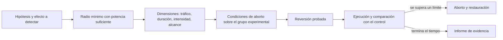
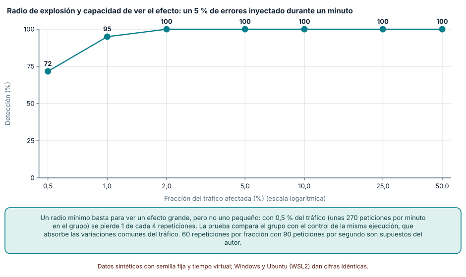
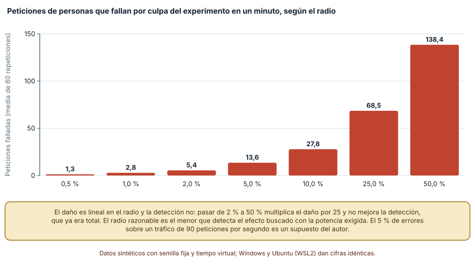

# SE-506 — Diseñar experimentos de fallo: alcance y radio de impacto

[← SE-505 — Principios de la ingeniería del caos: estado estable e hipótesis](https://github.com/vladimiracunadev-create/modern-software-engineering-program/blob/main/classes/part-42-ingenieria-del-caos/se-505-principios-de-la-ingenieria-del-caos-estado-estable-e-hipotesis/README.md) · [↑ Parte 42](https://github.com/vladimiracunadev-create/modern-software-engineering-program/blob/main/classes/part-42-ingenieria-del-caos/README.md) · [📚 Índice completo](https://github.com/vladimiracunadev-create/modern-software-engineering-program/blob/main/classes/README.md) · [🌐 Portal](https://vladimiracunadev-create.github.io/modern-software-engineering-program/classes/SE-506.html) · [SE-507 — Inyección de fallos de red, latencia y dependencias →](https://github.com/vladimiracunadev-create/modern-software-engineering-program/blob/main/classes/part-42-ingenieria-del-caos/se-507-inyeccion-de-fallos-de-red-latencia-y-dependencias/README.md)

## Punto profesional y fundamento pedagógico

**Punto profesional.** La clase existe para que dimensiones el **radio de explosión** de un experimento (a cuánta gente, durante cuánto tiempo y con qué intensidad se le hace daño) y para que escribas las **condiciones de aborto** que lo detienen antes de que el daño supere lo acordado. Un experimento sin límite de daño es un incidente con calendario; un límite sin condición de aborto es una promesa que nadie puede cumplir a las 23:50.

**Por qué aparece aquí.** Sigue a `SE-505`: allí se midió cuánto ruido tiene un indicador y qué efecto puede ver una ventana. Aquí se invierte la pregunta: dada la potencia que se necesita, ¿cuál es el daño mínimo que la consigue? La clase usa las señales de la [Parte 41](../../part-41-observabilidad-sre-e-incidentes/README.md) (`SE-496`, `SE-498`) para vigilar el experimento y el presupuesto de error de `SE-497` para pagarlo. El caso conductor es el cliente de la API de entregas.

**Error conceptual que debe corregir.** Creer que el radio de explosión es «lo más pequeño posible» y que la condición de aborto es «si el sistema se cae». El radio mínimo que no detecta el efecto es un experimento inútil que cuesta lo mismo, y una condición medida sobre todo el tráfico no ve un experimento que afecta al 1 %.

**Secuencia de aprendizaje.** Antes de ver los resultados predices cuánto tráfico hay que afectar para ver un efecto pequeño, cuántas peticiones se dañan por cada punto de radio y cuál de tres condiciones de aborto detiene antes un experimento que empeora. Después contrastas la predicción con tres experimentos y escribes la especificación de uno propio. [ICAP](https://icap.education.asu.edu/research) distingue participación de construcción de conocimiento; [How People Learn II](https://nap.nationalacademies.org/catalog/24783/how-people-learn-ii-learners-contexts-and-cultures) respalda diseñar la práctica con contextos reales y retroalimentación.

**Evidencia de aprendizaje.** `experimento-log.md` con la predicción, las tres figuras reproducidas, la especificación de un experimento (hipótesis, radio, duración, condiciones de aborto, reversión y responsable) y una nota que separe lo que la simulación muestra de lo que habría que comprobar en un sistema real.

**Límite de la conclusión.** El servicio, el 5 % de errores, la falla que empeora a los 60 s y las 60 repeticiones son sintéticos, con tiempo virtual y semilla fija. No se dañó ninguna petición real; las cifras muestran un mecanismo, no el daño de tu experimento.

### Trazabilidad fuente → afirmación

| Fuente primaria u oficial | Afirmación que respalda | Lo que no prueba |
|---|---|---|
| [Principles of Chaos Engineering](https://principlesofchaos.org/) | Establece como principio minimizar el radio de explosión: el impacto negativo de corto plazo es admisible, pero quien hace el experimento tiene la responsabilidad de contenerlo. | No fija el tamaño del radio. |
| [Netflix: «ChAP: Chaos Automation Platform» (2017)](https://netflixtechblog.com/chap-chaos-automation-platform-53e6d528371f) | Plantea la pregunta del experimento más pequeño que aún da confianza, reparte una porción pequeña del tráfico entre un clúster de control y uno experimental y añade un interruptor que termina el experimento al exceder un presupuesto de error. | No dice que 2 % o cualquier porcentaje sea el correcto. |
| [AWS FIS: stop conditions](https://docs.aws.amazon.com/fis/latest/userguide/stop-conditions.html) | Una condición de parada es una alarma que detiene el experimento si se alcanza un umbral definido a partir del estado estable; un experimento detenido no se reanuda. | No elige el umbral. |
| [Chaos Mesh: definir el alcance de un experimento](https://chaos-mesh.org/docs/define-chaos-experiment-scope/) | El alcance se define con selectores, de modo que se controla con precisión el radio de explosión de cada falla. | No decide qué alcance es seguro. |

## Antes de empezar

Recupera lo aprendido en `SE-505`: un estado estable con banda, una ventana y una regla de refutación, y una potencia que depende del tamaño del efecto. La pregunta activa es: **¿cuántas entregas de estudiantes estás dispuesto a fallar para saber si un 5 % de errores en el almacenamiento rompe el cliente, y quién te avisa si la falla resulta peor que 5 %?**

## Prerrequisitos

- Haber completado `SE-505` o poder escribir una hipótesis con estado estable, banda y regla de refutación.
- Conocer el presupuesto de error (`SE-497`) y las alertas (`SE-498`).
- Python 3.11 o posterior; los experimentos usan solo la biblioteca estándar.

## Problema auténtico

El equipo decide verificar que el cliente resiste un 5 % de errores del almacenamiento. Por prudencia empieza con el 0,5 % del tráfico durante un minuto, no ve diferencia entre el grupo experimental y el de control y escribe «hipótesis confirmada». En otra ocasión, con la misma prudencia, aplica la falla al 50 % del tráfico durante una hora «para tener muestra» y la falla resulta ser peor de lo previsto: el porcentaje de errores sube a 100 % a los 60 s y el condicional global («si el servicio baja de 99 %») aborta a los 10 s... por la propia falla del 20 % que sí se esperaba. Un experimento fue demasiado pequeño para detectar nada y el otro demasiado grande para detenerse a tiempo; en ambos casos el radio y el aborto se eligieron por sensación.

## Objetivos observables

Al terminar podrás:

1. definir el radio de explosión como el conjunto de dimensiones (tráfico, clientes, duración, intensidad, instancias, región) y calcular el costo en peticiones dañadas;
2. estimar el radio mínimo que detecta un efecto con una potencia dada y comprobarlo con grupo de control;
3. escribir condiciones de aborto automáticas evaluadas sobre el grupo experimental, no solo sobre el tráfico global;
4. explicar por qué un aborto por el SLO global es ciego a radios pequeños y prematuro a radios grandes;
5. escribir la especificación de un experimento con reversión probada y responsable.

## Mapa conceptual



El mapa separa lo que se decide **antes** (radio, aborto y reversión) de lo que ocurre **durante** (comparación y aborto). La reversión se prueba antes del experimento, no durante.

## Temas y por qué importan

| Tema | Por qué cambia una decisión profesional | Evidencia mínima |
|---|---|---|
| Dimensiones del radio | El daño se controla en varios ejes a la vez, no solo en el porcentaje. | Predicción, traza causal y contraejemplo de **Dimensiones del radio** en `experimento-log.md` |
| Radio mínimo y potencia | Demasiado pequeño no detecta; demasiado grande daña de más. | Predicción, traza causal y contraejemplo de **Radio mínimo y potencia** en `experimento-log.md` |
| Costo del experimento | El daño se contabiliza en peticiones y en presupuesto de error. | Predicción, traza causal y contraejemplo de **Costo del experimento** en `experimento-log.md` |
| Condiciones de aborto | La medida de aborto debe verse el daño que pretende limitar. | Predicción, traza causal y contraejemplo de **Condiciones de aborto** en `experimento-log.md` |
| Reversión | Abortar no sirve si no se sabe volver. | Predicción, traza causal y contraejemplo de **Reversión** en `experimento-log.md` |

## Conceptos y decisiones

### 1. Las dimensiones del radio de explosión

El **radio de explosión** es el conjunto de lo que el experimento puede dañar si sale mal. Los [principios](https://principlesofchaos.org/) lo plantean como una responsabilidad: se admite un impacto negativo de corto plazo, pero se debe contener. No es un solo número. Se controla en cinco dimensiones que se combinan: la **fracción del tráfico** afectada; el **alcance** (qué clientes, instancias, zonas o regiones); la **duración**; la **intensidad** de la falla (10 % de errores o 100 %) y la **profundidad** (si afecta solo a la llamada probada o a lo que depende de ella). Chaos Mesh, por ejemplo, define el alcance con [selectores](https://chaos-mesh.org/docs/define-chaos-experiment-scope/) por espacio de nombres, etiquetas, anotaciones o nodos, y la propia documentación presenta eso como el control del radio.

El costo de un experimento se puede resumir en una cifra que toda persona del equipo entiende: **peticiones dañadas**, o su equivalente en minutos de caída total, que se descuenta del presupuesto de error. Si f es la fracción del tráfico, λ las peticiones por segundo, d la duración en segundos y h la fracción de las peticiones afectadas que fallan, el costo es `f · λ · d · h`. Con f = 5 %, 90 peticiones por segundo, 600 s y h = 5 %, son unas 135 peticiones; con f = 50 %, 1 350. El presupuesto mensual de un objetivo de 99,9 % es de 43 minutos de caída total (`SE-497`); esa cuenta permite decir si el experimento cabe (`SE-513` la desarrolla).

### 2. Radio mínimo y potencia

La pregunta de [Netflix al diseñar ChAP](https://netflixtechblog.com/chap-chaos-automation-platform-53e6d528371f) es: ¿cuál es el experimento más pequeño que aún da confianza en el resultado? La respuesta combina dos fuerzas opuestas. A menor fracción, menos daño; pero también menos peticiones en el grupo experimental y por tanto más ruido: un efecto que sería evidente con 10 000 peticiones se pierde con 100. Netflix cuenta que con su herramienta anterior (FIT) el impacto se mezclaba con el del resto de la población y los experimentos tenían que ser grandes y largos para destacar sobre el ruido natural del sistema; con ChAP, un subconjunto pequeño se reparte entre un clúster de control y uno experimental, y el seguimiento de los indicadores solo para esos grupos facilita ver cuándo divergen.

Se simula esa compensación. El efecto a detectar es pequeño: un 5 % de errores inyectado durante un minuto al grupo experimental (con 90 peticiones por segundo y sin reintentos). Para cada fracción se repite el experimento 60 veces y se cuenta cuántas veces una prueba de dos proporciones entre el grupo experimental y el de control, con nivel de 1 %, detecta que el grupo experimental tiene más fallos.

```python
r = simulate(seed, Policy(timeout_ms=250, retries=0), [Fault("error", 0, 60, 0.05)], duration_s=60, rate=90, treat_fraction=f)
detecta = k1 / n1 > k0 / n0 and ztest_p(k1, n1, k0, n0) < 0.01
```



**Cómo leer la figura.** El eje horizontal es la fracción del tráfico en escala logarítmica y el vertical, el porcentaje de repeticiones en que el experimento detecta el efecto. Con 0,5 % del tráfico (unas 27 peticiones por minuto en el grupo experimental) se detecta 72 % de las veces, con 1 % 95 % y con 2 % o más siempre. **Dónde deja de valer:** la potencia depende del tamaño del efecto: un 5 % de errores es un efecto grande para una proporción de base de 0,4 %; con un efecto de 0,5 puntos habría que subir la fracción diez veces. La prueba compara con el control de la misma ejecución, de modo que absorbe las variaciones comunes; contra una línea base de otra hora la potencia sería menor.

Y el costo crece en proporción al radio:



**Cómo leer la figura.** Cada barra es un radio y su altura, las peticiones de personas que fallaron por culpa del experimento en un minuto, en promedio de 60 repeticiones. El daño crece linealmente: pasar de 2 % a 50 % multiplica por 25 el daño y no mejora la detección, que ya era del 100 %. El radio razonable es el menor que detecta el efecto buscado con la potencia exigida: aquí, 1 % a 2 %, con unas 3 a 5 peticiones dañadas por minuto. **Dónde deja de valer:** son peticiones *falladas*, no personas distintas: con 40 000 estudiantes y 90 peticiones por segundo, 2 % de peticiones puede tocar a pocas o a muchas personas según cómo se elija a quién (`SE-513` trata esa equidad).

### 3. Condiciones de aborto

Una **condición de aborto** es una regla evaluada de forma automática durante el experimento que, si se cumple, lo detiene y revierte la falla. [AWS FIS](https://docs.aws.amazon.com/fis/latest/userguide/stop-conditions.html) la implementa como condiciones de parada: alarmas de CloudWatch construidas a partir del estado estable que detienen el experimento si el servicio alcanza un estado inaceptable, y aclara que un experimento detenido no se puede reanudar. [ChAP](https://netflixtechblog.com/chap-chaos-automation-platform-53e6d528371f) incorpora un interruptor propio del experimento que lo termina automáticamente si se supera un presupuesto de error predefinido. Tres rasgos separan una condición útil de una decorativa. Se evalúa sobre el **grupo experimental** y no sobre el tráfico global, porque un grupo del 1 % no mueve el global. Se mide en una **ventana corta** (10 s en el modelo), porque el daño crece con cada segundo de retraso. Y tiene un **umbral independiente** del de la hipótesis: el estado estable dice cuándo la hipótesis queda refutada; el aborto dice cuándo el daño ya no es aceptable, que es un umbral más extremo.

Se pone a prueba con una sorpresa. El experimento planeado inyecta 20 % de errores, pero a los 60 s la falla empeora a 100 %, como ocurriría si la falla compartiera un recurso con otro servicio. Se comparan cuatro políticas: sin aborto; abortar si el servicio global falla más de 1 % en una ventana de 10 s; abortar si el grupo experimental falla más de 50 % en 10 s; y abortar al acumular 300 peticiones dañadas. Se mide el daño total en peticiones para cuatro radios.


**Cómo leer la figura.** Cada grupo de barras es un radio y cada barra una política; la escala es logarítmica. Sin aborto, el daño crece de 104 a 11 444 peticiones del radio menor al mayor. Con 2 % del tráfico, el aborto por el SLO global y el del grupo experimental se disparan a los 65 s (cinco segundos después del cambio) y limitan el daño a 34; el presupuesto de 300 peticiones se agota a los 240 s y deja pasar 305. Con 10 % y 50 %, el SLO global aborta a los 10 s, **antes de que la falla empeore**, porque el 20 % de errores esperado ya consume más del 1 % global: el experimento nunca habría llegado a ver lo que quería probar. Con 0,5 %, ninguna condición se activa: el global no se mueve y el grupo no reúne 20 peticiones en 10 s. **Dónde deja de valer:** los umbrales de 1 %, 50 % y 300 son supuestos del autor; con otros, los puntos de cruce cambian, pero la forma se mantiene: el aborto global es ciego a radios pequeños y prematuro a radios grandes, y el del grupo es el único que decide bien en el intervalo intermedio. Con 0,5 %, solo un presupuesto absoluto o un grupo con más muestra lo detendría.

### 4. La reversión es parte del diseño

Abortar significa que algo deja de inyectar. Si la falla es una regla de red, un proceso detenido o una configuración modificada, la reversión es una operación que puede fallar: la regla no se elimina, el proceso no reinicia, la configuración vieja ya no existe. Por eso la reversión se **prueba antes**, se ejecuta con un solo comando, no depende del componente que se está dañando y se mide: ¿cuánto tarda en volver el indicador a su banda? En la API de entregas, una falla inyectada con un proxy se revierte quitando el tóxico; una caída de proceso, reiniciando el servicio; una pérdida de capacidad, devolviendo los hilos. En cada caso se mide el tiempo hasta que el indicador regresa a la banda de `SE-505`, que es la señal de que el experimento terminó.

Hay tres precondiciones que se verifican antes de empezar y que también son una forma de aborto previa: el sistema está en estado estable (si ya hay una degradación, el experimento no es interpretable y suma daño), no hay un incidente en curso ni un despliegue reciente en los componentes tocados, y hay una persona responsable disponible con el aborto manual a mano. La ausencia de cualquiera cancela el experimento.

### 5. La especificación del experimento

Un experimento se escribe antes de ejecutarse, en un documento versionado con campos fijos: identificador, hipótesis, estado estable (métrica, umbral, ventana), radio (fracción y duración), condiciones de aborto (métrica, umbral, ventana), reversión (la orden exacta), responsable, ventana de calendario, observabilidad (dónde se mira), aprobación y comunicación. La lista no es burocracia: cada campo responde una pregunta que un incidente haría en voz alta. `SE-516` la convierte en un validador y mide qué tipos de error detecta.

## Definiciones de trabajo

- **radio de explosión:** conjunto de lo que un experimento puede dañar si sale mal, descrito por fracción de tráfico, alcance, duración, intensidad y profundidad.
- **costo del experimento:** peticiones dañadas (o minutos equivalentes de caída total) que el experimento consume del presupuesto de error.
- **condición de aborto:** regla automática que detiene el experimento y revierte la falla al cumplirse.
- **reversión:** operación que restituye el sistema al estado previo a la inyección y cuyo tiempo se mide.
- **especificación del experimento:** documento versionado con hipótesis, radio, aborto, reversión y responsable.

Las definiciones son operativas para el cliente de la API de entregas. No convierten términos con una historia más amplia en sinónimos y deben contrastarse con las fuentes enlazadas.

## Ejemplo mínimo

El fragmento calcula el costo de un experimento en peticiones dañadas. Antes de ejecutarlo, predice cuántas peticiones daña uno con 2 % del tráfico, 600 s, 90 peticiones por segundo y 5 % de errores.

```python
def costo(f, rate, dur_s, h):
    return f * rate * dur_s * h

print(round(costo(0.02, 90, 600, 0.05), 1), round(costo(0.5, 90, 600, 0.05), 1))
```

Imprime `54.0 1350.0`. El experimento con 2 % daña unas 54 peticiones; el de 50 %, 1 350. Registra versión de Python, comando y salida; luego decide a qué fracción el costo supera 300 peticiones y compáralo con la condición de aborto por presupuesto.

## Ejemplo profesional

Supón, como caso hipotético y no como medición, que el equipo escribe la especificación del experimento «almacenamiento con 20 % de errores»: radio de 2 % del tráfico durante 10 minutos, aborto si el grupo experimental falla más de 50 % en 10 s o si el servicio global baja de 99,5 % en 30 s, reversión «quitar la regla del proxy» probada la víspera con un tiempo de 4 s, responsable la guardia de la API, ventana de martes a jueves de 10:00 a 16:00 y nunca en una semana de cierre de plazo. Añade las tres precondiciones (indicador dentro de su banda, sin incidente abierto, sin despliegue en las dos horas previas) y registra en el documento qué *no* verifica: no detecta daño que afecte a un solo curso ni a una persona.

## Práctica guiada

1. Predice, por escrito, cuánta fracción de tráfico detecta un 5 % de errores con 95 % de potencia y cuántas peticiones daña.
2. Ejecuta `python scripts/experiments_part42_a.py e506` y compara; anota la mayor diferencia con tu predicción.
3. Cambia el efecto de 5 % a 1 % de errores y encuentra la fracción mínima con 90 % de potencia.
4. Cambia el umbral del grupo experimental de 50 % a 30 % y observa el tiempo de aborto y el daño.
5. Escribe la especificación de un experimento propio con los doce campos y la reversión probada.
6. Entrega `experimento-log.md` y pide a otra persona que identifique la condición de aborto que no se dispararía.

## Ejercicios

1. **Costo:** calcula las peticiones dañadas por un experimento con 10 % del tráfico, 300 s, 120 peticiones por segundo y 40 % de fallo, y exprésalas en minutos equivalentes de caída total.
2. **Radio:** con una proporción de base de 1 % de errores y un efecto de 2 puntos adicionales, estima cuántas peticiones necesita el grupo experimental para detectarlo (usa la fórmula de `SE-505`).
3. **Aborto:** un experimento al 1 % del tráfico con falla total en el grupo: calcula si un aborto global de 1 % en 10 s se activa y en cuánto tiempo se activaría uno por el grupo experimental con umbral de 50 %.
4. **Reversión:** describe cómo medirías el tiempo de reversión de una falla de red y qué hacer si supera el 10 % de la duración del experimento.

## Reto verificable

Entrega `experimento-log.md` con la predicción, las tres tablas de resultados reproducidas con las mismas semillas, la especificación completa de un experimento propio, el cálculo de su costo y la comprobación de que cada condición de aborto se dispara en una simulación con la falla empeorada. Se aprueba si otra persona ejecuta el código desde un checkout limpio, obtiene las mismas cifras y encuentra un escenario en el que ninguna de tus condiciones aborta a tiempo. No se aprueba por escribir «aborto manual si hay problemas».

## Caso conductor

El cliente de la API de entregas sigue siendo el caso conductor. Esta clase deja el segundo artefacto: la especificación de un experimento con radio, aborto y reversión. `SE-507` inyecta fallas de red, de latencia y de dependencias y `SE-508` las de recursos e infraestructura. Cambia después un solo parámetro, la fracción de tráfico, y observa a partir de qué valor el aborto global deja de ser ciego y empieza a ser prematuro.

## Preguntas frecuentes

### ¿Por qué no abortar siempre por el SLO del servicio?

Porque el SLO global es insensible a un grupo pequeño y, cuando el grupo es grande, el propio experimento esperado ya lo consume. Sirve como red de seguridad del conjunto y se complementa con una condición del grupo experimental. Las dos juntas protegen del radio pequeño que se vuelve grande y del experimento que degrada más de lo previsto.

### ¿Cuánto tráfico es «poco»?

El que detecta el efecto con la potencia exigida. Netflix usa la idea del experimento más pequeño que da confianza, no un porcentaje fijo; en este modelo son 1 % a 2 %, y en otro servicio pueden ser 0,1 % o 20 %. Se calcula con la fórmula de la desviación y se comprueba con un experimento A/A.

### ¿Y si la reversión falla?

Entonces el experimento no estaba listo. La reversión se prueba antes y tiene un plan alternativo (reiniciar, desviar el tráfico). Si la reversión depende del mismo componente que se dañó, hay que sacarla de ahí.

### ¿Quién puede abortar?

Cualquier persona del equipo con el procedimiento a mano, sin pedir permiso. El aborto automático cubre lo previsto; el manual cubre lo imprevisto, y debe ser fácil y sin penalización.

## Fallo controlado y diagnóstico

Reproduce el fallo clásico de la clase: **abortar solo por el SLO global**. Aplica la falla que empeora a los 60 s con un radio de 0,5 % y con un radio de 50 % y observa cuándo se activa cada condición.

Registra síntoma, entrada mínima, hipótesis, observación que descarta cada hipótesis, causa, corrección y prueba de regresión. **Síntoma:** con 0,5 % el experimento daña 104 peticiones y nadie aborta; con 50 %, el aborto ocurre a los 10 s y el experimento nunca prueba nada. **Hipótesis rivales:** (a) el umbral global está mal elegido; (b) la ventana es muy corta; (c) la condición mide el conjunto y no el grupo. **Prueba:** evalúa la condición del grupo experimental con el mismo experimento; si aborta a los 65 s con 2 % y a los 65 s con 50 %, y el global a 10 s con 50 %, la hipótesis (c) explica el desfase. **Conclusión:** el aborto debe medir al grupo que recibe la falla. **Regresión:** añade una prueba que simule la falla empeorada con tres radios y exija que alguna condición aborte en menos de 15 s después del empeoramiento. No cambies a la vez el radio, el umbral y la ventana.

## Errores comunes y cómo corregirlos

| Síntoma | Causa probable | Corrección |
|---|---|---|
| El experimento no detecta nada y se declara confirmado | Radio sin potencia suficiente | Calcular la fracción mínima y declarar el efecto mínimo detectable |
| El experimento aborta de inmediato | Condición global consumida por la falla esperada | Medir el grupo experimental y separar el umbral de aborto del de la hipótesis |
| La falla no se detiene al abortar | Reversión no probada o dependiente del componente dañado | Probar la reversión antes y ejecutarla desde fuera |
| El daño supera lo acordado sin aviso | Aborto manual sin alarma | Aborto automático y alarma de presupuesto |
| El experimento se ejecuta durante un pico | Calendario sin restricciones | Ventana de calendario con exclusiones de cierre de plazo |

## Entorno y archivos clave

```text
work/SE-506/
├── README.md
├── experimento/
│   ├── radio.py
│   ├── aborto.py
│   └── especificacion.yaml
├── tests/test_aborto.py
└── evidence/experimento-log.md
```

El `README` declara plataforma, versión de Python, semillas y comandos. Los experimentos usan solo la biblioteca estándar y se ejecutaron con CPython 3.12.9 en Windows 11 y 3.12.3 en Ubuntu bajo WSL2 con resultados idénticos. Para recuperar el estado, borra `work/SE-506/` y vuelve a ejecutar los scripts. Si añades una dependencia, fija procedencia y versión.

## Seguridad, ética y accesibilidad

- cada petición dañada es una persona que intentó entregar un trabajo: el costo se contabiliza y se descuenta del presupuesto antes de empezar;
- no inyectes una falla sin condición de aborto automática y sin reversión probada;
- elige a quién se daña con un criterio explícito y no solo por comodidad operativa (`SE-513`);
- documenta las tablas y las figuras con texto alternativo y en un formato que un lector de pantalla pueda recorrer;
- respeta las licencias de los libros y artículos y atribuye lo adaptado.

## Puente hacia el trabajo con agentes

Un agente al que se le pide «ejecuta un experimento de caos en el almacenamiento» tenderá a elegir un porcentaje redondo, a no definir condición de aborto y a aplicar la falla a todo el servicio. Pídele en cambio que escriba primero la especificación con los doce campos, que calcule el radio mínimo con la potencia, que pruebe la reversión y la condición de aborto en una simulación con la falla empeorada y que se detenga ante cualquier duda. Revisa especialmente si el aborto mide el grupo experimental, si la reversión se ejecutó de verdad y si el agente tiene permiso para inyectar en el entorno elegido.

## Transferencia

Traslada el análisis a otro servicio (un buscador, un servicio de pagos): calcula el radio mínimo de un experimento, escribe las condiciones de aborto sobre el grupo experimental y verifica que se dispararían. La transferencia está lograda cuando puedes decir en qué caso ninguna condición abortaría a tiempo, no cuando la especificación tiene todos los campos.

## Evaluación y evidencia

| Criterio | Evidencia para aprobar |
|---|---|
| comprensión | explicación del radio, la potencia y el aborto sobre el grupo experimental |
| corrección | detección, daño y aborto reproducibles con las mismas semillas |
| diseño | especificación con radio, aborto, reversión probada y responsable |
| diagnóstico | reproducción del fallo «abortar solo por el SLO global» con regresión |
| incertidumbre | declaración de que el servicio, el efecto y los umbrales son sintéticos |
| reproducibilidad | versiones, comandos, salida y límites declarados |

## Fuentes

- [Principles of Chaos Engineering](https://principlesofchaos.org/) — minimizar el radio de explosión; autoridad: documento vivo de la comunidad de ingeniería del caos.
- [Netflix: «ChAP: Chaos Automation Platform»](https://netflixtechblog.com/chap-chaos-automation-platform-53e6d528371f) — tamaño de experimento, control y experimento, interruptor del experimento; autoridad: blog de ingeniería de Netflix.
- [AWS FIS: stop conditions](https://docs.aws.amazon.com/fis/latest/userguide/stop-conditions.html) — condiciones de parada basadas en alarmas; autoridad: documentación de Amazon Web Services.
- [Chaos Mesh: Define the Scope of Chaos Experiments](https://chaos-mesh.org/docs/define-chaos-experiment-scope/) — selectores y radio de explosión; autoridad: documentación del proyecto Chaos Mesh.
- [Google SRE: Embracing Risk](https://sre.google/sre-book/embracing-risk/) — presupuesto de error; autoridad: libro de ingeniería de confiabilidad de Google.

Cada fuente respalda el mecanismo indicado; ninguna demuestra que 72 % de detección con 0,5 % del tráfico, 34 peticiones dañadas o un aborto a los 65 s se observen en un sistema real. Esa afirmación depende del servicio, del efecto y de los umbrales.

## Límites y siguiente paso

Se ejecutaron tres experimentos con tiempo virtual y semillas fijas en Windows y Ubuntu (WSL2) con resultados idénticos. No se dañó ninguna petición real; el servicio de 8 hilos, el 5 % de errores, la sorpresa a los 60 s, las 60 repeticiones y los umbrales de aborto son construcciones del autor, y las condiciones se evaluaron con el mismo escenario con que se diseñaron. La siguiente clase inyecta fallas de red, latencia y dependencias en un cliente con esperas, reintentos y cortacircuitos y mide qué protecciones resisten.

## Glosario

- **radio de explosión:** conjunto de lo que un experimento puede dañar si sale mal.
- **costo del experimento:** peticiones dañadas (o minutos equivalentes de caída total) que consume del presupuesto de error.
- **condición de aborto:** regla automática que detiene el experimento y revierte la falla.
- **reversión:** operación que restituye el estado previo a la inyección y cuyo tiempo se mide.
- **especificación del experimento:** documento versionado con hipótesis, radio, aborto, reversión y responsable.

---

[← SE-505 — Principios de la ingeniería del caos: estado estable e hipótesis](https://github.com/vladimiracunadev-create/modern-software-engineering-program/blob/main/classes/part-42-ingenieria-del-caos/se-505-principios-de-la-ingenieria-del-caos-estado-estable-e-hipotesis/README.md) · [↑ Parte 42](https://github.com/vladimiracunadev-create/modern-software-engineering-program/blob/main/classes/part-42-ingenieria-del-caos/README.md) · [📚 Índice completo](https://github.com/vladimiracunadev-create/modern-software-engineering-program/blob/main/classes/README.md) · [🌐 Portal](https://vladimiracunadev-create.github.io/modern-software-engineering-program/classes/SE-506.html) · [SE-507 — Inyección de fallos de red, latencia y dependencias →](https://github.com/vladimiracunadev-create/modern-software-engineering-program/blob/main/classes/part-42-ingenieria-del-caos/se-507-inyeccion-de-fallos-de-red-latencia-y-dependencias/README.md)
