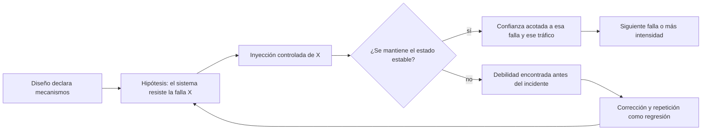

# SE-507 — Inyección de fallos de red, latencia y dependencias

[← SE-506 — Diseñar experimentos de fallo: alcance y radio de impacto](https://github.com/vladimiracunadev-create/modern-software-engineering-program/blob/main/classes/part-42-ingenieria-del-caos/se-506-disenar-experimentos-de-fallo-alcance-y-radio-de-impacto/README.md) · [↑ Parte 42](https://github.com/vladimiracunadev-create/modern-software-engineering-program/blob/main/classes/part-42-ingenieria-del-caos/README.md) · [📚 Índice completo](https://github.com/vladimiracunadev-create/modern-software-engineering-program/blob/main/classes/README.md) · [🌐 Portal](https://vladimiracunadev-create.github.io/modern-software-engineering-program/classes/SE-507.html) · [SE-508 — Fallos de recursos e infraestructura: CPU, memoria, disco y nodos →](https://github.com/vladimiracunadev-create/modern-software-engineering-program/blob/main/classes/part-42-ingenieria-del-caos/se-508-fallos-de-recursos-e-infraestructura-cpu-memoria-disco-y-nodos/README.md)

## Punto profesional y fundamento pedagógico

**Punto profesional.** La clase existe para que distingas una resiliencia **declarada** (el diseño dice que hay tiempos de espera, reintentos y cortacircuitos) de una resiliencia **demostrada** (alguien provocó la falla y el sistema se comportó como se prometió), para que sepas qué es y qué no es ingeniería del caos y para que reconozcas cuándo un mecanismo de protección es la causa de la caída. Un equipo que escribe «tenemos reintentos y cortacircuitos» en su documento de arquitectura ha descrito una intención; la evidencia empieza cuando esa intención se somete a una falla.

**Por qué aparece aquí.** Sigue a `SE-506`: allí se decidió cuánto daño puede pagar un experimento; aquí se inyectan las primeras fallas, las de red, de latencia y de dependencias, sobre el material de la Parte 36 (`SE-438` trata timeouts, retries, backoff y jitter y `SE-439` circuit breakers, bulkheads y degradación), de la Parte 32 (fallos parciales y la clase de caos controlado `SE-394`) y de la Parte 41 (observabilidad: sin señales no hay experimento). Aquellas clases enseñan los mecanismos; esta pregunta es previa a cualquier herramienta: ¿cómo sabes que funcionan juntos, con tu tráfico y tus dependencias? El caso conductor es el cliente de la **API de entregas** de la plataforma educativa que llama al servicio de almacenamiento de archivos.

**Error conceptual que debe corregir.** Creer que tener los mecanismos de resiliencia equivale a ser resiliente. Los mecanismos interactúan: un reintento sin pausa convierte una lentitud en una sobrecarga, un cortacircuitos sensible convierte un 30 % de errores en un servicio degradado y una espera larga retiene los hilos que otras peticiones necesitan.

**Secuencia de aprendizaje.** Antes de ver los resultados predices cuántas de seis fallas supera cada una de cinco configuraciones del cliente que «declaran» resiliencia y si alguna se recupera sola cuando la falla termina. Después contrastas la predicción con la simulación y escribes qué configuración defenderías y qué evidencia pedirías. La secuencia usa predicción, explicación propia, contraste y recuperación. [ICAP](https://icap.education.asu.edu/research) distingue participación de construcción de conocimiento; [How People Learn II](https://nap.nationalacademies.org/catalog/24783/how-people-learn-ii-learners-contexts-and-cultures) respalda diseñar la práctica con contextos reales y retroalimentación.

**Evidencia de aprendizaje.** `resiliencia-log.md` con la predicción, la matriz de cinco configuraciones por seis fallas reproducida, la serie temporal del fallo que no se recupera y una tabla «mecanismo declarado → falla que lo pone a prueba → resultado observado» para el cliente de la API de entregas.

**Límite de la conclusión.** El servicio, las latencias, el tráfico y las fallas son sintéticos, de tiempo virtual y con semilla fija. No se inyectó ninguna falla en un sistema real; las cifras muestran un mecanismo, no la frecuencia con que ocurre en el tuyo.

### Trazabilidad fuente → afirmación

| Fuente primaria u oficial | Afirmación que respalda | Lo que no prueba |
|---|---|---|
| [Principles of Chaos Engineering](https://principlesofchaos.org/) | Define la ingeniería del caos como la disciplina de experimentar sobre un sistema para ganar confianza en su capacidad de resistir condiciones turbulentas, y cita como debilidades sistémicas los ajustes de respaldo incorrectos y las tormentas de reintentos por esperas mal calibradas. | No fija qué fallas ni qué umbrales usar en tu sistema. |
| [Basiri et al., «Chaos Engineering» (IEEE Software, 2016)](https://arxiv.org/abs/1702.05843) | Describe el enfoque de experimentación para verificar la confiabilidad de sistemas distribuidos de gran tamaño. | No demuestra que el enfoque rinda lo mismo en un sistema pequeño. |
| [Google SRE: Addressing Cascading Failures](https://sre.google/sre-book/addressing-cascading-failures/) | Explica cómo la sobrecarga y los reintentos propagan una falla local a una falla en cascada. | No mide la probabilidad de cascada de tu servicio. |
| [AWS Builders' Library: Timeouts, retries, and backoff with jitter](https://aws.amazon.com/builders-library/timeouts-retries-and-backoff-with-jitter/) | Muestra que los reintentos amplifican la carga y que la pausa con azar la reparte. | No dice qué valores de espera y de reintentos usar. |
| [Bronson et al., «Metastable Failures in Distributed Systems» (HotOS 2021)](https://sigops.org/s/conferences/hotos/2021/papers/hotos21-s11-bronson.pdf) | Describe fallas que persisten tras desaparecer su disparador porque un efecto de refuerzo, como los reintentos, mantiene el sistema en un estado degradado. | No cuantifica cuántos sistemas reales las sufren. |

## Antes de empezar

Recupera lo aprendido sobre esperas, reintentos y cortacircuitos (`SE-438`, `SE-439`) y sobre señales y objetivos (`SE-493`, `SE-497`). La pregunta activa es: **si el almacenamiento de archivos se pone lento mientras los estudiantes entregan a las 23:50, ¿qué hará tu cliente y cómo lo sabrías sin esperar a que ocurra?**

## Prerrequisitos

- Conocer qué son un tiempo de espera, un reintento y un cortacircuitos; si no, repasa `SE-438` y `SE-439`.
- Poder leer un porcentaje de peticiones correctas como indicador (`SE-497`).
- Python 3.11 o posterior; los experimentos usan solo la biblioteca estándar (`random`, `heapq`, `statistics`).

## Problema auténtico

La plataforma educativa cierra el plazo de una tarea a las 23:59 y el almacenamiento de archivos tarda 100 ms más de lo normal desde las 23:40, porque un respaldo comparte disco con él. En la revisión de arquitectura del trimestre anterior el cliente de la API de entregas se aprobó con una casilla marcada: «tiempos de espera, reintentos y cortacircuitos: sí». A las 23:52 las entregas fallan en bloque, y cuando el respaldo termina a las 23:58 siguen fallando durante minutos. Nadie cambió nada; los mecanismos estaban presentes y funcionaron según su configuración, pero esa configuración, bajo esa falla, mantenía el sistema caído. La clase enseña por qué la casilla marcada no era evidencia y qué sí lo habría sido.

## Objetivos observables

Al terminar podrás:

1. distinguir resiliencia declarada de resiliencia demostrada y escribir qué observación convertiría una en la otra;
2. definir ingeniería del caos como experimentación con hipótesis y separarla de «romper cosas al azar» y de las pruebas de carga;
3. explicar cómo un reintento sin pausa amplifica la carga y cuándo un fallo se vuelve metaestable;
4. leer una matriz de configuraciones por fallas y decir cuáles pasan y cuáles solo parecen pasar;
5. escribir la tabla «mecanismo declarado → falla que lo pone a prueba → resultado» para un servicio propio.

## Mapa conceptual



El mapa separa lo **declarado** (la caja inicial) de lo **demostrado** (la rama sí). Una confirmación vale solo para la falla, la intensidad y el tráfico probados; una refutación es un hallazgo. Ninguna rama termina en «resiliente»: termina en «resistió esto».

## Temas y por qué importan

| Tema | Por qué cambia una decisión profesional | Evidencia mínima |
|---|---|---|
| Declarado frente a demostrado | Una arquitectura aprobada no es una arquitectura probada. | Predicción, traza causal y contraejemplo de **Declarado frente a demostrado** en `resiliencia-log.md` |
| Qué es ingeniería del caos | Un experimento con hipótesis no es sabotaje ni prueba de carga. | Predicción, traza causal y contraejemplo de **Qué es ingeniería del caos** en `resiliencia-log.md` |
| Amplificación por reintentos | Un mecanismo de protección puede multiplicar la carga que debía amortiguar. | Predicción, traza causal y contraejemplo de **Amplificación por reintentos** en `resiliencia-log.md` |
| Fallos metaestables | Un sistema puede quedar caído después de que la falla desaparece. | Predicción, traza causal y contraejemplo de **Fallos metaestables** en `resiliencia-log.md` |
| Mecanismos mal calibrados | Un cortacircuitos sensible convierte una falla parcial en degradación total. | Predicción, traza causal y contraejemplo de **Mecanismos mal calibrados** en `resiliencia-log.md` |

## Conceptos y decisiones

### 1. Resiliencia declarada y resiliencia demostrada

La **resiliencia declarada** es lo que el diseño afirma: «el cliente espera 250 ms, reintenta dos veces con pausa y abre un cortacircuitos si fallan muchas llamadas». Es información sobre intenciones y sobre configuración, y se puede revisar leyendo código. La **resiliencia demostrada** es lo que se observó cuando se provocó la falla: «con la dependencia 100 ms más lenta, el 0 % de las entregas se completó». La primera es barata y tiene valor, porque descarta diseños que no tienen ningún mecanismo; la segunda es la única que dice algo sobre el comportamiento conjunto. Entre ambas hay una brecha que no se cierra pensando más: la interacción de mecanismos con la capacidad real, el tráfico y las colas depende de números que solo se obtienen ejecutando.

Conviene fijar el vocabulario antes de seguir. Una **falla** es un evento o condición que se aparta del funcionamiento normal (un proceso que cae, un disco que se detiene, una dependencia lenta). Una **debilidad sistémica** es una propiedad del sistema que convierte esa falla en un daño visible para las personas usuarias. Un **experimento** es una intervención controlada que busca refutar una afirmación sobre esa propiedad. La [definición oficial](https://principlesofchaos.org/) pone el acento en la confianza: la ingeniería del caos es la disciplina de experimentar sobre un sistema para ganar confianza en su capacidad de resistir condiciones turbulentas. No promete eliminar las fallas ni asegura que el sistema no caerá; reduce la distancia entre lo que se cree y lo que se sabe.

### 2. Qué es y qué no es ingeniería del caos

Hay tres confusiones frecuentes. La primera es creer que consiste en apagar cosas al azar: el azar es una técnica de selección de objetivos (la herramienta histórica de Netflix elegía instancias al azar), pero lo esencial es la hipótesis, la medición y el control del daño. Sin hipótesis es sabotaje con registro. La segunda es confundirla con una **prueba de carga**: la prueba de carga (`SE-435`) aumenta la demanda para encontrar el límite de capacidad; el experimento de caos introduce una condición adversa con la demanda normal, o con demanda realista, para ver si el comportamiento se mantiene. Se complementan, y varios de los resultados de esta clase solo aparecen cuando la falla coincide con una carga alta. La tercera es creer que equivale a **pruebas de resiliencia unitarias**: probar que una función reintenta tres veces es una prueba de componente; el experimento mide la salida observable del servicio completo.

Los [principios](https://principlesofchaos.org/) resumen el método en cuatro pasos: definir el estado estable como una salida medible que indica comportamiento normal, formular la hipótesis de que continuará en el grupo de control y en el experimental, introducir variables que reflejen eventos reales (servidores que caen, discos que fallan, conexiones cortadas) e intentar refutar la hipótesis buscando una diferencia entre ambos grupos. Cuanto más difícil es perturbar el estado estable, más confianza se obtiene; si se perturba, hay un objetivo de mejora. `SE-505` desarrolla el primer paso y `SE-506` el control del daño.

### 3. Cinco clientes que declaran lo mismo

Para hacer visible la brecha se simula un cliente de la API de entregas que llama al almacenamiento de archivos. La dependencia atiende con 8 hilos y 40 ms de servicio medio (lognormal), con cola y rechazo cuando la espera supera 1,5 s; llegan 90 peticiones por segundo; el plazo de la persona usuaria es 1 s. Se comparan cinco configuraciones, todas con algún mecanismo de protección:

| Configuración | Qué declara |
|---|---|
| A | espera de 5 s y sin reintentos |
| B | espera de 1 s y 3 reintentos sin pausa |
| C | espera de 250 ms y 2 reintentos con pausa exponencial y azar |
| D | C con cortacircuitos (abre si falla 50 % de los últimos 20 intentos) y respuesta alternativa |
| E | C con cortacircuitos calibrado (abre si falla 80 % de los últimos 50 intentos) y respuesta alternativa |

Cada una se somete, durante 30 s dentro de una ejecución de 120 s y con tres semillas, a seis fallas: 100 ms más de latencia de red, 100 ms más de lentitud en la dependencia, 30 % de errores, pérdida de la mitad de los hilos, ausencia total de respuesta y caída del proceso durante 12 s. Se miden las peticiones correctas y completas durante la falla, las respondidas (completas o con la alternativa) y las correctas 20 s después de que la falla terminó.

```python
policy = Policy(timeout_ms=250, retries=2, backoff="exp_jitter", backoff_ms=50)   # configuración C
r = simulate(seed, policy, [Fault("capacity", 30, 60, 0.5)], duration_s=120, rate=90)
inside, after = summarize(r, 32, 60), summarize(r, 80, 120)
```

![Mapa de calor con el porcentaje de peticiones correctas y completas durante la falla para cinco configuraciones del cliente y seis fallas inyectadas: solo la latencia de red de 100 milisegundos no daña a ninguna; la configuración con reintentos sin pausa llega a 0 por ciento con la dependencia lenta y la configuración con espera corta y reintentos con azar cae a 0 con la dependencia lenta y con la caída del proceso; ninguna configuración sostiene la calidad completa con la dependencia lenta, la falta de respuesta y la caída del proceso.](../../../content/part-42/figures/se-507-cinco-clientes-seis-fallas.svg)

**Cómo leer la figura.** Cada fila es una configuración y cada columna una falla; el número es el porcentaje de peticiones que terminaron bien y completas mientras duraba la falla. Solo la latencia de red de 100 ms (la dependencia responde a tiempo, solo que más tarde) es inocua para las cinco. La espera de 5 s sin reintentos (A) cede 37 % con la dependencia lenta, 30 % con errores y 100 % sin respuesta. Los reintentos sin pausa (B) cubren bien el 30 % de errores (99 %) y colapsan con la lentitud (0 %). La espera corta con reintentos con azar (C) resuelve los errores (97 %) y colapsa con la lentitud, con la mitad de los hilos (33 %) y con la caída del proceso (0 %). Los dos cortacircuitos (D y E) responden siempre algo, pero la calidad completa baja a 4 % con la lentitud y a 0 % sin respuesta, porque la respuesta es la alternativa. Superan las seis fallas, medidas como «responde y se recupera», D y E; con «calidad completa y se recupera», A, B, C, D y E pasan 2, 3, 2, 1 y 2 de las seis. **Dónde deja de valer:** el servicio es una cola con 8 hilos, una distribución de servicio lognormal y fallas de tres tipos; otro servicio, con más holgura de capacidad (esta opera al 48 % de utilización) o con otra distribución, mueve los umbrales. Lo que sí generaliza es la forma: configuraciones que parecen equivalentes en el documento difieren entre 0 % y 100 % bajo falla.

El hallazgo contraintuitivo es que **D, con el cortacircuitos más «protector», entrega la peor calidad con 30 % de errores (13 %)**, mientras que C la entrega a 97 %. La causa es la calibración: con una ventana de 20 intentos y un umbral de 50 %, un 30 % de errores abre el circuito por azar con frecuencia, y mientras está abierto todas las peticiones reciben la alternativa. E, con ventana de 50 y umbral de 80 %, la entrega a 97 %. Un cortacircuitos mal calibrado no es neutro: puede transformar una degradación pequeña en una indisponibilidad completa de la calidad. Esto no se ve en el diagrama de arquitectura ni en una prueba unitaria del cortacircuitos.

### 4. Amplificación por reintentos

Un **reintento** repite una llamada fallida con la esperanza de que el fallo sea transitorio. Si el fallo no es transitorio sino una sobrecarga, el reintento añade trabajo al componente que ya no da abasto. Como la persona usuaria no se entera de que hubo varios intentos, el costo es invisible desde el cliente y evidente en la dependencia. La [documentación de Google SRE](https://sre.google/sre-book/addressing-cascading-failures/) lo identifica como una de las causas de las fallas en cascada, y la [guía de AWS](https://aws.amazon.com/builders-library/timeouts-retries-and-backoff-with-jitter/) explica el papel de la pausa con azar para repartir los reintentos en el tiempo.

El cálculo es directo. Si cada petición hace hasta 1 + r intentos y cada intento falla con probabilidad f (por espera agotada), los intentos por petición son `1 + f + f² + … + f^r`, que tiende a 1 + r cuando f se acerca a 1. Con r = 2 y f = 1 cada petición envía 3 intentos: la dependencia recibe el triple del trabajo justo cuando tiene menos capacidad. Y como el cliente abandona la espera pero la dependencia no cancela el trabajo, cada intento abandonado consume hilos. En el modelo, el servidor desperdicia el tiempo de cada intento que el cliente ya no espera.


**Cómo leer la figura.** Cada par de barras es una configuración y su largo, los intentos que envía por cada petición de una persona mientras dura la falla; la línea punteada es 1. A manda 1 en los dos casos porque no reintenta. B manda 2,3 con la dependencia lenta y 3,6 con la caída: con tres reintentos y sin pausa cada petición agota hasta cuatro intentos dentro del plazo de 1 s. C manda 3,0 en ambos casos: todos los intentos se agotan. D y E mandan cerca de 1 porque el cortacircuitos abre y deja de llamar. **Dónde deja de valer:** las cifras son intentos *por petición de persona*; el factor sobre la dependencia depende además de cuántas peticiones llegan y de cuántas ya estaban en cola. Con baja utilización, 3 intentos por petición pueden ser absorbidos sin daño, y por eso la amplificación se descubre inyectando bajo carga realista y no en reposo.

### 5. Fallos metaestables

Un **fallo metaestable** es un estado degradado que persiste después de que desapareció el disparador que lo causó, porque un efecto de refuerzo lo sostiene. El mecanismo más común es el reintento: la falla termina, pero la cola que se formó sigue llena y las esperas siguen agotándose, de modo que cada petición se reintenta y la carga efectiva sigue siendo triple de la capacidad. El sistema vuelve a ser sano solo si algo interrumpe el ciclo (un cortacircuitos que corta el flujo, un descarte de carga, un reinicio). El trabajo de [Bronson et al. (HotOS 2021)](https://sigops.org/s/conferences/hotos/2021/papers/hotos21-s11-bronson.pdf) lo formaliza como una clase de falla; el [libro de SRE](https://sre.google/sre-book/handling-overload/) describe cómo el descarte de carga y las respuestas degradadas cortan el ciclo.

Se ve en una serie temporal. Se retiran la mitad de los hilos de la dependencia entre los 30 y los 60 s (la capacidad pasa de 200 a 100 peticiones por segundo con 90 de demanda) y se mide cada 10 s la fracción de peticiones correctas para A, C y E.


**Cómo leer la figura.** El eje horizontal es el tiempo y el vertical, las peticiones correctas por ventana; las líneas verticales marcan el inicio y el fin de la falla. A no se entera: 90 peticiones por segundo caben en 100 de capacidad, y no multiplica la carga. C cae a 10 % durante la falla, y a los 60 s, cuando la dependencia recupera su capacidad, **sigue en 0 % durante el resto de la ejecución (60 s)**: cada petición vuelve a agotar la espera de 250 ms porque la cola de intentos viejos sigue sin vaciarse, y cada fracaso se reintenta. E baja a 44 % y sube a 100 % a los 75 s, porque el cortacircuitos corta el flujo y la cola se drena. **Dónde deja de valer:** el tamaño y la duración de la metaestabilidad dependen de la holgura de capacidad y de la política de cola (aquí rechazo tras 1,5 s de espera); con el doble de capacidad el fallo no aparece, con una cola sin límite se prolonga. La figura no dice que C sea «peor» que A en general: A pierde 63 % con una dependencia lenta, y C se recupera de los errores que A sufre. Dice que **sus modos de falla son distintos y que solo uno de ellos sigue después de la falla**.

## Definiciones de trabajo

- **resiliencia declarada:** conjunto de mecanismos de protección descritos en el diseño o la configuración de un sistema.
- **resiliencia demostrada:** comportamiento observado del sistema completo cuando se inyectó una falla concreta, con una intensidad y un tráfico concretos.
- **ingeniería del caos:** disciplina de experimentar sobre un sistema para ganar confianza en su capacidad de resistir condiciones turbulentas.
- **debilidad sistémica:** propiedad de un sistema que convierte una falla localizada en daño visible para las personas usuarias.
- **fallo metaestable:** estado degradado que persiste tras desaparecer su disparador por un efecto de refuerzo, como los reintentos.
- **amplificación por reintentos:** multiplicación de la carga sobre una dependencia por intentos repetidos de peticiones que fallan.

Las definiciones son operativas para el cliente de la API de entregas. No fijan sinónimos para términos con una historia más amplia y deben contrastarse con las fuentes enlazadas.

## Ejemplo mínimo

El fragmento calcula, para tres reintentos como máximo, cuántos intentos por petición envía un cliente según la probabilidad de que cada intento falle. Antes de ejecutarlo, predice el valor para f = 0,5 y para f = 1.

```python
def intentos_por_peticion(f: float, reintentos: int) -> float:
    return sum(f ** k for k in range(reintentos + 1))

for f in (0.1, 0.5, 0.9, 1.0):
    print(f, round(intentos_por_peticion(f, 3), 3))
```

Imprime `0.1 1.111`, `0.5 1.875`, `0.9 3.439` y `1.0 4.0`. Con f = 0,5 cada petición envía casi dos intentos; con f = 1, cuatro. Registra versión de Python, comando y salida; luego cambia `reintentos` a 2 y decide a partir de qué f el costo adicional supera el 50 %.

## Ejemplo profesional

Supón, como caso hipotético y no como medición, que el equipo de la API de entregas completa la tabla «mecanismo declarado → falla que lo pone a prueba → resultado esperado» antes de la próxima revisión de arquitectura. Para la espera de 250 ms propone la falla «dependencia lenta +100 ms» y el resultado esperado «99 % de entregas aceptadas dentro del plazo»; para los reintentos, «mitad de los hilos» y «sin aumento de la carga de la dependencia por encima de 1,5 veces la capacidad»; para el cortacircuitos, «30 % de errores» y «alternativa servida menos de 1 % del tiempo»; para la alternativa, «sin respuesta» y «entrega encolada para reintento posterior sin pérdida». La tabla no ejecuta nada: señala cuatro hipótesis que se escriben con el formato de `SE-505`. Decide además qué *no* probará todavía (la falla del disco del almacenamiento y el desfase de reloj) y las deja con fecha como deuda declarada.

## Práctica guiada

1. Predice, por escrito, cuántas de las seis fallas supera cada configuración y cuál se recupera mal tras la falla.
2. Ejecuta `python scripts/experiments_part42_a.py e507` y compara; anota la mayor diferencia con tu predicción.
3. Cambia la tasa de 90 a 60 peticiones por segundo y repite: ¿sigue C sin recuperarse? Encuentra la tasa a partir de la cual deja de ser metaestable.
4. Cambia el umbral del cortacircuitos de D de 0,5 a 0,8 con ventana 20 y observa el efecto sobre los 30 % de errores.
5. Escribe tu tabla «mecanismo declarado → falla → resultado esperado» para un servicio propio con ocho filas.
6. Entrega `resiliencia-log.md` y pide a otra persona que proponga una falla que tu tabla no cubra.

## Ejercicios

1. **Declarado:** clasifica cinco afirmaciones de un documento de arquitectura («tenemos reintentos», «la base replica», «hay un cortacircuitos», «el balanceador saca nodos enfermos», «hacemos copias nocturnas») como declaradas y escribe qué observación las demostraría.
2. **Amplificación:** con f = 0,7 y 2 reintentos calcula los intentos por petición y el trabajo adicional sobre la dependencia si llegan 80 peticiones por segundo.
3. **Metaestable:** una dependencia con 100 peticiones por segundo de capacidad recibe 90 de demanda y tres intentos por cada petición lenta durante una falla; explica por qué la carga sigue por encima de la capacidad después de que la falla termina y qué mecanismo interrumpiría el ciclo.
4. **Calibración:** con ventana de 20 intentos y umbral de 50 %, estima con la binomial la probabilidad de que un 30 % de fallos reales abra el circuito en una ventana, y compárala con la del umbral de 80 % y ventana 50.

## Reto verificable

Entrega `resiliencia-log.md` con la predicción, la matriz de cinco configuraciones por seis fallas reproducida con las mismas semillas, la serie de la metaestabilidad, la tabla «mecanismo declarado → falla → resultado» de tu servicio con al menos ocho filas y las tres hipótesis más arriesgadas ordenadas. Se aprueba si otra persona ejecuta el código desde un checkout limpio, obtiene las mismas cifras y propone una falla que tu tabla no pone a prueba. No se aprueba por listar herramientas ni por afirmar que «con cortacircuitos ya es resiliente».

## Caso conductor

El cliente de la API de entregas es el caso conductor de la Parte 42. Esta clase deja el tercer artefacto: una tabla de mecanismos declarados con la falla que los pondría a prueba. la hipótesis de cada fila se escribe como en `SE-505`, el daño se acota como en `SE-506` y `SE-508` completa el catálogo con las fallas de recursos. Cambia después un solo parámetro, la utilización de la dependencia, y observa a partir de qué punto la metaestabilidad desaparece.

## Preguntas frecuentes

### ¿La ingeniería del caos es lo mismo que probar en producción?

No. Hay experimentos de caos en el entorno de desarrollo, en la integración continua y en preproducción (`SE-512`), y algunos en producción cuando hay observabilidad, control del daño y condiciones de aborto (`SE-515`). Lo que define la práctica es la hipótesis y la medición, no el entorno; el entorno cambia el realismo y el riesgo.

### Si ya hacemos pruebas de carga, ¿hace falta algo más?

Sí. La prueba de carga busca el límite de capacidad con una dependencia sana. El experimento de caos busca qué hace el sistema cuando una dependencia se degrada con una carga normal. Los resultados de esta clase solo aparecen cuando una falla se superpone a una carga que, sin ella, no daña a nadie.

### ¿Por qué no basta con revisar la configuración?

Porque la configuración no dice cuánto tarda la cola en vaciarse, cuántos hilos retienen los intentos abandonados ni si un umbral abre el circuito por azar. La lectura de la configuración detecta ausencias (no hay cortacircuitos) y no detecta calibraciones. `SE-512` mide qué ve cada defensa.

### ¿Debo temer que un cortacircuitos empeore las cosas?

Debes temerle si no lo pusiste a prueba. Calibrado, protege; sensible, convierte errores moderados en alternativa permanente. La conclusión no es retirarlo, sino ponerlo a prueba con las fallas parciales que lo activan.

## Fallo controlado y diagnóstico

Reproduce el fallo clásico de la clase: **declarar resiliencia por la presencia de mecanismos**. Aplica la falla «mitad de los hilos» a la configuración C y observa qué ocurre durante y después de la falla.

Registra síntoma, entrada mínima, hipótesis, observación que descarta cada hipótesis, causa, corrección y prueba de regresión. **Síntoma:** las entregas siguen fallando 60 s después de que el almacenamiento recuperó su capacidad. **Hipótesis rivales:** (a) la dependencia no se recuperó; (b) el cliente tiene un defecto de reintento; (c) la cola acumulada y los reintentos mantienen la sobrecarga. **Prueba:** mide la utilización de la dependencia después de la falla y los intentos por petición del cliente; si la utilización es mayor de 100 % y cada petición envía 3 intentos, la hipótesis (c) explica la señal, y no hay defecto de código. **Conclusión:** la configuración sostiene su propia sobrecarga. **Regresión:** añade una prueba que aplique la falla durante 30 s y exija que 20 s después de terminar el 99 % de las peticiones sean correctas. No cambies a la vez la espera, los reintentos y el cortacircuitos.

## Errores comunes y cómo corregirlos

| Síntoma | Causa probable | Corrección |
|---|---|---|
| Todo parece resiliente en el documento | Se revisó la presencia de mecanismos, no su comportamiento | Inyectar la falla que cada mecanismo dice cubrir |
| El servicio no se recupera tras la falla | Reintentos y cola mantienen la sobrecarga | Cortacircuitos, descarte de carga o pausa con azar |
| El cortacircuitos abre con fallas pequeñas | Ventana corta o umbral bajo | Calibrar ventana y umbral con la tasa de fallas parciales esperada |
| La falla de red no daña pero la lentitud sí | La lentitud retiene hilos; el retraso de red no | Distinguir fallas por mecanismo antes de interpretarlas |
| Un experimento «pasa» y se declara resiliencia general | La confirmación vale solo para esa falla e intensidad | Escribir el alcance de cada confirmación |

## Entorno y archivos clave

```text
work/SE-507/
├── README.md
├── caos/
│   ├── simulador.py
│   ├── configuraciones.py
│   └── fallas.py
├── tests/test_resiliencia.py
└── evidence/resiliencia-log.md
```

El `README` declara plataforma, versión de Python, semillas y comandos. Los experimentos usan solo la biblioteca estándar y se ejecutaron con CPython 3.12.9 en Windows 11 y 3.12.3 en Ubuntu bajo WSL2 con resultados idénticos, porque el tiempo es virtual y el generador es `random.Random` con semilla fija. Para recuperar el estado, borra `work/SE-507/` y vuelve a ejecutar los scripts. Si añades una dependencia, fija procedencia y versión.

## Seguridad, ética y accesibilidad

- una falla inyectada es una acción deliberada sobre un sistema: en esta clase solo se simula, y en un sistema real exige autorización, alcance acotado y aborto (`SE-506`, `SE-513`);
- no pruebes con datos reales de estudiantes: usa cuentas y archivos de prueba;
- no atribuyas la caída a una persona: un mecanismo mal calibrado es una decisión de diseño colectiva;
- documenta las tablas y las figuras con texto alternativo y en un formato que un lector de pantalla pueda recorrer;
- respeta las licencias de los artículos y atribuye lo adaptado.

## Puente hacia el trabajo con agentes

Un agente al que se le pide «hazlo resiliente» tenderá a envolver cada llamada en reintentos con un valor por defecto y a añadir un cortacircuitos de biblioteca sin calibrar, y a declarar el resultado. Pídele en cambio que parta de la tabla «mecanismo declarado → falla → resultado», que escriba la prueba que inyecta cada falla antes de tocar la configuración, que reporte las peticiones correctas durante y después de la falla y que no cambie dos parámetros a la vez. Revisa especialmente si añade reintentos sin pausa, si ajusta los umbrales hasta que la prueba pase y si borra una prueba que falla en lugar de explicarla.

## Transferencia

Traslada el análisis a otro servicio (un procesador de pagos que llama a un banco, un buscador que llama a un índice): lista los mecanismos declarados, elige para cada uno la falla que lo pone a prueba y escribe el resultado esperado. La transferencia está lograda cuando puedes decir cuál de tus mecanismos podría empeorar la falla que dice cubrir, no cuando la lista está completa.

## Evaluación y evidencia

| Criterio | Evidencia para aprobar |
|---|---|
| comprensión | explicación de declarado frente a demostrado y de la amplificación por reintentos |
| corrección | matriz, serie e intentos por petición reproducibles con las mismas semillas |
| diseño | tabla mecanismo → falla → resultado con alcance de cada confirmación |
| diagnóstico | reproducción del fallo «declarar por presencia» con regresión |
| incertidumbre | declaración de que el servicio, el tráfico y las fallas son sintéticos |
| reproducibilidad | versiones, comandos, salida y límites declarados |

## Fuentes

- [Principles of Chaos Engineering](https://principlesofchaos.org/) — definición, pasos y principios avanzados; autoridad: documento vivo de la comunidad de ingeniería del caos.
- [Basiri et al., «Chaos Engineering»](https://arxiv.org/abs/1702.05843) — IEEE Software 33(3), 2016; autoridad: artículo revisado de ingenieros de Netflix.
- [Google SRE: Addressing Cascading Failures](https://sre.google/sre-book/addressing-cascading-failures/) — sobrecarga, reintentos y cascadas; autoridad: libro de ingeniería de confiabilidad de Google.
- [Google SRE: Handling Overload](https://sre.google/sre-book/handling-overload/) — descarte de carga y respuestas degradadas; autoridad: libro de ingeniería de confiabilidad de Google.
- [AWS Builders' Library: Timeouts, retries, and backoff with jitter](https://aws.amazon.com/builders-library/timeouts-retries-and-backoff-with-jitter/) — reintentos y pausa con azar; autoridad: biblioteca de ingeniería de Amazon Web Services.
- [Bronson et al., «Metastable Failures in Distributed Systems»](https://sigops.org/s/conferences/hotos/2021/papers/hotos21-s11-bronson.pdf) — fallos que persisten por refuerzo; autoridad: artículo de HotOS 2021.
- [Martin Fowler: Circuit Breaker](https://martinfowler.com/bliki/CircuitBreaker.html) — patrón del cortacircuitos; autoridad: boletín de ingeniería de software de Martin Fowler.

Cada fuente respalda el mecanismo indicado; ninguna demuestra que 0 % de recuperación, 4 % de calidad o 3,6 intentos por petición se observen en un sistema real. Esa afirmación depende de la capacidad, la carga y la configuración.

## Límites y siguiente paso

Se ejecutaron tres experimentos con tiempo virtual y semillas fijas en Windows y Ubuntu (WSL2) con resultados idénticos. No se inyectó ninguna falla en un sistema real; la dependencia de 8 hilos, el tráfico de 90 peticiones por segundo, las cinco configuraciones y las seis fallas son construcciones del autor, y los umbrales de los cortacircuitos se eligieron para mostrar el fenómeno. La siguiente clase amplía el catálogo a las fallas de recursos e infraestructura (CPU, memoria, disco, reloj y procesos) y a su huella en las señales.

## Glosario

- **resiliencia declarada:** conjunto de mecanismos de protección descritos en el diseño o la configuración de un sistema.
- **resiliencia demostrada:** comportamiento observado del sistema completo cuando se inyectó una falla concreta.
- **ingeniería del caos:** disciplina de experimentar sobre un sistema para ganar confianza en su capacidad de resistir condiciones turbulentas.
- **debilidad sistémica:** propiedad que convierte una falla localizada en daño visible para las personas usuarias.
- **fallo metaestable:** estado degradado que persiste tras desaparecer su disparador por un efecto de refuerzo.
- **amplificación por reintentos:** multiplicación de la carga sobre una dependencia por intentos repetidos.

---

[← SE-506 — Diseñar experimentos de fallo: alcance y radio de impacto](https://github.com/vladimiracunadev-create/modern-software-engineering-program/blob/main/classes/part-42-ingenieria-del-caos/se-506-disenar-experimentos-de-fallo-alcance-y-radio-de-impacto/README.md) · [↑ Parte 42](https://github.com/vladimiracunadev-create/modern-software-engineering-program/blob/main/classes/part-42-ingenieria-del-caos/README.md) · [📚 Índice completo](https://github.com/vladimiracunadev-create/modern-software-engineering-program/blob/main/classes/README.md) · [🌐 Portal](https://vladimiracunadev-create.github.io/modern-software-engineering-program/classes/SE-507.html) · [SE-508 — Fallos de recursos e infraestructura: CPU, memoria, disco y nodos →](https://github.com/vladimiracunadev-create/modern-software-engineering-program/blob/main/classes/part-42-ingenieria-del-caos/se-508-fallos-de-recursos-e-infraestructura-cpu-memoria-disco-y-nodos/README.md)
