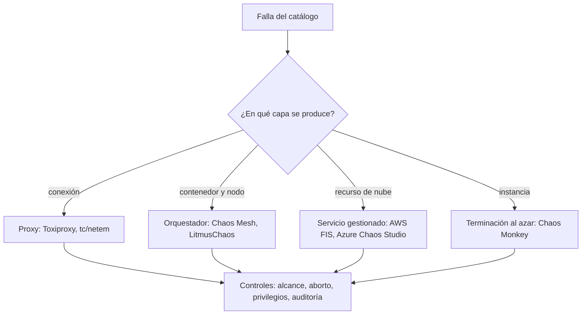

# SE-509 — Caos en Kubernetes y en plataformas cloud

[← SE-508 — Fallos de recursos e infraestructura: CPU, memoria, disco y nodos](https://github.com/vladimiracunadev-create/modern-software-engineering-program/blob/main/classes/part-42-ingenieria-del-caos/se-508-fallos-de-recursos-e-infraestructura-cpu-memoria-disco-y-nodos/README.md) · [↑ Parte 42](https://github.com/vladimiracunadev-create/modern-software-engineering-program/blob/main/classes/part-42-ingenieria-del-caos/README.md) · [📚 Índice completo](https://github.com/vladimiracunadev-create/modern-software-engineering-program/blob/main/classes/README.md) · [🌐 Portal](https://vladimiracunadev-create.github.io/modern-software-engineering-program/classes/SE-509.html) · [SE-510 — Fallos de datos y de estado: réplicas, particiones y corrupción →](https://github.com/vladimiracunadev-create/modern-software-engineering-program/blob/main/classes/part-42-ingenieria-del-caos/se-510-fallos-de-datos-y-de-estado-replicas-particiones-y-corrupcion/README.md)

## Punto profesional y fundamento pedagógico

**Punto profesional.** En Kubernetes y en la nube la falla se declara como un recurso (un experimento con alcance, programación y condiciones de parada), y esa declaración, con sus privilegios, es lo que hay que gobernar. La clase existe para que elijas la herramienta de inyección de fallas por la **capa en que actúa**, por sus controles de seguridad (alcance, aborto, privilegios) y por el entorno donde la vas a usar, y no por la lista de fallas que anuncia. Toxiproxy, Chaos Mesh, LitmusChaos, AWS Fault Injection Service y las herramientas históricas de Netflix resuelven problemas distintos; saber cuál toca qué evita comprar una plataforma para un problema que un proxy de cien líneas resuelve, y evita lo contrario.

**Por qué aparece aquí.** Sigue a `SE-508`: allí se organizó el catálogo de fallas por mecanismo; aquí se elige con qué se inyecta cada una. Usa los contenedores y la plataforma de la Parte 33 (`SE-397`) y el camino a producción de la Parte 40 (`SE-485`). A diferencia de las clases anteriores, incluye una **medición real**: un proxy escrito para la clase y un cliente con sockets reales en la máquina local. El caso conductor es el cliente de la API de entregas y su dependencia de almacenamiento.

**Error conceptual que debe corregir.** Creer que la herramienta define la práctica («hacemos caos porque instalamos Chaos Mesh»). Una herramienta sin hipótesis, sin aborto y sin observabilidad inyecta fallas con comodidad, y no convierte el resultado en evidencia.

**Secuencia de aprendizaje.** Antes de ver los resultados predices qué ve un cliente con espera de 300 ms cuando un proxy añade 50, 200 y 400 ms, cuando reinicia la conexión y cuando se queda en silencio. Después contrastas la predicción con la medición y escribes qué herramienta usarías para cada fila de tu catálogo. [ICAP](https://icap.education.asu.edu/research) distingue participación de construcción de conocimiento; [How People Learn II](https://nap.nationalacademies.org/catalog/24783/how-people-learn-ii-learners-contexts-and-cultures) respalda diseñar la práctica con contextos reales y retroalimentación.

**Evidencia de aprendizaje.** `herramientas-log.md` con la predicción, la medición reproducida en tu máquina con sus versiones, una tabla «falla del catálogo → capa → herramienta candidata → control de seguridad» y una nota que separe lo medido de lo documentado.

**Límite de la conclusión.** Se midió un proxy propio de 80 líneas en una máquina Windows, con 30 peticiones secuenciales por escenario. No se ejecutó ninguna de las herramientas descritas: todo lo que se dice de ellas procede de su documentación oficial y se atribuye. Las cifras muestran un mecanismo, no el rendimiento de Toxiproxy ni de ninguna otra.

### Trazabilidad fuente → afirmación

| Fuente primaria u oficial | Afirmación que respalda | Lo que no prueba |
|---|---|---|
| [Toxiproxy (Shopify)](https://github.com/Shopify/toxiproxy) | Es un proxy TCP escrito en Go, controlado por una API HTTP, hecho para pruebas, integración continua y desarrollo; sus tóxicos incluyen latencia, ancho de banda, cierre lento, timeout, reinicio de la conexión, fragmentación, límite de datos y pérdida de paquetes. | No mide su rendimiento ni su sobrecarga. |
| [Chaos Mesh: visión general](https://chaos-mesh.org/docs/) | Es una plataforma de ingeniería del caos nativa de la nube y de Kubernetes que ofrece distintos tipos de falla y orquestación de escenarios; nació del banco de pruebas de TiDB. | No dice que sea la adecuada para tu clúster. |
| [LitmusChaos: qué es Litmus](https://docs.litmuschaos.io/docs/introduction/what-is-litmus) | Es un marco de ingeniería del caos nativo de la nube, proyecto incubado de la CNCF, que define la intención del caos de forma declarativa con recursos personalizados de Kubernetes. | No compara con otras herramientas. |
| [AWS FIS: qué es](https://docs.aws.amazon.com/fis/latest/userguide/what-is.html) | Es un servicio gestionado que ejecuta experimentos sobre recursos de AWS a partir de plantillas con acciones, objetivos y condiciones de parada, y advierte que actúa sobre recursos reales. | No dice qué experimentos hacen falta. |
| [Azure Chaos Studio](https://learn.microsoft.com/en-us/azure/chaos-studio/chaos-studio-overview) | Es un servicio gestionado de ingeniería del caos y pruebas de resiliencia de Azure basado en espacios de trabajo y escenarios. | No describe su costo ni sus límites. |
| [Netflix: «The Netflix Simian Army» (2011)](https://netflixtechblog.com/the-netflix-simian-army-16e57fbab116) | Presenta Chaos Monkey, que desactiva instancias de producción al azar, y otros simios (Latency, Conformity, Doctor, Janitor, Security, 10-18 y Chaos Gorilla) como pruebas de resiliencia. | No describe el estado actual de esas herramientas. |
| [Netflix: «ChAP: Chaos Automation Platform» (2017)](https://netflixtechblog.com/chap-chaos-automation-platform-53e6d528371f) | Presenta FIT para inyectar fallas a nivel de microservicio y ChAP para ejecutar experimentos con un clúster de control y uno experimental. | No es un manual de uso de ninguna herramienta pública. |

## Antes de empezar

Recupera lo aprendido en `SE-508`: un catálogo de fallas por mecanismo con su huella. La pregunta activa es: **de tus doce fallas, ¿cuáles puedes inyectar con un proxy en la prueba de integración, cuáles necesitan acceso al nodo y cuáles solo las puede provocar el proveedor de nube, y qué permisos exige cada una?**

## Prerrequisitos

- Haber completado `SE-508` o poder clasificar una falla por mecanismo.
- Nociones de contenedores y orquestación (`SE-397`) y de TCP (cliente, servidor, conexión).
- Python 3.11 o posterior; los experimentos usan solo la biblioteca estándar (`socket`, `threading`, `http.server`).

## Problema auténtico

El equipo de la API de entregas quiere «empezar con caos». Una persona propone instalar una plataforma completa sobre Kubernetes; otra, escribir un script que apague contenedores al azar; una tercera, pedir al proveedor de nube que le cobre por experimentos gestionados. Pasan tres semanas comparando listas de funciones. Lo que nadie dice es que la primera falla que quieren probar (la dependencia tarda 400 ms más de lo que espera el cliente) se reproduce en una tarde con un proxy local, y que la que más miedo da (perder una zona de disponibilidad) no se puede reproducir con ninguna de esas tres opciones sin permisos que el equipo no tiene. La clase enseña a elegir por capa y por control, no por catálogo.

## Objetivos observables

Al terminar podrás:

1. clasificar las herramientas por la capa en que inyectan (conexión, contenedor y nodo, plataforma de nube, instancia) y decir qué fallas de tu catálogo cubre cada una;
2. explicar el mecanismo de un proxy de inyección y reproducir la medición de latencia, reinicio y silencio;
3. enumerar los controles de seguridad que debe tener una herramienta (alcance, aborto, privilegios, auditoría) y verificarlos en su documentación;
4. distinguir lo medido de lo documentado en un informe de herramientas;
5. escribir la tabla «falla → capa → herramienta candidata → control de seguridad» para un servicio propio.

## Mapa conceptual



El mapa separa la **capa** de la falla del **control** que la hace segura. La herramienta es la intersección de ambos; una herramienta sin aborto o con privilegios excesivos no es candidata aunque inyecte la falla que hace falta.

## Temas y por qué importan

| Tema | Por qué cambia una decisión profesional | Evidencia mínima |
|---|---|---|
| Inyección en la conexión | Un proxy basta para probar a un cliente y no toca el servicio. | Predicción, traza causal y contraejemplo de **Inyección en la conexión** en `herramientas-log.md` |
| Orquestadores de Kubernetes | Declarar la falla como recurso da trazabilidad, pero exige privilegios. | Predicción, traza causal y contraejemplo de **Orquestadores de Kubernetes** en `herramientas-log.md` |
| Servicios gestionados de nube | Los recursos del proveedor solo se alteran con sus herramientas. | Predicción, traza causal y contraejemplo de **Servicios gestionados de nube** en `herramientas-log.md` |
| Las herramientas de Netflix como historia | La herramienta más famosa no es la más adecuada, y su historia explica el método. | Predicción, traza causal y contraejemplo de **Las herramientas de Netflix como historia** en `herramientas-log.md` |
| Controles de seguridad | La herramienta se evalúa por cómo se detiene, no por lo que rompe. | Predicción, traza causal y contraejemplo de **Controles de seguridad** en `herramientas-log.md` |

## Conceptos y decisiones

### 1. Un proxy en la conexión: el mecanismo de Toxiproxy

[Toxiproxy](https://github.com/Shopify/toxiproxy) es un proxy TCP escrito en Go que se interpone entre un cliente y su dependencia y se controla con una API HTTP. La aplicación no se modifica: solo apunta a la dirección del proxy en lugar de la del servicio, y desde la prueba se activan, modifican y retiran **tóxicos** que alteran lo que atraviesa la conexión. Según su documentación, los tóxicos disponibles incluyen `latency` (retraso, con variación opcional), `bandwidth` (límite de KB por segundo), `slow_close` (retrasa el cierre del socket), `timeout` (detiene todos los datos y cierra la conexión pasado un tiempo, o la deja abierta y descarta los datos si el tiempo es 0), `reset_peer` (simula un reinicio de conexión), `slicer` (fragmenta los datos), `limit_data` (cierra tras transmitir cierto volumen) y `packet_loss` (descarta fragmentos al azar). Los tóxicos son direccionales: por defecto actúan en el sentido servidor → cliente. El propio proyecto lo describe como una herramienta pensada para entornos de prueba, integración continua y desarrollo, con manipulación determinista de las conexiones y soporte de caos aleatorio.

Se puede reproducir su mecanismo con ochenta líneas de la biblioteca estándar y medirlo. El proxy acepta conexiones, abre una conexión al servicio local, y según el modo activo reenvía, retrasa, cierra al instante o calla.

```python
if self.mode == "reset":   conn.close(); return          # el cliente ve la conexión reiniciada
if self.mode == "silence": time.sleep(3.0); conn.close() # el cliente espera hasta su propio tiempo de espera
up = socket.create_connection(("127.0.0.1", self.upstream))
up.sendall(data); time.sleep(self.latency / 2000.0)      # medio retraso en cada sentido
```

Un cliente con **espera de 300 ms** y sin reintentos hace 30 peticiones secuenciales por escenario y registra si cada una terminó bien y cuánto tardó. La medición se hizo en un equipo con Windows 11 y CPython 3.12.9; el servidor es un `ThreadingHTTPServer` que responde «ok».


**Cómo leer la figura.** Cada par de barras es un escenario con la mediana y el percentil 95 del tiempo hasta el desenlace; entre paréntesis, los éxitos de las 30 peticiones; la línea punteada es la espera del cliente (300 ms). Sin tóxico, el proxy añade menos de 1 ms a los 10,4 ms de la conexión directa. Con 50 y 200 ms de latencia las 30 peticiones salen bien y tardan lo que dice el tóxico más unos 11 ms. Con 400 ms la espera se agota: 0 de 30, y el tiempo es el de la espera (311 ms), no el del retraso. El reinicio de conexión falla en 10 ms y el silencio en 311 ms. **Dónde deja de valer:** son 30 peticiones secuenciales en una sola máquina, sin carga ni contención; los milisegundos varían unos puntos entre ejecuciones y los conteos de éxitos deben repetirse. El proxy es una imitación del mecanismo y no mide el rendimiento de Toxiproxy.

Dos conclusiones sobre el cliente. La primera: **el reinicio falla rápido y el silencio falla lento**. Con el silencio cada petición retiene un hilo del cliente 300 ms completos y sin resultado, y con tres reintentos son 900 ms; por eso el silencio es la falla de red que más recursos retiene y la que más pone a prueba las esperas de `SE-507`. La segunda: **400 ms de latencia son, para este cliente, indistinguibles de un silencio**; lo que importa es la relación entre el retraso y la espera, no el retraso solo.


**Cómo leer la figura.** El cliente (izquierda) y el servicio (derecha) no se modifican; el proxy (centro) altera la conexión según el tóxico activo, y un panel de control los activa y los retira. Debajo, lo que se mide y lo que no se puede ver desde ahí. **Dónde deja de valer:** el proxy solo altera lo que cruza el cable; no puede quitar hilos al servicio, llenar su disco ni cambiar su reloj. Esas fallas viven dentro del nodo y exigen otra capa. Un proxy tampoco prueba a los demás clientes del servicio.

### 2. Orquestadores en Kubernetes: Chaos Mesh y LitmusChaos

Cuando el servicio corre en Kubernetes, la falla se puede declarar como un recurso del clúster. [Chaos Mesh](https://chaos-mesh.org/docs/) es una plataforma de ingeniería del caos nativa de la nube que, según su documentación, ofrece distintos tipos de simulación de fallas y orquestación de escenarios, y nació del banco de pruebas de TiDB. Sus tipos de experimento de Kubernetes cubren fallas de pod, de red (partición, emulación de mala red, límite de ancho de banda), de estrés, de E/S de ficheros, de DNS, de tiempo, de JVM, del núcleo de Linux y de HTTP, además de fallas de dispositivos de bloque y de nodos físicos. El alcance se define con selectores (por ejemplo, de espacios de nombres y de etiquetas, que deben cumplirse todos a la vez) y los experimentos se pueden programar, encadenar en un flujo y ver en un panel. Su documentación incluye una página que explica por qué el demonio del caos corre con privilegios elevados: para alterar la red, el sistema de ficheros o el reloj de un contenedor desde fuera necesita acceso al nodo.

[LitmusChaos](https://docs.litmuschaos.io/docs/introduction/what-is-litmus) es otro marco nativo de la nube, un proyecto incubado de la CNCF, que adopta un enfoque «nativo de Kubernetes» para declarar la intención del caos con recursos personalizados. Distingue el **experimento de caos** (la unidad fundamental), el centro de caos (`ChaosCenter`) como plano de control, un repositorio de experimentos (`ChaosHub`) y las **sondas de resiliencia** (*resilience probes*) que comprueban de forma automática el estado del sistema durante el experimento. Esa última idea, la comprobación continua integrada al experimento, es el equivalente operativo del estado estable de `SE-505` y de la condición de aborto de `SE-506`.

Ambos comparten ventajas (la falla queda versionada como código, auditable y repetible; el alcance es declarativo) y costos (requieren un clúster, privilegios amplios para su componente en el nodo, y una curva de aprendizaje). La decisión práctica no es «cuál tiene más fallas» sino cuál integra mejor con la forma en que el equipo ya opera, qué permisos exige y qué tan fácil es detenerlo. Ninguna de las dos se ejecutó en esta clase; lo dicho procede de su documentación.

### 3. Servicios gestionados de nube: AWS FIS y Azure Chaos Studio

Hay fallas que ningún proxy ni orquestador puede producir porque ocurren sobre recursos del proveedor: una instancia detenida, una zona de disponibilidad inaccesible, una base de datos que conmuta. Para esas existen los servicios gestionados. [AWS Fault Injection Service](https://docs.aws.amazon.com/fis/latest/userguide/what-is.html) ejecuta experimentos sobre cargas de trabajo en AWS con la estructura de una **plantilla de experimento**: **acciones** (qué hacer a qué tipo de recurso, de un conjunto preconfigurado y con duración), **objetivos** (los recursos afectados, elegidos por identificador o por criterios como etiquetas o estado) y **condiciones de parada** (alarmas que detienen el experimento). Su documentación advierte que actúa sobre recursos reales y recomienda completar una fase de planificación y ejecutar antes los experimentos en preproducción. [Azure Chaos Studio](https://learn.microsoft.com/en-us/azure/chaos-studio/chaos-studio-overview) es el servicio equivalente de Azure; su modelo vigente de recursos son los **espacios de trabajo** y los **escenarios** que simulan interrupciones sobre los recursos descubiertos, y el modelo anterior de «experimentos» está en proceso de reemplazo según la propia documentación.

La ventaja es el control sobre recursos que el equipo no puede alterar de otra forma y que la herramienta ya integra con los permisos y las alarmas de la nube. El costo es la dependencia del proveedor, que los experimentos solo existen en esa nube y que cualquier error de selección de objetivos actúa sobre recursos reales. Por eso la selección de objetivos por etiqueta y la condición de parada son los dos primeros campos que se revisan.

### 4. Las herramientas de Netflix como historia

Las herramientas más citadas de la disciplina son históricas y documentadas por sus autores. [«The Netflix Simian Army»](https://netflixtechblog.com/the-netflix-simian-army-16e57fbab116) (2011) presenta **Chaos Monkey**, que desactiva al azar instancias de producción para comprobar que se puede sobrevivir a esa falla común sin impacto para los clientes, y una serie de «simios» con otros fines: **Latency Monkey** introduce retrasos artificiales en la capa cliente-servidor REST (y con retrasos muy grandes simula la caída de un servicio sin apagarlo), **Conformity Monkey** apaga instancias que no siguen las buenas prácticas, **Doctor Monkey** retira instancias que fallan sus comprobaciones de salud, **Janitor Monkey** limpia recursos sin uso, **Security Monkey** detecta violaciones de seguridad y certificados por vencer, **10-18 Monkey** revisa la localización y **Chaos Gorilla** simula la caída de una zona de disponibilidad completa. [«Chaos Engineering Upgraded»](https://netflixtechblog.com/chaos-engineering-upgraded-878d341f15fa) (2015) añade **Chaos Kong**, que evacúa una región entera, y formaliza la disciplina. [«ChAP»](https://netflixtechblog.com/chap-chaos-automation-platform-53e6d528371f) (2017) describe **FIT**, creada para inyectar fallas a nivel de microservicio en producción, y **ChAP**, que supera sus límites: interroga el proceso de despliegue del servicio, lanza un clúster de control y uno experimental, les envía una pequeña parte del tráfico y aplica un escenario de FIT solo al experimental.

Hoy el repositorio de [Chaos Monkey](https://github.com/Netflix/chaosmonkey) lo describe como una herramienta que termina al azar máquinas virtuales y contenedores en producción, y precisa que esta versión se integra por completo con Spinnaker, la plataforma de entrega continua de Netflix, y exige gestionar las aplicaciones con ella. La enseñanza no es copiar la herramienta: es que la selección al azar de instancias apoya una disciplina de **diseño** («los equipos construyen servicios que sobreviven a una instancia que cae»), que la latencia inyectada es una forma de simular la caída sin la caída, y que el paso de la inyección difusa a la comparación entre un grupo de control y uno experimental fue una mejora de método, no de herramienta (`SE-515`). La historia explica por qué las herramientas actuales ofrecen alcance, aborto y automatización.

### 5. Cómo elegir: capa, control y entorno

Con la capa y el control se toma la decisión. La tabla de criterios para la API de entregas lo resume:

| Falla del catálogo (`SE-508`) | Capa | Candidata | Control que se exige |
|---|---|---|---|
| Latencia, reinicio y silencio hacia el almacenamiento | conexión | proxy de inyección (como Toxiproxy) | un proxy por prueba, retiro verificado |
| Pérdida de hilos, memoria al 90 % o disco lento en un pod | contenedor y nodo | Chaos Mesh o LitmusChaos | selectores acotados, programación, privilegios revisados |
| Zona de disponibilidad inaccesible o instancia detenida | recurso de nube | AWS FIS o Azure Chaos Studio | etiquetas de objetivo, condición de parada, permisos mínimos |
| Instancia que cae al azar | instancia | Chaos Monkey o un equivalente | horario laboral, observabilidad, aborto manual |

Cuatro criterios adicionales deciden entre candidatas de la misma capa: el **aborto** nativo (¿se detiene solo ante una alarma y se puede detener a mano en un clic?), los **privilegios** que exige (¿cuánto poder tiene el componente que inyecta, y si lo compromete alguien, qué puede hacer?), la **auditoría** (¿queda registro de quién ejecutó qué, cuándo y con qué alcance?) y la **observabilidad** (¿integra con las señales que ya se usan para el estado estable?). Una herramienta sin aborto automático, con privilegios de administrador del clúster y sin auditoría solo es adecuada en un entorno aislado.


**Cómo leer la figura.** Las cuatro capas se leen de abajo arriba, de la instancia al servicio de nube; en cada una, la herramienta que actúa ahí y lo que altera. **Dónde deja de valer:** el reparto es una simplificación (Chaos Mesh también ofrece fallas de red y de nube, y Toxiproxy es solo una de varias formas de actuar en la conexión) y las capacidades de cada proyecto cambian con las versiones: la figura vale como mapa de decisión y no como inventario.

## Definiciones de trabajo

- **proxy de inyección:** intermediario en la conexión que altera lo que la atraviesa según el tóxico activo.
- **tóxico:** alteración configurable de una conexión (latencia, corte, límite de datos, pérdida) que el proxy aplica en una dirección.
- **orquestador de caos:** componente de plataforma que declara y ejecuta las fallas como recursos del clúster, con alcance, programación y estado.
- **plantilla de experimento:** definición de acciones, objetivos y condiciones de parada de un experimento gestionado.
- **condición de parada:** alarma que detiene el experimento si el sistema alcanza un estado inaceptable.
- **sonda de resiliencia:** comprobación automática del estado del sistema durante un experimento.

Las definiciones son operativas para el cliente de la API de entregas. No convierten términos con una historia más amplia en sinónimos y deben contrastarse con la documentación primaria enlazada al final.

## Ejemplo mínimo

El fragmento mide el tiempo que tarda un cliente con espera de 300 ms en una petición local contra un servidor que responde de inmediato. Antes de ejecutarlo, predice cuánto tarda y si el tiempo cambia al pasar por un proxy sin tóxico.

```python
import socket, time
def pedir(puerto: int, espera: float = 0.3):
    t0 = time.perf_counter()
    try:
        with socket.create_connection(("127.0.0.1", puerto), timeout=espera) as c:
            c.settimeout(espera)
            c.sendall(b"GET / HTTP/1.0\r\nHost: x\r\n\r\n")
            ok = c.recv(65536).startswith(b"HTTP/1.")
    except OSError:
        ok = False
    return ok, round((time.perf_counter() - t0) * 1000, 1)
```

En la máquina de la medición, una petición directa tardó unos 10 ms y con el proxy sin tóxico unos 11 ms. Registra versión de Python, sistema operativo, comando y salida; luego añade 150 ms de latencia y decide si el cliente sigue funcionando y con cuánto margen.

## Ejemplo profesional

Supón, como caso hipotético y no como medición, que el equipo de la API de entregas rellena la tabla de criterios con su catálogo de doce fallas. Resuelve cinco con un proxy en la prueba de integración (latencia, reinicio, silencio, pérdida de paquetes y límite de datos), cuatro con un orquestador en el clúster de preproducción (estrés de memoria y de CPU, E/S lenta y terminación de un pod), dos con el servicio gestionado de la nube (una instancia y una zona), y deja una (el desfase de reloj) como simulación en la prueba por falta de un nodo aislado. Para cada herramienta anota los privilegios que pide, el aborto con que cuenta y el entorno en que se usará, y rechaza una candidata porque su componente en el nodo exige privilegios de administrador del clúster sin registro de auditoría.

## Práctica guiada

1. Predice, por escrito, qué ve el cliente de 300 ms con 50, 200 y 400 ms de latencia, con reinicio de conexión y con silencio.
2. Ejecuta `python scripts/experiments_part42_a.py e509` y compara; anota la mayor diferencia con tu predicción y tu sistema operativo.
3. Cambia la espera del cliente de 300 ms a 150 ms y encuentra la latencia a partir de la cual deja de funcionar.
4. Añade un cuarto tóxico (límite de ancho de banda: un retraso proporcional al tamaño de la respuesta) y mide su efecto con respuestas de 1 y de 100 KB.
5. Lee la documentación de una herramienta y escribe, para ella, aborto, privilegios, alcance y auditoría, citando la página.
6. Entrega `herramientas-log.md` y pide a otra persona que reproduzca la medición y compare sus milisegundos con los tuyos.

## Ejercicios

1. **Capa:** clasifica seis fallas (latencia hacia el almacenamiento, pod terminado, zona inaccesible, disco lleno en un nodo, respuesta mal formada, reloj desfasado) por capa y di cuáles no cubre un proxy.
2. **Silencio frente a reinicio:** un cliente con espera de 250 ms y 2 reintentos sin pausa: calcula el tiempo máximo y los hilos retenidos por petición con el silencio y con el reinicio.
3. **Privilegios:** una herramienta pide acceso de administrador al clúster; escribe tres preguntas que harías antes de aceptarla y una alternativa de menor alcance.
4. **Medición:** explica por qué una medición con 30 peticiones secuenciales en tu máquina no sirve para estimar el rendimiento de una herramienta y qué cambiarías para que sirviera.

## Reto verificable

Entrega `herramientas-log.md` con la predicción, la medición reproducida con sus versiones y el sistema operativo, la tabla «falla → capa → herramienta candidata → control de seguridad» de tu servicio con al menos ocho filas, y una lista de lo que se documentó y no se midió. Se aprueba si otra persona ejecuta el código desde un checkout limpio, obtiene los mismos conteos de éxitos y encuentra una falla de tu catálogo que ninguna herramienta de tu tabla puede producir. No se aprueba por listar herramientas ni por copiar tablas de comparación de sus sitios.

## Caso conductor

El cliente de la API de entregas sigue siendo el caso conductor. Esta clase deja el quinto artefacto: una tabla de fallas por capa con herramienta y control. `SE-511` ordena los escenarios en un día de práctica y `SE-512` los lleva a la integración continua. Cambia después un solo dato, la espera del cliente, y observa a partir de qué latencia el cliente deja de funcionar.

## Preguntas frecuentes

### ¿Hace falta Kubernetes para hacer ingeniería del caos?

No. La conexión se altera con un proxy en cualquier entorno, un proceso se termina con una señal, un disco se llena con un fichero, y un reloj se simula en la prueba. Kubernetes y los servicios de nube añaden orquestación, alcance declarativo y permisos, y son útiles cuando ya se opera en ellos.

### ¿Es seguro instalar una herramienta de caos en producción?

Solo si se revisan sus privilegios, su aborto y su auditoría, y se acota su alcance. Una herramienta con acceso de administrador y sin condiciones de parada es un riesgo en sí misma: quien la controla puede alterar cualquier componente. La documentación de AWS FIS lo expresa con claridad: actúa sobre recursos reales, y recomienda planificar y probar antes en preproducción.

### ¿Chaos Monkey sigue siendo la herramienta de referencia?

Es la más conocida y documentada, y su repositorio la describe como una herramienta que termina al azar máquinas virtuales y contenedores, integrada con Spinnaker. Para la mayoría de los equipos es historia y método más que herramienta: la práctica actual añade hipótesis, comparación con un control, aborto y automatización.

### ¿Puedo escribir mi propia herramienta?

Para una conexión, un fallo de dependencia o un reloj simulado, sí, y puede ser lo más sensato. Para fallas sobre el nodo o sobre recursos de nube, escribirlas es costoso y arriesgado. La regla es la misma que para cualquier componente de seguridad: lo propio se justifica por un alcance menor y por poder auditarlo entero.

## Fallo controlado y diagnóstico

Reproduce el fallo clásico de la clase: **elegir la herramienta por el catálogo y no por la capa**. Intenta reproducir con el proxy la falla «mitad de los hilos del almacenamiento».

Registra síntoma, entrada mínima, hipótesis, observación que descarta cada hipótesis, causa, corrección y prueba de regresión. **Síntoma:** el proxy añade latencia y el servicio no pierde capacidad: el experimento «pasa». **Hipótesis rivales:** (a) el proxy está mal configurado; (b) el servicio es insensible a los hilos; (c) el proxy actúa sobre una capa que no toca los hilos. **Prueba:** mide la utilización del servicio durante la inyección; si no cambia, el proxy no está quitando capacidad. **Conclusión:** la falla pertenece a la capa del nodo, y el proxy solo altera la conexión. **Regresión:** añade al catálogo la capa de cada falla y rechaza una prueba cuya herramienta no actúa en esa capa. No cambies a la vez la herramienta y el escenario.

## Errores comunes y cómo corregirlos

| Síntoma | Causa probable | Corrección |
|---|---|---|
| La falla inyectada no produce ningún efecto | La herramienta actúa en otra capa | Elegir por capa antes que por catálogo |
| La falla no se retira al terminar | Reversión no probada o componente caído | Verificar el retiro y tener un segundo camino |
| El experimento afecta a otros equipos | Alcance por espacio de nombres demasiado amplio | Selectores por etiqueta y revisión del alcance |
| La herramienta pide permisos de administrador | Componente de nodo con privilegios elevados | Aislar el entorno y limitar quién puede crear experimentos |
| La medición cambia entre equipos | Diferencias de sistema operativo o carga | Declarar versiones y repetir los conteos, no los milisegundos |

## Entorno y archivos clave

```text
work/SE-509/
├── README.md
├── herramientas/
│   ├── proxy.py
│   ├── cliente.py
│   └── criterios.md
├── tests/test_proxy.py
└── evidence/herramientas-log.md
```

El `README` declara plataforma, versión de Python, comandos y la salida de cada escenario. Los conteos de éxitos se repitieron en la medición (30 de 30 hasta 200 ms de latencia y 0 de 30 en los otros tres); los milisegundos se miden en cada equipo y no son idénticos. Para recuperar el estado, borra `work/SE-509/` y vuelve a ejecutar los scripts; el servidor y el proxy usan puertos efímeros del anfitrión local. Si añades una dependencia, fija procedencia y versión.

## Seguridad, ética y accesibilidad

- el proxy y el servidor escuchan solo en la dirección local; no los expongas a la red ni los uses contra servicios ajenos;
- una herramienta de inyección es una puerta de acceso con privilegios: revisa quién puede crear y ejecutar experimentos, y registra cada uno;
- no apliques una herramienta a un sistema real por haberla probado en el modelo de esta clase;
- documenta las tablas y las figuras con texto alternativo y en un formato que un lector de pantalla pueda recorrer;
- respeta las licencias de los proyectos de código abierto y atribuye lo adaptado.

## Puente hacia el trabajo con agentes

Un agente al que se le pide «instala una herramienta de caos y ejecuta un experimento» tenderá a elegir la más conocida, a darle permisos amplios para que funcione y a ejecutar la falla en el primer entorno que encuentre. Pídele en cambio que parta de la tabla «falla → capa → herramienta → control», que cite la página de la documentación de cada afirmación, que pida el mínimo de permisos, que ejecute primero en un entorno aislado y que se detenga ante cualquier privilegio que no pueda justificar. Revisa especialmente si ejecuta algo con permisos de administrador, si apunta al entorno equivocado y si trata una afirmación de un sitio comercial como si fuera una medición.

## Transferencia

Traslada el análisis a otro servicio (un buscador, una pasarela de pagos): clasifica sus fallas por capa, elige una herramienta por falla y escribe los controles. La transferencia está lograda cuando puedes decir qué falla de tu catálogo no cubre ninguna herramienta disponible y qué harías en su lugar, no cuando la tabla está llena.

## Evaluación y evidencia

| Criterio | Evidencia para aprobar |
|---|---|
| comprensión | explicación de la capa de cada herramienta y de la diferencia entre reinicio y silencio |
| corrección | medición reproducida con conteos de éxitos iguales y sistema operativo declarado |
| diseño | tabla falla → capa → herramienta → control con fuentes |
| diagnóstico | reproducción del fallo «elegir por catálogo» con regresión |
| incertidumbre | separación entre lo medido y lo documentado |
| reproducibilidad | versiones, comandos, salida y límites declarados |

## Fuentes

- [Toxiproxy](https://github.com/Shopify/toxiproxy) — proxy TCP de inyección, tóxicos y API HTTP; autoridad: repositorio oficial de Shopify.
- [Chaos Mesh](https://chaos-mesh.org/docs/) — plataforma de caos para Kubernetes; autoridad: documentación del proyecto Chaos Mesh.
- [LitmusChaos](https://docs.litmuschaos.io/docs/introduction/what-is-litmus) — marco de caos nativo de Kubernetes; autoridad: documentación del proyecto LitmusChaos (CNCF).
- [AWS Fault Injection Service](https://docs.aws.amazon.com/fis/latest/userguide/what-is.html) y [condiciones de parada](https://docs.aws.amazon.com/fis/latest/userguide/stop-conditions.html) — plantillas, acciones, objetivos y parada; autoridad: documentación de Amazon Web Services.
- [Azure Chaos Studio](https://learn.microsoft.com/en-us/azure/chaos-studio/chaos-studio-overview) — espacios de trabajo y escenarios; autoridad: documentación de Microsoft.
- [Netflix: The Netflix Simian Army](https://netflixtechblog.com/the-netflix-simian-army-16e57fbab116), [Chaos Engineering Upgraded](https://netflixtechblog.com/chaos-engineering-upgraded-878d341f15fa) y [ChAP](https://netflixtechblog.com/chap-chaos-automation-platform-53e6d528371f) — historia de Chaos Monkey, Kong, FIT y ChAP; autoridad: blog de ingeniería de Netflix.
- [Netflix Chaos Monkey](https://github.com/Netflix/chaosmonkey) — descripción y requisitos actuales; autoridad: repositorio oficial de Netflix.
- [Python: socket](https://docs.python.org/3/library/socket.html) — biblioteca usada en la medición; autoridad: documentación de Python.

Cada fuente respalda el mecanismo indicado; ninguna demuestra que 11 ms de sobrecarga, 311 ms de silencio o 30 éxitos de 30 se observen con esas herramientas en otro entorno. Esa afirmación depende de la máquina, del cliente y del servicio.

## Límites y siguiente paso

Se ejecutó una medición real con sockets en una máquina Windows 11 con CPython 3.12.9, con 30 peticiones secuenciales por escenario y un proxy propio. No se ejecutó ninguna de las herramientas descritas, no se probó su rendimiento ni sus privilegios, y lo que se afirma de ellas procede de sus páginas oficiales, que cambian con las versiones. La siguiente clase aplica el método a los sistemas de datos y de aprendizaje automático, donde la falla más dañina no hace ruido.

## Glosario

- **proxy de inyección:** intermediario en la conexión que altera lo que la atraviesa según el tóxico activo.
- **tóxico:** alteración configurable de una conexión que el proxy aplica en una dirección.
- **orquestador de caos:** componente de plataforma que declara y ejecuta las fallas como recursos del clúster.
- **plantilla de experimento:** definición de acciones, objetivos y condiciones de parada de un experimento gestionado.
- **condición de parada:** alarma que detiene el experimento si el sistema alcanza un estado inaceptable.
- **sonda de resiliencia:** comprobación automática del estado del sistema durante un experimento.

---

[← SE-508 — Fallos de recursos e infraestructura: CPU, memoria, disco y nodos](https://github.com/vladimiracunadev-create/modern-software-engineering-program/blob/main/classes/part-42-ingenieria-del-caos/se-508-fallos-de-recursos-e-infraestructura-cpu-memoria-disco-y-nodos/README.md) · [↑ Parte 42](https://github.com/vladimiracunadev-create/modern-software-engineering-program/blob/main/classes/part-42-ingenieria-del-caos/README.md) · [📚 Índice completo](https://github.com/vladimiracunadev-create/modern-software-engineering-program/blob/main/classes/README.md) · [🌐 Portal](https://vladimiracunadev-create.github.io/modern-software-engineering-program/classes/SE-509.html) · [SE-510 — Fallos de datos y de estado: réplicas, particiones y corrupción →](https://github.com/vladimiracunadev-create/modern-software-engineering-program/blob/main/classes/part-42-ingenieria-del-caos/se-510-fallos-de-datos-y-de-estado-replicas-particiones-y-corrupcion/README.md)
