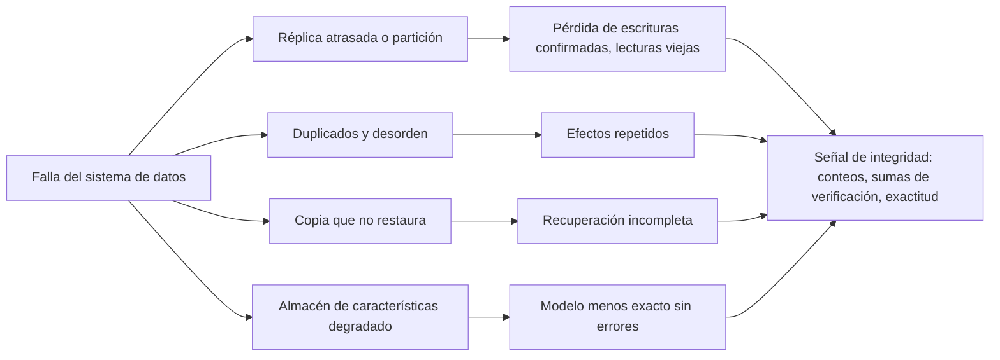
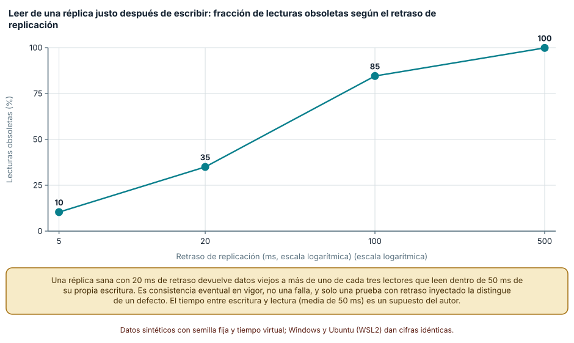

# SE-510 — Fallos de datos y de estado: réplicas, particiones y corrupción

[← SE-509 — Caos en Kubernetes y en plataformas cloud](https://github.com/vladimiracunadev-create/modern-software-engineering-program/blob/main/classes/part-42-ingenieria-del-caos/se-509-caos-en-kubernetes-y-en-plataformas-cloud/README.md) · [↑ Parte 42](https://github.com/vladimiracunadev-create/modern-software-engineering-program/blob/main/classes/part-42-ingenieria-del-caos/README.md) · [📚 Índice completo](https://github.com/vladimiracunadev-create/modern-software-engineering-program/blob/main/classes/README.md) · [🌐 Portal](https://vladimiracunadev-create.github.io/modern-software-engineering-program/classes/SE-510.html) · [SE-511 — Game days y ejercicios de respuesta a incidentes →](https://github.com/vladimiracunadev-create/modern-software-engineering-program/blob/main/classes/part-42-ingenieria-del-caos/se-511-game-days-y-ejercicios-de-respuesta-a-incidentes/README.md)

## Punto profesional y fundamento pedagógico

**Punto profesional.** La clase existe para que apliques el método a los sistemas donde la falla más dañina **no hace ruido**: bases de datos y colas que pierden o duplican datos sin lanzar un error, réplicas que sirven lecturas viejas y modelos de aprendizaje automático que siguen respondiendo, solo que peor. En un servicio sin estado, una falla se ve como errores y latencia; en uno con datos, puede verse como una cifra incorrecta que alguien descubre semanas después.

**Por qué aparece aquí.** Sigue a `SE-509`: allí se eligieron las herramientas por la capa en que actúan; aquí el criterio de calidad pasa a los datos, donde la falla más dañina no hace ruido. Usa la consistencia, la replicación y la idempotencia de la Parte 32 (`SE-390`, `SE-392`, `SE-393`), la durabilidad y la recuperación de la Parte 36 (`SE-440`) y la continuidad de la Parte 41 (`SE-502`). El caso conductor es el almacenamiento de las entregas y un modelo que sugiere la revisión prioritaria de entregas.

**Error conceptual que debe corregir.** Creer que un sistema de datos «tolera la falla» si no devuelve errores. Un almacén que conmuta a una réplica atrasada, o un modelo cuyo almacén de características devolvió ceros, responde sin error con un resultado distinto.

**Secuencia de aprendizaje.** Antes de ver los resultados predices cuántas escrituras confirmadas se pierden al caer el primario con replicación asíncrona, cuántas lecturas devuelven datos viejos según el retraso de la réplica y cuánto baja la exactitud de un modelo cuando faltan sus características más informativas. Después contrastas la predicción con tres experimentos y escribes la hipótesis de un experimento de datos. [ICAP](https://icap.education.asu.edu/research) distingue participación de construcción de conocimiento; [How People Learn II](https://nap.nationalacademies.org/catalog/24783/how-people-learn-ii-learners-contexts-and-cultures) respalda diseñar la práctica con contextos reales y retroalimentación.

**Evidencia de aprendizaje.** `caos-datos-log.md` con la predicción, las tres figuras reproducidas, un catálogo de fallas de datos y de ML de tu servicio con la señal que las detectaría, y una nota que separe lo que el modelo muestra de lo que habría que comprobar en un sistema real.

**Límite de la conclusión.** La replicación, el retraso, los picos, el modelo logístico y las características son sintéticos, con semilla fija y tiempo virtual. No se conmutó ninguna base de datos ni se entrenó ningún modelo real; las cifras muestran un mecanismo, no la pérdida de tu sistema.

### Trazabilidad fuente → afirmación

| Fuente primaria u oficial | Afirmación que respalda | Lo que no prueba |
|---|---|---|
| [Jepsen](https://jepsen.io/) | Publica análisis en profundidad de bases de datos, colas y sistemas de consenso, explorando si cumplen lo que dice su documentación bajo fallas, y mantiene una biblioteca de código abierto para pruebas de seguridad. | No audita tu sistema. |
| [Sculley et al., «Hidden Technical Debt in Machine Learning Systems» (NIPS 2015)](https://papers.nips.cc/paper_files/paper/2015/hash/86df7dcfd896fcaf2674f757a2463eba-Abstract.html) | Identifica factores de riesgo propios de los sistemas de ML: erosión de fronteras, entrelazamiento, bucles de retroalimentación ocultos, consumidores no declarados, dependencias de datos y cambios en el mundo externo. | No cuantifica ninguno de ellos. |
| [Principles of Chaos Engineering](https://principlesofchaos.org/) | Pide variar eventos del mundo real, incluidos los fallos de software como respuestas mal formadas, y medir la salida del sistema. | No dice qué hacer con datos incorrectos. |
| [Google SRE: Testing for Reliability](https://sre.google/sre-book/testing-reliability/) | Trata las pruebas de recuperación ante desastres y la verificación de la integridad de los datos como parte de las pruebas de confiabilidad. | No fija el RPO de tu sistema. |

## Antes de empezar

Recupera lo aprendido en `SE-509`: cada falla pertenece a una capa y la herramienta se elige por ella, pero en un sistema de datos el estado estable es una propiedad de integridad y no un porcentaje de respuestas. La pregunta activa es: **si el primario del almacenamiento de entregas cae en medio de un cierre de plazo y se conmuta a la réplica, ¿cuántas entregas que el estudiante vio como confirmadas desaparecen, y cómo lo sabrías sin esperar la queja?**

## Prerrequisitos

- Haber completado `SE-506` o poder escribir un experimento con radio, aborto y una señal de calidad más estricta que la disponibilidad.
- Conocer replicación, consistencia eventual e idempotencia (`SE-390`, `SE-392`, `SE-393`) y objetivos de punto y tiempo de recuperación (`SE-502`).
- Python 3.11 o posterior; los experimentos usan solo la biblioteca estándar (`random`, `math`, `statistics`).

## Problema auténtico

Durante un cierre de plazo cae el nodo primario de la base de entregas. La conmutación automática promueve a una réplica en 11 segundos; el servicio vuelve a responder, el tablero se ve verde y la guardia cierra el incidente. Dos días después, cuatro estudiantes escriben: su entrega figuraba como confirmada y no aparece. La réplica promovida tenía unos 80 ms de retraso respecto del primario al caer, y en esa ventana se habían confirmado 16 escrituras que nunca llegaron a la réplica. Ninguna señal de error se activó: ni la conmutación ni la lectura posterior fallaron. La clase enseña por qué esto es un resultado previsible de la replicación asíncrona y cómo se mide antes de que ocurra.

## Objetivos observables

Al terminar podrás:

1. calcular el número esperado de escrituras confirmadas que se pierden al conmutar con replicación asíncrona, semisíncrona y síncrona;
2. medir qué fracción de lecturas devuelve datos anteriores a la escritura de la misma persona según el retraso de la réplica;
3. diseñar fallas para datos (retraso de réplica, partición, duplicados, mensajes desordenados, copia que no restaura) y la señal de integridad que las detecta;
4. medir la degradación silenciosa de un modelo cuando falla su almacén de características y comparar tres políticas (valor por omisión, valor obsoleto, reserva con regla);
5. escribir un experimento de datos con una hipótesis sobre la pérdida o la corrección, no solo sobre la disponibilidad.

## Mapa conceptual



El mapa lleva las fallas a su **consecuencia en los datos** y no a su síntoma de disponibilidad. La última caja es la clave: en estos sistemas el estado estable es una propiedad de los datos (conteos que cuadran, exactitud estable), no un porcentaje de respuestas.

## Temas y por qué importan

| Tema | Por qué cambia una decisión profesional | Evidencia mínima |
|---|---|---|
| Replicación y conmutación | La pérdida de escrituras confirmadas es previsible y medible. | Predicción, traza causal y contraejemplo de **Replicación y conmutación** en `caos-datos-log.md` |
| Lecturas obsoletas | Una réplica sana puede devolver datos viejos. | Predicción, traza causal y contraejemplo de **Lecturas obsoletas** en `caos-datos-log.md` |
| Duplicados, desorden y copias | La entrega repetida y la restauración incompleta son fallas de datos. | Predicción, traza causal y contraejemplo de **Duplicados, desorden y copias** en `caos-datos-log.md` |
| Características degradadas | Un modelo con entradas degradadas responde sin errores. | Predicción, traza causal y contraejemplo de **Características degradadas** en `caos-datos-log.md` |
| Estado estable de datos | La salida a medir es la integridad, no la disponibilidad. | Predicción, traza causal y contraejemplo de **Estado estable de datos** en `caos-datos-log.md` |

## Conceptos y decisiones

### 1. Replicación y conmutación: cuántas escrituras confirmadas se pierden

En la **replicación asíncrona** el primario confirma la escritura a la persona usuaria antes de que la réplica la reciba. Si el primario cae, las escrituras confirmadas que no habían llegado a la réplica se pierden: el sistema las prometió y no las tiene. El número depende del **retraso de replicación** en el momento de la caída y del ritmo de escrituras: con 200 escrituras por segundo y un retraso de 20 ms, quedan en vuelo unas cuatro. La **replicación síncrona** espera la confirmación de la réplica y pierde cero, a cambio de latencia en cada escritura (unos milisegundos en la misma región y decenas entre regiones). La **semisíncrona** espera a una réplica y cae en medio. Es un compromiso entre durabilidad y latencia, no una opción correcta: lo que sí es incorrecto es no saber qué se eligió.

Se simulan 20 000 conmutaciones por escenario con 200 escrituras por segundo y un retraso con mediana de 20 ms y cola lognormal, con tres perfiles de picos: ninguno, 1 % de los casos con 2 s de retraso (un respaldo o una ráfaga) y 5 % de los casos con 2 s o 10 s.

```python
lag = rng.lognormvariate(math.log(0.02), 0.6)           # retraso típico: mediana de 20 ms
if rng.random() < spike_p: lag = 2.0                    # pico de retraso (un respaldo, una ráfaga)
perdidas = int(write_rate * lag)                        # escrituras confirmadas que la réplica no tenía
```


**Cómo leer la figura.** Cada grupo es un perfil de retraso y las tres barras son la media, el percentil 99 y el máximo de escrituras confirmadas perdidas por conmutación; el eje es logarítmico. Con retraso típico la media es 4,3 escrituras y el percentil 99, 15; con 1 % de picos de 2 s la media sube a 7,8 pero el máximo a 400; con 5 % de picos de hasta 10 s la media es 65,4 y el percentil 99 llega a 2 000. En 99 % de las conmutaciones se pierde al menos una escritura. **Dónde deja de valer:** el modelo supone un ritmo constante de 200 escrituras por segundo y retraso independiente del ritmo; en un cierre de plazo el ritmo sube y el retraso también, lo que empeora las cifras. La media engaña: lo que decide el RPO es la cola de los picos, y solo se ve provocándolos.

La consecuencia es una prueba concreta: matar el primario con la carga de un cierre de plazo y comparar las escrituras confirmadas (el registro del cliente) con las presentes en la réplica promovida. El resultado es un número que se compara con el objetivo de punto de recuperación de `SE-502`: si el RPO declarado es cero y el experimento pierde 16 escrituras, la resiliencia declarada y la demostrada difieren, en el lenguaje de `SE-507`.

### 2. Lecturas obsoletas: la réplica sana también falla

Una réplica con retraso responde sin error, con datos anteriores. Si una persona sube una entrega y recarga la lista, la lectura puede ir a una réplica que aún no la tiene y mostrarla vacía. No es una falla de la réplica: es **consistencia eventual** funcionando como está diseñada, y por eso solo se distingue de un defecto inyectando el retraso. Se simula la probabilidad de que la lectura de una persona, hecha un tiempo aleatorio después de su escritura (media de 50 ms), llegue antes que la replicación.



**Cómo leer la figura.** El eje horizontal es el retraso de replicación en escala logarítmica y el vertical, el porcentaje de lecturas obsoletas. Con 5 ms, 10 % de las lecturas llegan antes de que la réplica tenga el dato; con 20 ms, 35 %; con 100 ms, 85 %; con 500 ms, casi todas. **Dónde deja de valer:** el tiempo entre la escritura y la lectura se modeló exponencial con media de 50 ms; si la interfaz espera la respuesta de la escritura antes de recargar, ese tiempo es mayor y la fracción baja. El experimento correcto no mide «cuántas lecturas son viejas» en el vacío sino cuántas lo son en el flujo de la persona: «leer tu propia escritura».

Las contramedidas se prueban inyectando el retraso: leer del primario tras escribir (lecturas «a tu escritura»), enrutar a la persona a la misma réplica, o devolver en la escritura el estado nuevo para que la interfaz no relea. Cada una tiene un costo (carga en el primario, afinidad de sesión) y se decide con el número que mide el experimento.

### 3. Duplicados, desorden y copias que no restauran

Tres fallas más de datos completan el catálogo. **La entrega repetida:** un reintento tras un tiempo de espera agotado hace que la dependencia reciba dos veces la misma escritura; sin una clave de idempotencia (`SE-392`), el estudiante tiene dos entregas. El experimento inyecta el tiempo de espera justo después de que el servidor procesa y comprueba que el conteo de entregas sigue siendo uno. **El desorden:** mensajes que llegan en otro orden que el de su emisión rompen supuestos como «el último valor gana»; se inyecta con reordenamiento de paquetes o de eventos y se comprueba el estado final. **La copia que no restaura:** una copia de seguridad existe y no restaura (formato, permisos, versión de esquema). El experimento es restaurarla en un entorno aislado y comparar conteos y sumas de verificación con el original, como en `SE-502`: la resiliencia de una copia se demuestra restaurándola, no creándola. Los análisis de [Jepsen](https://jepsen.io/) ilustran la disciplina: exploran si un sistema de datos cumple lo que su documentación afirma al someterlo a fallas, y publican sus hallazgos y recomendaciones.

En todos los casos el estado estable es una **propiedad de integridad** que se calcula comparando: el número de entregas confirmadas contra las almacenadas, la suma de verificación de la copia contra la del original, el número de efectos contra el de solicitudes únicas. Esas comparaciones son las señales de `SE-505` para sistemas de datos y se escriben antes del experimento, con su banda (que aquí suele ser cero: no se tolera ninguna pérdida).

### 4. Aprendizaje automático: la degradación silenciosa

Un modelo en producción depende de un **almacén de características** que entrega los valores con que predice. Cuando ese almacén falla de forma parcial (valor ausente, valor obsoleto, lento y con tiempo de espera), el modelo sigue respondiendo y sus respuestas empeoran sin que ningún error lo señale. [Sculley et al.](https://papers.nips.cc/paper_files/paper/2015/hash/86df7dcfd896fcaf2674f757a2463eba-Abstract.html) identifican como riesgos propios de los sistemas de ML las dependencias de datos y los cambios del mundo externo, que se agravan cuando los consumidores no están declarados: nadie notó que el modelo dependía de ese valor.

Se simula un modelo logístico de seis características entrenado sobre 3 000 ejemplos sintéticos (exactitud de 80,2 % sobre 4 000 de prueba), con una **regla de reserva** de dos características que un equipo escribiría a mano (exactitud de 73,6 %, frente a 51,1 % del azar informado). Se afecta una fracción de las peticiones cuyas dos características más informativas llegan de tres formas: con un **valor por omisión** (cero), con un **valor obsoleto** (de otra petición) o se sirve la respuesta de la **regla de reserva** en lugar del modelo.


**Cómo leer la figura.** El eje horizontal es la fracción de peticiones afectadas y el vertical la exactitud; la línea punteada es la de la regla sola (73,6 %). Con la mitad de las peticiones afectadas, el valor por omisión deja la exactitud en 72,7 %, el valor obsoleto en 69,2 % (es el peor de los tres porque parece válido) y la regla de reserva en 76,6 %, **mejor que el modelo con entradas degradadas**. Con 10 % afectado la caída es de 1,6 a 2,4 puntos, un cambio que ningún panel de errores o de latencia mostraría. **Dónde deja de valer:** el modelo es logístico y las características son gaussianas e independientes; un modelo real con interacciones y dependencias entre características puede degradarse mucho más o mucho menos, y la regla de reserva solo funciona si existe una regla razonable. La figura muestra el mecanismo: **un modelo con entradas degradadas puede ser peor que una regla simple**, y por eso la política ante un valor ausente es una decisión de diseño que se prueba inyectando la falla.

El estado estable de un modelo es su **exactitud sobre una muestra con etiquetas conocidas** (o una proxy de ella: la distribución de las puntuaciones, la tasa de fallbacks) y no su disponibilidad. Un experimento de caos sobre un modelo comprueba, al degradar el almacén de características, que alguna señal sensible (la tasa de uso de valores por omisión, la distribución de las puntuaciones) salta antes de que la exactitud caiga, y que la política de reserva se activa.

### 5. El experimento de datos

Un experimento de datos se escribe con una hipótesis sobre **la pérdida o la corrección**, con un radio que no tiene por qué ser el tráfico sino los **datos** (una partición, un conjunto de pruebas, un tenant sintético), y una reversión que a veces es más difícil que en un servicio: una escritura perdida no se recupera con un reinicio. Por eso en datos se prefiere el entorno aislado con una copia, y la producción solo cuando hay un mecanismo de verificación e idempotencia que permita reparar. La integridad se comprueba con conteos, sumas de verificación y comparaciones con un registro independiente del cliente (la fuente de verdad de lo confirmado).

## Definiciones de trabajo

- **replicación asíncrona:** el primario confirma la escritura antes de que la réplica la reciba.
- **retraso de replicación:** tiempo que tarda una escritura del primario en estar en la réplica.
- **escritura confirmada perdida:** escritura que el sistema confirmó y no está presente tras una conmutación.
- **lectura obsoleta:** lectura que devuelve datos anteriores a una escritura ya confirmada.
- **almacén de características:** servicio que entrega los valores de entrada que un modelo usa al predecir.
- **regla de reserva:** respuesta alternativa, más simple que el modelo, que se sirve cuando las entradas no son confiables.

Las definiciones son operativas para el almacenamiento de las entregas y su modelo. No convierten términos con una historia más amplia en sinónimos y deben contrastarse con las fuentes enlazadas.

## Ejemplo mínimo

El fragmento calcula las escrituras esperadas en vuelo con replicación asíncrona según el retraso y el ritmo. Antes de ejecutarlo, predice cuántas son con 200 escrituras por segundo y 80 ms de retraso.

```python
def en_vuelo(ritmo: float, retraso_s: float) -> int:
    return int(ritmo * retraso_s)

for retraso in (0.02, 0.08, 0.5, 2.0):
    print(retraso, en_vuelo(200, retraso))
```

Imprime `0.02 4`, `0.08 16`, `0.5 100` y `2.0 400`. Con 80 ms son 16 escrituras, el caso del problema auténtico; con un pico de 2 s, 400. Registra versión de Python, comando y salida; luego decide qué retraso máximo aceptas si tu RPO es de 5 escrituras.

## Ejemplo profesional

Supón, como caso hipotético y no como medición, que el equipo del almacenamiento escribe tres experimentos de datos. El primero mata el primario en preproducción con una carga sintética de 200 escrituras por segundo y compara el registro de confirmaciones del cliente con la réplica promovida; la hipótesis es «se pierden menos de 5 escrituras» y la señal, el conteo diferencial. El segundo inyecta 100 ms de retraso en la réplica y comprueba que el flujo «subir y recargar» muestra la entrega propia en el 99,9 % de los casos. El tercero apaga el almacén de características del modelo de revisión prioritaria durante 10 minutos y comprueba que la tasa de uso de valores por omisión alerta en menos de 2 minutos y que se activa la regla de reserva. Cada uno registra qué verifica y qué no, entre otras cosas que no detectan una corrupción silenciosa de un campo.

## Práctica guiada

1. Predice, por escrito, cuántas escrituras confirmadas se pierden en media con retraso típico y con 5 % de picos, y cuánta exactitud pierde el modelo con la mitad de las peticiones afectadas.
2. Ejecuta `python scripts/experiments_part42_a.py e510` y compara; anota la mayor diferencia con tu predicción.
3. Cambia el ritmo de escrituras de 200 a 800 por segundo y calcula cuánto sube la media de pérdidas.
4. Cambia la fracción afectada del modelo a 5 % y a 100 % y observa cuándo la regla de reserva deja de ser mejor que el valor por omisión.
5. Escribe tres experimentos de datos para un sistema propio con hipótesis, señal de integridad, radio y reversión.
6. Entrega `caos-datos-log.md` y pide a otra persona que identifique una falla de datos silenciosa que tus señales no detectarían.

## Ejercicios

1. **RPO:** con 150 escrituras por segundo y retraso máximo de 1,2 s, calcula el número máximo de escrituras en vuelo y di si cumple un RPO de 100.
2. **Lecturas:** con retraso de 30 ms y tiempo medio de relectura de 100 ms, estima con la exponencial la fracción de lecturas obsoletas y propón dos contramedidas con su costo.
3. **Idempotencia:** escribe el experimento que demuestra que un reintento tras un tiempo de espera no duplica una entrega, con la señal que comprueba.
4. **Modelo:** con exactitud sana de 85 %, regla de 78 % y entradas degradadas de 70 % en el 30 % de las peticiones, calcula la exactitud global con valor por omisión y con regla de reserva.

## Reto verificable

Entrega `caos-datos-log.md` con la predicción, las tres tablas de resultados reproducidas con las mismas semillas, el catálogo de al menos seis fallas de datos o de ML con su señal de integridad y la hipótesis de tres experimentos con radio y reversión. Se aprueba si otra persona ejecuta el código desde un checkout limpio, obtiene las mismas cifras y encuentra una falla de datos de tu catálogo que ninguna de tus señales detectaría. No se aprueba por afirmar que «la base está replicada» ni que «el modelo tiene monitoreo».

## Caso conductor

El almacenamiento de las entregas y el modelo de revisión prioritaria son el caso conductor de esta clase. Esta clase deja el sexto artefacto: un catálogo de fallas de datos con señales de integridad. `SE-511` ejercita con personas la respuesta a estas fallas y `SE-512` automatiza lo técnico. Cambia después un solo dato, el ritmo de escrituras, y observa a partir de qué punto el RPO declarado deja de cumplirse.

## Preguntas frecuentes

### ¿Se puede hacer caos sobre una base de datos de producción?

Con precaución extrema y solo con mecanismos de verificación y reparación. Lo habitual es un entorno aislado con una copia o un tenant sintético. Una escritura perdida o corrompida no se revierte con un reinicio, y por eso el radio en datos se define por los datos expuestos y no solo por el tráfico.

### ¿La replicación síncrona resuelve el problema?

Resuelve la pérdida de escrituras confirmadas a cambio de latencia y de disponibilidad: si la réplica no responde, la escritura espera o falla. Es una elección entre durabilidad y disponibilidad, y se decide con el RPO y el presupuesto de latencia, no por regla.

### ¿Cómo se prueba un modelo con caos si no hay errores?

Midiendo señales de integridad (tasa de valores por omisión, distribución de las puntuaciones, exactitud sobre una muestra etiquetada) y verificando que alguna salta antes de que el daño llegue a las personas. El experimento no busca errores, sino cambios en la calidad de la salida.

### ¿Qué hago si la regla de reserva es peor que el modelo?

Entonces la política es otra: rechazar la petición y degradar de forma explícita, o responder «sin sugerencia». La política se elige con la exactitud medida y el costo de una mala respuesta, no con la intuición.

## Fallo controlado y diagnóstico

Reproduce el fallo clásico de la clase: **declarar un RPO de cero con replicación asíncrona**. Mata el primario con carga y compara el registro de confirmaciones con la réplica promovida.

Registra síntoma, entrada mínima, hipótesis, observación que descarta cada hipótesis, causa, corrección y prueba de regresión. **Síntoma:** cuatro estudiantes tienen entregas confirmadas que no existen tras una conmutación y ningún error lo señaló. **Hipótesis rivales:** (a) la conmutación corrompió datos; (b) las escrituras nunca llegaron al primario; (c) estaban confirmadas y en vuelo hacia la réplica. **Prueba:** compara el registro de confirmaciones del cliente con el primario antes de la caída y con la réplica promovida; si las escrituras estaban en el primario y faltan en la réplica, la hipótesis (c) explica la pérdida, y su número es el retraso por el ritmo. **Conclusión:** el RPO real es el retraso máximo por el ritmo de escrituras, no cero. **Regresión:** añade una prueba que mate el primario con carga y exija que la pérdida sea menor que el RPO declarado. No cambies a la vez el modo de replicación y el ritmo.

## Errores comunes y cómo corregirlos

| Síntoma | Causa probable | Corrección |
|---|---|---|
| Escrituras confirmadas desaparecen tras una conmutación | Replicación asíncrona con RPO declarado de cero | Medir la pérdida y elegir replicación semisíncrona o ajustar el RPO |
| Una persona no ve lo que acaba de subir | Lectura desde una réplica atrasada | Leer del primario tras escribir o devolver el estado en la escritura |
| Un reintento crea efectos repetidos | Sin clave de idempotencia | Clave por solicitud y una prueba que inyecte el tiempo de espera |
| El modelo empeora y nadie lo nota | Sin señal de integridad del almacén de características | Medir la tasa de valores por omisión y la distribución de puntuaciones |
| La copia existe y no restaura | Nunca se restauró | Restaurar en un entorno aislado y comparar sumas de verificación |

## Entorno y archivos clave

```text
work/SE-510/
├── README.md
├── datos/
│   ├── replicacion.py
│   ├── lecturas.py
│   └── modelo.py
├── tests/test_datos.py
└── evidence/caos-datos-log.md
```

El `README` declara plataforma, versión de Python, semillas y comandos. Los experimentos usan solo la biblioteca estándar y se ejecutaron con CPython 3.12.9 en Windows 11 y 3.12.3 en Ubuntu bajo WSL2 con resultados idénticos. Para recuperar el estado, borra `work/SE-510/` y vuelve a ejecutar los scripts. Si añades una dependencia, fija procedencia y versión.

## Seguridad, ética y accesibilidad

- una falla de datos en producción puede perder o exponer información de personas: usa copias, datos sintéticos y entornos aislados, y no inyectes sobre datos reales de estudiantes;
- un modelo con entradas degradadas puede producir decisiones injustas sin señal alguna: documenta quién sufre una mala respuesta y qué política protege a esas personas;
- registra qué experimento se ejecutó sobre qué datos y quién lo aprobó;
- documenta las tablas y las figuras con texto alternativo y en un formato que un lector de pantalla pueda recorrer;
- respeta las licencias de los libros y artículos y atribuye lo adaptado.

## Puente hacia el trabajo con agentes

Un agente al que se le pide «prueba que la base resiste una conmutación» tenderá a comprobar que el servicio vuelve a responder y a declararlo resiliente. Pídele en cambio que escriba la señal de integridad primero (conteo diferencial entre el registro del cliente y la réplica), que ejecute con la carga de un cierre de plazo y que reporte la pérdida como número, no como «sin errores». Revisa especialmente si lee la integridad de la misma fuente que se está probando, si lanza el experimento sobre datos reales y si propone un RPO sin medirlo.

## Transferencia

Traslada el análisis a otro sistema con datos (un servicio de pedidos, un catálogo con un modelo de recomendación): lista sus fallas de datos, escribe la señal de integridad de cada una y mide la pérdida o la degradación. La transferencia está lograda cuando puedes decir qué falla de datos no tiene señal en tu sistema, no cuando el servicio vuelve a responder.

## Evaluación y evidencia

| Criterio | Evidencia para aprobar |
|---|---|
| comprensión | explicación de la pérdida por replicación asíncrona, las lecturas obsoletas y la degradación silenciosa |
| corrección | pérdidas, lecturas obsoletas y exactitud reproducibles con las mismas semillas |
| diseño | catálogo de fallas de datos con señal de integridad, radio y reversión |
| diagnóstico | reproducción del fallo «RPO de cero con asíncrona» con regresión |
| incertidumbre | declaración de que la replicación, los picos y el modelo son sintéticos |
| reproducibilidad | versiones, comandos, salida y límites declarados |

## Fuentes

- [Jepsen](https://jepsen.io/) — análisis de seguridad de sistemas distribuidos de datos; autoridad: proyecto de investigación Jepsen.
- [Sculley et al., Hidden Technical Debt in Machine Learning Systems](https://papers.nips.cc/paper_files/paper/2015/hash/86df7dcfd896fcaf2674f757a2463eba-Abstract.html) — riesgos propios de los sistemas de ML; autoridad: artículo de NIPS 2015.
- [Principles of Chaos Engineering](https://principlesofchaos.org/) — variar eventos reales y medir la salida; autoridad: documento vivo de la comunidad de ingeniería del caos.
- [Google SRE: Testing for Reliability](https://sre.google/sre-book/testing-reliability/) — pruebas de recuperación e integridad de datos; autoridad: libro de ingeniería de confiabilidad de Google.
- [Python: random](https://docs.python.org/3/library/random.html) — generador con semilla usado en los experimentos; autoridad: documentación de Python.

Cada fuente respalda el mecanismo indicado; ninguna demuestra que 4,3 escrituras perdidas, 35 % de lecturas obsoletas o 76,6 % de exactitud se observen en un sistema real. Esa afirmación depende de la replicación, del ritmo y del modelo.

## Límites y siguiente paso

Se ejecutaron tres experimentos con tiempo virtual y semillas fijas en Windows y Ubuntu (WSL2) con resultados idénticos. No se conmutó ninguna base de datos ni se entrenó ningún modelo real; el ritmo de 200 escrituras por segundo, la distribución del retraso, los picos, el modelo logístico de seis características y la regla de reserva son construcciones del autor, y las latencias de replicación síncrona (2 y 70 ms) son supuestos. La siguiente clase ejercita con personas la respuesta a estas fallas en un día de práctica, donde se ven los defectos que ningún experimento automático encuentra.

## Glosario

- **replicación asíncrona:** el primario confirma la escritura antes de que la réplica la reciba.
- **retraso de replicación:** tiempo que tarda una escritura del primario en estar en la réplica.
- **escritura confirmada perdida:** escritura confirmada que no está presente tras una conmutación.
- **lectura obsoleta:** lectura que devuelve datos anteriores a una escritura ya confirmada.
- **almacén de características:** servicio que entrega los valores de entrada de un modelo al predecir.
- **regla de reserva:** respuesta alternativa más simple que el modelo que se sirve cuando sus entradas no son confiables.

---

[← SE-509 — Caos en Kubernetes y en plataformas cloud](https://github.com/vladimiracunadev-create/modern-software-engineering-program/blob/main/classes/part-42-ingenieria-del-caos/se-509-caos-en-kubernetes-y-en-plataformas-cloud/README.md) · [↑ Parte 42](https://github.com/vladimiracunadev-create/modern-software-engineering-program/blob/main/classes/part-42-ingenieria-del-caos/README.md) · [📚 Índice completo](https://github.com/vladimiracunadev-create/modern-software-engineering-program/blob/main/classes/README.md) · [🌐 Portal](https://vladimiracunadev-create.github.io/modern-software-engineering-program/classes/SE-510.html) · [SE-511 — Game days y ejercicios de respuesta a incidentes →](https://github.com/vladimiracunadev-create/modern-software-engineering-program/blob/main/classes/part-42-ingenieria-del-caos/se-511-game-days-y-ejercicios-de-respuesta-a-incidentes/README.md)
