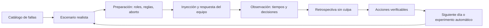
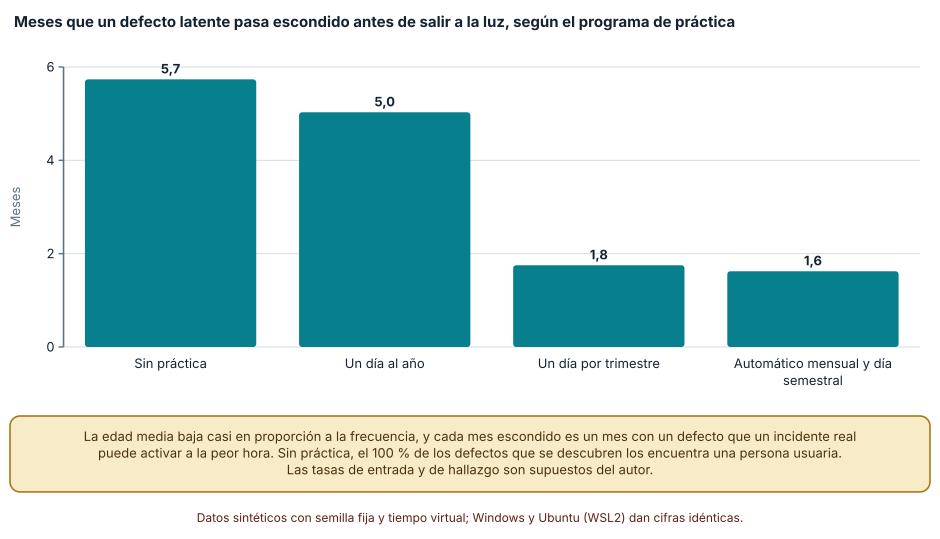

# SE-511 — Game days y ejercicios de respuesta a incidentes

[← SE-510 — Fallos de datos y de estado: réplicas, particiones y corrupción](https://github.com/vladimiracunadev-create/modern-software-engineering-program/blob/main/classes/part-42-ingenieria-del-caos/se-510-fallos-de-datos-y-de-estado-replicas-particiones-y-corrupcion/README.md) · [↑ Parte 42](https://github.com/vladimiracunadev-create/modern-software-engineering-program/blob/main/classes/part-42-ingenieria-del-caos/README.md) · [📚 Índice completo](https://github.com/vladimiracunadev-create/modern-software-engineering-program/blob/main/classes/README.md) · [🌐 Portal](https://vladimiracunadev-create.github.io/modern-software-engineering-program/classes/SE-511.html) · [SE-512 — Caos continuo: automatización en CI/CD y en producción →](https://github.com/vladimiracunadev-create/modern-software-engineering-program/blob/main/classes/part-42-ingenieria-del-caos/se-512-caos-continuo-automatizacion-en-ci-cd-y-en-produccion/README.md)

## Punto profesional y fundamento pedagógico

**Punto profesional.** La clase existe para que diseñes y conduzcas un **día de práctica (game day)**: un ejercicio programado donde un equipo responde a una falla inyectada con sus propios procedimientos, herramientas y comunicación. Un día de práctica prueba lo que ninguna prueba automática prueba: que la alerta llega a una persona, que el runbook sirve a las tres de la mañana, que quien escala responde y que el equipo decide a tiempo.

**Por qué aparece aquí.** Sigue a `SE-510`: allí el método llegó a los datos y a los modelos; aquí se decide quién responde y cómo se aprende. Usa la respuesta a incidentes de la Parte 41 (`SE-499`, `SE-500`, `SE-501`) como el procedimiento que se ejercita y el catálogo de fallas de `SE-508` como fuente de escenarios. El caso conductor es el equipo de la API de entregas.

**Error conceptual que debe corregir.** Creer que un día de práctica es una demostración para quien lo observa o una prueba que el equipo debe aprobar. Es un experimento sobre personas y procedimientos: su producto son los defectos encontrados, y un día sin hallazgos es sospechoso, no exitoso.

**Secuencia de aprendizaje.** Antes de ver los resultados predices cuántos defectos latentes quedan tras dos años con cuatro programas de práctica y cuánto tiempo pasa escondido cada defecto. Después contrastas la predicción con el modelo y escribes el calendario de tu equipo. [ICAP](https://icap.education.asu.edu/research) distingue participación de construcción de conocimiento; [How People Learn II](https://nap.nationalacademies.org/catalog/24783/how-people-learn-ii-learners-contexts-and-cultures) respalda diseñar la práctica con contextos reales y retroalimentación.

**Evidencia de aprendizaje.** `gameday-log.md` con la predicción, las tres figuras reproducidas, el plan de un día de práctica (escenario, roles, reglas, aborto, calendario y medidas) y una nota que separe lo que el modelo muestra de lo que habría que comprobar en un equipo real.

**Límite de la conclusión.** Los defectos, sus tasas de entrada y de hallazgo, los tipos de defecto y los programas son un modelo propio con semilla fija. No se organizó ningún día de práctica ni se midió ningún equipo; las cifras muestran un mecanismo, no el rendimiento de tu práctica.

### Trazabilidad fuente → afirmación

| Fuente primaria u oficial | Afirmación que respalda | Lo que no prueba |
|---|---|---|
| [AWS Well-Architected: REL12-BP05 Conduct game days regularly](https://docs.aws.amazon.com/wellarchitected/latest/reliability-pillar/rel_testing_resiliency_game_days_resiliency.html) | Recomienda ejercitar con regularidad los procedimientos de respuesta con los mismos equipos que responderían en producción, en entornos similares a producción; enumera como antipatrones documentar procedimientos sin ejercitarlos, no informar a las partes interesadas, excluir a quienes deciden por el negocio, no incorporar lo aprendido y culpar a los equipos. | No mide el beneficio de una frecuencia concreta. |
| [Netflix: «The Netflix Simian Army» (2011)](https://netflixtechblog.com/the-netflix-simian-army-16e57fbab116) | Describe ejecutar Chaos Monkey en horario laboral, en un entorno bien monitorizado y con ingenieros disponibles para atender los problemas, y con ello aprender de las debilidades y construir recuperación automática. | No es un guion de día de práctica. |
| [Principles of Chaos Engineering](https://principlesofchaos.org/) | Pide automatizar los experimentos para que corran de forma continua, porque ejecutarlos a mano exige mucho trabajo y no se sostiene. | No dice qué parte debe ser manual. |
| [Google SRE: Testing for Reliability](https://sre.google/sre-book/testing-reliability/) | Advierte que técnicas estadísticas como Chaos Monkey y Jepsen no son necesariamente pruebas repetibles y que repetirlas tras un cambio de código no demuestra que el fallo esté corregido. | No cuantifica la repetibilidad. |

## Antes de empezar

Recupera lo aprendido en `SE-508` y `SE-509`: un catálogo de fallas y las herramientas que las inyectan. La pregunta activa es: **si mañana a las 23:50 el almacenamiento deja de responder, ¿quién se entera, cómo, qué abre, a quién escala y cuánto tarda en volver, y cuándo fue la última vez que alguien comprobó esa cadena entera?**

## Prerrequisitos

- Haber completado `SE-508` y `SE-509` o poder describir una falla inyectable y cómo se detiene.
- Conocer un protocolo de incidentes con roles (`SE-500`) y los runbooks (`SE-499`).
- Python 3.11 o posterior; los experimentos usan solo la biblioteca estándar.

## Problema auténtico

El runbook de la API de entregas dice: «si el almacenamiento falla, reiniciar el servicio de archivos con `reiniciar-archivos`». Nadie lo ha ejecutado desde que se escribió, hace catorce meses. La noche del cierre de plazo el almacenamiento falla; la persona de guardia encuentra que el comando ya no existe (se renombró en un cambio de plataforma), que la alerta que debía despertarla no tiene destinatario desde la reorganización y que la persona a quien escala no responde porque su turno terminó hace diez minutos. Cada pieza «existía». Ninguna se había ejercitado junta. Un día de práctica de tres horas, el trimestre anterior, habría sacado a la luz los tres defectos con un costo de unas horas y ningún estudiante afectado.

## Objetivos observables

Al terminar podrás:

1. definir un día de práctica y distinguirlo de una prueba automática, de una demostración y de un ejercicio de mesa;
2. diseñar uno con escenario, roles (quien facilita, quien responde, quien observa, quien controla la plataforma), reglas, aborto y medidas;
3. clasificar los defectos que encuentra (alerta, runbook, alternativa, configuración, escalamiento, permisos) y decir cuáles solo ve una persona;
4. comparar programas de práctica (anual, trimestral, automático) por defectos latentes y por la edad con que salen a la luz;
5. conducir la retrospectiva sin culpa y convertir los hallazgos en acciones verificables.

## Mapa conceptual



El mapa muestra el día de práctica como un **ciclo**: los hallazgos vuelven como acciones y esas acciones se verifican en el siguiente ejercicio. Un día sin ciclo es una anécdota.

## Temas y por qué importan

| Tema | Por qué cambia una decisión profesional | Evidencia mínima |
|---|---|---|
| Qué se ejercita | Las personas y los procedimientos fallan de forma distinta que el sistema. | Predicción, traza causal y contraejemplo de **Qué se ejercita** en `gameday-log.md` |
| Diseño del ejercicio | Un escenario irreal enseña a resolver el escenario, no a responder. | Predicción, traza causal y contraejemplo de **Diseño del ejercicio** en `gameday-log.md` |
| Roles y reglas | Sin controlador y sin aborto, el ejercicio es un incidente. | Predicción, traza causal y contraejemplo de **Roles y reglas** en `gameday-log.md` |
| Frecuencia y automatización | Los defectos entran con cada cambio y esperan a la siguiente práctica. | Predicción, traza causal y contraejemplo de **Frecuencia y automatización** en `gameday-log.md` |
| Aprendizaje sin culpa | Quien teme el reproche oculta los hallazgos. | Predicción, traza causal y contraejemplo de **Aprendizaje sin culpa** en `gameday-log.md` |

## Conceptos y decisiones

### 1. Qué es un día de práctica y qué ejercita

Un **día de práctica** es un ejercicio programado donde se provoca una falla (real o simulada) y un equipo responde con sus herramientas y procedimientos habituales, mientras alguien observa y registra. [AWS lo describe](https://docs.aws.amazon.com/wellarchitected/latest/reliability-pillar/rel_testing_resiliency_game_days_resiliency.html) como ejercitar con regularidad los procedimientos de respuesta a eventos que afectan a una carga de trabajo, con los mismos equipos que responderían en producción, simulando eventos en entornos similares a producción y realizando las mismas acciones que se harían en el evento real. Se distingue de tres cosas parecidas. De una **prueba automática**, porque incluye personas, decisiones y comunicación. De una **demostración**, porque no se sabe de antemano cómo termina. Y de un **ejercicio de mesa**, que discute en una sala qué se haría y, aunque útil, no encuentra el comando que ya no existe.

Lo que se ejercita son cuatro cosas distintas. La **detección**: ¿salta la alerta, llega a alguien y qué ve esa persona? La **decisión**: ¿se sabe qué hacer, quién decide y con qué información? La **ejecución**: ¿los comandos, los permisos y los accesos funcionan? Y la **comunicación**: ¿se avisa a quien corresponde y se mantiene la cadencia? Las tres últimas viven en las personas y en los documentos y no se prueban con experimentos automáticos. Por eso un día de práctica y un experimento automático no compiten: encuentran defectos de naturaleza distinta.

### 2. Diseñar el ejercicio: escenario, roles y reglas

Un escenario se toma del catálogo de `SE-508`, se concreta con una falla, una intensidad y un contexto («el almacenamiento deja de responder a las 23:40 de un cierre de plazo con 300 entregas por minuto») y se escribe un **guion de inyección** privado: qué se inyecta, cuándo, y qué se hará si el equipo no responde. El nivel de sorpresa es una decisión explícita. La primera práctica se anuncia con fecha, hora y escenarios, como recomienda [AWS](https://docs.aws.amazon.com/wellarchitected/latest/reliability-pillar/rel_testing_resiliency_game_days_resiliency.html) para el primero; las siguientes pueden ocultar el escenario o la hora; las que se hacen sin aviso a quien responde solo son defendibles con un control del daño muy sólido y un acuerdo previo.

Los roles separan lo que, mezclado, invalida el ejercicio. La persona que **facilita** conduce el ritmo, inyecta según el guion y es la única que puede cambiar el escenario. El **equipo de respuesta** actúa como en un incidente real. Quien **observa** anota los tiempos y las decisiones sin intervenir. Y quien **controla la plataforma** vigila el daño real (el experimento tiene el radio y el aborto de `SE-506`), puede abortar sin consultar y verifica al final que todo volvió a su estado. Las reglas escritas incluyen qué está permitido (usar los runbooks, pedir ayuda), qué no (cambiar la falla, usar accesos que no se usarían en un incidente real) y cuándo se detiene el ejercicio. Los antipatrones que [AWS enumera](https://docs.aws.amazon.com/wellarchitected/latest/reliability-pillar/rel_testing_resiliency_game_days_resiliency.html) se leen como una lista de verificación: documentar procedimientos sin ejercitarlos, no informar a las partes interesadas, excluir a quienes toman decisiones de negocio, no incorporar lo aprendido y culpar a los equipos.


**Cómo leer la figura.** Los cuatro carriles son los cuatro roles y el eje horizontal, los minutos desde el inicio. Los primeros 30 minutos son de preparación: reglas, briefing y verificación de que el sistema está en su estado estable. La falla se inyecta entre los minutos 30 y 90, con una marca de aborto a los 75 si el sistema no está bajo control. El resto, hasta los 180, es retrospectiva con la línea de tiempo reconstruida. **Dónde deja de valer:** es una plantilla de tres horas, no una medición; el tiempo de un ejercicio depende de la complejidad del sistema y la madurez del equipo, y las primeras prácticas suelen necesitar más preparación y más retrospectiva que inyección.

### 3. Qué defectos encuentra

Un día de práctica encuentra defectos que viven en el espacio entre las piezas. Seis clases cubren casi todos: una **alerta ausente** o sin destinatario, un **runbook desactualizado** (el comando que ya no existe), una **alternativa rota** que nunca se había activado, una **espera mal configurada**, un **escalamiento sin respuesta** y un **permiso faltante** para quien debería actuar. Tres de ellas (alternativa, espera y permiso) son técnicas y un experimento automático las puede detectar; las otras tres (alerta sin destinatario, runbook y escalamiento) dependen de personas y de procedimientos y solo las ve una persona ejecutando el procedimiento. Es la distinción que decide el programa de práctica.

### 4. Frecuencia y automatización: comparar programas de práctica

Los defectos latentes entran con cada cambio y esperan hasta que algo los encuentre: un incidente real, un ejercicio o un experimento automático. Se modelan 24 meses del equipo de la API de entregas: cada mes entran 0, 1 o 2 defectos (media de 1) de las seis clases; cada defecto latente tiene 6 % de probabilidad al mes de salir a la luz en un incidente real; un día de práctica descubre 70 % de los latentes; un experimento automático descubre 80 % de los técnicos y ninguno de los humanos. Se comparan cuatro programas con 300 simulaciones cada uno.

```python
if month in prog["gameday_meses"]:                  # el ejercicio ve todos los tipos
    latent = [d for d in latent if rng.random() >= 0.7]
if month in prog["auto_meses"]:                     # el experimento automático solo ve los técnicos
    latent = [d for d in latent if d.kind not in technical or rng.random() >= 0.8]
```


**Cómo leer la figura.** Cada par de barras es un programa: los defectos que siguen latentes al final de los 24 meses y los incidentes reales que descubrieron un defecto en ese tiempo. Sin práctica quedan 12,6 defectos y ocurren 11,5 incidentes con un defecto latente como causa. Un día al año deja 3,0 y 8,7: el inventario acumulado baja, pero los defectos nuevos esperan hasta 12 meses y siguen produciendo incidentes. Un día por trimestre deja 1,1 y 3,9. Agregar experimentos automáticos mensuales y un día semestral deja 1,0 y 3,8, casi igual que el trimestral. **Dónde deja de valer:** las tasas de entrada y de hallazgo, la mitad técnica y mitad humana de los defectos y el 6 % mensual son supuestos del autor; con otras tasas el orden entre trimestral y automático puede cambiar, y el modelo no incluye el costo de cada ejercicio ni el cansancio del equipo.



**Cómo leer la figura.** Cada barra es la edad media de un defecto (los meses entre que entra y que se descubre) según el programa. Sin práctica son 5,7 meses; con un día al año, 5,0; con un día por trimestre, 1,8; con automáticos y semestral, 1,6. La edad baja casi en proporción a la frecuencia, y cada mes escondido es un mes en que un incidente real puede activar el defecto a la peor hora. **Dónde deja de valer:** la edad media no distingue defectos graves de leves; un defecto que bloquea toda respuesta pesa mucho más que uno que la retrasa, y el modelo los trata igual. La conclusión no es «trimestral es lo correcto» sino que **la frecuencia pesa más que la intensidad** y que los programas se combinan: lo automático cubre lo técnico con barata frecuencia y lo humano exige personas con calendario.

### 5. La retrospectiva y las acciones

El ejercicio no termina al restaurar el sistema. La **retrospectiva sin culpa** reconstruye la línea de tiempo con el observador (cuándo se inyectó, cuándo saltó la alerta, quién la vio, qué decidió y por qué), identifica los factores (la alerta sin destinatario, el comando que ya no existe) y no personas, y escribe **acciones verificables** con responsable y fecha: «corregir el comando y probarlo en el próximo ejercicio» y no «mejorar los runbooks». `SE-501` desarrolla ese formato. [AWS](https://docs.aws.amazon.com/wellarchitected/latest/reliability-pillar/rel_testing_resiliency_game_days_resiliency.html) lista entre los antipatrones no incorporar lo aprendido en los procesos de recuperación y culpar a los equipos. Y las medidas del día (tiempo hasta detectar, hasta decidir, hasta mitigar y hasta restaurar) se comparan con las de la vez anterior: la mejora es el único resultado cuantificable de un ejercicio, y se mide con la misma definición cada vez. Un ejercicio sin defectos encontrados exige la pregunta contraria: ¿el escenario era demasiado fácil o conocido de antemano?

## Definiciones de trabajo

- **día de práctica (game day):** ejercicio programado donde un equipo responde con sus procedimientos a una falla inyectada, con observación y registro.
- **ejercicio de mesa:** discusión de cómo se respondería a un escenario, sin inyectar nada.
- **guion de inyección:** plan privado de qué se inyecta, cuándo y qué hacer si el equipo no responde.
- **defecto latente:** debilidad de un sistema o de un procedimiento que aún no ha causado daño.
- **retrospectiva sin culpa:** análisis de lo ocurrido centrado en factores del sistema y no en personas.
- **acción verificable:** cambio con responsable, fecha y comprobación de que se hizo.

Las definiciones son operativas para el equipo de la API de entregas. No convierten términos con una historia más amplia en sinónimos y deben contrastarse con las fuentes enlazadas.

## Ejemplo mínimo

El fragmento calcula la probabilidad de que un defecto latente siga escondido tras n meses si cada mes tiene una probabilidad p de salir a la luz. Antes de ejecutarlo, predice cuántos meses espera, en promedio, un defecto con p = 6 %.

```python
p = 0.06
for meses in (3, 6, 12, 24):
    print(meses, round((1 - p) ** meses, 3))
print(round(1 / p, 1))
```

Imprime `3 0.831`, `6 0.69`, `12 0.476`, `24 0.227` y `16.7`. Tras un año casi la mitad de los defectos sigue escondida y su espera media sin práctica es de 16,7 meses. Registra versión de Python, comando y salida; luego decide qué frecuencia de ejercicio reduce la espera media a menos de 3 meses.

## Ejemplo profesional

Supón, como caso hipotético y no como medición, que el equipo planifica su primer día de práctica de tres horas para el tercer martes del mes, fuera de cierres de plazo. Escenario: «el almacenamiento deja de responder durante 20 minutos»; radio: preproducción con tráfico sintético de 300 entregas por minuto; roles: una persona facilita, tres responden, una observa y otra controla la plataforma; reglas: se usan los runbooks y los accesos de guardia, no se cambia la falla; aborto: a los 75 minutos si el servicio no está en estado estable. Mide el tiempo hasta detectar, hasta decidir y hasta mitigar, y registra los hallazgos con clase de defecto. Prepara el segundo ejercicio con la misma falla para verificar las acciones y el tercero con otra, y deja un experimento automático mensual para los defectos técnicos.

## Práctica guiada

1. Predice, por escrito, cuántos defectos latentes quedan tras dos años sin práctica y con un día trimestral.
2. Ejecuta `python scripts/experiments_part42_b.py e511` y compara; anota la mayor diferencia con tu predicción.
3. Cambia el hallazgo del día de práctica de 70 % a 40 % y observa cuánto se acerca un día trimestral a uno anual.
4. Cambia la mitad técnica de los defectos a 80 % y decide si el programa automático supera al trimestral.
5. Escribe el plan de un día de práctica propio con escenario, roles, reglas, aborto, medidas y calendario.
6. Entrega `gameday-log.md` y pide a otra persona que identifique el defecto humano que tu plan no ejercitaría.

## Ejercicios

1. **Tipos de ejercicio:** clasifica cinco actividades (discutir en una sala qué se haría si cae el almacenamiento, ejecutar el runbook en preproducción, una prueba automática de reintentos, apagar un nodo sin avisar, una simulación de incidente con el equipo de guardia) como ejercicio de mesa, día de práctica o prueba automática.
2. **Defectos:** de seis hallazgos (alerta sin destinatario, comando renombrado, umbral de cortacircuitos sensible, escalamiento fuera de turno, permiso faltante en la cuenta de servicio, alternativa que devuelve error) di cuáles ve un experimento automático y cuáles solo una persona.
3. **Espera:** con 1 defecto nuevo al mes y 6 % de salida mensual en incidentes, calcula el número esperado de defectos latentes en régimen estable sin práctica y con un ejercicio trimestral que descubre 70 %.
4. **Medida:** un ejercicio tarda 18 minutos en detectar, 12 en decidir y 25 en mitigar; la vez anterior fueron 25, 10 y 40: calcula el cambio total y di qué tramo empeoró.

## Reto verificable

Entrega `gameday-log.md` con la predicción, las tres figuras reproducidas con las mismas semillas, el plan de un día de práctica con los doce elementos pedidos y la comparación de tu calendario con los cuatro programas del modelo. Se aprueba si otra persona ejecuta el código desde un checkout limpio, obtiene las mismas cifras y encuentra un defecto humano que tu escenario no ejercitaría. No se aprueba por programar un día sin medir ni por declarar la práctica «exitosa» porque nadie se equivocó.

## Caso conductor

El equipo de la API de entregas sigue siendo el caso conductor. Esta clase deja el séptimo artefacto: el plan de un día de práctica y un calendario. `SE-512` lleva a la integración continua lo que se puede automatizar y `SE-515` lleva el método a producción. Cambia después un solo dato, la frecuencia, y observa a partir de qué punto añadir ejercicios deja de reducir los defectos latentes.

## Preguntas frecuentes

### ¿Un día de práctica debe hacerse en producción?

No necesariamente. El primero conviene en un entorno similar a producción y con aviso; los siguientes pueden acercarse a producción a medida que el equipo gana confianza y el control del daño lo permite. AWS recomienda entornos similares a producción y describe la posibilidad de réplicas con infraestructura como código. Lo esencial es que quien responde use sus procedimientos y accesos reales.

### ¿Hay que avisar al equipo?

La primera vez, sí: fecha, hora y escenarios, como recomienda AWS. Después se puede ocultar el detalle (cuándo y qué), pero el equipo debe saber que habrá ejercicios y estar de acuerdo. Un ejercicio por sorpresa total, sin acuerdo, convierte el aprendizaje en desconfianza.

### ¿Qué hago si el equipo falla el ejercicio?

Es el resultado esperado. El ejercicio existe para encontrar lo que falla antes de que falle un incidente. La respuesta es corregir el procedimiento, no al equipo; AWS enumera culpar a los equipos entre los antipatrones.

### ¿Para qué un ejercicio si ya hay experimentos automáticos?

Porque los defectos de personas y de procedimientos no los ve un experimento automático. Con un runbook obsoleto, una alerta sin destinatario o un escalamiento fuera de turno el sistema pasa todas las pruebas y el equipo falla en el primer incidente.

## Fallo controlado y diagnóstico

Reproduce el fallo clásico de la clase: **un día de práctica sin controlador de plataforma ni aborto**. Simula un ejercicio con una falla que empeora sin nadie que vigile el daño real y observa cuántas peticiones se pierden antes de que alguien lo note.

Registra síntoma, entrada mínima, hipótesis, observación que descarta cada hipótesis, causa, corrección y prueba de regresión. **Síntoma:** el ejercicio de 20 minutos se convierte en un incidente de 50 con estudiantes afectados. **Hipótesis rivales:** (a) la falla era más grave de lo planeado; (b) el equipo respondió mal; (c) nadie tenía el papel de vigilar el daño real y abortar. **Prueba:** revisa la línea de tiempo: si el daño superó el radio acordado a los 12 minutos y nadie lo notó hasta el 30, la hipótesis (c) explica el desfase. **Conclusión:** el ejercicio necesita un rol de control con autoridad de aborto. **Regresión:** añade al plan una lista de verificación que exija nombrar al controlador y probar el aborto antes de inyectar. No cambies a la vez el escenario y los roles.

## Errores comunes y cómo corregirlos

| Síntoma | Causa probable | Corrección |
|---|---|---|
| El ejercicio «sale perfecto» siempre | Escenario conocido o demasiado fácil | Variar el escenario y ocultar detalles progresivamente |
| Los hallazgos no se corrigen | Retrospectiva sin acciones verificables | Responsable, fecha y verificación en el siguiente ejercicio |
| El equipo teme participar | Se culpa a personas por lo hallado | Retrospectiva sin culpa y hallazgos como factores del sistema |
| El ejercicio se convierte en incidente | Sin controlador ni aborto | Rol de control con autoridad y aborto probado |
| Se ejercita solo lo técnico | No se incluyó a quien decide por el negocio | Incluir comunicación y decisión de negocio en el escenario |

## Entorno y archivos clave

```text
work/SE-511/
├── README.md
├── gameday/
│   ├── plan.md
│   ├── guion-de-inyeccion.md
│   └── medidas.csv
├── tests/test_plan.py
└── evidence/gameday-log.md
```

El `README` declara plataforma, versión de Python, semillas y comandos. Los experimentos usan solo la biblioteca estándar y se ejecutaron con CPython 3.12.9 en Windows 11 y 3.12.3 en Ubuntu bajo WSL2 con resultados idénticos. Para recuperar el estado, borra `work/SE-511/` y vuelve a ejecutar los scripts. Si añades una dependencia, fija procedencia y versión.

## Seguridad, ética y accesibilidad

- un ejercicio con personas es también una carga para ellas: respeta el horario, evita cierres de plazo y no lo uses para evaluar a nadie;
- no inyectes una falla sin aborto, sin controlador y sin aviso a las partes interesadas;
- no uses datos reales de estudiantes en el entorno del ejercicio;
- documenta las tablas y las figuras con texto alternativo y en un formato que un lector de pantalla pueda recorrer, y ofrece formas de participar a personas que no pueden estar en una sala;
- respeta las licencias de los libros y artículos y atribuye lo adaptado.

## Puente hacia el trabajo con agentes

Un agente al que se le pide «organiza un día de práctica» tenderá a redactar un guion sin comprobar que los comandos existen y a declarar el ejercicio exitoso. Pídele en cambio que redacte el plan con los doce elementos, que ejecute cada comando del runbook en un entorno de prueba antes del ejercicio, que no inyecte nada y que anote qué defectos de documento encontró. Revisa especialmente si propone acciones sin responsable, si omite el controlador de la plataforma y si sustituye la retrospectiva por un resumen.

## Transferencia

Traslada el diseño a otro equipo (el de pagos, el de búsqueda): escribe un escenario con su catálogo, los roles, las reglas y el calendario, y decide qué defectos humanos podría encontrar. La transferencia está lograda cuando puedes decir qué defecto no encontraría tu ejercicio, no cuando el plan tiene todos los apartados.

## Evaluación y evidencia

| Criterio | Evidencia para aprobar |
|---|---|
| comprensión | explicación de qué ejercita un día de práctica y de la diferencia con un ejercicio de mesa |
| corrección | defectos latentes y edad media reproducibles con las mismas semillas |
| diseño | plan con escenario, roles, reglas, aborto, medidas y calendario |
| diagnóstico | reproducción del fallo «sin controlador» con regresión |
| incertidumbre | declaración de que las tasas y los tipos de defecto son un modelo propio |
| reproducibilidad | versiones, comandos, salida y límites declarados |

## Fuentes

- [AWS Well-Architected: REL12-BP05 Conduct game days regularly](https://docs.aws.amazon.com/wellarchitected/latest/reliability-pillar/rel_testing_resiliency_game_days_resiliency.html) — definición, buenas prácticas y antipatrones; autoridad: documentación de Amazon Web Services.
- [Netflix: The Netflix Simian Army](https://netflixtechblog.com/the-netflix-simian-army-16e57fbab116) — ejecución en horario laboral con ingenieros disponibles; autoridad: blog de ingeniería de Netflix.
- [Principles of Chaos Engineering](https://principlesofchaos.org/) — automatización continua de los experimentos; autoridad: documento vivo de la comunidad de ingeniería del caos.
- [Google SRE: Testing for Reliability](https://sre.google/sre-book/testing-reliability/) — límites de las pruebas estadísticas; autoridad: libro de ingeniería de confiabilidad de Google.

Cada fuente respalda el mecanismo indicado; ninguna demuestra que 12,6 defectos latentes, 5,7 meses de edad o 70 % de hallazgo se observen en un equipo real. Esa afirmación depende del equipo, de los cambios y de los ejercicios.

## Límites y siguiente paso

Se ejecutó un experimento con semilla fija y tiempo virtual en Windows y Ubuntu (WSL2) con resultados idénticos, y se dibujaron dos figuras sobre sus resultados y una plantilla de ejercicio. No se organizó ningún día de práctica ni se midió ningún equipo; los tipos de defecto, sus tasas de entrada y de hallazgo, el 6 % mensual y los cuatro programas son construcciones del autor, y el modelo no incluye el costo de los ejercicios. La siguiente clase lleva lo automatizable al camino de integración y entrega continuas.

## Glosario

- **día de práctica (game day):** ejercicio programado donde un equipo responde a una falla inyectada, con observación y registro.
- **ejercicio de mesa:** discusión de cómo se respondería a un escenario, sin inyectar nada.
- **guion de inyección:** plan privado de qué se inyecta, cuándo y qué hacer si el equipo no responde.
- **defecto latente:** debilidad que aún no ha causado daño.
- **retrospectiva sin culpa:** análisis centrado en factores del sistema y no en personas.
- **acción verificable:** cambio con responsable, fecha y comprobación.

---

[← SE-510 — Fallos de datos y de estado: réplicas, particiones y corrupción](https://github.com/vladimiracunadev-create/modern-software-engineering-program/blob/main/classes/part-42-ingenieria-del-caos/se-510-fallos-de-datos-y-de-estado-replicas-particiones-y-corrupcion/README.md) · [↑ Parte 42](https://github.com/vladimiracunadev-create/modern-software-engineering-program/blob/main/classes/part-42-ingenieria-del-caos/README.md) · [📚 Índice completo](https://github.com/vladimiracunadev-create/modern-software-engineering-program/blob/main/classes/README.md) · [🌐 Portal](https://vladimiracunadev-create.github.io/modern-software-engineering-program/classes/SE-511.html) · [SE-512 — Caos continuo: automatización en CI/CD y en producción →](https://github.com/vladimiracunadev-create/modern-software-engineering-program/blob/main/classes/part-42-ingenieria-del-caos/se-512-caos-continuo-automatizacion-en-ci-cd-y-en-produccion/README.md)
