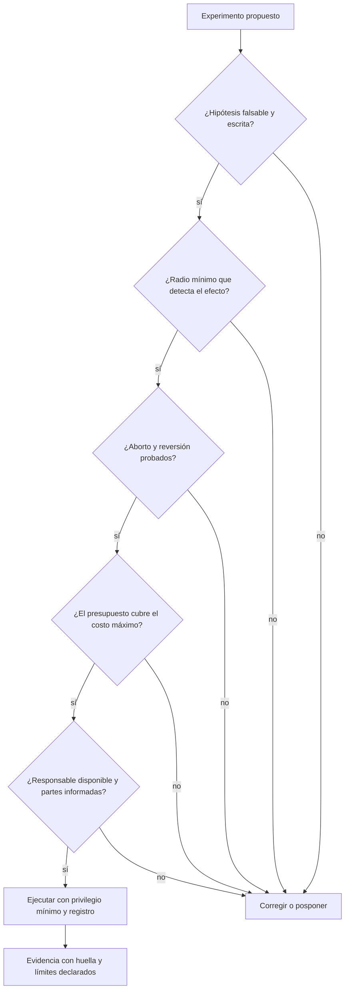

# SE-513 — Seguridad y gobernanza de los experimentos: abortar, autorizar y registrar

[← SE-512 — Caos continuo: automatización en CI/CD y en producción](https://github.com/vladimiracunadev-create/modern-software-engineering-program/blob/main/classes/part-42-ingenieria-del-caos/se-512-caos-continuo-automatizacion-en-ci-cd-y-en-produccion/README.md) · [↑ Parte 42](https://github.com/vladimiracunadev-create/modern-software-engineering-program/blob/main/classes/part-42-ingenieria-del-caos/README.md) · [📚 Índice completo](https://github.com/vladimiracunadev-create/modern-software-engineering-program/blob/main/classes/README.md) · [🌐 Portal](https://vladimiracunadev-create.github.io/modern-software-engineering-program/classes/SE-513.html) · [SE-514 — Aprender de los experimentos: hallazgos, métricas y mejora →](https://github.com/vladimiracunadev-create/modern-software-engineering-program/blob/main/classes/part-42-ingenieria-del-caos/se-514-aprender-de-los-experimentos-hallazgos-metricas-y-mejora/README.md)

## Punto profesional y fundamento pedagógico

**Punto profesional.** La clase existe para que establezcas los **límites** de la práctica: cuánto daño puede pagar el presupuesto de error, quién carga con él, qué privilegios se conceden a la herramienta que inyecta, cuándo un experimento no debe hacerse y qué no puede demostrar la ingeniería del caos. La disciplina tiene una paradoja ética: para reducir el daño de los incidentes provoca daño controlado, y la diferencia entre ambos depende de decisiones de diseño sobre radio, equidad, permisos y calendario.

**Por qué aparece aquí.** Sigue a `SE-512`: allí el caos entró al pipeline y a la producción continua; aquí se pregunta qué le da derecho a un equipo a ejecutar un experimento, quién lo autoriza, con qué permisos y cómo queda registrado. Usa el presupuesto de error de la Parte 41 (`SE-497`), el radio y el aborto de `SE-506` y el experimento acotado de `SE-515`. El caso conductor es el programa de experimentos de la API de entregas.

**Error conceptual que debe corregir.** Creer que «es un experimento controlado» basta como justificación. Un experimento tiene personas afectadas, un costo en presupuesto, privilegios que se pueden abusar y una conclusión limitada; un programa que no declara esas cuatro cosas es un riesgo con buena prensa.

**Secuencia de aprendizaje.** Antes de ver los resultados predices cuántos meses incumplen su objetivo con un calendario fijo de experimentos y con una compuerta de presupuesto, y qué le ocurre al cliente más pequeño cuando se elige por cliente en lugar de por petición. Después contrastas la predicción con dos experimentos y escribes la compuerta de decisión de tu equipo. [ICAP](https://icap.education.asu.edu/research) distingue participación de construcción de conocimiento; [How People Learn II](https://nap.nationalacademies.org/catalog/24783/how-people-learn-ii-learners-contexts-and-cultures) respalda diseñar la práctica con contextos reales y retroalimentación.

**Evidencia de aprendizaje.** `limites-log.md` con la predicción, las tres figuras reproducidas, la compuerta de decisión de tu programa (cinco preguntas y sus evidencias), una política de permisos para la herramienta de inyección y una lista de lo que tus experimentos no pueden demostrar.

**Límite de la conclusión.** Los incidentes, los experimentos, los 40 clientes y sus cuotas son sintéticos, con semilla fija. No se dañó ninguna petición real; las cifras muestran un mecanismo de costos y de equidad, y la clase no sustituye una evaluación ética ni legal de tu organización.

### Trazabilidad fuente → afirmación

| Fuente primaria u oficial | Afirmación que respalda | Lo que no prueba |
|---|---|---|
| [Principles of Chaos Engineering](https://principlesofchaos.org/) | Establece que experimentar en producción puede causar un dolor innecesario a las personas usuarias y que es responsabilidad y obligación de quien hace caos asegurar que las consecuencias se minimizan y contienen. | No dice cuánto daño es aceptable. |
| [ACM Code of Ethics and Professional Conduct](https://www.acm.org/code-of-ethics) | Pide evitar el daño, define el daño como consecuencia negativa significativa e injusta y establece que, cuando acciones bienintencionadas causan un daño no intencionado, quienes son responsables están obligados a deshacerlo o mitigarlo en la medida de lo posible. | No resuelve un dilema concreto. |
| [Google SRE: Embracing Risk](https://sre.google/sre-book/embracing-risk/) | Presenta el presupuesto de error como una forma de decidir cuánto riesgo asumir y cómo gastarlo. | No fija el presupuesto de tu servicio. |
| [AWS FIS: qué es](https://docs.aws.amazon.com/fis/latest/userguide/what-is.html) | Advierte que el servicio realiza acciones reales sobre recursos reales y recomienda planificar y ensayar antes en preproducción. | No describe sus permisos. |
| [Chaos Mesh: por qué el demonio corre en modo privilegiado](https://chaos-mesh.org/docs/) | Su documentación incluye una página sobre por qué el demonio del caos corre con privilegios elevados, y otra sobre la gestión de permisos de usuario. | No evalúa su seguridad. |

## Antes de empezar

Recupera lo aprendido en `SE-506` y `SE-512`: un experimento tiene radio, aborto y reversión, y puede automatizarse. La pregunta activa es: **si mañana quisieras ejecutar un experimento de caos que va a fallar a 2 % de las entregas de estudiantes durante 10 minutos, ¿quién decide que se puede, con qué evidencia y a quién le tocaría ese 2 %?**

## Prerrequisitos

- Haber completado `SE-506` y `SE-512` o poder escribir un experimento con radio, aborto y precondiciones.
- Conocer el presupuesto de error y los acuerdos de nivel de servicio (`SE-497`).
- Python 3.11 o posterior; los experimentos usan solo la biblioteca estándar.

## Problema auténtico

Un equipo entusiasta programa cuatro experimentos al mes con 50 % del tráfico durante 20 minutos, en el calendario compartido, sin consultar a nadie, con una cuenta de administrador del clúster para la herramienta. En tres meses se dan tres situaciones: el presupuesto de error del trimestre se agota en las primeras seis semanas; una universidad pequeña (0,6 % del tráfico) fue elegida cuatro veces por la regla «por cliente» y sufrió falla total en esos experimentos, sin aviso; y alguien con acceso a la herramienta la usa por error contra el entorno equivocado un viernes. Nada de eso viola una afirmación del equipo («hacemos experimentos controlados»); violan lo que ninguna afirmación decía.

## Objetivos observables

Al terminar podrás:

1. calcular el costo de un programa de experimentos en minutos equivalentes de caída y compararlo con el presupuesto de error;
2. distinguir la selección por petición de la selección por cliente y medir quién carga con el daño;
3. definir una política de privilegios para la herramienta de inyección (mínimo alcance, separación de funciones, registro, interruptor general);
4. escribir una compuerta de decisión con las condiciones que detienen un experimento antes de empezarlo;
5. enumerar lo que la ingeniería del caos no puede demostrar y cuándo no debe usarse.

## Mapa conceptual



El mapa muestra que la compuerta se evalúa **antes** de la ejecución y que un solo «no» detiene el experimento. El privilegio mínimo y el registro son parte de la ejecución, no un trámite posterior.

## Temas y por qué importan

| Tema | Por qué cambia una decisión profesional | Evidencia mínima |
|---|---|---|
| Presupuesto de error de los experimentos | Los experimentos se pagan del mismo presupuesto que las personas usuarias. | Predicción, traza causal y contraejemplo de **Presupuesto de error de los experimentos** en `limites-log.md` |
| Equidad: a quién le toca | Elegir por cliente concentra el daño. | Predicción, traza causal y contraejemplo de **Equidad: a quién le toca** en `limites-log.md` |
| Privilegios de la herramienta | La puerta que inyecta fallas también puede abusarse. | Predicción, traza causal y contraejemplo de **Privilegios de la herramienta** en `limites-log.md` |
| Cuándo no hacerlo | Sin observabilidad, aborto o responsables, el experimento es un incidente. | Predicción, traza causal y contraejemplo de **Cuándo no hacerlo** en `limites-log.md` |
| Límites de lo demostrable | Una confirmación vale solo para lo probado. | Predicción, traza causal y contraejemplo de **Límites de lo demostrable** en `limites-log.md` |

## Conceptos y decisiones

### 1. El presupuesto de error pagado por los experimentos

[El libro de SRE](https://sre.google/sre-book/embracing-risk/) presenta el presupuesto de error como la diferencia entre el objetivo y el 100 %, que se puede gastar en cambios, despliegues y riesgos asumidos. Un objetivo de 99,9 % mensual deja 43,2 minutos de caída total equivalente. Los experimentos consumen de esa cuenta: un experimento con fracción f, duración d minutos y daño h sobre las peticiones afectadas cuesta `f · d · h` minutos equivalentes. Con radio de 50 %, 20 minutos y 60 % de daño, son 6 minutos; cuatro al mes son 24, más de la mitad del presupuesto. Con radio de 5 %, son 0,6 minutos y cuatro al mes, 2,4.

Se simulan 4 000 meses con incidentes (1,2 por mes, duración lognormal con mediana de 12 minutos) y tres políticas: sin experimentos; un calendario fijo de cuatro al mes con radio de 50 %; y una compuerta que ejecuta cuatro experimentos con radio de 5 % pero omite el siguiente si, tras los incidentes del mes, queda menos de la mitad del presupuesto. Las tres usan los mismos incidentes.

```python
costo = radio * 20.0 * 0.6                 # minutos equivalentes de caída total por experimento
if politica == "compuerta" and (presupuesto - incidentes - gastado) < 0.5 * presupuesto:
    omitidos += 1; continue                # la compuerta omite el experimento
```


**Cómo leer la figura.** Cada grupo es una política; la barra coral, el porcentaje de meses en que los incidentes y los experimentos juntos superan los 43,2 minutos; la verde, los minutos medios gastados en experimentos. Sin experimentos, 16,2 % de los meses incumple por los incidentes. Con calendario fijo, el gasto de 24 minutos lleva el incumplimiento a 38,6 %, más del doble. Con la compuerta, el gasto es de 1,5 minutos, omite 1,5 experimentos al mes y deja el incumplimiento en 16,2 %: los experimentos no añaden ningún incumplimiento a los 4 000 meses simulados. **Dónde deja de valer:** el costo asume que el daño es proporcional al radio y a la duración, y que los incidentes son independientes de los experimentos; un experimento que provoca un incidente más largo (una cascada, `SE-507`) cuesta mucho más que su cálculo. La compuerta tampoco ve el daño a un cliente concreto, que es el tema de la sección siguiente.

### 2. Equidad: a quién le toca

El radio de 5 % se puede cumplir de dos maneras muy distintas. Por **petición**, cada petición se elige con probabilidad de 5 %: todas las personas tienen la misma probabilidad y el daño a cada cliente es 5 % de sus peticiones. Por **cliente**, se eligen clientes enteros hasta sumar 5 % del tráfico: es más fácil de operar (una sola institución, una sola comunicación) pero el cliente elegido sufre 100 % de sus peticiones. Se simulan 24 experimentos con 40 clientes de tráfico 1/k (el mayor aporta 23,4 % y el menor 0,6 %), con elección al azar de clientes hasta alcanzar el radio.


**Cómo leer la figura.** La primera pareja de barras es la elección por petición: la fracción de las peticiones de un cliente expuesta en un experimento es 5 %, para todos, y no queda ningún cliente sin participar. La segunda es la elección por cliente: el cliente afectado pierde 100 % de sus peticiones en ese experimento, 36 de los 40 clientes son elegidos al menos una vez y 4 nunca; el que más veces fue elegido lo fue 5 de las 24 veces. **Dónde deja de valer:** el reparto 1/k y la elección al azar son supuestos; con una regla que evite repetir al mismo cliente o que excluya a los que tienen contratos críticos, el resultado cambia, y por eso la regla se escribe y se revisa. La elección por petición tampoco es neutra: algunas peticiones (las de un estudiante que sube un trabajo grande) cuestan más al ser interrumpidas.

La enseñanza no es «siempre por petición»: es que **la selección es una decisión con consecuencias de equidad que se documenta**. A veces se justifica elegir por cliente (para que un cliente sepa y consienta, para aislar una falla de datos), y entonces se informa de antemano, se rota con una regla visible y se excluyen los momentos críticos (cierres de plazo, evaluaciones). La [ACM](https://www.acm.org/code-of-ethics) pide evitar el daño: define «daño» como consecuencia negativa significativa e injusta, y establece que, cuando acciones bienintencionadas causan un daño no previsto, quienes son responsables están obligados a deshacerlo o mitigarlo en lo posible. Un experimento que cae sobre la misma institución cuatro veces no es injusto por su intención sino por su diseño.

### 3. Privilegios y seguridad de la herramienta

La herramienta de inyección es, por definición, una puerta con permiso para alterar componentes. [AWS lo dice](https://docs.aws.amazon.com/fis/latest/userguide/what-is.html) sin eufemismos: realiza acciones reales sobre recursos reales, y por eso recomienda planificar y ensayar antes en preproducción. La documentación de [Chaos Mesh](https://chaos-mesh.org/docs/) incluye una página sobre por qué su demonio corre con privilegios elevados (necesita acceso al nodo para alterar la red, los ficheros o el reloj de un contenedor) y otra sobre la gestión de permisos de usuario. De ahí una política mínima: **mínimo alcance** (qué espacios de nombres, etiquetas o cuentas puede tocar y ninguno más), **separación de funciones** (quien aprueba no es quien ejecuta, y el aborto lo puede activar cualquiera), **registro** (cada experimento deja quién, cuándo, con qué alcance y con qué resultado, con una huella), **interruptor general** (una orden que detiene todos los experimentos y que no depende de la herramienta) y **entornos separados** (credenciales distintas para preproducción y producción, de modo que apuntar mal sea difícil). Una herramienta con privilegios de administrador del clúster, sin registro y con una cuenta compartida es adecuada solo para un entorno aislado.

### 4. Cuándo no hacer un experimento

Hay situaciones en que la respuesta correcta es no. Si **no hay observabilidad** del grupo experimental, el experimento no puede refutar nada (`SE-505`). Si el **aborto o la reversión no se han probado**, el radio no está acotado (`SE-506`). Si el sistema **no está en estado estable**, el resultado no es interpretable y se añade daño. Si hay un **incidente en curso** o un despliegue reciente en los componentes tocados, se mezclan causas. Si el **presupuesto de error** no cubre el costo máximo con margen, el experimento se paga con la confianza de quienes usan el servicio. Si **nadie responde** del experimento, o las partes interesadas no fueron informadas, el aprendizaje queda sin dueño. Y si la falla **no se puede resistir por diseño** (la pérdida de la única copia de un dato), lo que corresponde es corregir el diseño y no probarlo. Los [principios](https://principlesofchaos.org/) lo resumen como la obligación de quien hace caos de minimizar y contener las consecuencias.


**Cómo leer la figura.** Las cinco preguntas se leen de arriba abajo; cada «no» desvía hacia «se corrige o se pospone» y solo cuando las cinco son «sí» se ejecuta, con el aborto armado. **Dónde deja de valer:** la lista es una propuesta mínima y no una norma: un sistema con otras obligaciones (sanitario, financiero) añadirá preguntas, y las respuestas «sí» se apoyan en evidencia que alguien puede revisar, no en la afirmación de quien propone el experimento. La compuerta es un registro: se guarda junto a la evidencia del experimento.

### 5. Lo que la ingeniería del caos no demuestra

Una confirmación solo vale para la falla, la intensidad, el tráfico y el estado probados: «resistió 100 ms de lentitud en 2 % del tráfico un martes» no equivale a «es resiliente». No descubre lo que nadie imaginó, porque solo se prueban las fallas del catálogo; no prueba la capacidad ni el comportamiento ante cargas inéditas si no se inyectaron; no sustituye al diseño (un sistema sin redundancia no se arregla probándolo), ni a la observabilidad, ni a la respuesta a incidentes, ni a la auditoría o la prueba de intrusión. Su valor es producir **evidencia acotada y refutable** de que ciertas hipótesis resisten, y encontrar debilidades antes de que lo haga un incidente. Declarar sus límites en cada informe es parte del método, y por eso las clases de esta parte terminan con un apartado de lo que no se hizo.

## Definiciones de trabajo

- **costo de un experimento:** minutos equivalentes de caída total que consume del presupuesto de error.
- **compuerta de presupuesto:** regla que omite un experimento si el presupuesto restante no cubre su costo con margen.
- **selección por petición:** elegir al azar peticiones individuales para recibir la falla.
- **selección por cliente:** elegir clientes enteros para recibir la falla.
- **privilegio mínimo:** permiso limitado a lo imprescindible para la tarea y no más.
- **interruptor general:** orden independiente de la herramienta que detiene todos los experimentos.

Las definiciones son operativas para la API de entregas. No convierten términos con una historia más amplia en sinónimos y deben contrastarse con las fuentes enlazadas.

## Ejemplo mínimo

El fragmento calcula el costo de un experimento y cuántos caben en un presupuesto. Antes de ejecutarlo, predice cuántos experimentos de 5 % de radio, 20 minutos y 60 % de daño caben en 43,2 minutos reservando la mitad para incidentes.

```python
def costo(radio: float, duracion_min: float, dano: float) -> float:
    return radio * duracion_min * dano

c = costo(0.05, 20, 0.6)
print(round(c, 2), int(0.5 * 43.2 // c), round(costo(0.5, 20, 0.6), 1))
```

Imprime `0.6 36 6.0`. Un experimento cuesta 0,6 minutos y caben 36 en la mitad del presupuesto; con radio de 50 % cada uno cuesta 6 minutos y caben 3. Registra versión de Python, comando y salida; luego repite el cálculo con tu objetivo de nivel de servicio.

## Ejemplo profesional

Supón, como caso hipotético y no como medición, que el equipo escribe la política de su programa. Presupuesto: los experimentos nunca consumen más de 10 % del presupuesto mensual y se omiten si queda menos de la mitad. Equidad: selección por petición en producción; por cliente solo con aviso previo y rotación, excluyendo a las instituciones en semana de evaluación. Permisos: la herramienta solo actúa sobre el espacio de nombres de la API de entregas, aprueba el líder y ejecuta la guardia, cualquier persona del equipo puede activar el interruptor general, y hay credenciales separadas para preproducción y producción. Calendario: martes a jueves, de 10:00 a 16:00, fuera de cierres de plazo. Registro: cada experimento deja hipótesis, radio, resultado y huella, y la compuerta se archiva con él. Y un apartado de límites: lo que ningún experimento del programa demuestra.

## Práctica guiada

1. Predice, por escrito, cuántos meses incumplen con calendario fijo y con compuerta, y cuántas veces es elegido el mismo cliente.
2. Ejecuta `python scripts/experiments_part42_b.py e513` y compara; anota la mayor diferencia con tu predicción.
3. Cambia el radio del calendario fijo de 50 % a 10 % y encuentra a partir de qué radio deja de aumentar los meses que incumplen.
4. Cambia la regla de elección por cliente a «sin repetir hasta agotar la lista» y mide cuántos clientes quedan sin ser elegidos.
5. Escribe la política de permisos de tu herramienta con alcance, separación de funciones, registro e interruptor general.
6. Entrega `limites-log.md` y pide a otra persona que identifique la situación en la que tu compuerta aprobaría un experimento que no debería hacerse.

## Ejercicios

1. **Presupuesto:** con objetivo de 99,95 % mensual (21,6 minutos), calcula cuántos experimentos de radio 10 %, 15 minutos y 50 % de daño caben reservando 60 % para incidentes.
2. **Equidad:** con 5 clientes de cuotas 50, 25, 15, 8 y 2 %, calcula la fracción de sus peticiones expuesta por cliente con selección por petición de 10 % y con selección por cliente.
3. **Permisos:** una herramienta pide acceso de administrador del clúster a todos los espacios de nombres; escribe tres reducciones de alcance y la prueba que comprueba que no pueden tocar producción desde preproducción.
4. **Cuándo no:** clasifica seis situaciones (incidente abierto, aborto sin probar, presupuesto agotado, cierre de plazo, sin observabilidad del grupo, el sistema sin redundancia) como «posponer», «no hacer» o «corregir el diseño».

## Reto verificable

Entrega `limites-log.md` con la predicción, las dos tablas de resultados reproducidas con las mismas semillas, la política de tu programa (presupuesto, equidad, permisos, calendario y registro), la compuerta de cinco preguntas y una lista de lo que ningún experimento de tu programa demuestra. Se aprueba si otra persona ejecuta el código desde un checkout limpio, obtiene las mismas cifras y encuentra un caso en que tu política dañaría a un grupo sin que la compuerta lo impidiera. No se aprueba por declarar «hacemos experimentos controlados» sin presupuesto ni regla de selección.

## Caso conductor

El programa de experimentos de la API de entregas es el caso conductor. Esta clase deja el noveno artefacto: la política y la compuerta del programa. `SE-514` aprende de los experimentos con ensayos y hallazgos, `SE-515` ejecuta uno acotado con aborto y `SE-516` lo integra en un programa con validador, huella y límites. Cambia después un solo dato, la regla de selección, y observa quién carga con el daño.

## Preguntas frecuentes

### ¿Es ético dañar a personas usuarias para probar un sistema?

Es un daño deliberado y acotado a cambio de evitar uno mayor y no controlado, y por eso exige proporcionalidad: radio mínimo, aborto, presupuesto, equidad y transparencia. Hay prácticas que no lo justifican (afectar a quien no puede tolerarlo, como en una evaluación) y por eso la compuerta incluye el calendario y las partes informadas.

### ¿Hay que avisar a los clientes?

Depende del contrato y del daño. Los experimentos que afectan a una fracción pequeña de peticiones y se compensan con reintentos suelen cubrirse con las condiciones del servicio; los que afectan a clientes concretos o a datos requieren aviso o consentimiento. En todo caso se documenta la decisión y quién la tomó.

### ¿Quién debe poder abortar?

Cualquier persona del equipo, sin pedir permiso y sin consecuencias. El aborto automático cubre lo previsto y el manual cubre lo imprevisto; si abortar tiene un costo personal, se dejará de hacer.

### ¿Cuándo es mejor no hacer caos?

Cuando falta observabilidad, aborto, reversión, presupuesto o responsables, y cuando el sistema no resiste la falla por diseño. En esos casos el experimento sustituye a una decisión que debería tomarse antes, y el costo de aprender es mayor que el de corregir.

## Fallo controlado y diagnóstico

Reproduce el fallo clásico de la clase: **un calendario fijo de experimentos sin compuerta de presupuesto**. Aplica cuatro experimentos al mes con radio de 50 % durante 4 000 meses y compara con la compuerta.

Registra síntoma, entrada mínima, hipótesis, observación que descarta cada hipótesis, causa, corrección y prueba de regresión. **Síntoma:** los meses que incumplen el objetivo pasan de 16 % a 39 % sin que haya más incidentes. **Hipótesis rivales:** (a) hubo más incidentes; (b) los experimentos provocaron incidentes; (c) los experimentos consumieron el presupuesto. **Prueba:** descompón el gasto en incidentes y en experimentos; si los incidentes gastaron 21,3 minutos de media y los experimentos 24, la hipótesis (c) explica el aumento de 16,2 % a 38,6 % de meses que incumplen. **Conclusión:** los experimentos son una partida del presupuesto y deben tratarse como tal. **Regresión:** añade la compuerta y una prueba que exija que el gasto en experimentos no supere el 10 % del presupuesto y se omita con menos de la mitad restante. No cambies a la vez el radio y la frecuencia.

## Errores comunes y cómo corregirlos

| Síntoma | Causa probable | Corrección |
|---|---|---|
| El presupuesto se agota por experimentos | Calendario fijo sin compuerta | Compuerta con reserva para incidentes |
| Una institución sufre varias veces | Selección por cliente sin regla de rotación | Seleccionar por petición o rotar con regla visible |
| La herramienta se usa contra el entorno equivocado | Credenciales compartidas entre entornos | Credenciales separadas y aprobación aparte |
| Nadie sabe qué se ejecutó | Sin registro | Registro con huella de cada experimento |
| Se confía en el programa como garantía | No se declaran los límites | Apartado de lo que no se demuestra en cada informe |

## Entorno y archivos clave

```text
work/SE-513/
├── README.md
├── limites/
│   ├── presupuesto.py
│   ├── equidad.py
│   └── politica.md
├── tests/test_politica.py
└── evidence/limites-log.md
```

El `README` declara plataforma, versión de Python, semillas y comandos. Los experimentos usan solo la biblioteca estándar y se ejecutaron con CPython 3.12.9 en Windows 11 y 3.12.3 en Ubuntu bajo WSL2 con resultados idénticos. Para recuperar el estado, borra `work/SE-513/` y vuelve a ejecutar los scripts. Si añades una dependencia, fija procedencia y versión.

## Seguridad, ética y accesibilidad

- cada experimento afecta a personas que no lo pidieron: se justifica por proporcionalidad, se informa y se compensa cuando corresponde;
- no ejecutes experimentos en momentos críticos para las personas (evaluaciones, cierres de plazo) ni sobre quienes no pueden tolerar la falla;
- el registro de experimentos no debe contener datos personales y se conserva con los controles de acceso del resto de la evidencia;
- documenta las tablas y las figuras con texto alternativo y en un formato que un lector de pantalla pueda recorrer;
- respeta las licencias de los libros y artículos y atribuye lo adaptado.

## Puente hacia el trabajo con agentes

Un agente al que se le pide «ejecuta experimentos de caos cada semana» tenderá a programarlos con un calendario fijo, a pedir permisos amplios y a elegir objetivos por comodidad. Pídele en cambio que calcule el costo de cada experimento contra el presupuesto, que aplique la compuerta de cinco preguntas, que use credenciales del entorno acordado y que registre cada ejecución con huella. Revisa especialmente si pide privilegios de administrador, si selecciona clientes sin regla y si ejecuta en horario o entorno no autorizado. Un agente nunca debe tener la facultad de aprobar y ejecutar a la vez.

## Transferencia

Traslada el análisis a otro equipo (el de pagos, el de búsqueda): calcula el costo de su programa contra su presupuesto, escribe su regla de selección y su política de permisos, y lista lo que no demuestra. La transferencia está lograda cuando puedes decir a quién le tocaría el daño y qué permiso sería el más peligroso, no cuando la política existe.

## Evaluación y evidencia

| Criterio | Evidencia para aprobar |
|---|---|
| comprensión | explicación del costo, la equidad, los privilegios y los límites del método |
| corrección | presupuesto y equidad reproducibles con las mismas semillas |
| diseño | política con presupuesto, selección, permisos, calendario y registro |
| diagnóstico | reproducción del fallo «calendario fijo sin compuerta» con regresión |
| incertidumbre | declaración de que los incidentes, los clientes y los costos son sintéticos |
| reproducibilidad | versiones, comandos, salida y límites declarados |

## Fuentes

- [Principles of Chaos Engineering](https://principlesofchaos.org/) — responsabilidad de minimizar y contener el daño; autoridad: documento vivo de la comunidad de ingeniería del caos.
- [ACM Code of Ethics and Professional Conduct](https://www.acm.org/code-of-ethics) — evitar el daño y mitigarlo; autoridad: Association for Computing Machinery.
- [Google SRE: Embracing Risk](https://sre.google/sre-book/embracing-risk/) — presupuesto de error; autoridad: libro de ingeniería de confiabilidad de Google.
- [AWS Fault Injection Service](https://docs.aws.amazon.com/fis/latest/userguide/what-is.html) — acciones reales sobre recursos reales; autoridad: documentación de Amazon Web Services.
- [Chaos Mesh](https://chaos-mesh.org/docs/) — privilegios del demonio y gestión de permisos; autoridad: documentación del proyecto Chaos Mesh.

Cada fuente respalda el mecanismo indicado; ninguna demuestra que 38,6 % de meses incumplidos, 24 minutos de gasto o cuatro veces el mismo cliente se observen en un equipo real. Esa afirmación depende del presupuesto, de la regla de selección y de los incidentes.

## Límites y siguiente paso

Se ejecutaron dos experimentos con semilla fija en Windows y Ubuntu (WSL2) con resultados idénticos. No se dañó ninguna petición real; los incidentes de 1,2 por mes, la duración lognormal, el costo proporcional al radio, los 40 clientes con cuota 1/k y las políticas son construcciones del autor, y la clase no sustituye una evaluación ética, legal ni de seguridad de tu organización. La siguiente clase pregunta qué se aprende de un experimento: cuántos ensayos sostienen una conclusión y cómo se clasifican los hallazgos.

## Glosario

- **costo de un experimento:** minutos equivalentes de caída total que consume del presupuesto de error.
- **compuerta de presupuesto:** regla que omite un experimento si el presupuesto restante no cubre su costo con margen.
- **selección por petición:** elegir al azar peticiones individuales para recibir la falla.
- **selección por cliente:** elegir clientes enteros para recibir la falla.
- **privilegio mínimo:** permiso limitado a lo imprescindible para la tarea.
- **interruptor general:** orden independiente de la herramienta que detiene todos los experimentos.

---

[← SE-512 — Caos continuo: automatización en CI/CD y en producción](https://github.com/vladimiracunadev-create/modern-software-engineering-program/blob/main/classes/part-42-ingenieria-del-caos/se-512-caos-continuo-automatizacion-en-ci-cd-y-en-produccion/README.md) · [↑ Parte 42](https://github.com/vladimiracunadev-create/modern-software-engineering-program/blob/main/classes/part-42-ingenieria-del-caos/README.md) · [📚 Índice completo](https://github.com/vladimiracunadev-create/modern-software-engineering-program/blob/main/classes/README.md) · [🌐 Portal](https://vladimiracunadev-create.github.io/modern-software-engineering-program/classes/SE-513.html) · [SE-514 — Aprender de los experimentos: hallazgos, métricas y mejora →](https://github.com/vladimiracunadev-create/modern-software-engineering-program/blob/main/classes/part-42-ingenieria-del-caos/se-514-aprender-de-los-experimentos-hallazgos-metricas-y-mejora/README.md)
