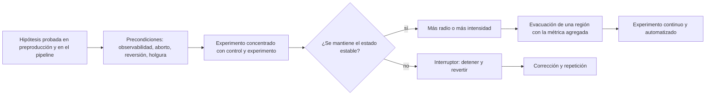

# SE-515 — Taller: ejecutar un experimento de caos acotado con criterio de aborto

[← SE-514 — Aprender de los experimentos: hallazgos, métricas y mejora](https://github.com/vladimiracunadev-create/modern-software-engineering-program/blob/main/classes/part-42-ingenieria-del-caos/se-514-aprender-de-los-experimentos-hallazgos-metricas-y-mejora/README.md) · [↑ Parte 42](https://github.com/vladimiracunadev-create/modern-software-engineering-program/blob/main/classes/part-42-ingenieria-del-caos/README.md) · [📚 Índice completo](https://github.com/vladimiracunadev-create/modern-software-engineering-program/blob/main/classes/README.md) · [🌐 Portal](https://vladimiracunadev-create.github.io/modern-software-engineering-program/classes/SE-515.html) · [SE-516 — Proyecto: programa de caos de un servicio con evidencia y remediación →](https://github.com/vladimiracunadev-create/modern-software-engineering-program/blob/main/classes/part-42-ingenieria-del-caos/se-516-proyecto-programa-de-caos-de-un-servicio-con-evidencia-y-remediacion/README.md)

## Punto profesional y fundamento pedagógico

**Punto profesional.** Esta clase es un taller: se ejecuta, en simulación, un experimento de caos acotado con grupo de control y criterio de aborto, que es el paso previo a cualquiera en producción. Existe para que lleves el método a **escala y a producción**: que distingas un experimento difuso de uno concentrado, que compares un grupo experimental con uno de control sobre tráfico real, que sepas qué exige evacuar una región entera y qué se puede y qué no se puede copiar del caso de Netflix. En producción el método gana realismo (tráfico, datos, capacidad y dependencias reales) y pierde margen: cada decisión de radio, aborto y comunicación pasa a tener personas afectadas.

**Por qué aparece aquí.** Sigue a `SE-514`, que fijó cuántos ensayos sostienen una conclusión; aquí se ejecuta un experimento acotado sobre tráfico con holgura calculada. Usa el radio y el aborto de `SE-506`, la comparación con control de `SE-505`, la gobernanza de `SE-513` y la disponibilidad y la recuperación de la [Parte 36](../../part-36-calidad-rendimiento-y-resiliencia/README.md) (`SE-440`), y toma como caso el de Netflix del repositorio (`casos/exito/netflix.md`). El caso conductor es la API de entregas con más de una región.

**Error conceptual que debe corregir.** Creer que «hacer caos en producción» es hacer en producción lo que se hizo en preproducción. La producción cambia lo que se aprende (umbrales de capacidad y de saturación que solo se cruzan con carga real) y lo que se arriesga; y la comparación entre dos grupos de la misma ejecución sustituye al «parece que está bien».

**Secuencia de aprendizaje.** Antes de ver los resultados predices qué ocurre con las regiones que sobreviven al evacuar una, según su número y su utilización previa, y cuánto tráfico lento hace falta para que un cliente colapse. Después contrastas la predicción con dos experimentos y escribes qué condiciones exigirías antes de un primer experimento en producción. [ICAP](https://icap.education.asu.edu/research) distingue participación de construcción de conocimiento; [How People Learn II](https://nap.nationalacademies.org/catalog/24783/how-people-learn-ii-learners-contexts-and-cultures) respalda diseñar la práctica con contextos reales y retroalimentación.

**Evidencia de aprendizaje.** `produccion-log.md` con la predicción, las tres figuras reproducidas, una lista de precondiciones para un primer experimento en producción de tu servicio y una nota que separe lo documentado por Netflix, lo que muestra la simulación y lo que habría que comprobar en tu sistema.

**Límite de la conclusión.** Las regiones, su capacidad, la utilización previa, la lentitud de 300 ms y el cliente son sintéticos, con tiempo virtual y semilla fija. No se evacuó ninguna región ni se inyectó ninguna falla en producción; lo que se dice de Netflix procede de su blog de ingeniería y de su repositorio, y se atribuye. Las cifras muestran un mecanismo, no el margen de tu sistema.

### Trazabilidad fuente → afirmación

| Fuente primaria u oficial | Afirmación que respalda | Lo que no prueba |
|---|---|---|
| [Netflix: «Chaos Engineering Upgraded» (2015)](https://netflixtechblog.com/chaos-engineering-upgraded-878d341f15fa) | Describe Chaos Kong, que simula la pérdida de una región entera de AWS; el 20 de septiembre de 2015, ante una falla de DynamoDB en US-EAST-1 que dejó intermitentes durante seis a ocho horas a muchas aplicaciones, Netflix tuvo solo un breve bache porque sus ejercicios de evacuación lo habían preparado; durante el ejercicio la atención se centra en una métrica agregada, que debe seguir una tendencia suave. | No prueba que tu sistema resista lo que resistió el de Netflix. |
| [Netflix: «ChAP» (2017)](https://netflixtechblog.com/chap-chaos-automation-platform-53e6d528371f) | Distingue experimentos «difusos», que reparten la carga y la absorbe la holgura sin activar cortacircuitos, de «concentrados», que dirigen un grupo pequeño a un clúster experimental para cruzar umbrales críticos; encontró políticas de reintento mal ajustadas, alternativas costosas en CPU e interacciones inesperadas entre cortacircuitos y balanceadores. | No es una receta aplicable sin su infraestructura. |
| [Principles of Chaos Engineering](https://principlesofchaos.org/) | Prefiere experimentar sobre tráfico de producción porque los sistemas se comportan distinto según el entorno y el tráfico, y pide minimizar el radio de explosión. | No dice cuándo estás listo. |
| [Google SRE: Addressing Cascading Failures](https://sre.google/sre-book/addressing-cascading-failures/) | Explica cómo la pérdida de capacidad en un clúster traslada su carga a los demás y puede propagar la sobrecarga. | No mide tu holgura. |
| [Casos de éxito: Netflix (repositorio del curso)](https://github.com/vladimiracunadev-create/modern-software-engineering-program/blob/main/casos/exito/netflix.md) | Reúne con etiquetas «documentado», «inferido» y «no se sabe» la arquitectura de resiliencia de Netflix, su línea de tiempo y lo que no se debe generalizar. | No sustituye a las fuentes que cita. |

## Antes de empezar

Recupera lo aprendido en `SE-514`: la evidencia de un experimento exige ensayos, criterio de aceptación y registro. La pregunta activa es: **si mañana evacuas una de tus tres regiones durante un ejercicio, ¿qué le pasa a la carga de las otras dos y cómo sabes, antes de intentarlo, que tienen holgura para recibirla?**

## Prerrequisitos

- Haber completado `SE-506`, `SE-513` y `SE-514` o poder escribir un experimento con radio, aborto, gobernanza y criterio de aceptación.
- Conocer la disponibilidad y la recuperación entre regiones (`SE-440`) y la replicación (`SE-393`).
- Python 3.11 o posterior; los experimentos usan solo la biblioteca estándar.

## Problema auténtico

El equipo de la API de entregas opera en tres regiones y declara «si una cae, las otras dos absorben su tráfico». Nunca lo ha comprobado. Un martes, una región pierde su balanceador durante un cambio y el tráfico se desvía a las otras dos, que operaban al 65 % de su capacidad: la carga sube a 97 % durante la hora punta, las colas se llenan, las esperas se agotan y los reintentos del cliente empujan la utilización por encima de 100 %. Lo que fue una pérdida parcial se convierte en una caída de las tres. El cálculo de holgura era conocido (65 % × 3/2 = 97,5 %) pero nadie lo había aplicado a la capacidad real, y nadie había hecho el ejercicio de evacuar una región con tráfico. La clase enseña ese cálculo, cómo se ejerce a escala y qué lo hace seguro.

## Objetivos observables

Al terminar podrás:

1. calcular la carga que absorben las regiones restantes al evacuar una y comprobarla con una simulación de tráfico;
2. distinguir un experimento difuso de uno concentrado y explicar por qué solo el segundo cruza ciertos umbrales;
3. diseñar la comparación entre un grupo de control y uno experimental sobre tráfico real y su interruptor automático;
4. enumerar las precondiciones de un primer experimento en producción y decir qué puede esperar a una etapa anterior;
5. leer el caso de Netflix separando lo documentado de lo inferido y de lo que no se debe generalizar.

## Mapa conceptual



El mapa ordena el **camino de la confianza**: cada paso requiere la evidencia del anterior. La evacuación de una región es la última etapa, no la primera, y el experimento continuo no empieza hasta que el aborto automático se probó.

## Temas y por qué importan

| Tema | Por qué cambia una decisión profesional | Evidencia mínima |
|---|---|---|
| Holgura y evacuación de regiones | Perder una región traslada su carga a las demás. | Predicción, traza causal y contraejemplo de **Holgura y evacuación de regiones** en `produccion-log.md` |
| Experimentos difusos y concentrados | Solo la concentración cruza los umbrales de saturación. | Predicción, traza causal y contraejemplo de **Experimentos difusos y concentrados** en `produccion-log.md` |
| Control y experimento en producción | Comparar con un grupo contemporáneo absorbe el ruido del tráfico real. | Predicción, traza causal y contraejemplo de **Control y experimento en producción** en `produccion-log.md` |
| Precondiciones | La producción exige observabilidad, aborto y reversión probados. | Predicción, traza causal y contraejemplo de **Precondiciones** en `produccion-log.md` |
| El caso de Netflix | Lo documentado se puede copiar; lo contextual, no. | Predicción, traza causal y contraejemplo de **El caso de Netflix** en `produccion-log.md` |

## Conceptos y decisiones

### 1. Evacuar una región: la aritmética de la holgura

Cuando una de R regiones deja de recibir tráfico, las R − 1 restantes absorben su parte. Si cada una operaba con utilización u, tras la evacuación opera con `u · R / (R − 1)`. Con dos regiones la carga se duplica; con tres sube 50 %; con seis, 20 %. Sobre 100 % de utilización una cola crece sin límite, las esperas se agotan y los reintentos aumentan aún más la carga (`SE-507`). [El libro de SRE](https://sre.google/sre-book/addressing-cascading-failures/) lo trata como la causa clásica de las fallas en cascada: un clúster que pierde capacidad traslada su carga a los demás, que se sobrecargan.

Se simula una región que sobrevive con la configuración E de `SE-507` (cortacircuitos calibrado y alternativa), con capacidad de 200 peticiones por segundo, y se le aplica la carga posterior a la evacuación para cuatro números de regiones y cuatro utilizaciones previas. Cada celda es la fracción de peticiones correctas y completas en una ejecución de 60 s con dos semillas.

```python
carga = util * regiones / (regiones - 1)            # utilización tras evacuar una región
r = simulate(seed, BASE, [], duration_s=60.0, rate=200.0 * carga)
ok = summarize(r, 5, 60)["ok"]
```


**Cómo leer la figura.** Cada fila es el número de regiones y cada columna la utilización previa de cada una; el número es el porcentaje de peticiones correctas y completas tras la evacuación. Con dos regiones solo se sostiene la utilización previa de 40 % (carga posterior de 80 %); con 55 % cae a 21 %. Con tres regiones, hasta 55 % (carga de 82,5 %); con 70 % (carga de 105 %), 32 %. Con cuatro, hasta 55 %, y con 70 % (carga de 93 %) cae a 72 %. Con seis, hasta 70 % (carga de 84 %). Con 85 % de utilización previa ninguna configuración aguanta: cae a 5 %, 13 %, 18 % y 37 %. **Dónde deja de valer:** el modelo supone que la carga se reparte por igual y que la capacidad es una cola de 8 hilos; una región real tiene capacidad desigual, afinidad de datos y el tiempo de autoescalado (minutos) que aquí no existe; las cifras muestran la forma, no el límite de tu sistema. Un punto como 4 regiones con 70 % (carga de 93 %) ilustra otra cosa: bajo 100 %, el sistema ya degrada la calidad porque la cola empieza a crecer.

La consecuencia es una regla de capacidad (cuánta utilización máxima puede tener cada región para que la pérdida de una sea soportable) y una prueba: evacuar una región con tráfico real y observar la métrica agregada. [Netflix describe su ejercicio](https://netflixtechblog.com/chaos-engineering-upgraded-878d341f15fa) con tres vistas de la misma métrica de reproducciones durante ocho horas: la agregada y la de cada región; durante el ejercicio la atención se centra en la agregada, y mientras siga una tendencia suave el sistema es resiliente a la conmutación. El tráfico sale de una región, sube en la otra y, al terminar, vuelve, y el agregado no muestra efectos adversos para las personas. Esa es la hipótesis de estado estable de `SE-505` escrita para una región.

### 2. Difuso frente a concentrado: dónde aparecen los umbrales

Un experimento **difuso** reparte la falla sobre toda la capacidad: 5 % de las peticiones recibe una lentitud extra, y el aumento de consumo lo absorbe la holgura normal. Es útil para comprobar la corrección lógica de una alternativa y no para ver el comportamiento del sistema bajo falla a escala. Un experimento **concentrado** dirige una porción pequeña del tráfico a un grupo (un clúster de pocas instancias) y le aplica la falla a **todas** sus peticiones: el grupo cruza los umbrales críticos (hilos agotados, CPU de una alternativa costosa, cortacircuitos que se abren) mientras el resto del sistema no se entera. [Netflix lo explica](https://netflixtechblog.com/chap-chaos-automation-platform-53e6d528371f) con ejemplos de umbrales que solo se cruzan cuando una gran parte de las peticiones es lenta o falla: los grupos de hilos se agotan si una dependencia es lenta, una alternativa más costosa que el camino feliz aumenta la CPU, las excepciones registradas pueden causar contención de bloqueos en el registro y los reintentos agresivos pueden producir un ataque de denegación de servicio autoinfligido.

Se simula con una lentitud de 300 ms en la dependencia aplicada a una fracción de peticiones, de 0 a 100 %, para tres clientes de `SE-507`: sin protección (A), reintentos sin pausa (B) y cortacircuitos calibrado (E).


**Cómo leer la figura.** El eje horizontal es la fracción de peticiones lentas y el vertical las peticiones respondidas. El cliente B se mantiene en 100 % hasta 10 % de peticiones lentas y a 20 % cae a 0 %: ese es un **umbral** de saturación (cada reintento retiene un hilo 340 ms), invisible para un experimento difuso de 5 %. El cliente A baja de forma gradual (88 % con 20 %, 26 % con 100 %) porque no multiplica la carga. El cliente E mantiene respuestas en 100 % (completas o con la alternativa), pero la respuesta completa cae a 44 % con 5 % de peticiones lentas y a 12 % con 10 %: el cortacircuitos cambia calidad por supervivencia y abre antes. **Dónde deja de valer:** los umbrales (10 % a 20 %) dependen del servicio de 8 hilos y 40 ms; en otro sistema serán otros, y lo que generaliza es que existen y que solo un experimento concentrado los cruza.

### 3. Control y experimento en producción

El diseño de Netflix para producción es una comparación explícita: una plataforma que, según su blog, interroga el proceso de despliegue de un servicio, lanza un clúster de **control** y uno **experimental** del mismo servicio, les envía una pequeña parte del tráfico y aplica un escenario de inyección solo al experimental; los indicadores se siguen solo para ambos grupos, de modo que es más fácil ver cuándo divergen. Para un experimento que afecta a 0,5 % de la población en un sistema de 200 instancias, el ejemplo del blog levanta clústeres de control y experimento con una instancia cada uno; como solo el tráfico experimental va al clúster experimental, el 100 % de sus peticiones a la dependencia sufre la falla. Y el experimento tiene un interruptor propio que lo termina de forma automática si se supera un presupuesto de error predefinido.


**Cómo leer la figura.** El tráfico real entra por un enrutador que envía casi todo a la flota normal y dos porciones pequeñas a los grupos de control y experimental; la falla solo se aplica al experimental; el comparador mide a ambos y el interruptor detiene el experimento si el experimental se degrada más que un límite. **Dónde deja de valer:** el dibujo es un esquema de ejemplo con proporciones ilustrativas (2 %) y no el diseño de ninguna plataforma real; su valor es mostrar el papel de cada pieza. La comparación con un control contemporáneo absorbe las variaciones comunes (hora, cierre de plazo) que una línea base de otra hora no absorbe, y por eso es la forma de medir sobre tráfico real.

Los experimentos concentrados exigen que la **fracción** y el **tamaño del grupo** estén de acuerdo con `SE-506`: con 0,5 % del tráfico y 200 instancias, el grupo es una sola instancia, y una instancia con 100 % de sus llamadas fallidas es un radio de explosión mínimo y una carga máxima para sus hilos. El experimento deja de ser difuso sin dañar al sistema.

### 4. Precondiciones para un primer experimento en producción

Los [principios](https://principlesofchaos.org/) prefieren experimentar sobre el tráfico de producción porque el comportamiento cambia con el entorno y el tráfico, y a la vez piden minimizar y contener el radio de explosión. La práctica serena exige precondiciones que se comprueban antes y se registran: (1) la hipótesis ya se demostró en preproducción y en el pipeline, y el experimento de producción añade realismo, no descubre lo básico; (2) hay observabilidad del grupo experimental, no solo del conjunto; (3) el aborto es automático y se probó, y hay una persona con autoridad para detener a mano; (4) la reversión se probó y su tiempo se midió; (5) la holgura de capacidad cubre el peor caso del experimento; (6) el calendario excluye cierres de plazo, despliegues y días de alto riesgo; (7) las partes interesadas están informadas; y (8) el costo máximo cabe en el presupuesto de error (`SE-513`). Si falta una, el experimento se pospone o se hace en una etapa anterior.

### 5. El caso de Netflix: qué es documentado y qué no se debe generalizar

El repositorio recoge el caso con etiquetas de procedencia (`casos/exito/netflix.md`, secciones «Resiliencia y degradación», «Temas a prueba de fallos» y «Qué no generalizar»). Lo **documentado** por Netflix, y verificado aquí en sus artículos, es una secuencia: Chaos Monkey en 2011, que apaga instancias de producción en horario laboral con ingenieros disponibles ([Simian Army](https://netflixtechblog.com/the-netflix-simian-army-16e57fbab116)); Chaos Gorilla y Chaos Kong para una zona y una región; la formalización de la disciplina en 2015 con estado estable, hipótesis y grupo de control ([Chaos Engineering Upgraded](https://netflixtechblog.com/chaos-engineering-upgraded-878d341f15fa)); FIT para microservicios y ChAP para experimentos con control y experimento y un interruptor automático ([ChAP](https://netflixtechblog.com/chap-chaos-automation-platform-53e6d528371f)). Lo que **no se debe generalizar** es el contexto: cientos de despliegues diarios, una arquitectura de microservicios con mucho tráfico por servicio (lo que permite que 0,5 % sea una instancia), una cultura de responsabilidad por el servicio propio y observabilidad y entrega continua con décadas de inversión. El caso del repositorio lo resume como que no se debe copiar Chaos Monkey en un sistema sin observabilidad, sin respuestas alternativas y sin reversión. Un sistema con tres instancias no puede hacer un experimento de 0,5 %, y uno sin comparación con control no puede ver una divergencia pequeña.

### Taller: ejecutar un experimento acotado con criterio de aborto

El taller recorre, con el simulador de estas clases, los pasos de un experimento acotado. (1) Calcula la utilización que alcanzan las regiones que sobreviven y comprueba que la holgura cubre el peor caso (sección 1). (2) Escribe la especificación de doce campos de `SE-506` con la hipótesis, el radio de 2 %, el aborto sobre el grupo experimental y la reversión. (3) Verifica las ocho precondiciones de la sección 4 y guarda la evidencia de cada una. (4) Ejecuta con grupo de control la falla concentrada de 300 ms y comprueba que el cliente sano la resiste y que la regresión sin cortacircuitos (`SE-512`) la refuta. (5) Repite con la falla empeorada y comprueba que el aborto se dispara en menos de 15 s. (6) Registra resultados, huella y límites, y deja a otra persona la revisión de la compuerta de `SE-513`. Cada paso produce una salida que se guarda; el taller dura de dos a tres horas y es una práctica de forma, no una evaluación del equipo.

## Definiciones de trabajo

- **evacuación de una región:** desviar todo el tráfico de una región a las demás, como ejercicio o como respuesta a una falla.
- **experimento difuso:** inyección repartida sobre toda la capacidad, absorbida por la holgura normal.
- **experimento concentrado:** inyección sobre un grupo pequeño al que se envía una porción del tráfico y en el que todas las peticiones sufren la falla.
- **grupo de control:** grupo comparable que recibe el mismo tráfico sin la falla.
- **interruptor del experimento:** mecanismo que lo termina de forma automática al superar un presupuesto de error.
- **holgura:** capacidad no usada que permite absorber un aumento de carga.

Las definiciones son operativas para la API de entregas. No convierten términos con una historia más amplia en sinónimos y deben contrastarse con las fuentes enlazadas.

## Ejemplo mínimo

El fragmento calcula la utilización que alcanzan las regiones restantes al evacuar una. Antes de ejecutarlo, predice el valor con 3 regiones al 65 % y con 4 al 70 %.

```python
def tras_evacuar(util: float, regiones: int) -> float:
    return util * regiones / (regiones - 1)

print(round(tras_evacuar(0.65, 3), 3), round(tras_evacuar(0.70, 4), 3), round(tras_evacuar(0.55, 2), 3))
```

Imprime `0.975 0.933 1.1`. Con tres regiones al 65 %, las dos restantes quedan al 97,5 %, el caso del problema auténtico; con cuatro al 70 %, al 93,3 %; con dos al 55 %, al 110 %. Registra versión de Python, comando y salida; luego calcula la utilización máxima de cada región para que la pérdida de una deje a las demás al 80 %.

## Ejemplo profesional

Supón, como caso hipotético y no como medición, que el equipo escribe el plan de su primer experimento en producción: «con 2 % del tráfico dirigido a un clúster experimental de la API de entregas, una lentitud de 300 ms en el 100 % de sus llamadas al almacenamiento durante 20 minutos no cambia, en comparación con el clúster de control, la proporción de entregas aceptadas en menos de 400 ms más de 1,5 puntos». Antes verifica las ocho precondiciones; el aborto detiene el experimento si el clúster experimental baja de 90 % durante 10 s; la reversión es devolver ese tráfico a la flota; la ventana es un martes a las 11:00, fuera de cierres. Tras aprobarlo, repite el experimento con 10 % para ver si aparece un umbral, y deja la evacuación de una región para un ejercicio posterior con la regla de capacidad calculada. Registra que **no** verifica el comportamiento con una región entera caída ni con datos corruptos.

## Práctica guiada

1. Predice, por escrito, la utilización posterior a evacuar una región con tres regiones al 60 % y qué fracción de peticiones lentas colapsa al cliente B.
2. Ejecuta `python scripts/experiments_part42_b.py e515` y compara; anota la mayor diferencia con tu predicción.
3. Cambia la política del cliente a la de E sin cortacircuitos calibrado y encuentra el umbral de peticiones lentas.
4. Calcula, para tu servicio, la utilización máxima por región que permite perder una y quedar en 80 %.
5. Escribe el plan de un primer experimento en producción con las ocho precondiciones y la señal de cada una.
6. Entrega `produccion-log.md` y pide a otra persona que identifique una precondición que no puedas verificar hoy.

## Ejercicios

1. **Holgura:** con cinco regiones, calcula la utilización previa máxima para que la pérdida de una deje a las demás al 85 %, y compárala con la de tres regiones.
2. **Difuso o concentrado:** clasifica cuatro experimentos (5 % de las peticiones con 300 ms de retraso en toda la flota, 100 % de las peticiones de una instancia con errores, una zona caída, 1 % de usuarios con falla total) y di cuáles cruzan umbrales.
3. **Grupo:** con 400 instancias y un experimento de 0,5 %, calcula el tamaño de los grupos de control y experimental y di si la muestra detecta un efecto de un punto con 90 peticiones por segundo por instancia.
4. **Caso:** lee `casos/exito/netflix.md` y escribe cinco afirmaciones sobre caos del caso con la etiqueta de procedencia («documentado», «inferido», «no se sabe») que lleva cada una.

## Reto verificable

Entrega `produccion-log.md` con la predicción, las tres tablas de resultados reproducidas con las mismas semillas, la regla de capacidad de tu servicio, el plan de un primer experimento en producción con las ocho precondiciones y una lista de lo que de Netflix no puede aplicarse a tu contexto. Se aprueba si otra persona ejecuta el código desde un checkout limpio, obtiene las mismas cifras y encuentra una precondición que tu plan da por cumplida sin evidencia. No se aprueba por copiar el esquema de Netflix ni por afirmar que «hacemos caos en producción» sin comparación con un control.

## Caso conductor

La API de entregas con varias regiones sigue siendo el caso conductor. Esta clase deja el undécimo artefacto: un plan de primer experimento en producción con regla de capacidad. `SE-516` reúne todo en un programa con validador, huella y límites. Cambia después un solo dato, el número de regiones, y observa a partir de qué utilización previa la evacuación deja de ser soportable.

## Preguntas frecuentes

### ¿Hay que hacer caos en producción para que valga la pena?

No. Muchas debilidades se encuentran antes: en el pipeline, en preproducción y en días de práctica. La producción añade lo que solo se ve con tráfico real, como los umbrales de saturación y las interacciones entre componentes, y exige más control. Si no se cumplen las precondiciones, no es el lugar.

### ¿Cuántas regiones necesito?

El número que permita absorber la pérdida de una con la utilización que operas. Con dos regiones, cada una debe operar por debajo del 50 % para sobrevivir a la otra; con tres, por debajo del 66 %. La cuenta se hace con tu capacidad real y se comprueba con un ejercicio.

### ¿Por qué comparar con un control y no con la línea base?

Porque el tráfico real cambia a cada hora y una línea base de otro momento mezcla esos cambios con el efecto. El control es contemporáneo y recibe el mismo tráfico; la diferencia entre ambos es el efecto del experimento.

### ¿Puedo copiar Chaos Monkey?

Puedes entender el método. Copiar la herramienta sin observabilidad, sin alternativas y sin reversión es repetir la parte más visible y omitir lo que la hace segura, como dice el propio caso del repositorio.

## Fallo controlado y diagnóstico

Reproduce el fallo clásico de la clase: **confiar en un experimento difuso para validar la escala**. Aplica 5 % de lentitud de 300 ms al cliente B y declara resiliente al sistema; luego aplica 20 %.

Registra síntoma, entrada mínima, hipótesis, observación que descarta cada hipótesis, causa, corrección y prueba de regresión. **Síntoma:** el experimento con 5 % de peticiones lentas confirma la hipótesis (100 % correctas) y en producción, con 20 % de peticiones lentas, el cliente cae a 0 %. **Hipótesis rivales:** (a) la inyección fue distinta; (b) el tráfico de producción es especial; (c) el experimento difuso no cruzó el umbral de saturación. **Prueba:** repite el experimento con 10 % y con 20 %; si el cliente se sostiene con 10 % y colapsa con 20 %, la hipótesis (c) explica la diferencia. **Conclusión:** existe un umbral que solo un experimento concentrado cruza. **Regresión:** añade una prueba que aplique la falla a una fracción creciente del tráfico y exija que el umbral sea mayor que el peor caso esperado. No cambies a la vez la fracción y la política del cliente.

## Errores comunes y cómo corregirlos

| Síntoma | Causa probable | Corrección |
|---|---|---|
| La evacuación de una región colapsa a las demás | Holgura calculada con la capacidad nominal y no la real | Calcular `u·R/(R−1)` y probarlo con tráfico antes |
| El experimento «pasa» y la falla real no | Inyección difusa que no cruza el umbral | Concentrar la falla en un grupo pequeño |
| Una divergencia pequeña no se ve | Comparación con una línea base de otra hora | Grupo de control contemporáneo |
| El experimento daña más de lo previsto | Sin interruptor automático ni presupuesto | Aborto automático y presupuesto de error |
| Se copia una herramienta sin su contexto | Se omiten observabilidad y reversión | Verificar las ocho precondiciones antes |

## Entorno y archivos clave

```text
work/SE-515/
├── README.md
├── produccion/
│   ├── capacidad.py
│   ├── concentracion.py
│   └── precondiciones.md
├── tests/test_capacidad.py
└── evidence/produccion-log.md
```

El `README` declara plataforma, versión de Python, semillas y comandos. Los experimentos usan solo la biblioteca estándar y se ejecutaron con CPython 3.12.9 en Windows 11 y 3.12.3 en Ubuntu bajo WSL2 con resultados idénticos. Para recuperar el estado, borra `work/SE-515/` y vuelve a ejecutar los scripts. Si añades una dependencia, fija procedencia y versión.

## Seguridad, ética y accesibilidad

- un experimento en producción es una decisión sobre personas reales: se informa a las partes interesadas, se acota el daño y se dispone de aborto y reversión probados;
- no ejecutes un ejercicio de región sin haber calculado la holgura y sin una persona con autoridad para abortar;
- los privilegios de la herramienta que inyecta son un riesgo en sí mismos (`SE-509`): limítalos y regístralos;
- documenta las tablas y las figuras con texto alternativo y en un formato que un lector de pantalla pueda recorrer;
- respeta las licencias de los libros y artículos y atribuye lo adaptado.

## Puente hacia el trabajo con agentes

Un agente al que se le pide «prueba la resiliencia en producción» tenderá a elegir un porcentaje de tráfico sin calcular la holgura y a declarar éxito si no ve errores. Pídele en cambio que calcule la utilización posterior a una pérdida, que compare un grupo de control con uno experimental, que verifique las ocho precondiciones y que se detenga si falta una. Revisa especialmente si el agente tiene permiso para actuar en producción, si el aborto lo evalúa sobre el grupo experimental y si copia el diseño de una herramienta ajena sin su contexto.

## Transferencia

Traslada el análisis a otro servicio (un buscador, una pasarela de pagos): calcula su holgura entre regiones, decide si un experimento concentrado es posible con su número de instancias y escribe las precondiciones. La transferencia está lograda cuando puedes decir qué precondición no cumplirías hoy y cuál es el siguiente paso para cumplirla, no cuando el plan está firmado.

## Evaluación y evidencia

| Criterio | Evidencia para aprobar |
|---|---|
| comprensión | explicación de la holgura, de difuso frente a concentrado y del control |
| corrección | evacuación y umbrales reproducibles con las mismas semillas |
| diseño | plan de experimento en producción con precondiciones, aborto y reversión |
| diagnóstico | reproducción del fallo «confiar en un experimento difuso» con regresión |
| incertidumbre | separación entre lo documentado por Netflix, lo simulado y lo no comprobado |
| reproducibilidad | versiones, comandos, salida y límites declarados |

## Fuentes

- [Netflix: Chaos Engineering Upgraded](https://netflixtechblog.com/chaos-engineering-upgraded-878d341f15fa) — Chaos Kong, evacuación de región y formalización de la disciplina; autoridad: blog de ingeniería de Netflix.
- [Netflix: ChAP: Chaos Automation Platform](https://netflixtechblog.com/chap-chaos-automation-platform-53e6d528371f) — experimentos difusos y concentrados, control y experimento, interruptor; autoridad: blog de ingeniería de Netflix.
- [Netflix: The Netflix Simian Army](https://netflixtechblog.com/the-netflix-simian-army-16e57fbab116) — Chaos Monkey y Chaos Gorilla; autoridad: blog de ingeniería de Netflix.
- [Principles of Chaos Engineering](https://principlesofchaos.org/) — experimentar en producción y minimizar el radio; autoridad: documento vivo de la comunidad de ingeniería del caos.
- [Google SRE: Addressing Cascading Failures](https://sre.google/sre-book/addressing-cascading-failures/) — pérdida de capacidad y sobrecarga en cascada; autoridad: libro de ingeniería de confiabilidad de Google.
- [Casos de éxito: Netflix](https://github.com/vladimiracunadev-create/modern-software-engineering-program/blob/main/casos/exito/netflix.md) — arquitectura de resiliencia con etiquetas de procedencia; autoridad: caso del repositorio del curso, que cita las fuentes públicas.

Cada fuente respalda el mecanismo indicado; ninguna demuestra que 97,5 % de utilización, un umbral entre 10 % y 20 % o 72 % de calidad con cuatro regiones al 70 % se observen en un sistema real. Esa afirmación depende de la capacidad, de la carga y de las políticas.

## Límites y siguiente paso

Se ejecutaron dos experimentos con tiempo virtual y semillas fijas en Windows y Ubuntu (WSL2) con resultados idénticos. No se evacuó ninguna región ni se inyectó ninguna falla en producción; las regiones, la capacidad de 200 peticiones por segundo, la utilización, la lentitud de 300 ms y los tres clientes son construcciones del autor, y lo que se dice de Netflix procede de sus artículos y de su repositorio y no se midió. La siguiente clase es el proyecto: reúne la parte en un programa de caos de un servicio con validador, huella, límites y un plan de remediación.

## Glosario

- **evacuación de una región:** desviar todo el tráfico de una región a las demás.
- **experimento difuso:** inyección repartida sobre toda la capacidad, absorbida por la holgura normal.
- **experimento concentrado:** inyección sobre un grupo pequeño en el que todas las peticiones sufren la falla.
- **grupo de control:** grupo comparable que recibe el mismo tráfico sin la falla.
- **interruptor del experimento:** mecanismo que lo termina de forma automática al superar un presupuesto de error.
- **holgura:** capacidad no usada que permite absorber un aumento de carga.

---

[← SE-514 — Aprender de los experimentos: hallazgos, métricas y mejora](https://github.com/vladimiracunadev-create/modern-software-engineering-program/blob/main/classes/part-42-ingenieria-del-caos/se-514-aprender-de-los-experimentos-hallazgos-metricas-y-mejora/README.md) · [↑ Parte 42](https://github.com/vladimiracunadev-create/modern-software-engineering-program/blob/main/classes/part-42-ingenieria-del-caos/README.md) · [📚 Índice completo](https://github.com/vladimiracunadev-create/modern-software-engineering-program/blob/main/classes/README.md) · [🌐 Portal](https://vladimiracunadev-create.github.io/modern-software-engineering-program/classes/SE-515.html) · [SE-516 — Proyecto: programa de caos de un servicio con evidencia y remediación →](https://github.com/vladimiracunadev-create/modern-software-engineering-program/blob/main/classes/part-42-ingenieria-del-caos/se-516-proyecto-programa-de-caos-de-un-servicio-con-evidencia-y-remediacion/README.md)
