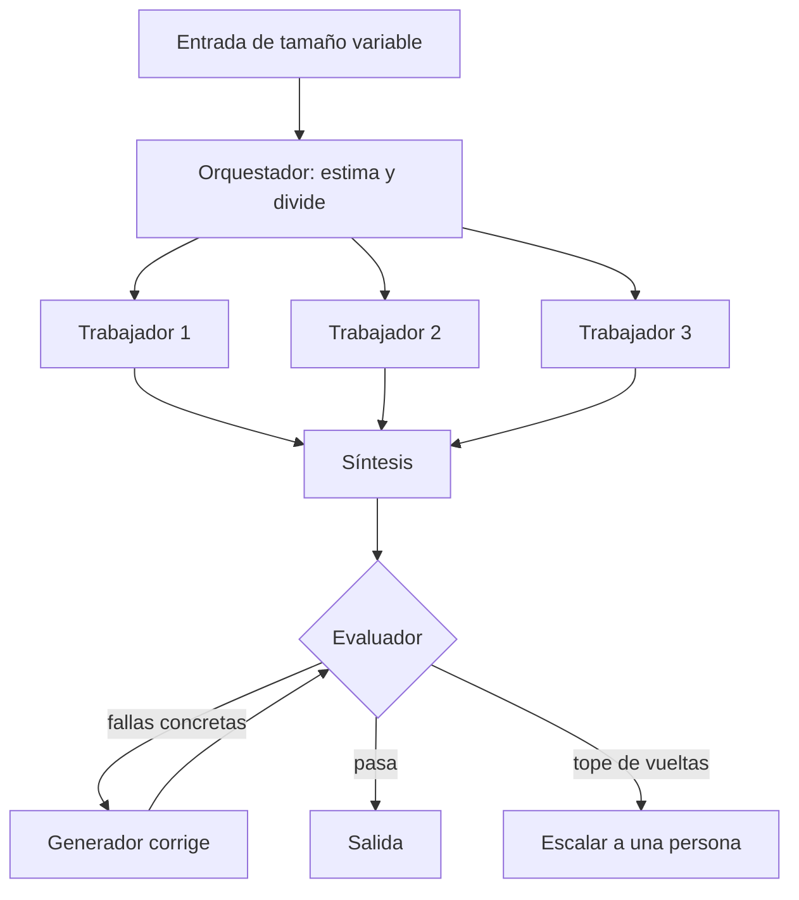
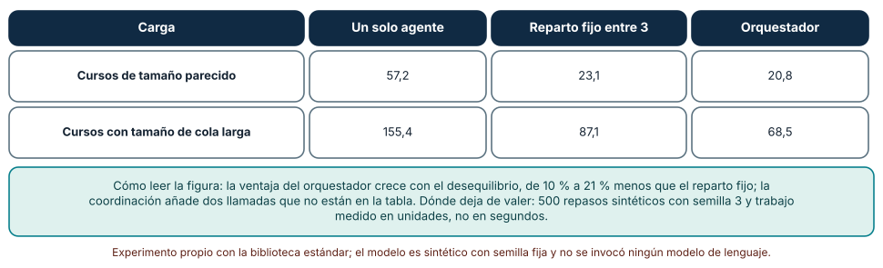
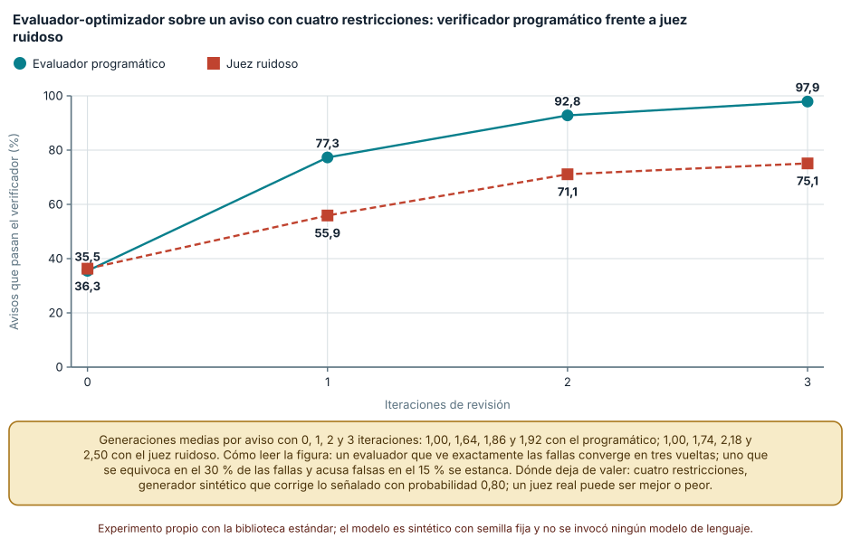

# SE-507 — Orquestador-trabajadores y evaluador-optimizador

[← SE-506 — Encadenado, enrutamiento y paralelización](https://github.com/vladimiracunadev-create/modern-software-engineering-program/blob/main/classes/part-42-patrones-agenticos-y-sistemas-con-llm/se-506-encadenado-enrutamiento-y-paralelizacion/README.md) · [↑ Parte 42](https://github.com/vladimiracunadev-create/modern-software-engineering-program/blob/main/classes/part-42-patrones-agenticos-y-sistemas-con-llm/README.md) · [📚 Índice completo](https://github.com/vladimiracunadev-create/modern-software-engineering-program/blob/main/classes/README.md) · [🌐 Portal](https://vladimiracunadev-create.github.io/modern-software-engineering-program/classes/SE-507.html) · [SE-508 — ReAct, plan-and-execute y reflexión →](https://github.com/vladimiracunadev-create/modern-software-engineering-program/blob/main/classes/part-42-patrones-agenticos-y-sistemas-con-llm/se-508-react-plan-and-execute-y-reflexion/README.md)

## Punto profesional y fundamento pedagógico

**Punto profesional.** La clase existe para que sepas cuándo un sistema necesita que un componente **decida en tiempo de ejecución cómo dividir el trabajo** (orquestador-trabajadores) y cuándo la calidad se consigue **iterando contra un criterio** (evaluador-optimizador). Son los dos patrones de workflow que rozan la autonomía de un agente sin entregarla del todo: el código sigue fijando la estructura (un orquestador, unos trabajadores, un bucle con tope) y el modelo decide el contenido. Quien los entiende sabe que su valor depende de dos cosas medibles: la variabilidad real del trabajo y la calidad del evaluador.

**Por qué aparece aquí.** Sigue a `SE-506`, donde las subtareas estaban fijadas de antemano. Aquí el número y el tamaño de las subtareas dependen de la entrada, y la salida de un paso se revisa y se rehace. Recoge la idea de puerta de `SE-506` y la lleva a su límite: una puerta que devuelve **qué falló** en lugar de solo «falló».

**Error conceptual que debe corregir.** Creer que «un modelo que revisa a otro» mejora la calidad por sí solo. El evaluador-optimizador mejora el resultado cuando el evaluador **detecta fallas reales** y el generador **sabe corregirlas**. Si el evaluador es otro modelo con errores propios, el bucle puede estancarse e incluso empeorar, porque «corrige» lo que estaba bien. Y la creencia gemela: que más trabajadores significa menos tiempo. Con trabajo muy desigual, el tiempo lo fija el trabajador más cargado, y un reparto mal hecho lo desperdicia.

**Secuencia de aprendizaje.** Antes de ejecutar predices el tiempo de un repaso de entregas con un agente, con reparto fijo y con orquestador en dos tipos de carga, y el éxito de un aviso con cuatro restricciones tras 0, 1, 2 y 3 iteraciones con un evaluador programático y con un juez ruidoso. Después ejecutas y comparas.

**Evidencia de aprendizaje.** `iterar-log.md` con tus predicciones, las dos tablas medidas, un verificador programático para un artefacto de tu sistema (con al menos tres restricciones) y la condición de parada del bucle.

**Límite de la conclusión.** El reparto se simula con tamaños de curso sintéticos (uniformes y de cola larga) y la ventaja del orquestador no incluye el costo de sus dos llamadas de coordinación; el generador del aviso es sintético y corrige lo señalado con probabilidad 0,80; el juez ruidoso detecta el 70 % de las fallas y acusa en falso el 15 %. No se invocó ningún modelo real.

### Trazabilidad fuente → afirmación

| Fuente primaria u oficial | Afirmación que respalda | Lo que no prueba |
|---|---|---|
| [Anthropic, «Building effective agents»](https://www.anthropic.com/engineering/building-effective-agents) | Describe el orquestador que descompone dinámicamente el trabajo y delega en trabajadores, y el evaluador-optimizador donde un modelo genera y otro evalúa en bucle. | No fija cuándo conviene cada uno ni cuánto mejora. |
| [Anthropic, «How we built our multi-agent research system»](https://www.anthropic.com/engineering/multi-agent-research-system) | Narra un orquestador con subagentes en paralelo y reconoce el costo en tokens y la dificultad de coordinar. | Es un sistema concreto de investigación, no un caso general. |
| [Madaan et al., «Self-Refine»](https://arxiv.org/abs/2303.17651) | Estudia el refinamiento iterativo donde un modelo genera, se critica y mejora. | Sus tareas y modelos no son los de tu sistema. |
| [Zheng et al., «Judging LLM-as-a-Judge»](https://arxiv.org/abs/2306.05685) | Documenta sesgos y límites de usar un modelo como evaluador. | No mide tu juez. |

## Antes de empezar

Recupera `SE-506`: una puerta es una comprobación independiente con una acción al fallar. La pregunta activa es: **la última vez que revisaste un trabajo ajeno, ¿tu revisión señalaba qué estaba mal de forma que se pudiera corregir, o solo decía «no me convence»?**

## Prerrequisitos

- Haber completado `SE-506` o poder explicar la puerta programática y el costo de un reintento.
- Conocer de `SE-505` la diferencia entre workflow y agente.
- Python 3.11 o posterior con la biblioteca estándar.

## Problema auténtico

*Avisos* debe preparar cada semana un repaso de entregas de entre 4 y 12 cursos, y los cursos son muy desiguales: unos tienen cinco entregas y otros doscientas. Un agente que recorre los cursos uno a uno es lento y su contexto se llena. Un reparto fijo («cursos 1, 4, 7 al trabajador A») deja a un trabajador con tres cursos enormes mientras otro termina pronto. Se necesita un componente que, **mirando la entrada**, decida cuántos trabajadores usar y qué reparto hacer.

Además, el sistema redacta avisos con cuatro restricciones: máximo 160 caracteres, mencionar el curso, incluir la fecha de vencimiento en formato ISO y no usar tono alarmista. El primer borrador del generador cumple las cuatro solo el 35,5 % de las veces. Hay que decidir si un bucle de revisión lo arregla, con qué evaluador y cuántas vueltas.

## Objetivos observables

Al terminar podrás:

1. distinguir un orquestador-trabajadores de una paralelización fija por quién decide la división;
2. calcular el tiempo de reloj de un reparto y justificar un reparto que empieza por lo más grande;
3. escribir un verificador programático que devuelva las fallas concretas de un artefacto;
4. medir la convergencia de un bucle generar-evaluar-corregir con un evaluador exacto y con uno ruidoso;
5. decidir la condición de parada del bucle y la acción al agotarla.

## Mapa conceptual



El mapa muestra los dos patrones encadenados: el orquestador reparte y la síntesis pasa por un evaluador que devuelve fallas al generador hasta pasar o llegar al tope.

## Temas y por qué importan

| Tema | Por qué cambia una decisión profesional | Evidencia mínima |
|---|---|---|
| División dinámica | El número de subtareas depende de la entrada. | Tiempo con reparto fijo y con orquestador |
| Reparto desigual | El tiempo lo fija el trabajador más cargado. | Carga uniforme frente a de cola larga |
| Aislamiento de contexto | Cada trabajador ve solo su parte. | Tamaño de contexto por trabajador |
| Evaluador exacto | Devuelve fallas que el generador sabe corregir. | Éxito por iteración |
| Evaluador ruidoso | Puede estancar o empeorar el bucle. | Éxito con juez ruidoso |
| Parada y escalado | Un bucle sin tope no termina. | Condición de parada escrita |

## Conceptos y decisiones

### 1. Orquestador: dividir después de ver la entrada

En una paralelización (`SE-506`) las subtareas se conocen de antemano. En un **orquestador-trabajadores**, un modelo (o una regla) inspecciona la entrada, decide en cuántas partes dividirla, asigna cada una a un trabajador y luego sintetiza los resultados. La documentación de Anthropic lo recomienda cuando no se pueden predecir las subtareas, y pone el ejemplo de cambios de código que tocan un número variable de archivos. Lo que hace especial al patrón es la **decisión de división en tiempo de ejecución**; el resto (trabajadores, síntesis) es infraestructura. Su costo mínimo son dos llamadas: la que divide y la que sintetiza.

### 2. Repartir: por qué empezar por lo más grande

El tiempo de reloj de un reparto entre *k* trabajadores es la carga del más cargado. Un reparto fijo («el curso *i* va al trabajador *i* mod 3») ignora los tamaños. Un orquestador que conoce o estima los tamaños puede aplicar la regla voraz «asigna el trabajo más grande aún sin asignar al trabajador menos cargado» (la heurística LPT). En 500 repasos simulados de cursos de tamaño parecido, un solo agente tarda 57,2 unidades, el reparto fijo entre tres 23,1 y el orquestador 20,8. Con cursos de cola larga, 155,4, 87,1 y 68,5. La ventaja del orquestador sobre el reparto fijo crece del 10 % al 21 % con el desequilibrio. Cuando todo es parecido, la ganancia es pequeña y no compensa las dos llamadas de coordinación.



**Cómo leer la figura.** Cada grupo es un tipo de carga y las barras son un solo agente (coral), el reparto fijo entre tres (dorada) y el orquestador (verde azulada). Mira que el orquestador es la barra más baja en los dos grupos y que su ventaja sobre el reparto fijo crece con el desequilibrio; lo deseable es la barra más baja, teniendo en cuenta que añade dos llamadas. **Dónde deja de valer:** 500 repasos sintéticos con semilla 3, trabajo medido en unidades y tamaños conocidos por el orquestador; en la práctica el tamaño se estima y un error de estimación degrada el reparto.

### 3. Contexto aislado: el otro beneficio

Un agente único que revisa doce cursos acumula en su contexto las observaciones de todos, y cada paso relee ese historial (`SE-505`). Con trabajadores, cada uno ve solo su curso y devuelve un resumen estructurado; la síntesis lee resúmenes, no historiales. El beneficio no es solo de tiempo: es de costo y de calidad, porque el contexto largo degrada la atención del modelo sobre lo que importa (hay evidencia de que los modelos usan peor la información en el medio de contextos largos, como muestra «Lost in the Middle»). El precio es que los trabajadores no se ven entre sí: si un hallazgo del curso 3 afecta al 7, la síntesis debe reconocerlo.

### 4. Evaluador-optimizador: una puerta que explica

El patrón añade un bucle: un generador produce, un evaluador revisa y devuelve **qué falló**, y el generador corrige. Es una puerta (`SE-506`) con retroalimentación. Funciona cuando hay un criterio de evaluación claro y la iteración mejora el resultado. En el experimento, el aviso tiene cuatro restricciones comprobables y el generador sintético corrige cada falla señalada con probabilidad 0,80 y estropea con 0,03 lo que estaba bien. Sin revisión, pasan el 35,5 %. Con un evaluador **programático** que ve exactamente las fallas, una vuelta lleva al 77,3 %, dos al 92,8 % y tres al 97,9 %, con 1,92 generaciones por aviso. El rendimiento marginal decrece: cada vuelta corrige una fracción de lo que queda.

### 5. Cuando el evaluador se equivoca

Con un **juez ruidoso** que detecta el 70 % de las fallas reales y acusa en falso el 15 % de las restricciones correctas, el bucle mejora más despacio: 55,9 % tras una vuelta, 71,1 % tras dos y 75,1 % tras tres, con 2,50 generaciones. Se estanca por dos mecanismos: las fallas no detectadas no se corrigen y las falsas alarmas **piden cambiar lo que estaba bien**, con un 10 % de probabilidad de estropearlo. Es un resultado general: un evaluador es una fuente de verdad solo en la medida de su acierto. Por eso, cuando el criterio se puede programar (longitud, presencia de un dato, formato), el evaluador debe ser código; el modelo juez se reserva para lo que no se puede programar (tono, claridad) y se calibra con casos etiquetados.

### 6. Parada, tope y escalado

Un bucle de revisión necesita una condición de parada que no dependa de que el modelo se declare satisfecho: pasa el verificador, o se llega al tope de vueltas (aquí 3), o el costo acumulado supera el presupuesto. Al agotarse sin pasar, la acción correcta es **escalar** con el último borrador y las fallas pendientes, no entregar el borrador. También conviene registrar qué restricción falla más a menudo: si es siempre la misma, el defecto está en el prompt del generador y no en la falta de iteraciones.



**Cómo leer la figura.** El eje horizontal son las iteraciones de revisión y el vertical el porcentaje de avisos que pasa el verificador; la línea verde azulada es el evaluador programático y la coral, el juez ruidoso. Mira que las dos parten del mismo punto, que la verde azulada converge en tres vueltas y que la coral se estanca: un evaluador que se equivoca no se corrige con más vueltas. **Dónde deja de valer:** cuatro restricciones, un generador sintético y un juez con acierto fijo; un juez real puede ser mejor en tono y peor en datos, y su acierto hay que medirlo con casos etiquetados.

## Quién decide qué

El esquema que une los dos patrones deja clara la responsabilidad de cada pieza. El código fija la estructura y los topes. El orquestador decide la división. Los trabajadores resuelven. La síntesis reúne. El evaluador, preferiblemente programático, devuelve fallas concretas. Y la persona recibe lo que el sistema no pudo cerrar.


**Cómo leer la figura.** La primera fila reparte y la segunda cierra: lo importante es que la decisión de cuántas subtareas hay recae en el orquestador y la de «está bien» en el evaluador. **Dónde deja de valer:** si el número de subtareas se conoce antes de ver la entrada, es una paralelización y el orquestador sobra; si el criterio no se puede evaluar de forma fiable, el bucle de revisión no aporta.

## Definiciones de trabajo

- **Orquestador:** componente que divide el trabajo según la entrada y lo asigna a trabajadores.
- **Trabajador:** componente con contexto y herramientas mínimas que resuelve una subtarea.
- **Síntesis:** paso que reúne los resultados de los trabajadores.
- **Evaluador:** componente que juzga un resultado y devuelve las fallas concretas.
- **Tope de vueltas:** número máximo de iteraciones del bucle de revisión.
- **LPT:** regla voraz de reparto que asigna primero las tareas más grandes.

## Ejemplo mínimo

Un verificador que devuelve fallas concretas para el aviso de *Avisos*:

```python
import re

def verificar_aviso(texto: str, curso: str, vence: str) -> set[str]:
    fallas = set()
    if len(texto) > 160:
        fallas.add("longitud")
    if curso not in texto:
        fallas.add("curso")
    if vence not in texto or not re.search(r"\b\d{4}-\d{2}-\d{2}\b", texto):
        fallas.add("fecha")
    if re.search(r"(?i)\burgente\b|!!", texto):
        fallas.add("tono")
    return fallas
```

Cada falla es una etiqueta que el generador puede usar como instrucción: «corrige solo `fecha` y `tono` y no cambies el resto».

## Ejemplo profesional

*Escenario ilustrativo: las cifras de este ejemplo son supuestos de la narración, no mediciones.*

El equipo implementa el repaso semanal con un orquestador que lee la lista de cursos con su número de entregas y decide los grupos: los tres cursos más grandes van cada uno a un trabajador y el resto se agrupa. Cada trabajador usa tres herramientas de solo lectura y devuelve un JSON con pendientes, vencidos y anomalías. La síntesis redacta el informe y el verificador comprueba que cada curso aparezca una vez y que los totales coincidan con la suma de los JSON. Si falla, el generador de la síntesis recibe las fallas exactas y rehace; con tres intentos sin pasar, el informe se envía a una persona marcado como «incompleto» con la lista de cursos que no cuadran. El equipo mide semanalmente el tiempo de reloj, las vueltas por informe y el porcentaje que escala.

## Práctica guiada

1. Predice los tiempos de las dos cargas y el éxito del aviso tras tres vueltas con cada evaluador.
2. Ejecuta `python scripts/experiments_part42_a.py 507` y compara con tu predicción.
3. Cambia el número de trabajadores de 3 a 2 y a 6 en `exp507` y anota cuándo deja de compensar.
4. Sube la probabilidad de acusación en falso del juez de 0,15 a 0,30: ¿el bucle empeora con las vueltas?
5. Escribe un verificador para un artefacto de tu sistema con tres restricciones y una prueba por restricción.

## Ejercicios

1. **Básico.** Explica por qué un reparto «un curso por trabajador» puede ser peor que uno fijo de tres trabajadores.
2. **Intermedio.** Calcula el tiempo con LPT de cursos de tamaños 40, 30, 20, 10, 5 y 5 entre tres trabajadores y compáralo con el reparto por turnos.
3. **Avanzado.** Diseña la política de un bucle de revisión donde parte del criterio es programable (formato) y parte no (claridad): qué evalúa el código, qué evalúa el juez, y cómo medirías el acuerdo del juez con personas.

## Reto verificable

Entrega `iterar-log.md` con las dos tablas, un verificador programático con sus pruebas, el tope de vueltas con su acción al agotarlo y un argumento de si tu sistema necesita un orquestador o le basta una paralelización fija. Es válido si otra persona reproduce las tablas con la misma semilla y la decisión sobre el orquestador se apoya en la variabilidad medida de tu carga.

## Caso conductor

El repaso semanal de entregas de *Avisos* se vuelve orquestador-trabajadores y la redacción de los avisos, evaluador-optimizador con verificador. En `SE-508` se estudiará el bucle del agente que sigue cuando el trabajo no se puede dividir de antemano y, en `SE-513`, cómo se evalúan estos componentes con puertas estadísticas.

## Preguntas frecuentes

### ¿Es lo mismo un orquestador que un agente con subagentes?

Estructuralmente se parecen. La diferencia es de control: en el orquestador-trabajadores el código fija los topes, las herramientas y la síntesis; en un sistema multiagente abierto cada agente decide sus propias acciones y se comunican entre sí. Más autonomía implica más costo y menos revisabilidad.

### ¿El evaluador puede ser el mismo modelo que el generador?

Puede, pero comparte sus sesgos y errores. Con restricciones programables conviene código; para lo demás, un modelo distinto o una persona sobre una muestra.

### ¿Cuántas vueltas son suficientes?

Las que reduzcan el costo esperado de un error. En el experimento, la tercera vuelta añade 5 puntos y la primera 42; si cada generación cuesta, el tope se fija donde el rendimiento marginal no paga la llamada.

### ¿Qué pasa si los trabajadores se contradicen?

La síntesis debe tener una regla: prevalece el dato de la fuente de verdad o se escala el conflicto. Resolver la contradicción con otra llamada sin una regla traslada el problema.

## Fallo controlado y diagnóstico

**Fallo.** El bucle de revisión de avisos tarda más y más cada semana y el 20 % de los avisos termina con tono alarmista aunque pasan «la revisión».

**Diagnóstico paso a paso.** (1) Se mide el número de vueltas por aviso: sube de 1,6 a 3,4. (2) Se revisa el evaluador: es un modelo juez que acepta «URGENTE» si la fecha es correcta. (3) Se compara con el verificador programático: detecta el tono en el 100 % de los casos. (4) Se identifica que el juez deja pasar lo que debía corregir y que ordena cambios en lo que estaba bien, de modo que el generador oscila.

**Corrección.** Se sustituye el juez por el verificador en las tres restricciones programables y se deja el juez solo para claridad, con un conjunto de 50 avisos etiquetados para medir su acuerdo con personas. Se fija el tope en tres y la acción de escalado.

## Errores comunes y cómo corregirlos

- **Orquestador para trabajo fijo.** Síntoma: dos llamadas de más sin beneficio. Causa: las subtareas se conocían. Solución: paralelización fija.
- **Reparto por turnos con carga desigual.** Síntoma: un trabajador tarda el triple. Causa: no se mira el tamaño. Solución: asigna primero lo más grande.
- **Evaluador que devuelve «malo» sin más.** Síntoma: el generador cambia al azar. Causa: sin fallas concretas. Solución: etiquetas de falla verificables.
- **Bucle sin tope.** Síntoma: costos que crecen sin límite. Causa: se espera a que «mejore». Solución: tope de vueltas y presupuesto con escalado.
- **Juez sin calibrar.** Síntoma: el bucle se estanca o empeora. Causa: acierto desconocido. Solución: mídelo con casos etiquetados antes de confiar.

## Entorno y archivos clave

- `scripts/experiments_part42_a.py`: función `exp507` con el reparto de carga y el bucle del aviso; `python scripts/experiments_part42_a.py 507`.
- `scripts/experiments_part42_lab.py`: utilidades comunes.
- `content/part-42/figures/`: figuras de la clase.
- Entorno: CPython 3.11 o posterior, biblioteca estándar, semillas fijas.

## Seguridad, ética y accesibilidad

Los trabajadores deben recibir solo las herramientas y los datos de su parte: es el principio de mínimo privilegio aplicado a subagentes, y evita que un contenido hostil en un curso alcance herramientas de otro (`SE-514`). Ética: un bucle que «pule» un aviso hasta que suena convincente no mejora su verdad; el verificador de datos debe pasar antes que cualquier criterio de estilo. Privacidad: los resúmenes que viajan entre trabajador y síntesis no deben incluir más datos personales de los necesarios. Accesibilidad: las figuras son tablas y un diagrama con alternativa textual.

## Puente hacia el trabajo con agentes

Un agente de programación que implementa un reparto tiende a asignar por turnos y a usar el mismo modelo para generar y evaluar. La instrucción de repositorio es doble: «reparte primero lo más grande y muestra los tamaños que usaste» y «el evaluador devuelve etiquetas de falla verificables; si el criterio se puede programar, prográmalo». La comprobación mecánica: una prueba que inyecta un artefacto con una sola falla debe producir exactamente esa etiqueta y el bucle debe corregir solo eso.

## Transferencia

Toma una tarea de tu sistema que se reparta entre varias partes y mide, con datos reales o una muestra, la variabilidad del tamaño de las partes. Calcula el tiempo con reparto fijo y con LPT. Para un artefacto que generes (un correo, un informe, un fragmento de código), escribe un verificador de al menos tres restricciones y mide cuántos borradores del generador lo pasan sin revisión.

## Evaluación y evidencia

| Criterio | Evidencia aceptable | Rechazo |
|---|---|---|
| Variabilidad | Tamaños de las partes medidos | «Son parecidas» |
| Reparto | Tiempo con reparto fijo y con LPT | Solo la descripción |
| Verificador | Código con pruebas por restricción | «El modelo revisa» |
| Convergencia | Éxito por vuelta con evaluador exacto y ruidoso | Solo el resultado final |
| Parada | Tope, presupuesto y acción al agotar | Sin tope |
| Límite | Dice que generador y juez son sintéticos | Presenta una tasa real |

## Fuentes

- Anthropic. [«Building effective agents»](https://www.anthropic.com/engineering/building-effective-agents).
- Anthropic. [«How we built our multi-agent research system»](https://www.anthropic.com/engineering/multi-agent-research-system).
- Madaan, A. et al. [«Self-Refine: Iterative Refinement with Self-Feedback»](https://arxiv.org/abs/2303.17651).
- Zheng, L. et al. [«Judging LLM-as-a-Judge with MT-Bench and Chatbot Arena»](https://arxiv.org/abs/2306.05685).
- Liu, N. F. et al. [«Lost in the Middle: How Language Models Use Long Contexts»](https://arxiv.org/abs/2307.03172).

## Límites y siguiente paso

Los tamaños de los cursos son sintéticos y el orquestador conoce los tamaños exactos; el generador y el juez son componentes con probabilidades declaradas; no se midió ningún modelo de lenguaje ni ningún sistema multiagente real. El siguiente paso, `SE-508`, trata el caso en que ni siquiera la división se puede fijar: el bucle del agente, con ReAct, plan-and-execute y reflexión.

## Glosario

| Término | Definición breve |
|---|---|
| Orquestador | Componente que divide el trabajo según la entrada |
| Trabajador | Componente con contexto mínimo que resuelve una parte |
| Síntesis | Paso que reúne los resultados de los trabajadores |
| Evaluador | Componente que juzga y devuelve fallas concretas |
| Tope de vueltas | Máximo de iteraciones del bucle de revisión |
| LPT | Regla voraz que reparte primero lo más grande |
